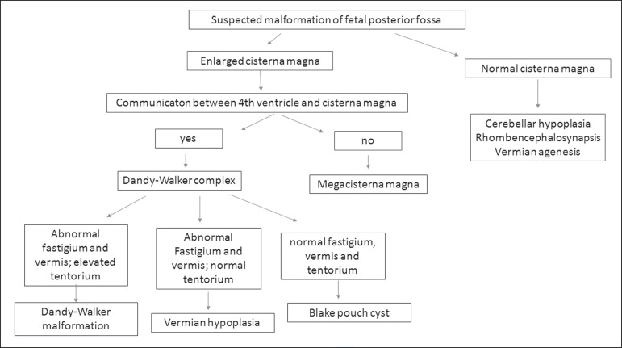
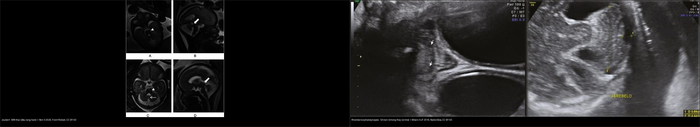
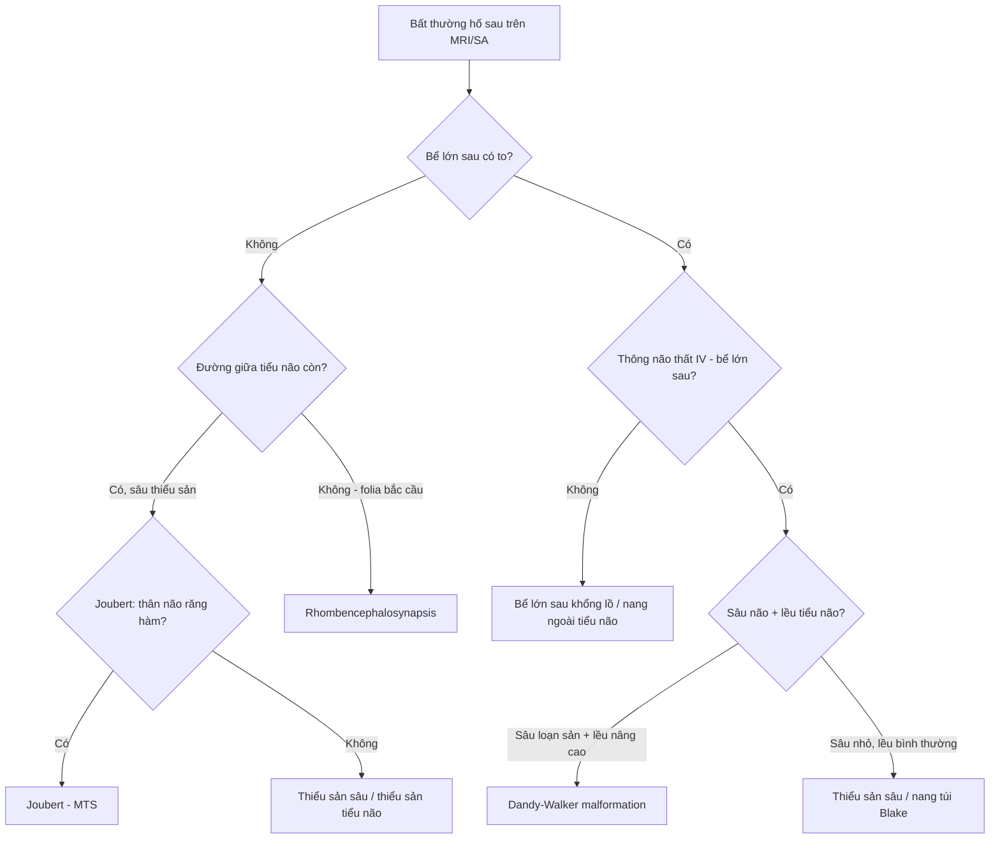
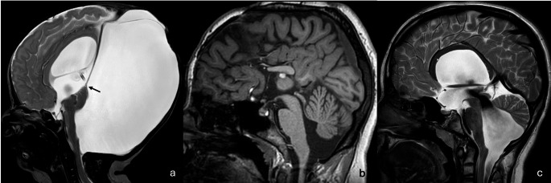
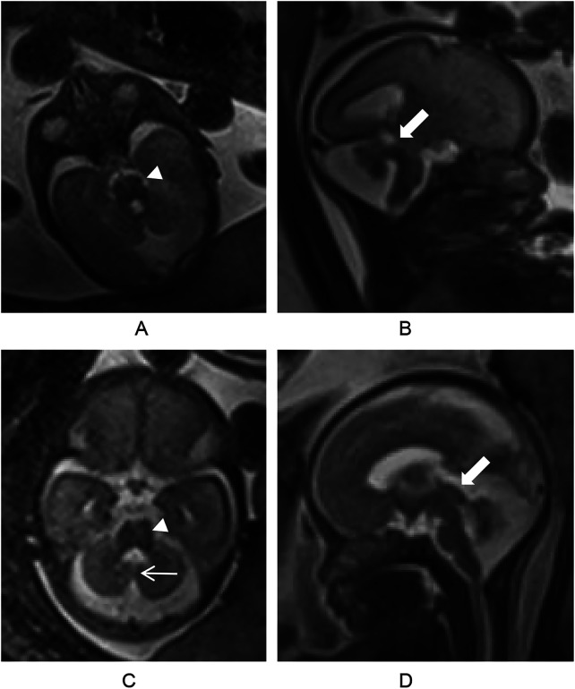
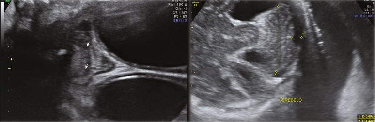
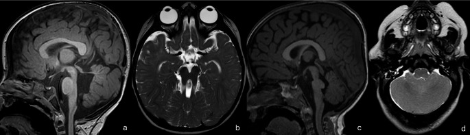

# 657 — Dị tật hố sau: Joubert (dấu răng hàm) & rhombencephalosynapsis / Posterior fossa malformations

**Tags:** `pattern:di-dang-ho-sau` `pattern:rang-ham` `pattern:thieu-san-vermis` `vung:tieu-nao` `vung:nao-nhi` `protocol:MRI-nao-nhi`
**Mức chắc chắn (certainty):** tổng hợp y văn (literature synthesis) — tổng hợp từ bài tổng quan hình ảnh–di truyền hố sau + ca thai CC BY, chưa phải ca nguyên văn đơn lẻ.

## 1. Tổng quan bệnh học – cơ chế hình ảnh

### 1.1 Phôi thai học — vì sao "răng hàm" lại là dấu hiệu chốt

- **Não sau (rhombencephalon)** chia thành **thể não giữa (metencephalon = cầu não + tiểu não)** và **thể não sau (myelencephalon = hành não)**. Tiểu não/hạch thần kinh phát sinh từ **mào tiểu não (rhombic lip)**, dưới sự điều khiển của **vùng tổ chức đồi-thể não giữa (midbrain-hindbrain junction / isthmic organizer)**, vào khoảng **tuần 5–7 thai kỳ**. Sự cố trong cửa sổ này sinh ra nhóm dị tật "đồi–hố sau" (midbrain–hindbrain malformations).
- **Dấu răng hàm (molar tooth sign — MTS)** là hệ quả hình ảnh của 3 khiếm khuyết phối hợp, đọc trên **lát cắt trục (axial) qua ngã ba đồi–cầu (pontomesencephalic junction)**:
  1. **Cuống tiểu não trên (superior cerebellar peduncle — SCP) dày, dài và nằm NGANG** (bình thường SCP chạy dọc, hội tụ lên trên theo hình chữ V). TẠI SAO: trong bệnh lý tiểu não–ciliopathy, các sợi SCP **không bắt chéo được như bình thường** nên đổi hướng thành nằm ngang và dày lên trên T2 → tạo "hai chân răng".
  2. **Hố liên cuống (interpeduncular fossa) sâu** → tạo "khe giữa răng".
  3. **Thiểu sản/loạn sản sâu tiểu não (vermian hypoplasia/dysplasia)** → tạo "thân răng".
  Ba yếu tố này ghép lại cho hình chiếc **răng hàm (molar tooth)** trên mặt cắt trục.
- **Joubert syndrome (JS) và bệnh cảnh liên quan (JSRD)** là **bệnh lông mao (ciliopathy) di truyền lặn nhiễm sắc thể thường**, do khiếm khuyết **lông mao sơ cấp / vận chuyển trong lông mao (intraflagellar transport)**. Đây là nhóm rối loạn đa cơ quan (não–mắt–thận–gan–xương). Tần suất ước tính **~1/80.000–1/100.000** (Orphanet). Hơn **40 gen** đã biết; thường gặp **AHI1, CEP290, CC2D2A, TMEM67, NPHP1, RPGRIP1L**.
- **Rhombencephalosynapsis (RES)** là **hợp nhất hoàn toàn (hiếm khi từng phần) hai bán cầu tiểu não + nhân răng (dentate nuclei) + cuống tiểu não trên**, kèm **bất sản sâu tiểu não** → hình ảnh "tiểu não hợp nhất" ở đường giữa. TẠI SAO: hỏng bước tạo rãnh giữa/đường giữa tiểu não. Thường **lẻ tẻ (sporadic)**, đa số chẩn đoán ở trẻ nhỏ; có thể kèm **giãn não thất (hydrocephalus)** và triệu chứng tiểu não muộn.

### 1.2 Ngưỡng định lượng & mốc đọc chuẩn

- **MTS đọc trên lát axial T2 (hoặc bất kỳ chuỗi) tại ngã ba đồi–cầu** — mô tả định tính (SCP dày/ngang + hố liên cuống sâu + thiểu sản sâu não). Không có ngưỡng mm chính thức; đối chiếu cấu trúc giải phẫu.
- **Sâu tiểu não (vermis)**: ở thai, sâu khép kín đường giữa **khoảng tuần 18** — trước mốc này **không được kết luận thiểu sản sâu** trên siêu âm/MRI thai (nguy cơ dương tính giả rất cao).
- **Joubert**: liệt vận nhãn (oculomotor apraxia) gặp ở **~80%** (dấu lâm sàng gợi ý mạnh); **loạn dưỡng võng mạc (retinal dystrophy)** ở nhóm JS type B **~20–30%** → cần soi đáy mắt + ERG.
- **Rhombencephalosynapsis**: chẩn đoán dựa vào **folia tiểu não liên tục qua đường giữa, không thấy sâu tiểu não** (siêu âm thai coronal hoặc MRI axial). Đường kính ngang tiểu não có thể **bình thường hoặc dưới bách phân vị 10 (10th percentile)** và tiểu não **hình tam giác** trên lát trục.

## 2. Mẫu hình + chẩn đoán phân biệt theo vị trí (gamut)

Hai câu hỏi định hướng mọi bất thường hố sau (theo lưu đồ Milani 2019):
**(1) Bể lớn sau (cisterna magna) có to không? (2) Có thông giữa não thất IV và bể lớn sau không?**

- **Bể lớn sau to + CÓ thông IV ↔ bể lớn sau** → **phức hợp Dandy-Walker**: dị tật Dandy-Walker (sâu loạn sản + xoay lên trên + lều tiểu não nâng cao / đảo dấu torcula–lambda), **thiểu sản sâu tiểu não (vermian hypoplasia)**, **nang túi Blake (Blake pouch cyst)**.
- **Bể lớn sau to + KHÔNG thông** → **bể lớn sau khổng lồ (megacisterna magna)** — thường là biến thể/khối nang ngoài tiểu não.
- **Bể lớn sau bình thường** → **thiểu sản tiểu não (cerebellar hypoplasia)**, **rhombencephalosynapsis**, **bất sản sâu tiểu não (vermian agenesis)**.
- **Bất thường ngã ba đồi–cầu (midbrain–hindbrain junction)** → **Joubert syndrome (MTS)**; các bắt chước (mimic): **hội chứng Poretti-Boltshauser (đột biến LAMA1)** — MTS giống răng hàm + nang vỏ tiểu não + bất thường mắt; **loạn sản trần tegmentum (tegmental cap dysplasia)** — gồ tiết tegmentum cầu; **"răng hàm mini" (mini molar tooth)** trong loạn dưỡng chất trắng giảm myelin do **POLR3B**.
- **Nhóm kèm biểu hiện mắt–cột sống**: bất thường tiểu não/hố sau có thể đi kèm **bất thường mắt** (loạn dưỡng võng mạc, coloboma, dị tật nhãn cầu như trong Poretti-Boltshauser) và **bất thường đốt sống/cột sống**. Cần nhớ các hội chứng kèm: **Gomez-López-Hernández** (hói đỉnh đầu + mất cảm giác thần kinh sinh ba + bất thường sọ mặt) và **phổ VACTERL** (dị tật **Đốt sống** Vertebral, hậu môn Anal, tim Cardiac, khí–thực quản Tracheo-Esophageal, thận Renal, chi Limb) — cả hai đều có thể kèm rhombencephalosynapsis. → Khi thấy bất thường hố sau, phải **quét mắt (đáy mắt) và cột sống**.

*Lưu đồ phân biệt bất thường hố sau: bể lớn sau to + có/không thông não thất IV → phức hợp Dandy-Walker / nang túi Blake / bể lớn sau khổng lồ; bể lớn sau bình thường → thiểu sản tiểu não, rhombencephalosynapsis, bất sản sâu tiểu não. Nguồn: Milani HJF et al., Radiol Bras 2019, CC BY 4.0.*

## 3. Bảng so sánh phân biệt (ma trận đối chiếu)

| Thực thể (entity) | Hình ảnh điển hình | Chốt vào (rule-in) | Chốt loại (rule-out) | Gợi ý xác nhận |
|---|---|---|---|---|
| **Joubert (MTS)** | Axial T2 ngã ba đồi–cầu: **SCP dày, nằm ngang + hố liên cuống sâu + thiểu sản sâu não**; sagittal: sâu não nhỏ, não thất IV giãn | **Hình "răng hàm" trên axial + liệt vận nhãn/giảm trương lực + thở bất thường** | SCP bình thường (hướng dọc) → loại MTS | MRI axial T2 lát mỏng qua ngã ba; soi đáy mắt/ERG (loạn dưỡng võng mạc ~20–30%), siêu âm thận, men gan |
| **Rhombencephalosynapsis** | **Folia liên tục qua đường giữa, KHÔNG có sâu tiểu não**; hai nhân răng hợp nhất; tiểu não hình tam giác trên trục | **Folia bắc cầu đường giữa + mất sâu não** ở MỌI lát | Có sâu não/một khe giữa rõ → không phải RES | MRI axial T2 + coronal; tìm Gomez-López-Hernández (hói đỉnh, mất cảm giác mặt), dị tật đốt sống (VACTERL) |
| **Dandy-Walker (DWM)** | Sâu não **thiểu sản + xoay lên trên**, não thất IV **dạng nang thông với bể lớn sau**, hố sau to + **đảo torcula–lambda** | **Não thất IV dạng nang + thông bể lớn sau + lều nâng cao** | Nếu sâu não bình thường, không nang → loại DWM | MRI sagittal T1/T2; phân biệt nang túi Blake |
| **Thiểu sản sâu (vermian hypoplasia)** | Sâu nhỏ nhưng **lều tiểu não BÌNH THƯỜNG**, không nang lớn; fastigium bất thường | **Sâu nhỏ + lều bình thường** | Sâu bình thường/folia liên tục → loại | Trước 18 tuần **không kết luận** (sâu chưa khép) |
| **Nang túi Blake / bể lớn sau khổng lồ** | Nang sau tiểu não; **fastigium–sâu–lều bình thường**; MCM: bể lớn sau to nhưng sâu bình thường | **Sâu não bình thường + não thất IV không giãn lớn** | Sâu loạn sản + lều nâng → DWM | So tuần tuổi; theo dõi, phần lớn tiên lượng tốt |
| **Poretti-Boltshauser (LAMA1)** | Hố sau bất thường + **MTS GIỐNG** + loạn sản tiểu não có **nang dưới vỏ** + bất thường mắt (nhãn cầu/thị giác) | **MTS "giả" + nang vỏ tiểu não + bất thường mắt** | MTS kinh điển không nang vỏ + không bất thường mắt → Joubert | Miễn dịch/gen LAMA1; soi đáy mắt |
| **Tegmental cap dysplasia** | **Gồ "mũ" ở trần tegmentum cầu**, thân não loạn sản, tiểu não giảm sản/loạn sản | **Gồ trần tegmentum + thân não loạn sản** | MTS chân răng ngang nhưng không gồ trần → Joubert | MRI thân não lát mỏng |
| **Thiểu sản tiểu não (cerebellar hypoplasia)** | Tiểu não nhỏ, **đường kính ngang < BPV10**, bể lớn sau "giả to"; có thể kèm pontine hypoplasia | **ĐK ngang tiểu não < BPV10 + cấu trúc vẫn còn** | Tiểu não bình thường về kích thước → loại | Đo sinh trắc qua MRI thai nhi/sau sinh |

*Trái: **Joubert** — MRI thai (2 ô trên: axial HASTE dấu răng hàm — đầu mũi tên; ô dưới: sagittal hố sau rộng, sâu loạn sản, cuống tiểu não trên dày dài — mũi tên). Phải: **rhombencephalosynapsis** — siêu âm thai: folia liên tục qua đường giữa, không thấy sâu tiểu não (đầu mũi tên); tiểu não hình tam giác. Nguồn: Ren S 2026, Front Pediatr (PMC13041775); Milani HJF 2019, Radiol Bras (PMC7007051) — CC BY 4.0. Ảnh ghép letterbox.*

### Joubert vs rhombencephalosynapsis — nhìn gì trước?
- **Joubert**: hình thái **thân não** bất thường (răng hàm) nhưng **đường giữa tiểu não vẫn có** (sâu não thiểu sản nhưng không bị hợp nhất). **Bể lớn sau bình thường**, không giãn não thất sớm.
- **Rhombencephalosynapsis**: thân não thường **bình thường**, nhưng **đường giữa tiểu não biến mất** (folia bắc cầu). Hay kèm **giãn não thất**.
- **Neo chốt**: bất thường *thân não ngã ba* → Joubert; bất thường *đường giữa tiểu não* → rhombencephalosynapsis.

## 4. Protocol chụp + hệ phân độ / lưu đồ

- **MRI sọ não (không – có cản quang)**: bắt buộc **chuỗi axial T2 lát mỏng (≤ 2–3 mm) qua ngã ba đồi–cầu** để phát hiện MTS; **T1/T2 sagittal** đánh giá sâu tiểu não, não thất IV, lều tiểu não; **FLAIR** (chất trắng), **DWI** nếu nghi nhiễm trùng/chuyển hóa. Nếu liên quan cột sống: **MRI cột sống toàn bộ**.
- **MR Neuroimaging "ciné"**: với nghi ngờ ciliopathy, thêm **MRCP/ siêu âm thận–gan** (nephronophthisis, xơ gan) và **soi đáy mắt + ERG**.
- **Siêu âm thai (cửa sổ hố sau), MRI thai (HASTE/SSFSE)**: đọc **hố sau 3 mặt cắt** (transcerebellar axial, coronal, sagittal). **Không kết luận thiểu sản sâu trước 18 tuần.**
- **Không có RADS riêng** cho nhóm này → dùng **lưu đồ quyết định** (Milani 2019) + hội chẩn di truyền (JSRD nhiều gen, xét nghiệm gen lông mao/array).

## 5. Biến thể bình thường và cạm bẫy

- **Bể lớn sau khổng lồ (megacisterna magna)** là **biến thể/khối nang lành** khi sâu tiểu não và lều tiểu não **bình thường** — đừng gọi oan là Dandy-Walker.
- **Sâu tiểu não chưa khép ở thai < 18 tuần** → **không được** kết luận thiểu sản sâu (cạm bẫy kinh điển của siêu âm/MRI thai sớm). Hẹn khảo sát lại sau 18 tuần.
- **"Răng hàm mini" (mini molar tooth)** trong loạn dưỡng chất trắng giảm myelin **POLR3B** — bắt chước MTS nhưng thiếu loạn dưỡng võng mạc/liệt vận nhãn điển hình và có giảm myelin lan tỏa → **đừng chốt Joubert vội**.
- **MTS "giả" của Poretti-Boltshauser (LAMA1)** kèm **nang vỏ tiểu não + bất thường mắt** — là bắt chước quan trọng, cần xét nghiệm gen.
- **Thỏa mãn tìm kiếm (satisfaction of search)**: thấy bất thường hố sau là xong → **bỏ sót bất thường mắt (coloboma, loạn dưỡng võng mạc) và đốt sống** đi kèm. Luôn quét "mắt–thận–gan–cột sống".
- **Rhombencephalosynapsis thể VACTERL** có thể đi kèm dị tật đốt sống/hậu môn/tim — nếu chỉ báo "dị tật tiểu não" là thiếu.

*(a) Dandy-Walker: sâu thiểu sản xoay lên trên ("dấu đuôi" — mũi tên), hố sau to thông với não thất IV, giãn não thất trên lều. (b) Thiểu sản sâu dưới: sâu dưới nhỏ, góc fastigium nhọn giữ nguyên. (c) Nang túi Blake. Nguồn: AlRayahi J et al., Neuroradiology 2026 (PMC13216138), CC BY 4.0.*

## 6. Tự lượng giá — Blind Quiz

**Ca 1 — Thai đôi, một thai nhi có bất thường hố sau trên MRI thai. Nhìn ảnh trước, mô tả.**

- Gợi ý lâm sàng: MRI thai (HASTE) ở một thai nhi trong thai kỳ đôi, được chụp vì hố sau bất thường trên siêu âm.
- Câu hỏi: Hình dạng thân não ở lát axial (A, C) gợi ý gì? Trên lát sagittal (B, D) thấy gì ở hố sau? 3 chẩn đoán phân biệt và dấu hiệu chốt?

<b>Bấm để hiện đáp án</b>

- Dấu hiệu (findings): lát axial qua ngã ba đồi–cầu cho **"dấu răng hàm" (molar tooth sign — đầu mũi tên/arrowhead)** — cuống tiểu não trên dày nằm ngang + hố liên cuống sâu; lát sagittal cho **hố sau rộng, sâu tiểu não loạn sản, cuống tiểu não trên dày–dài bất thường (mũi tên)**.
- Chẩn đoán (diagnosis): **Joubert syndrome (bệnh lông mao)** — vì MTS phản ánh SCP không bắt chéo được (nằm ngang) + thiểu sản sâu, là dấu hiệu hình ảnh đặc trưng của rối loạn ngã ba đồi–hố sau. → tư vấn di truyền, soi đáy mắt/ERG, siêu âm thận–gan sau sinh.
- Nguồn ảnh: Ren S et al., Front Pediatr 2026 (PMC13041775), CC BY 4.0 — Fig 1.

**Ca 2 — Trẻ có bất thường tiểu não trên siêu âm thai. Nhìn ảnh trước.**

<b>Bấm để hiện đáp án</b>

- Dấu hiệu (findings): **coronal** (trái) — các **folia tiểu não liên tục xuyên qua đường giữa**, **không thấy sâu tiểu não** (đầu mũi tên); **axial** (phải) — tiểu não **hình tam giác**, đường kính ngang bình thường hoặc < BPV10.
- Chẩn đoán (diagnosis): **rhombencephalosynapsis** — vì hai bán cầu tiểu não hợp nhất ở đường giữa, không tạo sâu/ khe giữa. → tìm Gomez-López-Hernández (hói đỉnh, mất cảm giác mặt) và dị tật đốt sống (VACTERL).
- Nguồn ảnh: Milani HJF et al., Radiol Bras 2019 (PMC7007051), CC BY 4.0 — Fig 10.

**Ca 3 — Ảnh ghép: hai bệnh cảnh hố sau khác nhau. Nhìn ngoài, tự phân biệt rồi mở đáp án.**

- Câu hỏi: Ở mỗi bên, bất thường nằm ở **thân não** hay ở **đường giữa tiểu não**? Dấu hiệu nào giúp chốt?

<b>Bấm để hiện đáp án — findings + chẩn đoán</b>

- **Trái = Joubert**: bất thường ở **thân não ngã ba** (dấu răng hàm) + sâu não thiểu sản; đường giữa tiểu não vẫn tồn tại (không hợp nhất).
- **Phải = rhombencephalosynapsis**: thân não bình thường; bất thường ở **đường giữa tiểu não** (folia liên tục, mất sâu não).
- **Neo chốt**: *thân não ngã ba* → Joubert; *đường giữa tiểu não* → rhombencephalosynapsis.
- Nguồn ảnh: ghép từ Ren S 2026 (PMC13041775) + Milani HJF 2019 (PMC7007051), CC BY 4.0; `tools/make_composite.py`.

**Ca 4 — Hình nhiều ô: hố sau và thân não bất thường. Kể tên các thực thể.**

<b>Bấm để hiện đáp án</b>

- (a, b) **Joubert syndrome**: cuống tiểu não trên dày, nằm ngang + thiểu sản sâu não (a); hố liên cuống sâu tạo **"dấu răng hàm" (molar tooth sign)** kinh điển trên axial (b).
- (c) **Tegmental cap dysplasia**: gồ "mũ" ở **trần tegmentum cầu** + thân não loạn sản + tiểu não giảm sản/loạn sản.
- (d) **Rhombencephalosynapsis**: **bất sản sâu tiểu não + hợp nhất hai bán cầu và nhân răng** → hình "tiểu não hợp nhất" đường giữa.
- Nguồn ảnh: AlRayahi J et al., Neuroradiology 2026 (PMC13216138), CC BY 4.0 — Fig 13.

## Bài liên quan chéo
- [600 – Tổng quan Nhi](../600-tong-quan-nhi-khoa/lesson.md)
- [650 – Thần kinh nhi (Papile, u hố sau)](../650-than-kinh-nhi-xuat-huyet-mam-va-u-ho-sau/lesson.md)
- [654 – Tổn thương não sơ sinh KHÔNG do ngạt (DDx HIE)](../654-ton-thuong-nao-so-sinh-khong-do-ngat/lesson.md)
- [655 – HIE sơ sinh & dị tật bẩm sinh TKTW (DWM, Chiari II, bất sản thể chai)](../655-hie-so-sinh-va-di-dang-bam-sinh-than-kinh/lesson.md)
- [656 – Bất thường tủy–cột sống kín ở trẻ](../656-bat-thuong-tuy-cot-song-nhi/lesson.md)
- [218 – Thoát vị não & úng thủy](../218-thoat-vi-nao-ung-thuy/lesson.md)

## Ảnh
- Ảnh tải về + giấy phép từng file: `images/CREDITS.md`. Toàn bộ ảnh trong bài **CC BY 4.0** (cho phép ghép/điều chỉnh, ghi nguồn).
- Ảnh ghép đối chiếu tạo bằng `tools/make_composite.py` (letterbox nền đen, giữ aspect).

> Không dùng để chẩn đoán độc lập khi chưa có người hướng dẫn.
