# 658 — Phổ mắt–tai–cột sống (OAVS/Goldenhar) & dị tật cung mang I–II / Oculo-auriculo-vertebral spectrum & branchial arch anomalies

**Tags:** `pattern:di-dang-bam-sinh` `pattern:khoi-co-bam-sinh` `vung:dau-mat-co` `vung:cot-song-co` `score:OMENS` `score:Jahrsdoerfer` `protocol:CT-thai-duong`
**Mức chắc chắn (certainty):** tổng hợp y văn (literature synthesis) — tổng hợp từ bài tổng quan phôi thai–hội chứng + các ca lâm sàng ảnh CC, chưa phải ca nguyên văn đơn lẻ.

## 1. Tổng quan bệnh học – cơ chế hình ảnh

### 1.1 Vì sao cung mang I–II quyết định "mặt – tai – cổ"

- **Cung hầu (pharyngeal arch / branchial arch)** hình thành tuần **4–8 thai kỳ**. Mỗi cung có: trục sụn, cung động mạch, thần kinh, cơ và **mào thần kinh (neural crest)** di cư vào. **Cung I (hàm)** cho: xương hàm trên/hàm dưới, xương gò má (zygomatic), xương búa–đe, dây V, cơ nhai — sụn trục là **sụn Meckel (Meckel's cartilage)**. **Cung II (móng)** cho: xương bàn đạp, mỏm trâm, xương móng, dây VII, cơ mặt — sụn trục là **sụn Reichert (Reichert's cartilage)**. **Túi (pouch) và khe (cleft)** cung I–II tạo ống tai ngoài (external auditory canal — EAC) và tai giữa.
- **TẠI SAO (cơ chế)**: **Phổ OAVS (oculo-auriculo-vertebral spectrum) / vi mất sản sọ mặt (craniofacial microsomia — CFM)** sinh ra khi thiếu hụt di cư/tăng sinh **mào thần kinh** và mô cung I–II trong cửa sổ trên → **giảm sản nửa mặt (hemifacial microsomia)**, **microtia/ứ mạc tai ngoài**, **dermoid ở mắt** và **bất thường đốt sống**. Ngược lại, hỏng đóng khe/túi để lại **di tích khe mang (branchial cleft remnant)** → **nang/xoang/rò vùng cổ bên**. Đây là **bệnh hình thái** (giải phẫu), nên **CT xương và MRI/CT thái dương** là xương sống chẩn đoán — không dựa vào tín hiệu mô như u.
- **Dermoid ngoài nhãn cầu (epibulbar dermoid) = choristoma** (mô bình thường lạc chỗ) nằm ở **rìa giác mạc (limbus)**, thường kèm lông; khối đặc nông, **không vôi hóa**, **không ngấm mạnh** — khác u.
- **TẠI SAO phân độ dermoid limbus theo độ sâu**: độ sâu quyết định mổ cắt đơn thuần hay **ghép giác mạc lát (lamellar keratoplasty)**.

### 1.2 Ngưỡng định lượng & mốc đọc chuẩn

- **Tần suất CFM**: phổ biến **thứ hai** trong dị tật mặt bẩm sinh (sau sứt môi–vòm miệng), **1/3.500–5.600** trẻ sinh sống (PMC13200892).
- **Bất thường theo hệ (OAVS/Goldenhar)**: dị tật **tai ~80%**; **coloboma mi trên > 75%** số ca có tổn thương mắt; **dermoid/choristoma ngoài nhãn cầu** là dấu hiệu đặc trưng; **bất thường đốt sống ~50%** (PMC13411227).
- **Dermoid limbus (phân độ Mann)**: **độ I** — nông, **< 5 mm**, ở limbus; **độ II** — lan sâu vào mô đệm giác mạc (stroma), có thể tới **màng Descemet** (tổn thương > 5 mm); **độ III** (hiếm) — lan tới Descemet/nội mô. Tần suất chung **1–3/10.000** người (PMC11503224).
- **Ngưng thở khi ngủ do tắc nghẽn (OSA)** ở Goldenhar: **7–67%**; **AHI** (apnea–hypopnea index) phân độ **nhẹ 5–15, vừa 15–30, nặng > 30 sự kiện/giờ** (PMC13411227).
- **Điểm Jahrsdoerfer** (1–10) đánh giá xương thái dương trước tạo hình tai: **thấp = bất lợi**; nhóm nghiên cứu chia **< 5 nặng / 5–8 vừa / > 8 nhẹ** (PMC13607474). Kinh điển lấy **≥ 6–7/10** để cân nhắc mổ (số kinh điển, "cần tra thêm" nếu muốn trích dẫn chính xác).
- **Nang khe mang II** là **hay gặp nhất**: **~67–95%** dị tật cung mang (PMC13341225 nói 67–93%; PMC11986246 nói 85–95%), kích thước thường **1–10 cm** (PMC13341225).

## 2. Mẫu hình + chẩn đoán phân biệt theo vị trí (gamut)

Chia thành **hai mẫu hình** dựa trên câu hỏi đầu tiên:

**(A) "Mặt–tai lệch một bên + mắt có khối ở rìa giác mạc" → ưu thế nhóm OAVS/CFM (cung I–II).**
Theo **OMENS / OMENS+** (Orbital, Mandibular, Ear, Nerve, Soft tissue, ± ngoài sọ): lệch **ổ mắt** (coloboma mi, dermoid), **hàm dưới** (giảm sản), **tai** (microtia), **dây VII** (liệt mặt), **mô mềm**. Gamut: CFM/OAVS, Goldenhar (khi có dermoid ± đốt sống), **Treacher-Collins**, **Nager**, hội chứng **branchio-oto-renal (BOR)**, **Moebius**, **Pierre Robin/22q11.2**.
→ Luôn quét kèm **cột sống cổ–ngực** (gù/vẹo, đốt sống khối, nửa đốt sống), **tim, thận, TKTW**.

**(B) "Khối/nang vùng cổ bên ở trẻ" → gamut theo vị trí (location) trước, mô học sau.**
- **Cạnh tuyến mang tai / loa tai, trên xương móng (cung I)** → **dị tật khe mang I** (Work **type I/II**).
- **Bờ trước cơ ức–đòn–chũm (SCM), trên xương móng, sau tuyến dưới hàm (cung II)** → **nang rò khe mang II** (Bailey **type I–IV**).
- **Tuyến giáp/cổ dưới, trước khí quản** → **nang ống giáp–lưỡi (thyroglossal duct cyst — đường giữa, di động khi nuốt)**.
- **Hố hầu (retropharyngeal)/ngực trên** → **túi mang III/IV** (dò vào **xoang lỗ rò pyriform**).
- Nang lành khác: **nang biểu bì/bì (dermoid/epidermoid)**, **nang nước bọt dưới lưỡi (ranula)**, **bạch mạch (lymphatic malformation — "cystic hygroma" nhiều vách)**, **u tuyến nước bọt**.

## 3. Bảng so sánh phân biệt (ma trận đối chiếu)

**Bảng 3A — phổ mặt–tai–mắt–đốt sống (nhóm cung I–II):**

| Thực thể (entity) | Hình ảnh điển hình | Chốt vào (rule-in) | Chốt loại (rule-out) | Gợi ý xác nhận |
|---|---|---|---|---|
| **OAVS/CFM (vi mất sản sọ mặt)** | Lệch một bên; **giảm sản hàm dưới/gò má** trên CT xương; CT/MRI thái dương bất đối xứng | **Lệch nửa mặt + microtia một bên** (đa số) | Lệch hai bên đối xứng kiểu sứt môi–miệng → TCS | CT 3D sọ (đối chiếu hai bên) + MRI/CT thái dương |
| **Goldenhar (trong phổ CFM)** | CFM **+ dermoid ngoài nhãn cầu ± bất thường đốt sống** | **Dermoid ở limbus (mắt) + bất đối xứng mặt** = Goldenhar | Không có dermoid và không bất thường đốt sống → gọi CFM, tránh lạm dụng tên "Goldenhar" | Soi đáy/đo khúc xạ; X-quang/CT cột sống |
| **Treacher-Collins (TCS)** | Giảm sản xương gò má–hàm, **coloboma MI DƯỚI**, tai bất thường, **HAI BÊN đối xứng** | **Coloboma mi dưới + sứt vòm miệng + hai bên** | Dermoid ở limbus + lệch một bên → OAVS | Gen TCOF1/POLR1C/POLR1D; CT sọ |
| **Nager syndrome** | Giảm sản hàm + **dị tật chi trục quay (radial)** | **Dị tật mặt kèm khiếm khuyết chi trước trục** | Chi bình thường → TCS | Gen SF3B4; X-quang chi |
| **BOR (branchio-oto-renal)** | **Nang/khe mang cổ + tai + thận**; hố trước tai | **Dị tật mang + bất thường tai + thận** (tam chứng) | Không tổn thương thận → nhóm CFM | Siêu âm thận; gen EYA1 (~40–75%) |
| **Moebius** | **Liệt dây VII (± VI) hai bên**, mặt "mặt nạ" | **Liệt mặt hai bên bẩm sinh** | Lệch mặt đơn thuần → CFM | Khám thần kinh/dây VII |

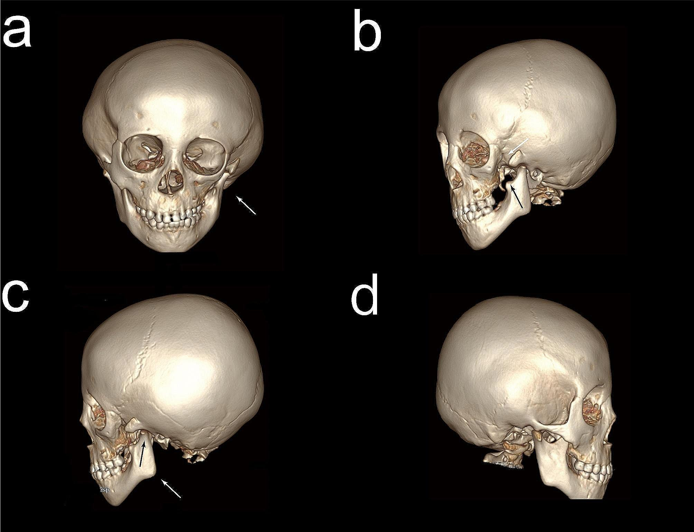
*CT sọ dựng 3D của trẻ OAVS: (a) **bất đối xứng hai bên xương hàm dưới và xương gò má** (mũi tên); (b) bên trái **mất mỏm thái dương (temporal process) của xương gò má**; (c, d) các góc nhìn khác cho thấy lệch khớp thái dương–hàm. Đây là bằng chứng xương của CFM. Nguồn: Fu Y et al. (PMC10882892), BMC Ophthalmol 2024, CC BY 4.0 — Fig 5.*

**Bảng 3B — nang/dò vùng cổ bên ở trẻ (theo vị trí):**

| Thực thể (entity) | Hình ảnh điển hình | Chốt vào (rule-in) | Chốt loại (rule-out) | Gợi ý xác nhận |
|---|---|---|---|---|
| **Khe mang II** (hay gặp nhất) | Nang đơn ngăn/bọc **bờ trước SCM, trên xương móng**, **sau tuyến dưới hàm**, cạnh khoang cảnh (Bailey I–IV) | **Vị trí góc hàm–bờ trước SCM + trên xương móng** | Nằm đường giữa, di động khi nuốt → nang ống giáp–lưỡi | US → CT/MRI (không chọc khi đang viêm) |
| **Khe mang I** | Nang **quanh tuyến mang tai/loa tai (preauricular)**; Work type I–II (loại II có thể chạy sát/xuyên dây VII) | **Cạnh tuyến mang tai/loa tai** | Ở cổ dưới → khe mang II/III–IV | MRI (quan hệ dây VII); tránh rạch khi chưa rõ |
| **Túi mang III/IV** | Nang **hố hầu/cổ dưới**, dò vào **xoang lỗ rò hình quả lê (pyriform sinus)**; ~90% **bên trái** | **Dò pyriform + viêm cổ dưới tái phát bên trái** | Không thấy đường dò pyriform → xem lại khe mang II | Nội soi ± chụp dò/CT; **type IV ~6% bên phải** |
| **Nang ống giáp–lưỡi** | Nang **đường giữa trên/dưới xương móng**, dính vào xương móng | **Đường giữa + di động theo nuốt (dấu "thè lưỡi")** | Lệch bên → khe mang II | US / CT; phẫu thuật kiểu Sistrunk |
| **Bạch mạch (lymphatic malformation)** | Khối **nhiều vách, tăng echo, không tưới máu**, hay dưới hàm/cổ sau | **Nhiều ngăn vách + không ngấm thuốc** | Nang đơn ngăn có bờ rõ sau SCM → khe mang II | MRI T2 sáng; đánh giá chèn ép đường thở |

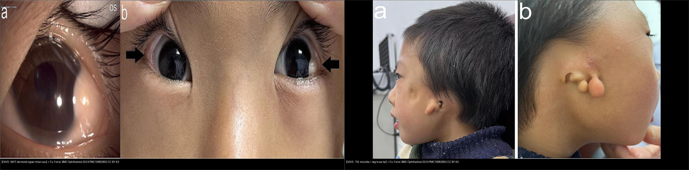
*Trái: **OAVS — MẮT** (dermoid ngoài nhãn cầu ở góc trong mắt + hai bên, mũi tên). Phải: **OAVS — TAI** (microtia + nhiều tag trước tai một bên, kèm lệch mặt). Cùng ca ở BMC Ophthalmol 2024. Nguồn: Fu Y et al. (PMC10882892), CC BY 4.0. Ảnh ghép letterbox.*

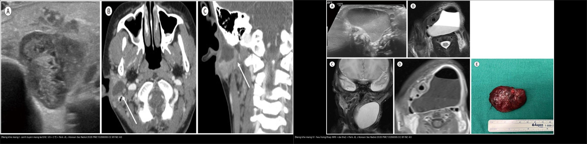
*Trái: **nang khe mang I** — khối nang cạnh tuyến mang tai (US đa âm hỗn hợp + CT xoang bờ ngấm). Phải: **nang khe mang IV** — khối nang lớn vùng cổ thấp/hố hầu trên MRI (kèm đại thể). Vị trí so với tuyến mang tai và hố hầu là chốt. Nguồn: Park JE, J Korean Soc Radiol 2026 (PMC13266095), CC BY-NC 4.0. Ảnh ghép letterbox.*

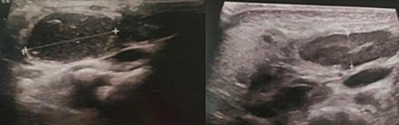
*Siêu âm vùng cổ bên phải: **khối nang đơn ngăn bờ rõ** ở bờ trước cơ ức–đòn–chũm — hình ảnh kinh điển của **nang khe mang II** (hay gặp nhất, ~67–95% dị tật cung mang). Nguồn: Houas J et al. (PMC11986246), Int J Surg Case Rep 2025, CC BY-NC-ND 4.0 (giữ nguyên bản) — Fig 2.*

## 4. Protocol chụp + hệ phân độ / lưu đồ

- **OAVS/CFM — quy trình hình ảnh**: **CT sọ–mặt dựng 3D** (đối xứng xương hàm dưới/gò má/khớp thái dương–hàm; mất mỏm thái dương xương gò má); **CT xương thái dương lát mỏng ≤ 1 mm** (ứ mạc EAC, tai giữa, **điểm Jahrsdoerfer**); **MRI sọ/tai** (IAC, ốc tai, dây VII–VIII nếu nghi bất sản); **X-quang/CT cột sống cổ–ngực** (đốt sống khối, nửa đốt sống, gù/vẹo); **siêu âm thận + tim** (bất thường phối hợp); **soi đáy mắt + khúc xạ** (dermoid, loạn thị gây nhược thị).
- **Khối cổ bên ở trẻ**: **siêu âm đầu tay**; **CT cản quang** (vị trí so với SCM, khoang mạch) và **MRI** (đường dò, quan hệ dây VII, tổn thương hố hầu). **Không chọc khi đang viêm cấp**.
- **Hệ phân độ dùng trong bài**: **OMENS/OMENS+** (mặt); **Mann** (dermoid limbus I–III); **Nagata hình thái / Marx độ I–IV** (microtia); **Jahrsdoerfer 1–10** (xương thái dương); **Work type I–II** (khe mang I); **Bailey type I–IV** (khe mang II, tinh chỉnh Proctor 1955).

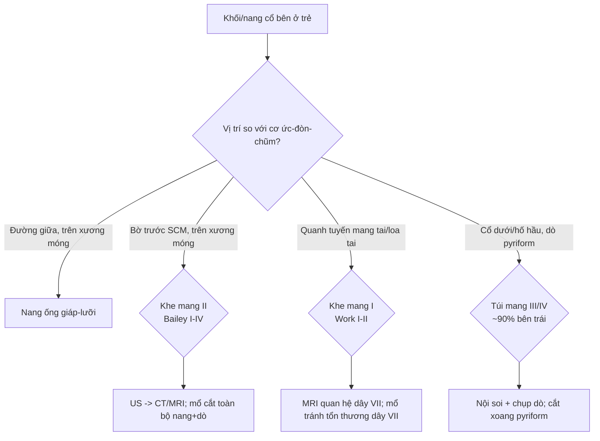

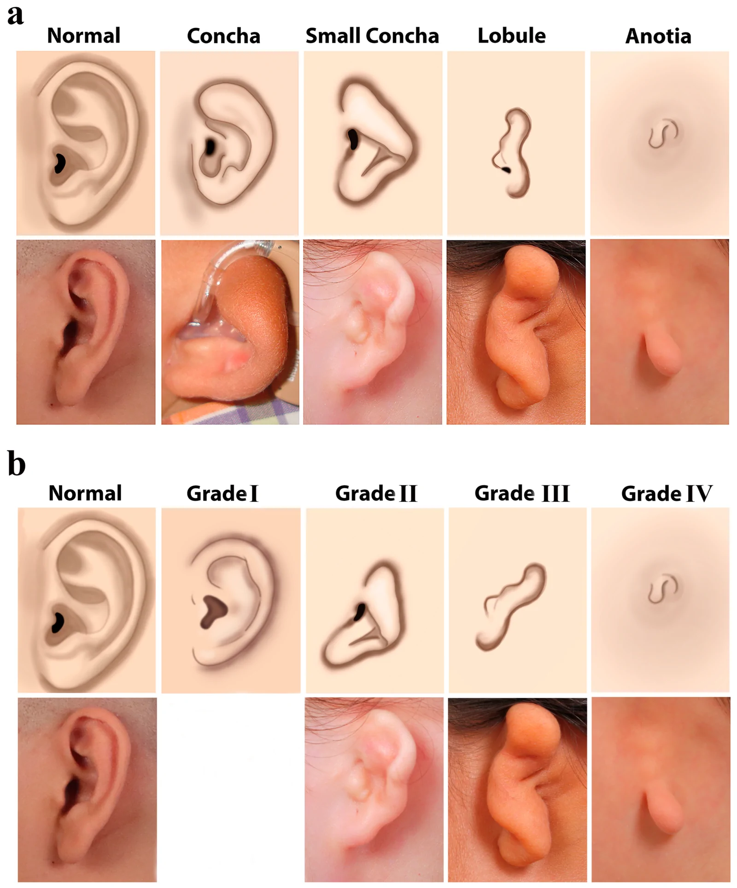
*Hai hệ phân loại loa tai ngoài: (a) **Nagata hình thái** — bình thường / ốc tai (concha) / ốc tai nhỏ / thùy (lobule) / không tai (anotia); (b) **Marx độ I–IV** theo mức nặng. Lưu ý: **hình thái loa tai ngoài KHÔNG phản ánh trung thực giải phẫu xương thái dương bên dưới** (điểm Jahrsdoerfer chồng lấn nhiều giữa các độ) → luôn chụp CT thái dương lát mỏng. Nguồn: Solmaz E et al. (PMC13607474), J Clin Med 2026, CC BY 4.0 — Fig 2.*

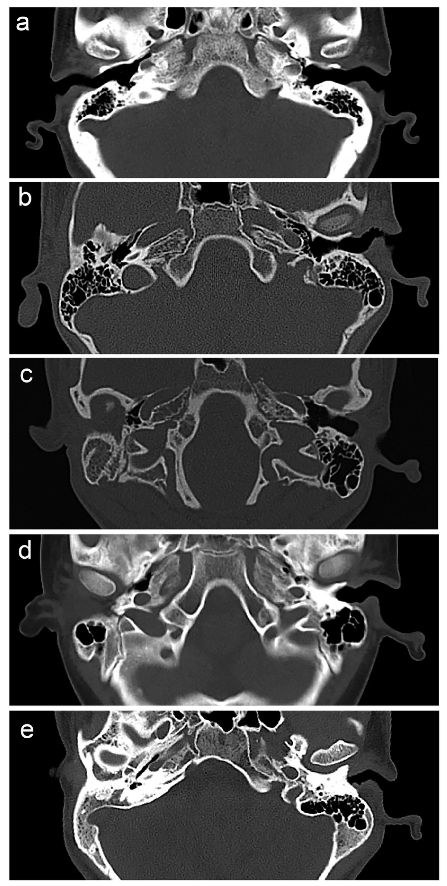
*CT trục xương thái dương: (a) người lành — ống tai ngoài thông; (b–e) các ca microtia một bên kèm **ứ mạc ống tai ngoài (EAC atresia)** mức độ khác nhau — cơ sở để tính **điểm Jahrsdoerfer 1–10** (nhóm nghiên cứu xếp < 5 nặng / 5–8 vừa / > 8 nhẹ). Nguồn: Solmaz E et al. (PMC13607474), J Clin Med 2026, CC BY 4.0 — Fig 3.*

## 5. Biến thể bình thường và cạm bẫy

- **Tag/khối trước tai (preauricular tag/pit)** là biến thể nhỏ, hay lành — nhưng khi **kèm lệch mặt, microtia hoặc bất thường đốt sống** thì phải nghĩ phổ OAVS và đi tìm tổn thương phối hợp.
- **Đừng lạm dụng tên "Goldenhar"**: Goldenhar = **CFM + dermoid ngoài nhãn cầu ± bất thường đốt sống**; nếu chỉ có lệch mặt/microtia thì gọi **CFM** (chẩn đoán Goldenhar hay bị dùng sai — PMC13200892).
- **Bất đối xứng hàm hai bên trên CT 3D** dễ nhầm với **tư thế đầu nghiêng/artifact chuyển động** — luôn dựng ở tư thế chuẩn, đo đối chiếu hai bên.
- **"Đảo lời khuyên theo vị trí, không theo hình nang"**: nang cổ bên có thể trông giống hệt nhau; **vị trí so với SCM/xương móng/tuyến mang tai** mới quyết định tên gọi và phẫu thuật.
- **Cạm bẫy bất đối xứng cột sống**: **nửa đốt sống (hemivertebra) + đốt sống khối (block vertebra)** là nguyên nhân gù/vẹo **bẩm sinh** (khác vẹo vô căn) — nhớ đếm đốt sống và tìm dị tật đốt sống ở mọi trẻ lệch mặt.
- **Satisfaction of search**: thấy dermoid mắt là dừng → **bỏ sót tai (ứ mạc, điếc), thận, tim và đốt sống**. Luôn "quét hệ": mắt–tai–cột sống–thận–tim–TKTW.
- **Đường thở**: hàm dưới giảm sản + bất thường đốt sống cổ làm **đặt nội khí quản khó** (khó soi thanh quản); **OSA** gặp tới 7–67% → đánh giá khi ngủ trước mọi can thiệp.

## 6. Tự lượng giá — Blind Quiz

**Ca 1 — Trẻ có khối đặc ở rìa giác mạc, lệch nhẹ nửa mặt. Nhìn ảnh trước.**

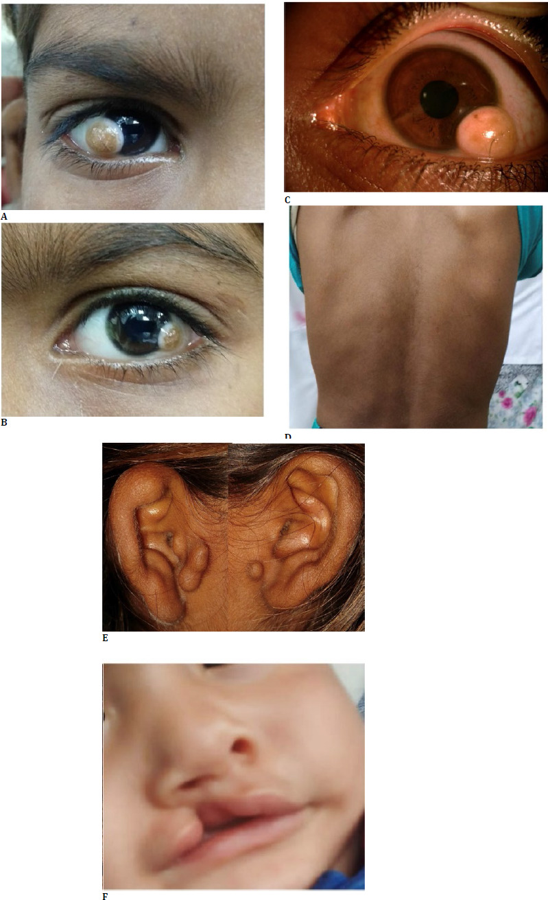

- Gợi ý lâm sàng: bệnh nhi được khám mắt; ảnh gồm mắt, cột sống và vùng miệng.
- Câu hỏi: Tổn thương ở mắt là gì, định vị ở đâu? Các ô khác cho thấy gì (khung xương, cột sống, môi)? Chẩn đoán hội chứng gợi ý?

<b>Bấm để hiện đáp án (findings + chẩn đoán)</b>

- Dấu hiệu (findings): (A, B, C) **dermoid ở rìa giác mạc (limbal dermoid)** — khối đặc nông màu hồng ngà ở limbus, một ô kèm lông mọc ra; (D) **gù/vẹo cột sống nhẹ**; (E) **tag trước tai**; (F) **sứt môi**.
- Chẩn đoán (diagnosis): **phổ OAVS/Goldenhar** — phối hợp dermoid ngoài nhãn cầu + tag trước tai + bất thường cột sống + sứt môi; vì tất cả nằm trong phổ dị tật cung hầu I–II. Vì dermoid độ I nông (< 5 mm) có thể cắt đơn thuần, còn độ II sâu hơn cần **ghép giác mạc lát**.
- Nguồn ảnh: Tripathi A et al. (PMC11503224), Rom J Ophthalmol 2024, CC BY 4.0 — Fig 1.

**Ca 2 — Trẻ lệch nửa mặt + tai bất thường một bên. Nhìn ảnh trước.**

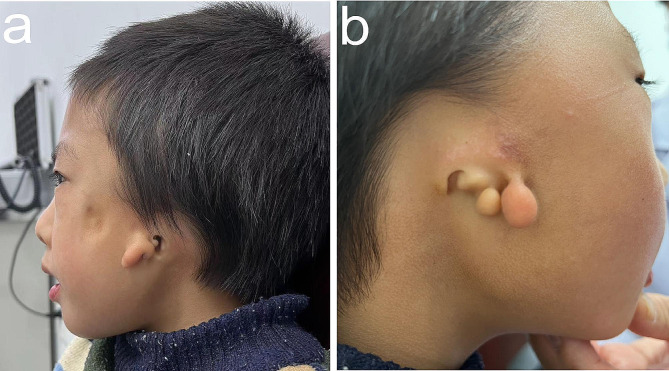

- Câu hỏi: Mô tả loa tai và các nốt quanh tai. Có lệch mặt không? Nên chụp thêm gì để đánh giá định mổ?

<b>Bấm để hiện đáp án</b>

- Dấu hiệu (findings): (a) **lệch nửa mặt** + loa tai nhỏ bất thường; (b) **microtia một bên + nhiều tag/nốt trước tai**; ống tai ngoài hẹp/mất một bên.
- Chẩn đoán (diagnosis): **OAVS/CFM một bên** — vì thiếu hụt mô cung hầu I–II. Bước tiếp: **CT xương thái dương lát mỏng ≤ 1 mm** để tính **điểm Jahrsdoerfer** (quyết định tạo hình tai/ứ mạc) và đánh giá chuỗi tai giữa–trong; đồng thời kiểm tra cột sống và thận.
- Nguồn ảnh: Fu Y et al. (PMC10882892), BMC Ophthalmol 2024, CC BY 4.0 — Fig 2.

**Ca 3 — Trẻ điếc một bên, tai ngoài bất thường. Nhìn CT thái dương trước.**

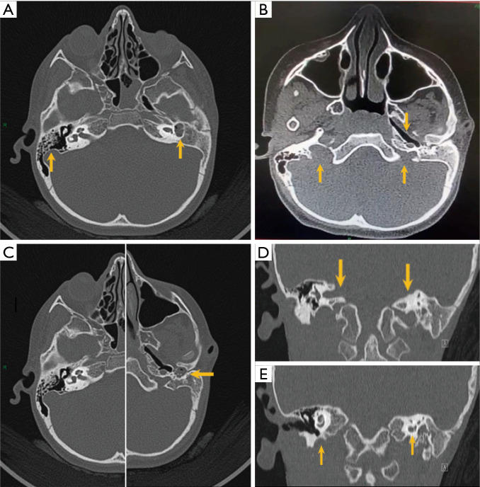

- Câu hỏi: Bên bệnh có gì? Liệt kê các tầng tai bị ảnh hưởng. Vì sao điểm Jahrsdoerfer lại thấp?

<b>Bấm để hiện đáp án</b>

- Dấu hiệu (findings): (A) **bất sản ống tai trong (internal auditory canal — IAC) bên trái**, ốc tai và tiền đình **hợp nhất thành một khoang chung (common cavity)**, xương chũm kém khí hóa; (E) **giảm sản ốc tai trái**.
- Chẩn đoán (diagnosis): **Goldenhar với bất thường cả ba tầng tai + bất sản IAC** — vì cung I–II và túi tai cùng bị ảnh hưởng. Bất sản IAC/ khoang chung làm **điểm Jahrsdoerfer thấp (< 5)** → kém thuận lợi cho tạo hình tai giữa; cần cân nhắc dụng cụ dẫn âm xương, và chỉ cấy ốc tai điện tử khi ốc tai và dây VIII còn.
- Nguồn ảnh: Al Hamoud M et al. (PMC13264792), AME Case Rep 2026, CC BY-NC-ND 4.0 (giữ nguyên bản) — Fig 6.

**Ca 4 — Trẻ có khối nang cạnh tuyến mang tai, tái phát. Nhìn ảnh trước.**

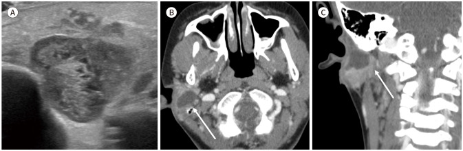

- Gợi ý lâm sàng: khối nang cạnh tuyến mang tai, tái phát sau khi sưng; không đau khi thăm khám ban đầu.
- Câu hỏi: Nang nằm ở khoang nào? Đây là nhánh cung mang nào, phân độ nào? Vì sao phải thận trọng với dây VII?

<b>Bấm để hiện đáp án</b>

- Dấu hiệu (findings): (A) siêu âm **khối nang hỗn hợp kế cận tuyến mang tai phải**; (B, C) CT cản quang trục + vành: **khối nang viền ngấm, ranh giới rõ** quanh tuyến mang tai/loa tai.
- Chẩn đoán (diagnosis): **dị tật khe mang I** — vị trí **quanh tuyến mang tai/loa tai** là chốt (khe mang II nằm bờ trước SCM, trên xương móng). Theo **Work**, loại **II** xuyên qua tuyến mang tai và có thể chạy sát/xuyên **dây VII** → mổ cần MRI để lần đường dây thần kinh, tránh rạch nhầm ổ nhiễm.
- Nguồn ảnh: Park JE, J Korean Soc Radiol 2026 (PMC13266095), CC BY-NC 4.0 — Fig 4.

**Ca 5 — Trẻ viêm cổ dưới tái phát, nang lớn vùng cổ thấp. Nhìn ảnh trước.**

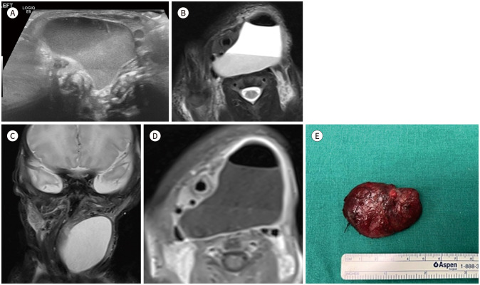

- Câu hỏi: Nang nằm ở khoang nào? Gợi ý nhánh cung mang nào? Cần tìm đường dò ở đâu?

<b>Bấm để hiện đáp án</b>

- Dấu hiệu (findings): (A–D) MRI cho thấy **khối nang lớn vùng hố hầu/cổ thấp**, mức dịch–dịch, đè đẩy tổ chức xung quanh; (E) tiêu bản đại thể khối nang.
- Chẩn đoán (diagnosis): **dị tật túi mang IV** (nhóm III/IV) — thường **bên trái (~90%)**, dò vào **xoang lỗ rò hình quả lê (pyriform sinus)**; cần **nội soi ± chụp dò** tìm đường dò và xử trí xoang pyriform để tránh tái phát. Lưu ý **type IV hiếm khi bên phải (~6%)**.
- Nguồn ảnh: Park JE, J Korean Soc Radiol 2026 (PMC13266095), CC BY-NC 4.0 — Fig 5.

**Ca 6 — Trẻ lệch mặt có cứng cổ nhẹ và đường cong bất thường. Nhìn ảnh trước.**

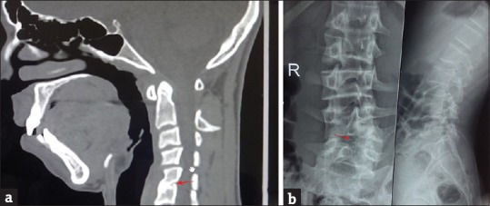

- Câu hỏi: Mô tả hai bất thường cột sống. Chúng thuộc nhóm dị tật bẩm sinh nào? Vì sao phải tìm ở mọi ca OAVS?

<b>Bấm để hiện đáp án</b>

- Dấu hiệu (findings): (a) CT cổ: **đốt sống khối (block vertebra) C5–C6** — thân đốt sống dính liền, mất đĩa đệm; (b) X-quang ngực–thắt lưng: **nửa đốt sống (hemivertebra) ở L5** kèm vẹo thắt lưng.
- Chẩn đoán (diagnosis): **bất thường đốt sống bẩm sinh** trong phổ OAVS (gặp ~50%) — vì đốt sống và cung hầu cùng bắt nguồn từ trung bì/mào thần kinh, và **bất thường đốt sống là một trong ba trụ của tam chứng Goldenhar**. Loại trừ vẹo vô căn bằng cách đếm đốt sống và tìm dị tật khối/nửa đốt sống.
- Nguồn ảnh: Chandrakala C et al. (PMC5363152), Indian J Dermatol 2017, CC BY-NC-SA 3.0 (giữ nguyên bản) — Fig 3.

## Bài liên quan chéo
- [600 – Tổng quan Nhi khoa](../600-tong-quan-nhi-khoa/lesson.md)
- [657 – Dị tật hố sau: Joubert & rhombencephalosynapsis](../657-di-dang-ho-sau-joubert-rhombencephalo/lesson.md) (bất thường mắt–cột sống kèm hố sau)
- [656 – Bất thường tủy–cột sống nhi (đốt sống, tủy căng)](../656-bat-thuong-tuy-cot-song-nhi/lesson.md)
- [655 – HIE sơ sinh & dị tật bẩm sinh TKTW](../655-hie-so-sinh-va-di-dang-bam-sinh-than-kinh/lesson.md)
- [230 – Tuyến giáp ACR TI-RADS & hạch cổ](../230-tuyen-giap-hach-co/lesson.md) (khối vùng cổ)
- [449 – Chấn thương mắt & dị vật nội nhãn](../449-chan-thuong-mat-dich-vat/lesson.md) (nhãn cầu)
- [420 – Vỡ sàn hốc mắt](../420-vo-san-hoc-mat/lesson.md) (hốc mắt)

## Ảnh
- Ảnh tải về + giấy phép từng file: `images/CREDITS.md`. Giấy phép trong bài: **CC BY 4.0** (Fu Y, Tripathi A, Solmaz E), **CC BY-NC 4.0** (Park JE), **CC BY-NC-SA 3.0** (Chandrakala C), **CC BY-NC-ND 4.0** (Al Hamoud M, Houas J).
- Ảnh **CC BY-NC-ND** (Al Hamoud, Houas) giữ **nguyên bản**, không ghép/crop. Ảnh ghép đối chiếu tạo bằng `tools/make_composite.py` (letterbox nền đen, giữ aspect) chỉ từ ảnh cho phép phái sinh.

> Không dùng để chẩn đoán độc lập khi chưa có người hướng dẫn.
