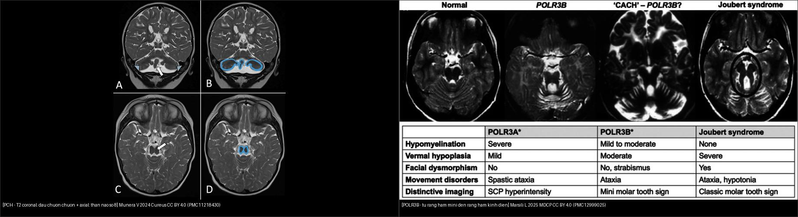
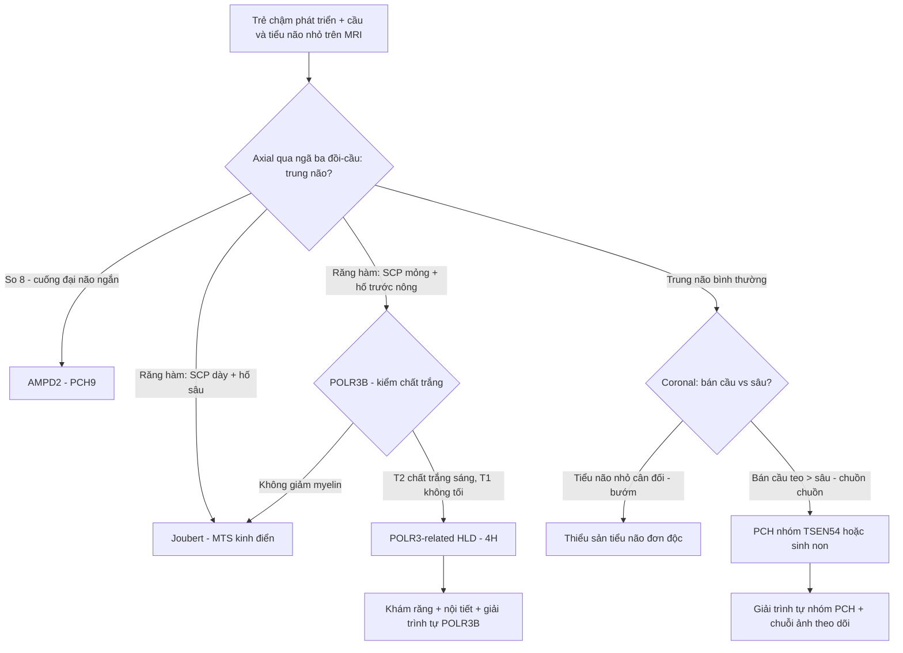
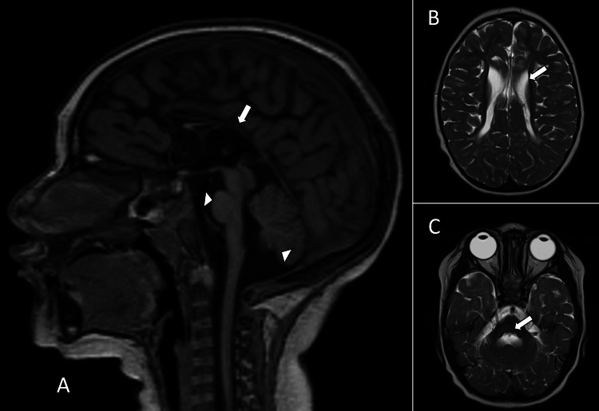
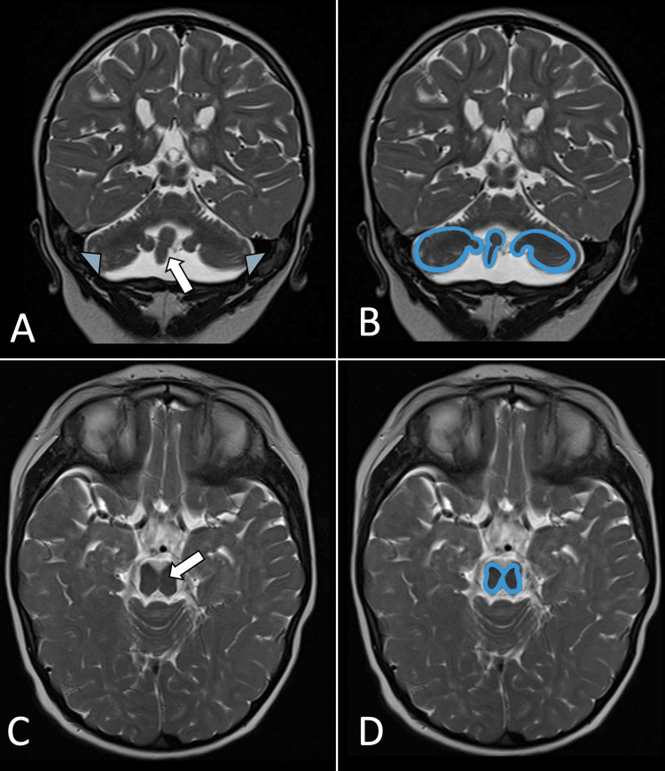
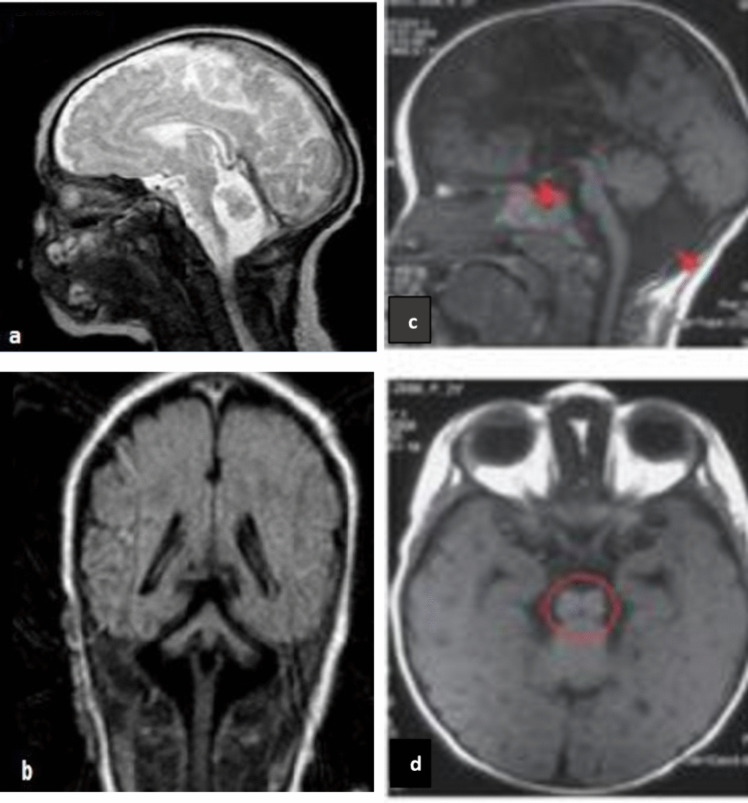
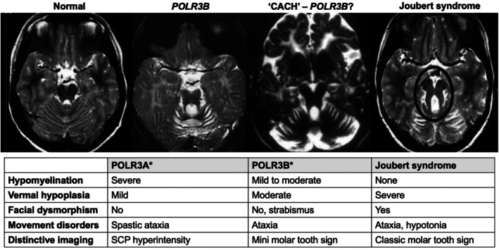
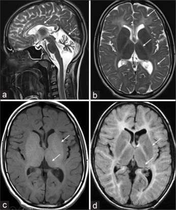
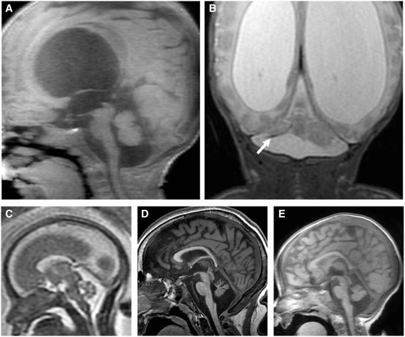

# 659 — Thiểu sản cầu–tiểu não (PCH/PHSD) & loạn dưỡng chất trắng giảm myelin POLR3B / Pontocerebellar hypoplasia & POLR3B-related hypomyelinating leukodystrophy

**Tags:** `pattern:thieu-san-cau-tieu-nao` `pattern:giam-myelin` `pattern:dragonfly` `pattern:figure-of-8` `vung:tieu-nao` `vung:nao-nhi` `protocol:MRI-nao-nhi`
**Mức chắc chắn (certainty):** tổng hợp y văn (literature synthesis) — tổng hợp từ bài tổng quan PCH (1912–2022) + cohort quốc gia + ca nguyên văn CC BY; các ca quiz là ca nguyên văn của bài gốc, phần khái quát là tổng hợp.

## 1. Tổng quan bệnh học – cơ chế hình ảnh

### 1.1 PCH là gì — "thiểu sản" (hypoplasia), KHÔNG phải "teo" (atrophy)

- **Thiểu sản cầu–tiểu não (pontocerebellar hypoplasia — PCH)** là một **phổ bệnh thoái hóa/thần kinh di truyền** với đặc điểm chung: **cầu não (pons) và tiểu não (cerebellum) nhỏ hơn bình thường ngay từ khi hình thành**, kèm biến đổi thần kinh và hình ảnh rất đa dạng (có thể gồm cả trên lều — supratentorial). Khởi phát **trước sinh hoặc sau sinh**.
- **TẠI SAO gọi là "thiểu sản" chứ không phải "teo":** hypoplasia = mô **chưa bao giờ đạt kích thước bình thường** (ngừng phát triển); atrophy = mô **đã phát triển rồi mất đi**. Trên chuỗi ảnh theo thời gian, PCH cho thấy **ngừng tăng trưởng (arrested growth)** hoặc tiến triển chậm — nếu thấy mô **co nhỏ dần sau khi đã bình thường** thì phải nghĩ nguyên nhân mắc phải (atrophy), không phải PCH.
- **Thuật ngữ mới (2025):** bài tổng quan 1912–2022 đề xuất gọi cả phổ là **pontocerebellar hypoplasia spectrum disorder (PHSD)** và dùng **cách đặt tên theo gen (dyadic naming)** — ví dụ *TSEN54*-associated PHSD, *RARS2*-associated PHSD — thay cho cách đánh số cũ (PCH type 1, 2, 3…). Lý do: cách đánh số **không phản ánh tính dị thể gen** và gây nhầm lẫn tiên lượng.
- **Số lượng:** y văn hiện có **26 thể/danh mục PCH** và **24–25 gen** liên quan; hay gặp nhất là **TSEN54 (n = 20 nghiên cứu), RARS2 (n = 19), EXOSC3 (n = 15), AMPD2 (n = 9)**; các type 1, 2, 6 là thường gặp nhất. Trong một **cohort quốc gia 64 bệnh nhân** (15 trung tâm): CLP1 **26,56%**, EXOSC3 **10,9%**, TSEN54 **9,3%**, AMPD2 **9,3%**.

### 1.2 Ba dấu hiệu hình ảnh "chữ ký" và TẠI SAO chúng xuất hiện

- **Dấu "chuồn chuồn" (dragonfly sign)** — đọc trên **mặt cắt vành (coronal) T2**: hai **bán cầu tiểu não teo** làm "cánh chuồn chuồn", **sâu tiểu não (vermis) tương đối bảo tồn** làm "thân chuồn chuồn". TẠI SAO: các bán cầu tiểu não (nguồn gốc từ mào tiểu não) bị tổn thương nặng hơn sâu → mất cân xứng bán cầu/sâu tạo hình cánh–thân.
- **Dấu "số 8" của trung não (figure-of-8 midbrain)** — đọc trên **mặt cắt trục (axial)**: trung não có hình số 8 do **cuống đại não (cerebral peduncles) ngắn lại/thiểu sản**. Gần như luôn gặp trong **PCH9 (AMPD2)**.
- **Dấu "răng hàm mini" (mini molar tooth sign)** — gặp trong **POLR3B**. TẠI SAO khác "răng hàm kinh điển": "mini" có **cuống tiểu não trên (superior cerebellar peduncle — SCP) MỎNG** (chứ không dày) và **hố trước (anterior foramen cecum) NÔNG** (chứ không sâu) → trông *giống* nhưng *thiếu* hai thành phần tạo "chân răng" dày của Joubert.
- **Cơ chế giảm myelin trong POLR3B (nhóm 4H):** đột biến gen mã hóa **tiểu đơn vị RNA polymerase III (POLR3A/POLR3B/POLR1C/POLR3K)** → giảm biệt hóa/chức năng **tế bào tiền sinh myelin (oligodendrocyte progenitor)** → **myelin chưa bao giờ được tạo đủ** (hypomyelination). Trên MRI: **T2 chất trắng tăng tín hiệu nhưng T1 KHÔNG tối** (myelin chưa hình thành, không phải myelin bị mất như trong demyelination — nơi T1 thường tối). Đây là điểm vật lý quan trọng để phân biệt **hypomyelination vs demyelination**.

### 1.3 Ngưỡng định lượng & mốc đọc

- **Không có ngưỡng mm chính thức** cho PCH — đánh giá định tính cấu trúc + **đo vòng đầu (OFC)**: vi đầu (microcephaly) định nghĩa là **OFC ≤ −2 SD** theo tuổi/giới; nhiều thể (đặc biệt CASK) có **OFC < −3 SD**.
- **Đọc chuẩn 3 mặt cắt:** sagittal T1 (cầu + tiểu não + thể chai), **axial T2 lát mỏng qua ngã ba đồi–cầu (pontomesencephalic junction)** (dấu số 8 / răng hàm), **coronal T2** (dấu chuồn chuồn).
- **PCH9 (AMPD2):** dấu số 8 có thể thấy **sớm tới tuần 30 thai kỳ** trên MRI thai.
- **POLR3B:** **~90%** ca POLR3-related leukodystrophy do **POLR3A + POLR3B**; **POLR3A** khởi phát muộn hơn, tiến triển nhanh hơn; **POLR3B** khởi phát sớm hơn, tiến triển chậm hơn, **teo tiểu não rõ hơn** và bảo tồn đường vỏ–gai tương đối.
- **Lưu ý độ đặc hiệu:** dấu chuồn chuồn **không nhạy, không đặc hiệu** — có thể **vắng** ở một số ca TSEN54, **có mặt** ở PCH 1/9/11/16 và ở **thiểu sản hố sau mắc phải** (đặc biệt tổn thương do sinh non).

## 2. Mẫu hình + chẩn đoán phân biệt theo dấu hiệu (gamut)

- **Mẫu hình gốc:** *thiểu sản đồng thời cầu não + tiểu não* ở trẻ có chậm phát triển/giảm trương lực/co giật. Từ đây hỏi **3 câu**: (1) **trung não axial** có "số 8" không? (2) **coronal** có "chuồn chuồn" không? (3) **chất trắng T2/T1** có "giảm myelin" ± "răng hàm mini" không?
- **Gamut theo dấu hiệu:**
  - **Số 8 trung não** → **AMPD2 (PCH9)** (còn có thể kèm thể chai mỏng).
  - **Chuồn chuồn (coronal)** → **TSEN54 (PCH2A/2/4/5)** là điển hình, nhưng còn **PCH1, 9, 11, 16** và **thiểu sản hố sau mắc phải (sinh non)**.
  - **Hình "bướm" (butterfly)** — tiểu não nhỏ nhưng **cân đối bình thường** (không mất cân xứng bán cầu/sâu).
  - **Răng hàm mini + giảm myelin** → **POLR3B** (nhóm 4H).
  - **Răng hàm kinh điển (SCP dày + hố liên cuống sâu)** → **Joubert** (xem bài 657).
  - **Đồi/cầu + tiểu não thiểu sản có kèm tổn thương trên lều** (hạch nền, thể chai) → nghĩ PCH thể có biểu hiện trên lều (ví dụ PCH16, CLP1).

## 3. Bảng so sánh phân biệt (ma trận đối chiếu)

| Thực thể (entity) | Hình ảnh điển hình | Chốt vào (rule-in) | Chốt loại (rule-out) | Gợi ý xác nhận |
|---|---|---|---|---|
| **PCH thể TSEN54 (PCH2A/4/5)** | Coronal T2: **chuồn chuồn** (bán cầu teo, sâu tương đối giữ) + cầu thiểu sản; vi đầu tiến triển, giảm trương lực, loạn vận động | **Chuồn chuồn + vi đầu tiến triển + co giật/loạn trương lực** | Chuồn chuồn cũng gặp ở PCH9/11/16 và sinh non → **không loại trừ** nếu thiếu; nếu không có bất kỳ thiểu sản hố sau nào thì loại PCH | Giải trình tự **TSEN54** (p.A307S đồng hợp ở PCH2A); MRI chuỗi theo thời gian |
| **PCH9 (AMPD2)** | Axial: **trung não hình số 8** (cuống đại não ngắn) + thể chai mỏng + tiểu não thiểu sản | **Số 8 trung não trên axial** | Trung não bình thường → loại PCH9 | Giải trình tự **AMPD2**; có thể thấy số 8 **từ tuần 30 thai** |
| **POLR3B-related HLD (4H)** | **Giảm myelin lan tỏa** (T2 chất trắng sáng, **T1 không tối**) + teo tiểu não + **"răng hàm mini"** (SCP mỏng, hố trước nông) | **Giảm myelin + răng hàm mini + bộ ba 4H lâm sàng** (hypodontia/răng kém + hypogonadotropic hypogonadism) | **Không giảm myelin** → không phải POLR3-HLD; SCP **dày** + hố liên cuống **sâu** → Joubert | Giải trình tự **POLR3B**; khám răng + nội tiết (LH/FSH, testosterone/estradiol) |
| **Joubert (MTS kinh điển)** | Axial: SCP **dày, nằm ngang** + hố liên cuống **sâu** + thiểu sản sâu não; **KHÔNG giảm myelin** | **Răng hàm kinh điển (SCP dày) + không giảm myelin** | SCP **mỏng** + hố trước **nông** → "mini" (POLR3B) | MRI ngã ba đồi–cầu lát mỏng; gen lông mao |
| **Thiểu sản/teo tiểu não do sinh non (mắc phải)** | Tiểu não nhỏ, có thể giống chuồn chuồn; **tiền sử sinh non**; tổn thương chất trắng quanh não thất | **Tiền sử sinh non + tổn thương chất trắng kèm** | Không có tiền sử sinh non/tổn thương mắc phải → nghĩ PCH di truyền | Tiền sử + chuỗi ảnh; nếu nghi ngờ → giải trình tự nhóm PCH |
| **Thiểu sản tiểu não đơn độc / hình "bướm"** | Tiểu não nhỏ **cân đối**, không mất cân xứng bán cầu/sâu; cầu có thể bình thường | **Tiểu não nhỏ cân đối + cầu bình thường** | Mất cân xứng bán cầu/sâu + cầu thiểu sản → nghĩ PCH | Đo sinh trắc; tìm nguyên nhân chuyển hóa/di truyền khác |

*Trái: **PCH** — T2 coronal "dấu chuồn chuồn" (bán cầu teo = cánh, sâu giữ = thân) + axial "thân não số 8" (khung xanh). Phải: **POLR3B** — chuỗi ảnh axial T2 từ trái sang phải: trung não bình thường → POLR3B (răng hàm mini) → CACH (nghi POLR3B) → **răng hàm kinh điển của Joubert** (khoanh đen), kèm bảng so sánh 4H. Nguồn: Munera V 2024, Cureus (PMC11218430); Marsili L 2025, Mov Disord Clin Pract (PMC12999025) — CC BY 4.0. Ảnh ghép letterbox.*

### Ba dấu hiệu nhìn gì trước?
- **Trung não axial**: "số 8" (cuống đại não ngắn) → **AMPD2/PCH9**; "răng hàm" → ngã ba đồi–cầu: **dày = Joubert**, **mỏng = POLR3B (mini)**.
- **Coronal**: "chuồn chuồn" (bán cầu teo > sâu) → nhóm PCH (TSEN54 điển hình) **hoặc** sinh non; "bướm" (cân đối) → thiểu sản tiểu não đơn độc.
- **Chất trắng T2 + T1**: **giảm myelin (T2 sáng, T1 không tối)** → nhóm POLR3/4H; nếu T1 **tối** (mất myelin thật) → nghĩ demyelination (bài 215).

## 4. Protocol chụp + lưu đồ chẩn đoán

- **MRI sọ não** (không – có cản quang), tối thiểu: **T1 sagittal**, **T2 axial lát mỏng (≤ 2–3 mm) qua ngã ba đồi–cầu**, **T2 coronal**, **FLAIR** (chất trắng trên lều), cân nhắc **T1 3D** để đo thể tích tiểu não/cầu. Nghi thai kỳ: **MRI thai HASTE/SSFSE** (đọc số 8 có thể từ ~30 tuần).
- **Chuỗi ảnh theo thời gian là bắt buộc** để phân biệt **thiểu sản (ngừng tăng trưởng)** với **teo (mất mô tiến triển)**.
- **Xét nghiệm kèm:** **giải trình tự toàn bộ vùng mã hóa (WES/exome)** cho nhóm gen PCH/POLR3 (TSEN54, RARS2, EXOSC3, AMPD2, CLP1, POLR3A/B/C/K…) — nhiều ca chỉ chẩn đoán được bằng gen; khám **răng** (hypodontia), **nội tiết** (hypogonadotropic hypogonadism), **mắt** (teo thần kinh thị, loạn dưỡng võng mạc), chuyển hóa (amino acid hữu cơ, acid béo chuỗi rất dài).
- **Không có RADS riêng** cho nhóm này → dùng **lưu đồ quyết định** (Kukulka 2025, Milani 2019) + hội chẩn di truyền.

## 5. Biến thể bình thường và cạm bẫy

- **Thiểu sản vs teo (cạm bẫy số 1):** PCH = **chưa bao giờ đủ lớn** (hypoplasia); nếu thấy mô **co nhỏ dần** sau khi từng bình thường → nghĩ **atrophy mắc phải**, không gọi PCH.
- **Chuồn chuồn không đặc hiệu:** có thể **vắng** ở TSEN54 và **có** ở PCH1/9/11/16 lẫn **tổn thương hố sau do sinh non**. Đừng chốt thể bệnh chỉ bằng một dấu.
- **"Răng hàm mini" ≠ "răng hàm kinh điển":** **SCP mỏng** + **hố trước nông** = POLR3B; **SCP dày** + **hố liên cuống sâu** = Joubert. Đọc nhầm "mini" thành Joubert sẽ bỏ sót bệnh myelin có thể điều trị/tư vấn khác.
- **Giảm myelin vs mất myelin (vật lý T1):** **hypomyelination** → T2 sáng, **T1 không tối**; **demyelination** → T2 sáng, **T1 tối**. Cần cả T1 lẫn T2 để phân định.
- **Thỏa mãn tìm kiếm (satisfaction of search):** thấy tiểu não nhỏ là dừng → bỏ sót **biểu hiện trên lều** (hạch nền, thể chai, vỏ não), **vi đầu**, và bất thường **mắt–răng–nội tiết**. Luôn quét toàn bộ não + khám hệ thống.
- **Dấu số 8 ở thai < 30 tuần:** cấu trúc chưa hoàn thiện — không kết luận sớm; hẹn khảo sát lại (tương tự nguyên tắc "không kết luận thiểu sản sâu trước 18 tuần" ở bài 657).

## 6. Tự lượng giá — Blind Quiz

**Ca 1 — Trẻ 3 tháng tuổi, sinh non 27 tuần, đầu nhỏ, chậm phát triển. Nhìn ảnh trước, mô tả.**

- Gợi ý lâm sàng: nhũ nhi 3 tháng (sinh non 27 tuần), vi đầu, chậm phát triển tâm vận.
- Câu hỏi: (A) sagittal T1 và (B, C) axial T2 cho thấy gì ở hố sau? 3 chẩn đoán phân biệt? Dấu hiệu nào chốt?

<b>Bấm để hiện đáp án</b>

- Dấu hiệu (findings): (A) **cầu não + tiểu não nhỏ**, thể chai mỏng (mũi tên); (B, C) tăng tín hiệu chất trắng quanh não thất/trên lều (mũi tên).
- Chẩn đoán (diagnosis): **thiểu sản cầu–tiểu não (PCH)** trên bối cảnh sinh non (thể do tổn thương hố sau mắc phải do sinh non là DDx quan trọng) — vì hypoplasia cầu + tiểu não kèm tổn thương chất trắng. → đối chiếu chuỗi ảnh (thiểu sản = ngừng tăng trưởng) + giải trình tự nhóm PCH nếu tiến triển.
- Nguồn ảnh: Munera V et al., Cureus 2024 (PMC11218430), CC BY 4.0 — Fig 1.

**Ca 2 — Trẻ có "dấu chuồn chuồn". Nhìn ảnh trước, chỉ ra dấu hiệu.**

- Câu hỏi: (A, B) coronal T2 — "cánh" và "thân" chuồn chuồn là gì? (C, D) axial T2 — hình dạng trung não gợi ý gì?

<b>Bấm để hiện đáp án</b>

- Dấu hiệu (findings): (A) coronal T2 — **bán cầu tiểu não teo (mũi tên xanh = cánh)** + **sâu tiểu não tương đối bảo tồn (mũi tên trắng = thân)** = **dấu chuồn chuồn**; (B) sơ đồ khoanh xanh; (C, D) axial — **trung não hình số 8** do cuống đại não ngắn (khung xanh).
- Chẩn đoán (diagnosis): **PCH** với phối cảnh chuồn chuồn + số 8; gợi ý phổ gen **TSEN54/AMPD2**. → giải trình tự nhóm PCH, theo dõi vòng đầu.
- Nguồn ảnh: Munera V et al., Cureus 2024 (PMC11218430), CC BY 4.0 — Fig 2.

**Ca 3 — Trẻ có chậm phát triển + bất thường hố sau. Nhìn ảnh trước.**

- Câu hỏi: Hai bệnh nhân trong hình có cùng kiểu bất thường tiểu não/trung não không? Kể tên dấu hiệu và gen gợi ý.

<b>Bấm để hiện đáp án</b>

- Dấu hiệu (findings): **(a, b) dấu "chuồn chuồn"** (sâu giữ tương đối, bán cầu teo) ở một bệnh nhân **TSEN54**; **(c, d) thân não hình "số 8"** ở một bệnh nhân **AMPD2** (PCH9).
- Chẩn đoán (diagnosis): **PCH** — chuồn chuồn (TSEN54) và số 8 (AMPD2) là hai dấu hiệu khác nhau của cùng phổ PCH. → giải trình tự gen tương ứng.
- Nguồn ảnh: Cavusoglu D et al., Cerebellum 2024 (PMC11489189), CC BY 4.0 — Fig 3.

**Ca 4 — Trẻ có ataxia + răng kém + dậy thì muộn. Nhìn ảnh trước, mô tả trung não.**

- Gợi ý lâm sàng: hai chị em ataxia tiến triển, hypogonadism, răng thứ phát kém, chậm phát triển.
- Câu hỏi: Chuỗi axial T2 (trái→phải) cho thấy gì ở trung não? "Răng hàm mini" khác "răng hàm kinh điển" ở điểm nào?

<b>Bấm để hiện đáp án</b>

- Dấu hiệu (findings): từ trái sang phải: trung não bình thường → **POLR3B (răng hàm mini)** → CACH (nghi POLR3B) → **răng hàm kinh điển của Joubert** (khoanh đen). Bảng kèm theo: POLR3B có **giảm myelin nhẹ–trung bình**, thiểu sản sâu vừa, **"mini molar tooth sign"**; Joubert **không giảm myelin**, thiểu sản sâu nặng, **"classic molar tooth sign"**.
- Chẩn đoán (diagnosis): **POLR3B-related hypomyelinating leukodystrophy (nhóm 4H)** — vì **SCP mỏng + hố trước nông** tạo "răng hàm mini", kèm giảm myelin (khác Joubert SCP dày + hố sâu). → giải trình tự POLR3B, khám răng + nội tiết.
- Nguồn ảnh: Marsili L et al., Mov Disord Clin Pract 2025 (PMC12999025), CC BY 4.0 — Fig 1.

**Ca 5 — Bệnh nhân có ataxia tiểu não, thể chai mỏng, chất trắng tăng tín hiệu. Nhìn ảnh trước.**

- Gợi ý lâm sàng: nam 22 tuổi, ataxia từ 2 tuổi, răng cửa hàm trên kém phát triển, không có đặc điểm sinh dục thứ phát.
- Câu hỏi: (a) T2 sagittal thấy gì ở tiểu não và thể chai? (b, d) T2/FLAIR thấy gì ở chất trắng? Gợi ý bệnh gì?

<b>Bấm để hiện đáp án</b>

- Dấu hiệu (findings): (a) **teo tiểu não lan tỏa + thể chai mỏng** (mũi tên); (b, d) T2/FLAIR **tăng tín hiệu đối xứng hai bên bao trong sau, quanh não thất và dưới vỏ**; giảm tín hiệu đồi thị/hạch đậu nhạt.
- Chẩn đoán (diagnosis): **POLR3-related leukodystrophy (4H: Hypomyelination, Hypodontia, Hypogonadotropic hypogonadism)** — vì giảm myelin + teo tiểu não + thể chai mỏng trên bối cảnh răng kém và dậy thì muộn. → giải trình tự POLR3B.
- Nguồn ảnh: Sachithanandan S et al., Ann Indian Acad Neurol 2026 (PMC12962435), CC BY-NC-ND 4.0 — Fig 2 (giữ nguyên bản, không ghép).

**Ca 6 — Hình ảnh thần kinh trong một bài tổng quan PCH. Nhìn ảnh trước.**

<b>Bấm để hiện đáp án</b>

- Dấu hiệu (findings): (A) T1W sagittal và (B) T2W coronal ở nhũ nhi 3 tháng (sinh non 27 tuần) cho thấy **dấu "chuồn chuồn" của thiểu sản tiểu não** (bán cầu teo > sâu); các ô còn lại (C–E) minh họa thêm tổn thương hố sau/não trong nhóm PCH.
- Chẩn đoán (diagnosis): **PCH (PHSD)** — bài tổng quan 1912–2022 dùng hình này làm ví dụ "dấu chuồn chuồn", lưu ý dấu này **cũng gặp ở tổn thương mắc phải do sinh non** nên không đặc hiệu.
- Nguồn ảnh: Kukulka NA et al., Brain Commun 2025 (PMC12422213), CC BY 4.0 — Fig 3 (chú thích theo bài gốc).

## Bài liên quan chéo
- [600 – Tổng quan Nhi khoa](../600-tong-quan-nhi-khoa/lesson.md)
- [650 – Thần kinh nhi (xuất huyết mầm, u hố sau)](../650-than-kinh-nhi-xuat-huyet-mam-va-u-ho-sau/lesson.md)
- [654 – Tổn thương não sơ sinh KHÔNG do ngạt](../654-ton-thuong-nao-so-sinh-khong-do-ngat/lesson.md)
- [655 – HIE sơ sinh & dị tật bẩm sinh hệ thần kinh](../655-hie-so-sinh-va-di-dang-bam-sinh-than-kinh/lesson.md)
- [657 – Dị tật hố sau: Joubert & rhombencephalosynapsis](../657-di-dang-ho-sau-joubert-rhombencephalo/lesson.md) (dấu răng hàm kinh điển)
- [656 – Bất thường tủy–cột sống kín ở trẻ](../656-bat-thuong-tuy-cot-song-nhi/lesson.md)
- [215 – Mất myelin (McDonald)](../215-mat-myelin/lesson.md) (demyelination vs hypomyelination)
- [218 – Thoát vị não & úng thủy](../218-thoat-vi-nao-ung-thuy/lesson.md)

## Ảnh
- Ảnh tải về + giấy phép từng file: `images/CREDITS.md`. Phần lớn **CC BY 4.0** (cho phép ghép/điều chỉnh, ghi nguồn); 1 ảnh **CC BY-NC-ND 4.0** giữ nguyên bản, không ghép.
- Ảnh ghép đối chiếu tạo bằng `tools/make_composite.py` (letterbox nền đen, giữ aspect).

> Không dùng để chẩn đoán độc lập khi chưa có người hướng dẫn.
