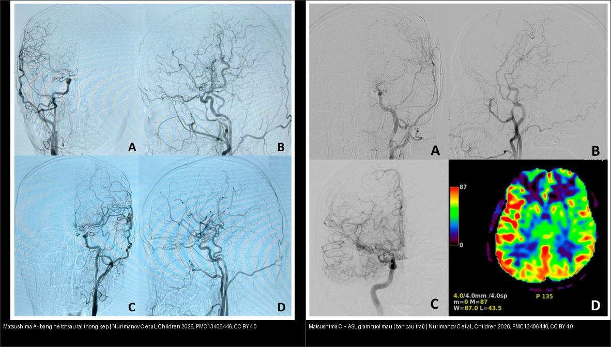
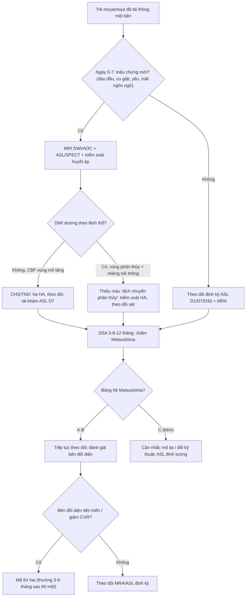
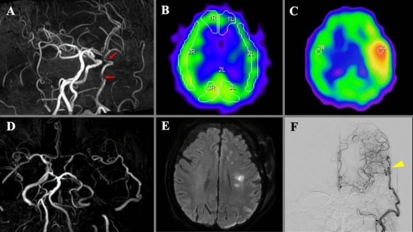
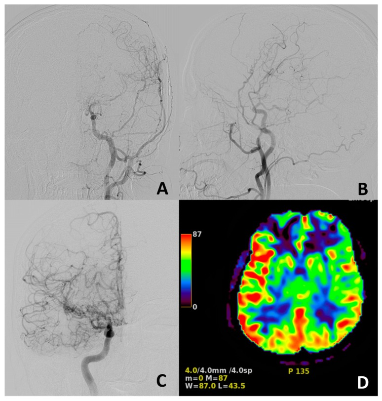
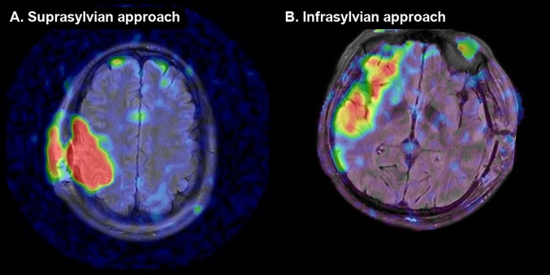
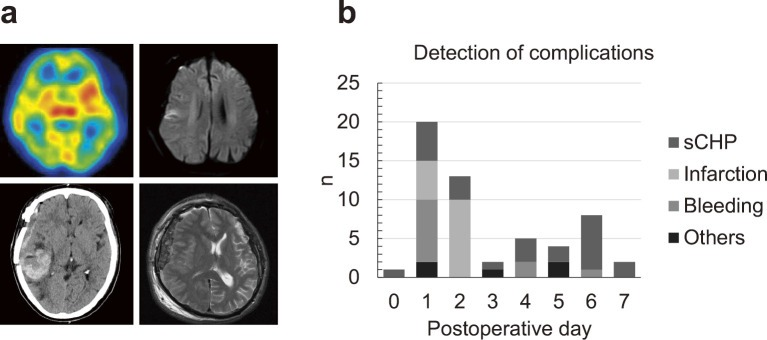
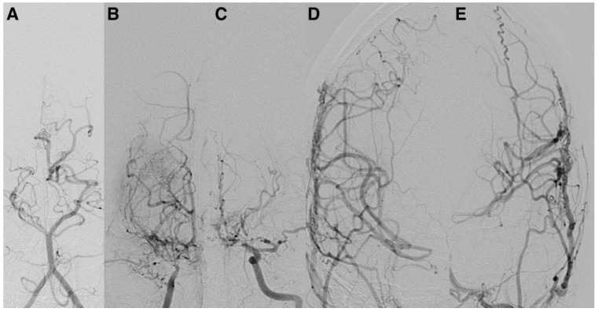

# 660 — Theo dõi sau tái thông (revascularization) moyamoya ở trẻ: hội chứng tưới máu quá mức (CHS), thiếu máu muộn & thời điểm mổ bên đối diện

**Tags:** `pattern:tuoi-mau-qua-muc` `pattern:hep-tac-mach` `pattern:nhoi-mau-nao` `vung:nao-nhi` `score:Matsushima` `protocol:ASL` `protocol:DSA`
**Mức chắc chắn (certainty):** tổng hợp y văn (literature synthesis) — bài tổng quan theo dõi **sau** tái thông, ghép ca nguyên văn (verbatim case) từ các bài open-access; số liệu lấy từ bài gốc có PMCID ghi kèm, ca không thuần nhi được ghi chú rõ.

> **Điểm chốt của bài:** phẫu thuật tái thông (revascularization) **không phải là đích cuối** — "mổ xong chưa phải hết". Ba câu hỏi phải trả lời theo trình tự thời gian: **(1) tuần đầu: trẻ có hội chứng tưới máu quá mức (cerebral hyperperfusion syndrome, CHS) không?** (2) **thiếu máu muộn "dịch chuyển phân thủy" (watershed shift) dù miệng nối thông?** (3) **sau 3–12 tháng: bàng hệ có hình thành (Matsushima A–B) và có phải mổ bên đối diện?** Đọc đúng ba giai đoạn này quyết định huyết áp mục tiêu, thời điểm mổ bên còn lại và tiên lượng.

## 1. Tổng quan bệnh học – cơ chế hình ảnh

### 1.1 Vì sao "sau tái thông" là một bài riêng

Bệnh moyamoya gây **hẹp/tắc tiến triển đoạn tận động mạch cảnh trong (internal carotid artery, ICA)**; tái thông (trực tiếp STA–MCA hoặc gián tiếp EDAS/pial synangiosis) là điều trị nền để tái lập tưới máu ([652](../652-dot-quy-mach-mau-nao-nhi-moyamoya-viem-mach/lesson.md)). Nhưng chính lúc tưới máu được tái lập lại xuất hiện các biến cố đặc thù:

- **Ngày 0–7:** **CHS** (đỏ da đầu, nhức đầu, co giật, yếu nửa người thoáng qua) — **rối loạn chức năng thần kinh thoáng qua (transient neurological dysfunction, TND)** là biến chứng **hay gặp nhất** sau mổ moyamoya, tỉ lệ được báo cáo **16,5–38,2%** (đồng thuận chuyên gia Trung Quốc 2024 — Ni W et al., *Stroke Vasc Neurol* 2026, PMC13540286). Triệu chứng TND hay gặp nhất là **mất ngôn ngữ và tê chi**, tiếp theo là yếu nửa người, liệt mặt, loạn vận ngôn, khó nuốt.
- **Quanh ngày 3:** **thiếu máu muộn do "dịch chuyển phân thủy"** — nhồi máu mới **dù miệng nối vẫn thông**.
- **3–12 tháng:** đánh giá **bàng hệ mới hình thành (Matsushima)** và **tiến triển bên đối diện** để quyết định mổ thì hai.

### 1.2 TẠI SAO xảy ra CHS — mất tự điều hòa mạch máu não

Trong hẹp–tắc mạn, tiểu động mạch não **giãn tối đa để bù (tự điều hòa đã cạn)**. Khi miệng nối mở ra đột ngột, **lượng máu tăng vọt** nhưng **cơ chế tự điều hòa chưa "tỉnh", chưa co mạch kịp** → mao mạch bị áp lực lớn → **phù mạch máu (vasogenic edema)** và nguy cơ **xuất huyết**. Đây là lý do CHS gây **tăng áp lực nội sọ** giống khối choán chỗ, và **tử vong/thương tổn thần kinh vĩnh viễn có thể xảy ra nếu không hạ huyết áp** (Murchison J et al., *Am J Case Rep* 2017, PMC5644817).

- **Ngưỡng định lượng:** tăng **CBF ≥ 30% so với bên đối diện** HOẶC **≥ 50% so với nền trước mổ** dự báo **CHS xuất huyết (hemorrhagic hyperperfusion)** (Chen S et al., *BMJ Neurol Open* 2026, PMC13374456).
- **Cơ chế vì sao ASL thấy được:** ASL (arterial spin labeling) đánh dấu **nước trong máu động mạch** làm chất đánh dấu nội sinh → đo **CBF định lượng** không cần cản quang; vùng tăng tín hiệu ASL hậu phẫu tương ứng vùng tưới máu quá mức (PMC13461402).
- **Trên SPECT/CTP** cùng cơ chế: vùng ngấm **trội hơn bên đối diện**; ca minh họa đạt **CBF tối đa 250% bên đối diện** (Nishitani M et al., *Acta Neurochir* 2025, PMC12680796).

### 1.3 TẠI SAO có "dịch chuyển phân thủy" (watershed shift)

Miệng nối **cấp thêm máu ngược dòng** cho toàn bộ vùng MCA, làm **giảm dòng chảy xuôi dòng của ICA**; vùng phân thủy "bị xô dịch" tới một vị trí chưa được tưới máu tốt → **nhồi máu phân thủy mới dù miệng nối thông hoàn toàn**. Trong một loạt 158 ca (người lớn, hẹp–tắc ICA mạn), **miệng nối thông 100%** nhưng vẫn có **3/158 (1,9%)** thiếu máu muộn kiểu này, **tất cả ở ngày hậu phẫu thứ 3** và **chỉ gặp ở hẹp ICA nặng** (PMC12680796). **Lưu ý phản biện:** đây là dữ liệu **người lớn/hẹp vữa mạn**, dùng để minh họa cơ chế; tần suất ở trẻ moyamoya có thể khác.

## 2. Mẫu hình + chẩn đoán phân biệt theo trình tự thời gian (Gamut)

- **Hậu phẫu 0–7 ngày (bảng "quá tưới máu"):** CHS/TND (DWI âm), **phù mạch máu** vỏ–dưới vỏ, co giật, xuất huyết mới, **phồng cơ thái dương (temporal muscle swelling)** gây đẩy đường giữa.
- **Quanh ngày 3 (bảng "thiếu máu phức tạp"):** **nhồi máu phân thủy/dịch chuyển phân thủy** (miệng nối vẫn thông), co mạch, biến chứng tụt huyết áp.
- **Tuần–tháng (bảng "miệng nối"):** hẹp/tắc miệng nối (thrombosis), tụt huyết áp/giảm thể tích → giảm tưới máu; tụ máu dưới màng cứng.
- **3–12 tháng (bảng "bàng hệ"):** bàng hệ hình thành tốt (Matsushima A–B) → cải thiện; **bàng hệ kém (C)** → kém hồi phục, cân nhắc mổ lại; **tiến triển bên đối diện** → mổ thì hai.

Gợi nhớ **"3H" sau tái thông:** **H**yperperfusion (ngày 0–7) — **H**emodynamic shift (ngày 3) — **H**ealing collaterals (3–12 tháng).

## 3. Bảng so sánh phân biệt (ma trận đối chiếu)

| Thực thể (entity) | Hình ảnh điển hình | Chốt vào (rule-in) | Chốt loại (rule-out) | Gợi ý xác nhận |
|---|---|---|---|---|
| **CHS / TND** (ngày 0–7) | ASL/SPECT/CTP: **CBF vùng mổ tăng trội** (≥ +30% so bên đối diện hoặc +50% so nền); FLAIR/T2 **phù vỏ–dưới vỏ**; **DWI thường ÂM**; có thể xuất huyết | **Triệu chứng (mất ngôn ngữ/tê/yếu) + tăng CBF khu vực + DWI âm**; huyết áp cao | DWI dương theo lãnh thổ → nhồi máu thật; sẹo cũ → di chứng | ASL/SPECT ngày 1 & 7; đo huyết áp; **hạ HA nghiêm** |
| **Thiếu máu "dịch chuyển phân thủy"** (ngày ~3) | **DWI mới** ở **vùng phân thủy** (corona radiata) **dù MRA/DSA miệng nối thông**; ASL giảm vùng xa | **DWI mới + miệng nối thông + phân thủy** | Tắc miệng nối → không có tín hiệu mạch trên MRA | MRA/DSA đối chiếu ASL; kiểm soát HA |
| **Tắc/hẹp miệng nối (graft failure)** | MRA/DSA: **mất tín hiệu hoặc hẹp tại miệng nối**; ASL vùng nuôi giảm | **Mất/hẹp tín hiệu miệng nối + giảm CBF vùng** | Miệng nối thông nhưng bàng hệ chưa đủ → giai đoạn lành | DSA là chuẩn; siêu âm mạch thái dương nông (STA flow) |
| **Bàng hệ kém sau tái thông gián tiếp** (3–12 tháng) | DSA: tân mạch từ STA/ECA kém; **ASL còn giảm CBF bán cầu** | **Matsushima C + ASL giảm CBF** | Matsushima A–B + ASL tăng → thành công | DSA 3–6–12 tháng; ASL định lượng |
| **Tiến triển bên đối diện** | MRA/DSA: hẹp nặng thêm/ bàng hệ mới ở bán cầu chưa mổ | **Hẹp tiến triển + triệu chứng/TIA bên kia** | Bên kia bình thường, ổn định | MRA theo dõi; **FCASS ≥ 8** dự báo tiến triển ([652](../652-dot-quy-mach-mau-nao-nhi-moyamoya-viem-mach/lesson.md)) |

*Trái: tái thông kép (Suzuki V) — bàng hệ hai bên hình thành tốt, **Matsushima A**. Phải: DSA **Matsushima C** + **ASL giảm CBF bán cầu trái** (thang 0–87 mL/100 g/phút). Nguồn: Nurimanov C et al., Children 2026, PMC13406446 — CC BY 4.0. Ảnh ghép letterbox, giữ tỉ lệ.*

## 4. Protocol chụp + hệ phân độ/điểm chuẩn hóa

### 4.1 Protocol theo dõi hậu phẫu (trẻ)

1. **Ngày 0–3:** theo dõi lâm sàng sát (triệu chứng TND, co giật) + **SPECT/CTP hoặc ASL hậu phẫu sớm**; **hạ huyết áp** nếu có bằng chứng tăng tưới máu.
2. **Ngày 1, 7, 30:** **3D-pCASL (ASL)** định lượng CBF; **territorial ASL (tASL)** ngày 1 nếu có để lập bản đồ vùng tưới máu quá mức ([PMC13461402](https://pmc.ncbi.nlm.nih.gov/articles/PMC13461402/)).
3. **MRA TOF** hậu phẫu để kiểm tra miệng nối; luôn đọc **source images** (mất tín hiệu dòng chảy giả hẹp).
4. **MRI sọ** khi có triệu chứng mới: **DWI/ADC** để phân biệt **TND (DWI âm)** vs **nhồi máu thật**.
5. **DSA** ở **3–6–12 tháng**: xác định **Matsushima** và bàng hệ ngoài sọ; ở trẻ cần gây mê, chỉ định chọn lọc.
6. **SS-ASL (super-selective ASL)** đánh dấu riêng **từng cuống mạch** (ICA/ECA/ĐM đốt sống) — hữu ích để biết miệng nối nào "nuôi" vùng nào (PMC11246266).

### 4.2 Phân độ Matsushima (bàng hệ sau tái thông gián tiếp)

| Độ | Bàng hệ nuôi vùng MCA |
|---|---|
| **A** | **≥ 2/3** diện tích lãnh thổ MCA |
| **B** | **1/3 – 2/3** |
| **C** | **< 1/3** |

*Ý nghĩa: **A–B = lành mạnh về tưới máu**, liên quan kết cục thần kinh tốt hơn; **C = bàng hệ kém**, gắn với hồi phục chức năng xấu hơn* (Nurimanov C et al., Children 2026, PMC13406446). Trong loạt 45 trẻ: tuổi chẩn đoán **9,5 ± 3,8**, theo dõi **20,6 ± 17,5 tháng**, **82,2% kết cục tốt (mRS 1–2)**, mRS trung bình **2,09 → 1,64** (p = 0,004), **64,4% mổ hai bên**.

### 4.3 Thời điểm mổ bên đối diện

- Nguyên tắc: **mổ bên có triệu chứng/giảm tưới máu nặng trước**; bên đối diện mổ **thì hai** sau khi bên thứ nhất ổn định và lành mổ.
- Khoảng cách thường dùng **~3–6 tháng** (theo từng trung tâm) để tránh cộng dồn nguy cơ CHS và cho bàng hệ "lành"; ca nguyên văn trẻ 18 tháng mổ **hai thì cách 5 tháng** (PMC5644817). **Đây là kinh nghiệm trung tâm — không có một con số tuyệt đối trong y văn**, trái ngược các ngưỡng định lượng ở trên.
- Quyết định dựa trên **triệu chứng + MRA theo dõi + ASL/CVR**: bên đối diện **hẹp tiến triển** hoặc **giảm dự trữ mạch máu (CVR)/misery perfusion** → mổ sớm.

## 5. Biến thể bình thường và cạm bẫy

- **TND/CHS "trông như đột quỵ" nhưng DWI âm.** Đừng vội kết luận nhồi máu mới rồi can thiệp mạnh; **DWI + ASL/SPECT** phân biệt. Nhưng cũng **đừng bỏ qua** vì có thể tiến triển thành xuất huyết.
- **Phồng cơ thái dương (temporal muscle swelling)** sau mổ có thể **đẩy đường giữa/che lấp** trên CT → đọc nhầm khối choán chỗ hoặc phù não lan rộng; đối chiếu lâm sàng (thường lành).
- **Ivy sign "biến mất" sau tái thông thành công** — không phải bệnh nặng lên; ivy sign là **dấu động** của giảm CVR ([652](../652-dot-quy-mach-mau-nao-nhi-moyamoya-viem-mach/lesson.md)).
- **MRA hậu phẫu đánh giá quá mức hẹp/tắc miệng nối** do mất tín hiệu dòng chảy → dùng DSA khi cần kết luận.
- **Sai lầm "mổ xong là xong":** không theo dõi **bên đối diện** và **bàng hệ** → bỏ lỡ tiến triển; nhớ **FCASS ≥ 8** dự báo tiến triển bên đối diện.
- **Cạm bẫy nguồn:** dữ liệu "dịch chuyển phân thủy" ở trên là của **người lớn hẹp–tắc ICA mạn (ICAD)** (PMC12680796), không phải thuần moyamoya nhi — dùng để hiểu cơ chế, **không suy diễn nguyên tần suất cho trẻ**.

*Ca minh họa (người lớn, hẹp–tắc ICA mạn): (A) MRA trước mổ hẹp/hẹp chồng; (B) SPECT trước mổ giảm CBF/CVR; (C) **SPECT hậu phẫu tăng tưới máu khu trú, CBF tối đa ~250% bên đối diện**; (D) MRA ngày 3 miệng nối **vẫn thông**; (E) **DWI ngày 3 nhồi máu mới corona radiata trái**; (F) DSA. Nguồn: Nishitani M et al., Acta Neurochir 2025, PMC12680796, CC BY 4.0.*

## 6. Tự lượng giá — Blind Quiz (ảnh trơn ngoài, đáp án ẩn trong khối chi tiết)

**Ca 1 — Bé trai 13 tuổi, moyamoya một bên trái, đã tái thông gián tiếp. DSA theo dõi 12 tháng + ASL. Mô tả trước khi mở đáp án.**

- Gợi ý: sàng lọc thấy bệnh bên phải ít hơn; đánh giá bàng hệ sau mổ.
- Câu hỏi: (A,B) bàng hệ nuôi được bao nhiêu lãnh thổ MCA? Xếp Matsushima độ mấy? (C,D) bên phải và ASL nói gì?

<b>Bấm để hiện đáp án (findings + chẩn đoán)</b>

- **Dấu hiệu:** (A,B) DSA sau tái thông gián tiếp 12 tháng — bàng hệ **< 1/3** lãnh thổ MCA = **Matsushima C**; (C) bên phải **Suzuki III**; (D) **ASL giảm CBF bán cầu trái**.
- **Chẩn đoán:** bàng hệ kém sau tái thông một bên trái + bệnh tiến triển bên phải → **cân nhắc mổ lại/kỹ thuật khác và mổ thì hai bên phải**.
- **Vì sao quan trọng:** Matsushima A–B gắn kết cục tốt hơn; C gắn hồi phục xấu hơn → cần đánh giá lại bằng ASL/DSA, không chỉ nhìn hồi phục lâm sàng tạm thời.
- Nguồn ảnh: Nurimanov C et al., Children 2026 (PMC13406446), Fig. 3, CC BY 4.0.

**Ca 2 — Ca minh họa cơ chế (người lớn, hẹp–tắc ICA mạn): hậu phẫu tái thông trực tiếp, SPECT ngày 3, MRA và DWI cùng ngày. Đây là biến chứng gì?**

- Gợi ý: yếu nửa người phải xuất hiện ngày hậu phẫu thứ 3 (bệnh cảnh hẹp–tắc ICA mạn, minh họa cơ chế chung với moyamoya).
- Câu hỏi: Vì sao vừa "tăng tưới máu" (C) vừa "nhồi máu mới" (E)? Miệng nối thế nào (D)? Cơ chế?

<b>Bấm để hiện đáp án (findings + chẩn đoán)</b>

- **Dấu hiệu:** (C) SPECT hậu phẫu **tăng tưới máu khu trú, CBF max ~250%**; (D) MRA ngày 3 **miệng nối thông tốt**; (E) **DWI nhồi máu mới vùng phân thủy/corona radiata trái**.
- **Chẩn đoán:** đồng thời **CHS** (tăng tưới máu) và **thiếu máu "dịch chuyển phân thủy"** — miệng nối cấp máu ngược dòng toàn bộ MCA làm giảm dòng xuôi ICA → vùng phân thủy xa bị xô lệch.
- **Xử trí:** **kiểm soát huyết áp nghiêm** (vừa tránh tăng tưới máu xuất huyết, vừa đủ tưới phân thủy).
- **Phản biện:** ca/loạt gốc là **người lớn ICAD**, minh họa cơ chế; không suy diễn nguyên tần suất cho moyamoya nhi.
- Nguồn ảnh: Nishitani M et al., Acta Neurochir 2025 (PMC12680796), Fig. 3, CC BY 4.0.

**Ca 3 — Bản đồ tưới máu lãnh thổ (tASL) hậu phẫu ngày 1: hai đường tiếp cận mổ khác nhau cho ra hình thái tăng tưới máu khác nhau. Đọc giải thích.**

- Gợi ý: cùng ngày chụp, hai bệnh nhân khác nhau; vùng đỏ = tưới máu cao hơn.
- Câu hỏi: Vùng tăng tưới máu nằm ở đâu trong mỗi tiếp cận? Vì sao dùng tASL thay vì chỉ MRA?

<b>Bấm để hiện đáp án (findings + chẩn đoán)</b>

- **Dấu hiệu:** (A) tiếp cận **trên rãnh Sylvius** — tăng tưới máu vùng **thùy trán/đỉnh trên rãnh** (đỏ); (B) tiếp cận **dưới rãnh Sylvius** — tăng tưới máu **thùy thái dương/dưới rãnh**, lan hơn.
- **Chẩn đoán/ý nghĩa:** tASL **định lượng bản đồ vùng tăng tưới máu** → tín hiệu nguy cơ CHS; MRA chỉ cho giải phẫu miệng nối, **không cho biết tưới máu**.
- **Cơ chế:** tăng CBF khu trú hậu phẫu = mất tự điều hòa; theo dõi D1/D7/D30 để phát hiện sớm.
- Nguồn ảnh: Yang Z et al., Front Physiol 2026 (PMC13461402), Fig. 6, CC BY 4.0.

**Ca 4 — Hậu phẫu tái thông: SPECT tăng tưới máu, DWI nhồi máu, CT xuất huyết, T2 phồng cơ thái dương + biểu đồ thời điểm. Có mấy loại biến chứng và xuất hiện ngày nào?**

- Gợi ý: loạt 91 bán cầu/71 bệnh nhân tái thông kép.
- Câu hỏi: Đọc 4 dạng tổn thương trong (a); (b) biến chứng nào đạt đỉnh sớm nhất và vào ngày nào?

<b>Bấm để hiện đáp án (findings + chẩn đoán)</b>

- **Dấu hiệu (a):** **SPECT tăng tưới máu** (góc trên trái) · **DWI nhồi máu** (góc trên phải) · **CT xuất huyết nội sọ** (dưới trái) · **T2 phồng cơ thái dương** gây đẩy đường giữa (dưới phải).
- **(b) Thời điểm:** **tăng tưới máu có triệu chứng (sCHP)** và **nhồi máu** đạt đỉnh **quanh ngày 1–2**, giảm dần; tỉ lệ trong loạt: **sCHP 26%, thiếu máu 16%, xuất huyết 12%, phồng cơ thái dương 5%** (Yamamoto T et al., *Neurol Med Chir* 2025).
- **Vì sao quan trọng:** cửa sổ nguy cơ CHS nằm **trong vài ngày đầu** → giám sát chặt ngay hậu phẫu, không phải tuần sau.
- Nguồn ảnh: Yamamoto T et al., Neurol Med Chir 2025 (PMC11968201), Fig. 1, **CC BY-NC-ND** (dùng nguyên bản, không chỉnh sửa).

**Ca 5 — Tái thông gián tiếp (EDAS) ở trẻ: DSA hậu phẫu. Tân mạch đến từ đâu?**

- Gợi ý: bệnh nhân nhi, sau EDAS; (A) ĐM đốt sống trái, (B) ICA phải, (C) ICA trái, (D) ECA phải, (E) ECA trái.
- Câu hỏi: Dấu hiệu nào chứng minh EDAS thành công? Vì sao ICA giảm ngấm?

<b>Bấm để hiện đáp án (findings + chẩn đoán)</b>

- **Dấu hiệu:** **tân mạch rõ phát triển từ ĐM thái dương nông (STA)** (hệ ECA) trong khi **ICA ngấm giảm**.
- **Chẩn đoán:** **tái thông gián tiếp thành công** — mạng mạch ngoài sọ mới nuôi vỏ não; ICA ngấm giảm vì dòng ưu thế đã chuyển sang bàng hệ.
- **Đối chiếu:** EDAS cần **3–6 tháng** mới hình thành bàng hệ ổn định → DSA đánh giá ở 3–6–12 tháng (Matsushima).
- Nguồn ảnh: Savoldi AM et al., J Clin Med 2025 (PMC12608464), Fig. 3, CC BY 4.0.

**Ca 6 — Trẻ moyamoya — ảnh ghép Matsushima A vs C: nhìn ngoài, bạn xếp độ nào và vì sao độ quyết định hướng đi?**

<b>Bấm để hiện đáp án (findings + chẩn đoán)</b>

- **Trái = Matsushima A** (bàng hệ ≥ 2/3 MCA, tái thông kép, Suzuki V) → kết cục tốt.
- **Phải = Matsushima C** (< 1/3 MCA) + **ASL giảm CBF bán cầu trái** → bàng hệ kém → hồi phục xấu hơn, cân nhắc mổ lại/mổ bên đối diện.
- **Vì sao:** chất lượng bàng hệ (không phải kỹ thuật mổ) quyết định tưới máu và kết cục (PMC13406446).
- Nguồn ảnh: Nurimanov C et al., Children 2026 (PMC13406446), Fig. 1 & 3, CC BY 4.0; ghép bằng `tools/make_composite.py`.

## Bài liên quan chéo
- [652 – Đột quỵ & bệnh mạch máu não ở trẻ (moyamoya, FCA, viêm mạch, CVST)](../652-dot-quy-mach-mau-nao-nhi-moyamoya-viem-mach/lesson.md) — chẩn đoán, Suzuki, FCASS, chỉ định tái thông.
- [653 – PRES & RCVS ở trẻ em](../653-pres-rcvs-tre-em/lesson.md) — co mạch não, biến thể tự điều hòa thấp.
- [219 – PRES & RCVS (người lớn)](../219-pres-rcvs/lesson.md) — tự điều hòa mạch máu não.
- [655 – HIE sơ sinh & dị tật bẩm sinh hệ thần kinh](../655-hie-so-sinh-va-di-dang-bam-sinh-than-kinh/lesson.md) — phân biệt tổn thương thiếu máu ở trẻ.
- [661 – Đột quỵ do hồng cầu hình liềm ở trẻ](../661-dot-quy-hong-cau-hinh-liem-o-tre/lesson.md) — moyamoya syndrome thứ phát (hồng cầu hình liềm).

## Ảnh
- Tên file: `660_..._Modality_SourceID.jpg`; nguồn + giấy phép từng ảnh trong `images/CREDITS.md`.
- Ảnh **CC BY 4.0** được phép tải/ghép (ghi attribution); ảnh **CC BY-NC-ND** (PMC11968201) giữ **nguyên bản**, không crop/ghép.
- Không tải được/paywall: chỉ dẫn link trong `sources.md`.

> **Disclaimer:** Bài học dành cho mục đích học tập, không dùng để chẩn đoán độc lập khi chưa có bác sĩ chuyên khoa hướng dẫn. Chỉ định mổ, huyết áp mục tiêu và liều thuốc phải theo phác đồ tại cơ sở.
