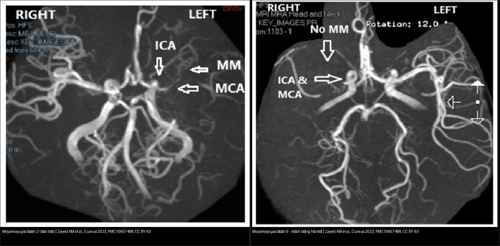
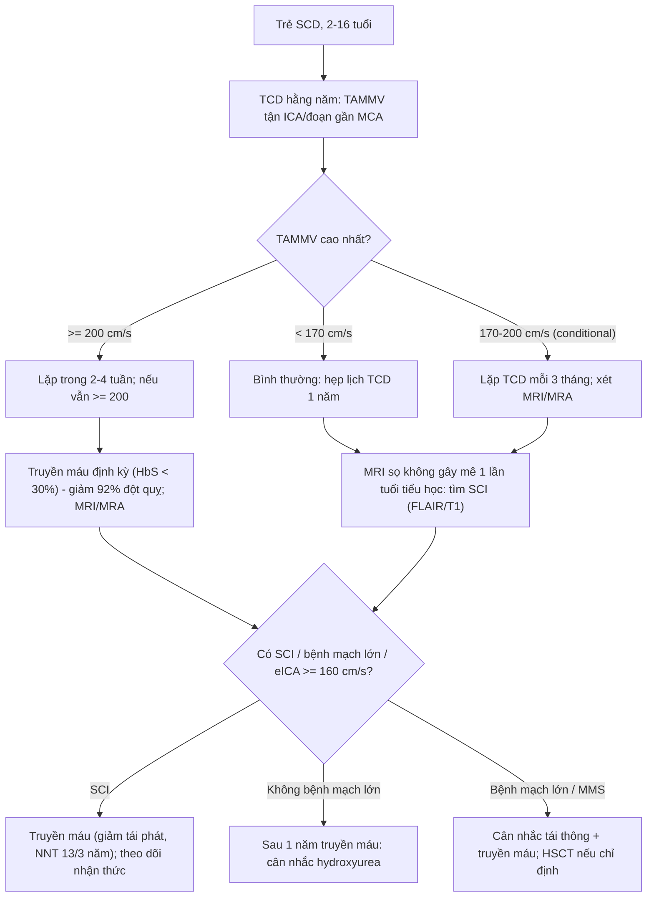
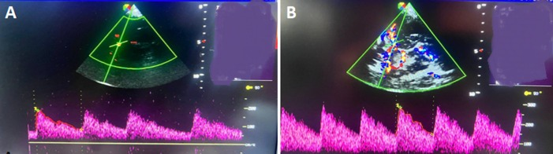
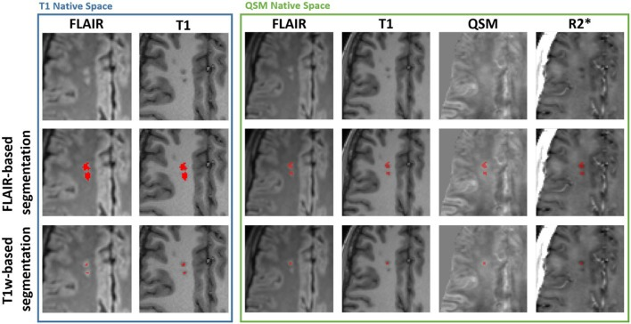
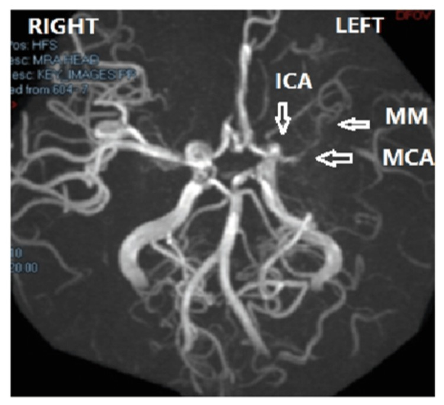
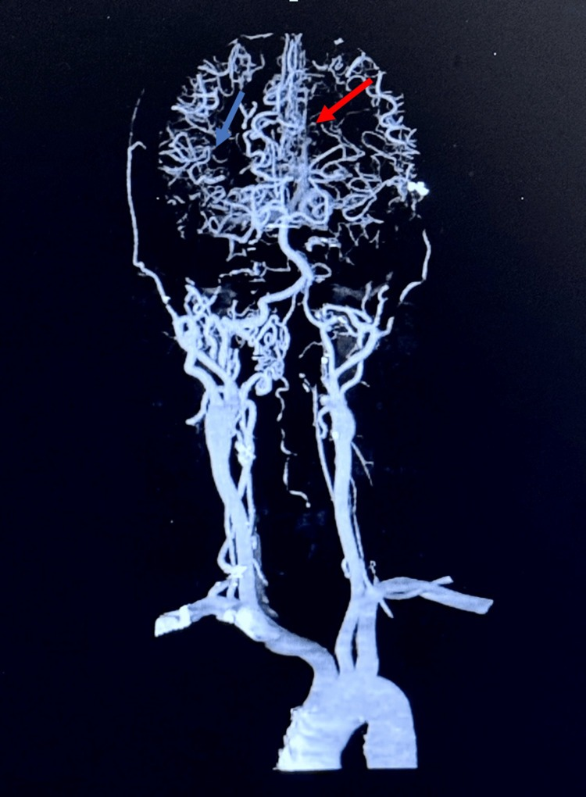
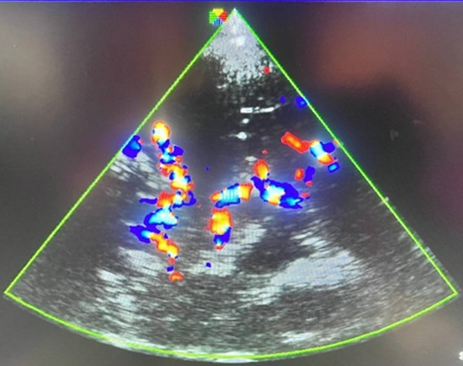

# 661 — Đột quỵ & bệnh mạch não do hồng cầu hình liềm ở trẻ: TCD sàng lọc, đột quỵ im lặng (SCI) & truyền máu định kỳ

**Tags:** `pattern:nhoi-mau-nao` `pattern:nhoi-mau-im-lang` `pattern:hep-tac-mach` `vung:nao-nhi` `score:STOP-TCD` `protocol:TCD` `protocol:MRA-ASL`
**Mức chắc chắn (certainty):** tổng hợp y văn (literature synthesis) — ghép ca nguyên văn (verbatim case) từ các bài open-access; số liệu lấy từ bài gốc có PMCID ghi kèm.

> **Điểm chốt của bài:** bệnh hồng cầu hình liềm (sickle cell disease, SCD) gây **bệnh mạch não lớn (đoạn tận ICA/MCA) + bệnh vi mạch** ngay từ tuổi nhỏ; vì vậy trẻ SCD phải được **sàng lọc bằng siêu âm Doppler xuyên sọ (transcranial Doppler, TCD) hằng năm từ 2–16 tuổi**. Ba chốt cần nhớ: **(1) TCD dùng vận tốc trung bình tối đa (TAMMV)** — `< 170` = bình thường, **`170–200` = trung gian (conditional)**, **`≥ 200 cm/s` = bất thường → truyền máu định kỳ** (giảm nguy cơ đột quỵ đầu tiên **92%**); **(2) đột quỵ IM LẶNG (silent cerebral infarct, SCI)** nhìn thấy trên **FLAIR** nhưng trẻ không triệu chứng — vẫn gây suy giảm nhận thức; **(3)** ngoài mạch trong sọ, còn phải đánh giá **động mạch cảnh trong NGOÀI sọ (extracranial ICA, eICA)**.

## 1. Tổng quan bệnh học – cơ chế hình ảnh

### 1.1 Vì sao hồng cầu hình liềm gây đột quỵ

Hemoglobin S (HbS) khi khử oxy **trùng hợp (polymerization) → hồng cầu hình liềm** → **tắc vi mạch + tan máu** → hoạt hóa nội mô, bám dính bạch cầu, viêm. Hệ quả mạch lớn: **tăng sinh nội mạc (intimal hyperplasia)** làm hẹp/tắc **đoạn tận ICA và đoạn gần MCA** → giảm tưới máu và **hình thành mạch bàng hệ kiểu moyamoya** (DuPont M et al., *Cells* 2026, PMC12939810). Đây là lý do SCD là **nguyên nhân đột quỵ trẻ em hay gặp nhất** và có **yếu tố nguy cơ được quản lý bằng thử nghiệm ngẫu nhiên**.

- **Dịch tễ:** đột quỵ thiếu máu hay gặp nhất ở **2–16 tuổi**; nếu không dự phòng, **tới ~11%** trẻ SCD bị đột quỵ có triệu chứng (Fomekong SD et al., *Pan Afr Med J* 2025, PMC12985353).
- **Thể moyamoya trong SCD:** trong tổng quan gộp, **1,5%** trẻ SCD (1–21 tuổi) được chẩn đoán **hội chứng moyamoya (pediatric SCD-MMS)**, và **49,8%** trong số đó được phẫu thuật tái thông; ước tính toàn cầu **~36.587 ca pSCD-MMS**, tập trung chủ yếu ở châu Phi (Haizel-Cobbina J et al., *Childs Nerv Syst* 2026, PMC13597574).

### 1.2 TẠI SAO TCD phát hiện được — vận tốc tăng = hẹp

Theo định luật liên tục, **tiết diện mạch hẹp → vận tốc dòng tăng**. TCD đo **vận tốc trung bình theo thời gian của đỉnh (time-averaged mean of the maximum velocity, TAMMV)** ở **đoạn tận ICA và đoạn gần MCA** — nơi bệnh mạch lớn hay khu trú. **TAMMV ≥ 200 cm/s** phản ánh **hẹp đủ nặng để tăng nguy cơ đột quỵ ~44 lần (relative risk)** so với trẻ có vận tốc bình thường (Creary S et al., *Curr Neurol Neurosci Rep* 2024, PMC11455693).

### 1.3 TẠI SAO SCI "im lặng" mà vẫn thấy trên MRI

SCI là **nhồi máu nhỏ ở chất trắng sâu phân thủy** (vùng tưới máu thấp), **không gây triệu chứng vận động** nhưng để lại **sẹo thần kinh đệm (gliosis)**:

- Tổn thương **tăng tín hiệu trên FLAIR/T2** (tăng nước tự do trong sẹo) và **giảm tín hiệu trên T1W** (mất mô não bình thường).
- Vì vậy SCI cần **FLAIR độ phân giải cao** — MRI độ phân giải thấp **bỏ sót** nhiều ổ.
- **Định nghĩa ảnh hưởng lớn tới tỉ lệ:** nghiên cứu FLAIR 3T ở trẻ SCD 8–30 tuổi cho **tỉ lệ SCI 24–42%** tùy định nghĩa (liberal/traditional/restrictive) vs **4–23%** ở nhóm chứng (Stotesbury H et al., *Front Neurol* 2022, PMC9277177).
- **Vị trí:** SCI phân bố **chất trắng sâu và cạnh vỏ (juxtacortical) vùng trán–đỉnh** — tương ứng vùng tưới máu phân thủy (Murdoch R et al., *Front Neurol* 2022, PMC9632444).
- **Nguy cơ tăng theo vận tốc:** ở trẻ **TAMMV trong sọ ≥ 200 cm/s**, nguy cơ SCI vẫn **cao tới 37,1% lúc 14 tuổi** **dù đã truyền máu định kỳ** (Bernaudin F et al., *Haematologica* 2026, PMC12775746). **eICA TAMMV ≥ 160 cm/s — kể cả không hẹp — vẫn là yếu tố nguy cơ SCI**.

## 2. Mẫu hình + chẩn đoán phân biệt theo vị trí/tổn thương (Gamut)

- **Nhồi máu có triệu chứng (overt arterial ischemic stroke):** nhồi máu lớn theo lãnh thổ ICA/MCA, DWI sáng/ADC tối, ± mất tín hiệu mạch trên MRA.
- **Nhồi máu im lặng (SCI):** ổ nhỏ chất trắng sâu/cạnh vỏ, **FLAIR sáng/T1 tối**, trẻ **không triệu chứng**.
- **Xuất huyết nội sọ (hemorrhagic stroke):** tăng ở người lớn SCD (phình mạch, mạch bàng hệ dễ vỡ, tăng huyết áp).
- **Hội chứng moyamoya do SCD (SCD-MMS):** hẹp/tắc tận ICA hai bên + bàng hệ nền sọ, tương tự moyamoya ([652](../652-dot-quy-mach-mau-nao-nhi-moyamoya-viem-mach/lesson.md)).
- **Bệnh mạch cảnh trong ngoài sọ (eICA arteriopathy):** hẹp đoạn cổ eICA — nhóm nguy cơ mới, cần **đo eICA**, không chỉ trong sọ.
- **TIA/co giật — chuyển hóa:** hạ oxy, cơn đau, nhiễm trùng có thể gây thiếu máu thần kinh thoáng qua — phân biệt bằng DWI.

## 3. Bảng so sánh phân biệt (ma trận đối chiếu)

| Thực thể (entity) | Hình ảnh điển hình (TCD/MRI/MRA) | Chốt vào (rule-in) | Chốt loại (rule-out) | Gợi ý xác nhận |
|---|---|---|---|---|
| **Nhồi máu có triệu chứng (overt AIS)** | DWI sáng/ADC tối theo lãnh thổ; FLAIR sau 4–6 giờ; MRA mất tín hiệu ICA/MCA | **Triệu chứng cấp + DWI dương theo lãnh thổ** | DWI âm, chỉ FLAIR tăng mạn → SCI/sẹo cũ | MRI + MRA cấp; **truyền máu cấp** + huyết học |
| **Nhồi máu im lặng (SCI)** | **FLAIR/T2 sáng + T1 tối**, ổ nhỏ **chất trắng sâu/cạnh vỏ trán–đỉnh**; trẻ không triệu chứng | **FLAIR sáng + T1 tối + không triệu chứng**; định hướng phân thủy | DWI dương cấp → nhồi máu cấp thật | FLAIR độ phân giải cao ≥ 3T; đối chiếu T1W |
| **Xuất huyết nội sọ** | CT tăng đậm độ; SWI/T2* "blooming"; có thể SAH | **SWI/CT tăng đậm độ + không theo lãnh thổ ĐM** | Nhồi máu tăng đậm độ do vôi → kiểm tra CT | CT/SWI khẩn; tìm phình mạch (MRA/DSA) |
| **SCD-MMS (moyamoya do SCD)** | Hẹp/tắc **tận ICA hai bên** + **bàng hệ "khói thuốc"**; teo vỏ/glosis mạn | **Hẹp hai bên + bàng hệ nền sọ trên nền SCD** | Hẹp một bên ngắn, ổn định → FCA/mạch khác | MRA/CTA + DSA; chấm **Suzuki** |
| **Bệnh mạch cảnh ngoài sọ (eICA)** | Hẹp eICA đoạn cổ; TCD **eICA TAMMV ≥ 160 cm/s** | **eICA TAMMV ≥ 160 cm/s**, kể cả chưa hẹp trên hình thái | eICA bình thường → chỉ theo dõi trong sọ | Siêu âm/TCD eICA; MRA cổ |

*Trái: bệnh nhân SCD, **moyamoya giai đoạn 2** — tắc ĐM cảnh trong trên lều trái + xuất hiện bàng hệ "moyamoya". Phải: **giai đoạn 6** — mất bàng hệ, mạch lớn không còn thấy. Nguồn: Zayed AM et al., Cureus 2023, PMC10657488 — CC BY 4.0. Ảnh ghép letterbox, giữ tỉ lệ.*

## 4. Protocol chụp + hệ phân độ/điểm chuẩn hóa

### 4.1 Sàng lọc TCD (STOP criteria)

| TAMMV (đoạn tận ICA / đoạn gần MCA) | Phân loại | Xử trí |
|---|---|---|
| **70 – < 170 cm/s** | Bình thường | Sàng lọc lại **hằng năm** |
| **170 – ≤ 200 cm/s** | Trung gian (conditional) | **Sàng lọc lại mỗi 3 tháng** |
| **≥ 200 cm/s** | Bất thường | **Lặp lại trong 2–4 tuần**; nếu vẫn ≥ 200 → **truyền máu định kỳ** |

- **Sàng lọc:** siêu âm Doppler **hằng năm, từ 2–16 tuổi**, đo **đoạn tận ICA và đoạn gần MCA**; lấy **vận tốc cao nhất** trong các mạch đo.
- **Đo lúc trạng thái nền**, **KHÔNG đo ngay sau truyền máu** (truyền máu làm vận tốc bình thường hóa tạm thời → âm tính giả) (Creary S et al., PMC11455693).

### 4.2 Sàng lọc MRI/MRA

- **ASH khuyến cáo ít nhất 1 lần MRI sọ không gây mê ở tuổi đầu cấp tiểu học** để tìm **SCI** (Itanyi UD & Nnodu OE, *Front Stroke* 2024, PMC12802630).
- **FLAIR độ phân giải cao + T1W** để phát hiện/đo SCI; **DWI/ADC** khi nghi cấp.
- **MRA đầu + cổ**: tìm hẹp tận ICA/MCA và **eICA**; **luôn đọc source images** (MRA mất tín hiệu dòng chảy → giả hẹp).
- **MRA "moyamoya-like"** ở SCD = bàng hệ nền sọ; đánh giá **Suzuki** khi theo dõi ([652](../652-dot-quy-mach-mau-nao-nhi-moyamoya-viem-mach/lesson.md)).

### 4.3 Điều trị dựa trên ngưỡng

- **Truyền máu định kỳ (chronic transfusion):** giữ **HbS < 30%**; giảm đột quỵ đầu tiên **92%** ở trẻ TCD bất thường (STOP 1998 — dẫn qua PMC12802630). Sau **1 năm** truyền máu, **hydroxyurea** là thay thế hợp lý (nếu **không có bệnh mạch lớn**).
- **SCI:** truyền máu **giảm tái phát** SCI nhưng **không loại trừ hoàn toàn**; **NNT = 13 bệnh nhân trong 3 năm** để tránh 1 ổ mới (SIT trial — dẫn qua PMC11455693).
- **Dự phòng thứ phát:** trẻ đã đột quỵ → **truyền máu kéo dài vô thời hạn**; **ghép tế bào gốc tạo máu (HSCT)** là lựa chọn chữa khỏi.
- **eICA ≥ 160 cm/s** → truyền máu định kỳ + cân nhắc ghép; **160–199 cm/s** → duy trì hydroxyurea (Bernaudin F et al., PMC12775746).

## 5. Biến thể bình thường và cạm bẫy

- **TCD phụ thuộc người làm/thiết bị.** Dùng **TAMMV**, không dùng vận tốc đỉnh tâm thu (PSV); tráo đổi hai đại lượng này làm sai phân loại nguy cơ.
- **Đo ngay sau truyền máu → vận tốc bình thường hóa tạm thời** → **âm tính giả**; luôn đo lúc trạng thái nền.
- **Conditional (170–200) không phải bình thường** — cần **lặp lại mỗi 3 tháng**, không bỏ theo dõi.
- **SCI dễ bị "vô hình"** trên MRI độ phân giải thấp hoặc chỉ đọc T2; cần **FLAIR HR + T1W**; **định nghĩa (liberal/traditional/restrictive) làm thay đổi tỉ lệ** → so sánh nghiên cứu phải cùng định nghĩa.
- **MRA đánh giá quá mức hẹp** do mất tín hiệu dòng chảy; nếu định can thiệp, cần **CTA/DSA**.
- **Đừng quy mọi triệu chứng thần kinh cho "đột quỵ":** cơn đau, hạ oxy, nhiễm trùng, tăng huyết áp có thể gây thiếu máu thoáng qua — **DWI** phân định.
- **"Im lặng" không có nghĩa vô hại:** SCI gắn suy giảm nhận thức và đột quỵ tái phát → phải điều trị, không chỉ theo dõi.
- **Đừng chỉ nhìn trong sọ:** **eICA** (ngoài sọ) là yếu tố nguy cơ SCI độc lập — phải đo cả eICA.

*Phổ Doppler xuyên sọ: (A) động mạch cảnh trong trái — vận tốc bình thường, PSV 176 cm/s, **TAMMV 115 cm/s**; (B) vận tốc cao, PSV 217 cm/s, **TAMMV 191 cm/s = trung gian (conditional)**. Nguồn: Fomekong SD et al., Pan Afr Med J 2025, PMC12985353, CC BY 4.0.*

## 6. Tự lượng giá — Blind Quiz (ảnh trơn ngoài, đáp án ẩn trong khối chi tiết)

**Ca 1 — Trẻ SCD, sàng lọc TCD: hai phổ Doppler (A và B). Đọc vận tốc và phân loại nguy cơ.**

- Gợi ý: cùng đo động mạch cảnh trong; đo lúc trạng thái nền.
- Câu hỏi: (A) và (B) khác nhau thế nào về vận tốc? Mỗi trường hợp xử trí ra sao?

<b>Bấm để hiện đáp án (findings + chẩn đoán)</b>

- **Dấu hiệu:** (A) PSV 176, **TAMMV 115 cm/s** → **bình thường** (< 170). (B) PSV 217, **TAMMV 191 cm/s** → **trung gian/conditional** (170–200).
- **Chẩn đoán/xử trí:** trung gian → **lặp TCD mỗi 3 tháng** (không phải bình thường, cũng chưa cần truyền máu ngay); bình thường → hẹp lịch **1 năm**.
- **Cơ chế:** vận tốc tăng phản ánh tiết diện mạch hẹp; dùng **TAMMV** theo STOP, không dùng PSV.
- Nguồn ảnh: Fomekong SD et al., Pan Afr Med J 2025 (PMC12985353), Fig. 3, CC BY 4.0.

**Ca 2 — Trẻ SCD, MRI sọ không gây mê tuổi tiểu học: FLAIR và T1W (cùng 1 ổ). Đây là tổn thương gì?**

- Gợi ý: trẻ không triệu chứng vận động; khung xanh đánh dấu các ổ.
- Câu hỏi: Tín hiệu FLAIR và T1 của ổ? Nằm ở vùng nào? Vì sao gọi là "im lặng"?

<b>Bấm để hiện đáp án (findings + chẩn đoán)</b>

- **Dấu hiệu:** ổ **FLAIR tăng tín hiệu** (tăng nước trong sẹo) + **T1 giảm tín hiệu** (mất mô não); phân bố **chất trắng sâu/cạnh vỏ**.
- **Chẩn đoán:** **nhồi máu im lặng (SCI)** — nhồi máu nhỏ vùng tưới máu thấp, **không gây liệt** nhưng gắn suy giảm nhận thức và đột quỵ tái phát.
- **Định nghĩa quan trọng:** áp ngưỡng "restrictive" (kèm T1 tối, > 3 mm) làm giảm số ổ so với "liberal".
- Nguồn ảnh: Murdoch R et al., Front Neurol 2022 (PMC9632444), Fig. 1, CC BY 4.0.

**Ca 3 — Trẻ SCD, MRA sọ: bên trái có bất thường gì? Xếp giai đoạn moyamoya.**

- Gợi ý: nhãn RIGHT/LEFT; SCD có hội chứng moyamoya.
- Câu hỏi: Mô tả bất thường mạch bên trái? Bàng hệ nền sọ có chưa?

<b>Bấm để hiện đáp án (findings + chẩn đoán)</b>

- **Dấu hiệu:** **tắc/tắc nghẽn ĐM cảnh trong trên lều trái** (mũi tên dọc) và **MCA trái** (mũi tên ngang) với **xuất hiện bàng hệ kiểu moyamoya**.
- **Chẩn đoán:** **moyamoya giai đoạn 2** trên nền **SCD** (bệnh mạch máu não thứ phát — SCD-MMS). Bàng hệ đã xuất hiện nhưng mạch lớn còn hẹp/tắc rõ.
- **Vì sao quan trọng:** tiến triển tới giai đoạn 6 sẽ **mất hoàn toàn bàng hệ** (xem Ca 5) → cho thấy bệnh **tiến triển**, cần theo dõi MRA + truyền máu/tái thông.
- Nguồn ảnh: Zayed AM et al., Cureus 2023 (PMC10657488), Fig. 1, CC BY 4.0.

**Ca 4 — Trẻ SCD có bệnh mạch, CTA đầu–cổ dựng 3D: dấu hiệu nào là "khói thuốc"?**

- Gợi ý: CTA đầu + cổ; bệnh nhân SCD.
- Câu hỏi: Nhận diện bàng hệ bất thường; phân biệt với nút AVM?

<b>Bấm để hiện đáp án (findings + chẩn đoán)</b>

- **Dấu hiệu:** **mạng mạch bàng hệ giãn bất thường tụ ở nền sọ = "puff of smoke"** (mũi tên đỏ); **kết thúc đột ngột đoạn xa M3 phải** do thay đổi tắc mạch của SCD (mũi tên xanh).
- **Chẩn đoán:** **bệnh mạch máu não do SCD kèm hiện tượng moyamoya** — bàng hệ là mạch nhỏ chảy chậm, **không phải nidus AVM** (không có shunt sớm).
- **Cơ chế:** tăng sinh nội mạc do SCD làm hẹp mạch lớn → mạch bàng hệ nền sọ giãn ra.
- Nguồn ảnh: Carpintieri S et al., Cureus 2024 (PMC11412159), Fig. 3, CC BY 4.0.

**Ca 5 — Ảnh ghép: tiến triển moyamoya do SCD từ giai đoạn 2 → giai đoạn 6. Điều gì mất đi?**

<b>Bấm để hiện đáp án (findings + chẩn đoán)</b>

- **Trái (giai đoạn 2):** tắc ICA trên lều + **bàng hệ moyamoya mới xuất hiện**.
- **Phải (giai đoạn 6):** mạch lớn đã tắc hoàn toàn; **bàng hệ "khói thuốc" ĐÃ MẤT** → không còn đường vòng nội sọ.
- **Ý nghĩa:** đây là lý do phải **sàng lọc/phát hiện sớm** và theo dõi; mất bàng hệ = mất khả năng bù nội sọ, chỉ còn bàng hệ ngoài sọ.
- Nguồn ảnh: Zayed AM et al., Cureus 2023 (PMC10657488), Fig. 1 & 3, CC BY 4.0; ghép bằng `tools/make_composite.py`.

**Ca 6 — Trẻ SCD, siêu âm màu vòng động mạch (circle of Willis) qua xương thái dương. Nhìn gì và để làm gì?**

<b>Bấm để hiện đáp án (findings + chẩn đoán)</b>

- **Dấu hiệu:** cấu trúc vòng động mạch Willis trên siêu âm màu — dùng để **định hướng mạch trước khi đặt cửa sổ Doppler** đo TAMMV.
- **Vì sao:** TCD "mù" (blind) cần định vị giải phẫu; siêu âm màu + ghi phổ giúp đo đúng **đoạn tận ICA/đoạn gần MCA** và **eICA**.
- **Chốt lâm sàng:** vận tốc cao **có tính khu trú** theo mạch, không phải tăng chung do thiếu máu.
- Nguồn ảnh: Fomekong SD et al., Pan Afr Med J 2025 (PMC12985353), Fig. 2, CC BY 4.0.

## Bài liên quan chéo
- [652 – Đột quỵ & bệnh mạch máu não ở trẻ (moyamoya, FCA, viêm mạch, CVST)](../652-dot-quy-mach-mau-nao-nhi-moyamoya-viem-mach/lesson.md) — SCD là nguyên nhân moyamoya syndrome; Suzuki, FCASS, tái thông.
- [660 – Theo dõi sau tái thông moyamoya ở trẻ (CHS, thiếu máu muộn)](../660-theo-doi-sau-tai-thong-moyamoya-o-tre/lesson.md) — theo dõi sau phẫu thuật ở trẻ SCD-MMS.
- [655 – HIE sơ sinh & dị tật bẩm sinh hệ thần kinh](../655-hie-so-sinh-va-di-dang-bam-sinh-than-kinh/lesson.md) — phân biệt tổn thương thiếu máu ở trẻ.
- [650 – Thần kinh nhi: xuất huyết mầm & u hố sau](../650-than-kinh-nhi-xuat-huyet-mam-va-u-ho-sau/lesson.md) — xuất huyết nội sọ ở trẻ.

## Ảnh
- Tên file: `661_..._Modality_SourceID.jpg`; nguồn + giấy phép từng ảnh trong `images/CREDITS.md`.
- Toàn bộ ảnh trong bài là **CC BY 4.0** (được phép tải/ghép, ghi nguồn).
- Không tải được/paywall: chỉ dẫn link trong `sources.md`.

> **Disclaimer:** Bài học dành cho mục đích học tập, không dùng để chẩn đoán độc lập khi chưa có bác sĩ chuyên khoa hướng dẫn. Ngưỡng truyền máu, sàng lọc và liều thuốc phải theo phác đồ tại cơ sở.
