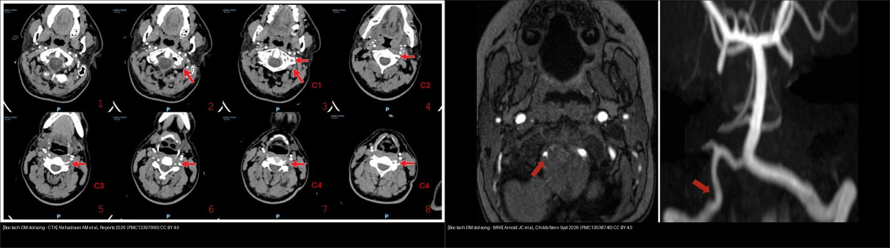
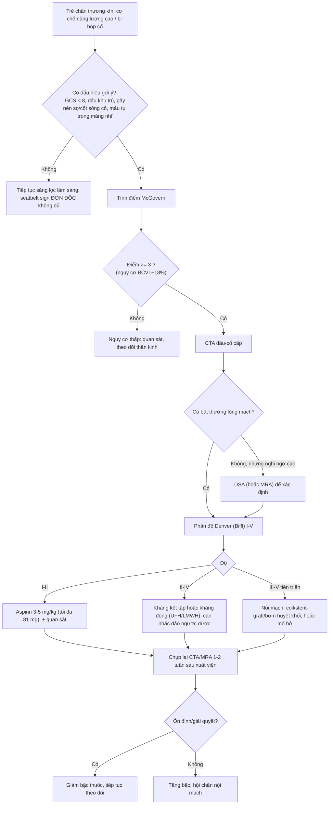
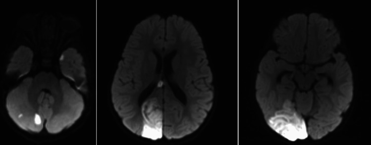
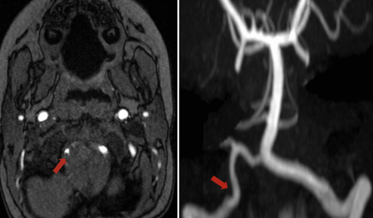
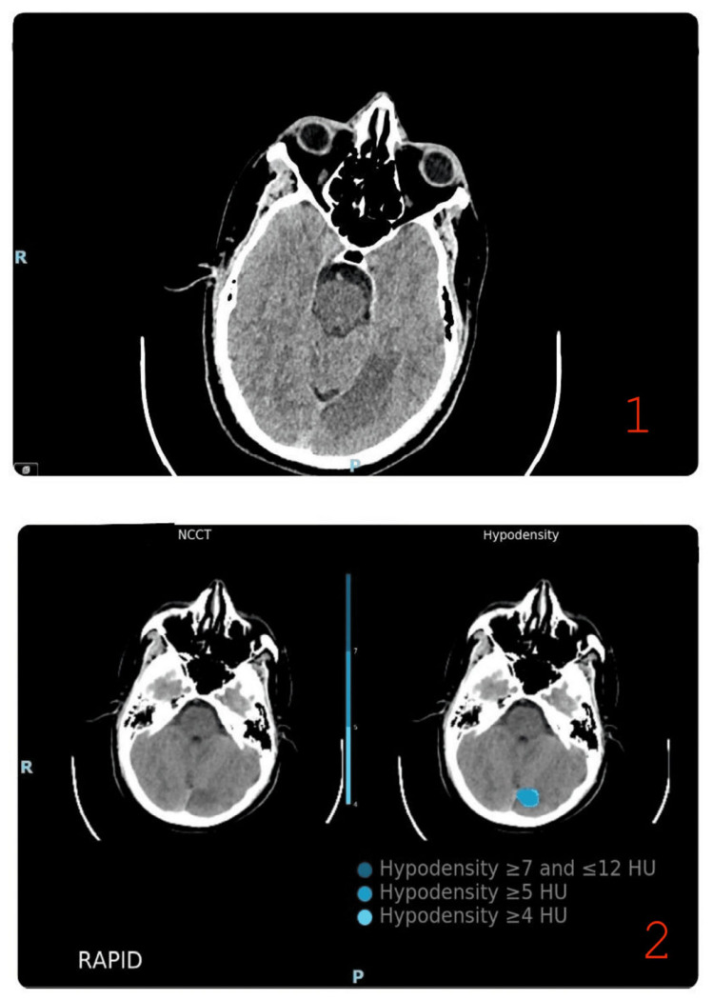
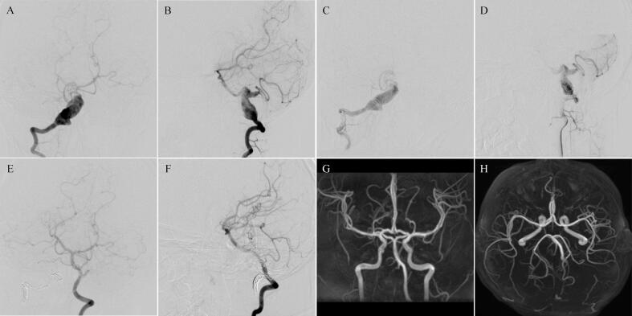

# 662 — Bóc tách động mạch cổ ở trẻ & sau chấn thương cổ: tiêu chuẩn Denver, CTA/MRA cổ, chống huyết khối & theo dõi giả phình

**Tags:** `pattern:boc-tach-mach` `pattern:hep-tac-mach` `pattern:nhoi-mau-nao` `pattern:gia-phinh-mach` `vung:mach-co-dau-co` `vung:nao-nhi` `score:Denver-Biffl` `score:McGovern` `protocol:CTA-co` `protocol:MRA-co`
**Mức chắc chắn (certainty):** tổng hợp y văn (literature synthesis) — ghép dữ liệu tổng quan có PMCID với ca nguyên văn open-access; số liệu để nguyên kèm nguồn, không suy diễn.

> **Điểm chốt của bài:** bóc tách động mạch cổ (cervical artery dissection, CAD) ở trẻ gần như luôn là **chấn thương mạch máu não do chấn thương kín (blunt cerebrovascular injury, BCVI)** — hậu quả của cơ chế năng lượng cao (tai nạn xe, xe đạp/người đi bộ, ngã cao, bị bóp cổ). Ba chốt: **(1) ai cần chụp** — dùng **tiêu chuẩn sàng lọc đặc thù trẻ em (McGovern)**, điểm **≥ 3 = nguy cơ BCVI 18% → chụp CTA**; **(2) chụp gì** — **CTA là tuyến đầu** trong cấp cứu, **MRA/CTA độ phân giải cao để theo dõi** 1–2 tuần sau xuất viện; **(3) phân độ Denver (Biffl) I–V quyết định điều trị** — độ thấp dùng **đơn trị kháng kết tập tiểu cầu (aspirin 3–5 mg/kg, tối đa 81 mg)**, độ cao cân nhắc **kháng đông/hướng nội mạch**, đích là **phòng đột quỵ (stroke) — nguồn bệnh tật chính**.

## 1. Tổng quan bệnh học – cơ chế hình ảnh

### 1.1 Vì sao chấn thương cổ gây bóc tách

Động mạch cảnh trong (ICA) và động mạch đốt sống (vertebral artery, VA) **bị cố định ở hai đầu nhưng di động ở giữa** — các đoạn "neo" này là nơi chịu lực cắt (shear) khi cổ tăng duỗi/xoay/xoắn. Vùng tổn thương hay gặp:

- **ICA ngoài sọ** căng vắt qua **mỏm ngang đốt sống cổ C1–C3**; **ICA trong sọ** khi qua **đoạn đá (petrous) và đoạn hang (cavernous)** — nơi xương dễ vỡ trong chấn thương (Alkhadrawi AM et al., *Reports* 2026, PMC13397990; Murillo A et al., *J Clin Med* 2026, PMC13257469).
- **VA đoạn V3 (C1–C2)** nằm trong **lỗ ngang** linh động — đoạn cột sống cổ trên dễ tổn thương nhất; **VA trong sọ (V4)** ngắn, được dịch não tủy bảo vệ → ít tổn thương hơn.
- Vì vậy **gãy nền sọ có liên quan ống cảnh/xương đá là yếu tố tương quan mạnh nhất (17–68%)** với tổn thương ICA; **gãy cột sống cổ trên (C1–C4) tương quan với tổn thương VA (5.9–26%)** (Murillo et al., PMC13257469).

Cơ chế phân tử: **rách nội mạc (intimal tear) → máu tràn vào thành mạch tạo huyết khối trong thành (intramural hematoma)** → hẹp/không đều lòng mạch, có thể **tắc (occlusion)** hoặc **giả phình (pseudoaneurysm)**. Huyết khối tại chỗ **đi theo dòng → tắc mạch xa (thromboembolism)** gây **đột quỵ tuần hoàn sau (posterior circulation)** hoặc nhồi máu theo lãnh thổ ICA/MCA.

### 1.2 TẠI SAO mỗi phương thức "thấy" được bóc tách

- **CTA:** bơm thuốc cản quang → **thuốc chỉ vào lòng thật**; **huyết khối trong thành KHÔNG ngấm thuốc** nên hiện ra như **dải dày thành giảm đậm độ ("moonlike/hemilunar")** kèm lòng mạch **hẹp không đều, thuôn nhọn hình ngọn nến (flame-like taper)** hoặc **giả phình lồi thành** (Alkhadrawi et al., PMC13397990). Độ nhạy CTA so với DSA **66–98%**, độ đặc hiệu **92–100%**.
- **MRI/MRA:** **MRA (TOF) chỉ đánh giá LÒNG mạch** → thấy **bất thường/tắc lòng mạch**, nhưng **bỏ sót huyết khối trong thành và tổn thương nội mạc nhỏ**: độ nhạy MRA chỉ **50% (cảnh) / 47% (đốt sống)** khi so với CTA; so với DSA đạt **95% (bóc tách cảnh) / 60% (bóc tách đốt sống)**. **T1W fat-sat** có thể thấy **huyết khối trong thành tăng tín hiệu** (methemoglobin) — dấu hiệu đặc hiệu nhưng phụ thuộc thời điểm.
- **DWI/ADC:** nhồi máu cấp = **DWI sáng, ADC tối**; ở trẻ đau đầu/vận động không đặc hiệu, **DWI phân thủy sau (chẩm–tiểu não)** là chìa khóa định hướng mạch đốt sống (Arnold JC et al., *Childs Nerv Syst* 2026, PMC13038740).
- **DSA:** tiêu chuẩn tham chiếu cũ, phân giải không gian–thời gian cao nhất, nhưng **xâm lấn**: biến chứng mạch bẹn **4.2%**, tổn thương mạch não do thủ thuật **1.8%**, biến chứng thần kinh vĩnh viễn **0.07%** → để dành cho ca **CTA/MRA không kết luận nhưng nghi ngờ cao**.

### 1.3 Ngưỡng định lượng nền

- **Tỷ lệ BCVI ở trẻ chấn thương kín: 0,03–0,5%** (Krüger L et al., BMC Emerg Med 2026, PMC13374070).
- Trong **956 trẻ chấn thương có CT** tại một trung tâm cấp I Đức: **BCVI 0,6% (6 ca)**, **70%** được chụp thêm CTA (Krüger et al., PMC13374070).
- **Đột quỵ ở trẻ có BCVI: 3,9–37,4%**; ở nhóm bị đột quỵ, **tử vong tới 33%** (Murillo et al., PMC13257469).
- **Độ tổn thương thấp (Denver I–II): 50–75%** tổng số ca (Murillo et al., PMC13257469).
- **Điểm McGovern ≥ 3: nguy cơ BCVI 18%** → chỉ định chụp (Murillo et al., PMC13257469).

## 2. Mẫu hình + chẩn đoán phân biệt theo vị trí (Gamut)

- **Bóc tách do chấn thương (traumatic BCVI)** — đa số trẻ: CTA lòng mạch không đều/hẹp/tắc/giả phình ở ICA ngoài sọ hoặc VA V2–V3, kèm **gãy nền sọ/gãy cột sống cổ**.
- **Bóc tách tự phát (spontaneous CAD) trên nền bệnh mô liên kết** (Marfan, Ehlers-Danlos, Loeys-Dietz, loạn sản cơ–xơ): bệnh nhân trẻ, **không hoặc chấn thương rất nhẹ**, kèm dấu hiệu marfanoid, phình gốc ĐMC (Alkhadrawi et al., PMC13397990).
- **Bóc tách sau động tác cổ (chiropractic manipulation, tư thế yoga, ho dữ dội):** trẻ nhỏ có thể **biểu hiện không đặc hiệu** (lừ đừ, nôn, tím tái) — ca 20 tháng tuổi sau nắn cổ (Arnold et al., PMC13038740).
- **Giả phình/động mạch lớn dạng bóc tách (dissecting aneurysm):** lồi thành mạch lớn, có thể liên quan PICA → điều trị nội mạch/vòng xoắn (Zhang Y et al., *Int J Surg Case Rep* 2025, PMC12481094).
- **Bắt chước (mimics):** co mạch (RCVS), loạn sản cơ–xơ (FMD), **động mạch đốt sống thiểu sản (hypoplastic VA) giả "tắc"**, mảng xơ vữa (hiếm ở trẻ), viêm mạch, đau nửa đầu có co mạch.

## 3. Bảng so sánh phân biệt (ma trận đối chiếu)

| Thực thể (entity) | Hình ảnh điển hình | Chốt vào (rule-in) | Chốt loại (rule-out) | Gợi ý xác nhận |
|---|---|---|---|---|
| **Bóc tách do chấn thương (BCVI)** | CTA: dày thành giảm đậm độ + lòng hẹp không đều/thuôn nhọn; ± tắc/giả phình | **Cơ chế năng lượng cao + gãy nền sọ/cột sống cổ + bất thường lòng mạch trên CTA** | Lòng mạch đều, không hẹp ở mọi thì và không tổn thương xương liên quan | CTA đầu–cổ; phân độ **Denver (Biffl) I–V**; DSA nếu không kết luận |
| **Bóc tách tự phát (bệnh mô liên kết)** | VA/cảnh tắc/hẹp dài đoạn; ĐMC giãn; dấu hiệu marfanoid | **Trẻ/người trẻ + không chấn thương + tắc/hẹp đa đoạn + bệnh nền mô liên kết** | Chấn thương nặng tương xứng giải thích trọn vẹn tổn thương | MRA/CTA cổ + siêu âm tim (gốc ĐMC) + hội chẩn Ghent |
| **RCVS (co mạch có hồi phục)** | "Chuỗi hạt" **nhiều mạch, hai bên, hồi phục < 3 tháng** | Đau đầu sét đánh tái diễn + co mạch **nhiều mạch đối xứng** rồi hồi phục | Tổn thương **khu trú một mạch**, không hồi phục → bóc tách | MRA/CTA lặp lại 8–12 tuần (đối chiếu hồi phục) |
| **Loạn sản cơ–xơ (FMD)** | "Chuỗi ngọc" (string-of-beads) **đoạn giữa ICA**, nữ trẻ, **hai bên** | Nhiều chỗ hẹp–giãn xen kẽ **hai bên**, không có huyết khối trong thành | Bất thường khu trú một đoạn sau chấn thương | CTA/MRA cổ; đôi khi DSA |
| **VA thiểu sản (hypoplastic VA)** | Một VA **nhỏ đều suốt chiều dài**, VA đối diện trội | Mạch **nhỏ nhưng đồng dạng**, đối bên trội, không dày thành | Bất thường **không đều/khu trú** → bóc tách | Đối chiếu đối bên + MRA/CTA cả hai bên |
| **Giả phình dạng bóc tách lớn** | Lồi thành mạch lớn, ± liên quan PICA, ± huyết khối trong túi | **Túi lồi ngấm thuốc giữ hình, có cổ rộng**, khối choán chỗ | Chỉ hẹp lòng không có túi → bóc tách hẹp đơn thuần | DSA chọn lọc (và để can thiệp nội mạch) |

*Hai ca khác nhau minh họa hai phương thức. **Trái (CTA):** khuyết thuốc rời rạc trong lòng ĐM đốt sống trái tại C4 và C2 trên CTA ở người lớn có hội chứng Marfan (bóc tách tự phát). **Phải (MRA):** bất thường lòng mạch đoạn V4 ĐM đốt sống phải ở bé 20 tháng sau nắn cổ. Nguồn: Alkhadrawi AM et al., Reports 2026, PMC13397990; Arnold JC et al., Childs Nerv Syst 2026, PMC13038740 — CC BY 4.0. Ghép bằng `tools/make_composite.py`, giữ tỉ lệ.*

## 4. Protocol chụp + hệ phân độ/điểm chuẩn hóa

### 4.1 Sàng lọc — ai cần chụp mạch cổ?

Tiêu chuẩn người lớn (Denver 2012, EAST 2010) **kém đặc hiệu ở trẻ** → dùng công cụ đặc thù trẻ em:

| Tiêu chuẩn | Độ nhạy | Độ đặc hiệu | Ghi chú |
|---|---|---|---|
| **Memphis (2002)** | 88–91,7% | 71,1–77,5% | Nhạy nhất nhưng đặc hiệu thấp nhất → nhiều chiếu xạ oan |
| **Utah (2017)** | 45,8–52,4% | 91,3–95,8% | Đặc hiệu cao nhất nhưng **bỏ sót nhiều** |
| **McGovern (2018) — điểm ≥ 3** | 75–81% (bản gốc); **90%** (một số nghiên cứu); **100%**, AUC 0,960 (Krüger) | 71–89,5%; **96,7%**; **83,8%** (Krüger) | Cân bằng nhất; tính cả **cơ chế chấn thương (MOI)**; tối đa 11 điểm |

- **Dấu hiệu lâm sàng gợi ý chụp:** GCS < 8; đồng tử không đều; dấu thần kinh khu trú; **tiếng thổi vùng cổ**; máu tụ quanh hốc mắt ("racoon eyes"); **máu tụ trong màng nhĩ (hemotympanum)**; rò dịch não tủy; **đau cột sống cổ giữa**; gãy xương đầu–mặt–cổ rõ. **Dấu dây an toàn (seatbelt sign) ĐƠN ĐỘC không đủ** để chỉ định chụp (Murillo et al., PMC13257469).
- **Cơ chế hay gặp:** tai nạn xe (5,9–60%); xe/người đi bộ (7,5–23,5%); ngã (5,9–24,2%); **bị bóp cổ/treo cổ (hanging) là cơ chế tương quan bền vững nhất — 0,9–5,6% ca có BCVI**.

### 4.2 Phân độ Denver (Biffl) I–V

*Sơ đồ phân độ Denver (Biffl) I–V: I = bất thường nội mạc/ bóc tách < 25% hẹp lòng; II = bóc tách/huyết khối trong thành ≥ 25% hẹp; III = giả phình; IV = tắc hoàn toàn; V = đứt rời có thoát mạch tự do. Nguồn: Murillo A et al., J Clin Med 2026, PMC13257469 — CC BY 4.0.*

- **Độ I–II = 50–75%** tổng số ca; **độ III 1,7–21%**; **độ IV 4–18%**; **độ V < 10%**.
- **Độ Denver càng cao → nguy cơ đột quỵ càng tăng**; tử vong tương quan chặt hơn với điểm chấn thương (ISS) và chấn thương sọ não kèm theo.

### 4.3 Điều trị theo độ & theo dõi

- **Quan sát (observation):** tới **52%** trẻ BCVI không được điều trị nội–ngoại khoa (thường là độ thấp, hoặc chống chỉ định vì đa chấn thương); nếu chọn quan sát phải **theo dõi thần kinh mỗi 1–2 giờ**.
- **Kháng kết tập tiểu cầu (đầu tay):** **aspirin 3–5 mg/kg/ngày, tối đa 81 mg**; clopidogrel khi cần hoặc phối hợp sau đặt stent. **Kháng kết tập không thua kháng đông** về phòng đột quỵ/biến chứng xuất huyết → ưu tiên ở trẻ.
- **Kháng đông (UFH/LMWH):** dùng cho **độ cao (II–IV)** hoặc khi cần **đảo ngược nhanh** ở bệnh nhân đa chấn thương.
- **Can thiệp nội mạch/mổ:** khi **giả phình to lên, huyết khối, tắc hoàn toàn (độ III–V)**, hoặc **tiến triển dù đã điều trị nội khoa**; nội mạch (bơm huyết khối, stent graft, nút mạch) linh hoạt hơn mổ hở. Điển hình: nút vòng xoắn (coil) động mạch đốt sống mẹ ở **2 bé trai 10 tuổi** có giả phình dạng bóc tách lớn liên quan PICA — hồi phục hoàn toàn, không tái phát ở 1 năm (Zhang et al., PMC12481094).
- **Theo dõi:** hầu hết chụp lại **1–2 tuần sau xuất viện**; **ổn định/giải quyết → giảm bậc thuốc; nặng lên → tăng bậc, hội chẩn nội mạch**. Ưu tiên **CTA** cho độ cao; xem xét **MRA/siêu âm (không chiếu xạ)** cho theo dõi (Murillo et al., PMC13257469).

## 5. Biến thể bình thường và cạm bẫy

- **Áp tiêu chuẩn người lớn cho trẻ → chụp tràn lan:** Denver/EAST kém đặc hiệu ở trẻ, làm tăng chiếu xạ. Một **CTA đầu chiếu ~15–30 mGy vào tủy xương → tăng ~1,8 lần nguy cơ ung thư huyết học** (Murillo et al., PMC13257469) — đây là lý do **ALARA** đặc biệt quan trọng ở trẻ.
- **"Dấu dây an toàn" một mình không phải chỉ định:** giá trị tiên đoán thấp, không dùng đơn độc.
- **MRA bình thường KHÔNG loại trừ bóc tách:** MRA chỉ thấy lòng mạch (độ nhạy **50% cảnh / 47% đốt sống** so với CTA), bỏ sót huyết khối trong thành → nếu nghi ngờ cao, cần **CTA/T1W fat-sat/DSA**.
- **Độ thấp vẫn có thể đột quỵ — nhất là trẻ nhỏ:** trẻ **< 11 tuổi** có nguy cơ đột quỵ **2–6,2%** dù tổn thương độ thấp (nghịch lý "độ thấp – nguy cơ cao"), và tỷ lệ được khởi trị kháng huyết khối chỉ **18,8–22,4%** (so với **3–4,1%** và **35,5–63,6%** ở trẻ lớn hơn).
- **Trẻ biểu hiện KHÔNG đặc hiệu:** lừ đừ, nôn, tím tái, khó thở (ca bé 20 tháng sau nắn cổ) — dễ bỏ sót vì không có "đau cổ" như người lớn.
- **Động mạch đốt sống thiểu sản giả "tắc":** mạch nhỏ đều suốt chiều dài, đối bên trội, **không dày thành** → đừng chẩn đoán bóc tách/tắc (nhắc lại ca chiropractic còn thấy VA phải thiểu sản).
- **Coi chừng bắt chước:** co mạch do RCVS/đau nửa đầu có thể trông giống bất thường mạch; **hồi phục trên phim lặp lại** là điểm khác biệt ([219](../219-pres-rcvs/lesson.md)).

*DWI cho thấy nhồi máu cấp **nhiều ổ ở thùy chẩm phải và tiểu não phải** (tăng tín hiệu) — biểu hiện "lừ đừ, nôn, tím tái" hoàn toàn không đặc hiệu của bóc tách động mạch đốt sống. Nguồn: Arnold JC et al., Childs Nerv Syst 2026, PMC13038740 — CC BY 4.0.*

## 6. Tự lượng giá — Blind Quiz (ảnh trơn ngoài, đáp án ẩn trong khối chi tiết)

**Ca 1 — Bé trai 20 tháng tuổi, lừ đừ – nôn – tím tái sau khi được nắn cổ. Đọc DWI.**

- Gợi ý lâm sàng: không có chấn thương đầu rõ; khởi phát cấp sau một buổi nắn cổ.
- Câu hỏi: Tổn thương ở vùng nào? Vì sao gợi ý tổn thương mạch đốt sống? Cần chụp gì tiếp theo?

<b>Bấm để hiện đáp án (findings + chẩn đoán)</b>

- **Dấu hiệu:** DWI tăng tín hiệu **nhiều ổ thùy chẩm phải + tiểu não phải** = nhồi máu cấp **tuần hoàn sau**.
- **Chẩn đoán:** **nhồi máu tuần hoàn sau do bóc tách động mạch đốt sống phải (V4)** sau nắn cổ — xác nhận bằng MRA (Ca 2).
- **Cơ chế:** động tác cổ gây căng/xoắn VA ở đoạn V3–V4 → rách nội mạc → huyết khối → tắc mạch xa.
- Nguồn ảnh: Arnold JC et al., Childs Nerv Syst 2026 (PMC13038740), Fig. 1, CC BY 4.0.

**Ca 2 — Cùng bệnh nhân: MRA não. Bất thường mạch nằm ở đâu?**

- Gợi ý: so sánh hai bên; chú ý đoạn xuyên màng cứng của VA.
- Câu hỏi: Mô tả bất thường? Vì sao MRA có thể bỏ sót bóc tách?

<b>Bấm để hiện đáp án (findings + chẩn đoán)</b>

- **Dấu hiệu:** **bất thường lòng mạch (luminal irregularity) đoạn V4 động mạch đốt sống phải** (mũi tên); trái là ảnh axial T2, phải là MRA.
- **Chẩn đoán:** **bóc tách động mạch đốt sống phải** — trẻ được điều trị bảo tồn, xuất viện **không di chứng thần kinh**.
- **Vì sao MRA dễ bỏ sót:** MRA chỉ đánh giá lòng mạch; **huyết khối trong thành không thấy được** → độ nhạy thấp (47–60% với VA).
- Nguồn ảnh: Arnold JC et al., Childs Nerv Syst 2026 (PMC13038740), Fig. 2, CC BY 4.0.

**Ca 3 — Ảnh ghép: cùng là bóc tách động mạch đốt sống, hai phương thức khác nhau. Nhận xét?**

<b>Bấm để hiện đáp án (findings + chẩn đoán)</b>

- **Trái (CTA):** **khuyết thuốc rời rạc (discontinuous intraluminal filling defects) trong lòng ĐM đốt sống trái tại C4 và C2** → huyết khối/loét nội mạc, ở người lớn có Marfan (bóc tách tự phát).
- **Phải (MRA):** **bất thường lòng mạch V4** ở bé 20 tháng sau nắn cổ.
- **Ý nghĩa:** CTA (nhạy với thành mạch + khuyết thuốc) là tuyến đầu cấp cứu; MRA tiện theo dõi nhưng **chỉ thấy lòng mạch**. Hai ca khác nhau nên chỉ so sánh **hình thái**, không so sánh trị số.
- Nguồn ảnh: Alkhadrawi et al., Reports 2026 (PMC13397990) và Arnold et al., Childs Nerv Syst 2026 (PMC13038740) — CC BY 4.0; ghép bằng `tools/make_composite.py`.

**Ca 4 — Người bệnh trẻ có nhồi máu tuần hoàn sau bí ẩn và dấu hiệu marfanoid. CT và CTA cho thấy gì?**

- Gợi ý: nhồi máu chẩm trái + PICA trái; có bong bóng (+) trên siêu âm tim.
- Câu hỏi: Vì sao phải nghĩ bóc tách tự phát, không quy cho PFO? Bước tiếp theo?

<b>Bấm để hiện đáp án (findings + chẩn đoán)</b>

- **Dấu hiệu:** CT không cản quang: **giảm đậm độ thùy chẩm trái và tiểu não dưới (PICA) trái**; siêu âm tim: giãn nhẹ gốc ĐMC (4,0 cm, Z +2,53) + **PFO nhỏ với bong bóng (+)**, RoPE 6.
- **Chẩn đoán:** **bóc tách ĐM đốt sống trái tự phát** là tổn thương thủ phạm (ổ nhồi máu khớp lãnh thổ mạch bóc tách); **PFO là tình cờ** — không quy nhân quả cho PFO.
- **Xử trí:** tiêu sơi huyết tĩnh mạch → kháng kết tập tiểu cầu + statin mạnh + kiểm soát HA/đường huyết; đánh giá Ghent.
- Nguồn ảnh: Alkhadrawi AM et al., Reports 2026 (PMC13397990), Fig. 1, CC BY 4.0.

**Ca 5 — Bé trai 10 tuổi, đau đầu 3 tháng, DSA động mạch đốt sống phải. Chẩn đoán và hướng xử trí?**

- Gợi ý: túi lồi lớn ở VA phải, liên quan động mạch tiểu não sau dưới (PICA).
- Câu hỏi: Đây là độ mấy theo Denver? Vì sao chọn nút mạch (coil) động mạch mẹ?

<b>Bấm để hiện đáp án (findings + chẩn đoán)</b>

- **Dấu hiệu:** DSA trước mổ (A, B) cho thấy **giả phình dạng bóc tách lớn (giant dissecting aneurysm) ở VA phải, liên quan PICA**; các thì sau nút mạch cho thấy tắc hoàn toàn túi phình và VA phải trở nên mảnh, **VA trái trội** (E–H).
- **Chẩn đoán:** bóc tách có **giả phình = Denver độ III**; điều trị **nút vòng xoắn (coil) động mạch mẹ** vì tổn thương đã mất khả năng chứa đựng, và VA trái đủ cấp máu bàng hệ.
- **Kết cục:** hồi phục hoàn toàn, không nhồi máu mới, không triệu chứng ở 1 năm (mRS 0 ở 70% ca bóc tách đốt sống trẻ theo y văn).
- Nguồn ảnh: Zhang Y et al., Int J Surg Case Rep 2025 (PMC12481094), Fig. 1, CC BY 4.0.

**Ca 6 — Sơ đồ: nếu quên phân độ thì dễ sai gì? Kể 5 mức Denver.**

<b>Bấm để hiện đáp án (findings + chẩn đoán)</b>

- **Độ I:** bất thường nội mạc hoặc bóc tách **< 25% hẹp lòng**.
- **Độ II:** bóc tách/huyết khối trong thành **≥ 25% hẹp lòng**.
- **Độ III:** **giả phình (pseudoaneurysm)**.
- **Độ IV:** **tắc hoàn toàn (occlusion)**.
- **Độ V:** **đứt rời có thoát mạch tự do (transection with free extravasation)**.
- **Vì sao quan trọng:** độ càng cao → nguy cơ đột quỵ càng cao và định hướng leo thang từ aspirin → kháng đông → can thiệp nội mạch.
- Nguồn ảnh: Murillo A et al., J Clin Med 2026 (PMC13257469), Fig. 3, CC BY 4.0.

## Bài liên quan chéo
- [652 – Đột quỵ & bệnh mạch máu não ở trẻ (moyamoya, FCA, viêm mạch, CVST)](../652-dot-quy-mach-mau-nao-nhi-moyamoya-viem-mach/lesson.md) — khung tiếp cận đột quỵ trẻ em; bóc tách là một nhánh nguyên nhân.
- [661 – Đột quỵ & bệnh mạch não do hồng cầu hình liềm ở trẻ](../661-dot-quy-hong-cau-hinh-liem-o-tre/lesson.md) — bệnh mạch não lớn tuổi nhỏ, phân biệt với bóc tách.
- [660 – Theo dõi sau tái thông moyamoya ở trẻ](../660-theo-doi-sau-tai-thong-moyamoya-o-tre/lesson.md) — theo dõi mạch não hậu phẫu.
- [216 – Dị dạng mạch não & huyết khối xoang tĩnh mạch (CVST)](../216-di-dang-mach-CVST/lesson.md) — phân biệt nguồn tắc mạch tĩnh mạch.
- [219 – PRES & RCVS](../219-pres-rcvs/lesson.md) — "bắt chước" co mạch có hồi phục.
- [202 – Quy tắc chụp cột sống cổ cấp cứu (NEXUS & Canadian)](../202-quy-tac-chup-cot-song-co-cap-cuu-nexus-canadian/lesson.md) — cùng bối cảnh chấn thương cổ.
- [080 – Chấn thương ngực kín](../080-chan-thuong-nguc/lesson.md) — cơ chế chấn thương năng lượng cao ở trẻ.

## Ảnh
- Tên file: `662_boc-tach-dong-mach-co_Modality_SourceID.jpg`; nguồn + giấy phép từng ảnh trong `images/CREDITS.md`.
- Toàn bộ ảnh là **CC BY 4.0** (được phép tải/ghép, ghi nguồn). Ảnh ghép letterbox giữ tỉ lệ, không crop/kéo giãn.

> **Disclaimer:** Bài học dành cho mục đích học tập, không dùng để chẩn đoán độc lập khi chưa có bác sĩ chuyên khoa hướng dẫn. Ngưỡng sàng lọc, liều thuốc và chỉ định can thiệp phải theo phác đồ tại cơ sở.
