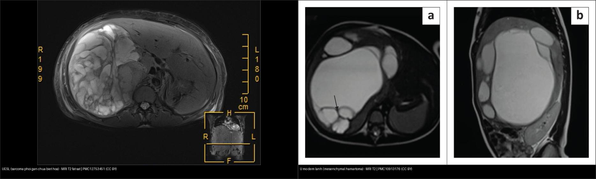
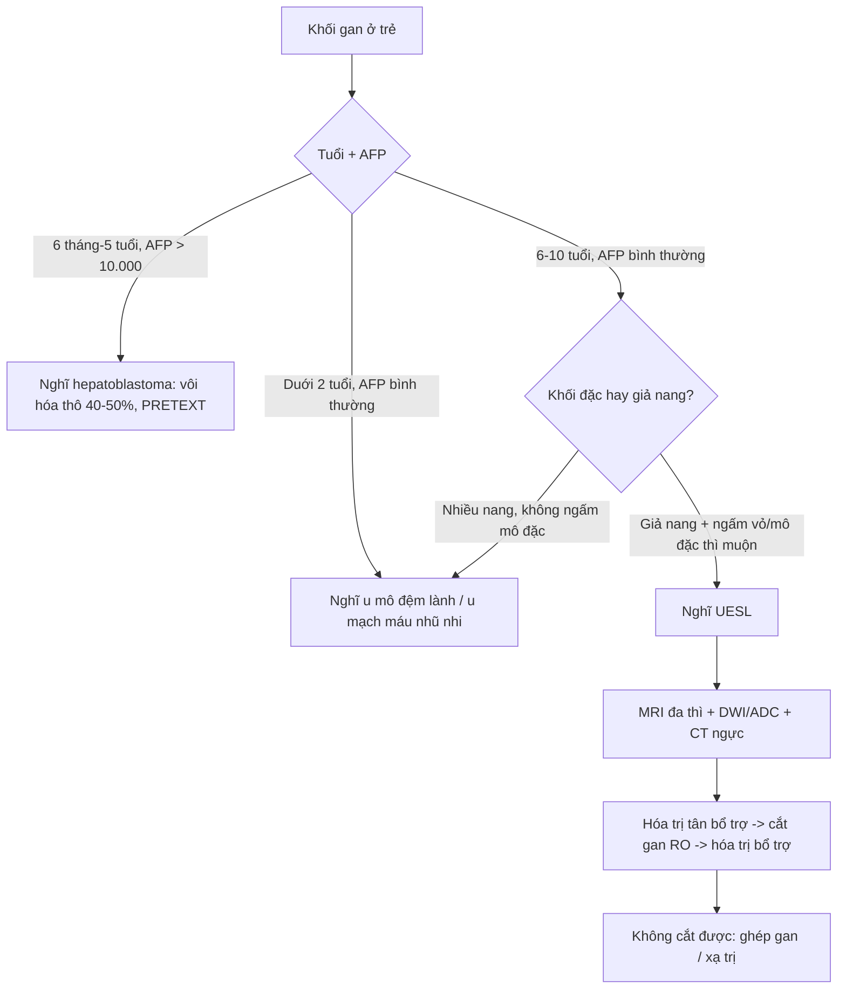
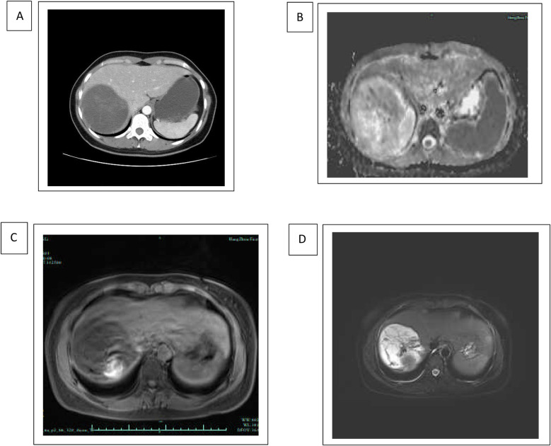
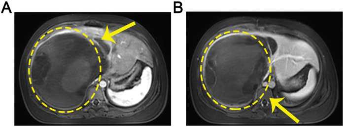
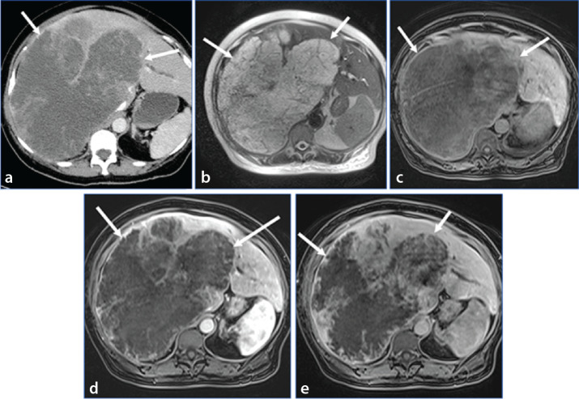

# 663 — Sarcoma phôi gan chưa biệt hóa (UESL) & u gan hiếm ở trẻ / Undifferentiated embryonal sarcoma of the liver

**Tags:** `pattern:khoi-gan-gia-nang` `vung:gan` `score:PRETEXT` `protocol:US-CT-MRI-gan-nhi` `incidentaloma:khoi-gan-nhi`
**Mức chắc chắn (certainty):** tổng hợp y văn (literature synthesis) — tổng hợp review + ca nguyên văn từ y văn mở (đa số CC BY); các ca minh họa ghi rõ PMCID + Fig trong `images/CREDITS.md`, không tự suy diễn thêm ngoài chú thích gốc.

## 1. Tổng quan bệnh học – cơ chế hình ảnh

- **UESL (undifferentiated embryonal sarcoma of the liver)** là **u mô đệm (mesenchymal) ác tính** nguyên phát của gan, gần như chỉ gặp ở trẻ em, đỉnh **6–10 tuổi**, **nam hơi ưu thế**. Về tần suất, đây là **u gan ác nguyên phát phổ biến thứ 3 ở trẻ** sau **u nguyên bào gan (hepatoblastoma)** và **ung thư gan (hepatocellular carcinoma — HCC)** (Stanietzky N et al., *Diagn Interv Radiol* 2025, PMC11880871). Trong một kiểm toán đơn trung tâm 69 trẻ u gan không phải hepatoblastoma, UESL chiếm **26,3%** ở nhóm **3–10 tuổi** và **22,7%** ở nhóm **≥ 10 tuổi** (Mehta A et al., *Indian J Gastroenterol* 2026, PMC13272263).
- **Mối liên hệ với u mô đệm lành (mesenchymal hamartoma — MH):** MH và UESL **chia sẻ tái sắp xếp nhiễm sắc thể nhánh dài NST 19 tại vùng 19q13.4** (gen dung hợp *MHLB1*, liên quan vùng *C19MC*/*MALAT1*), và MH hiếm khi có thể **biến đổi (malignant transformation) thành UESL** — nên hai thực thể được coi là hai đầu của một phổ (Martins-Filho SN et al., *Hepat Oncol* 2020, PMC7338921). MH chiếm **~8%** các u gan ở trẻ và **80%** xuất hiện **trong 2 năm đầu đời**.
- **TẠI SAO UESL trông "giả nang" (pseudocystic) dù thực chất là u ĐẶC?** Mô u gồm **chất nền nhầy (myxoid stroma) giàu nước** và các ổ **hoại tử/xuất huyết**. Vì nước cho **T2 rất dài**, khối ngậm nước này **sáng gần như dịch não tủy trên T2W** và **giảm đậm độ trên CT**, tạo cảm giác "một nang lớn có vách". Nhưng khác nang thật, u có **vỏ xơ giả (fibrous pseudocapsule)** — một viền dày **giảm tín hiệu trên cả T1W và T2W** — và **ngấm thuốc dần (progressive delayed enhancement)** ở vỏ và mô đặc bên trong ở thì muộn. Đây là điểm **chốt loại nang lành** (nang đơn thuần **không ngấm**); nếu chỉ đọc thì động mạch sẽ tưởng nang, **bắt buộc phải có thì muộn 3–5 phút** (Stanietzky 2025).
- **Vì sao vẫn thấy điểm T1 tăng tín hiệu bên trong?** Đó là **ổ xuất huyết trong u** (methemoglobin) — dấu hiệu gợi ý ác tính, giúp phân biệt một khối "giả nang" với nang dịch thuần.
- **Vôi hóa:** UESL **thường KHÔNG vôi hóa** — ngược với hepatoblastoma (**vôi hóa thô 40–50%**). Đây là mẹo phân biệt nhanh trên CT.
- **Alpha-fetoprotein (AFP):** UESL phần lớn **AFP BÌNH THƯỜNG**, trong khi hepatoblastoma tăng AFP ở **~95%** ca. Vì vậy **AFP bình thường KHÔNG loại trừ u ác** — đây là cạm bẫy hay được gọi là "nang lành" làm trì hoãn chẩn đoán.
- **Ngưỡng định lượng:** UESL **ưu thế thùy gan phải**, kích thước **lớn ~10–29 cm** khi chẩn đoán (ca nguyên văn: **10,8 × 9,5 cm** ở người lớn — Mo Y et al., *Front Oncol* 2025, PMC12753451; **13,7 × 13,6 × 11,5 cm** ở trẻ — Jensen L et al., *Cureus* 2025, PMC12433609). Vị trí di căn hay gặp: **phổi, màng phổi, phúc mạc**.
- **So sánh hai đầu phổ MH ↔ UESL:** MH (lành) là khối **nhiều nang thật có vách**, **không ngấm mô đặc**; UESL (ác) **giả nang nhưng đặc bên trong**, **ngấm vỏ dày + mô đặc dần ở thì muộn**.

## 2. Mẫu hình + chẩn đoán phân biệt theo vị trí (gamut)

- **Mẫu hình vào:** **khối gan lớn, giả nang (pseudocystic), thùy phải, ở trẻ 6–10 tuổi, AFP bình thường**.
- **Gamut theo tuổi (quan trọng nhất vì mô học phụ thuộc tuổi):**
  - **< 2 tuổi:** u mô đệm lành (MH), u mạch máu nhũ nhi (infantile hemangioma), u nội mô mạch máu (hemangioendothelioma), u mô đệm cơ thận cấp (congenital mesoblastic nephroma) di căn ít gặp.
  - **6 tháng – 5 tuổi:** u nguyên bào gan (hepatoblastoma — cần AFP/vôi hóa thô).
  - **6 – 10 tuổi:** **UESL**, hepatoblastoma muộn, HCC nền xơ gan.
  - **> 10 tuổi:** HCC, UESL, di căn.
- **Gamut theo hình thái "khối giả nang / nang có vách":** UESL, MH, carcinoma giả sarcoma (sarcomatoid carcinoma), **u nhầy đường mật (biliary mucinous cystic neoplasm — MCN/biliary cystadenoma)**, **nang sán lá gan (hydatid)**, **áp-xe gan (pyogenic abscess)**, **di căn (neuroblastoma, Wilms)**, **u quái (teratoma — có mỡ + vôi hóa)**.
- **Gamut theo bối cảnh lâm sàng:** trẻ **đau bụng + sờ thấy khối + sụt cân** (UESL/HCC); **sốt + đau hạ sườn phải** (áp-xe); **bụng cấp (cấp cứu)** do **vỡ u** (UESL có thể vỡ, gây bụng cấp).
- **Gợi nhớ:** khối gan **"giả nang" ở trẻ 6–10 tuổi + AFP bình thường + vôi hóa âm** = **nghĩ UESL** cho đến khi loại trừ; **khối nhiều nang ở nhũ nhi + AFP bình thường** = MH; **khối đặc + AFP rất cao + vôi hóa thô** = hepatoblastoma.

## 3. Bảng so sánh phân biệt (ma trận đối chiếu)

| Thực thể (entity) | Hình ảnh điển hình (US/CT/MRI) | Chốt vào (rule-in) | Chốt loại (rule-out) | Gợi ý xác nhận |
|---|---|---|---|---|
| **UESL (sarcoma phôi gan)** | Khối lớn thùy phải **giả nang**; CT giảm đậm độ; T2 rất sáng (myxoid); **vỏ xơ giả dày** giảm tín hiệu T1/T2; **ngấm dần thì muộn** | **Trẻ 6–10 tuổi + khối giả nang ĐẶC (ngấm vỏ/mô đặc thì muộn) + AFP bình thường + không vôi hóa** | **Không ngấm ở mọi thì + vách mỏng đều → nghĩ nang lành** | MRI đa thì + ADC; sinh thiết; giai đoạn sau mổ (IRS group) |
| **U mô đệm lành (MH)** | Khối **nhiều nang thật có vách**, T2 sáng, **ít/không ngấm mô đặc** | **Nhũ nhi < 2 tuổi + nhiều nang có vách + AFP bình thường** | **Ngấm vỏ dày + mô đặc dần thì muộn → nghĩ UESL** | MRI; theo dõi (MH có thể thoái triển) hoặc cắt nếu chèn ép |
| **U nguyên bào gan (hepatoblastoma)** | Khối đặc không đồng nhất, hoại tử, **vôi hóa thô** | **6 tháng–5 tuổi + AFP > 10.000 ng/mL + vôi hóa thô 40–50%** | **AFP bình thường + giả nang không vôi hóa → nghĩ UESL/MH** | AFP, CT/MRI đa thì, PRETEXT |
| **U nhầy đường mật (MCN/biliary cystadenoma)** | Nang nhiều ngăn, vách **ngấm thuốc**, đôi khi có nốt đặc trong vách | **Vách ngấm + nốt đặc trong vách + người lớn/trẻ lớn** | **Vách ngấm đều không nốt + trẻ 6–10 tuổi AFP bình thường → vẫn phải loại UESL** | MRCP + MRI đa thì; mô bệnh sau cắt |
| **Áp-xe gan** | Khối giảm đậm độ, viền ngấm, có thể mức khí | **Sốt + tăng bạch cầu + khí trong ổ + thành viền ngấm liên tục** | **Không sốt, viền ngấm dần muộn, khối lớn → nghĩ u** | Siêu âm/CT; chọc hút chẩn đoán |
| **Nang sán lá gan (hydatid)** | Nang **tách màng (hoa súng)**, vách/đậm độ ngăn — **đậm độ KHÔNG phân biệt được với nang đơn thuần** (9,2 vs 7,3 HU, AUC 54,6%) | **Dịch tễ + dấu tách màng/vách + huyết thanh (ELISA)** | **Có mô đặc ngấm thì muộn → không phải nang sán** | ELISA + MRI; **cấm chọc mù** |

### Dấu hiệu chốt cần đọc đúng trên từng chuỗi xung
- **Vỏ xơ giả dày (fibrous pseudocapsule):** viền **giảm tín hiệu trên cả T1W và T2W**, **ngấm thuốc muộn** — đây là "Chốt vào" mạnh nhất phân biệt UESL với nang thật (nang thật có vách mỏng, **không ngấm**).
- **Đậm độ/tín hiệu giống dịch (CSF-like)** trên T2 nhưng có **điểm T1 tăng tín hiệu (xuất huyết)** → cảnh giác u đặc.
- **Thì muộn bắt buộc:** "ngấm dần (gradual/progressive enhancement)" là mấu chốt; nang đơn thuần **không có**.
- Trên **DWI/ADC**, mô u đặc **hạn chế khuếch tán** (ADC thấp) trong khi lòng giả nang (hoại tử/nhầy) **ADC cao** — tương phản giúp thấy u **không phải dịch thuần**.

## 4. Protocol chụp + hệ phân độ/điểm chuẩn hóa

- **Protocol đánh giá khối gan ở trẻ (theo tuổi + AFP):**
  1. **Siêu âm bụng** đầu tay (khối đặc/nang, tưới máu bằng Doppler màu);
  2. **CT bụng đa thì** hoặc **MRI gan** (T1/T2 fat-sat, **DWI/ADC**, động học sau tiêm **thì động mạch, thì cửa, thì muộn 3–5 phút**; cân nhắc chất tương phản đặc hiệu tế bào gan cho u lành);
  3. **AFP huyết thanh** trước điều trị (nhớ: AFP **bình thường KHÔNG loại trừ** UESL);
  4. **CT ngực** tìm di căn phổi (vị trí di căn hay gặp: phổi, màng phổi, phúc mạc);
  5. **Sinh thiết** khi cần mô học — thận trọng vì u giả nang dễ lấy nhầm vùng hoại tử, gây âm tính giả (ca Mo 2025: chọc/fenestration ban đầu đọc "nang gan lành" → tái phát mới ra UESL).
- **Phân độ:** UESL **không** dùng PRETEXT như hepatoblastoma. Giai đoạn dùng **nhóm sau mổ của Intergroup Rhabdomyosarcoma Study (IRS group I–IV)** theo mức cắt bỏ triệt để. (PRETEXT I–IV vẫn được nhắc trong một số báo cáo UESL nhưng là hệ của hepatoblastoma — cần ghi rõ khi trình bày.)
- **Điều trị:** **hóa trị tân bổ trợ (neoadjuvant)** (phác đồ kiểu sarcoma: ifosfamide, doxorubicin, vincristine, actinomycin-D, cyclophosphamide) → **cắt gan triệt để (RO)** → hóa trị bổ trợ; **ghép gan** khi không cắt được; **xạ trị** cho bệnh không mổ được/tái phát. Tiên lượng phụ thuộc **cắt bỏ hoàn toàn** (Lin WY et al., *Cancers* 2024, PMC10931367; Li J et al., *Transl Pediatr* 2024, PMC11148738).
- **Kết cục định lượng (NCDB 2004–2015, n = 82 trẻ + 41 người lớn):** trẻ sống sót toàn bộ **5 năm 84,4%** vs người lớn **48,2%** (p < 0,001); trẻ được hóa trị nhiều hơn (**92,7% vs 65,9%**) (Ziogas IA et al., *Cancers* 2021, PMC8230649).
- **Quy trình ra quyết định (Mermaid):**

## 5. Biến thể bình thường và cạm bẫy

- **Cạm bẫy #1 (chết người) — "nang gan lành":** đọc khối giả nang trên CT/US là **nang đơn thuần** rồi **chọc hút/fenestration**; mô bệnh vùng hoại tử cho "nang lành" → **chẩn đoán trễ, u tái phát**. Ca nguyên văn (Mo Y 2025, PMC12753451): nữ 50 tuổi, khối **10,8 × 9,5 cm** được fenestration + dẫn lưu và đọc "nang gan lành"; tái phát mới xác định UESL, **tử vong sau 9 tháng**.
- **Cạm bẫy #2 — AFP bình thường:** nhiều người loại u ác khi AFP bình thường; UESL phần lớn **AFP bình thường** → **không được dùng AFP bình thường để loại UESL**.
- **Cạm bẫy #3 — bỏ thì muộn:** nếu chỉ chụp thì động mạch/cửa, khối giảm đậm độ giả nang trông giống nang. **Bắt buộc thì muộn 3–5 phút** để thấy **ngấm dần của vỏ và mô đặc**.
- **Cạm bẫy #4 — nhầm với u mô đệm lành (MH):** hai bệnh cảnh **cùng nhìn "nang" trên T2**; chốt bằng **ngấm thuốc** (UESL ngấm, MH không) + tuổi (MH < 2 tuổi). Về sinh bệnh học hai bệnh **liên quan 19q13.4** — MH có thể biến đổi thành UESL.
- **Cạm bẫy #5 — vỡ u:** UESL lớn có thể **vỡ gây bụng cấp**; nếu gặp trẻ đau bụng cấp + khối gan lớn + dịch phúc mạc, nghĩ **u vỡ** (không chỉ chấn thương).
- **Biến thể bình thường dễ nhầm:** **u máu gan nhũ nhi (infantile hemangioma)** T2 sáng mạnh giống UESL, nhưng **ngấm viền nốt rồi đầy dần vào trung tâm** ở nhũ nhi + AFP bình thường; **nang đơn thuần** không ngấm; **vùng gan đảo ngược pha** (chemical shift) không phải khối.

## 6. Tự lượng giá — Blind Quiz ngay trên trang tĩnh

**Ca 1 — Bé 6 tuổi, đau bụng + sờ thấy khối hạ sườn phải, AFP bình thường.**

- Gợi ý lâm sàng: trẻ, khối gan lớn, AFP bình thường.
- Câu hỏi: (a) Trên T2W khối trông giống nang hay đặc? (b) Nêu 3 chẩn đoán phân biệt. (c) Dấu hiệu nào **chốt loại** nang lành?

<b>Bấm để hiện đáp án (findings + chẩn đoán)</b>

- Dấu hiệu (findings): (A) CT thì tĩnh mạch — khối giảm đậm độ lớn chiếm thùy gan; (B) DWI — tín hiệu cao; (C) T1W — tín hiệu hỗn hợp; (D) T2W — tín hiệu rất cao (giả dịch). Ảnh chụp từ ca UESL.
- Chẩn đoán (diagnosis): **sarcoma phôi gan chưa biệt hóa (UESL)** — vì khối "giả nang" thực chất là u đặc giàu chất nền nhầy (nước → T2 rất sáng) + có **vỏ xơ giả ngấm thuốc muộn**.
- Chốt loại nang lành: **không ngấm ở mọi thì** (nang thật) so với **ngấm dần ở thì muộn** (UESL) — bắt buộc có thì muộn 3–5 phút.
- Nguồn ảnh: Qiu X et al., *Front Surg* 2025, PMC12055822, Fig 1 — **CC BY 4.0**.

**Ca 2 — Trẻ 11 tuổi, đau hạ sườn phải 20 ngày; MRI thì động mạch/tĩnh mạch.**

- Câu hỏi: Khối ưu thế thùy nào? Có xâm lấn mạch gan lớn không? Chẩn đoán hàng đầu và hướng xử trí?

<b>Bấm để hiện đáp án</b>

- Dấu hiệu: (A) thì động mạch và (B) thì tĩnh mạch — **khối lớn thùy phải** (khoanh vàng) xâm lấn mạch gan lớn và cơ hoành; khối **hỗn hợp nang-đặc**.
- Chẩn đoán: **UESL thùy phải**, đã xâm lấn mạch lớn → **cắt gan phải mở rộng theo đường trước (right trisectionectomy)** + hóa trị bổ trợ.
- Nguồn ảnh: Liang Z et al., *Front Surg* 2026, PMC13002798, Fig 1 — **CC BY 4.0**. (Fig 4 của bài gốc = CT hậu phẫu cùng vị trí.)

**Ca 3 — Khối "nang" lớn 10,8 cm ở gan, chọc hút ra "nang lành". Đọc kỹ CT + MRI thì muộn.**

- Câu hỏi: Vì sao "nang lành" lại tái phát? Trên ảnh, dấu hiệu nào chứng minh khối là **đặc** chứ không phải nang?

<b>Bấm để hiện đáp án</b>

- Dấu hiệu: (a) CT cản quang — khối **chủ yếu "nang"** chiếm phần lớn thùy phải + một phần thùy trái; (b) T2W — tín hiệu cao trông như nang; (c–e) **T1 sau gadolinium động học — tích tụ thuốc DẦN** cho thấy **bản chất ĐẶC** của khối (vỏ dày + mô đặc ngấm dần).
- Chẩn đoán: **UESL** (mô bệnh xác nhận embryonal sarcoma, có thể biệt hóa sụn). Bài học: **nang "không ngấm" là nang lành; khối giả nang ngấm dần là u** — đừng chỉ đọc thì động mạch.
- Nguồn ảnh: Stanietzky N et al., *Diagn Interv Radiol* 2025, PMC11880871, Fig 3 — **CC BY-NC 4.0**.

## Bài liên quan chéo
- [665 – Khối u gan ở trẻ: u nguyên bào gan vs ung thư gan vs u mạch máu](../665-khoi-u-gan-nhi/lesson.md) (gamut đầy đủ theo tuổi + PRETEXT)
- [630 – U bụng nhi: neuroblastoma vs Wilms](../630-u-bung-nhi-neuroblastoma-vs-wilms/lesson.md) (di căn gan)
- [122 – U lành & áp-xe gan](../122-u-lanh-gan/lesson.md) (áp-xe, u lành)
- [120 – Khối gan nền](../120-khoi-gan-nen/lesson.md) (động học ngấm thuốc)
- [123 – Nang gan & bệnh gan đa nang](../123-nang-gan-va-benh-gan-da-nang/lesson.md) (gamut nang gan)
- [131 – Tắc mật: sỏi OMC vs Klatskin](../131-tac-mat/lesson.md)

## Ảnh
- Tên file: `663_sarcoma-phoi-gan_Modality_SourceID.jpg`. Nguồn + giấy phép từng ảnh trong `images/CREDITS.md`.
- Không tải được (paywall / cấm, vd AuntMinnie): chỉ dẫn link ở `sources.md`.

> Không dùng để chẩn đoán độc lập khi chưa có người hướng dẫn.
