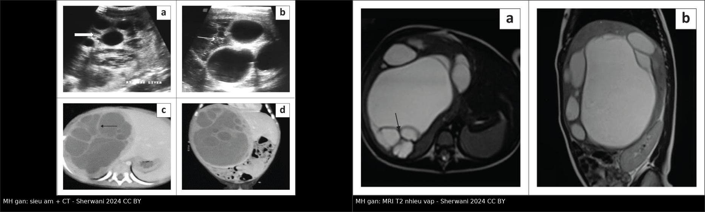
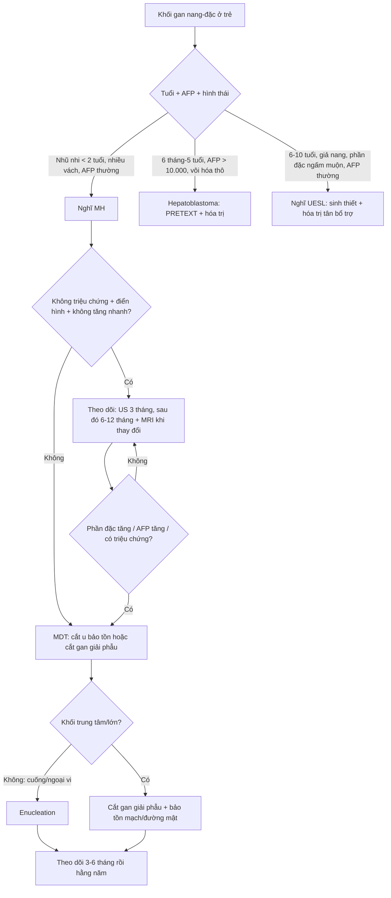
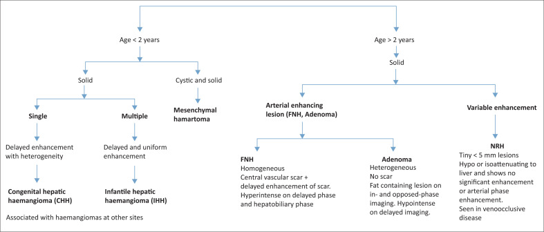
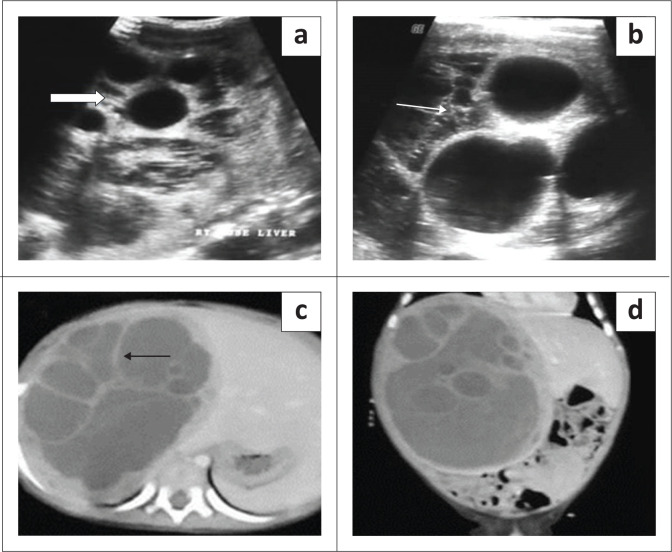
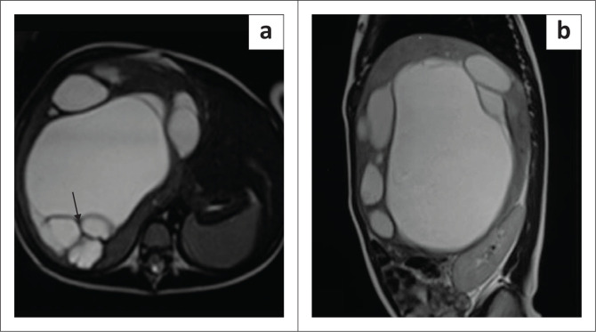
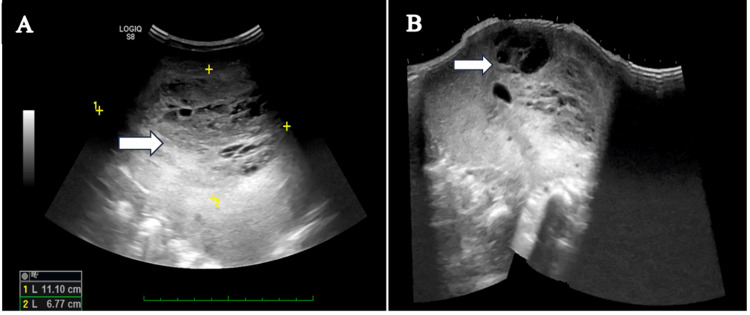
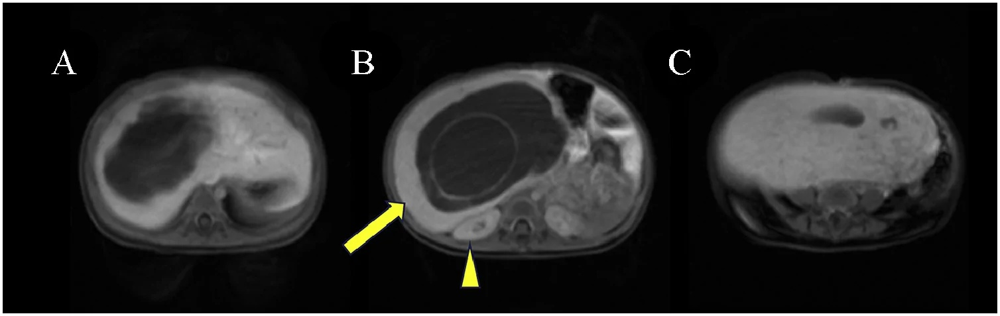
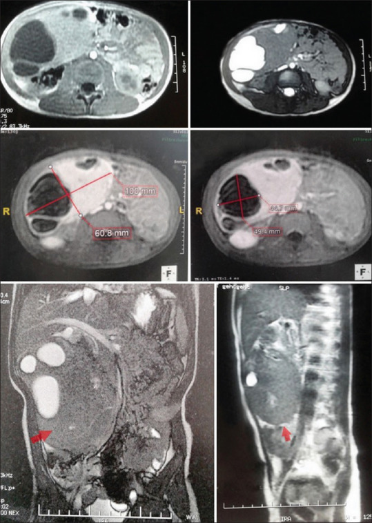

# 664 — U mô đệm lành của gan ở trẻ: theo dõi bảo tồn hay mổ & phổ MH → UESL / Hepatic mesenchymal hamartoma: observe or resect?

**Tags:** `pattern:khoi-gan-nhi` `pattern:khoi-nang-dac` `vung:gan` `score:PRETEXT` `protocol:US-CT-MRI-gan-nhi` `incidentaloma:khoi-gan-nhi`
**Mức chắc chắn (certainty):** tổng hợp y văn (literature synthesis) — tổng hợp review + ca nguyên văn có ảnh CC BY/CC BY-NC-SA (ghi PMCID từng ảnh), đối chiếu bài 663/665/667 trong repo; chưa gắn một ca nguyên văn duy nhất.

## 1. Tổng quan — vì sao một "khối nang" lành lại có thể là u, và vì sao không được chủ quan

- **Bệnh học (pathology):** u mô đệm lành của gan (hepatic mesenchymal hamartoma — MH) là một **hamartoma** — khối mô loạn tổ chức gồm **mô đệm myxoid/collagen**, **ống mật bất thường giãn**, mạch máu và các đảo **tế bào gan**. U **không có vỏ (unencapsulated)**, phát triển bằng cách tích dịch trong các khoang nang → có thể to rất nhanh và rất lớn. Về mô học, mô đệm **myxoid ~50%**, **collagen/hyalin ~47%**; tế bào gan thường ở ngoại vi u.
- **Dịch tễ (epidemiology):**
  - Là **u gan lành tính phổ biến thứ hai** sau u mạch máu nhũ nhi (infantile hepatic hemangioma — IHH), chiếm **~5–8% các u gan nguyên phát ở trẻ** và **18–29%** trong nhóm u gan lành.
  - **80%** chẩn đoán **< 2 tuổi**, hầu hết **< 5 tuổi**; nam:nữ **~3:2**; **~75%** ở **thùy phải**; **tới 20%** có cuống (pedunculated).
  - Có thể phát hiện **trước sinh** (quý III) và có thể kèm **phù thai (hydrops fetalis)**, **đa ối**, bất thường tim thai (tràn dịch màng tim, giãn tâm thất).
- **TẠI SAO hình ảnh như vậy (cơ chế vật lý):**
  - **Nang:** dịch trong ống mật giãn/lymphatic/pseudocyst → **trống âm trên siêu âm**, **đậm độ nước trên CT**, **T1 tối – T2 rất sáng** trên MRI. Dịch giàu protein có thể làm T2 **không sáng đồng nhất**.
  - **Vách và mô đệm xơ:** collagen/hyalin ít nước → **T2 tối**, **ngấm thuốc thì muộn**; đây là lý do vách nổi rõ trên nền dịch sáng.
  - **Thành phần myxoid:** giàu nước → **T2 sáng**; không hạn chế khuếch tán mạnh như u đặc tế bào.
  - **Không có vỏ** → bờ có thể lobulated nhưng vẫn **bờ rõ**; u lớn chèn ép **tĩnh mạch chủ dưới (IVC)**, gây phù chi dưới, chèn cơ hoành gây khó thở; **vỡ nang** → dịch quanh gan dưới bao.
  - **Doppler:** **ít mạch máu trong u** — khác IHH (tăng mạch rõ).
- **AFP — điểm dễ sai nhất:** AFP **thường bình thường**, nhưng **có thể tăng nhẹ** do tế bào gan/ống mật nằm trong mô đệm myxoid. Ca nguồn ghi **AFP 306 ng/mL** (tham chiếu **< 8,78 ng/mL**) và **GGT 111,36 U/L** ở bé trai 2 tuổi. Ngược lại, **hepatoblastoma** thường **AFP > 10.000 ng/mL** kèm vôi hóa thô **40–50%**.
- **Di truyền — vì sao phải theo dõi lâu dài:** phần lớn bất thường tế bào di truyền tập trung ở **19q13.4**, chứa **cụm microRNA C19MC**. **UESL (undifferentiated embryonal sarcoma of the liver)** — sarcoma phôi gan chưa biệt hóa — có **cùng bất thường 19q13/C19MC**; phân tích 14 ca UESL thấy **10/13** có biến thể cấu trúc vùng 19q13, **7/7** mẫu giải trình tự miRNA có **C19MC tăng > 100 lần**, và **TP53 đột biến/mất** ở mọi u đánh giá được có C19MC tăng. Vì vậy MH **hiếm khi** chuyển dạng ác nhưng **có thật**, và chuyển dạng được mô tả như **từng bước: C19MC hoạt hóa + mất TP53**.
- **Diễn tiến tự nhiên:** nhiều ca **tăng nhanh do tích dịch**; một số báo cáo **thoái triển tự nhiên** nhưng bằng chứng yếu (xem mục 5). Tổng quan hệ thống 95 ca (2000–2022): **85 ca mổ** vs **10 ca không mổ**; **biến chứng 17% vs 20%**, **tử vong 6% vs 10%**; không khác nhau về giới/thùy/kích thước. Kết luận: **cắt u hoàn toàn vẫn là chuẩn khi còn đủ nhu mô gan lành**; các báo cáo "theo dõi thành công" có **thời gian theo dõi ngắn và bằng chứng mô học không đầy đủ**.

## 2. Mẫu hình + chẩn đoán phân biệt theo tuổi và hình thái (gamut)

- **Theo tuổi (khối gan ở trẻ):**
  - **< 6 tháng:** IHH/CHH, MH (có thể bẩm sinh), hepatoblastoma bẩm sinh (hiếm), di căn neuroblastoma, nang đường mật.
  - **6 tháng – 3 tuổi:** **MH**, hepatoblastoma, IHH, u nội mô mạch máu (hemangioendothelioma), u rhabdoid ác tính (malignant rhabdoid tumor — MRT). Trong một cohort 69 ca u gan không-hepatoblastoma, nhóm **6 tháng–3 tuổi** có **MRT 25,0%**, **MH và hemangioendothelioma mỗi loại 18,7%**.
  - **3–10 tuổi:** hepatoblastoma (thể lớn tuổi), **HCC**, **UESL** (đỉnh 6–10 tuổi), MH (hiếm, tới 5 tuổi).
  - **> 10 tuổi:** HCC, UESL, FNH, adenoma.
- **Theo hình thái:**
  - **Chủ yếu nang, nhiều vách:** **MH** (điển hình), nang sán (hydatid), u nhầy đường mật (biliary mucinous cystic neoplasm — MCN), nang ống mật chủ, lymphangioma, nang đôi tiêu hóa.
  - **Hỗn hợp nang–đặc:** **MH**, **UESL** ("giả nang" nhưng phần đặc thật), hepatoblastoma có hoại tử/xuất huyết, MRT.
  - **Đặc hoàn toàn:** hepatoblastoma, HCC, FNH, adenoma, **thể đặc của MH** (hiếm) — dễ nhầm nhất.
- **Gợi nhớ "MH":** **M**ultiseptated (nhiều vách) · **H**epatocytes/Myxoid (tế bào gan trong mô đệm myxoid) · **< 2 tuổi** · **H**ypovascular (ít mạch) · **H**ydrops (có thể phù thai).
- **Gợi nhớ "UESL":** **U**nilocular/pseudocystic (giả nang) · **E**levated age **6–10 tuổi** · **S**olid stroma (phần đặc thật, ngấm muộn) · **L**iver + AFP thường bình thường + không vôi hóa.

## 3. Bảng so sánh phân biệt (ma trận đối chiếu)

| Thực thể (entity) | Hình ảnh điển hình (US/CT/MRI) | Chốt vào (rule-in) | Chốt loại (rule-out) | Gợi ý xác nhận |
|---|---|---|---|---|
| **U mô đệm lành (MH)** | US: khối **nhiều nang có vách**, dịch trống âm, **ít mạch** trên Doppler; CT: dịch đậm độ nước, vách/solid ngấm; MRI: **T2 rất sáng**, vách **T2 tối**, ngấm vách; có thể có **dịch quanh gan** nếu vỡ | **< 2 tuổi + khối nhiều vách + AFP thường + ít mạch + không vôi hóa thô** | **Vôi hóa thô + AFP > 10.000 ng/mL + ngấm mạnh không đồng nhất → hepatoblastoma**; **phần đặc lớn ngấm muộn + tuổi 6–10 → UESL** | US + MRI gan; AFP/GGT/LFT; MDT; mô học khi không điển hình |
| **UESL (sarcoma phôi gan)** | Khối lớn, **"giả nang" nhưng phần đặc thật**, T2 sáng do myxoid, **ngấm vỏ/mô đặc thì muộn**, có thể xuất huyết/hoại tử; **không vôi hóa** | **6–10 tuổi + khối giả nang + phần đặc ngấm muộn + AFP bình thường** | **Nhiều nang thật, vách mảnh, không có phần đặc ngấm → MH**; **AFP rất cao + vôi hóa thô → hepatoblastoma** | MRI đa thì + sinh thiết/cắt u; CT ngực tìm di căn; mô học + IHC |
| **Hepatoblastoma** | Khối đặc không đồng nhất, **hoại tử, vôi hóa thô 40–50%**, xâm lấn nhiều phân thùy | **6 tháng–5 tuổi + AFP > 10.000 ng/mL + vôi hóa thô + > 5 cm** | **AFP bình thường + nhiều nang vách + không vôi hóa → MH** | AFP, MRI đa thì, PRETEXT, sinh thiết theo protocol |
| **IHH/CHH (u mạch máu)** | US: khối tăng hồi âm/không đồng nhất, **tăng mạch**; CEUS/MRI: **ngấm viền nốt → đầy dần trung tâm**; CHH có đủ lúc sinh, không tăng | **Ngấm viền nốt rồi đầy dần + GLUT-1 (IHH) + xuất hiện sau sinh** | **Nhiều nang vách + ít mạch + AFP thường → MH**; **đứng yên từ lúc sinh → CHH** | US Doppler, CEUS, MRI động; TSH/fT4; AFP |
| **U nhầy đường mật (MCN/biliary cystadenoma)** | Nang nhiều vách, dịch đặc, có thể vôi hóa vách; **ngấm vách**; thường ở người lớn/trẻ lớn | **Trẻ lớn/người lớn + nang nhiều vách + CA19-9 tăng** | **< 2 tuổi + AFP thường + mô đệm myxoid → MH** | MRI/MRCP, CA19-9, mô học |
| **Nang sán (hydatid)** | Nang **vỏ dày**, có thể **nang con**, vôi hóa vỏ, **không ngấm**; dịch tễ vùng chăn nuôi | **Dấu hiệu vỏ dày/nang con + huyết thanh học dương** | **Nhiều nang vách mảnh, có mô đặc ngấm → MH** | ELISA/hemagglutination, MRI/CT, dịch tễ |
| **Áp-xe gan** | Ổ dịch **vỏ dày ngấm viền**, khí trong ổ, đông đặc quanh | **Sốt + đau + bạch cầu tăng + vỏ ngấm viền** | **Không sốt + nhiều nang vách mảnh + AFP thường → MH** | US/CT, CRP, cấy, dẫn lưu |

*Trái: siêu âm thang xám (a, b) — khối nhiều nang có vách; CT (c, d) — dịch đậm độ nước, vách ngấm thuốc. Phải: MRI T2 (a, b) — khối **tăng tín hiệu mạnh**, vách **giảm tín hiệu**. Nguồn: Sherwani P et al., S Afr J Radiol 2024 (PMC10913176), Fig. 8 & 10, CC BY 4.0; ảnh ghép letterbox giữ nguyên tỷ lệ.*

### Dấu hiệu chốt cần đọc đúng trên từng kỹ thuật
- **Siêu âm:** đếm **số nang, độ dày vách, phần đặc**, bật **Doppler** xem mạch trong u (MH ít mạch). Tìm **dịch dưới bao/quanh gan** — gợi ý vỡ.
- **CT:** đo **đậm độ dịch** (gần 0–20 HU), xem **vách/solid ngấm**, **vôi hóa**, mối liên quan **IVC/tĩnh mạch gan/ống mật**; không dùng CT để khẳng định mô học.
- **MRI:** **T2 là chuỗi tốt nhất** — nang sáng, vách tối; **DWI** giúp phân biệt phần đặc tế bào (UESL/hepatoblastoma) với nang; **động học sau tiêm** phân biệt ngấm vách (MH) với ngấm mô đặc (u ác).
- **AFP + GGT + LFT + đông máu** trước mọi can thiệp; **CT ngực** nếu nghi ác tính.

## 4. Protocol chụp + thuật toán theo dõi/mổ

- **Protocol hình ảnh:**
  1. **Siêu âm bụng + Doppler** đầu tay (ALARA — trẻ nhỏ).
  2. **MRI gan** (T1/T2 fat-sat, DWI/ADC, động học sau tiêm) khi khối lớn, không điển hình, hoặc trước mổ. **CT** khi MRI không sẵn có/chống chỉ định hoặc cần đánh giá xương–phổi.
  3. Đo **đường kính lớn nhất (3 chiều)**, **% thành phần đặc**, số nang, vị trí so với **IVC, tĩnh mạch gan, cuống gan**, có **vỡ/dịch quanh gan**.
  4. **Không dùng PRETEXT để phân giai đoạn MH** (PRETEXT dành cho hepatoblastoma); với MH, mục tiêu là **bản đồ mạch máu – đường mật** để chọn **cắt u bảo tồn nhu mô** hay **cắt gan giải phẫu**.
- **Sinh thiết (biopsy) — không thường quy:**
  - **Chỉ định:** khối không điển hình, không mổ được ngay, cần chẩn đoán trước hóa trị, hoặc nghi UESL/ác tính.
  - **Hạn chế:** **sai lệch mẫu (sampling error)** — MH có thể nằm cạnh ổ UESL; kim nhỏ có thể chỉ lấy mô đệm lành và bỏ sót chuyển dạng. Nếu khối điển hình và cắt được, nhiều trung tâm **mổ luôn không sinh thiết**.
- **Thuật toán xử trí:**
  - **Cắt u hoàn toàn** là chuẩn khi còn đủ nhu mô gan lành — bằng chứng hệ thống: **85 ca mổ** vs **10 ca không mổ**, biến chứng **17% vs 20%**, tử vong **6% vs 10%**, không khác biệt về giới/thùy/kích thước.
  - **Kỹ thuật:** **cắt u bảo tồn (enucleation)** nếu khối có cuống/ngoại vi; **cắt gan giải phẫu** nếu khối trung tâm/lớn; có thể **chọc hút dịch nang trong mổ** để giảm thể tích và tạo đường mổ.
  - **Theo dõi bảo tồn (selected cases):** chỉ khi **không triệu chứng, hình ảnh điển hình, không tăng nhanh, gia đình tuân thủ**. Lịch **đề xuất thực hành** (chưa có guideline riêng cho MH): **US lúc 3 tháng, sau đó mỗi 6–12 tháng** đến khi ổn định/thoái triển; **MRI** nếu tăng nhanh hoặc phần đặc thay đổi. Bằng chứng cho cách này **yếu** — phải giải thích rõ với gia đình.
  - **Chỉ định mổ ngay:** chèn ép IVC/khó thở, đau, **vỡ/chảy máu**, tăng nhanh, **nghi UESL/ác tính**, hoặc không loại trừ được hepatoblastoma.
  - **Nếu UESL:** **hóa trị tân bổ trợ + cắt R0** (bài 663), không điều trị như MH.
- **Theo dõi sau mổ:** US/CT/MRI **3–6 tháng** rồi **hằng năm**; theo dõi **AFP** nếu tăng trước mổ; chú ý **tái phát tại chỗ** (hiếm) và **di căn phổi** (nếu chuyển dạng).

*Thuật toán của bài nguồn: **< 2 tuổi** — khối đặc đơn ổ → CHH; đa ổ → IHH; **nang + đặc → MH**. **> 2 tuổi** — khối đặc: ngấm động mạch → FNH/adenoma; ngấm thay đổi → NRH. Nguồn: Sherwani P et al., S Afr J Radiol 2024 (PMC10913176), Fig. 16, CC BY 4.0.*

## 5. Biến thể bình thường và cạm bẫy

- **AFP tăng nhẹ không loại trừ MH:** ca nguồn **AFP 306 ng/mL** (ref < 8,78) nhưng mô học là MH; ngược lại hepatoblastoma thường **> 10.000 ng/mL**. Đừng để một con số AFP đẩy thẳng trẻ vào hóa trị.
- **MH thể đặc (solid variant) dễ bị đọc là hepatoblastoma/UESL:** mô đệm xơ nhiều, ít nang → T2 không sáng, ngấm ít; cần MRI đa thì + mô học.
- **"Giả nang" của UESL:** phần đặc thật có thể ngấm muộn, T2 sáng do myxoid — **không phải nang thật**; đừng chọc/fenestration mù (bài 663).
- **Nang sán (hydatid):** vỏ dày, nang con, vôi hóa vỏ, **không ngấm**; hỏi dịch tễ và làm huyết thanh học trước khi can thiệp — chọc nang sán có nguy cơ **sốc phản vệ**.
- **"Tự thoái triển" không phải quy luật:** các báo cáo theo dõi thành công thường **thời gian ngắn**, không đủ mô học; đừng hứa với gia đình là "u sẽ tự hết".
- **Sai lệch mẫu sinh thiết:** kim nhỏ có thể bỏ sót ổ **UESL** cạnh MH; nếu mổ, **lấy mẫu phần đặc** và nhiều vị trí.
- **Vỡ u:** có thể biểu hiện **đau bụng cấp + dịch quanh gan**; tránh thăm khám thô bạo, hội chẩn ngoại nhi sớm.
- **Tăng tín hiệu thì gan–mật (HBP) trên gadoxetate:** MH có thể **tăng nhẹ tín hiệu HBP** do tế bào giống gan còn OATP1B3 trong bào tương — **đừng dùng HBP để loại MH** hay khẳng định hepatoblastoma; ca nguồn mô tả tín hiệu tăng nhẹ nhưng vẫn **thấp hơn nhu mô gan lành**.
- **MH trước sinh:** có thể kèm **hydrops, đa ối, bất thường tim thai**; cần **trung tâm sản–nhi** có khả năng can thiệp ngay sau sinh.
- **Theo dõi sau mổ:** tái phát tại chỗ hiếm nhưng vẫn phải theo dõi; nếu **AFP tăng lại** hoặc phần đặc mới → nghĩ **chuyển dạng/UESL**.

## 6. Tự lượng giác — Blind Quiz

**Ca 1 — Bé trai 9 tháng tuổi, bụng to, không sốt. Đọc siêu âm và CT.**

- Gợi ý lâm sàng: nhũ nhi, khối bụng lớn; AFP chưa có trong hội chẩn ban đầu.
- Câu hỏi: Mô tả thành phần khối? Chẩn đoán hàng đầu? Cần xét nghiệm/hình ảnh gì tiếp theo?

<b>Bấm để hiện đáp án (findings + chẩn đoán)</b>

- **Dấu hiệu:** siêu âm (a, b) — khối **nhiều nang, vách mảnh**, dịch trống âm, **không thấy mạch trong u**; CT (c, d) — khối lớn thùy phải, **dịch đậm độ nước**, **vách ngấm thuốc**, không vôi hóa thô.
- **Chẩn đoán:** **u mô đệm lành của gan (MH)** — tuổi < 2, nhiều vách, ít mạch.
- **Tiếp theo:** **AFP, GGT, LFT, đông máu**; **MRI gan** để đánh giá phần đặc và mạch máu; hội chẩn ngoại nhi. Nếu điển hình, không triệu chứng → có thể theo dõi; nếu khối lớn/chèn ép → **cắt u bảo tồn nhu mô**.
- Nguồn ảnh: Sherwani P et al., S Afr J Radiol 2024 (PMC10913176), Fig. 8, CC BY 4.0.

**Ca 2 — Bé gái 2 tuổi, khối bụng lớn. Đọc MRI T2 và phân biệt với nang sán.**

- Gợi ý lâm sàng: khối lớn, không sốt; cần hỏi thêm dịch tễ (chó/trang trại) để loại nang sán.
- Câu hỏi: Tín hiệu của dịch và vách nói gì? Hai chẩn đoán phân biệt chính? Xét nghiệm nào giúp loại nang sán?

<b>Bấm để hiện đáp án (findings + chẩn đoán)</b>

- **Dấu hiệu:** MRI T2 (a, b) — khối lớn thùy phải, **dịch tăng tín hiệu rất mạnh**, **vách giảm tín hiệu** (xơ), bờ rõ, không có nang con rõ.
- **Chẩn đoán:** **MH** — dịch nang + vách xơ. Phân biệt: **nang sán (hydatid)** — vỏ dày, nang con, vôi hóa vỏ, **không ngấm**; **MCN** — trẻ lớn/người lớn, CA19-9 tăng.
- **Xét nghiệm:** **huyết thanh học hydatid (ELISA/hemagglutination)**, AFP, CA19-9; MRI/CT đa thì. Nếu hydatid dương → **không chọc nang**, điều trị albendazole ± PAIR/phẫu thuật.
- Nguồn ảnh: Sherwani P et al., PMC10913176, Fig. 10, CC BY 4.0.

**Ca 3 — Bé trai 2 tuổi, bụng to 4 tháng, AFP 306 ng/mL. Đọc siêu âm.**

- Gợi ý lâm sàng: không sốt, không sụt cân; AFP tăng nhẹ; GGT 111,36 U/L.
- Câu hỏi: Vì sao không kết luận ngay hepatoblastoma? Hình thái nào ủng hộ MH? Bước tiếp theo?

<b>Bấm để hiện đáp án (findings + chẩn đoán)</b>

- **Dấu hiệu:** siêu âm — khối lớn **đa nang, vách**, phần đặc xen kẽ, hình **"phô mai Thụy Sĩ" (Swiss-cheese)**; CT có phần đặc ngoại vi.
- **Chẩn đoán:** **MH có AFP tăng nhẹ** — AFP **306 ng/mL** (ref < 8,78) do tế bào gan/ống mật trong mô đệm, không đủ để gọi hepatoblastoma. Mô học xác nhận MH, không ác tính.
- **Bài học:** **AFP tăng nhẹ + khối đa nang + ít mạch** → vẫn phải nghĩ MH; **AFP > 10.000 + vôi hóa thô + khối đặc** mới nghiêng hepatoblastoma. Nếu cắt được, **mổ + mô học** là cách chốt.
- Nguồn ảnh: Venkataraman S et al., Cureus 2024 (PMC11683158), Fig. 1, CC BY 4.0.

**Ca 4 — Bé gái 9 tháng, MRI gadoxetate thì gan–mật (HBP). Đọc tín hiệu và cho biết cạm bẫy.**

- Gợi ý lâm sàng: khối nang–đặc lớn; đang cân nhắc có phải hepatoblastoma.
- Câu hỏi: Phần đặc trên HBP tăng hay giảm? Có loại được MH không? Vì sao?

<b>Bấm để hiện đáp án (findings + chẩn đoán)</b>

- **Dấu hiệu:** HBP — phần đặc **tăng nhẹ tín hiệu so với trước tiêm** nhưng **thấp hơn nhu mô gan lành**; vách ngấm mảnh; không có cấu trúc tân mạch.
- **Chẩn đoán:** **MH** — tế bào giống gan còn **OATP1B3 ở bào tương** (không định vị màng) nên có thể giữ một ít gadoxetate; đây là **cạm bẫy**: HBP tăng nhẹ **không loại trừ MH**, cũng **không đủ khẳng định** hepatoblastoma.
- **Bài học:** dựa vào **tuổi + AFP + hình thái + động học đa thì**, không dựa riêng HBP.
- Nguồn ảnh: Sugie T et al., Radiol Case Rep 2026 (PMC13571136), Fig. 4, CC BY 4.0.

**Ca 5 — Bé gái 4 tuổi, khối bụng tình cờ, AFP 1,45 IU/mL. Đọc siêu âm và MRI.**

- Gợi ý lâm sàng: khối lớn thùy phải, không triệu chứng; AFP bình thường.
- Câu hỏi: Vì sao MH vẫn có thể gặp ở 4 tuổi? Chọn theo dõi hay mổ? Yếu tố nào quyết định?

<b>Bấm để hiện đáp án (findings + chẩn đoán)</b>

- **Dấu hiệu:** siêu âm — khối **hỗn hợp đặc–nang**, nang lớn nhất **58 × 50 mm**, dịch trống âm, không mạch; MRI — khối lớn, phần đặc và nang, chèn ép cấu trúc lân cận, **không xâm lấn mạch**.
- **Chẩn đoán:** **MH ở trẻ 4 tuổi** (hiếm nhưng có; 80% < 2 tuổi). AFP **1,45 IU/mL** bình thường.
- **Xử trí:** khối lớn, có phần đặc, không loại trừ hoàn toàn u ác → **cắt u bảo tồn nhu mô + mô học**. Nếu chọn theo dõi, phải **US 3 tháng/lần** và mổ khi phần đặc tăng/triệu chứng.
- Nguồn ảnh: Tlili S et al., Afr J Paediatr Surg 2023 (PMC10756409), Fig. 2, **CC BY-NC-SA 4.0** (giữ nguyên bản, không ghép).

## Bài liên quan chéo
- [600 – Tổng quan Hệ Nhi khoa](../600-tong-quan-nhi-khoa/lesson.md) (bảng DDx khối gan nhi)
- [665 – Khối u gan ở trẻ em: hepatoblastoma, hemangioma, hamartoma & HCC](../665-khoi-u-gan-nhi/lesson.md)
- [667 – U mạch máu gan ở trẻ & điều trị nội khoa](../667-u-mach-mau-gan-o-tre-va-dieu-tri/lesson.md)
- [663 – Sarcoma phôi gan chưa biệt hóa (UESL) & u gan hiếm ở trẻ](../663-sarcoma-phoi-gan-chua-biet-hoa/lesson.md)
- [626 – Viêm tụy cấp ở trẻ (DDx đau bụng + khối)](../626-viem-tuy-cap-nhi/lesson.md)
- [630 – U bụng nhi: neuroblastoma vs Wilms](../630-u-bung-nhi-neuroblastoma-vs-wilms/lesson.md)
- [139 – Sán lá gan (hydatid): phân độ WHO 2010](../139-san-la-gan/lesson.md)

## Ảnh
- Tên file `664_mh-gan_<modality>_PMC...`; nguồn + giấy phép từng ảnh trong `images/CREDITS.md`.
- Ảnh **CC BY** được ghép đối chiếu (`composite_mh-gan-us-ct-vs-mri.jpg`, letterbox giữ tỷ lệ). Ảnh **CC BY-NC-SA** (PMC10756409) **giữ nguyên bản, không ghép**.
- Không tải Google Images/AuntMinnie; nguồn đóng chỉ dẫn link ở `sources.md`.

> Không dùng để chẩn đoán độc lập khi chưa có người hướng dẫn.
