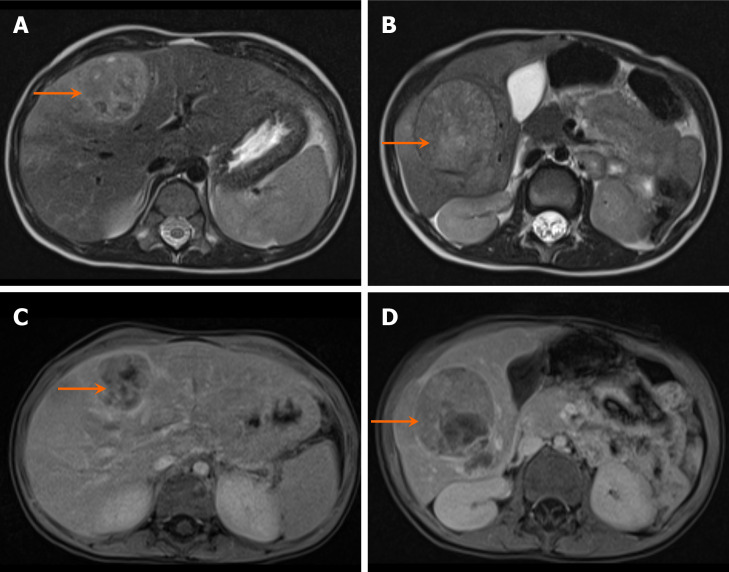
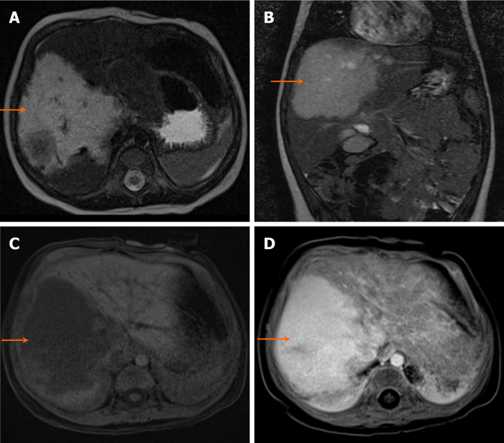
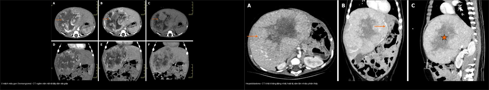
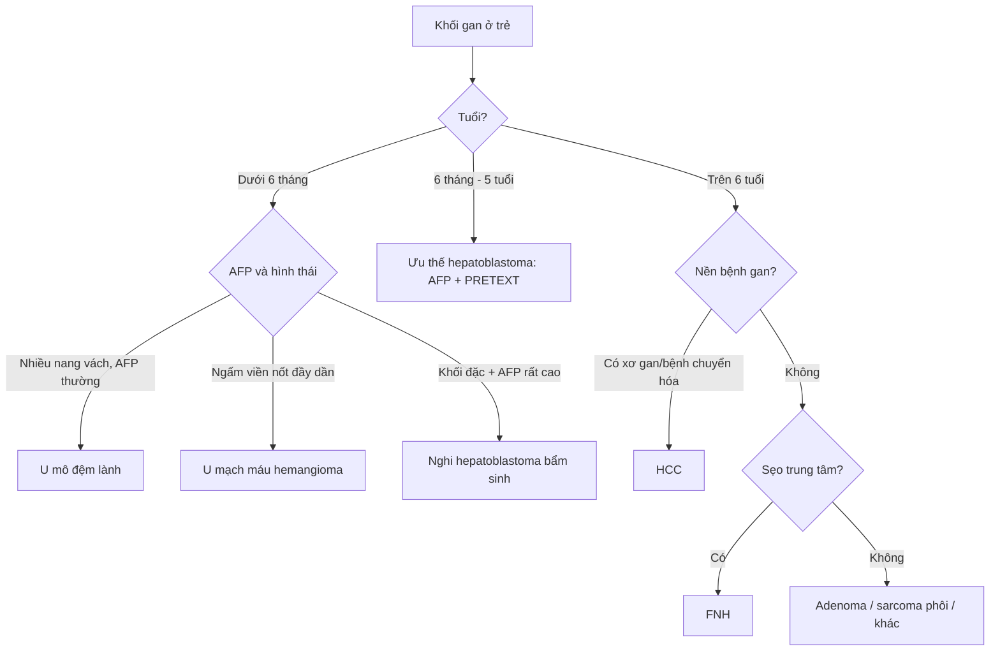
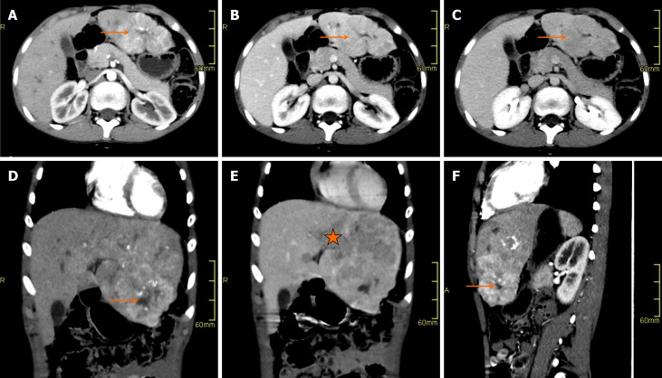
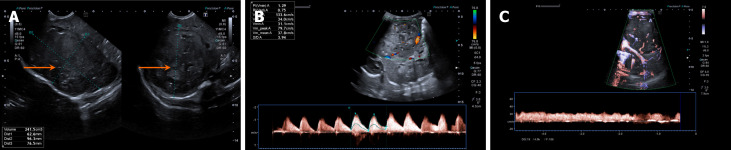
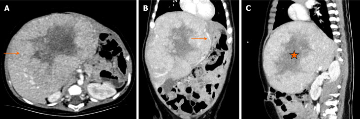
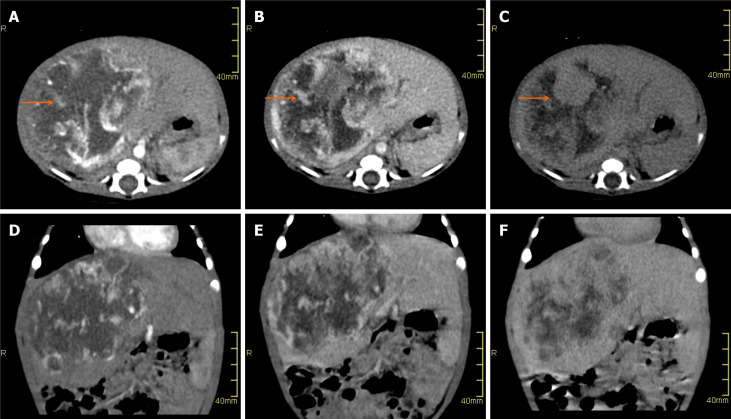
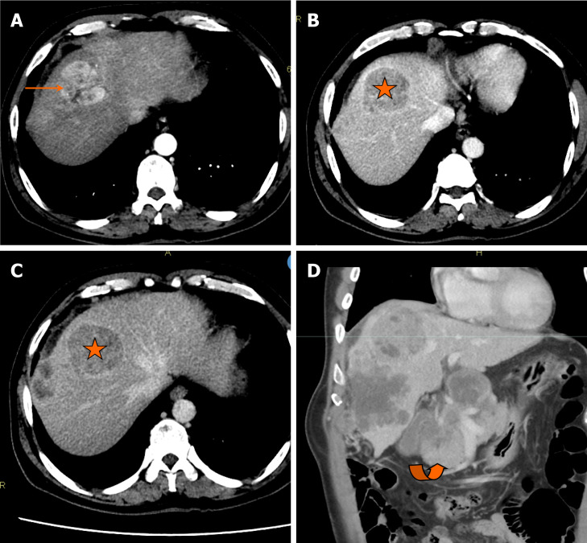
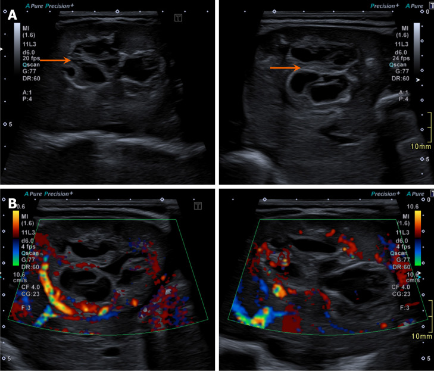

# 665 — Khối u gan ở trẻ em: u nguyên bào gan vs ung thư gan vs u mạch máu & u mô đệm lành / Pediatric liver masses

**Tags:** `pattern:khoi-gan-nhi` `vung:gan` `score:PRETEXT` `protocol:US-CT-MRI-gan-nhi` `incidentaloma:khoi-gan-nhi`
**Mức chắc chắn (certainty):** tổng hợp y văn (literature synthesis) — tổng hợp từ bài minireview hình ảnh khối gan nhi (Shahid M et al., World J Hepatol 2025, PMC12400384) + bảng phân độ PRETEXT, các ca minh họa là ca nguyên văn lấy từ bài gốc.

## 1. Tổng quan bệnh học – cơ chế hình ảnh

- Khối gan ở trẻ em được chia theo **tuổi** vì mô học phụ thuộc giai đoạn phát triển: **dưới 6 tháng** là nhóm mạch máu/mô đệm lành (u mạch máu [hemangioma], u mô đệm lành [mesenchymal hamartoma]); **6 tháng–5 tuổi** là đỉnh của **u nguyên bào gan (hepatoblastoma)**; **trên 6 tuổi** gặp **ung thư gan (hepatocellular carcinoma — HCC), tăng sản nốt khu trú (focal nodular hyperplasia — FNH), u tuyến gan (hepatic adenoma)**.
- **Alpha-fetoprotein (AFP)** là mấu chốt lâm sàng, nhưng phải hiểu **sinh lý**: AFP **sinh lý cao trong 6 tháng đầu** nên chỉ số này có giá trị hạn chế ở trẻ < 6 tháng và **không dùng để loại ác tính** ở nhóm tuổi đó.
- **Hepatoblastoma** phát sinh từ **tiền thân phôi (embryonal precursor)** còn biệt hóa kém, kích thích trục **IGF2**; khối phát triển nhanh, thường **> 5 cm** khi chẩn đoán, hoại tử trung tâm và **vôi hóa thô (chunky calcification)** gặp ở **40–50%**.
- **U mạch máu (hemangioma)** — trước đây gọi là *u nội mô mạch máu ở trẻ nhũ nhi (infantile hemangioendothelioma)* — là u mạch máu lành tính hay gặp nhất ở nhũ nhi, thường xuất hiện **vài tuần đến vài tháng** sau sinh. Cơ chế hình ảnh then chốt: u là **hồ mạch máu chảy chậm** nên trên CT/MRI ngấm thuốc **dạng nốt ngoại vi không liên tục (peripheral nodular discontinuous enhancement)** rồi **đầy dần vào trung tâm (centripetal fill-in)** thì tĩnh mạch và muộn — khác hoàn toàn kiểu ngấm đồng thì của khối đặc ác tính.
- **TẠI SAO tín hiệu như vậy?** Trên **T2W**, khối giàu nước/tế bào (hepatoblastoma, hamartoma dạng nang) và khối chứa máu chảy chậm (hemangioma) **đều sáng** — nên T2 sáng KHÔNG phân biệt được một mình. Cái phân biệt là **động học ngấm thuốc**: hemangioma ngấm viền rồi đầy dần; HCC ngấm mạnh thì động mạch rồi **thải thuốc (washout)** thì cửa/muộn (do tăng sinh mạch ĐM + dòng cửa giảm); FNH ngấm đồng sớm và **sẹo trung tâm ngấm muộn dần** (mô xơ ngấm thuốc chậm); adenoma ngấm động mạch, **không sẹo**.
- **Ngưỡng định lượng bắt buộc** (theo minireview + bảng PRETEXT): hepatoblastoma **AFP > 10.000–100.000+ ng/mL**, vôi hóa thô **40–50%**, kích thước **> 5 cm**; hemangioma **AFP bình thường hoặc tăng nhẹ < 100 ng/mL**, vôi hóa **gặp ở thể bẩm sinh (congenital), hầu như không có ở thể nhũ nhi (infantile)**, kích thước từ **< 3 cm đến u khổng lồ > 5 cm** (u khổng lồ có thể gây suy tim cung lượng cao); hamartoma mô đệm **AFP bình thường**, kích thước thường **> 10 cm**, nhiều vách; HCC **AFP tăng ở 50–70%** (có thể > 10.000 ng/mL), vôi hóa **~20%**; FNH **sẹo trung tâm ~80%**, thường **< 5 cm**; adenoma **> 5 cm** tăng nguy cơ chảy máu.
- Vôi hóa: hepatoblastoma **thô, đám**; hemangioma thể bẩm sinh **có thể vôi hóa**; u mô đệm lành **hiếm vôi hóa**. Đây là chi tiết dễ bị bỏ qua khi đọc nhanh lát cắt.
- **Cùng sáng trên T2, khác bản chất:** hepatoblastoma (trái) sáng trên T2 do mô phôi giàu nước/tế bào, ngấm thuốc **không đồng nhất** do hoại tử; hemangioma (phải) sáng trên T2 do là mô mạch máu nhiều nước, ngấm **đồng nhất mạnh**.

## 2. Mẫu hình + chẩn đoán phân biệt theo tuổi (gamut)

- **< 6 tháng tuổi:** u mạch máu (hemangioma — thể bẩm sinh hoặc nhũ nhi), u mô đệm lành (mesenchymal hamartoma), hepatoblastoma bẩm sinh (hiếm), di căn (neuroblastoma thai nhi/trẻ nhũ nhi), nang đường mật (choledochal cyst).
- **6 tháng – 5 tuổi:** hepatoblastoma (ưu thế tuyệt đối), u mô đệm lành, hemangioma còn ngấm, sarcoma phôi gan chưa biệt hóa (undifferentiated embryonal sarcoma — hiếm, thường 6–10 tuổi).
- **> 6 tuổi:** HCC (nền xơ gan/bệnh chuyển hóa như tyrosinemia), HCC thể sợi (fibrolamellar HCC — người trẻ, không nền xơ), FNH, adenoma (nữ, dùng thuốc tránh thai/steroid), sarcoma phôi, di căn.
- **Gợi nhớ “khối gan nhi theo tuổi”:** **h**epatoblastoma (6 tháng–5 tuổi) — **h**emangioma/hamartoma (< 6 tháng) — **h**CC/FNH/adenoma (> 6 tuổi).
- **Một khối đặc lớn + AFP rất cao ở trẻ nhỏ** = coi chừng hepatoblastoma đến khi loại trừ; **khối nhiều nang ở nhũ nhi + AFP bình thường** = u mô đệm lành; **khối ngấm viền rồi đầy dần ở nhũ nhi** = hemangioma.

## 3. Bảng so sánh phân biệt (ma trận đối chiếu)

| Thực thể (entity) | Hình ảnh điển hình (US/CT/MRI) | Chốt vào (rule-in) | Chốt loại (rule-out) | Gợi ý xác nhận |
|---|---|---|---|---|
| U nguyên bào gan (hepatoblastoma) | Khối đặc không đồng nhất, hoại tử, vôi hóa thô; T1 tối, T2 sáng, ngấm không đồng nhất | **Tuổi 6 tháng–5 tuổi + AFP > 10.000 ng/mL + vôi hóa thô 40–50%** | **AFP bình thường + khối nhiều nang hoàn toàn → nghĩ u mô đệm lành** | AFP, CT/MRI đa thì, MRI gan, sinh thiết khi cần phân tầng |
| U mạch máu (hemangioma) | Khối mạch máu giàu tưới máu; T2 sáng rất mạnh; ngấm viền nốt rồi đầy dần vào giữa | **Nhũ nhi < 6 tháng + ngấm viền nốt không liên tục → đầy dần trung tâm** | **Ngấm mạnh thì động mạch rồi thải thuốc (washout) → nghĩ ác tính** | Doppler US (chỉ số đề kháng thấp), CT/MRI đa thì, propranolol nếu u khổng lồ |
| U mô đệm lành (mesenchymal hamartoma) | Khối nhiều nang có vách xen mô đặc, ngấm ít | **Nhũ nhi < 18 tháng + nhiều nang có vách + AFP bình thường** | **Khối đặc hoàn toàn + AFP rất cao → nghĩ hepatoblastoma** | US + MRI, theo dõi/ cắt bỏ nếu chèn ép |
| Ung thư gan (HCC) | Khối ngấm mạnh thì động mạch + thải thuốc thì cửa/muộn; có thể hoại tử | **Trẻ > 6 tuổi + AFP tăng (50–70%) + nền bệnh gan mạn/xơ gan** | **Sẹo trung tâm ngấm muộn dần, AFP bình thường → nghĩ FNH** | AFP, MRI đa thì (DWI + mô học nếu cần) |
| Tăng sản nốt khu trú (FNH) | Khối ngấm đồng sớm, **sẹo trung tâm**; T2 sẹo sáng, ngấm muộn dần | **Sẹo trung tâm ~80% + ngấm muộn của sẹo + AFP bình thường** | **Vôi hóa thô + AFP rất cao → nghĩ ác tính** | MRI đa thì (chất tương phản tế bào gan), theo dõi |
| U tuyến gan (adenoma) | Khối ngấm động mạch, thì cửa/tĩnh mạch đẳng hoặc giảm; có thể có mỡ/xuất huyết; **không sẹo** | **Nữ > 6 tuổi + tiền sử thuốc tránh thai/steroid + không sẹo trung tâm** | **Sẹo trung tâm → nghĩ FNH** | MRI đa thì; cắt khi > 5 cm hoặc biến chứng |

### Dấu hiệu chốt cần đọc đúng trên từng chuỗi xung
- **Ngấm viền nốt không liên tục (peripheral nodular discontinuous enhancement):** các nốt ngấm ở rìa ngấm không đều nhau, “nhảy cóc” quanh chu vi; đây là **Chốt vào** mạnh của hemangioma. Phân biệt với **ngấm viền mỏng đều** của áp-xe/u có vỏ.
- **Đầy dần vào trung tâm (centripetal fill-in):** ở thì muộn, các nốt rìa lan dần vào giữa. Ngược lại, thoát thuốc (washout) ở thì muộn hướng ác tính.
- Trên **T1W**, u chứa mỡ vi thể hoặc xuất huyết có điểm sáng; mô u đặc thường tối. Trên **T2W**, hemangioma sáng “đèn neon” vì là mô mạch máu nhiều nước, còn mô xơ (sẹo FNH, nốt xơ) tối.

## 4. Protocol chụp + hệ phân độ PRETEXT

- **Protocol:** (1) **Siêu âm bụng** đầu tay — xác định khối đặc/nang, tưới máu bằng Doppler; (2) **CT bụng đa thì** (trước tiêm, thì động mạch ~25–35 s, thì cửa ~65–70 s, muộn 3–5 phút) hoặc **MRI gan** (T1/T2 fat-sat, **DWI/ADC**, động học sau tiêm 3 thì, xem xét chất tương phản đặc hiệu tế bào gan cho FNH); (3) **AFP huyết thanh** trước điều trị; (4) tìm các tổn thương vệ tinh/ di căn phổi bằng CT ngực.
- **Phân độ PRETEXT (pretreatment extent of disease)** dùng cho hepatoblastoma — đếm số phân thùy (section) còn trống u, có “+” chú giải:

| Độ (stage) | Định nghĩa |
|---|---|
| PRETEXT I | Ba phân thùy liền kề không có u; u chỉ ở phân thùy trái-bên hoặc phải-sau |
| PRETEXT II | U ở một hoặc hai phân thùy, không còn hai phân thùy liền kề trống; u khu trú thùy đuôi cũng xếp II |
| PRETEXT III | U cả thùy phải và trái, hai hoặc ba phân thùy; chỉ còn một phân thùy liền kề trống |
| PRETEXT IV | Bệnh nhiều ổ xâm lấn cả bốn phân thùy |

- **Chú giải PRETEXT:** **P** (tĩnh mạch cửa), **V** (tĩnh mạch gan), **E** (lan ngoài gan), **M** (di căn), **C** (thùy đuôi), **F** (nhiều ổ), **R** (vỡ khối). Ví dụ minh họa trong nguồn: “PRETEXT III C” (xâm lấn thùy đuôi) và “PRETEXT II F” (nhiều ổ ở thùy phải).
- **Phân tầng nguy cơ** dựa trên PRETEXT + tuổi + AFP + yếu tố chú giải; CHIC (Children’s Hepatic tumors International Collaboration) cũng đưa AFP và di căn vào nhóm nguy cơ — quyết định số đợt hóa trị và khả năng phẫu thuật/ghép gan.
- **Sơ đồ tiếp cận theo tuổi:**

## 5. Biến thể bình thường và cạm bẫy

- **AFP sinh lý cao trong 6 tháng đầu** → một AFP tăng nhẹ ở nhũ nhi KHÔNG đủ khẳng định ác tính; phải so với tuổi và theo dõi động học.
- **U mạch máu có thể thoái triển tự nhiên** — đừng vội can thiệp nếu không biến chứng (suy tim cung lượng cao, chèn ép). Theo dõi kích thước và dấu hiệu suy tim.
- **U mô đệm lành có thể tăng AFP** (đã có ca báo cáo) → một AFP cao không loại trừ được u lành; cần hình thái nhiều nang + mô học.
- **Sẹo trung tâm không đặc hiệu:** gặp cả ở FNH (ngấm muộn) và ở **HCC thể sợi** (fibrolamellar HCC) — HCC thể sợi có thể kèm **huyết khối tĩnh mạch** và tiên lượng khác, nên phải đọc kỹ tĩnh mạch.

- **Cạm bẫy mặt cắt:** “khối” ở gan trẻ nhỏ có thể chỉ là **thùy gan bình thường biến dạng do chèn ép** (dấu Reidel, thùy phụ) hoặc **giả khối do nhịp thở/giả ảnh** trên US — đối chiếu CT/MRI trước khi kết luận. Trên US, u mạch máu có thể **không đồng nhất, giả đặc** (xem ảnh dưới) khiến dễ nhầm khối đặc.
- **Đừng quên ổ thứ hai:** hepatoblastoma nhiều ổ và di căn phổi (PRETEXT M) làm đổi hoàn toàn chiến lược → luôn chụp CT ngực.

## 6. Tự lượng giá — Blind Quiz

**Ca 1 — Bé gái 4 tuổi, bụng căng, sụt cân, AFP tăng rất cao. Đọc CT bụng có tiêm thuốc.**

- Gợi ý lâm sàng: tuổi mẫu giáo, bụng to nhanh, AFP cao.
- Câu hỏi: Khối chiếm mấy phân thùy? Có dấu hiệu hoại tử không? 3 chẩn đoán phân biệt và dấu hiệu nào chốt chẩn đoán?

<b>Bấm để hiện đáp án (findings + chẩn đoán)</b>

- Dấu hiệu (findings): khối **không đồng nhất** ở gan, xâm lấn cả hai thùy (phân thùy I, IV, V, VIII), **đẩy lệch tĩnh mạch cửa trái**, có vùng **giảm đậm độ do hoại tử** ở giữa, **không thấy vôi hóa** trên ca này — phân độ **PRETEXT III C** (xâm lấn thùy đuôi).
- Chẩn đoán (diagnosis): **u nguyên bào gan (hepatoblastoma)** — vì tuổi 6 tháng–5 tuổi + AFP rất cao + khối đặc lớn không đồng nhất xâm lấn nhiều phân thùy; hoại tử trung tâm giải thích vùng giảm ngấm.
- Nguồn ảnh: Shahid M et al., World J Hepatol 2025 (PMC12400384, Fig. 2), CC BY-NC.

**Ca 2 — Bé trai 11 tháng, nôn và khối hạ sườn phải. Chọn chẩn đoán cho CT ngấm thuốc.**

- Gợi ý lâm sàng: nhũ nhi, khối lớn, không rõ AFP.
- Câu hỏi: Kiểu ngấm thuốc là gì? Vì sao nó loại ác tính? Chẩn đoán?

<b>Bấm để hiện đáp án (findings + chẩn đoán)</b>

- Dấu hiệu (findings): khối lớn thùy phải gan; thì động mạch có **ngấm viền nốt không liên tục**, các thì muộn **đầy dần vào trung tâm** — hình mẫu **hemangioma**.
- Chẩn đoán (diagnosis): **u mạch máu gan (hemangioma, trước gọi u nội mô mạch máu)**. Cơ chế: u là các hồ mạch chảy chậm → thuốc ngấm dần theo dòng chậm vào lòng mạch, khác hẳn kiểu ngấm-thải của HCC.
- Nguồn ảnh: Shahid M et al., World J Hepatol 2025 (PMC12400384, Fig. 5), CC BY-NC.

**Ca 3 — Bé trai 14 tuổi, tiền sử viêm gan C và xơ gan. Đọc CT bụng thì động mạch.**

- Gợi ý lâm sàng: trẻ lớn, nền xơ gan.
- Câu hỏi: Dấu hiệu động học ngấm thuốc? Chẩn đoán và yếu tố nguy cơ?

<b>Bấm để hiện đáp án (findings + chẩn đoán)</b>

- Dấu hiệu (findings): ổ **ngấm mạnh thì động mạch** ở phân thùy VIII, sau đó **thải thuốc (washout)** thì tĩnh mạch cửa và muộn; kèm đám hạch quanh tụy.
- Chẩn đoán (diagnosis): **ung thư gan (HCC)**. Cơ chế washout: u tăng sinh mạch động mạch nhưng mất dòng tĩnh mạch cửa → ngấm động mạch rồi nhanh chóng “nhạt” ở thì muộn. Yếu tố nguy cơ: bệnh gan mạn/xơ gan, bệnh chuyển hóa (ví dụ tyrosinemia).
- Nguồn ảnh: Shahid M et al., World J Hepatol 2025 (PMC12400384, Fig. 9), CC BY-NC.

**Ca 4 — Bé trai 1 ngày tuổi, siêu âm tiền sản thấy cấu trúc “đa nang hồi âm”. Đọc siêu âm sau sinh.**

- Gợi ý lâm sàng: sơ sinh, tổn thương phát hiện trước sinh, AFP chưa đủ tin cậy vì còn sinh lý.
- Câu hỏi: Mẫu hình chính? Chẩn đoán hàng đầu?

<b>Bấm để hiện đáp án (findings + chẩn đoán)</b>

- Dấu hiệu (findings): **khối nhiều nang, có vách, xen mô đặc**, bờ phân thùy (lobulated), ít tưới máu bên trong.
- Chẩn đoán (diagnosis): **u mô đệm lành của gan (mesenchymal hamartoma)** — thường < 18 tháng tuổi, mô đệm nguyên thủy tạo nhiều khoang dịch. Cẩn thận: **AFP ở nhũ nhi cao sinh lý** nên không dùng để kết luận ác tính.
- Nguồn ảnh: Shahid M et al., World J Hepatol 2025 (PMC12400384, Fig. 8), CC BY-NC.

## Bài liên quan chéo
- [600 – Tổng quan Hệ Nhi khoa](../600-tong-quan-nhi-khoa/lesson.md) (bảng DDx khối bụng nhi)
- [630 – U bụng nhi: neuroblastoma vs Wilms](../630-u-bung-nhi-neuroblastoma-vs-wilms/lesson.md) (hepatoblastoma được gọi tên trong gamut)
- [625 – Vàng da tắc mật sơ sinh (teo đường mật)](../625-vang-da-tac-mat-so-sinh-teo-duong-mat/lesson.md) (nang đường mật ở trẻ)
- [120 – Khối gan nền lành vs xơ](../120-khoi-gan-nen/lesson.md) (động học ngấm gan người lớn)
- [121 – LI-RADS & HCC](../121-khoi-gan-LIRADS/lesson.md) (tiêu chuẩn ngấm-thải của HCC)
- [122 – U lành & áp-xe gan](../122-u-lanh-gan/lesson.md) (hemangioma/FNH/adenoma)
- [131 – Tắc mật](../131-tac-mat/lesson.md) (nang ống mật chủ)

## Ảnh
- Tên file `665_..._PMC12400384-FigN-...jpg`, nguồn + giấy phép từng ảnh trong `images/CREDITS.md`. Toàn bộ ảnh: **CC BY-NC** (Shahid M et al., World J Hepatol 2025, PMCID PMC12400384) — cho phép dùng phi thương mại + ghi nguồn.
- Ảnh ghép `images/composite_hemangioma-vs-hepatoblastoma.jpg` tạo bằng `tools/make_composite.py`, letterbox nền đen, giữ tỷ lệ.
- Không tải Google Images / AuntMinnie; nguồn đóng chỉ dẫn link tại `sources.md`.

> Không dùng để chẩn đoán độc lập khi chưa có người hướng dẫn.
