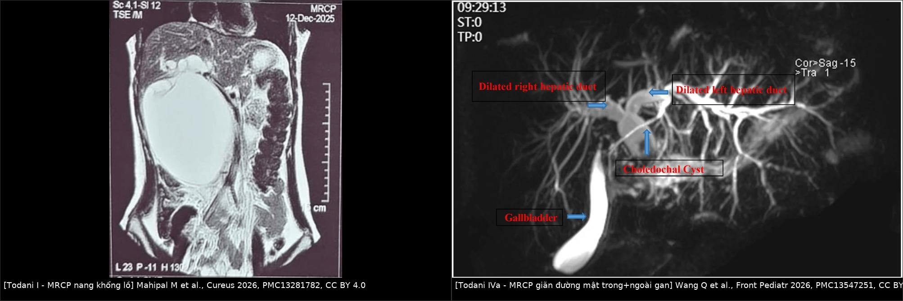
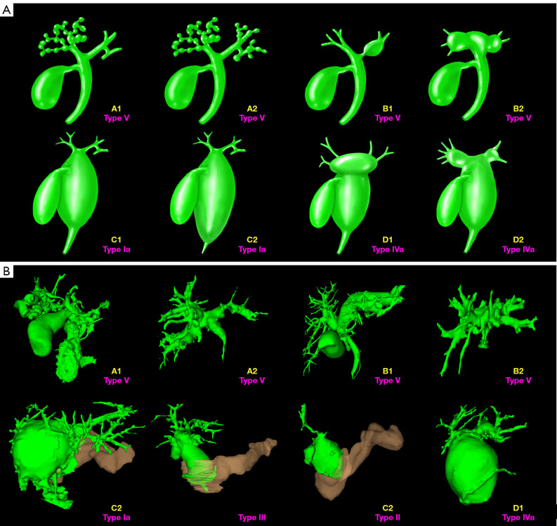
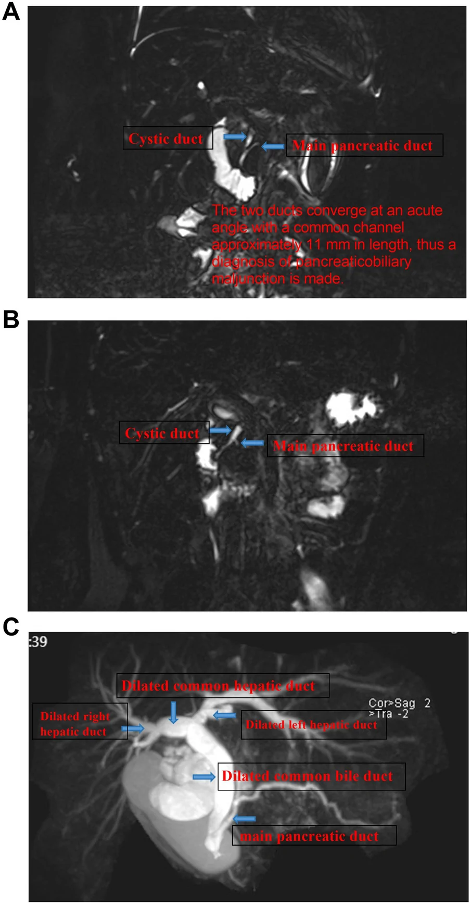
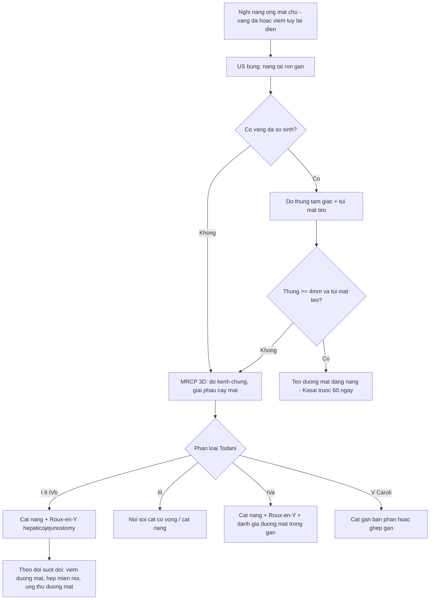
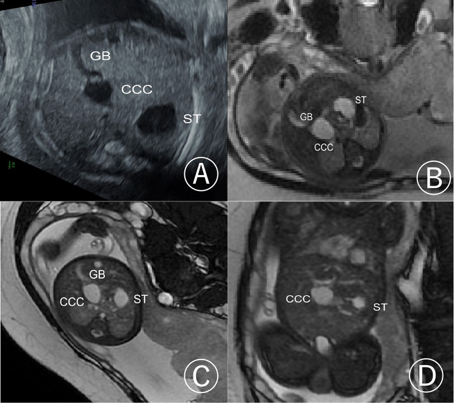
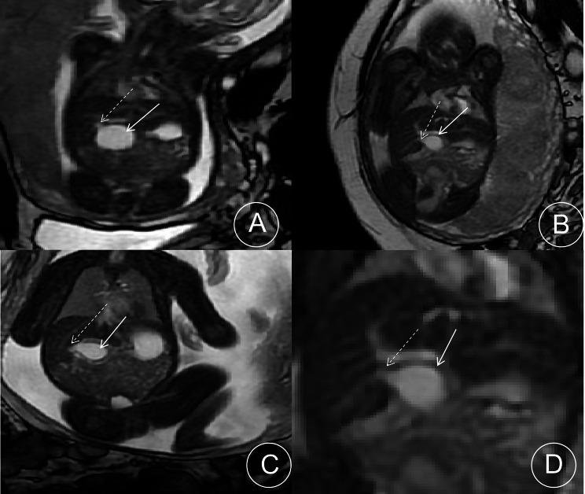
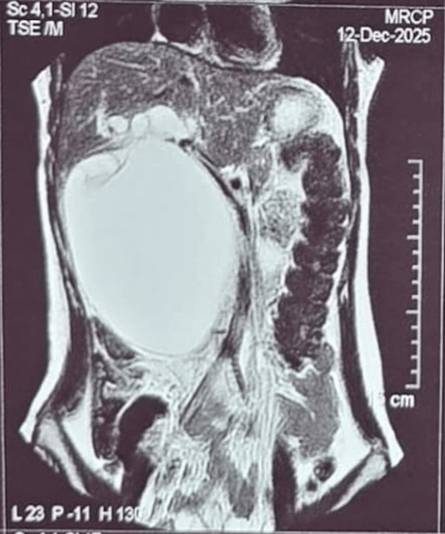
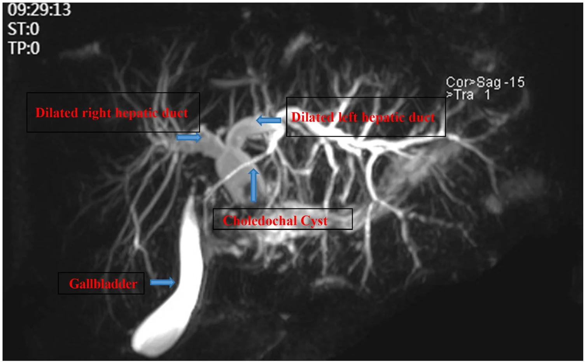

# 666 — Nang ống mật chủ ở trẻ (Todani I–V): MRCP, hợp lưu tụy–mật & nguy cơ ung thư đường mật / Choledochal cyst

**Tags:** `pattern:nang-duong-mat` `vung:gan-mat-nhi` `score:Todani` `protocol:MRCP` `protocol:US-bung-nhi` `incidentaloma:nang-duong-mat`
**Mức chắc chắn (certainty):** tổng hợp y văn (literature synthesis) — tổng hợp review phân loại Todani + các ca nguyên văn có ảnh CC BY/CC BY-NC-ND (ghi rõ PMCID + Fig từng ảnh); số liệu đối chiếu trực tiếp bài gốc, không suy diễn ngoài chú thích.

## 1. Tổng quan bệnh học – cơ chế hình ảnh

- **Nang ống mật chủ (choledochal cyst, CCC) — định nghĩa:** giãn **dạng nang hay dạng thoi (fusiform)** của đường mật **ngoài gan và/hoặc trong gan**, thường kèm **hợp lưu tụy–mật bất thường (pancreaticobiliary maljunction, PBM)**, hẹp đường mật và sỏi mật (Wang Q et al., *Front Pediatr* 2026, **PMC13547251**). Đây là bệnh **đường mật bẩm sinh**, không phải "u".
- **Dịch tễ (định lượng):** gặp nhiều ở châu Á, ước tính **~1/1.000 trẻ sinh**; **nữ trội 3–4:1** (Gu L et al., *BMC Med Imaging* 2026, **PMC13366937**; Wang Q 2026). **Todani I là thể phổ biến nhất, chiếm 80–90%** (Gu L 2026).
- **Cơ chế — TẠI SAO hình thành nang (thuyết Babbitt/PBM):** ống mật chủ và ống tụy chính **hợp lưu ngoài thành tá tràng** tạo **kênh chung dài (common channel) > 15 mm** → **dịch tụy (protease) trào ngược vào đường mật** → viêm và giãn thành nang (Gu L 2026). Ca minh họa đo **kênh chung 11,0 mm** (Wang Q 2026). Thuyết này giải thích luôn **vì sao PBM là chốt chẩn đoán** trên MRCP: kênh chung dài là "dấu vân tay" sinh bệnh học.
- **TẠI SAO MRCP nhìn rõ nang (vật lý):** mật/dịch nang là **nước tự do (mật) hoặc nhầy** → **T2 rất dài** → tín hiệu **rất sáng trên các chuỗi nặng T2 (SSFSE/FRFSE, 3D MRCP)**; trên **T1 thường tối** (dịch nước), chỉ **tăng T1 khi dịch giàu protein/máu** trong nang. Vì vậy **MRCP không cần cản quang** vẫn thấy toàn bộ cây mật — khác CT chỉ thấy "khối nước" đơn thuần, không thấy kênh chung.
- **Hình thái học thai (định lượng):** trong **31 ca CCC thai**, **70,9% nữ**; nang **hình ellipse ở 26 ca**; **"dấu đỉnh nhọn" (pointed apex sign) có ở 100% (31/31) ca**; **bờ dưới nang không vượt bờ dưới gan ở 29/31 ca**; hướng chủ đạo **phải-trên → trái-dưới 26/31** (Gu L 2026). Nang thai phát hiện được từ **tuần 24–30** (Gu L 2026).
- **Diễn tiến/bỏ sót — định lượng:** nang không mổ có thể tiến triển **viêm đường mật, viêm tụy, thủng đường mật (biliary perforation)** và về lâu dài **tăng nguy cơ ung thư đường mật (cholangiocarcinoma)** ở tuổi trưởng thành (Wang Q 2026). Nguy cơ **vẫn tồn tại sau khi đã cắt nang**: ca **ung thư đường mật ngoài gan (eCCA) ở nữ 25 tuổi** đã cắt nang từ thời sơ sinh (Hraib M et al., *Ann Med Surg* 2026, **PMC13354358**) — nên **theo dõi suốt đời**, không "cắt xong là hết".
- **Tam chứng kinh điển:** đau bụng + vàng da + khối bụng — nhưng **hiếm khi đủ cả 3**, trẻ nhũ nhi thường chỉ **vàng da ứ mật** hoặc **khối bụng**.

## 2. Mẫu hình + chẩn đoán phân biệt theo vị trí (gamut)

**Gamut "nang quanh rốn gan/rốn gan (porta hepatis) ở trẻ":**
- **Nang ống mật chủ (Todani I–IV):** nang **thông với cây mật**; kèm **PBM/kênh chung dài**; thường **vàng da ứ mật tái diễn + viêm tụy**.
- **Teo đường mật dạng nang (cystic biliary atresia):** nang **nhỏ, không to lên**, niêm mạc túi mật không đều, **dấu thừng tam giác ≥ 4 mm** — khác CCC (xem [625](../625-vang-da-tac-mat-so-sinh-teo-duong-mat/lesson.md)).
- **Nang gan đơn thuần/sán lá gan (hydatid):** **không thông với đường mật**; sán có **nang con + vôi hóa thành** (xem [139](../139-san-la-gan/lesson.md)).
- **Nang ống mật chủ nội tá tràng (choledochocele = Todani III):** "nang" **nằm trong lòng tá tràng**, thoát vị thành sau; thường **đau/viêm tụy tái phát, ít vàng da**.
- **Ống mật chủ đôi/dị dạng đường mật (biliary anatomical variant), túi mật đôi:** cạm bẫy **giả nang** (xem mục 5).

**Gamut "giãn đường mật trong gan (intrahepatic biliary dilatation)":**
- **Todani IVa** (giãn cả trong gan + ngoài gan, hay gặp nhất sau I), **Todani V/Caroli** (giãn **nhiều ổ trong gan** + **dấu chấm trung tâm — central dot sign** = nhánh TM cửa bị vây trong nang), **hẹp/xơ sau viêm đường mật tái phát**, **ung thư đường mật (chít hẹp + nang giãn thượng lưu)**.

**Phân loại Todani (nhớ nhanh):**
- **I** — giãn ngoài gan (Ia dạng nang, Ib khu trú, Ic dạng thoi); **II** — túi thừa ống mật chủ; **III** — choledochocele (trong tá tràng); **IVa** — trong + ngoài gan, **IVb** — nhiều ổ ngoài gan; **V** — chỉ trong gan (**Caroli**).
- Mnemonic theo vị trí: **I-II-IVb ngoài gan · III tá tràng · V trong gan · IVa cả hai**.

## 3. Bảng so sánh phân biệt (ma trận đối chiếu)

| Thực thể (entity) | Hình ảnh điển hình | Chốt vào (rule-in) | Chốt loại (rule-out) | Gợi ý xác nhận |
|---|---|---|---|---|
| **Todani I (nang/thoi ngoài gan)** | Nang lớn ở rốn gan, **thông cây mật**, túi mật thường; MRCP thấy **kênh chung dài > 15 mm (PBM)** | **Nang thông đường mật + PBM + vàng da ứ mật/viêm tụy tái diễn** | Nang **không thông** đường mật, không PBM → nang gan đơn thuần/sán | MRCP (phân loại chính xác ~96,2%); cắt nang + Roux-en-Y |
| **Todani IVa (trong + ngoài gan)** | **Giãn đường mật trong gan HAI bên + nang/thoi ống mật chủ**; hình "cây" trên MRCP | **Giãn in-ra 2 bên + nang ngoài gan + PBM** | Giãn trong gan **khu trú một thùy/không nang** → Caroli/hẹp lành tính | MRCP 3D + đo kênh chung; MRCP phát hiện PBM và giãn trong gan tốt hơn US/CT (**P < 0,05**) |
| **Todani V (Caroli)** | **Nhiều nang trong gan** dọc đường mật, **dấu chấm trung tâm** | **Dấu chấm trung tâm + giãn đường mật trong gan dạng túi** | Không có nang ngoài gan, không PBM → không phải I/IV | MRCP/CT; tìm xơ gan mật (CHF) + tăng áp cửa |
| **Teo đường mật dạng nang** | Nang **nhỏ (< 1 cm → không to sau sinh)**, túi mật **teo (< 15–19 mm), không co sau bú** | **Dấu thừng tam giác ≥ 4 mm + túi mật teo/không co + HIDA không thải 24 giờ** | Nang **> 1 cm và to lên sau sinh** + túi mật thường → CCC | Siêu âm lặp + HIDA; **Kasai < 60 ngày** |
| **Nang sán lá gan (hydatid)** | **Nang con/vỏ tách (water-lily)**, **vôi hóa thành**, **không thông đường mật** | **Vỏ tách + nang con + tiền sử dịch tễ** | Thông đường mật + PBM → CCC | Siêu âm/CT/MRI + huyết thanh; albendazole + PAIR |
| **Ung thư đường mật sau cắt nang** | **Chít hẹp/mass xâm lấn + giãn đường mật thượng lưu**, CA19-9 tăng, **nhiều năm sau mổ** | **Tiền sử cắt nang đường mật + khối xâm lấn + CA19-9 tăng** | Nang dạng đơn thuần, bờ đều → tái phát lành tính/hẹp | MRCP + CT; sinh thiết; theo dõi **suốt đời** |

*Trái: nang khổng lồ [Todani I] — Mahipal M et al., Cureus 2026, PMC13281782, CC BY 4.0. Phải: Todani IVa với giãn đường mật trong gan hai bên — Wang Q et al., Front Pediatr 2026, PMC13547251, CC BY 4.0. Ảnh ghép letterbox giữ nguyên tỷ lệ.*

### Phân độ Todani — sơ đồ 3D

*Tái tạo 3D cây mật–tĩnh mạch: **Ia** nang ống mật chủ, **II** túi thừa, **III** choledochocele, **IVa** trong + ngoài gan, **V** (Caroli) trong gan — Cai P et al., Quant Imaging Med Surg 2026, PMC13457801, **CC BY-NC-ND 4.0** (giữ nguyên bản, không ghép).*

### Hợp lưu tụy–mật (PBM) — "chìa khóa" sinh bệnh học

*MRCP: ống mật chủ + ống tụy chính hợp lưu **góc nhọn ngoài thành tá tràng**, kênh chung **11 mm** → **PBM** (tiêu chuẩn kênh chung dài thường **> 15 mm**) — Wang Q et al., Front Pediatr 2026, PMC13547251, CC BY 4.0.*

## 4. Protocol chụp + phân loại Todani

- **Siêu âm bụng (đầu tay, trẻ nhịn ăn):** đo kích thước nang tại rốn gan, tìm **giãn đường mật trong gan**, đánh giá **túi mật** (thường/teo), **dấu thừng tam giác** (nếu vàng da sơ sinh). Siêu âm **kém nhạy với PBM** và giãn đường mật trong gan hơn MRCP.
- **MRCP/MRI gan–mật (tiêu chuẩn phân loại):** chuỗi **nặng T2 SSFSE/FRFSE 3D**, lát mỏng; đánh giá **kênh chung (chiều dài mm), hợp lưu lệch vị trí, giãn trong gan hai bên**. Trong cohort 117 trẻ, **MRCP phân loại chính xác 96,2%** và **phát hiện PBM + giãn đường mật trong gan cao hơn US/CT (P < 0,05)** (Wang Q 2026).
- **CT:** hữu ích đánh giá biến chứng (thủng/viêm tụy) và giải phẫu mạch quanh nang; **không thay MRCP** để phân loại.
- **HIDA (khi còn nghi ngờ teo đường mật):** không thấy tracer xuống ruột sau **24 giờ** gợi ý tắc; nhưng **chỉ loại trừ tốt khi thấy tracer xuống ruột** (xem [625](../625-vang-da-tac-mat-so-sinh-teo-duong-mat/lesson.md)).
- **Phân loại Todani (phiên bản Todani 1977, dùng thống nhất):** I–V như trên; **IVa hay gặp nhất trong nhóm nhiều ổ** (24,0% trong cohort của Wang Q 2026).
- **Điều trị (nguyên tắc):** **cắt toàn bộ nang + nối mật–ruột Roux-en-Y** là chuẩn (chiếm **81,7%** ở Wang Q 2026); **tránh nối nang–ruột đơn thuần** (giữ nang → nguy cơ ung thư đường mật). **Todani III** có thể xử trí **nội soi cắt cơ vòng**; **Todani V** (Caroli) thường **cắt gan bán phần/ghép gan** tùy vị trí.
- **Biến chứng sớm sau mổ:** tỉ lệ biến chứng sớm chung **16,3%** (Wang Q 2026); theo dõi **viêm đường mật, hẹp miệng nối, sỏi mới** và **ung thư đường mật muộn**.

## 5. Biến thể bình thường và cạm bẫy

- **Túi mật đôi / ống mật chủ đôi / gập túi mật:** có thể giả "nang" trên MRCP — luôn dò **sự liên tục với cây mật** và **kiểu đổ vào của ống túi mật** trước khi gọi nang.
- **MRCP lát dày (thick-slab) có thể bị tá tràng đè hình làm mất ống túi mật** — trong khi **MRCP 3D thấy rõ**; đừng kết luận "không có ống túi mật" chỉ vì một chuỗi (Kaynak Şahap S, Fitoz S, *Turk J Med Sci* 2026, **PMC13398544**).
- **Nang thai có thể thoái triển tự nhiên** hoặc **teo đường mật dạng nang** — vì vậy nang phát hiện trước sinh **phải chụp lặp sau sinh**, không mổ ngay dựa trên hình thai.
- **Cạm bẫy "giãn đường mật trong gan = Caroli":** Todani **IVa** giãn trong gan **hai bên nhưng có nang ngoài gan + PBM**; Caroli **không có nang ngoài gan**. Dấu **chấm trung tâm** (nhánh TM cửa bị vây quanh bởi nang) nghiêng về Caroli.
- **Cạm bẫy sau mổ:** giãn đường mật thượng lưu **nhiều năm sau cắt nang** không được quy lành tính — nghĩ **hẹp miệng nối/sỏi/ung thư đường mật** (ca eCCA 25 tuổi sau cắt sơ sinh).
- **Thỏa mãn tìm kiếm (satisfaction of search):** thấy nang ống mật chủ rồi bỏ qua **sỏi ống mật chủ** và **ung thư đường mật đồng thời** — luôn soát thêm sỏi + chít hẹp trên MRCP/CT.

## 6. Tự lượng giá — Blind Quiz

**Ca 1 — Thai 30 tuần, siêu âm thấy cấu trúc dạng nang ở rốn gan. Nhìn ảnh, mô tả trước.**

- Gợi ý lâm sàng (clinical context): thai không triệu chứng, phát hiện tình cờ khi siêu âm thai.
- Câu hỏi: Cấu trúc nang nằm ở đâu so với túi mật và dạ dày? 3 chẩn đoán phân biệt trong tử cung? Dấu nào gợi nang ống mật chủ?

<b>Bấm để hiện đáp án (findings + chẩn đoán)</b>

- Dấu hiệu (findings): trên siêu âm ngang (A), cấu trúc nang **CCC** nằm ngay **rốn gan, sát túi mật (GB)**, cạnh dạ dày (ST); các mặt cắt MRI **SSFSE (B, D) và FIESTA (C)** xác định rõ quan hệ nang–túi mật–dạ dày.
- Chẩn đoán (diagnosis): **nang ống mật chủ bẩm sinh type I (congenital choledochal cyst)** — vì nang **thông với đường mật tại rốn gan** và giữ nguyên tương quan với túi mật; thêm **dấu đỉnh nhọn** trên mặt cắt dọc giúp chốt (xem ca đối chiếu dưới).
- Đối chiếu dấu đỉnh nhọn:

- Trong 31 ca CCC thai, **dấu đỉnh nhọn có ở 100%**, nang hình ellipse **26/31**, bờ dưới nang **không vượt bờ dưới gan 29/31** (Gu L et al., BMC Med Imaging 2026).
- Nguồn ảnh: Gu L et al., *BMC Med Imaging* 2026, PMC13366937, **CC BY-NC-ND 4.0**.

**Ca 2 — Bé gái đau bụng, bụng to; MRCP có nang lớn. Xem ảnh trước khi kết luận.**

- Gợi ý lâm sàng: trẻ có khối vùng bụng trên, đau bụng; MRCP thấy một nang lớn.
- Câu hỏi: Nang có thông với cây mật không (bằng chứng nào)? Đây là thể Todani nào? Xử trí?

<b>Bấm để hiện đáp án (findings + chẩn đoán)</b>

- Dấu hiệu (findings): **nang khổng lồ** chiếm gần hết bụng trên phải, tín hiệu **rất sáng trên MRCP (dịch T2 dài)**, liên tục với đường mật rốn gan.
- Chẩn đoán (diagnosis): **nang ống mật chủ (choledochal cyst)** — nang **thông với cây mật** khác nang gan đơn thuần; đây là ca **nang "khổng lồ"** đã được phẫu thuật cắt nang + Roux-en-Y.
- Xử trí: **cắt toàn bộ nang + nối mật–ruột Roux-en-Y**; theo dõi suốt đời vì nguy cơ ung thư đường mật muộn.
- Nguồn ảnh: Mahipal M et al., *Cureus* 2026, PMC13281782, **CC BY 4.0**.

**Ca 3 — Bé gái viêm tụy tái diễn; MRCP đường mật giãn. Đọc ảnh có chú thích.**

- Gợi ý lâm sàng: đau bụng/viêm tụy tái diễn, MRCP thấy đường mật giãn.
- Câu hỏi: Giãn ở đoạn nào (trong gan/ngoài gan)? Nếu cộng thêm túi mật giãn + nang ống mật chủ thì gọi Todani thể mấy? Vì sao phải tìm kênh chung?

<b>Bấm để hiện đáp án (findings + chẩn đoán)</b>

- Dấu hiệu (findings): **giãn đường mật gan phải và gan trái** (hai bên) + **nang/thoi ống mật chủ**; túi mật căng. Ảnh chú thích ghi rõ "dilated right/left hepatic duct" và "choledochal cyst".
- Chẩn đoán (diagnosis): **Todani IVa** (giãn cả **trong gan hai bên** và **ngoài gan**) — vì có cả giãn in-ra hai bên **và** nang ngoài gan; tổ hợp này chiếm **24,0%** trong cohort nhi của Wang Q. **Kênh chung dài/PBM** phải tìm vì đó là cơ chế trào ngược dịch tụy (ca điển hình **11 mm**).
- Nguồn ảnh: Wang Q et al., *Front Pediatr* 2026, PMC13547251, **CC BY 4.0**.

## Bài liên quan chéo
- [600 – Tổng quan Hệ Nhi khoa](../600-tong-quan-nhi-khoa/lesson.md) (bảng DDx bụng–gan mật nhi)
- [625 – Vàng da tắc mật sơ sinh: teo đường mật vs viêm gan](../625-vang-da-tac-mat-so-sinh-teo-duong-mat/lesson.md) (phân biệt nang ống mật chủ vs teo đường mật dạng nang)
- [626 – Viêm tụy cấp ở trẻ (nang ống mật chủ, tụy divisum)](../626-viem-tuy-cap-nhi/lesson.md) (CCC là nguyên nhân giải phẫu của viêm tụy)
- [665 – Khối u gan ở trẻ em](../665-khoi-u-gan-nhi/lesson.md) (gamut khối gan nhi)
- [624 – Chấn thương gan–đường mật nhi](../624-chan-thuong-gan-duong-mat-nhi/lesson.md) (DDx cấp cứu quanh gan)
- [641 – Theo dõi hậu phẫu Kasai](../641-theo-doi-hau-phau-kasai/lesson.md) (viêm đường mật, tăng áp lực cửa)
- [131 – Tắc mật: sỏi OMC vs Klatskin](../131-tac-mat/lesson.md) (người lớn)
- [123 – Nang gan & bệnh gan đa nang (Caroli)](../123-nang-gan-va-benh-gan-da-nang/lesson.md) (Todani V/Caroli)
- [139 – Sán lá gan (hydatid)](../139-san-la-gan/lesson.md) (DDx nang gan không thông đường mật)

## Ảnh
- Tên file: `666_nang-omc_<modality>_<PMCID>-FigN-...`. Nguồn + giấy phép từng ảnh trong `images/CREDITS.md` và `sources.md`.
- Ảnh **CC BY 4.0** dùng cho ảnh ghép (`composite_omc-typeI-vs-typeIVa.jpg`); ảnh **CC BY-NC-ND** (PMC13366937, PMC13457801) **giữ nguyên bản, không ghép**.
- Không tải Google Images/AuntMinnie; nguồn đóng chỉ dẫn link ở `sources.md`.

> Không dùng để chẩn đoán độc lập khi chưa có người hướng dẫn.
