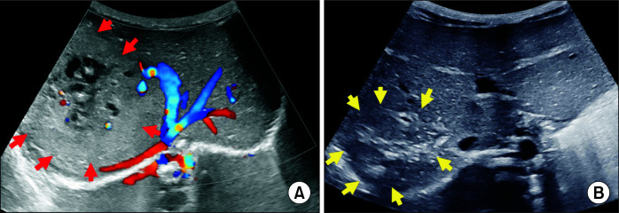
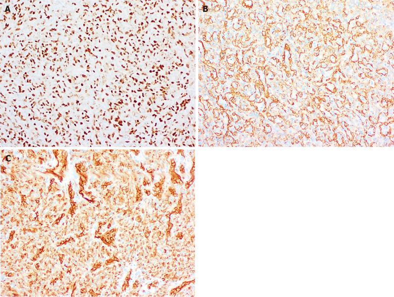
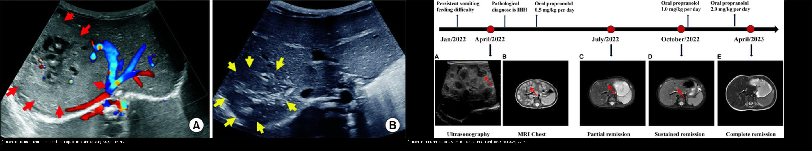
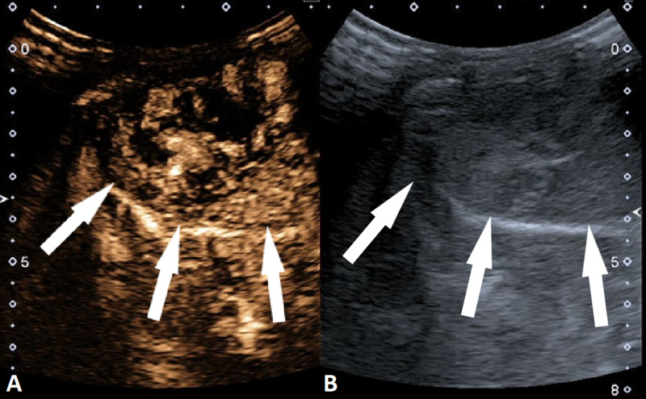
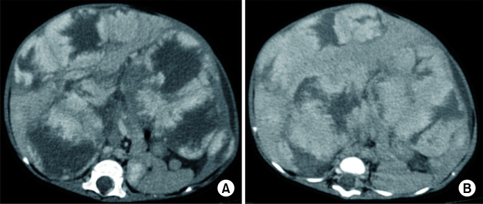
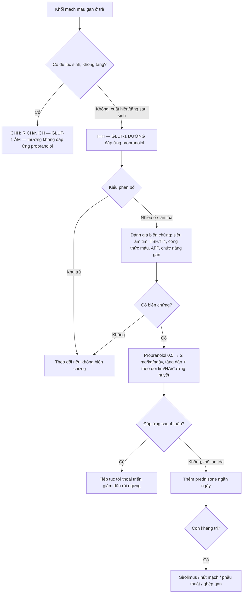
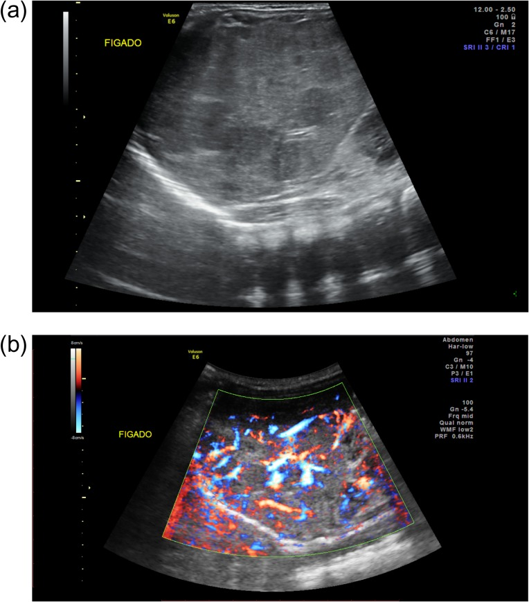
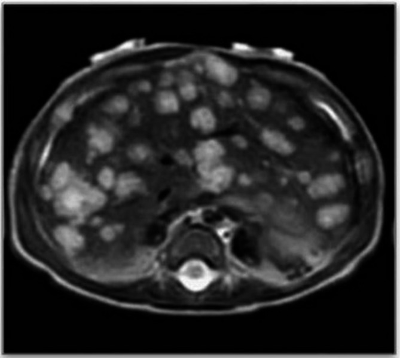
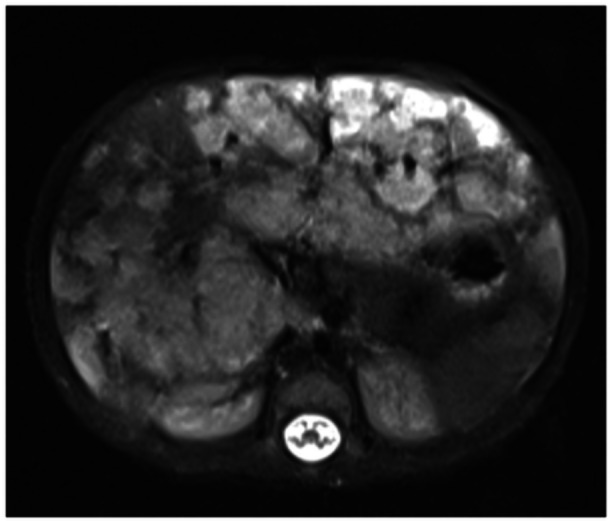
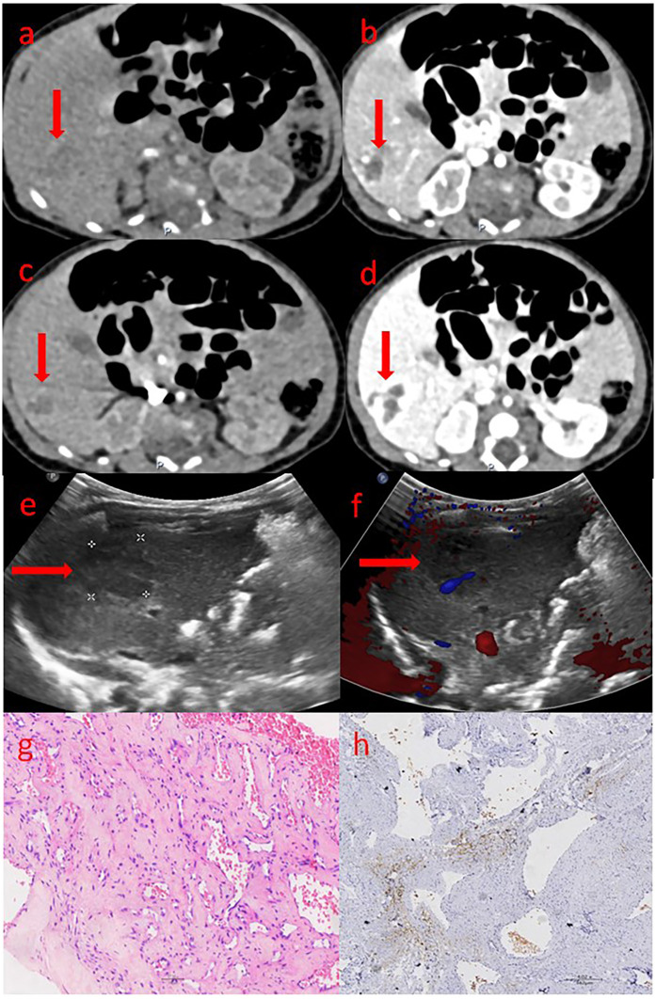

# 667 — U mạch máu gan ở trẻ: hemangioma khổng lồ, suy tim cung lượng cao & điều trị nội khoa / Infantile hepatic hemangioma & medical therapy

**Tags:** `pattern:khoi-gan-nhi` `vung:gan` `score:ISSVA` `protocol:US-Doppler-CEUS-MRI-gan-nhi` `incidentaloma:khoi-gan-nhi`
**Mức chắc chắn (certainty):** tổng hợp y văn (literature synthesis) — tổng hợp từ các review mạch máu gan nhi + ca nguyên văn có ảnh CC BY/BY-NC (ghi rõ PMCID từng ảnh); các ca minh họa là ca nguyên văn lấy từ bài gốc.

## 1. Tổng quan bệnh học – cơ chế hình ảnh

- **U mạch máu gan (hepatic hemangioma)** là khối u mạch máu lành tính hay gặp nhất ở gan nhũ nhi. **ISSVA** chia làm hai họ hoàn toàn khác nhau về sinh học và **đáp ứng thuốc**:
  - **U mạch máu bẩm sinh (congenital hemangioma — CHH):** **đã có đủ lúc sinh**, **không tăng sau sinh**; ba thể theo diễn tiến — **RICH** (thoái triển nhanh), **NICH** (không thoái triển), **PICH** (thoái triển một phần). Mô học: **GLUT-1 ÂM**.
  - **U mạch máu nhũ nhi (infantile hemangioma — IHH):** xuất hiện **sau sinh vài tuần–vài tháng**, có **pha tăng sinh rồi pha thoái triển** song song u mạch máu da. Mô học: **GLUT-1 DƯƠNG** (dấu ấn của nhau thai) — đây là chìa khóa phân biệt với CHH và là lý do **IHH đáp ứng propranolol còn CHH thường không**.
- **TẠI SAO hình ảnh như vậy?** IHH là **hồ mạch máu chảy chậm** — trên siêu âm là khối **tăng hồi âm/không đồng nhất có mạch trong u** (Doppler); trên **CEUS và MRI động** ngấm thuốc kiểu **viền nốt ngoại vi không liên tục → đầy dần vào trung tâm (peripheral nodular discontinuous enhancement → centripetal fill-in)** vì thuốc chảy chậm vào các hồ mạch, khác hẳn kiểu **ngấm mạnh thì động mạch của u ác**. Trên **T2W u sáng mạnh** (nhiều nước), **T1W tối**, sau tiêm ngấm dần.
- **Cơ chế biến chứng (vì sao u lành vẫn có thể giết người):**
  - **Suy tim cung lượng cao (high-output cardiac failure):** do **shunt động–tĩnh mạch** trong u khổng lồ/lan tỏa — tim bơm lưu lượng lớn. Ca nguồn ghi **gradient xuyên mạch phổi đỉnh 18 mmHg** trước điều trị, giảm nhanh sau propranolol.
  - **Suy giáp tiêu thụ (consumptive hypothyroidism):** nội mô u tăng biểu hiện **enzym type 3 deiodinase (D3)** phá hủy T4/T3 → suy giáp nặng, nếu không thay hormone đủ sẽ hại phát triển thần kinh. Tổng quan 64 ca (2000–2023): **59,37% dùng propranolol** (52,63% đơn trị); **92,85% cần LT4**; nhóm propranolol cần **liều LT4 thấp hơn**.
  - **Hội chứng khoang bụng (abdominal compartment syndrome)**, **thiếu máu/giảm tiểu cầu**, **suy gan** — gặp trong thể **lan tỏa (diffuse IHH)** gần như thay hết nhu mô gan.
- **Ngưỡng định lượng / phân loại bắt buộc:** theo số ổ — **khu trú (focal, 1 ổ)** / **nhiều ổ (multifocal, ≥ 2 ổ)** / **lan tỏa (diffuse, vô số ổ thay gần hết nhu mô)**; số đo trong ca minh họa: US ổ **trung bình 15 mm**, MRI tổn thương **tối đa 20 mm** (Bettini 2025, PMC12186321).
- **Vai trò AFP:** giúp loại u ác (hepatoblastoma) nhưng **AFP cao sinh lý trong 6 tháng đầu** nên **không dùng để khẳng định ác tính** ở nhũ nhi.

## 2. Mẫu hình + chẩn đoán phân biệt theo số lượng ổ (gamut)

- **Một ổ (focal) ở nhũ nhi:** u mạch máu **bẩm sinh** (RICH/NICH — GLUT-1 âm, thường không đáp ứng propranolol), IHH khu trú (GLUT-1 dương), **hepatoblastoma** (khối đặc + AFP rất cao), **u mô đệm lành (mesenchymal hamartoma)** (nhiều nang).
- **Nhiều ổ (multifocal):** IHH nhiều ổ (kèm u mạch máu da), **di căn gan của neuroblastoma** (khối nguyên phát thượng thận + vôi hóa lấm tấm), hepatoblastoma nhiều ổ, u nội mô mạch máu (epithelioid hemangioendothelioma — hiếm ở trẻ).
- **Lan tỏa (diffuse — vô số ổ thay gần hết nhu mô):** **IHH lan tỏa** — nhóm **nguy hiểm nhất**, luôn kèm bộ ba biến chứng **suy tim cung lượng cao + suy giáp tiêu thụ + thiếu máu/khoang bụng**.
- **Gợi nhớ “khối mạch máu gan nhi”:** **B** — **B**ẩm sinh (CHH, GLUT-1 âm, không đáp ứng) vs **I** — **I**HH (GLUT-1 dương, đáp ứng propranolol); **1 ổ hẹp = lành hơn; lan tỏa = nguy hiểm nhất**.
- **Bối cảnh chốt:** trẻ non tháng/thiếu máu không rõ + **một ổ gan tăng mạch** → nghĩ IHH (CEUS là chìa khóa khi MRI không loại được hepatoblastoma). Trẻ **có u mạch máu da kèm nhiều ổ gan** → IHH nhiều ổ.

## 3. Bảng so sánh phân biệt (ma trận đối chiếu)

| Thực thể (entity) | Hình ảnh điển hình (US/CEUS/MRI) | Chốt vào (rule-in) | Chốt loại (rule-out) | Gợi ý xác nhận |
|---|---|---|---|---|
| U mạch máu nhũ nhi (IHH) | US: khối tăng hồi âm/không đồng nhất có mạch; CEUS/MRI: **ngấm viền nốt không liên tục → đầy dần trung tâm**; T2 sáng mạnh | **Xuất hiện sau sinh + tăng rồi thoái triển + GLUT-1 dương + ngấm viền đầy dần** | **Đứng yên từ lúc sinh + không đáp ứng propranolol → nghĩ CHH**; **ngấm động mạch rồi thải thuốc + AFP rất cao → nghĩ hepatoblastoma** | US Doppler + CEUS; TSH/fT4; AFP; MRI động |
| U mạch máu bẩm sinh (CHH: RICH/NICH/PICH) | **Có đủ lúc sinh, không tăng**; US: mạch to, có thể thoái triển nhanh (RICH); MRI: tín hiệu không đồng nhất, vôi hóa gặp ở thể bẩm sinh | **Khối đã có lúc sinh + không tăng theo thời gian + GLUT-1 ÂM** | **Xuất hiện/tăng sau sinh → IHH (đáp ứng propranolol)** | Theo dõi diễn tiến; mô học GLUT-1 khi cần |
| U nguyên bào gan (hepatoblastoma) | Khối đặc không đồng nhất, **hoại tử, vôi hóa thô 40–50%**, xâm lấn nhiều phân thùy | **6 tháng–5 tuổi + AFP > 10.000 ng/mL + vôi hóa thô** | **AFP bình thường + ngấm viền đầy dần → nghĩ u mạch máu** | AFP, MRI đa thì, PRETEXT (bài 665) |
| U mô đệm lành (mesenchymal hamartoma) | Khối **nhiều nang có vách** xen mô đặc, ngấm ít | **Nhũ nhi < 18 tháng + nhiều nang + AFP bình thường** | **Khối đặc hoàn toàn + AFP rất cao → hepatoblastoma** | US + MRI |
| Di căn gan neuroblastoma | Nhiều nốt trong gan **+ khối thượng thận nguyên phát**, vôi hóa lấm tấm | **Khối thượng thận + vôi hóa + catecholamine (VMA/HVA)** | **Vô số ổ thay gần hết nhu mô + suy giáp → IHH lan tỏa** | US bụng, MIBG, VMA/HVA |

### Dấu hiệu chốt cần đọc đúng trên từng kỹ thuật
- **CEUS (siêu âm cản quang):** chìa khóa khi MRI không loại được hepatoblastoma — thấy **ngấm viền nốt ngoại vi ở giây thứ 8–10**, rồi những giây tiếp theo **đầy dần toàn bộ tổn thương** ở thì động mạch muộn. Kiểu này gần như loại u ác.
- **US Doppler:** khối tăng hồi âm/không đồng nhất, **có mạch trong u**; thể lan tỏa là **vô số nốt hồi âm kém/đồng âm rải khắp gan** + gan to.
- **MRI:** **T2 sáng mạnh**, T1 tối, sau tiêm ngấm **viền nốt rồi đầy dần**; **T2 là chuỗi nhạy nhất để thấy các nốt nhỏ** khi thể lan tỏa.

## 4. Protocol chụp + phác đồ điều trị nội khoa

- **Protocol hình ảnh:** (1) **US bụng + Doppler** đầu tay — khối đặc/tăng mạch, gan to; (2) **CEUS** khi cần phân biệt với hepatoblastoma (ngấm viền nốt → đầy dần); (3) **MRI gan** (T1/T2 fat-sat, **DWI/ADC**, động học sau tiêm) khi lan tỏa/cần bản đồ tổn thương; (4) **CTA/MRA** khi nghi shunt mạch lớn hoặc trước can thiệp.
- **Đánh giá biến chứng bắt buộc trước điều trị:** **siêu âm tim** (suy tim cung lượng cao), **TSH/fT4/fT3** (suy giáp tiêu thụ), **công thức máu** (thiếu máu/giảm tiểu cầu), **AFP**, **chức năng gan**, đo **vòng bụng/áp lực khoang bụng** khi lan tỏa.
- **Phác đồ nội khoa:**
  - **Propranolol = điều trị đầu tay** cho IHH có biến chứng/nhiều ổ/lan tỏa. Ca nguồn tăng liều **0,5 mg/kg/ngày → 2 mg/kg/ngày**; khởi đầu liều thấp, tăng dần, **theo dõi nhịp tim–huyết áp–đường huyết** (hạ đường huyết ở nhũ nhi nhỏ, đặc biệt khi bú kém).
  - **Bổ sung prednisone cho thể lan tỏa:** RCT đa trung tâm (Lan 2026, PMC13433490, n = 45) — tuần 4 **đáp ứng tổn thương 91,3% (propranolol + prednisone) vs 59,1% (propranolol đơn trị)**, khác biệt **32,2% (KTC 95% 6,9–53,5%), P = 0,007**; tháng 6 đáp ứng thể tích **91,3% vs 63,6% (P = 0,026)**; **không có biến cố nặng độ 3–4**.
  - **Kháng trị:** sirolimus, **nút mạch (hepatic artery embolization)**, phẫu thuật, hoặc **ghép gan** khi suy gan/suy tim không kiểm soát.
  - **Suy giáp tiêu thụ:** thay **LT4 liều cao**, giảm dần khi u thoái triển (ca nguồn propranolol giúp **bình thường hóa giáp sau 2 tuần**, có ca không cần LT4).
- **Sơ đồ tiếp cận khối mạch máu gan ở trẻ:**

## 5. Biến thể bình thường và cạm bẫy

- **AFP cao sinh lý 6 tháng đầu** → AFP tăng nhẹ ở nhũ nhi **không đủ khẳng định ác tính**; đánh giá theo động học + hình thái.
- **CHH không đáp ứng propranolol** → đừng tăng liều vô ích; theo dõi diễn tiến (RICH tự thoái triển, NICH đứng yên).
- **“Lành” không đồng nghĩa “vô hại”:** thể **lan tỏa** có thể gây **suy tim cung lượng cao, suy giáp tiêu thụ, hội chứng khoang bụng, suy gan** — báo cáo ca **tử vong** trong thể CHH khổng lồ kèm suy tim sung huyết dù đã nút mạch.
- **Bỏ sót suy giáp tiêu thụ:** biểu hiện ban đầu có thể chỉ là **thiếu máu + tăng transaminase/GGT** hoặc suy giáp khởi phát muộn → **luôn xét nghiệm tuyến giáp** ở mọi trẻ có IHH.
- **Kasabach–Merritt (giảm tiểu cầu tiêu thụ) KHÔNG điển hình ở IHH** — nhóm này gắn với **u nội mô mạch máu Kaposi (KHE)**; đừng gán nhầm.
- **Cạm bẫy mặt cắt:** “khối gan” ở trẻ nhỏ có thể là **thùy gan biến dạng do chèn ép** hoặc **giả khối do nhịp thở** trên US — đối chiếu MRI trước khi kết luận; **nhiều nốt gan** phải phân biệt **di căn neuroblastoma** (tìm khối thượng thận + VMA/HVA).

## 6. Tự lượng giá — Blind Quiz

**Ca 1 — Bé gái non tháng 10 ngày, thiếu máu dai dẳng không rõ nguyên nhân. Đọc siêu âm và CEUS.**

- Gợi ý lâm sàng: nhũ nhi non tháng, thiếu máu; MRI chưa loại được hepatoblastoma.
- Câu hỏi: Kiểu ngấm thuốc là gì? Nó nói lên điều gì? Chẩn đoán?

<b>Bấm để hiện đáp án (findings + chẩn đoán)</b>

- Dấu hiệu (findings): CEUS — **ngấm viền nốt ngoại vi ở giây thứ 8**, rồi **đầy dần vào trung tâm** các thì sau; đối chiếu US thang xám (B) thấy tổn thương không tăng hồi âm rõ.
- Chẩn đoán (diagnosis): **u mạch máu gan nhũ nhi (IHH)** — kiểu ngấm viền nốt rồi đầy dần là **chốt loại u ác**, giúp tránh sinh thiết/phẫu thuật không cần thiết khi MRI không phân định được.
- Nguồn ảnh: Sekej M et al., Cureus 2020 (PMC7478462, Fig. 3), CC BY 4.0.

**Ca 2 — Bé trai 2 tháng, gan to, thiếu máu + tăng transaminase. Đọc MRI T2.**

- Gợi ý lâm sàng: nhũ nhi, chưa rõ nguyên nhân suy giáp/thiếu máu.
- Câu hỏi: Mẫu hình phân bố? Cần xét nghiệm gì bắt buộc? Biến chứng hay đi kèm?

<b>Bấm để hiện đáp án (findings + chẩn đoán)</b>

- Dấu hiệu (findings): **vô số nốt T2 sáng mạnh rải khắp các thùy gan**, gan to — mẫu hình **lan tỏa (diffuse IHH)**; US trước đó (Fig. 2) cho thấy các nốt hồi âm kém, đường kính trung bình **15 mm**.
- Chẩn đoán (diagnosis): **u mạch máu gan nhũ nhi lan tỏa (diffuse IHH)**. Bắt buộc xét nghiệm **TSH/fT4** (suy giáp tiêu thụ do D3), **công thức máu** (thiếu máu), **AFP**, **siêu âm tim** (suy tim cung lượng cao). Điều trị: **propranolol** (trong ca nguồn giúp giảm u và **bình thường hóa giáp sau 2 tuần**).
- Nguồn ảnh: Bettini I et al., Ital J Pediatr 2025 (PMC12186321, Fig. 3), CC BY 4.0.

**Ca 3 — Bé gái IHH nhiều ổ nhập viện vì suy tim sung huyết, chậm tăng trưởng. So sánh siêu âm trước và sau điều trị.**

- Gợi ý lâm sàng: suy tim cung lượng cao + gan to + chậm tăng cân.
- Câu hỏi: Điều trị gì? Kết quả ra sao? Theo dõi tim bằng số nào?

<b>Bấm để hiện đáp án (findings + chẩn đoán)</b>

- Dấu hiệu (findings): siêu âm trước điều trị: **nhiều ổ mạch máu trong gan**; sau propranolol: **thoái triển rõ rệt**; MRI nền có nhiều ổ ngấm gần khắp nhu mô. **Gradient xuyên mạch phổi đỉnh 18 mmHg** trước điều trị, giảm nhanh và duy trì cải thiện qua 8 tháng.
- Chẩn đoán (diagnosis): **IHH nhiều ổ có suy tim cung lượng cao** — điều trị **propranolol** là đầu tay, hiệu quả và dung nạp tốt; cải thiện cả lâm sàng lẫn hình ảnh.
- Nguồn ảnh: Ateeqi FA et al., JPGN Reports 2026 (PMC13398648, Fig. 1), **CC BY-NC-ND** (giữ nguyên gốc, không chỉnh sửa/ghép).

**Ca 4 — Trẻ sơ sinh có khối gan đã thấy từ lúc sinh, không tăng theo thời gian. Đọc bộ ảnh đa phương thức.**

- Gợi ý lâm sàng: khối gan bẩm sinh, đã có đủ lúc sinh.
- Câu hỏi: Hình thái CT/siêu âm/mô học? Đây là họ u nào (bẩm sinh hay nhũ nhi)? Vì sao điều trị khác?

<b>Bấm để hiện đáp án (findings + chẩn đoán)</b>

- Dấu hiệu (findings): CT (a–d) 4 thì — khối có phần ngấm; siêu âm (e–f) — khối và mạch máu trong u; mô học (g–h) — mạch máu lành, không ác tính.
- Chẩn đoán (diagnosis): **u mạch máu gan bẩm sinh (congenital hepatic hemangioma)** — thuộc họ **CHH (GLUT-1 âm)**, và vì **thường không đáp ứng propranolol**, xử trí thiên về theo dõi/thoái triển tự nhiên; chỉ can thiệp khi có biến chứng (trong báo cáo 12 ca CHH: 8 ca mổ, 3 ca dùng thuốc, 1 ca khổng lồ kèm suy tim sung huyết nút mạch nhưng tử vong).
- Nguồn ảnh: Wei Y et al., Front Pediatr 2025 (PMC12066750, Fig. 2), CC BY 4.0.

**Ca 5 — Bé trai sơ sinh khám vì hẹp môn vị, tình cờ phát hiện gan bất thường trên siêu âm. Đọc siêu âm và MRI.**

- Gợi ý lâm sàng: phát hiện tình cờ, trẻ bú tốt, chưa có triệu chứng tim.
- Câu hỏi: Trái/phải khác nhau ở điểm nào (số ổ + diễn tiến)? Ca tình cờ cần làm gì tiếp?

<b>Bấm để hiện đáp án (findings + chẩn đoán)</b>

- Dấu hiệu (findings): trái — **một khối mạch máu khu trú (u bẩm sinh, có mạch trong u)**; phải — **nhiều ổ lan tỏa, chuỗi ảnh cho thấy thoái triển dần theo thời gian** (US + MRI).
- Chẩn đoán (diagnosis): **khu trú (congenital/focal) vs lan tỏa (diffuse IHH)**. Với ca phát hiện tình cờ, dù không triệu chứng vẫn phải **đánh giá biến chứng định kỳ** (tim, tuyến giáp, công thức máu) vì lan tỏa có thể diễn tiến nặng; thể bẩm sinh RICH tự thoái triển.
- Nguồn ảnh: ghép từ ảnh trái — Sarangi S et al., Ann Hepatobiliary Pancreat Surg 2023 (PMC10700950, Fig. 3), CC BY-NC; ảnh phải — Li Z et al., Front Oncol 2024 (PMC10859491, Fig. 1), CC BY 4.0. Ảnh ghép letterbox giữ tỷ lệ.

## Bài liên quan chéo
- [600 – Tổng quan Hệ Nhi khoa](../600-tong-quan-nhi-khoa/lesson.md) (bảng DDx khối gan nhi)
- [665 – Khối u gan ở trẻ em (hepatoblastoma, hemangioma, hamartoma, HCC)](../665-khoi-u-gan-nhi/lesson.md) (gamut theo tuổi, PRETEXT)
- [630 – U bụng nhi: neuroblastoma vs Wilms](../630-u-bung-nhi-neuroblastoma-vs-wilms/lesson.md) (di căn gan)
- [122 – U lành & áp-xe gan](../122-u-lanh-gan/lesson.md) (hemangioma người lớn)
- [615 – Viêm phổi nhi](../615-viem-phoi-nhi-round-pneumonia/lesson.md) (nhóm bệnh nhi, không liên quan trực tiếp)

## Ảnh
- Tên file `667_u-mach-mau-gan-nhi_<Modality>_PMC...`; nguồn + giấy phép từng ảnh trong `images/CREDITS.md`.
- Ảnh CC BY / CC BY-NC: được ghép đối chiếu (`composite_khu-tru-bam-sinh-vs-lan-toa-nhu-nhi.jpg`). Ảnh **CC BY-NC-ND** (PMC13398648) **giữ nguyên bản, không crop/ghép**.
- Không tải Google Images / AuntMinnie; nguồn đóng chỉ dẫn link tại `sources.md`.

> Không dùng để chẩn đoán độc lập khi chưa có người hướng dẫn.
