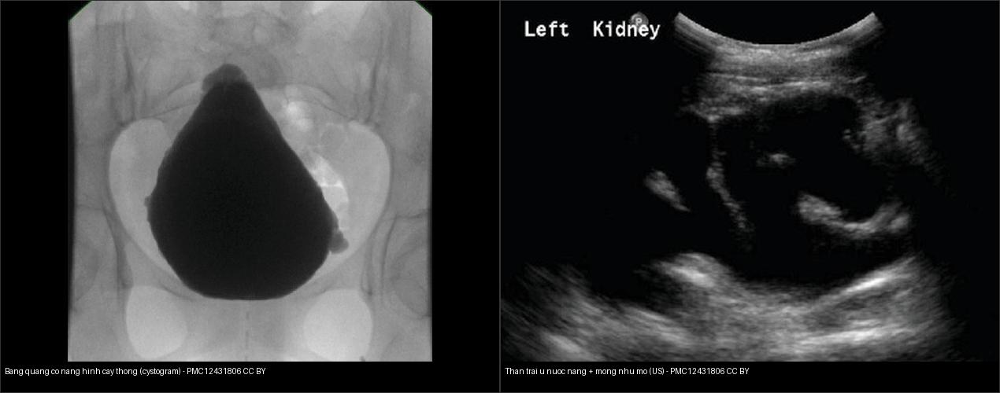
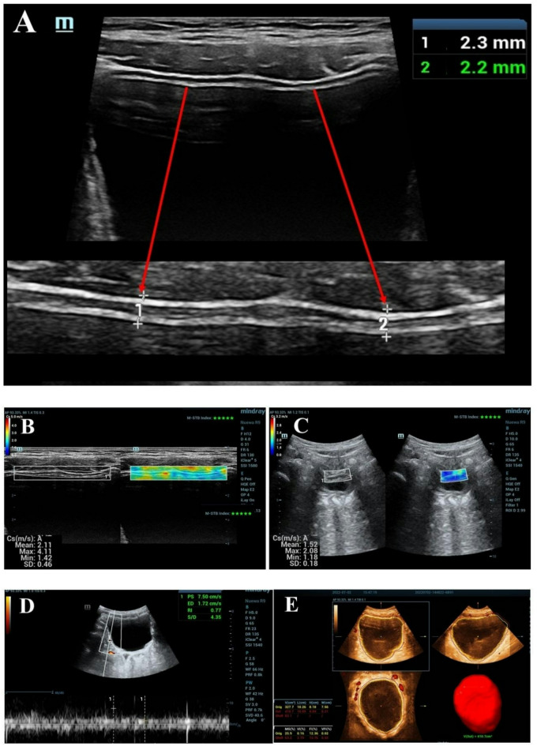
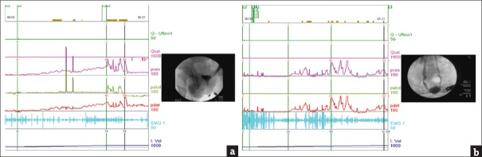
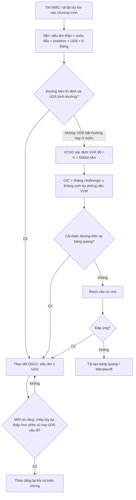
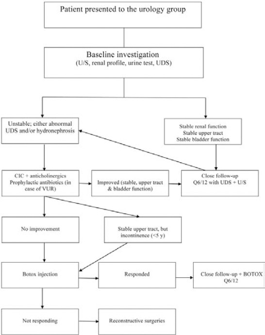
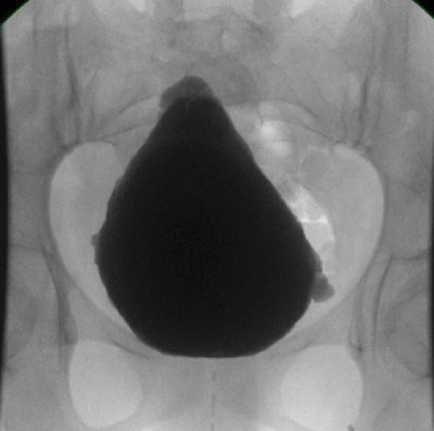
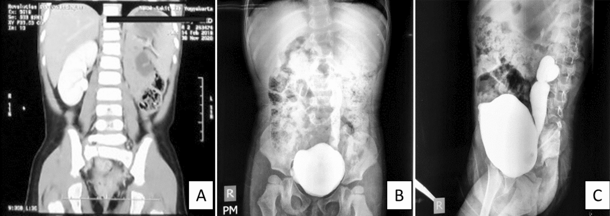
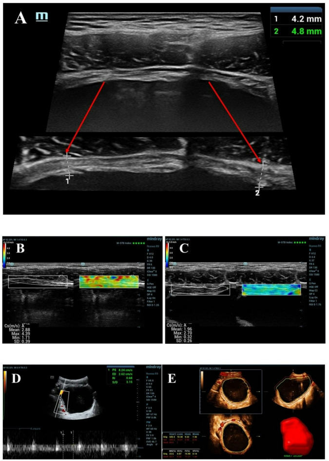
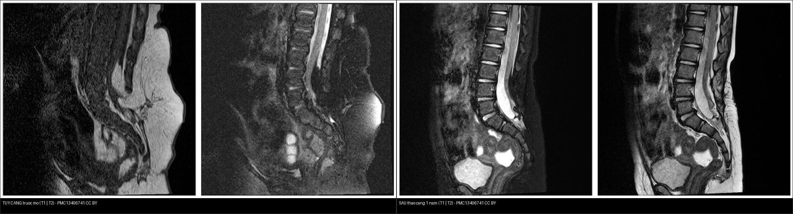

# 668 — Theo dõi dài hạn sau tháo căng tủy & bàng quang thần kinh ở trẻ: tái căng, urodynamics & bảo tồn chức năng thận / Long-term follow-up of tethered cord & neurogenic bladder

**Tags:** `pattern:bang-quang-than-kinh` `vung:tiet-nieu-nhi` `vung:tuy-cot-song-nhi` `score:VUR-ISRSC` `protocol:VUD-urodynamics` `protocol:MRI-cot-song`
**Mức chắc chắn (certainty):** tổng hợp y văn (literature synthesis) — tổng hợp từ bài tổng quan bàng quang thần kinh ở trẻ myelomeningocele (Sič A et al., Diseases 2025, PMC12025530), bài theo dõi tái căng (Lee JY et al., J Korean Neurosurg Soc 2020, PMC7218204), nghiên cứu siêu âm động–tĩnh dự báo VUR/sẹo thận (da Silva CMP et al., Int Braz J Urol 2023, PMC10947619), nghiên cứu siêu âm đa phương thức (Wang J et al., Sci Rep 2026, PMC12890931) và phác đồ phòng khám spina bifida (Al-Hazmi HH et al., Saudi Med J 2014, PMC4362106).

## 1. Tổng quan — vì sao phải theo dõi suốt đời + ngưỡng định lượng then chốt

- **Bàng quang thần kinh (neurogenic bladder — NB / neurogenic lower urinary tract dysfunction)** là hậu quả gần như phổ biến của **myelomeningocele (MMC)** và dị tật tủy kín (bài `656`): tổn thương cung phản xạ tủy cùng sinh ra **bàng quang tăng hoạt cơ chủ (detrusor overactivity)** ± **loạn phối hợp cơ thắt–cơ chủ (detrusor–sphincter dyssynergia — DSDS)** → bàng quang **áp lực cao, dung tích nhỏ, compliance thấp**. Đích điều trị suốt đời là giữ một **bàng quang áp lực thấp – dung tích cao (low-pressure, high-compliance bladder)** để bảo vệ đường tiết niệu trên và đạt khô ráo.
- **Vật lý/ngưỡng áp lực (TẠI SAO là số chứ không phải "bàng quang dày"):** bình thường bàng quang chứa nước ở áp lực **< 10–15 cm H₂O** và tống xuất ở **50–80 cm H₂O (nam), 40–65 cm H₂O (nữ)**. Khi áp lực bàng quang **> 40 cm H₂O** → giảm mức lọc cầu thận (GFR) và xuất hiện **giãn đường tiết niệu trên + trào ngược bàng quang–niệu quản (VUR)** (Sič A et al., Diseases 2025, PMC12025530). Vì vậy:
  - **Áp lực đỉnh khi chứa/rò > 40 cm H₂O = compliance bất thường** (Al-Hazmi HH et al., Saudi Med J 2014, PMC4362106).
  - **Áp lực rò cơ chủ (detrusor leak point pressure — DLPP) > 40 cm H₂O** là ngưỡng "bàng quang đe dọa (hostile bladder)" của đường tiết niệu trên.
- **Tần suất tổn thương đường trên:** **VUR có ở tới 1/3 trẻ NB**; VUR + áp lực cao → viêm thận–bể thận tái diễn → **sẹo thận (renal scarring) → suy thận mạn** — đích cần phát hiện sớm bằng hình ảnh (da Silva CMP et al., Int Braz J Urol 2023, PMC10947619).
- **Tái căng (retethering) là "sóng thứ hai" theo thời gian:** sách giáo khoa ghi tới **15%**; nhưng các loạt theo dõi > 5 năm ghi **> 30%**, và **tới 57% ở thời điểm 18 năm**. Meta-analysis của Goodrich (2016, dẫn trong PMC7218204): **tăng 3,2% mỗi năm** (0% ở 2,1 năm → 57% ở 18 năm). Nguy cơ **giảm dần khi trẻ lớn**: còn **7,4% sau 15 tuổi** và **1,8% sau 20 tuổi** → **cửa sổ rủi ro là toàn bộ giai đoạn tăng trưởng tới 18 tuổi**.
- **Điểm diễn giải quan trọng:** tổn thương thần kinh do tái căng biểu hiện **sớm nhất ở bàng quang** (thay đổi UDS), *trước cả* co cứng/yếu chi dưới. Nghiên cứu phát hiện **32% suy giảm thần kinh–niệu** ở bệnh nhân theo dõi trung bình **9,1 năm**, và **tỷ lệ phát hiện cao hơn hẳn nếu UDS được làm đủ** (Lee JY et al., J Korean Neurosurg Soc 2020, PMC7218204).

## 2. Mẫu hình + chẩn đoán phân biệt theo tầng giải phẫu (gamut theo tầng)

Đọc "từ trên xuống dưới" — mỗi tầng một câu hỏi:

- **Tầng tủy – cột sống (MRI):** tái căng tủy. Dấu hiệu: **chóp tủy (conus) tụt thấp hơn so với phim nền**, tủy **bám dính vào vùng mổ/mỡ/dây tận cùng**, **ống tủy rỗng (syrinx) mới hoặc to lên**, dây tận cùng mỡ/dính. Cần so **phim cũ** — tái căng là *thay đổi so với trước*, không phải "chóp tủy thấp" đơn thuần.
- **Tầng bàng quang (siêu âm + UDS/video-urodynamics):** bàng quang **co nhỏ, thành dày, thô ráp (trabeculation), túi thừa (diverticulum)**, thành sau tăng hồi âm; UDS cho **áp lực rò/đỉnh cao + compliance giảm ± DSDS ± tăng hoạt cơ chủ**.
- **Tầng đường tiết niệu trên (siêu âm + VCUG + xạ hình DMSA):** **VUR độ I–V**, **ứ nước thận (hydronephrosis) + mỏng nhu mô**, **sẹo thận (photopenic defect trên DMSA)**. Đây là tầng quyết định tiên lượng chức năng thận.
- **Gamut tầng bàng quang/đường trên (chẩn đoán phân biệt):** bàng quang thần kinh (MMC/dị tật tủy, chấn thương tủy, u tủy), **van niệu đạo sau (PUV)** ở bé trai, **hẹp khúc nối bể–niệu quản (UPJO)** (niệu quản rỗng, xem bài `635`), **hẹp niệu đạo**, nhiễm trùng tiểu tái diễn, và **nang/thận đôi** gây giãn đơn thuần. Mấu chốt: giãn trên nền **bàng quang áp lực cao** = do thần kinh; giãn với **bàng quang bình thường/nhỏ không áp lực cao** = nghĩ nguyên nhân cơ học.
- **Gợi nhớ theo tầng — C-A-U (Conus → Bladder → Upper tract):** **C**onus (tủy căng/tái căng) · **B**ladder (bàng quang co nhỏ áp lực cao) · **U**pper tract (VUR/hydronephrosis/scar). Ba tầng này nối nhân–quả: căng tủy → bàng quang áp lực cao → VUR/ứ nước → sẹo thận.

## 3. Bảng so sánh phân biệt (ma trận đối chiếu)

| Thực thể (entity) | Hình ảnh điển hình | Chốt vào (rule-in) | Chốt loại (rule-out) | Gợi ý xác nhận |
|---|---|---|---|---|
| Tái căng tủy (retethering) | MRI T1/T2 dọc + ngang: chóp tủy tụt thấp hơn phim nền, tủy dính vào sẹo mổ/mỡ, syrinx mới/to lên | **Tụt thấp hơn so với phim cũ + dính tủy ở vị trí mổ trước + triệu chứng mới (UDS đổi)** | Chóp tủy đứng yên so với phim cũ và không triệu chứng → không mổ | MRI tủy toàn bộ so phim nền + UDS lặp lại |
| Bàng quang thần kinh co nhỏ/áp lực cao | Siêu âm: thành dày, thô ráp; UDS/VUD: áp lực đỉnh–rò cao, compliance thấp, DSDS | **Áp lực bàng quang > 40 cm H₂O khi chứa/rò** | Áp lực lưu trữ < 10–15 cm H₂O + compliance bình thường → không phải bàng quang đe dọa | UDS/VUD (tiêu chuẩn vàng), siêu âm đa phương thức |
| VUR (trào ngược bàng quang–niệu quản) | VCUG: thuốc cản quang trào lên niệu quản/bể thận; siêu âm động: bể thận giãn/niệu quản xa giãn | **Bể thận (RPD) ≥ 5 mm hoặc niệu quản xa ≥ 6,5 mm; tăng RPD khi cơ chủ co** | Bể thận – niệu quản xa trong giới hạn và không đổi khi co cơ chủ → ít nghĩ VUR | VCUG (phân độ I–V), siêu âm động–tĩnh |
| Ứ nước thận + mỏng nhu mô (deterioration) | Siêu âm: bể–đài giãn, trục nhu mô mỏng, mất phân biệt vỏ–tủy | **RPD tăng đáng kể + nhu mô thận mỏng so với chuẩn tuổi** | Nhu mô đều, không mỏng, RPD ổn định → bảo tồn | Siêu âm Q6/12, DMSA làm nền |
| Sẹo thận (renal scarring) | Xạ hình 99mTc-DMSA: khuyết/thu nhỏ vùng vỏ; siêu âm: nhu mô mỏng khu trú | **Khuyết giảm bắt xạ khu trú (photopenic defect) không hồi phục** | Nhu mô dày đều, đánh giá lần đầu khó → so chuỗi DMSA | DMSA (chuẩn tham chiếu), siêu âm mỏng nhu mô chỉ Se 40,9% / Sp 94,4% |
| Bàng quang thô ráp + túi thừa | Cystogram/VCUG: bàng quang hình "cây thông" (Christmas tree), thành nham nhở, túi thừa | **Hình dạng bàng quang biến dạng + túi thừa khi áp lực trong bàng quang cao** | Bàng quang cầu đều, thành nhẵn → không nghĩ tái cấu trúc do áp lực | VCUG/VUD |

*Trái: cystogram — bàng quang thô ráp, túi thừa, hình "cây thông" (Alkeraithe F et al., Case Rep Urol 2025, PMC12431806, Fig. 2, CC BY). Phải: siêu âm thận trái — ứ nước nặng, mỏng nhu mô (cùng nguồn, Fig. 4). Ảnh ghép letterbox giữ tỷ lệ.*

*Đối chiếu bàng quang **lành** ở bé trai 9 tuổi — BWT 2,25 mm, SWV khi chứa/tống 2,11/1,52 m/s, VI 3,79%; so với bàng quang thần kinh (Ca 4) để thấy thành dày lên và mạch hóa tăng. Wang J et al., Sci Rep 2026 (PMC12890931, Fig. 4), CC BY-NC-ND — nguyên bản.*

### Dấu hiệu đặc trưng cần đọc đúng
- **RPD (renal pelvic diameter — đường kính bể thận):** trên siêu âm động (khi bàng quang đầy/tống), giãn **≥ 5 mm** và **niệu quản xa ≥ 6,5 mm** là ngưỡng có tỷ số chẩn đoán tốt nhất cho **VUR độ cao (IV–V)**. Quan trọng hơn cả con số tĩnh là **bể thận giãn thêm khi cơ chủ co** — đạt độ chính xác **89,2%** (da Silva CMP et al., Int Braz J Urol 2023, PMC10947619).
- **Video-urodynamics (VUD):** tiêu chuẩn vàng đánh giá đường tiết niệu dưới ở trẻ — vừa đo áp lực/dung tích/compliance, vừa **nhìn thấy hình thái bàng quang và VUR** trên cùng một lần (ví dụ ca MMC: bàng quang co nhỏ + DSDS + VUR độ cao bên phải — Jiang YH et al., Tzu Chi Med J 2020, PMC7137365, Fig. 5a).

*Mỗi panel: hai nửa là **đường cong áp lực** và **hình ảnh soi quang** của cùng thì. Jiang YH et al., Tzu Chi Med J 2020 (PMC7137365, Fig. 5), CC BY-NC-SA — nguyên bản.*

## 4. Protocol chụp + hệ phân độ & lịch theo dõi

- **Đánh giá nền (baseline) khi vào chương trình spina bifida:** **siêu âm thận–bàng quang, xét nghiệm nước tiểu, creatinin máu, UDS** — mọi bệnh nhân **UDS trước 6 tháng tuổi** (hoặc ngay khi được chuyển đến nếu > 6 tháng) (Al-Hazmi HH et al., Saudi Med J 2014, PMC4362106).
- **VCUG** khi: thận giãn (ứ nước), UDS cho thấy **bàng quang compliance kém**, hoặc **đã có nhiễm trùng tiểu** (cùng nguồn).
- **Xạ hình 99mTc-DMSA:** làm nền (sau 4 tháng tuổi ở nhũ nhi) và lặp lại khi **nhiễm trùng tiểu tái diễn/viêm thận–bể thận** — đây là chuẩn tham chiếu cho **sẹo thận** (da Silva CMP et al., PMC10947619).
- **Lịch theo dõi:** phòng khám đa chuyên khoa theo dõi **đều đặn mỗi 6 tháng (Q6/12)** với **siêu âm ± UDS**; nhánh ổn định chỉ theo dõi sát, nhánh bất thường chuyển CIC + kháng cholinergic ± kháng sinh dự phòng nếu VUR (Al-Hazmi HH et al., PMC4362106).
- **Ngưỡng định lượng siêu âm đa phương thức (MMU) phân biệt NB với bàng quang lành ở trẻ** (Wang J et al., Sci Rep 2026, PMC12890931, n = 73 NB vs 100 lành): **BWT trung bình 3,61 ± 1,01 mm (NB) vs 2,52 ± 0,26 mm (lành)**; điểm cắt **BWT 2,98 mm** (Sp 98,0%), **vận tốc sóng biến dạng khi chứa (filling SWV) 2,47 m/s** (Se 90,41%/Sp 74,0%, AUC 0,89) và **VI 5,00%** (Sp 93,0%). Mô hình MMU **không khác biệt có ý nghĩa so với UDS** trong chẩn đoán NB.
- **Yếu tố nguy cơ tổn thương đường trên (UUTD):** mô hình học máy trên 2.393 bệnh nhân NB chọn **cách quản lý bàng quang và DSDS** là biến cốt lõi; hiệu năng AUC tập kiểm định–test **0,868–0,878** (Zhong P et al., Int Neurourol J 2026, PMC13643472).
- **Hệ phân độ VUR (International Reflux Study Committee — ISRSC, phổ biến nhất trên VCUG):** **I** – trào lên niệu quản không giãn; **II** – tới bể thận, không giãn; **III** – giãn nhẹ–vừa, đài thận chưa tù; **IV** – giãn vừa, niệu quản ngoằn ngoèo, đài tù nhưng còn ấn nhú; **V** – giãn nặng, ngoằn ngoèo, **mất ấn nhú**. Nhóm **độ IV–V = VUR độ cao**, liên quan sẹo thận và cần can thiệp.
- **Ngưỡng can thiệp thêm:** khi trẻ lớn mà **vẫn tiểu không kiểm soát (< 5 tuổi chấp nhận được)** hoặc đường trên xấu đi → **botulinum toxin (Botox)** vào cơ chủ, và khi thất bại → **phẫu thuật tái tạo (augmentation/ileocystoplasty, Mitrofanoff)**; trong một loạt 188 trẻ MMC, **58% dùng CIC, 23% tiêm Botox, 14% tái tạo bàng quang**, và **nhóm đến khám muộn sau 3 tuổi cần can thiệp nhiều hơn có ý nghĩa** (Al-Hazmi HH et al., PMC4362106).

*Phác đồ thực hành: đánh giá nền (siêu âm, xét nghiệm thận, nước tiểu, UDS) → nhánh ổn định theo dõi sát **Q6/12** (UDS + siêu âm); nhánh bất thường: CIC + kháng cholinergic ± kháng sinh dự phòng nếu VUR → **Botox** → **tái tạo bàng quang**. Al-Hazmi HH et al., Saudi Med J 2014 (PMC4362106, Fig. 1), CC BY-NC-SA — nguyên bản.*

## 5. Biến thể bình thường và cạm bẫy

- **Chóp tủy thấp mạn tính sau mổ KHÔNG tự động là tái căng:** cần **so phim cũ** — tái căng là **thay đổi so với nền** (tụt thấp hơn, syrinx mới) cộng **triệu chứng/UDS mới**. Không đổi so với phim cũ và không triệu chứng → theo dõi (Lee JY et al., PMC7218204).
- **Siêu âm bình thường KHÔNG loại trừ bàng quang áp lực cao:** bàng quang có thể "trông bình thường" nhưng UDS đã áp lực rò > 40 cm H₂O — **không bỏ UDS**. Ngược lại, giãn nhẹ đường trên có thể chỉ do **bàng quang căng khi chụp** → luôn đo lại khi bàng quang vừa trống và khi đầy/tống.
- **Đừng chẩn đoán VUR chỉ bằng một lần siêu âm tĩnh:** bể thận giãn thoáng qua khi bàng quang rất đầy ≠ VUR. Giá trị nằm ở **động học: RPD tăng khi cơ chủ co** (chính xác 89,2%), còn số đo tĩnh chỉ có AUC "trung bình" (0,62–0,69). RPD ≥ 5 mm và niệu quản xa ≥ 6,5 mm mới là điểm cắt gợi ý độ IV–V.
- **Mỏng nhu mô trên siêu âm rất đặc hiệu nhưng độ nhạy thấp để tìm sẹo thận** (Se **40,9%**, Sp **94,4%**, NPV 92,2%): siêu âm sạch **không loại trừ sẹo** — nghi ngờ thì DMSA.
- **Cạm bẫy "thoả mãn tìm kiếm" hai chiều:** (1) thấy VUR là dừng, bỏ sót **bàng quang áp lực cao** cần điều trị trước; (2) thấy bàng quang co nhỏ là dừng, bỏ sót **tái căng tủy** là nguyên nhân nền. Luôn đọc đủ 3 tầng C-A-U.
- **Hai bẫy thời gian:** sẹo thận DMSA có thể chỉ lộ rõ **sau nhiều tháng** sau đợt viêm thận–bể thận cấp (đừng kết luận quá sớm); và **tái căng xuất hiện muộn** — nguy cơ còn kéo dài tới **18 tuổi**, giảm nhưng **không hết** sau tuổi trưởng thành (7,4% sau 15 tuổi).
- **Hiệu ứng "không cải thiện ngay":** ở trẻ đến muộn (> 3 tuổi), tỷ lệ phải can thiệp (Botox/tái tạo) cao hơn có ý nghĩa — nhưng **lợi ích theo dõi sớm vẫn rõ**, nên không vì thế mà ngừng sàng lọc.

## 6. Tự lượng giá — Blind Quiz

**Ca 1 — Bé gái MMC, đi khám định kỳ. Đọc ảnh cystogram: hình dạng bàng quang ra sao, gợi ý điều gì?**

- Gợi ý lâm sàng: MMC, tiểu không kiểm soát, nhiều đợt nhiễm trùng tiểu.
- Câu hỏi: Thành bàng quang có bình thường không? Hình "cây thông" là gì? Bước tiếp theo cần làm gì?

<b>Bấm để hiện đáp án (findings + chẩn đoán)</b>

- Dấu hiệu (findings): bàng quang **thô ráp, thành nham nhở, nhiều túi thừa nhỏ**, hình dạng **"cây thông" (Christmas tree)** — dấu hiệu **tái cấu trúc thành bàng quang do áp lực cao**.
- Chẩn đoán (diagnosis): **bàng quang thần kinh áp lực cao** (nghĩ tới **tái căng tủy** nếu bệnh cảnh mới xấu đi). Cần **UDS/VUD** đo áp lực–compliance; ngưỡng xấu khi **> 40 cm H₂O**.
- Nguồn ảnh: Alkeraithe F et al., Case Rep Urol 2025 (PMC12431806, Fig. 2), CC BY.

**Ca 2 — Cùng bé, siêu âm thận trái. Đọc và cho biết nguy cơ của đường tiết niệu trên.**

- Gợi ý lâm sàng: bàng quang áp lực cao đã biết.
- Câu hỏi: Mô tả bể thận và nhu mô. Hậu quả lâu dài nếu không xử trí?

<b>Bấm để hiện đáp án (findings + chẩn đoán)</b>

- Dấu hiệu (findings): **ứ nước thận nặng** — bể–đài giãn rõ, **mỏng nhu mô** (mất phân biệt vỏ–tủy theo vùng).
- Chẩn đoán (diagnosis): **tổn thương đường tiết niệu trên do bàng quang áp lực cao** (thường kèm **VUR**, cần VCUG). Nguy cơ: viêm thận–bể thận tái diễn → **sẹo thận (DMSA) → suy thận mạn**. Xử trí: giải áp (CIC), kháng cholinergic, xem xét Botox/tái tạo.
- Nguồn ảnh: Alkeraithe F et al., Case Rep Urol 2025 (PMC12431806, Fig. 4), CC BY.

**Ca 3 — Bé trai spina bifida, VCUG. Có trào ngược không và độ mấy?**

- Gợi ý lâm sàng: spina bifida, nhiễm trùng tiểu.
- Câu hỏi: Ở khung bên phải, thuốc trào tới đâu? Xếp độ VUR theo ISRSC?

<b>Bấm để hiện đáp án (findings + chẩn đoán)</b>

- Dấu hiệu (findings): thuốc cản quang **trào lên niệu quản trái giãn nặng, ngoằn ngoèo, tới bể–đài thận, mất ấn nhú**.
- Chẩn đoán (diagnosis): **VUR độ V (ISRSC)** bên trái — nhóm **độ cao (IV–V)**, nguy cơ sẹo thận; chỉ định CIC + theo dõi đường trên, cân nhắc can thiệp.
- Nguồn ảnh: Yuri P et al., J Med Case Rep 2024 (PMC10811896, Fig. 1B–C), CC BY.

**Ca 4 — Bé trai 10 tuổi được chẩn đoán hội chứng tủy căng, siêu âm bàng quang đa phương thức. So với bàng quang lành thì khác ở đâu?**

- Gợi ý lâm sàng: tủy căng, nghi bàng quang thần kinh.
- Câu hỏi: Đo BWT được bao nhiêu? Vì sao siêu âm đa phương thức hữu ích và giới hạn của nó?

<b>Bấm để hiện đáp án (findings + chẩn đoán)</b>

- Dấu hiệu (findings): **BWT (độ dày thành bàng quang) 4,2–4,8 mm**, tăng so với chuẩn (lành **2,52 ± 0,26 mm**; điểm cắt **2,98 mm**); **SWV khi chứa 2,88 m/s** (điểm cắt **2,47 m/s**), **VI 8,32%**; dung tích tống xuất còn lại lớn.
- Chẩn đoán (diagnosis): **bàng quang thần kinh**; hình thái gợi ý **áp lực cao/compliance thấp**. Giới hạn: siêu âm mô tả **hình thái**, chẩn đoán **áp lực** vẫn cần **UDS/VUD** — siêu âm hỗ trợ, không thay thế hoàn toàn khi cần quyết định điều trị.
- Nguồn ảnh: Wang J et al., Sci Rep 2026 (PMC12890931, Fig. 5), **CC BY-NC-ND 4.0 — giữ nguyên bản, không crop/ghép**.

**Ca 5 — Bé trai 9 tuổi, đã mổ tháo căng tủy 5 năm trước, nay đau chân tăng. Đọc MRI dọc.**

- Gợi ý lâm sàng: hậu mổ tủy kín, đau/yếu chi dưới xuất hiện lại.
- Câu hỏi: MRI đơn lẻ có đủ kết luận tái căng không? Vì sao cần phim nền và UDS?

<b>Bấm để hiện đáp án (findings + chẩn đoán)</b>

- Dấu hiệu (findings): **chóp tủy nằm thấp**, tủy **dính vào mỡ/sẹo mổ**; ống tủy rỗng. Ảnh phải là **MRI sau tháo căng 1 năm** (giải ép dây tận cùng), tủy tái tạo dạng ống, bao màng cứng rộng.
- Chẩn đoán (diagnosis): nghi **tái căng tủy (retethering)** — nhưng **phải so với phim nền** (tụt thấp hơn/syrinx mới) và **triệu chứng/UDS mới** mới chốt. Tỷ lệ tái căng **tăng ~3,2%/năm**, tới **57% ở 18 năm**; tháo căng lại khi **có triệu chứng**.
- Nguồn ảnh: Lee CO et al., Brain Sci 2026 (PMC13406741, Fig. 1 và Fig. 17), CC BY; ảnh ghép letterbox giữ tỷ lệ.

## Bài liên quan chéo
- [600 – Tổng quan Hệ Nhi khoa](../600-tong-quan-nhi-khoa/lesson.md) (bảng DDx)
- [656 – Bất thường tủy–cột sống kín ở trẻ (dị tật đôi tủy, tủy căng, u mỡ, đường rò da)](../656-bat-thuong-tuy-cot-song-nhi/lesson.md)
- [635 – Dị tật hệ tiết niệu nhi (SFU/VUR/PUV)](../635-di-tat-tiet-nieu-nhi-SFU-VUR-PUV/lesson.md) (VUR, van niệu đạo sau)
- [636 – Cấp cứu niệu–sinh dục nhi](../636-cap-cuu-nieu-sinh-duc-nhi/lesson.md)
- [637 – Chấn thương bàng quang & niệu đạo nhi](../637-chan-thuong-bang-quang-nieu-dao-nhi/lesson.md)
- [150 – Nang thận & phân độ Bosniak](../150-nang-than-Bosniak/lesson.md) (đường tiết niệu trên)

## Ảnh
- Tên file `668_..._PMCxxxxx-FigN-...jpg`, nguồn + giấy phép từng ảnh trong `images/CREDITS.md`.
- **CC BY 4.0** (PMC13406741, PMC10811896, PMC12431806); **CC BY-NC-ND 4.0** (PMC12890931 — giữ nguyên bản, không crop/ghép); **CC BY-NC-SA** (PMC7137365, PMC4362106 — giữ nguyên bản).
- Ảnh ghép `images/composite_bang-quang-than-kinh-cascade.jpg` và `images/composite_tethered-cord-truoc-sau.jpg` tạo bằng `tools/make_composite.py`, letterbox nền đen, giữ tỷ lệ (chỉ ghép ảnh **CC BY**).
- Không tải Google Images / AuntMinnie; nguồn đóng chỉ dẫn link tại `sources.md`.

> Không dùng để chẩn đoán độc lập khi chưa có người hướng dẫn.
