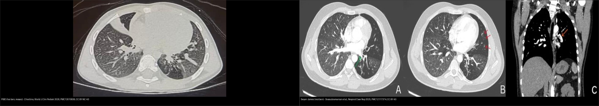
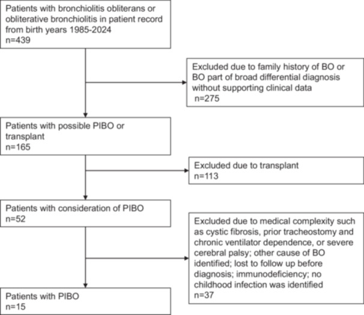
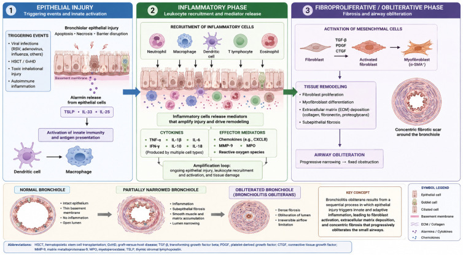
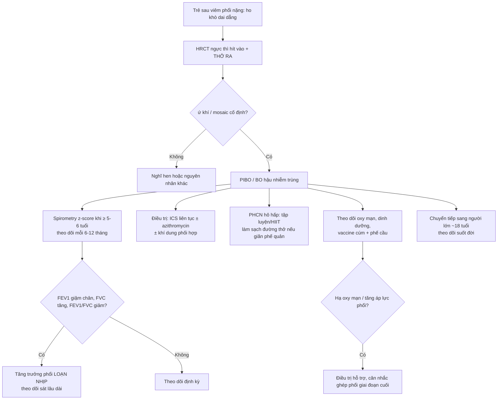
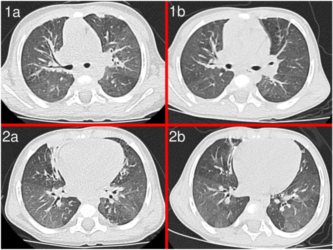
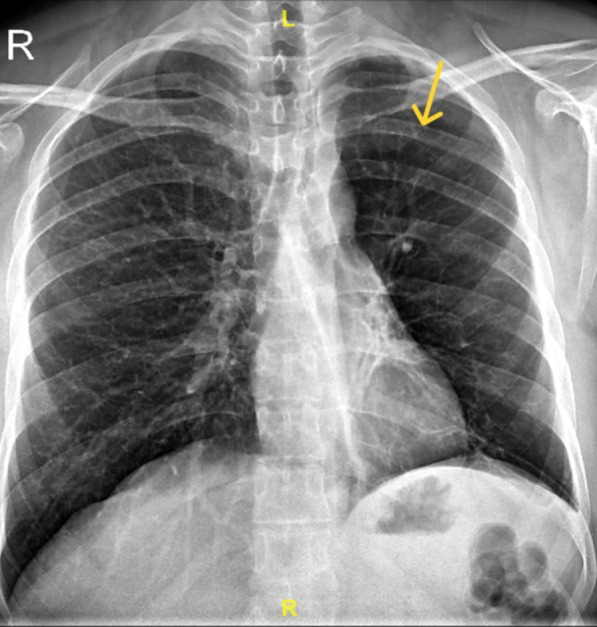
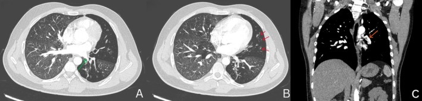
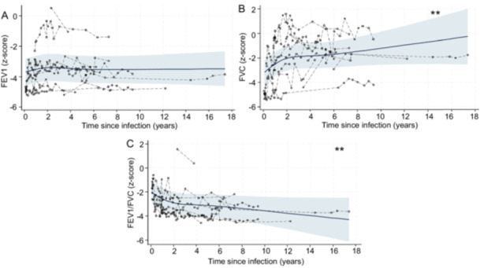
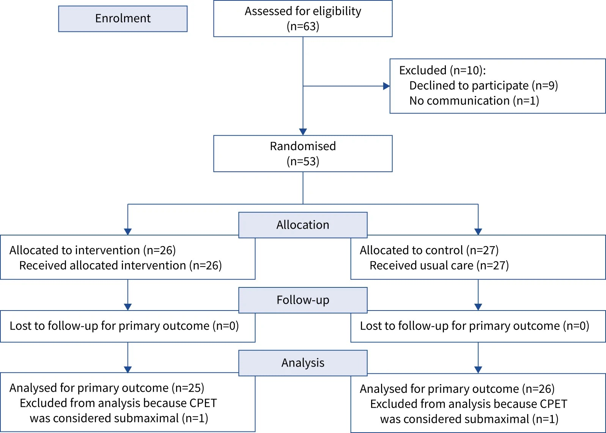
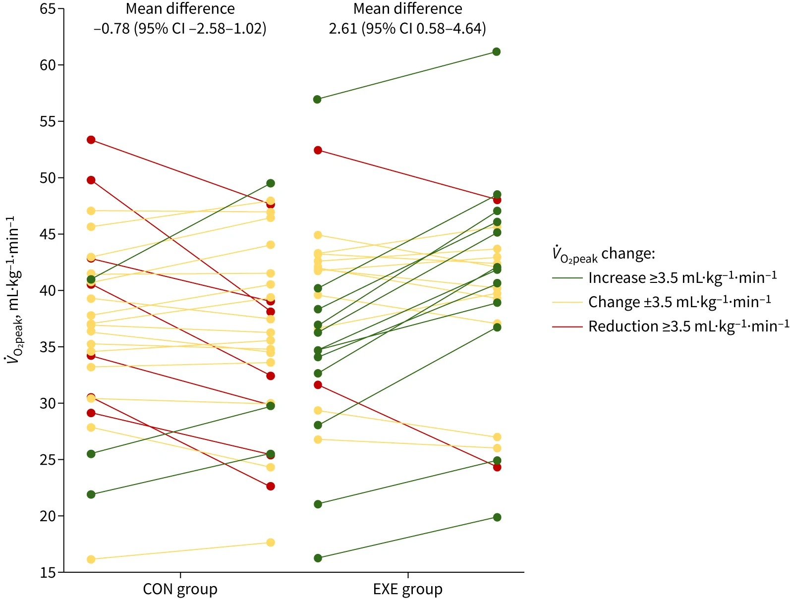

# 669 — Theo dõi dài hạn BO hậu nhiễm trùng & Swyer–James ở trẻ: tăng trưởng phổi, chức năng hô hấp & phục hồi chức năng / Long-term follow-up of post-infectious bronchiolitis obliterans & Swyer–James–MacLeod

**Tags:** `pattern:u-khi` `pattern:viem-tieu-phe-quan` `pattern:phoi-mot-ben-sang` `vung:phoi` `vung:phe-quan` `score:spirometry-z` `protocol:HRCT-thi-tho-ra` `protocol:theo-doi-dai-han`
**Mức chắc chắn (certainty):** tổng hợp y văn (literature synthesis) — nhóm tự biên từ các bài **CC BY 4.0 / CC BY-NC 4.0** (Europe PMC); **các ca trong quiz là ca nguyên văn (verbatim case)** chép đúng tuổi – bệnh cảnh – chú thích gốc. Số liệu giữ nguyên nguồn, phần chưa kiểm chứng ghi "chưa rõ".

## 1. Tổng quan bệnh học – cơ chế hình ảnh

- **Định vị chủ đề:** bài 614 trả lời "**chẩn đoán** BO/Swyer–James"; bài này trả lời "**sau đó thì sao**" — trẻ BO hậu nhiễm trùng (post-infectious bronchiolitis obliterans, **PIBO**) **sống và lớn lên cùng phổi đã hẹp tiểu phế quản**, nên cần một **chiến lược theo dõi dài hạn**: chức năng hô hấp – tăng trưởng phổi – phục hồi chức năng – biến chứng – chuyển tiếp người lớn.
- **Bệnh học (TẠI SAO tổn thương vĩnh viễn):** sau đợt nhiễm trùng nặng, **tổn thương biểu mô → viêm bạch cầu trung tính dai dẳng → sửa chữa bất thường** kích hoạt **TGF-β/CTGF**, chuyển dạng biểu mô–trung mô, tương tác đại thực bào–nguyên bào sợi → **xơ và bít lòng tiểu phế quản (constrictive bronchiolitis)**. Đây là **tổn thương xơ cố định**, không phải co thắt → **đáp ứng thuốc giãn phế quản kém**.
- **Cơ chế hình ảnh chốt (TẠI SAO thấy mosaic/ứ khí):** tiểu phế quản bị bít **một phần** → vùng phế nang phía sau **giữ khí (air trapping)**; khí giữ lại **chèn ép mạch máu** vùng đó → **giảm tưới máu** → trên **HRCT thì thở RA** vùng đó **vẫn sáng trong khi vùng lành xẹp lại** = **mẫu ba đậm độ / mosaic giảm tỷ trọng (mosaic perfusion)**: **đậm độ thấp + mạch máu NHỎ lại = ứ khí**, ngược với bệnh mạch (đậm độ thấp nhưng mạch vẫn to). Đây là **cùng một bản chất vật lý** ở phổi một bên (Swyer–James) hay hai bên (PIBO).
- **TẠI SAO "thể tích phổi" quan trọng hơn "kích thước tổn thương":** ở trẻ, phổi **đang tăng trưởng** → kết cục phụ thuộc **tăng trưởng có cân xứng hay không**. Nghiên cứu dọc (Vanderbilt, 15 trẻ PIBO) cho thấy **tăng trưởng phổi loạn nhịp (dysanaptic, không tuyến tính)**: FEV₁ gần như **giậm chân tại chỗ** trong khi FVC tăng tiếp → tỉ lệ FEV₁/FVC **giảm dần theo năm** (chi tiết ở mục 4).
- **TẠI SAO không dùng một mốc duy nhất để tiên lượng:** quần thể rất **không đồng nhất** (tác nhân adenovirus vs Mycoplasma, tuổi, mức độ nặng ban đầu, có/không nhập ICU). Ca nặng có FEV₁ z-score **−3,83** lúc đầu, nhưng **một số** cải thiện chức năng và hình ảnh sau điều trị (HRCT cải thiện tới **82%** ở một loạt dùng khí dung phối hợp) → **theo dõi chuỗi** mới trả lời được.

## 2. Mẫu hình + chẩn đoán phân biệt theo vị trí (gamut)

- **PIBO hai bên (hậu adenovirus/Mycoplasma):** trẻ nhỏ (< 3–5 tuổi) sau viêm phổi nặng (nhiều ca **nhập ICU**), ho khò dai dẳng sau đợt cấp **~1 tháng (0–5 tháng)**, FEV₁/FEF₂₅₋₇₅ giảm, **HRCT: ứ khí + mosaic + dày thành phế quản ± xẹp**.
- **Swyer–James–MacLeod một bên:** hậu nhiễm trùng một bên → **phổi một bên sáng, ứ khí, thể tích giảm, mạch máu thưa/động mạch phổi nhỏ**, có thể giãn phế quản; thường **phát hiện muộn / ở người lớn như biến chứng ho ra máu**.
- **Giãn phế quản không-CF / sau hoại tử–cắt thùy:** xem bài 619 — ứ khí + giãn phế quản + "phổi bó", nhưng có **can thiệp phẫu thuật trước đó** và theo dõi hô hấp riêng.
- **Hen (asthma):** tắc nghẽn **có hồi phục**, đáp ứng giãn phế quản rõ, HRCT ít mosaic cố định → cần **test hồi phục** và **HRCT thì thở ra** để phân biệt.
- **BOS sau ghép (ghép phổi/ghép tế bào gốc):** tắc nghẽn tiến triển **mới** theo tiêu chuẩn **NIH 2014 (FEV₁ giảm ≥ 10%)**, bối cảnh ghép → **khác phác đồ**, cần bài riêng (đang xếp lịch: 670).
- **Bất thường mạch phổi khác:** các bệnh **mạch phổi tắc nghẽn** cũng cho mosaic, nhưng ở đó **mạch máu vùng sáng vẫn có/thrombus**, không phải ứ khí → phân biệt bằng mạch máu trong vùng giảm đậm độ.

## 3. Bảng so sánh phân biệt (ma trận đối chiếu)

| Thực thể (entity) | Hình ảnh điển hình | Chốt vào (rule-in) | Chốt loại (rule-out) | Gợi ý xác nhận |
|---|---|---|---|---|
| **PIBO hai bên** | HRCT thì thở ra: **ứ khí + mosaic** (mạch nhỏ lại), dày thành phế quản ± xẹp; X-quang có thể chỉ thấy viêm phổi cũ | **Tắc nghẽn CỐ ĐỊNH + mosaic cố định + ho khò dai dẳng sau nhiễm trùng nặng** | Test hồi phục giãn phế quản **rõ + về bình thường** → nghĩ hen | HRCT thì thở ra + spirometry chuỗi |
| **Swyer–James–MacLeod (một bên)** | **Phổi một bên sáng**, thể tích giảm, mạch thưa, **động mạch phổi nhỏ**, có thể giãn phế quản; rốn phổi nhỏ | **Một bên sáng + ứ khí + mạch thưa ĐỒNG NHẤT cả bên** | Tổn thương khu trú/khối, van phế quản → nghĩ **dị vật/tắc nghẽn cục bộ** | So X-quang thẳng–nghiêng; CT; nếu cần soi loại dị vật |
| **Giãn phế quản không-CF / sau cắt thùy** | Dấu **"vòng nhẫn" (signet ring)**, dày thành, "phổi bó" | Giãn phế quản có **tiền sử mổ/hoại tử phổi** | Bo tròn đều không giãn phế quản → nghĩ ứ khí đơn thuần | HRCT + PFT (bài 619) |
| **Hen (asthma)** | HRCT thường bình thường / dày thành nhẹ, **không mosaic cố định** | **Tắc nghẽn + hồi phục (ΔFEV₁ rõ)** + đáp ứng điều trị | Mosaic **cố định** trên thì thở ra → nghĩ BO | Test hồi phục; theo dõi |
| **BOS sau ghép** | Ứ khí/mosaic **mới xuất hiện sau ghép** | Tiêu chuẩn **NIH 2014: FEV₁ giảm ≥ 10%** + bối cảnh ghép | Không có ghép + khởi phát sau nhiễm trùng → PIBO | PFT chuỗi + HRCT thở ra |

*Trái: **PIBO hai bên** — mosaic giảm tỷ trọng + đông đặc/xẹp và giãn phế quản. Phải: **Swyer–James một bên** — phổi trái sáng, ứ khí, thể tích giảm. Ảnh ghép letterbox, giữ nguyên tỉ lệ. Nguồn: Chiellino *World J Clin Pediatr* 2026 (PMC13010836, CC BY-NC 4.0) + Sivasubramanian et al. *Respirol Case Rep* 2025 (PMC12117374, CC BY 4.0).*

### Lịch theo dõi dài hạn (khung thực hành)

| Hạng mục | Ngưỡng / nội dung | Chốt vào (rule-in) | Chốt loại (rule-out) |
|---|---|---|---|
| Spirometry | Làm được khi **≥ 5–6 tuổi**; theo dõi **mỗi 6–12 tháng** | FEV₁ và **FEF₂₅₋₇₅ giảm**, **đáp ứng giãn phế quản kém** | DLCO **thường bảo tồn** (ít gợi ý bệnh mô kẽ) |
| HRCT | **Thì thở ra** để lộ ứ khí | **Mosaic + ứ khí cố định** | Không mosaic khi thở ra → ít nghĩ BO |
| Oxy/khí máu | Theo dõi **hạ oxy mạn** | Hạ oxy → nguy cơ **tăng áp lực động mạch phổi** | Oxy bình thường chưa loại trừ khi gắng sức |
| Dinh dưỡng – tăng trưởng | Biểu đồ tăng trưởng, cơ hô hấp | Suy dinh dưỡng làm yếu cơ hô hấp | — |
| Dự phòng | **Vaccine cúm mùa + phế cầu**; làm sạch đường thở nếu giãn phế quản | Đợt nhiễm trùng làm xấu chức năng | — |
| Phục hồi chức năng | **Tập luyện (kể cả HIIT)** | V̇O₂peak thấp → tập cải thiện | — |
| Ghép phổi | Bệnh giai đoạn cuối | Suy hô hấp tiến triển bất chấp điều trị | — |

## 4. Protocol chụp + hệ phân độ/điểm chuẩn hóa

- **HRCT ngực:** lớp mỏng, **thì hít vào đủ + thì thở RA** (hoặc cắt lớp ở 3 mức) — thì thở ra là **chìa khóa** để chứng minh ứ khí; cản quang **không bắt buộc** để chẩn đoán PIBO, chỉ khi cần phân biệt/đánh giá trước ghép.
- **Spirometry + z-score (khung định lượng thay cho "RADS"):** dùng **z-score** (không dùng % dự đoán) để so chuỗi theo thời gian. Số liệu dọc ở 15 trẻ PIBO (Vanderbilt, 11 trẻ có ≥ 1 lần đo, trung vị 14 lần/bệnh nhân):
  - z-score lần đầu: **FEV₁ −3,83 · FVC −2,92 · FEV₁/FVC −2,61**.
  - Thay đổi mỗi năm: **FEV₁ +0,008 (p = 0,69 — giậm chân tại chỗ)**, **FVC +0,185 (p = 0,003)**, **FEV₁/FVC −0,143 (p = 0,004)** → **tăng trưởng phổi loạn nhịp (dysanaptic)**: phổi lớn lên nhưng đường thở nhỏ không lớn theo.
  - **44% (4/9) có đáp ứng giãn phế quản**; **adenovirus** khởi đầu FVC thấp hơn nhưng **tăng FVC nhanh hơn** nhóm khác (p < 0,001).

*So sánh lần đo đầu và cuối: FEV₁ (đen), FVC (xanh), FEV₁/FVC (vàng) — trẻ nhiễm adenovirus (chấm đặc) khởi đầu FVC thấp hơn nhưng tăng nhanh hơn. Nguồn: Clegg et al., Pediatr Pulmonol 2026 (PMC13330942), CC BY 4.0.*
- **Bối cảnh dịch tễ để tư vấn (định lượng):**
  - Loạt Pháp (147 trẻ PIBO, 18 trung tâm): **58,5% nam**, tuổi chẩn đoán trung vị **22 tháng**; **83,7% nhập viện** cho đợt nhiễm trùng đầu (**36,7% vào ICU**); tìm được tác nhân **66,0%**, chủ yếu **adenovirus 28,5%** và **RSV 26,4%**. Điều trị: **ICS 90,5%**, **azithromycin 59,2%**, **pulse corticoid TM 40,8%**.
  - Loạt bùng phát adenovirus (11 trẻ): HRCT **ứ khí 100%**, **mosaic 91%**, **dày thành phế quản 82%**, **xẹp phổi 82%**; triệu chứng khởi phát **trung vị 1 tháng (0–5 tháng)** sau đợt cấp.
- **Điều trị & bằng chứng (TẠI SAO theo dõi chứ không chỉ "kê đơn"):** ICS **liên tục > ngắt quãng** (cải thiện FVC, FEV₁, MMEF₂₅₋₇₅); khí dung phối hợp (budesonide + terbutaline + ipratropium) cải thiện TPEF/TE, VPEF/VE và **HRCT tới 82%**; phối hợp **fluticasone–azithromycin–montelukast** đang hứa hẹn nhưng **chưa đủ bằng chứng**. Bản chất **xơ cố định** giải thích vì sao **giãn phế quản không chữa khỏi bệnh**.
- **Phục hồi chức năng hô hấp (điểm mới, có số):** thử nghiệm **RCT đa trung tâm đầu tiên** về **HIIT (tập cường độ cao ngắt quãng)** ở trẻ PIBO: nhóm tập tăng **V̇O₂peak +3,39 mL·kg⁻¹·min⁻¹ (KTC 95% 0,82–5,97; p = 0,04)** so với nhóm chứng (ngưỡng có ý nghĩa lâm sàng **1 MET = 3,5 mL·kg⁻¹·min⁻¹**) → **tập luyện là can thiệp có bằng chứng**, không chỉ "nghỉ ngơi".

*Sơ đồ sinh bệnh học PIBO: tổn thương biểu mô → viêm dai dẳng → các con đường xơ hóa (TGF-β/CTGF, chuyển dạng biểu mô–trung mô) → bít lòng tiểu phế quản. Nguồn: Zago et al., Biomolecules 2026 (PMC13406661), CC BY 4.0.*

## 5. Biến thể bình thường và cạm bẫy

- **Mosaic trên HRCT thì HÍT VÀO có thể là bình thường/giả** — phải chụp **thì thở ra** để xác nhận ứ khí; đây là **cạm bẫy số một**.
- **X-quang "bình thường" không loại trừ** PIBO (nhất là giai đoạn sớm) — chẩn đoán dựa vào **lâm sàng + HRCT + PFT**, và ở trẻ < 5–6 tuổi **không làm được spirometry chuẩn** → nhiều ca chẩn đoán muộn.
- **"Phổi một bên sáng" chưa chắc Swyer–James:** phải loại trừ **dị vật/van phế quản**, **nang/khối**, **bất thường mạch phổi** — vì chúng cần xử trí khác.
- **Đừng gộp PIBO với BOS sau ghép:** bối cảnh (ghép) và tiêu chuẩn (NIH 2014, FEV₁ giảm ≥ 10%) khác nhau; đây là **lỗi gộp nhầm** hay gặp.
- **Đừng nhầm mosaic ứ khí với bệnh mạch phổi:** chốt bằng **mạch máu TRONG vùng giảm đậm độ** — nhỏ lại = ứ khí; còn/thrombus = mạch.
- **Hạn chế bằng chứng:** phần lớn nghiên cứu nhỏ, hồi cứu, ngắn hạn → **mọi ngưỡng tiên lượng dài hạn còn yếu**, cần theo dõi cá thể hóa.

## 6. Tự lượng giá — Blind Quiz

**Ca 1 — Trẻ sau viêm phổi nặng, X-quang ngực còn đông đặc. Mô tả trước khi mở đáp án.**

- Gợi ý lâm sàng: viêm phổi adenovirus nặng, sau đó ho khò dai dẳng.
- Câu hỏi: X-quang này gợi ý gì? Bước hình ảnh tiếp theo là gì và vì sao?

<b>Bấm để hiện đáp án (findings + chẩn đoán)</b>

- **Đông đặc thùy trên và thùy giữa bên phải** trên phim của trẻ viêm phổi adenovirus **về sau tiến triển thành PIBO**.
- Bước tiếp: **HRCT thì thở ra** để tìm **ứ khí/mosaic** (chẩn đoán mới xác lập), rồi theo dõi **spirometry** khi trẻ đủ lớn.
- Nguồn ảnh: Chiellino, *World J Clin Pediatr* 2026 (PMC13010836), CC BY-NC 4.0.

**Ca 2 — HRCT trẻ PIBO. Đọc dấu hiệu chốt.**

<b>Bấm để hiện đáp án (findings + chẩn đoán)</b>

- **Xẹp thùy giữa có dấu phế quản hơi (air bronchogram) + giãn phế quản**, kèm **mẫu mosaic lan tỏa và ứ khí** — hình ảnh điển hình PIBO sau adenovirus.
- **Chốt:** ứ khí/mosaic **cố định trên thì thở ra** (không phải hiệu ứng mạch máu bình thường).
- Nguồn ảnh: Chiellino, *World J Clin Pediatr* 2026 (PMC13010836), CC BY-NC 4.0.

**Ca 3 — HRCT trước và sau các đợt corticoid. Có gì thay đổi?**

<b>Bấm để hiện đáp án (findings + chẩn đoán)</b>

- **(1a, 1b) trước điều trị:** viêm quanh phế quản, **mosaic/ứ khí**; **(2a, 2b) sau các đợt corticoid:** **giảm viêm quanh phế quản**, phần ứ khí/mosaic giảm.
- **Chốt:** tổn thương **xơ** thì ít đổi; phần **viêm** có thể cải thiện → cơ sở cho điều trị chống viêm và **theo dõi bằng ảnh chuỗi**.
- Nguồn ảnh: Traunero et al., *Pediatr Pulmonol* 2025 (PMC11960595), CC BY 4.0.

**Ca 4 — Phổi một bên sáng ở người lớn ho ra máu.**

<b>Bấm để hiện đáp án (findings + chẩn đoán)</b>

- **Phổi trái sáng hơn hẳn** (mũi tên) so với phải → nghĩ **Swyer–James–MacLeod** (ứ khí + mạch thưa một bên).
- Đối chiếu CT:

- CT: **vùng sáng lan tỏa, xơ + giãn phế quản thùy dưới/lingula, thể tích trái giảm, động mạch phổi trái nhỏ, động mạch phế quản trái phì đại** (nguồn chảy máu → **nút mạch phế quản** kiểm soát ho ra máu).
- PFT ca này: **FVC 77,4% · FEV₁ 62,9% · FEV₁/FVC 0,70** (tắc nghẽn).
- Nguồn ảnh: Sivasubramanian et al., *Respirol Case Rep* 2025 (PMC12117374), CC BY 4.0.

**Ca 5 — Đường cong chức năng hô hấp theo thời gian. Tăng trưởng phổi có "cân xứng"?**

<b>Bấm để hiện đáp án (findings + chẩn đoán)</b>

- **FEV₁ z-score gần như nằm ngang** (thay đổi **+0,008/năm, p = 0,69**), trong khi **FVC z-score tăng** (**+0,185/năm, p = 0,003**) → **FEV₁/FVC giảm dần** (**−0,143/năm, p = 0,004**).
- **Chốt:** tăng trưởng phổi **loạn nhịp (dysanaptic, không tuyến tính)** — phổi lớn nhưng đường thở nhỏ không lớn theo → PFT ban đầu: FEV₁ z **−3,83**, FVC z **−2,92**, FEV₁/FVC z **−2,61**.
- Nguồn ảnh: Clegg et al., *Pediatr Pulmonol* 2026 (PMC13330942), CC BY 4.0.

**Ca 6 — Trẻ PIBO, chức năng tim–hô hấp kém. Tập luyện có giúp?**

- Gợi ý: trẻ PIBO ổn định, được mời tham gia chương trình tập luyện tại nhà có giám sát từ xa.

<b>Bấm để hiện đáp án (findings + chẩn đoán)</b>

- So sánh trước–sau (T0→T1) giữa nhóm tập (EXE) và chứng (CON): nhóm tập tăng **V̇O₂peak +3,39 mL·kg⁻¹·min⁻¹ (KTC 95% 0,82–5,97; p = 0,04)**; ngưỡng có ý nghĩa **1 MET = 3,5 mL·kg⁻¹·min⁻¹**.
- **Chốt:** **HIIT an toàn và hiệu quả** ở trẻ PIBO → đưa **phục hồi chức năng** vào khung theo dõi.
- Nguồn ảnh: Salazar-Pérez et al., *Eur Respir J* 2026 (PMC13650447), **CC BY-NC 4.0**.

## Bài liên quan chéo
- [614 – Bệnh tiểu phế quản tắc nghẽn (BO) & Swyer–James](../614-benh-tieu-phe-quan-tac-nghen-BO-Swyer-James/lesson.md) (chẩn đoán)
- [613 – Viêm tiểu phế quản ở nhũ nhi (RSV)](../613-viem-tieu-phe-quan-nhi/lesson.md)
- [616 – Biến chứng viêm phổi nhi: mủ màng phổi & hoại tử phổi](../616-bien-chung-viem-phoi-nhi-empyema-hoai-tu/lesson.md)
- [617 – Hội chứng rò khí ở nhũ nhi](../617-hoi-chung-ro-khi-o-nhu-nhi/lesson.md)
- [619 – Di chứng hô hấp sau hoại tử phổi & cắt thùy ở trẻ](../619-di-chung-ho-hap-sau-hoai-tu-phoi-cat-thuy/lesson.md)
- [600 – Tổng quan Nhi](../600-tong-quan-nhi-khoa/lesson.md)

## Ảnh
- 10 ảnh + 1 ảnh ghép trong `images/`, nguồn & giấy phép từng ảnh ở `images/CREDITS.md`.
- Tải từ Europe PMC (**CC BY 4.0**, một phần **CC BY-NC 4.0** — giữ nguyên bản khi là NC-ND, bài này không có ảnh ND). Radiopaedia/AuntMinnie chỉ dẫn link trong `sources.md`.

> Không dùng để chẩn đoán độc lập khi chưa có người hướng dẫn.
