# 670 — Hội chứng tiểu phế quản tắc nghẽn (BOS) sau ghép tế bào gốc / ghép phổi ở trẻ: ứ khí thì THỞ RA, FEV₁ & tiêu chuẩn NIH 2014 / Bronchiolitis obliterans syndrome (BOS) after HSCT & lung transplant in children

**Tags:** `pattern:bos` `pattern:u-khi` `pattern:viem-tieu-phe-quan` `vung:phe-quan` `vung:phoi` `score:NIH-2014` `score:ISHLT-CLAD` `protocol:HRCT-thi-tho-ra` `protocol:spirometry` `protocol:theo-doi-sau-ghep`
**Mức chắc chắn (certainty):** ca nguyên văn (verbatim case) — trục bài là ca trẻ 5 tuổi BOS sau ghép tế bào gốc tự thân (auto-HSCT) của Ogawa N et al., *Cureus* 2026 (PMC12936193, CC BY); các phần tiêu chuẩn chẩn đoán, phân độ và điều trị là tổng hợp y văn (literature synthesis) — ghi rõ nguồn từng số ở `sources.md`.

## 1. Tổng quan bệnh học – cơ chế hình ảnh

- **BOS là gì:** viêm–xơ tiến triển **khu trú ở tiểu phế quản tận cùng và tiểu phế quản hô hấp** (bronchiolitis obliterans — OB) làm hẹp/tắc **đường thở nhỏ < 2 mm**. Đây là **biến chứng phổi mạn KHÔNG nhiễm trùng muộn** (late-onset non-infectious pulmonary complication) sau:
  - **ghép tế bào gốc (HSCT)** — biểu hiện phổi của **bệnh mảnh ghép chống chủ mạn (chronic graft-versus-host disease, cGVHD)**, chủ yếu sau ghép **đồng loài (allo-HSCT)**;
  - **ghép phổi** — nằm trong **rối loạn chức năng mảnh ghép phổi mạn (chronic lung allograft dysfunction, CLAD)**, thể **BOS**.
- **Sinh lý bệnh:** tế bào T của người cho nhận diện dị nguyên phổi → tổn thương biểu mô tiểu phế quản → sửa chữa loạn nhịp, xơ hóa quanh tiểu phế quản → **tắc nghẽn đường thở nhỏ CỐ ĐỊNH, không hồi phục**. Nhóm **KHÔNG do miễn dịch đồng loài** (như **auto-HSCT**) lại khởi phát từ tổn thương độc tế bào do hóa trị liều cao (thiotepa, melphalan, busulfan) giải phóng **mẫu phân tử liên quan tổn thương (damage-associated molecular patterns, DAMPs)**, rồi bị khuếch đại bởi quá trình tái lập miễn dịch lúc mọc mảnh ghép — đây là lý do BOS có thể gặp cả sau auto-HSCT (hiếm, nhưng đã có báo cáo ở người lớn và nay ở trẻ).
- **TẠI SAO hình ảnh lại là "ứ khí" chứ không phải thấy trực tiếp tổn thương:** tiểu phế quản < 2 mm **dưới ngưỡng phân giải của CT**; thành tiểu phế quản tắc không nhìn thấy được. Ta chỉ thấy **HẬU QUẢ** của van một chiều trong lòng ống: khí vào được, ra khó → **ứ khí phía sau (air trapping)**, biểu hiện **mosaic attenuation** (mật độ phổi xen kẽ sáng–tối), **tăng thể tích phổi (hyperinflation)** và hệ quả trên đường thở lớn hơn (**dày thành phế quản, giãn phế quản**). Vì vậy **ứ khí CHỈ lộ rõ khi chụp thì THỞ RA (expiratory CT)** — trên thì hít vào có thể chỉ là mosaic mờ nhạt hoặc bình thường.
- **Vì sao mosaic giảm tỷ trọng là ứ khí chứ không phải thiếu máu:** vùng ứ khí căng giãn chèn ép mạch máu **thứ phát (constrictive)**, nên vùng sáng vừa "nhiều khí" vừa "thưa mạch" — khác mosaic do **bệnh mạch phổi** (mọi vùng đều chứa đầy khí, chỉ khác tưới máu). Chìa khóa phân biệt là **thì thở ra** và **bối cảnh** (sau ghép → ưu tiên BOS).
- **Ngưỡng định lượng quan trọng (bắt buộc nhớ):**
  - **Tiêu chuẩn NIH 2014** (chẩn đoán BOS sau HSCT): **FEV₁ < 75% dự đoán** VÀ **giảm ≥ 10% trong < 2 năm**; albuterol **không đưa FEV₁ trở về > 75% dự đoán** và độ giảm tuyệt đối sau thuốc vẫn **≥ 10%**; cộng **ứ khí trên CT thì thở ra** HOẶC **dày thành đường thở nhỏ / giãn phế quản trên HRCT** (hoặc bằng PFT: **RV > 120% dự đoán** hay **tỷ lệ RV/TLC vượt 90% CI**); và **không có nhiễm trùng hoạt động**. Với **trẻ em và người già** dùng **giới hạn dưới của bình thường (lower limit of normal, LLN)** theo NHANES III chứ không dùng mốc 75% cứng.
  - **CLAD sau ghép phổi (ISHLT 2019):** **giảm FEV₁ tuyệt đối > 20%** so với **nền = trung bình 2 giá trị tốt nhất sau ghép, đo cách nhau ≥ 3 tuần**; **khả năng (possible) < 3 tuần**, **có thể (probable) ≥ 3 tuần**, **chắc chắn (definite) ≥ 3 tháng**; giảm **≥ 10%** = **"CLAD tiềm tàng" (potential CLAD)**.
  - **Dịch tễ:** BOS gặp ở **5–10%** người nhận allo-HSCT, tăng tới **~15%** khi có cGVHD ngoài phổi; **sống 5 năm chỉ 10–20%** sau khi BOS khởi phát. Đoàn hệ đơn trung tâm 678 bệnh nhân (Savaş EM et al., *J Clin Med* 2026, PMC13665736): **28 ca (4,1%)** đạt tiêu chuẩn NIH; **FEV₁ 97,5% → 47,5%**, **DLCO 72% → 35%**; **sống trung vị từ lúc chẩn đoán BOS chỉ 27,2 tháng**.
  - Sau **ghép phổi trẻ em**: sống trung vị **6 năm**; **CLAD chiếm ~40% ca tử vong sau năm đầu**; BOS đã chẩn đoán có **sống trung vị 3–5 năm** (thể RAS nặng hơn: 6–18 tháng).

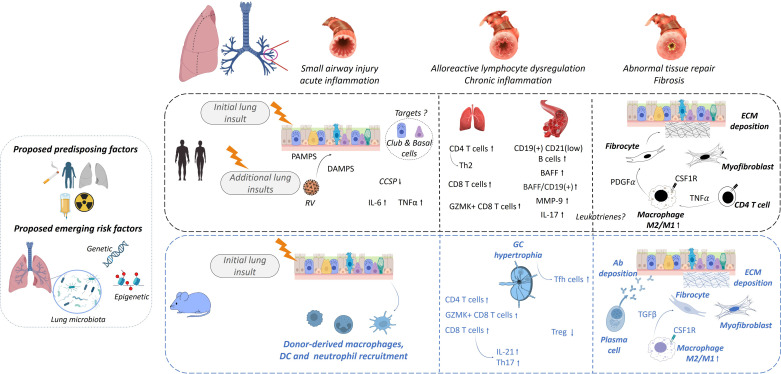
*Sơ đồ sinh lý bệnh BOS sau ghép tế bào gốc: tổn thương biểu mô → viêm → sửa chữa loạn nhịp → xơ hóa quanh tiểu phế quản. Nguồn: Cheng GS et al., Am J Respir Crit Care Med 2025 (PMC12412426), CC BY-NC-ND 4.0 — nguyên bản, không chỉnh sửa.*

## 2. Mẫu hình + chẩn đoán phân biệt theo vị trí (gamut)

- **Mẫu hình cốt lõi:** bệnh nhân sau ghép **ho khan, khò khè, khó thở khi gắng sức** + **tắc nghẽn đường thở nhỏ cố định** + **mosaic/ứ khí thì THỞ RA**, KHÔNG có mờ phổi dai dẳng.
- **Gamut theo CƠ CHẾ của mosaic giảm tỷ trọng (3 cơ chế — Argon "cùng hình, khác gốc"):**
  1. **Bệnh đường thở nhỏ** (ứ khí) — vùng sáng căng giãn, mạch thưa *thứ phát*; lộ rõ khi **thở ra**. Gồm **BOS (sau ghép)**, **PIBO/Swyer–James (sau nhiễm trùng, bài 614)**, viêm tiểu phế quản hút sặc, viêm tiểu phế quản tăng sản tế bào nội tiết thần kinh lan tỏa (DIPNECH).
  2. **Bệnh mạch máu phổi** (mosaic do tưới máu) — **thuyên tắc phổi mạn / tăng áp phổi**; vùng thưa mạch vẫn chứa đầy khí, KHÔNG tệ hơn khi thở ra.
  3. **Bệnh nhu mô xâm nhập** (mosaic do kính mờ) — **viêm phổi quá mẫn, viêm phổi kẽ**, tổn thương thâm nhiễm.
- **Gamut theo BỐI CẢNH sau ghép ở trẻ:**
  - **Sau ghép tủy (allo)**: BOS do cGVHD (bài này), **viêm phổi do virus sau ghép** (RSV, parainfluenza, adenovirus — vi rút cận myxo/adenovirus có thể để lại BOS tới **40%** ở người nhận ghép phổi), **hội chứng viêm phổi vô căn (idiopathic pneumonia syndrome, IPS)**, **viêm phổi tổ chức (organizing pneumonia)**.
  - **Sau ghép phổi**: **4 thể CLAD** — **BOS** (tắc nghẽn, không mờ phổi dai dẳng), **RAS** (hạn chế, TLC giảm ≥ 10%, có mờ phổi dai dẳng; ~30% CLAD), **hỗn hợp (mixed)**, **không xác định (undefined)**.
  - **Sau nhiễm trùng nặng (adenovirus, sởi, Mycoplasma)**: **PIBO → Swyer–James** (bài 614, 669).
- **Mnemonic phân biệt nhanh "BAO KHÔNG ĐỔI thì là xơ":** *B*OS sau ghép + tắc nghẽn **CỐ ĐỊNH** (không đáp ứng giãn phế quản, không hồi phục theo thời gian) = **xơ hóa tiểu phế quản**, khác hen (hồi phục) và khác viêm tiểu phế quản cấp (tự khỏi).

## 3. Bảng so sánh phân biệt (ma trận đối chiếu)

| Thực thể (entity) | Hình ảnh điển hình | Chốt vào (rule-in) | Chốt loại (rule-out) | Gợi ý xác nhận |
|---|---|---|---|---|
| BOS sau ghép tủy (cGVHD phổi) | HRCT: mosaic + **ứ khí thì THỞ RA**, dày thành phế quản, ± giãn phế quản; X-quang có thể **bình thường** | **Sau allo-HSCT + FEV₁ < 75% dự đoán, giảm ≥ 10% trong 2 năm + ứ khí thì thở ra + không nhiễm trùng** = BOS theo **NIH 2014** | Có mờ phổi dai dẳng / đông đặc / nốt vệ tinh hoặc **thì thở ra KHÔNG ứ khí** → nghĩ nguyên nhân khác | Spirometry chuỗi + CT hít vào & thở ra + loại trừ nhiễm trùng (BAL/nội soi) |
| CLAD thể BOS sau ghép phổi | Tắc nghẽn đơn thuần: mosaic + ứ khí, có thể giãn phế quản; **không mờ phổi dai dẳng, TLC KHÔNG giảm** | **FEV₁ giảm > 20% so nền, kéo dài ≥ 3 tuần (chắc chắn ≥ 3 tháng)**, dạng tắc nghẽn | Mờ phổi dai dẳng + **TLC giảm ≥ 10%** → thể **RAS** (khác tiên lượng, nặng hơn) | ISHLT 2019: đo FEV₁, TLC, CT hít vào–thở ra; loại trừ nguyên nhân khác |
| RAS (restrictive allograft syndrome) | Mờ phổi dai dẳng (kính mờ/đông đặc) + giảm thể tích | **Hạn chế + TLC giảm ≥ 10% + mờ phổi dai dẳng** | Không mờ phổi dai dẳng, thể tích giữ → BOS | CT thì muộn; đáp ứng corticoid kém, sống trung vị 6–18 tháng |
| PIBO / Swyer–James (sau nhiễm trùng) | Mosaic hai bên (PIBO) hay **một bên sáng + mạch thưa + rốn nhỏ** (Swyer–James); X-quang có thể bình thường tới **1/3 ca** | Tiền sử **nhiễm trùng hô hấp nặng** (adenovirus 20–69%) + tắc nghẽn cố định + ứ khí thì thở ra | Có bối cảnh **sau ghép** → ưu tiên BOS; ứ khí **đột ngột một bên** → **dị vật** (nội soi!) | HRCT thì thở ra; so phim cũ; bài 614/669 |
| Thuyên tắc phổi mạn / tăng áp phổi (mosaic do mạch) | Mosaic **giống nhau cả thì hít vào và thở ra**; mạch thưa nhưng khí đầy | Bệnh cảnh huyết khối/tăng áp + mosaic KHÔNG tăng khi thở ra | **Thì thở ra ứ khí rõ hơn** → bệnh đường thở nhỏ | CTA mạch phổi; đo áp lực động mạch phổi |
| Viêm phổi quá mẫn / viêm phổi kẽ (mosaic do kính mờ) | Mosaic + **kính mờ** + nốt trung tâm tiểu thùy + "headcheese" ba mật độ | Phơi nhiễm kháng nguyên + kính mờ xen kẽ | Không kính mờ, ứ khí thuần → BOS | HRCT thì hít vào–thở ra; bạch cầu ái toan/BAL lympho |

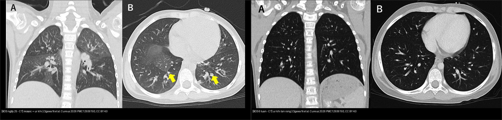
*Trái: BOS ngày 25 sau auto-HSCT — mosaic + ứ khí + dày thành phế quản (mũi tên), không kính mờ, không nốt trung tâm tiểu thùy. Phải: BOS 6 tuần — ứ khí lan rộng gần toàn bộ phổi dù đã dùng giãn phế quản + corticoid. Nguồn: Ogawa N et al., Cureus 2026 (PMC12936193), CC BY 4.0. Ảnh ghép letterbox.*

### Đọc chuẩn thì THỞ RA (điểm chốt của cả bài)
- **Ứ khí = vùng phổi giảm tỷ trọng KHÔNG nhỏ lại khi thở ra** (giữ nguyên thể tích hoặc giảm rất ít so các thùy lành). Trên CT thì thở ra, vùng ứ khí **sáng tương phản rõ hơn** so với thì hít vào và so nhu mô lành — đây là lý do phải chụp **cả 2 thì**.
- **Cạm bẫy dịch tễ:** ứ khí **có thể gặp ở tới 20% người khỏe mạnh** (một số báo cáo tới 1/2 người khỏe, thường ở đáy phổi phụ thuộc) — nên **ứ khí phải đi kèm BỐI CẢNH LÂM SÀNG + tắc nghẽn cố định**, không đọc ứ khí đơn độc.
- Trong BOS sau ghép tế bào gốc, **X-quang ngực có thể bình thường** — X-quang bình thường KHÔNG loại trừ BOS; và **chỉ HRCT thì thở ra** mới "bắt" được ứ khí sớm.

## 4. Protocol chụp + hệ phân độ/điểm chuẩn hóa

- **Theo dõi chức năng hô hấp (chìa khóa phát hiện sớm):**
  - Sau chẩn đoán **cGVHD**: **spirometry mỗi 3 tháng trong ≥ 1 năm**, sau đó **PFT đầy đủ hằng năm** (spirometry + thể tích phổi + DLCO), và **spirometry/PFT mỗi 3–6 tháng cho tới khi ngưng hẳn ức chế miễn dịch** (đồng thuận NIH 2020).
  - **Giảm FEV₁ ≥ 10%** so nền hoặc so mốc ngày 100 → **đo lại ngắn hạn sau 2–4 tuần**.
  - Ở trẻ: **FEF25–75 và V25 nhạy hơn FEV₁** cho đường thở nhỏ (ca nguyên văn: **FEV₁ 88,2% nhưng V25 chỉ 36% dự đoán**); **< 8 tuổi** có thể không làm được spirometry tin cậy → cân nhắc **rửa trôi nhiều nhịp thở (multiple breath washout, MBW)/chỉ số LCI** (không vượt trội spirometry ở trẻ ≥ 8 tuổi).
- **Protocol CT:** **HRCT lát mỏng ≤ 1 mm, liều thấp**, chụp **hít vào (đủ) + THỞ RA (end-expiratory)**; thêm **thì nằm sấp (prone)** để loại xẹp phổi phụ thuộc ở đáy sau. Đọc: mosaic, ứ khí, dày thành phế quản, giãn phế quản; **định lượng** ứ khí/độ đậm đặc phổi (qCT) **tăng độ chính xác khi kết hợp với đọc định tính**.
- **Hệ phân độ/tiêu chuẩn:**
  - **NIH 2014** — chẩn đoán BOS sau HSCT (ở trên); **KHÔNG có "độ" BOS** trong tiêu chuẩn NIH, nhưng thực hành hay dùng **NIH lung score của cGVHD 0–3** (điểm 2–3 là mức nặng — như đoàn hệ 678 bệnh nhân).
  - **ISHLT 2019** — CLAD: **potential ≥ 10%**, **CLAD > 20%**; **BOS 0p** (FEV₁ 79–90%) và **BOS 1 (> 20–35%), BOS 2 (35–50%), BOS 3 (> 50%)** theo mức giảm FEV₁.
- **Xử trí (khung):** tăng/thêm **corticoid toàn thân**, **azithromycin** (thể đáp ứng ~10–15%), **montelukast** (làm chậm tốc độ giảm FEV₁ ở BOS khởi phát muộn độ 1), **ruxolitinib/ibrutinib**, **ly trích quang (extracorporeal photopheresis, ECP)** bước 2; **ghép phổi** là lựa chọn cuối ở BOS nặng. Đáp ứng điều trị rất hạn chế: corticoid bước 1 chỉ **14,3%**; ruxolitinib **33,3%**; ECP **25%**; ibrutinib **25%**; imatinib **0%**. **Pirfenidone** (RCT 90 bệnh nhân, 26 tuần, 2403 mg/ngày) **KHÔNG vượt placebo** trong BOS tiến triển sau ghép phổi.

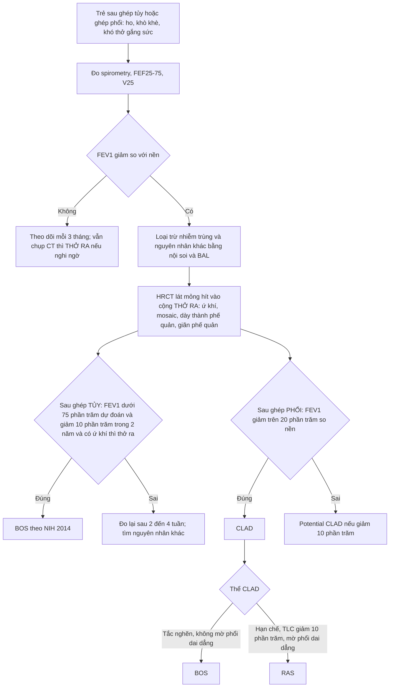

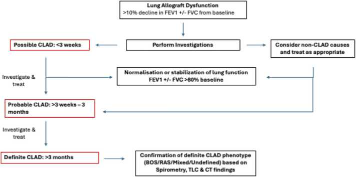
*Sơ đồ CLAD sau ghép phổi: rối loạn chức năng mảnh ghép (giảm FEV₁ > 10%) → khảo sát → hồi phục/ổn định, hay tiến triển thành possible (< 3 tuần), probable (≥ 3 tuần) và definite (≥ 3 tháng) CLAD, rồi xác định thể BOS/RAS/hỗn hợp/không xác định. Nguồn: Sepahzad A et al., JHLT Open 2026 (PMC13123590), CC BY 4.0.*

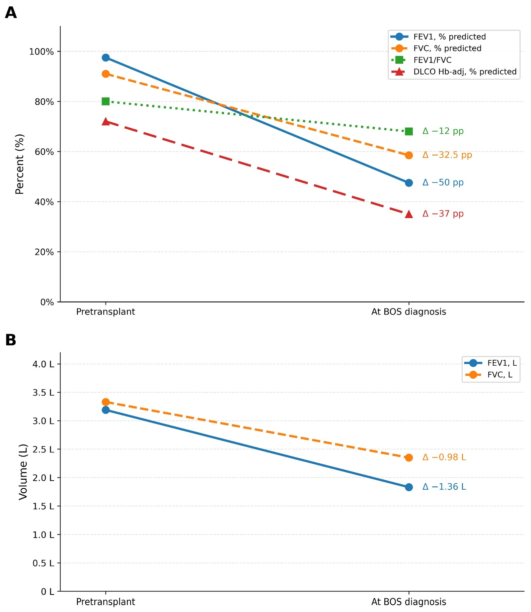
*Biểu đồ FEV₁ trước ghép và lúc chẩn đoán BOS trong đoàn hệ 678 bệnh nhân allo-HSCT: FEV₁ trung vị giảm từ 97,5% xuống 47,5% dự đoán. Nguồn: Savaş EM et al., J Clin Med 2026 (PMC13665736), CC BY 4.0.*

## 5. Biến thể bình thường và cạm bẫy

- **Biến thể bình thường:**
  - **Ứ khí ở người khỏe mạnh** (tới 20%, đôi khi tới một nửa) — thường ở đáy phổi phụ thuộc; **không gọi BOS nếu không có tắc nghẽn cố định + bối cảnh sau ghép**.
  - **Mosaic do xẹp phổi phụ thuộc** ở đáy sau trên phim nằm ngửa — **chụp thêm thì nằm sấp** để phân biệt.
  - **Tăng thông khí/giảm tỷ trọng tư thế** và **giả ảnh do cử động (motion artifact)** dễ giả ứ khí.
- **Cạm bẫy (pitfall):**
  - **X-quang bình thường KHÔNG loại trừ BOS** (X-quang thường không đặc hiệu, có thể chỉ là tăng sáng khu trú/nghèo mạch mơ hồ). Đừng để "phim phổi bình thường" làm trì hoãn chẩn đoán.
  - **FEV₁ BÌNH THƯỜNG cũng KHÔNG loại trừ BOS sớm** — ca nguyên văn có **FEV₁ 88,2% dự đoán** nhưng **V25 36%** và đường cong lưu lượng **lõm (concave)**; chỉ số đường thở nhỏ (V25/V50, FEF25–75) mới phát hiện sớm. Ở trẻ, **tiêu chuẩn 75% cứng của người lớn không dùng nguyên** — dùng LLN theo NHANES III.
  - **Tiêu chuẩn NIH kém nhạy và kém đặc hiệu:** chỉ **52%** ca OB đã được chứng minh mô bệnh học thỏa tiêu chuẩn spirometry NIH; ngược lại **24%** ca thỏa tiêu chuẩn NIH lại là bệnh nhu mô KHÔNG phải OB (viêm phổi tổ chức, tổn thương phế nang, NSIP).
  - **Giảm FEV₁ đơn độc chưa đủ:** trong 1.325 bệnh nhân "tiền BOS" (FEV₁ giảm 10% và/hoặc FEF25–75 giảm 25%), **chỉ 72 ca (5%)** tiến triển thành BOS NIH — phần lớn giảm FEV₁ do nguyên nhân khác.
  - **Auto-HSCT ≠ miễn nhiễm với BOS**, và thể này có thể **hồi phục** (ca nguyên văn khỏi triệu chứng sau 3 tháng, PFT bình thường sau 9 tháng) — khác diễn tiến thường **không hồi phục** của BOS sau allo-HSCT. **KL-6 và SP-D có thể bình thường** (ca nguyên văn) → không dùng để loại trừ.
  - **Sau ghép phổi, mọi tắc nghẽn mới không tự động là BOS** — phải loại trừ nhiễm trùng, viêm phổi tổ chức, bệnh nhu mô; và phân biệt **BOS (tắc nghẽn) với RAS (hạn chế + mờ phổi dai dẳng)** vì tiên lượng rất khác.
  - **Cẩn thận "mosaic" do mạch (thuyên tắc phổi mạn) và do thâm nhiễm (kính mờ)** — cùng hình mosaic nhưng gốc khác; **bắt buộc có thì thở ra** để chốt.
  - Bệnh nhân ghép phổi có **PAL/dò khí dai dẳng, giãn phế quản, nhiễm trùng** làm phức tạp đọc CT (bài 618) — đừng quy hết cho BOS.

## 6. Tự lượng giá — Blind Quiz ngay trên trang tĩnh

**Ca 1 — Bé gái 5 tuổi, u nguyên bào thần kinh giai đoạn M, sau hóa trị liều cao (thiotepa + melphalan) và ghép tế bào gốc TỰ THÂN (auto-HSCT); mọc mảnh ghép ngày 10, sau đó khó thở + khò khè thì thở ra + SpO₂ giảm về đêm. Cấy và film array hô hấp âm tính toàn bộ. Chụp CT ngày 25.**

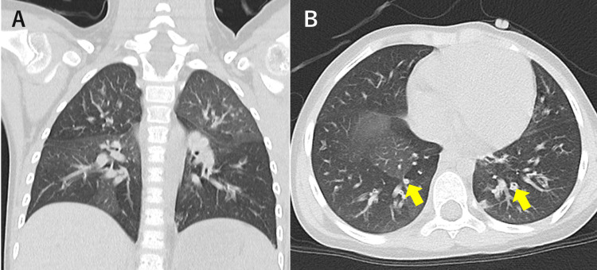

- Gợi ý lâm sàng (clinical context): trẻ sau ghép tủy tự thân, triệu chứng hô hấp xuất hiện ngay sau mọc mảnh ghép, nhiễm trùng âm tính.
- Câu hỏi: Mô tả mẫu hình trên CT? Vì sao nhiễm trùng âm tính là thông tin quan trọng? Ba chẩn đoán phân biệt và dấu hiệu nào chốt?

<b>Bấm để hiện đáp án (findings + chẩn đoán)</b>

- Dấu hiệu (findings): **mosaic attenuation** (vùng giảm tỷ trọng xen kẽ) + **ứ khí** + **dày thành phế quản** (mũi tên); **KHÔNG có kính mờ, KHÔNG nốt trung tâm tiểu thùy**. Nhiễm trùng âm tính giúp loại trừ viêm tiểu phế quản nhiễm trùng cấp — một tiêu chí của BOS.
- Chẩn đoán (diagnosis): **BOS sau ghép tế bào gốc tự thân**. Cơ chế: tổn thương biểu mô do hóa trị liều cao + DAMP lúc tái lập miễn dịch → xơ hóa tiểu phế quản → ứ khí. Đối chiếu đường cong lưu lượng bên dưới.
- Nguồn ảnh: Ogawa N et al., *Cureus* 2026 (PMC12936193), CC BY 4.0.

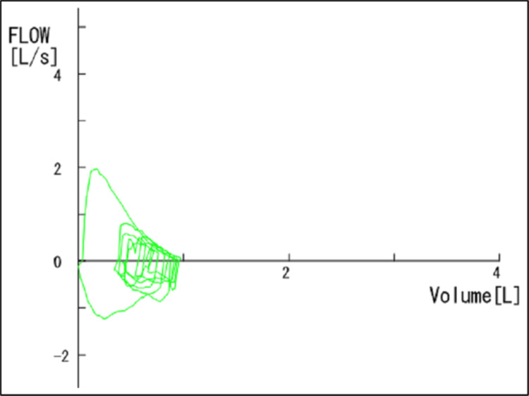

- Bổ sung: đường cong lưu lượng **lõm (concave)** = tắc nghẽn đường thở nhỏ ngoại vi; **V25 = 0,33 L/s = 36% dự đoán** trong khi **FEV₁ = 88,2%** (bình thường!). Đây là cạm bẫy lớn: FEV₁ bình thường KHÔNG loại trừ BOS.
- Nguồn ảnh: Ogawa N et al., *Cureus* 2026 (PMC12936193), CC BY 4.0.

**Ca 2 — Cùng bệnh nhân, 6 tuần sau khởi phát, triệu chứng vẫn tiến triển dù đã dùng giãn phế quản hít + montelukast + prednisolone 2 mg/kg mỗi 8 giờ.**

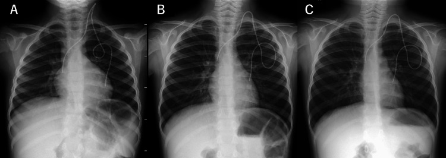

- Gợi ý: so sánh 3 mốc thời gian trên phim (trước khởi phát, 2 tuần, 6 tuần).
- Câu hỏi: Đặc điểm X-quang gì xuất hiện/tiến triển? Điều này gợi ý gì về sinh lý phổi?

<b>Bấm để hiện đáp án</b>

- Dấu hiệu: **tăng sáng phổi (hyperlucency) + cơ hoành dẹt + lồng ngực hình thùng (barrel-shaped) + bóng tim hẹp** — hình thái tăng thể tích phổi do ứ khí; tiến triển thêm sau 6 tuần.
- Ý nghĩa: cơ chế van một chiều ở tiểu phế quản → khí ứ lại → **tăng thể tích phổi (hyperinflation)**; đây là dấu hiệu muộn/thô trên X-quang.
- Nguồn ảnh: Ogawa N et al., *Cureus* 2026 (PMC12936193), CC BY 4.0.

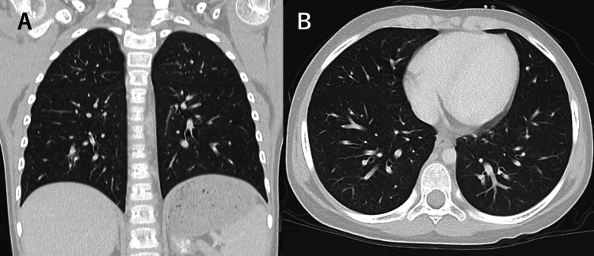

- Bổ sung: **ứ khí lan rộng gần toàn bộ phổi** so với CT ngày 25 → xác nhận BOS tiến triển. Sau đó bệnh nhân được **methylprednisolone xung 30 mg/kg/ngày × 3 ngày mỗi tháng + IVIG + corticoid hít + azithromycin**; 3 tháng sau hết triệu chứng, **V25 trở về 160% dự đoán**, ngưng oxy; 9 tháng sau không triệu chứng và các chỉ số bình thường.
- Nguồn ảnh: Ogawa N et al., *Cureus* 2026 (PMC12936193), CC BY 4.0.

**Ca 3 — Bệnh nhân sau ghép tủy, ho mạn, FEV₁ giảm; CT hít vào (a) và THỞ RA (b).**

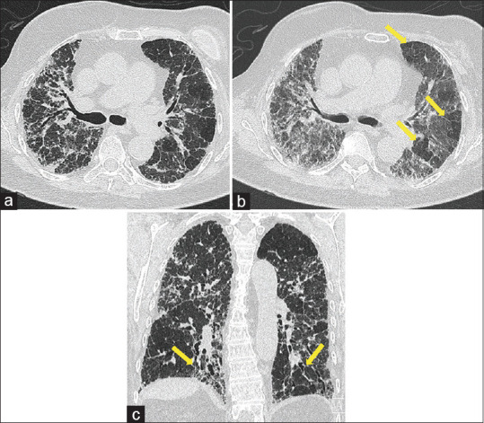

- Gợi ý: chú ý các mũi tên vàng chỉ các ổ giảm tỷ trọng **chỉ lộ rõ ở thì (b)**.
- Câu hỏi: Vì sao phải chụp thì THỞ RA? Cơ chế và cách phân biệt với mosaic do mạch máu?

<b>Bấm để hiện đáp án</b>

- Dấu hiệu: thì hít vào (a) mosaic mờ nhạt; thì THỞ RA (b) **các vùng giảm tỷ trọng dạng tiểu thùy KHÔNG nhỏ lại** (mũi tên) = **ứ khí (air trapping)**; (c) coronal xác nhận nhiều ổ.
- Cơ chế/chốt: ứ khí là dấu hiệu **gián tiếp** của bệnh tiểu phế quản (ổng < 2 mm dưới ngưỡng phân giải CT). **Vùng ứ khí tệ hơn khi thở ra**, còn mosaic do **bệnh mạch máu phổi** giữ nguyên cả 2 thì (khí đầy nhưng thưa mạch). Nên **luôn chụp cả 2 thì**.
- Nguồn ảnh: Lee ECH et al., Singapore Med J 2026 (PMC13405576), CC BY-NC-ND 4.0 — nguyên bản, không chỉnh sửa.

**Ca 4 — Bệnh nhân trẻ sau ghép tủy: HRCT trước và sau ghép phổi + mô bệnh.**

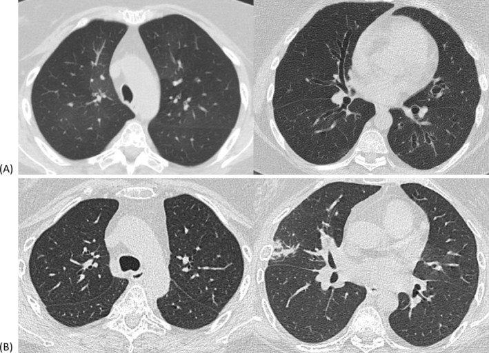

- Gợi ý: Hình trên và dưới là hai thời điểm chụp khác nhau; đối chiếu với bệnh phẩm mô học bên dưới.
- Câu hỏi: 3 chẩn đoán phân biệt cho bệnh cảnh tắc nghẽn tiến triển sau ghép? Mô bệnh học xác nhận gì?

<b>Bấm để hiện đáp án</b>

- Chẩn đoán: **BOS/CLAD thể BOS** sau ghép tế bào gốc (mô bệnh = **viêm–xơ tiểu phế quản**), sau đó **ghép phổi hai bên** vì bệnh nặng (BODE index 7). Sau ghép 3 tháng chức năng phổi cải thiện rõ và ổn định ~5 năm.
- Phân biệt: BOS do cGVHD; viêm phổi tổ chức/nhiễm trùng; CLAD thể RAS (nếu có mờ phổi dai dẳng + giảm thể tích).
- Nguồn ảnh: Huang SW et al., Respirol Case Rep 2025 (PMC11893176), CC BY-NC-ND 4.0 — nguyên bản, không ghép/chỉnh sửa.

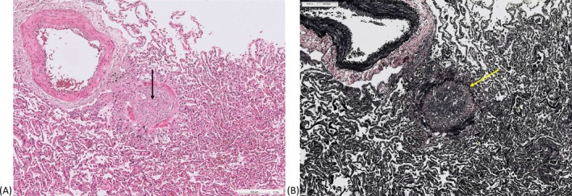

- Mô bệnh: thành tiểu phế quản **viêm nhẹ–vừa và xơ hóa** làm hẹp/tắc lòng — tương ứng tổn thương **OB**; đây là bằng chứng mô học, không thay đổi nguyên tắc chẩn đoán lâm sàng–hình ảnh.
- Nguồn ảnh: Huang SW et al., Respirol Case Rep 2025 (PMC11893176), CC BY-NC-ND 4.0 — nguyên bản.

**Ca 5 — Bệnh nhân sau ghép tủy, CT có dày thành phế quản và ổ giảm tỷ trọng; chẩn đoán hướng tới BOS do bệnh mảnh ghép chống chủ.**

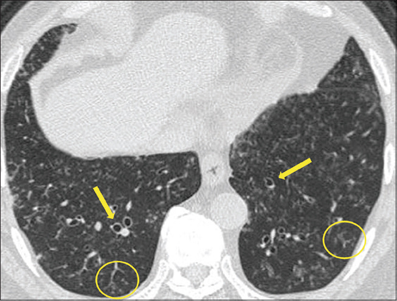

- Gợi ý: Bệnh nhân 68 tuổi (người lớn) ghép tủy 1 năm trước, ho + sốt; chú ý dày thành phế quản nhẹ và các ổ giảm tỷ trọng.
- Câu hỏi: Dấu hiệu chốt hướng tới viêm tiểu phế quản/BOS là gì? Vì sao cần loại trừ nhiễm trùng trước khi chốt BOS?

<b>Bấm để hiện đáp án</b>

- Dấu hiệu: **dày thành phế quản nhẹ + mosaic/ứ khí** ở bệnh nhân sau ghép tủy — phù hợp viêm tiểu phế quản tắc nghẽn do mảnh ghép chống chủ; **thì thở ra** giúp xác nhận ứ khí.
- Vì sao loại trừ nhiễm trùng: **nhiễm trùng hoạt động là tiêu chí LOẠI TRỪ** trong định nghĩa NIH 2014; nhiễm trùng cũng có thể để lại ứ khí/dày thành phế quản nên phải chẩn đoán bằng BAL/nội soi.
- Nguồn ảnh: Lee ECH et al., Singapore Med J 2026 (PMC13405576), CC BY-NC-ND 4.0 — nguyên bản.

**Ca 6 — Trẻ sau ghép tế bào gốc, sàng lọc phát hiện FEV₁ giảm; nhưng cần cẩn thận không "kết luận sớm" từ một lần đo.**
- Câu hỏi: Ngưỡng giảm FEV₁ nào buộc **đo lại sau 2–4 tuần**? Khi nào đủ để gọi **CLAD tiềm tàng** vs **CLAD xác định**?

<b>Bấm để hiện đáp án</b>

- **Giảm FEV₁ ≥ 10%** so nền/so ngày 100 → **đo lại sau 2–4 tuần** (đồng thuận NIH 2020).
- **CLAD tiềm tàng = FEV₁ giảm ≥ 10%**; **CLAD xác định = giảm > 20% so nền (trung bình 2 giá trị tốt nhất cách ≥ 3 tuần)** và **kéo dài ≥ 3 tháng** (probable ≥ 3 tuần). Với HSCT: BOS = **FEV₁ < 75% + giảm ≥ 10% trong 2 năm + ứ khí thì thở ra + không nhiễm trùng**.
- Nguồn: Cheng GS et al., Am J Respir Crit Care Med 2025 (PMC12412426), CC BY-NC-ND 4.0; Sepahzad A et al., JHLT Open 2026 (PMC13123590), CC BY 4.0.

## Bài liên quan chéo
- [614 – Bệnh tiểu phế quản tắc nghẽn (BO) hậu nhiễm trùng & Swyer–James](../614-benh-tieu-phe-quan-tac-nghen-BO-Swyer-James/lesson.md)
- [669 – Theo dõi dài hạn BO hậu nhiễm trùng & Swyer–James ở trẻ](../669-theo-doi-dai-han-BO-Swyer-James/lesson.md)
- [613 – Viêm tiểu phế quản ở nhũ nhi (RSV)](../613-viem-tieu-phe-quan-nhi/lesson.md)
- [617 – Hội chứng rò khí ở nhũ nhi (tràn khí màng phổi & trung thất)](../617-hoi-chung-ro-khi-o-nhu-nhi/lesson.md)
- [618 – Rò phế quản–màng phổi & rò khí dai dẳng ở trẻ](../618-ro-phe-quan-mang-phoi-va-ro-khi-dai-dang-o-tre/lesson.md)
- [619 – Di chứng hô hấp sau hoại tử phổi & cắt thùy ở trẻ](../619-di-chung-ho-hap-sau-hoai-tu-phoi-cat-thuy/lesson.md)
- [600 – Tổng quan Hệ Nhi khoa](../600-tong-quan-nhi-khoa/lesson.md)
- [070 – PE & ĐMC cấp (mosaic do mạch máu phổi)](../070-thuyen-tac-phoi-dmc-cap/lesson.md)
- [035 – Xơ mô kẽ UIP vs NSIP (mosaic do kính mờ)](../035-xo-mo-ke-UIP-NSIP/lesson.md)

## Ảnh
- Tên file: `670_slug_Modality_SourceID.jpg`. Nguồn + giấy phép từng ảnh trong `images/CREDITS.md`.
- Ảnh CC BY-NC-ND (PMC11893176, PMC12412426, PMC13405576) giữ nguyên bản, KHÔNG crop/ghép.
- Không tải được: các ca sau ghép tủy trên Radiopaedia/AuntMinnie — chỉ dẫn link ở `sources.md`.

> Không dùng để chẩn đoán độc lập khi chưa có người hướng dẫn.
