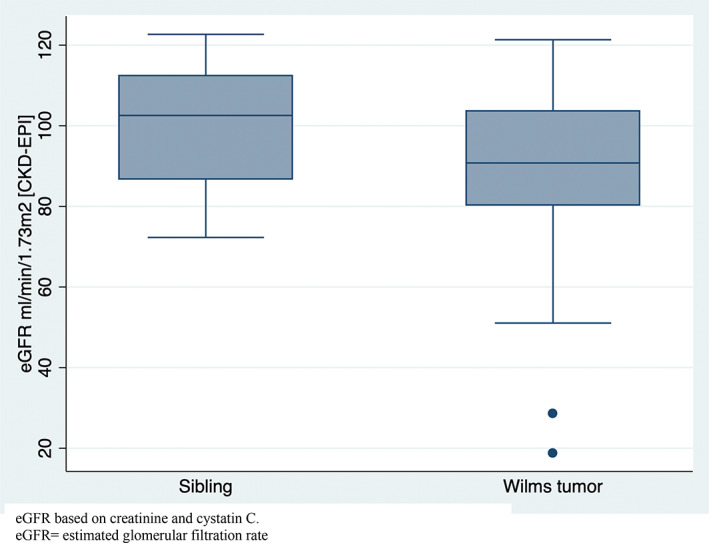
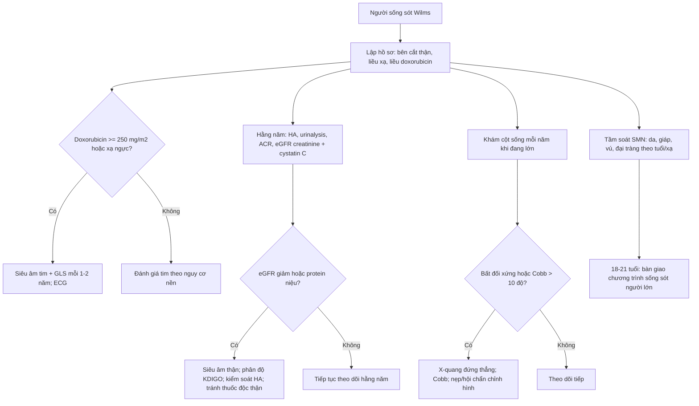
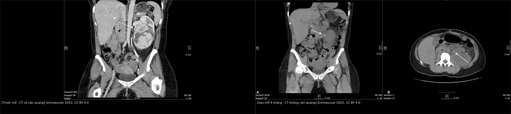
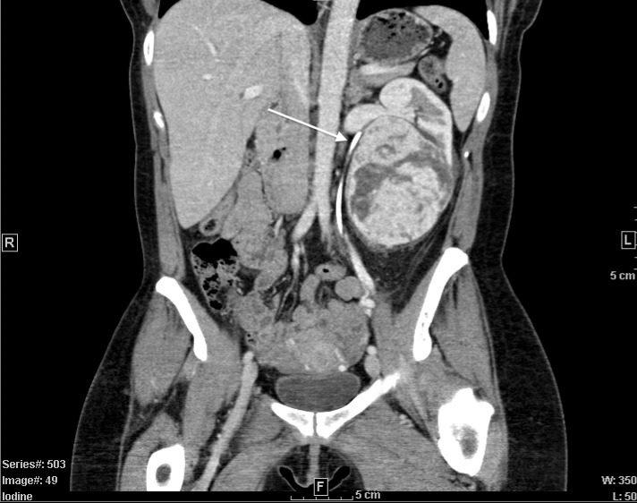
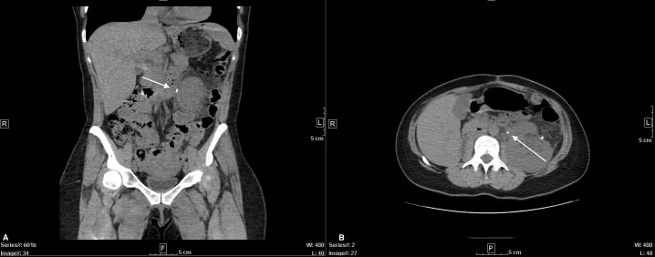
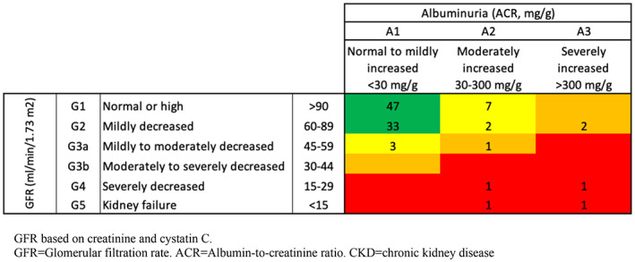

# 6700 — Biến chứng muộn & chuyển tiếp ở người sống sót sau u nguyên bào thận (Wilms) / Late effects and transition after Wilms tumor

**Tags:** `pattern:di-chung-muon` `pattern:khong-lo-than` `pattern:scoliosis` `vung:than` `vung:nguc` `vung:cot-song` `score:KDIGO` `protocol:surveillance` `incidentaloma:second-malignancy`
**Mức chắc chắn (certainty):** tổng hợp y văn (literature synthesis) + ca nguyên văn (verbatim case) — ca người lớn 37 tuổi có khối thận thứ phát trên thận độc nhất sau Wilms thời thơ ấu (Schmeusser BN et al., Front Oncol 2022, PMC9382288), đối chiếu đoàn hệ sống sót Đan Mạch (Høgsholt S et al., Cancer Med 2023, PMC9883410), St. Jude Lifetime Cohort (Foster KL et al., Pediatrics 2022, PMC9812640) và tổng quan hệ thống SIOP/SIOPEN 2025 (Radiother Oncol, PMID 40441488).

## 1. Tổng quan — "khỏi u" không phải "hết bệnh"

- **Sống sót sau Wilms là một bệnh cảnh đa hệ, kéo dài suốt đời.** Điều trị kinh điển gồm **cắt thận (nephrectomy)**, **hóa trị** (vincristine, actinomycin D, doxorubicin) và **xạ trị** vùng bụng/ngực. Mỗi thành phần để lại một "dấu vết" riêng:
  - **Cắt thận → tăng lọc bù (hyperfiltration)** ở thận còn lại → xơ hóa cầu thận tiến triển, tăng huyết áp, bệnh thận mạn (chronic kidney disease — CKD).
  - **Xạ trị → mất nephron, tổn thương mạch máu thận, xơ hóa**, đồng thời **tổn thương sụn tiếp hợp** và **mô mềm** → vẹo cột sống, lệch chiều dài chi, giảm chiều cao ngồi, thiểu sản vú ở bé gái.
  - **Doxorubicin (anthracycline) → tổn thương cơ tim nhiễm độc**, có thể **âm thầm nhiều năm** rồi biểu hiện suy tim.
  - **Xạ trị + hóa trị → ung thư thứ hai (second malignant neoplasm — SMN)**, đặc biệt **ung thư biểu mô tế bào thận (RCC)** và **ung thư đại trực tràng** sau xạ bụng (tổng quan SIOP/SIOPEN 2025, mức bằng chứng trung bình).
- **Số liệu định lượng cốt lõi:**
  - **Thận:** 99 người sống sót ≥ 20 năm (trung vị theo dõi **37 năm**) có **eGFR thấp hơn anh chị em cùng nhà 13 mL/min/1,73 m²** (95% CI −20 đến −5); **19%** có bệnh thận (so với **2%** ở anh chị em); **2%** suy thận giai đoạn cuối; **92%** vẫn có eGFR > 60 (Høgsholt 2023).
  - **Toàn thân:** 280 người sống sót (tuổi trung vị 30,5) có **12,7 bệnh lý độ 1–4** và **7,5 bệnh lý độ 2–4** tính đến 40 tuổi, so với **4,2** và **2,3** ở nhóm chứng. Tỷ lệ bệnh lý độ 2–4: **nội tiết 53,9%**, **tim mạch 26,4%**, **hô hấp 18,2%**, **thần kinh 8,6%**, **ung thư 7,9%**, **thận 7,2%** (Foster 2022).
  - **Xạ trị bụng trên:** tổng quan 55 nghiên cứu xác nhận bằng chứng **cao** cho **hội chứng chuyển hóa, đái tháo đường, suy lách chức năng**; **trung bình** cho **SMN (RCC, đại trực tràng)** và **CKD**; **rất thấp** cho **vẹo cột sống/biến dạng cột sống** và **bất thường phát triển động mạch chủ** (tổng quan SIOP/SIOPEN 2025).
- **TẠI SAO lại muộn như vậy:** thận còn lại **tăng lọc bù** trong nhiều thập kỷ mới lộ xơ hóa; anthracycline gây **stress oxy hóa và apoptosis tế bào cơ tim** không hồi phục, nhưng **cơ tim còn dự trữ** nên triệu chứng xuất hiện khi dự trữ cạn; xạ trị gây **đột biến DNA** tích lũy — thời gian tiềm tàng của SMN thường **> 10 năm**.
- **Vì vậy "theo dõi sau Wilms" không phải tầm soát tái phát đơn thuần** (tái phát chủ yếu trong 2 năm đầu), mà là **giám sát thận, tim, cột sống, nội tiết, sinh sản và ung thư thứ hai** — và **bàn giao sang người lớn** khi trưởng thành.

*Hộp eGFR (creatinine + cystatin C): **người sống sót Wilms** có trung vị thấp hơn và **đuôi thấp tới 20–28 mL/min/1,73 m²**, trong khi nhóm anh chị em giữ trên 70. Đây là lý do phải đo **creatinine + cystatin C**, không chỉ creatinine. Ảnh: Høgsholt S et al., Cancer Med 2023;12:1330–1338 (PMC9883410, Fig. 3), CC BY 4.0.*

## 2. Mẫu hình + chẩn đoán phân biệt theo cơ quan (Gamut)

- **Thận (phổ biến nhất về hình ảnh):**
  - **CKD do cắt thận/xạ trị:** thận còn lại **to bù**, vỏ mỏng, **tăng huyết áp**, protein niệu; siêu âm có thể bình thường ở giai đoạn sớm.
  - **Tăng huyết áp do thận:** thận nhỏ một bên (đã cắt), thận còn lại **tăng kích thước**, có thể có **hẹp động mạch thận** sau xạ.
  - **Sỏi thận/niệu quản** do **ứ trệ** khi niệu quản bị kéo lệch sau phẫu thuật/xạ — ca dưới đây bị **sỏi UPJ 5 mm** 9 tháng sau mổ.
  - **Khối thận thứ phát:** **RCC** (thể chromophobe/oncocytoma cần phân biệt), **u nguyên bào thận tái phát** (hiếm sau 5 năm), **di căn**, **tăng sản bù**.
- **Tim:**
  - **Bệnh cơ tim do anthracycline (anthracycline cardiomyopathy):** giảm LVEF, **GLS giảm sớm**, dãn buồng tim; có thể không triệu chứng.
  - **Bệnh tim do xạ (radiation heart disease):** xơ hóa cơ tim, bệnh van, bệnh mạch vành, màng ngoài tim — thường sau xạ ngực.
- **Cột sống–lồng ngực:**
  - **Vẹo cột sống (scoliosis)** do xạ không đối xứng + mất cân bằng cơ/dây chằng; **gù (kyphosis)**, **giảm chiều cao ngồi**.
  - **Osteochondroma do xạ** (lành tính) vs **osteosarcoma thứ phát** (ác tính) — cùng nằm trong trường xạ.
  - **Thiểu sản vú/tổ chức dưới da**, lệch chiều dài chi.
- **Nội tiết–chuyển hóa:** hội chứng chuyển hóa, đái tháo đường, suy giáp (nếu xạ vùng cổ), suy sinh dục (xạ khung chậu/alkylating).
- **Ung thư thứ hai:** RCC, đại trực tràng, sarcoma mô mềm, ung thư vú (xạ ngực), bạch cầu/lymphoma (hóa trị).
- **Mẹo nhớ "RENAL-CARE":** **R**enal (CKD, RCC, sỏi), **E**ndocrine (chuyển hóa, giáp, sinh dục), **N**eurocognitive, **A**nthracycline cardiomyopathy, **L**ung/chest wall, **C**olorectal/breast SMN, **A**void nephrotoxins, **R**adiation scoliosis, **E**ducation/transition.

## 3. Bảng so sánh phân biệt (ma trận đối chiếu)

| Thực thể (entity) | Hình ảnh điển hình | Chốt vào (rule-in) | Chốt loại (rule-out) | Gợi ý xác nhận |
|---|---|---|---|---|
| **RCC/oncocytoma trên thận độc nhất** | Khối đặc trong thận còn lại, ngấm thuốc, có thể **vôi hóa/hoại tử**; thận đối diện **không còn** | **Tiền sử cắt thận vì Wilms + khối mới ở thận còn lại**; ngấm thuốc mạnh | Nhiều nang đơn thuần, không ngấm → nang lành | CT 3 thì/MRI; **sinh thiết lõi có hội chẩn**; theo dõi chức năng thận |
| **Wilms tái phát** | Khối ở **giường mổ/thận còn lại**, có thể **hạch**, **di căn phổi** | **Tái phát trong 2 năm đầu**, tăng thể tích nhanh, mô học u | Khối ngấm kém, ổ nguyên bào thận, không lớn lên → rest | CT/MRI bụng–ngực; đối chiếu mô học cũ |
| **Tăng sản bù (compensatory hypertrophy)** | Thận còn lại **to đều**, giữ **phân biệt vỏ–tủy**, không có khối thống trị | **Không có khối khu trú**, chức năng ổn định, không ngấm bất thường | Khối khu trú, bờ rõ, ngấm khác nhu mô → u | Siêu âm/CT so sánh nhiều lần; đo kích thước theo thời gian |
| **Sỏi UPJ/ứ nước sau mổ** | **Sỏi cản quang** ở UPJ, **giãn bể thận**, niệu quản **cong bất thường** | **Đau hông lưng + creatinine tăng + ứ nước**; tiền sử mổ/xạ | Không sỏi, không giãn bể thận → đau cơ–xương | CT không cản quang; siêu âm; niệu quản ngược dòng |
| **Bệnh thận do xạ/CKD** | Thận teo, vỏ mỏng, **tăng tín hiệu T2/FLAIR?** (thận), **không khối**; xơ hóa quanh thận | **Xạ bụng + eGFR giảm dần + protein niệu/THA** | eGFR ổn định, không protein niệu → không CKD tiến triển | eGFR creatinine + cystatin C; ACR; siêu âm Doppler |
| **Bệnh cơ tim do anthracycline** | **LVEF giảm**, buồng dãn, **GLS giảm**; MRI: LGE/ECV tăng | **Doxorubicin ≥ 250 mg/m²**, GLS giảm > 15% tương đối, LVEF giảm > 10 điểm % xuống < 50% | LVEF bình thường, GLS bình thường, không phơi nhiễm → không nghĩ do thuốc | Siêu âm tim + GLS; ECG; NT-proBNP; cardiac MRI |
| **Vẹo cột sống do xạ** | **Cobb > 10°**, xoay đốt sống, **bất đối xứng chiều cao đốt**, có thể gù | **Xạ bụng/ngực không đối xứng + Cobb tăng theo thời gian** | Cobb < 10°, không tiến triển → tư thế/không bệnh lý | X-quang cột sống **đứng thẳng**; đo Cobb; so phim |
| **Osteochondroma do xạ vs osteosarcoma** | Osteochondroma: **cuống liên tục tủy xương** với xương gốc, sụn mũ; sarcoma: **phá hủy vỏ, phản ứng màng xương, mô mềm** | **Liên tục tủy–vỏ + không phá hủy** → lành; **phá hủy + mô mềm** → ác | Không liên tục tủy, mô mềm xâm lấn → nghi sarcoma | X-quang/CT; MRI; sinh thiết nếu nghi ác |

- **Phân biệt cốt lõi trên CT/MRI:** **khối thận thứ phát** = khối khu trú, ngấm thuốc, **không giữ cấu trúc vỏ–tủy**; **tăng sản bù** = thận to đều, **giữ cấu trúc**, không có khối; **sỏi UPJ** = cản quang trong lòng niệu quản + giãn bể thận.

## 4. Protocol theo dõi + sơ đồ quyết định

- **Bước 0 — hồ sơ điều trị (treatment summary):** ghi rõ **bên cắt thận**, **liều xạ và trường chiếu**, **liều tích lũy doxorubicin (mg/m²)**, **alkylating agent**, **hóa trị khác**, **biến chứng cấp**. Không có hồ sơ thì không thể cá thể hóa lịch.
- **Thận:**
  - **Huyết áp** mỗi năm (trẻ: theo percentile; người lớn: < 130/80 nếu có CKD).
  - **Urinalysis + albumin-to-creatinine ratio (ACR)** mỗi năm.
  - **eGFR** bằng **creatinine + cystatin C** (CKiD U25 ở < 25 tuổi; CKD-EPI 2021 ở người lớn) — creatinine đơn thuần **đánh giá quá cao** ở người ít cơ.
  - **Phân độ KDIGO:** G1 ≥ 90, G2 60–89, G3a 45–59, G3b 30–44, G4 15–29, G5 < 15 mL/min/1,73 m²; A1 < 30, A2 30–300, A3 > 300 mg/g.
  - **Siêu âm thận** khi có THA, protein niệu, eGFR giảm, hoặc tiền sử xạ bụng; **CT/MRI** khi nghi khối.
  - **Tránh thuốc độc thận** (NSAID kéo dài, aminoglycoside, amphotericin); **không ngừng cản quang cần thiết** nhưng bù dịch, dùng liều thấp, theo dõi creatinine sau 48–72 giờ.
- **Tim:**
  - **Siêu âm tim + GLS** nếu **doxorubicin ≥ 250 mg/m²** hoặc **xạ ngực**; lặp **mỗi 1–2 năm** (ESC 2022 cardio-oncology).
  - **CTRCD (cancer therapy-related cardiac dysfunction):** **LVEF giảm > 10 điểm % xuống < 50%**; **GLS giảm > 15% tương đối** là dấu hiệu cận lâm sàng sớm.
  - **ECG, NT-proBNP** khi có triệu chứng/nguy cơ; **cardiac MRI** khi LVEF giảm hoặc nghi bệnh cơ tim.
  - Kiểm soát **THA, đái tháo đường, rối loạn lipid**, ngừng thuốc lá; tư vấn **mang thai** (nguy cơ suy tim khi có LVEF giảm).
- **Cột sống–cơ xương:**
  - Khám lưng **mỗi năm** trong giai đoạn tăng trưởng; **X-quang cột sống đứng thẳng** khi bất đối xứng vai/eo/lồng ngực.
  - **Cobb > 10° = vẹo cột sống**; **20–40°** ở trẻ đang lớn → cân nhắc nẹp; **> 40–50°** → hội chẩn chỉnh hình.
  - **DXA** khi có xạ bụng/khung chậu, suy sinh dục, hoặc gãy xương bất thường.
  - Đau xương mới trong trường xạ: **X-quang/CT/MRI** phân biệt **osteochondroma lành** với **sarcoma thứ phát**.
- **Ung thư thứ hai & nội tiết:**
  - **Da, tuyến giáp, vú** khám mỗi năm; **MRI vú hằng năm** từ **25 tuổi hoặc 8 năm sau xạ ngực** (tuổi nào muộn hơn) theo COG LTFU.
  - **Nội soi đại tràng** từ **30 tuổi hoặc 5 năm sau xạ bụng/khung chậu** (tuổi nào muộn hơn) — hỏi lại trung tâm sống sót vì khuyến cáo thay đổi theo phiên bản.
  - **Tuyến giáp:** siêu âm khi có nhân/bất thường; TSH nếu xạ cổ.
  - **Sinh sản:** đánh giá dậy thì, AMH/FSH khi có chỉ định; tư vấn trữ noãn/tinh trùng **trước** điều trị (không hồi cứu được).
- **Chuyển tiếp (transition):**
  - **18–21 tuổi**: bàn giao sang **chương trình sống sót người lớn**, kèm **bản tóm tắt điều trị** và lịch tầm soát.
  - Hỏi **việc làm, bảo hiểm, sức khỏe tâm thần, nhận thức**; tư vấn **thai kỳ** (tim–thận) và **di truyền** nếu có hội chứng nền.

## 5. Biến thể bình thường và cạm bẫy

- **Tăng sản bù không phải u:** thận còn lại to đều, **giữ phân biệt vỏ–tủy**, không có khối thống trị; so sánh nhiều lần, đừng sinh thiết chỉ vì "to".
- **eGFR creatinine bình thường không loại trừ CKD:** ở người ít cơ (trẻ nhỏ, suy dinh dưỡng), creatinine thấp giả tạo; dùng **cystatin C/CKiD U25**.
- **Suy tim do anthracycline có thể không triệu chứng:** đừng chờ khó thở; **GLS** phát hiện sớm hơn LVEF.
- **Đau lưng sau xạ không phải lúc nào cũng do "tư thế":** đo Cobb, tìm **gãy xẹp**, **osteochondroma**, **sarcoma**.
- **Osteochondroma do xạ có thể trông "ác":** chốt bằng **liên tục tủy xương–vỏ**; không sinh thiết mù khi nghi lành.
- **Sỏi/ứ nước sau mổ dễ bị gọi nhầm là tái phát:** đau hông lưng + creatinine tăng + giãn bể thận → **CT không cản quang** tìm sỏi, không vội PET.
- **SMN có thời gian tiềm tàng dài:** không dừng tầm soát sau 5 năm; **RCC và đại trực tràng** là hai ung thư thứ hai đáng nhớ sau xạ bụng.
- **Cản quang ở thận độc nhất:** không từ chối cản quang cần thiết, nhưng **bù dịch, liều thấp, tránh thuốc độc thận đồng thời**, kiểm tra creatinine sau 48–72 giờ.
- **"Đặc xương" sau xạ không đồng nghĩa di căn:** có thể là **lành hóa xương**; ngược lại **tiêu xương/mô mềm mới** mới đáng ngại (bài [306](../306-theo-doi-sau-sbrt-di-can-xuong-rcc/lesson.md)).
- **Bỏ sót khối thận vì chỉ nhìn "thận to":** đo kích thước, tìm **khối khu trú**, đối chiếu nhu mô; ca dưới đây có khối **7,5 × 8,3 × 10,0 cm** trong thận độc nhất.

*Trái — **trước mổ**: khối đặc lớn ở thận trái độc nhất, đẩy và làm cong niệu quản (mũi tên trắng). Phải — **9 tháng sau cắt bán phần**: khối đã lấy, nhưng niệu quản vẫn cong và xuất hiện **sỏi UPJ 5 mm + ứ nước**. Ảnh: Schmeusser BN et al., Front Oncol 2022;12:971341 (PMC9382288, Fig. 1 và Fig. 3), CC BY 4.0; ảnh ghép letterbox, không crop/kéo giãn.*

## 6. Tự lượng giá — Blind Quiz

**Ca 1 — Nữ 37 tuổi, tiền sử cắt thận phải vì Wilms lúc 3 tuổi, hóa–xạ 2 năm. Đau bụng 2 tuần, sờ thấy khối hông lưng trái. Nhìn CT, mô tả trước:**

- Gợi ý: creatinine 0,7 mg/dL, eGFR 120; không sốt, không tiểu máu.
- Hỏi: dấu hiệu chính? 3 chẩn đoán phân biệt? bước xử trí tiếp theo?

<b>Bấm để hiện đáp án (findings + chẩn đoán)</b>

- **Thận trái độc nhất** (thận phải đã cắt) chứa **khối đặc 7,5 × 8,3 × 10,0 cm**, ngấm thuốc không đồng nhất, **đẩy và làm cong niệu quản** (mũi tên trắng), gây **ứ nước**; có thêm **sỏi 1,2 cm ở cực dưới**.
- Phân biệt: **RCC thể chromophobe/oncocytoma**, **Wilms tái phát muộn** (rất hiếm sau 34 năm), **di căn**, **tăng sản bù** (loại vì có khối khu trú).
- Xử trí: **sinh thiết lõi có hội chẩn** → **cắt bán phần thận (nephron-sparing)** để bảo tồn thận độc nhất; theo dõi creatinine/eGFR. Kết quả mô học ca này là **oncocytoma** (lành).
- **Nguồn ca:** Schmeusser BN et al., Front Oncol 2022;12:971341 (PMC9382288, Fig. 1), CC BY 4.0.

**Ca 2 — Cùng bệnh nhân 9 tháng sau: đau hông lưng trái, buồn nôn, creatinine tăng từ 0,7 lên 1,4 mg/dL. Nhìn CT, mô tả trước:**

- Hỏi: dấu hiệu? vì sao lại tạo sỏi? xử trí?

<b>Bấm để hiện đáp án</b>

- **Sỏi cản quang 5 mm ở khớp niệu quản–bể thận (UPJ)**, gây **giãn bể thận/ứ nước**; ngoài ra có nhiều sỏi nhỏ không cản quang hai bên.
- Nguyên nhân: **niệu quản bị kéo lệch/cong lên trên** do khối u trước đó và mô xơ sau mổ → **ứ trệ nước tiểu** → sỏi. Đây là biến chứng muộn của chính phẫu thuật, không phải tái phát u.
- Xử trí: **tán sỏi laser nội soi**; ca này sỏi **90% acid uric**, sau đó **uống ≥ 2 L nước/ngày** và theo dõi niệu khoản.
- **Nguồn ca:** Schmeusser BN et al., Front Oncol 2022 (PMC9382288, Fig. 3), CC BY 4.0.

**Ca 3 — Đọc biểu đồ phân độ CKD của 99 người sống sót Wilms:**

- Hỏi: bao nhiêu người có CKD? giai đoạn nào hay gặp? vì sao **92%** vẫn được coi là "chức năng thận bình thường"?

<b>Bấm để hiện đáp án</b>

- **19/99 (19%)** có CKD (G2–G5 hoặc albuminuria); đa số ở **G1–G2** (A1: 47 + 33), nhưng có **3 ca G3a**, **1 ca G4**, **1 ca G5**.
- **92%** có **eGFR > 60 mL/min/1,73 m²**, nghĩa là phần lớn **không suy thận nặng**, nhưng **eGFR trung bình vẫn thấp hơn anh chị em 13 mL/min** — tổn thương âm thầm.
- Vì vậy: **đo eGFR + ACR hằng năm**, kiểm soát HA/đái tháo đường, tránh thuốc độc thận; **không chờ creatinine tăng** mới can thiệp.
- **Nguồn:** Høgsholt S et al., Cancer Med 2023;12:1330–1338 (PMC9883410, Fig. 1), CC BY 4.0.

## Bài liên quan chéo
- [648 – Hội chứng dễ mắc u nguyên bào thận: BWS, WAGR, Denys–Drash & lịch tầm soát](../648-hoi-chung-de-mac-wilms-tam-soat-nephroblastomatosis/lesson.md)
- [639 – Khối thận đặc ở trẻ: Wilms vs CMN vs RCC](../639-khoi-than-o-tre-wilms-cmn-rcc/lesson.md)
- [651 – Đánh giá đáp ứng & theo dõi sau điều trị Wilms](../651-danh-gia-dap-ung-sau-dieu-tri-wilms/lesson.md)
- [6701 – Di căn phổi Wilms & sarcoma xương ở trẻ](../6701-di-can-phoi-wilms-va-sarcoma-xuong-o-tre/lesson.md)
- [306 – Theo dõi sau SBRT di căn xương RCC: lành hóa xương vs tái phát](../306-theo-doi-sau-sbrt-di-can-xuong-rcc/lesson.md)
- [189 – Đánh giá tiết niệu trước ghép thận ở bàng quang thần kinh](../189-danh-gia-truoc-ghep-than-bang-quang-than-kinh/lesson.md)
- [6104 – Aniridia bẩm sinh & hội chứng WAGR](../6104-aniridia-bam-sinh-va-hoi-chung-wagr/lesson.md)

## Ảnh
- `6700_ca1_CT_PMC9382288-Fig1-CCBY.jpg`, `6700_ca3_CT_PMC9382288-Fig3-CCBY.jpg`, `composite_wilms-than-doc-nhat-truoc-sau.jpg` — CC BY 4.0 (PMC9382288).
- `6700_egfr-boxplot_PMC9883410-Fig3-CCBY.jpg`, `6700_ckd-phan-do_BarChart_PMC9883410-Fig1-CCBY.jpg` — CC BY 4.0 (PMC9883410).
- Ảnh ghép letterbox giữ nguyên tỷ lệ, **không crop/kéo giãn**.
- Nguồn + giấy phép từng ảnh: `images/CREDITS.md`.

> Không dùng để chẩn đoán độc lập khi chưa có người hướng dẫn.
