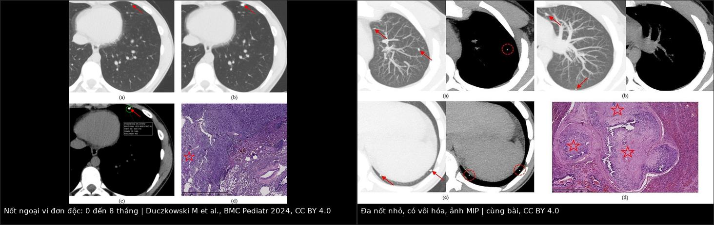
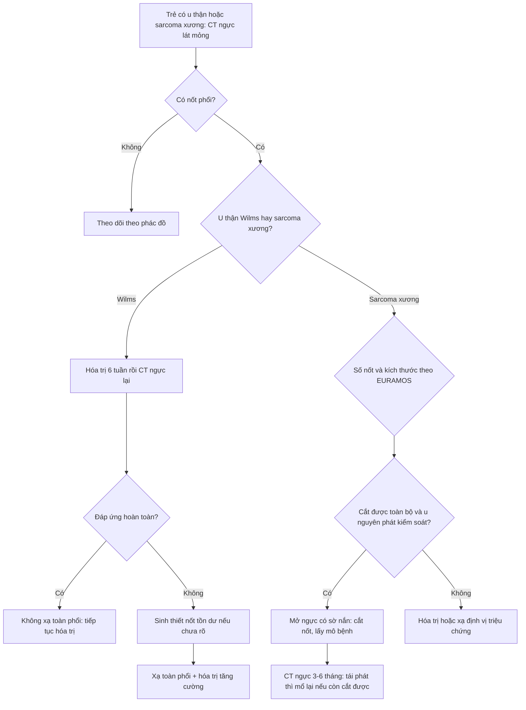
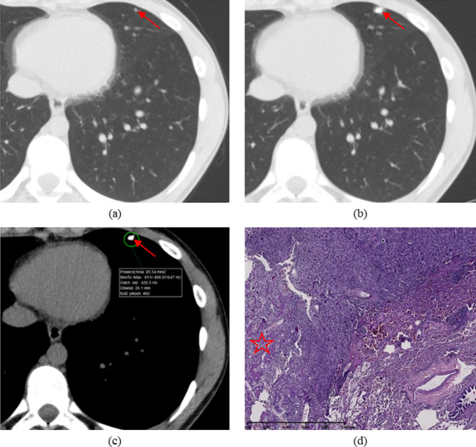
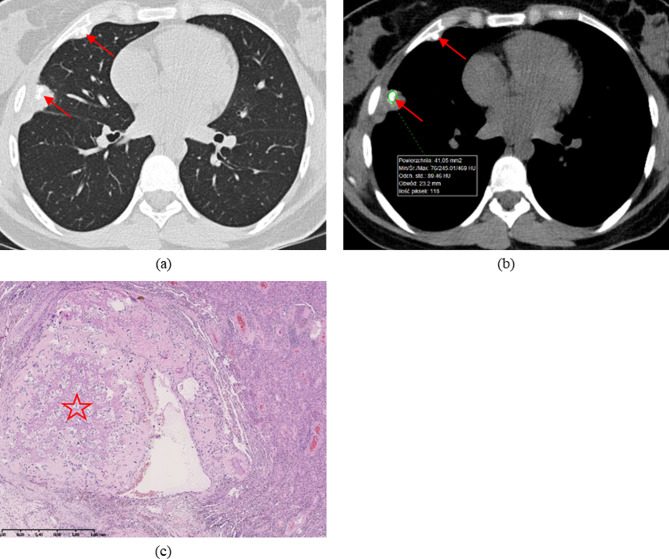
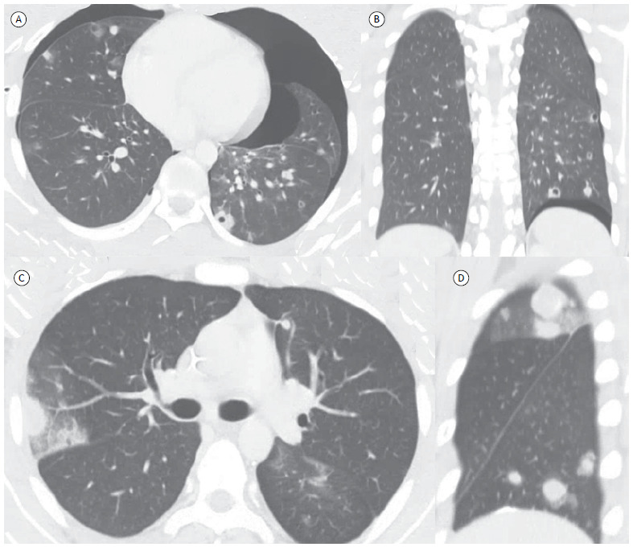
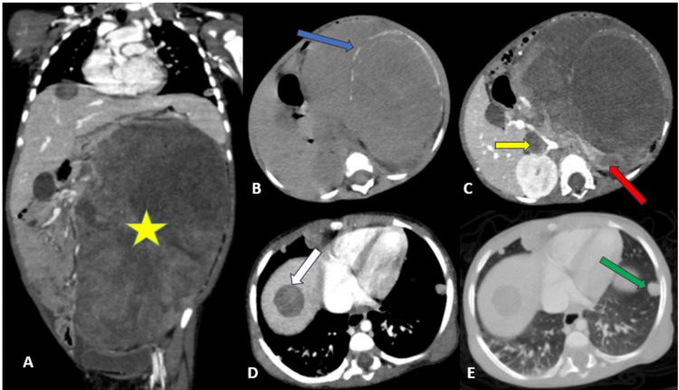

# 6701 — Di căn phổi ở Wilms & sarcoma xương ở trẻ: nốt nào cắt, nốt nào theo dõi / Pulmonary metastases in pediatric Wilms tumor and osteosarcoma: which nodule to resect

**Tags:** `pattern:not` `pattern:da-not` `pattern:di-can` `pattern:voi-hoa` `vung:phoi` `score:EURAMOS` `score:RECIST` `protocol:CT-nguc` `protocol:CT-lieu-thap` `protocol:metastasectomy` `incidentaloma:not-phoi`
**Mức chắc chắn (certainty):** tổng hợp y văn (literature synthesis) — đoàn hệ CT trước mổ ở 100 lần mở ngực vì osteosarcoma (Duczkowski M et al., BMC Pediatr 2024, PMC11145898), ca Wilms di căn phổi–gan (Elaitari K et al., Cureus 2025, PMC12476164), đặc điểm CT di căn osteosarcoma (Silva JAM et al., J Bras Pneumol 2023, PMC10171270), tổng quan điều trị Wilms (Front Pediatr 2022, PMC9333359) và meta-analysis mổ nốt phổi osteosarcoma (World J Surg Oncol 2026, PMC13251309).

> **Câu chốt của bài:** ở trẻ có sarcoma xương, **vôi hóa trong nốt phổi KHÔNG loại trừ di căn** — ngược lại, nốt vôi hóa trên CT trước mổ là **yếu tố dự báo di căn mạnh nhất** (Duczkowski). Ở Wilms, **đáp ứng của nốt phổi sau 6 tuần hóa trị quyết định có xạ toàn phổi hay không**; nốt tồn dư không rõ phải **sinh thiết trước khi xạ toàn phổi**. Chỉ mổ khi **cắt được toàn bộ nốt, kiểm soát được u nguyên phát, còn đủ dự trữ phổi** — và với sarcoma xương nên **mở ngực có sờ nắn**, không chỉ nội soi cắt nốt nhìn thấy.

## 1. Tổng quan bệnh học – cơ chế hình ảnh

- **Wilms (nephroblastoma):** u thận ác hay gặp nhất ở trẻ, thường chẩn đoán **trước 5 tuổi**. Khoảng **10–12%** đã di căn lúc chẩn đoán; trong số đó **~80% di căn phổi**, gan ít hơn. Phổi là **cơ quan di căn chính**, nên **CT ngực là phần bắt buộc của staging**, không thay bằng X-quang.
- **Osteosarcoma:** u xương nguyên phát ác hay gặp nhất ở trẻ/vị thành niên; **phổi là nơi di căn đầu tiên và thường là duy nhất**, đồng thời là nguyên nhân tiến triển và tử vong chính. Nhiều ca **chỉ có di căn phổi** mà không có di căn xương khác.
- **Vì sao nốt osteosarcoma hay vôi hóa:** tế bào u tạo **chất nền xương (osteoid)** rồi khoáng hóa → nốt có **vôi hóa trung tâm/lệch tâm**, đậm độ cao trên CT. Vì vậy **vôi hóa là dấu hiệu của mô u xương**, không phải dấu hiệu lành tính. Ngược lại, vôi hóa **dạng bỏng ngô (popcorn)** và có **mỡ (−40 đến −120 HU)** gợi ý hamartoma lành.
- **Vật lý CT — vì sao phải đọc cả hai cửa sổ:**
  - **Cửa sổ phổi (W1500/L−600):** phát hiện nốt nhỏ, bờ nốt, dấu mạch nuôi, khí trong nốt.
  - **Cửa sổ trung thất (W350/L40):** đo đậm độ, xác nhận **vôi hóa** (giá trị HU cao), phân biệt mỡ, dịch, mô đặc; đánh giá hạch trung thất.
  - **Lát cắt mỏng 1–1,5 mm + MIP (maximum intensity projection):** tăng phát hiện nốt nhỏ và nốt bám mạch; MPR giúp định vị nốt trước mổ.
- **Ngưỡng định lượng dùng trong bài:**
  - **EURAMOS-1 (đánh giá cả hai phổi):** mức **A** = **ít nhất 1 nốt ≥ 10 mm** hoặc **≥ 3 nốt ≥ 5 mm**; mức **B** = không đạt A.
  - **Đánh giá riêng bên phổi sẽ mổ:** **a** = 1 nốt **> 10 mm** hoặc **> 1 nốt > 5 mm**; **b** = nốt đơn **5–10 mm** hoặc nhiều nốt **3–5 mm**; **c** = nốt đơn **< 5 mm** hoặc vài nốt **< 3 mm**.
  - Trong đoàn hệ 100 lần mở ngực: **72%** xác nhận có di căn (di căn sống hoặc đã hoại tử) → **28% mở ngực "không cần"** nếu chỉ dựa vào tiêu chuẩn lâm sàng lúc đó. Mô hình CT đạt **Se 72–92%, PPV 81–90%, accuracy 74–79%**.
  - **Vôi hóa** có trên CT trước mổ ở **58%** lần mở ngực; số nốt vôi hóa trung bình **1,3** (0–10). **Vôi hóa là yếu tố dự báo mạnh nhất** trong cả 3 mô hình.
- **Tiên lượng sau mổ (osteosarcoma, meta-analysis):** mổ nốt phổi so với không mổ **HR 0,29** (KTC 95% 0,18–0,46) cho sống sau tái phát; **cắt hoàn toàn** HR **0,21** (0,12–0,38) cho PRS và **0,31** (0,23–0,42) cho sống sau mổ; **di căn hai bên** HR **1,56** (1,27–1,93); **VATS** so với mở ngực HR **1,69** (1,01–2,82); nốt đơn độc sống 5 năm **~50%**, **> 10 nốt** HR **2,38** so với 1 nốt.
- **Nốt phổi không xác định (IPN) ở osteosarcoma:** **nhiều IPN** có sống 5 năm **30%**, trong khi **IPN đơn độc** có tiên lượng **tương đương không có nốt** — số lượng nốt là yếu tố tiên lượng độc lập.

## 2. Mẫu hình + chẩn đoán phân biệt theo số lượng & bờ nốt (Gamut)

- **Nốt đơn độc ngoại vi:** **di căn osteosarcoma/Wilms** (bờ tròn, có thể vôi hóa, lớn dần) vs **hạch nội phổi** (đậm độ mô mềm, bờ đều, **≤ 10 mm**, sát màng phổi/dọc khe) vs **u hạt lành (granuloma)** (vôi hóa trung tâm/lan tỏa, ổn định ≥ 2 năm) vs **hamartoma** (vôi hóa bỏng ngô + mỡ) vs **nốt viêm/round pneumonia** (bờ mờ, có triệu chứng, giảm sau kháng sinh).
- **Nhiều nốt nhỏ hai bên:** **di căn** (phân bố ngoại vi, kích thước khác nhau, lớn dần) vs **nhiễm nấm xâm lấn** (trung tính giảm, nốt có quầng, hang) vs **thuyên tắc nhiễm khuẩn** (nốt ngoại vi + mạch nuôi) vs **lao/kê** (hạt kê, phân bố bạch huyết) vs **di căn sau điều trị đã hoại tử** (nốt không lớn, có thể vôi hóa).
- **Nốt có hang/hang mỏng + tràn khí:** **di căn osteosarcoma hoại tử** (thành mỏng, có thể vỡ gây **tràn khí màng phổi**) vs **áp-xe phổi** (mức khí–dịch, sốt) vs **lao hang** vs **nấm**.
- **Nốt mới trong khi hóa trị:** **di căn kháng trị** (lớn lên, có thể vôi hóa thêm) vs **nhiễm trùng cơ hội** (sốt, giảm bạch cầu) vs **huyết khối nhiễm khuẩn** vs **phản ứng viêm do thuốc**.
- **Nốt tồn dư sau hóa trị:** **mô u hoại tử/xơ** (nhỏ lại, vôi hóa, không ngấm) vs **u sống còn** (không nhỏ, ngấm, DWI sáng) — với Wilms, nốt tồn dư **không rõ** phải **sinh thiết ≥ 2 tổn thương** trước khi xạ toàn phổi.
- **Mnemonic "LUNG METS":** **L**arge/≥10 mm — **U**nilateral/bilateral — **N**umber > 10 — **G**rowth on serial CT — **M**atrix calcification (osteoid) — **E**xtrapulmonary disease — **T**iming after primary — **S**table ≥ 2 years favors benign.

## 3. Bảng so sánh phân biệt (ma trận đối chiếu)

| Thực thể (entity) | Hình ảnh điển hình trên CT | Chốt vào (rule-in) | Chốt loại (rule-out) | Gợi ý xác nhận |
|---|---|---|---|---|
| **Di căn osteosarcoma** | Nốt tròn ngoại vi, **vôi hóa trung tâm/lệch tâm**, có thể hang hoặc nốt bám mạch; lớn dần; có thể gây tràn khí | **Vôi hóa trong nốt + lớn lên + tiền sử osteosarcoma** | **Vôi hóa bỏng ngô + mỡ −40 đến −120 HU + ổn định ≥ 2 năm** → hamartoma | So CT cũ; mở ngực sờ nắn; mô bệnh |
| **Di căn Wilms** | Nốt mô mềm tròn, bờ rõ, thường **không vôi hóa**, ngoại vi; **giảm/thu nhỏ sau 6 tuần hóa trị** | **Nốt mới + u thận + đáp ứng với hóa trị theo dõi** | **Nốt không đổi nhiều năm, vôi hóa đều** → u hạt lành | CT ngực sau 6 tuần; sinh thiết nốt tồn dư nếu không rõ |
| **U hạt lành (granuloma)** | Nốt nhỏ, **vôi hóa trung tâm/lan tỏa**, bờ đều, ở thùy dưới/thùy giữa | **Vôi hóa đều + ổn định ≥ 2 năm + không lớn** | **Lớn lên, vôi hóa lệch tâm, tiền sử sarcoma** → di căn | So phim cũ; theo dõi 3–6 tháng |
| **Hamartoma** | **Vôi hóa bỏng ngô**, có **mỡ**, bờ nhẵn; thường ở ngoại vi | **Mỡ trong nốt (−40 đến −120 HU) + vôi hóa bỏng ngô** | Không mỡ, vôi hóa lệch tâm → nghi di căn | CT lát mỏng; không cần sinh thiết nếu điển hình |
| **Hạch nội phổi** | Nốt đặc nhỏ **≤ 10 mm**, sát màng phổi/dọc khe, bờ đều, không vôi hóa | **Vị trí đặc trưng + ≤ 10 mm + ổn định** | **> 10 mm, bờ tua, lớn nhanh** → di căn | Theo dõi; đối chiếu phim cũ |
| **Nhiễm nấm xâm lấn** | Nốt có **quầng ground-glass**, sau đó hang; nhiều ổ; trung tính giảm | **Sốt + giảm bạch cầu hạt + nốt có quầng/hang** | **Nốt đặc vôi hóa, không quầng, không sốt** → di căn | Cấy máu, galactomannan, CT lặp |
| **Di căn hang + tràn khí** | Hang thành mỏng ngoại vi, **tràn khí màng phổi** cùng bên; có thể tràn khí trung thất | **Tràn khí tự phát + nốt hang ở trẻ có sarcoma** | Hang có mức dịch + sốt → áp-xe | CT ngực; dẫn lưu khẩn nếu tràn khí nhiều |
| **Sẹo/xơ sau điều trị** | Mờ tuyến tính/dải, co kéo màng phổi, **không lớn**, có thể vôi hóa | **Ổn định ≥ 6–12 tháng + không khối** | **Nốt tròn lớn dần** → tái phát | So phim; PET/CT nếu còn nghi |

*Trái: nốt ngoại vi đơn độc ở đáy phổi, chụp lúc 0 và 8 tháng — **lớn lên**, xác nhận di căn. Phải: nhiều nốt nhỏ hai bên, một số **vôi hóa**, ảnh MIP — ở osteosarcoma, vôi hóa **không** loại trừ di căn. Nguồn: Duczkowski M et al., BMC Pediatr 2024 (PMC11145898), CC BY 4.0; ảnh ghép letterbox.*

## 4. Protocol chụp + hệ phân độ/điểm chuẩn hóa

- **Kỹ thuật CT ngực trẻ em (ALARA):**
  - **Không cản quang** là đủ cho nốt phổi; chỉ cản quang khi cần đánh giá mạch/hạch/trung thất.
  - **Lát mỏng 1–1,5 mm**, thì **hít vào tối đa** (hợp tác được), tái tạo **lung + mediastinal**, **MPR + MIP**; giảm kVp/mAs theo cân nặng, **không lặp CT chỉ để "nhìn lại"**.
  - Ghi **số nốt, vị trí theo thùy, kích thước lớn nhất, vôi hóa, bờ, khoảng cách màng phổi** trong báo cáo — đây là dữ liệu quyết định mổ.
- **Lịch chụp:**
  - **Wilms:** CT ngực **lúc chẩn đoán** và **sau 6 tuần hóa trị** (đánh giá RCR/SIR); sau đó theo phác đồ COG/SIOP và lịch theo dõi tái phát.
  - **Osteosarcoma:** CT ngực **lúc chẩn đoán**, **trước mổ nốt phổi ≤ 4 tuần**, sau mổ **3–6 tháng**, rồi **mỗi 3 tháng trong 2 năm**, **mỗi 6 tháng đến 5 năm** (cá thể hóa theo nguy cơ).
- **Wilms — quyết định dựa trên đáp ứng (COG AREN0533):**
  - **Rapid complete response (RCR)** sau **6 tuần DD-4A** → **không xạ toàn phổi**.
  - **Slow incomplete response (SIR)** hoặc **LOH 1p/16q** → hóa trị tăng cường (regimen M) + **xạ toàn phổi (WLRT)** theo phác đồ.
  - **Nốt tồn dư không rõ** → **sinh thiết ≥ 2 tổn thương** trước khi WLRT.
  - Kết quả AREN0533: 4 năm **EFS 85,4% / OS 95,6%**, tốt hơn NWTS-5 (**72,5% / 84,0%**).
- **Osteosarcoma — tiêu chí mổ nốt phổi:**
  - **Cắt được toàn bộ** nốt đã phát hiện (và nốt sờ thấy khi mổ); **kiểm soát được u nguyên phát**; **đủ dự trữ phổi** sau mổ; **không có di căn ngoài phổi không kiểm soát**; bệnh nhân chịu được gây mê.
  - **Mở ngực có sờ nắn** là chuẩn; **VATS** chỉ chọn lọc vì có thể bỏ sót nốt nhỏ (HR tử vong 1,69 trong meta-analysis).
  - **Hai bên:** mổ **theo thì** (thường bên nặng hơn trước), không mổ hai bên cùng lúc nếu không cần.
  - **Tái phát:** vẫn mổ lại nếu còn cắt được toàn bộ — không có giới hạn tuyệt đối số lần.
- **Phân tầng CT (EURAMOS-1):** A/B cho cả hai phổi; a/b/c cho bên sẽ mổ — dùng để **chuẩn hóa chỉ định và so sánh**, không thay thế đánh giá đa chuyên khoa.
- **Sơ đồ quyết định:**

## 5. Biến thể bình thường và cạm bẫy

- **Vôi hóa KHÔNG phải bằng chứng lành tính ở osteosarcoma:** trong đoàn hệ 100 lần mở ngực, vôi hóa là **yếu tố dự báo di căn mạnh nhất**, gặp ở **58%** ca có di căn. Đừng bỏ qua nốt vôi hóa nhỏ.
- **Nốt < 5 mm có thể bị bỏ sót** trên lát dày hoặc CT thở ra; dùng **lát 1–1,5 mm + MIP**, so với phim cũ.
- **Mổ nội soi chỉ cắt nốt nhìn thấy** có thể bỏ sót nốt nằm sâu; **sờ nắn khi mở ngực** phát hiện nhiều nốt hơn CT.
- **Tràn khí màng phổi tự phát** có thể là **dấu hiệu đầu tiên** của di căn osteosarcoma hoại tử — đừng chỉ điều trị tràn khí mà bỏ qua nốt nguyên nhân.
- **Nốt tồn dư sau hóa trị không đồng nghĩa u sống:** có thể là **hoại tử/xơ**; với Wilms, sinh thiết nốt không rõ trước WLRT; với osteosarcoma, chỉ cắt nốt còn lại nếu nghi u sống.
- **Nốt mới trong lúc giảm bạch cầu** có thể là **nấm**; đừng gọi di căn ngay khi chưa loại trừ nhiễm.
- **Đếm thiếu nốt** làm mất tiêu chuẩn "cắt toàn bộ": đọc **cả hai phổi, MPR ba bình diện, MIP**, ghi rõ từng nốt.
- **Sẹo xạ/mổ** có thể co kéo và vôi hóa; so phim và đánh giá thay đổi theo thời gian.

## 6. Tự lượng giá — Blind Quiz

**Ca 1 — Bé trai 16 tuổi, osteosarcoma xương đùi, CT ngực lúc chẩn đoán có một nốt ngoại vi đơn độc; 8 tháng sau chụp lại.**

- Câu hỏi: Mô tả thay đổi? Nốt này nên theo dõi hay mổ? Vì sao không thể khẳng định lành tính chỉ vì nốt nhỏ?

<b>Bấm để hiện đáp án</b>

- Hình: nốt **ngoại vi đơn độc** ở đáy phổi; sau **8 tháng** nốt **lớn lên rõ** — tiến triển.
- Chẩn đoán: **di căn phổi osteosarcoma**. Kích thước ban đầu nhỏ không loại trừ ác; cần **so sánh** và **đo** trên cùng cửa sổ.
- Xử trí: **mổ cắt nốt** nếu cắt được toàn bộ và u nguyên phát kiểm soát; lấy mô bệnh. Nếu chỉ theo dõi, phải chụp lại **3 tháng**.
- Nguồn ảnh: Duczkowski M et al., BMC Pediatr 2024 (PMC11145898), Fig. 5, CC BY 4.0.

**Ca 2 — Bé gái 14 tuổi, osteosarcoma, 11 năm sau chẩn đoán CT phát hiện hai nốt dưới màng phổi có vôi hóa.**

- Câu hỏi: Vôi hóa gợi ý lành tính hay ác tính? Cần làm gì tiếp?

<b>Bấm để hiện đáp án</b>

- Hình: **hai nốt dưới màng phổi có vôi hóa**, bờ rõ; ROI cho đậm độ **469 HU** (canxi).
- Chẩn đoán: **di căn osteosarcoma tái phát muộn** — vôi hóa do **chất nền xương của u**, không phải u hạt lành.
- Vì sao: trong osteosarcoma, **vôi hóa là yếu tố dự báo di căn mạnh nhất**, không phải tiêu chuẩn loại trừ.
- Xử trí: **mổ cắt nốt + mô bệnh**; đánh giá lại toàn thân.
- Nguồn ảnh: Duczkowski M et al., BMC Pediatr 2024 (PMC11145898), Fig. 3, CC BY 4.0.

**Ca 3 — Bé trai 16 tuổi, osteosarcoma xương đùi, đau ngực đột ngột; CT thấy nhiều nốt có hang và tràn khí hai bên.**

- Câu hỏi: Chẩn đoán? Vì sao tràn khí xuất hiện? Xử trí ưu tiên?

<b>Bấm để hiện đáp án</b>

- Hình: **nhiều nốt có hang thành mỏng** ở hai phổi, kèm **tràn khí màng phổi hai bên**; sau hóa trị nốt vẫn lớn, có quầng.
- Chẩn đoán: **di căn osteosarcoma hoại tử có hang**, vỡ vào khoang màng phổi gây **tràn khí tự phát**.
- Xử trí: **dẫn lưu khẩn** nếu tràn khí nhiều/căng; sau ổn định đánh giá mổ nốt phổi và kiểm soát u.
- Cạm bẫy: nghĩ "áp-xe/lao" vì có hang và bỏ qua tiền sử sarcoma.
- Nguồn ảnh: Silva JAM et al., J Bras Pneumol 2023 (PMC10171270), Fig. 3, CC BY-NC 4.0 — giữ nguyên bản, không crop/ghép.

**Ca 4 — Bé gái 20 tháng tuổi, khối thận trái, CT ngực–bụng có nốt phổi và ổ gan.**

- Câu hỏi: Phân giai đoạn? Vì sao phải chụp CT ngực? Điều trị định hướng?

<b>Bấm để hiện đáp án</b>

- Hình: khối thận trái lớn (dấu **spur sign** với thận), **huyết khối trong tĩnh mạch chủ dưới**, cùng **nốt phổi** và **ổ gan** — di căn đa cơ quan.
- Chẩn đoán: **Wilms giai đoạn IV** (di căn phổi ± gan). Phổi là nơi di căn chính (**~80%** ca di căn).
- Điều trị: hóa trị theo nguy cơ (DD-4A/regimen M), phẫu thuật cắt thận sau hóa trị, **xạ toàn phổi nếu đáp ứng không hoàn toàn**; sinh thiết nốt tồn dư không rõ trước WLRT.
- Vì sao CT ngực bắt buộc: X-quang bỏ sót nốt nhỏ; đáp ứng phổi sau **6 tuần** quyết định có WLRT.
- Nguồn ảnh: Elaitari K et al., Cureus 2025 (PMC12476164), Fig. 1, CC BY 4.0.

## Bài liên quan chéo
- [381 – Di căn phổi MPNST: cắt nốt hay SBRT](../381-di-can-phoi-mpnst-cat-not-hay-sbrt/lesson.md)
- [639 – Khối thận ở trẻ: Wilms vs CMN vs RCC](../639-khoi-than-o-tre-wilms-cmn-rcc/lesson.md)
- [651 – Đánh giá đáp ứng sau điều trị Wilms](../651-danh-gia-dap-ung-sau-dieu-tri-wilms/lesson.md)
- [020 – Nốt phổi](../020-not-phoi/lesson.md)
- [016 – Nốt phổi ở bệnh nhân có tiền sử ung thư](../016-not-phoi-tien-su-ung-thu/lesson.md)
- [621 – Nang sán lá phổi ở trẻ](../621-nang-san-la-phoi-o-tre/lesson.md)

> Không dùng để chẩn đoán độc lập khi chưa có người hướng dẫn.
