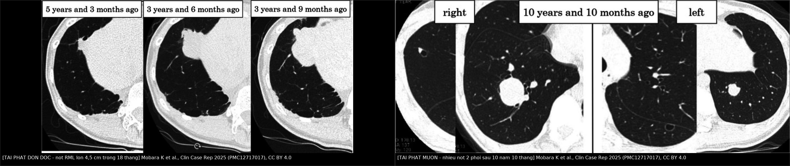
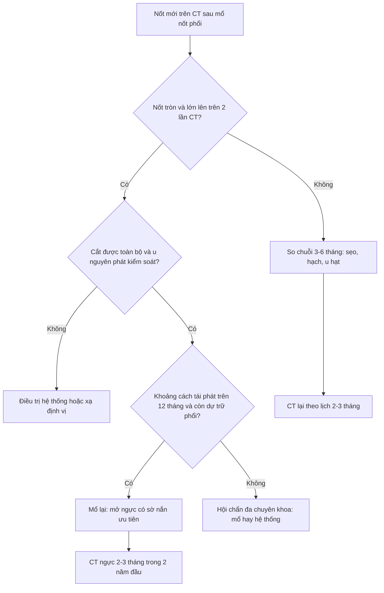
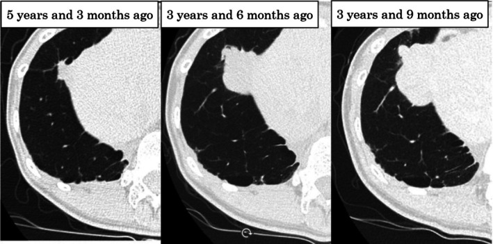
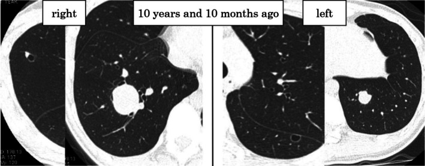
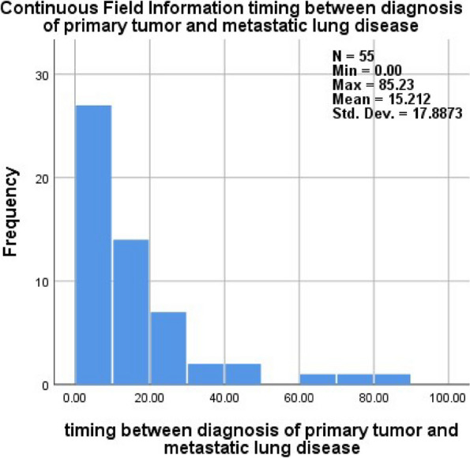
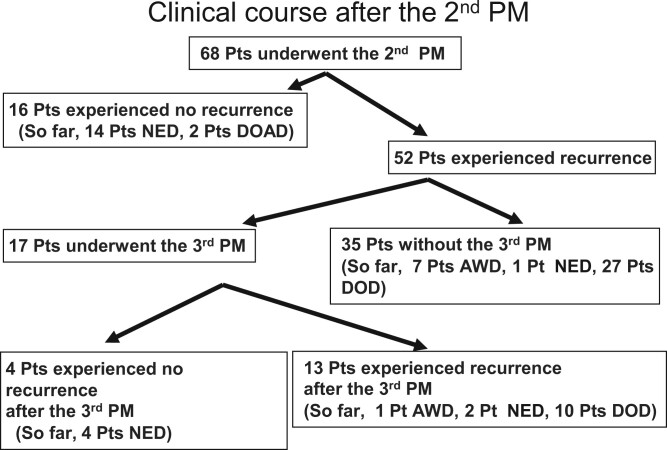

# 6702 — Theo dõi sau mổ nốt phổi ở trẻ: nốt mới là tái phát hay sẹo? / Follow-up after pediatric pulmonary metastasectomy: is the new nodule recurrence or scar?

**Tags:** `pattern:not` `pattern:not-moi` `pattern:di-can` `pattern:di-can-tai-phat` `pattern:seo-sau-mo` `vung:phoi` `score:RECIST` `score:EURAMOS` `protocol:CT-nguc` `protocol:CT-lieu-thap` `protocol:metastasectomy` `protocol:surveillance` `incidentaloma:not-phoi`
**Mức chắc chắn (certainty):** tổng hợp y văn (literature synthesis) — lịch theo dõi và sống sau mổ lấy từ đoàn hệ osteosarcoma 159 bệnh nhân/229 lần mổ (Zhang Z et al., Transl Lung Cancer Res 2026, PMC13557883), đoàn hệ nhi 55 ca (Hamoda A et al., J Egypt Natl Canc Inst 2024, PMC13313816), loạt mổ lần hai/lần ba (Kanzaki R et al., Interdiscip Cardiovasc Thorac Surg 2024, PMC10927334), ca tái phát muộn 10 năm 10 tháng có hồi phục chức năng phổi (Mobara K et al., Clin Case Rep 2025, PMC12717017) và đoàn hệ chức năng phổi người sống sót ung thư nhi (Žarković M et al., ERJ Open Res 2026, PMC13548452).

> **Câu chốt của bài:** sau mổ nốt phổi ở trẻ, **tái phát là quy luật, không phải ngoại lệ** — **76,5% (52/68)** tái phát sau lần mổ thứ hai, sống không tái phát 5 năm chỉ **27%**. Vì vậy **lịch CT ngực mới là "thuốc" chính**: **mỗi 2–3 tháng trong 2 năm đầu**, mỗi 6 tháng đến năm thứ 5, rồi 6–12 tháng. Và **mổ lại vẫn có ích** khi còn cắt được toàn bộ, **khoảng cách tái phát > 12 tháng** là dấu hiệu tốt, còn **nốt mới lớn dần** sau mổ phải coi là di căn cho tới khi chứng minh ngược lại.

## 1. Tổng quan bệnh học – cơ chế hình ảnh: vì sao "theo dõi" là phần khó nhất

- **Vì sao phải theo dõi dày:** phổi là nơi di căn đầu tiên và thường duy nhất của osteosarcoma; sau khi đã mổ nốt phổi, **bệnh vẫn tiếp tục tái phát ở phổi** vì tế bào u đã gieo vào tuần hoàn phổi. Trong đoàn hệ 159 bệnh nhân/229 lần mổ (median follow-up **79,1 tháng**): sống sau di căn **3 năm 52,2% / 5 năm 36,0%** (Zhang Z et al., Transl Lung Cancer Res 2026, PMC13557883).
- **Tái phát sau mổ lần hai (68 bệnh nhân, 2000–2020):** **52/68 = 76,5%** tái phát tiếp; sống không tái phát 5 năm **27%**, sống toàn bộ 5 năm **48%**. **Khoảng cách từ mổ lần một đến lúc phát hiện di căn mới ≤ 12 tháng** là yếu tố tiên lượng xấu độc lập cho **cả** sống không tái phát **và** sống toàn bộ (Kanzaki R et al., Interdiscip Cardiovasc Thorac Surg 2024, PMC10927334).
- **Mổ lần ba có ích nhưng chọn lọc:** **17/68** bệnh nhân được mổ lần ba, chỉ **3/17** đạt sống không bệnh 3 năm (Kanzaki 2024). Nghĩa là **không phải mổ lại bao nhiêu lần cũng được** — phải có khoảng bệnh ổn định và còn dự trữ phổi.
- **Thời điểm xuất hiện di căn phổi (55 ca nhi, 78,2% osteosarcoma):** trung bình **15,2 tháng** (SD **17,9**; 0–85,2 tháng) từ chẩn đoán u nguyên phát; **21,8%** có di căn ngay lúc chẩn đoán, **30,9%** trong lúc điều trị, **32,7%** trong **năm đầu theo dõi**, **14,5%** muộn (Hamoda A et al., J Egypt Natl Canc Inst 2024, PMC13313816). Sống 5 năm toàn bộ **74,8%** (cả nhóm) và **68%** (osteosarcoma); **hoại tử u nguyên phát (p = 0,017)** và **thời điểm di căn (p = 0,001)** là yếu tố tiên lượng có ý nghĩa.
- **TẠI SAO vẫn phải theo dõi dài:** tái phát muộn có thật — ca bệnh tái phát **10 năm 10 tháng** sau lần mổ phổi đầu tiên, vẫn mổ lần ba và sống không tái phát 2 năm 7 tháng sau đó (Mobara K et al., Clin Case Rep 2025, PMC12717017). Ngừng theo dõi ở mốc 5 năm là bỏ sót nhóm này.
- **Vật lý CT — vì sao đọc nốt sau mổ khó hơn đọc nốt lần đầu:**
  - **Tương phản nốt–không khí rất lớn:** khí phổi **−800 đến −900 HU** so với mô mềm **+30 đến +100 HU**, mô u tạo xương (osteoid) còn cao hơn → nốt **> 5 mm** gần như luôn thấy trên cửa sổ phổi **nếu lát đủ mỏng**.
  - **Hiệu ứng thể tích một phần (partial volume averaging):** lát **5 mm** làm nốt **< 5 mm** bị "pha loãng" với khí, mất tương phản; lát **1–1,5 mm + MIP** giữ lại nốt nhỏ và nốt bám mạch.
  - **Đo tăng trưởng phải cùng điều kiện:** cùng cửa sổ, cùng độ dày lát, cùng thì hít vào; **RECIST 1.1** định nghĩa tiến triển là **tăng ≥ 20%** *và* **tăng tuyệt đối ≥ 5 mm** so với nadir, lấy tổng đường kính các tổn thương đích (**≥ 10 mm** mới làm tổn thương đích).
  - **Vì sao hậu phẫu gây nhiễu:** sau cắt bờ nêm, **đường stapler**, dày màng phổi, dải xẹp phổi và biến dạng nhu mô tạo ra "nốt giả" **hình bầu dục, bám đường khâu, không tròn, không lớn dần**. Chỉ **so chuỗi** mới tách được sẹo với tái phát.
  - **Vì sao kích thước một mình không đủ:** **thời gian nhân đôi u (tumor doubling time)**, cắt được toàn bộ (R0) và **tỉ lệ bờ cắt/kích thước u > 0,5** là các yếu tố tiên lượng được nêu trong ca Mobara 2025 — nốt nhỏ nhưng nhân đôi nhanh nguy hiểm hơn nốt to mà đứng yên.

## 2. Mẫu hình + chẩn đoán phân biệt theo vị trí (Gamut)

**Mẫu hình:** một hoặc nhiều **nốt mới** xuất hiện trên CT ngực ở trẻ **đã mổ nốt phổi** vì u đặc (osteosarcoma, Ewing, Wilms, hepatoblastoma, sarcoma mô mềm).

- **Nốt đơn độc, tròn, ngoại vi, lớn dần:** **tái phát di căn** (hàng đầu) vs **u hạt lành** (vôi hóa trung tâm, đứng yên ≥ 2 năm) vs **hạch nội phổi** (≤ 10 mm, sát màng phổi/dọc khe) vs **viêm phổi tròn** (bờ mờ, có sốt, tan sau kháng sinh).
- **Nốt mới sát đường khâu/dưới màng phổi cùng bên mổ:** **hạt viêm quanh chỉ/stapler line**, **dày màng phổi khu trú**, **dải xẹp phổi** (hình dải, bám màng phổi, không tròn) vs **tái phát tại chỗ** (tròn, lớn dần, đẩy màng phổi).
- **Nhiều nốt hai bên, kích thước khác nhau:** **tái phát đa ổ** vs **nhiễm nấm xâm lấn** (trung tính giảm, nốt có quầng, sau đó hang) vs **thuyên tắc nhiễm khuẩn** (nốt ngoại vi + mạch nuôi) vs **di căn mô u khác**.
- **Nốt/hang trong vùng đã xạ:** **u ác thứ hai do xạ** (radiation-induced sarcoma — xuất hiện sau nhiều năm, trong trường xạ) vs **di căn hoại tử có hang** vs **viêm phổi do xạ** (thẳng bờ trường chiếu).
- **Tổn thương ngoài nhu mô:** **di căn xương sườn/thành ngực** (phá xương, phần mềm cạnh sườn) — dễ bị bỏ qua khi chỉ đọc cửa sổ phổi.
- **Gợi nhớ "4S" cho nốt mới sau mổ:** **S**ame disease (tái phát di căn) · **S**car (sẹo/stapler/xẹp phổi) · **S**ickness (nhiễm trùng, nấm) · **S**econd cancer (u thứ hai do xạ).

## 3. Bảng so sánh phân biệt (ma trận đối chiếu)

| Thực thể (entity) | Hình ảnh điển hình trên CT | Chốt vào (rule-in) | Chốt loại (rule-out) | Gợi ý xác nhận |
|---|---|---|---|---|
| **Tái phát di căn** | Nốt **tròn**, bờ rõ, ngoại vi hoặc bất kỳ thùy, **có thể vôi hóa** (osteoid); **lớn dần** trên chuỗi CT; có thể nhiều nốt hai bên | **Tròn + lớn lên trên ≥ 2 lần CT cùng kỹ thuật + tiền sử sarcoma** | **Đứng yên ≥ 2 năm, vôi hóa đều, bờ đa giác** → u hạt/hạch lành | So CT cũ cùng cửa sổ; RECIST 1.1; mô bệnh khi mổ |
| **Sẹo/stapler line** | **Dải hoặc bầu dục**, bám **đường khâu/màng phổi**, không tròn, có thể co kéo; **không đổi** qua nhiều lần chụp | **Bám đường khâu + hình dải + không lớn** | **Tròn, lớn dần, tách khỏi đường khâu** → tái phát | CT nền sau mổ; so 3–6 tháng |
| **Hạch nội phổi** | Nốt đặc **≤ 10 mm**, sát màng phổi hoặc **dọc khe**, bờ đều, đậm độ mô mềm | **Vị trí đặc trưng + ≤ 10 mm + ổn định** | **> 10 mm, bờ tua, lớn nhanh** → di căn | Theo dõi; đối chiếu phim cũ |
| **U hạt lành (granuloma)** | Nốt nhỏ, **vôi hóa trung tâm/lan tỏa**, bờ đều, thùy dưới/giữa | **Vôi hóa đều + ổn định ≥ 2 năm** | **Vôi hóa lệch tâm + lớn lên** → di căn | So phim; không sinh thiết nếu điển hình |
| **Nhiễm nấm xâm lấn** | Nốt có **quầng ground-glass** (halo sign), sau đó **hang**; nhiều ổ; đáy phổi | **Sốt + giảm bạch cầu hạt + nốt có quầng/hang** | **Nốt đặc, không quầng, không sốt, đứng yên** → không phải nấm | Galactomannan, cấy máu, CT lặp 1–2 tuần |
| **Viêm phổi tròn** | Đám mờ **bờ mờ**, có thể có phế quản hơi, kèm sốt/ho | **Triệu chứng nhiễm + tan sau kháng sinh 2–4 tuần** | **Không đổi sau 4 tuần, bờ rõ dần** → nghĩ u | Lâm sàng + CT lặp |
| **U ác thứ hai do xạ** | Khối/nốt **trong trường xạ cũ**, xuất hiện **nhiều năm** sau xạ; có thể phá xương sườn | **Vị trí đúng trường xạ + ≥ 5 năm sau xạ + lớn nhanh** | **Ngoài trường xạ, xuất hiện sớm < 1 năm** → nghĩ tái phát | So mô phỏng xạ; sinh thiết |

*Trái: nốt thùy giữa phải xuất hiện rồi **lớn dần tới 4,5 cm trong 18 tháng** — tái phát đơn độc, đã mổ lần ba. Phải: **nhiều nốt hai phổi** phát hiện **10 năm 10 tháng** sau lần mổ phổi đầu — tái phát muộn, nhiều ổ. Nguồn: Mobara K et al., Clin Case Rep 2025 (PMC12717017), CC BY 4.0; ảnh ghép letterbox, không crop.*

## 4. Protocol chụp + hệ phân độ/điểm chuẩn hóa

- **Kỹ thuật CT ngực trẻ em (ALARA):**
  - **Không cản quang** là đủ cho nốt phổi; chỉ cản quang khi cần đánh giá **rốn phổi/trung thất/thành ngực**.
  - **Lát mỏng 1–1,5 mm**, tái tạo **cửa sổ phổi + trung thất**, **MPR + MIP**, thì **hít vào tối đa** nếu trẻ hợp tác; giảm kVp/mAs theo cân nặng.
  - **Luôn so với lần chụp trước trên cùng cửa sổ và cùng độ dày lát**; ghi **số nốt, thùy, đường kính lớn nhất, vôi hóa, khoảng cách màng phổi, quan hệ đường khâu** — đây là dữ liệu quyết định mổ lại.
- **Lịch theo dõi sau mổ (Zhang Z et al. 2026, PMC13557883):**

| Thời gian sau mổ nốt phổi | CT ngực |
|---|---|
| **2 năm đầu** | **mỗi 2–3 tháng** |
| **Năm 3–5** | **mỗi 6 tháng** |
| **Sau năm 5** | **mỗi 6–12 tháng** (tiếp tục — có ca tái phát 10 năm 10 tháng) |
| **Giai đoạn chờ đáp ứng trước mổ** (nếu điều trị hệ thống trước) | **mỗi 4–8 tuần**, thời gian theo dõi trước mổ **tối ưu 2–3 tháng** |

- **Đánh giá đáp ứng:** **RECIST 1.1** (tổn thương đích **≥ 10 mm**; **PR** giảm ≥ 30%; **PD** tăng ≥ 20% **và** ≥ 5 mm); với nốt phổi nhiều ổ, **đếm và đo từng nốt** thay vì chỉ đo nốt lớn nhất.
- **Chức năng phổi — theo dõi bằng số, không bằng cảm giác:**
  - Đoàn hệ người sống sót ung thư nhi (median **7 năm** sau chẩn đoán): **phẫu thuật lồng ngực** liên quan **TLC z = −0,53**; **32%** có triệu chứng hô hấp nhưng **64%** số người có rối loạn chức năng phổi **không có triệu chứng** (Žarković M et al., ERJ Open Res 2026, PMC13548452).
  - Hướng dẫn **IGHG** chỉ khuyến cáo PFT thường quy cho người **có triệu chứng** đã phơi nhiễm điều trị gây hại phổi — nhưng với trẻ **đã mổ phổi nhiều lần**, đo **FVC + thể tích phổi 3D-CT** trước mỗi lần mổ lại là cách duy nhất để biết còn dự trữ.
  - Ca Mobara 2025: qua **3 lần mổ phổi**, **FVC 2540 → 2280 → 1980 → 2080 mL** (giảm ~**18%** so với ban đầu) nhưng **thể tích phổi 3D-CT 3916 → 3699 mL** gần như giữ nguyên → **đừng từ chối mổ lần ba chỉ vì "đã mổ hai lần"**.
- **Tư vấn vận động:** trẻ 5–17 tuổi **≥ 60 phút/ngày** vận động trung bình–mạnh; người lớn **150–300 phút/tuần** (WHO 2020). Không có bằng chứng rằng vận động làm tăng tái phát; ngược lại cần duy trì thể lực trước mổ lại.
- **Sơ đồ quyết định khi có nốt mới sau mổ:**

## 5. Biến thể bình thường và cạm bẫy

- **Đọc CT quá sớm sau mổ:** tràn dịch, xẹp phổi và dày màng phổi hậu phẫu che lấp hoặc giả làm nốt; **lấy CT nền theo lịch chương trình** rồi so chuỗi, đừng kết luận "tái phát" trên phim chụp trong vài tuần đầu.
- **Stapler line giả nốt:** hạt viêm quanh chỉ và dày màng phổi khu trú thường **bầu dục, bám đường khâu, không lớn** — đừng sinh thiết/mổ lại chỉ vì "có nốt mới" mà không so phim.
- **Bỏ sót nốt nhỏ vì lát dày hoặc không dùng MIP:** ở trẻ đã mổ, **nốt < 5 mm** vẫn có thể là di căn; đọc **cả hai phổi, ba bình diện, MIP**.
- **"Satisfaction of search":** thấy một nốt lớn rồi dừng lại — **đếm đủ nốt** vì tiêu chuẩn mổ là **cắt toàn bộ**; bỏ sót một nốt làm mất chính chỉ định đã đặt ra.
- **PET/CT dương tính giả sau mổ/viêm:** viêm màng phổi, hạt viêm quanh chỉ và nhiễm trùng đều ngấm FDG; **không dùng PET để "chốt" tái phát** khi chưa so chuỗi CT.
- **Ngừng theo dõi quá sớm:** tái phát **10 năm 10 tháng** sau mổ đầu (Mobara 2025) — lịch 6–12 tháng sau năm 5 là có lý do.
- **Từ chối mổ lại vì "đã mổ nhiều lần":** FVC giảm ~18% sau 3 lần mổ nhưng thể tích phổi 3D-CT gần như không đổi; quyết định dựa trên **số đo**, không dựa trên số lần mổ.
- **Bỏ qua cửa sổ trung thất/thành ngực:** di căn **xương sườn** và **màng phổi** dễ sót nếu chỉ nhìn cửa sổ phổi.

## 6. Tự lượng giá — Blind Quiz

**Ca 1 — Nữ 20 tuổi, osteosarcoma xương đùi phải đã mổ và thay khớp, đã mổ nốt phổi hai lần. CT ngực định kỳ ở 3 thời điểm.**

- Câu hỏi: Mô tả thay đổi của nốt? Đây là sẹo hay tái phát? Cần làm gì tiếp và dựa vào đâu để quyết định mổ lần ba?

<b>Bấm để hiện đáp án</b>

- Hình: nốt **thùy giữa phải** xuất hiện, rồi **lớn dần tới 4,5 cm trong 18 tháng**, trong khi không có ổ di căn nào khác.
- Chẩn đoán: **tái phát di căn osteosarcoma đơn độc** — nốt tròn, lớn dần trên chuỗi CT là chốt; sẹo/stapler không lớn theo thời gian.
- Xử trí: **mổ lần ba** (cắt bờ nêm + cắt cơ hoành bị xâm lấn, vá cơ hoành) sau khi xác nhận **dự trữ phổi đủ** (FVC + thể tích 3D-CT); mô bệnh xác nhận tế bào hình thoi giống u nguyên phát; sau mổ sống không tái phát **2 năm 7 tháng**.
- Cạm bẫy: nốt **đơn độc** không có nghĩa "lành" — tiên lượng tốt đến từ **khoảng cách tái phát dài + tốc độ phát triển chậm + cắt được R0**.
- Nguồn ảnh: Mobara K et al., Clin Case Rep 2025 (PMC12717017), Fig. 2, CC BY 4.0.

**Ca 2 — Cùng bệnh nhân, CT ngực chụp 10 năm 10 tháng trước thời điểm hiện tại, sau lần mổ phổi đầu tiên.**

- Câu hỏi: Mô tả phân bố tổn thương? Vì sao "đã mổ sạch" mà vẫn còn nhiều nốt? Điều này nói gì về lịch theo dõi?

<b>Bấm để hiện đáp án</b>

- Hình: **nhiều nốt ở thùy trên phải, thùy dưới phải và thùy dưới trái** — tổn thương hai bên, nhiều thùy.
- Chẩn đoán: **tái phát nhiều ổ** sau mổ nốt phổi đầu; bệnh nhân đã được **cắt thùy dưới phải + cắt bờ nêm thùy trên phải + cắt bờ nêm thùy dưới trái**.
- Vì sao: di căn phổi là bệnh **gieo rải theo tuần hoàn phổi**, mổ chỉ lấy được nốt **nhìn/sờ thấy**; nốt vi thể còn lại sẽ mọc — đây là lý do **76,5% tái phát sau mổ lần hai** và sống không tái phát 5 năm chỉ **27%**.
- Ý nghĩa theo dõi: phải chụp **mỗi 2–3 tháng trong 2 năm đầu**, rồi 6 tháng đến năm 5, sau đó 6–12 tháng — và **không ngừng** vì ca này tái phát ở mốc **10 năm**.
- Nguồn ảnh: Mobara K et al., Clin Case Rep 2025 (PMC12717017), Fig. 1, CC BY 4.0.

**Ca 3 — Trẻ 12 tuổi osteosarcoma, đã mổ nốt phổi. Bố mẹ hỏi: "Bao lâu thì hết nguy cơ tái phát để cháu đi học xa?"**

- Câu hỏi: Đọc biểu đồ (55 ca nhi): thời gian từ chẩn đoán u nguyên phát đến khi phát hiện di căn phổi tập trung ở đâu? Trả lời bố mẹ thế nào?

<b>Bấm để hiện đáp án</b>

- Biểu đồ: thời gian từ chẩn đoán u nguyên phát đến di căn phổi **trung bình 15,2 tháng** (SD **17,9**; 0–85,2 tháng); phần lớn ca nằm trong **24 tháng đầu**.
- Phân bố theo giai đoạn: **21,8%** có di căn ngay lúc chẩn đoán, **30,9%** trong lúc điều trị, **32,7%** trong **năm đầu theo dõi**, **14,5%** muộn.
- Trả lời: nguy cơ **cao nhất trong 2 năm đầu** → CT **mỗi 2–3 tháng**; vẫn còn nguy cơ đến **năm 5** (CT 6 tháng/lần) và **sau đó** (6–12 tháng/lần) — không có mốc "hết nguy cơ", nhưng có thể **học xa** nếu lịch chụp được duy trì và có kênh liên lạc với trung tâm điều trị.
- Nguồn ảnh: Hamoda A et al., J Egypt Natl Canc Inst 2024 (PMC13313816), Fig. 6, CC BY 4.0.

**Ca 4 — Sau mổ nốt phổi lần hai, gia đình hỏi "mổ lần ba còn được không?"**

- Câu hỏi: Bao nhiêu bệnh nhân tái phát sau mổ lần hai? Bao nhiêu người được mổ lần ba và kết quả ra sao? Yếu tố nào chọn người có lợi?

<b>Bấm để hiện đáp án</b>

- Sơ đồ 68 bệnh nhân: **16** không tái phát, **52 (76,5%)** tái phát; **17** được **mổ lần ba**, **35** không mổ lần ba.
- Kết quả: sau mổ lần hai, sống không tái phát 5 năm **27%**, sống toàn bộ **48%**; trong 17 ca mổ lần ba chỉ **3** đạt sống không bệnh 3 năm.
- Chọn người có lợi: **khoảng cách từ mổ lần một đến di căn mới > 12 tháng** là yếu tố tiên lượng tốt cho cả sống không tái phát và sống toàn bộ; kèm **cắt được toàn bộ** và **còn dự trữ phổi**.
- Nguồn ảnh: Kanzaki R et al., Interdiscip Cardiovasc Thorac Surg 2024 (PMC10927334), Fig. 2, CC BY 4.0.

## Bài liên quan chéo
- [6701 – Di căn phổi ở Wilms & sarcoma xương ở trẻ: nốt nào cắt](../6701-di-can-phoi-wilms-va-sarcoma-xuong-o-tre/lesson.md)
- [6700 – Biến chứng muộn & chuyển tiếp sau Wilms](../6700-di-chung-muon-sau-wilms-va-chuyen-tiep/lesson.md)
- [381 – Di căn phổi MPNST: cắt nốt hay SBRT](../381-di-can-phoi-mpnst-cat-not-hay-sbrt/lesson.md)
- [016 – Nốt phổi ở bệnh nhân có tiền sử ung thư](../016-not-phoi-tien-su-ung-thu/lesson.md)
- [020 – Nốt phổi](../020-not-phoi/lesson.md)
- [651 – Đánh giá đáp ứng & theo dõi sau điều trị Wilms](../651-danh-gia-dap-ung-sau-dieu-tri-wilms/lesson.md)

> Không dùng để chẩn đoán độc lập khi chưa có người hướng dẫn.
