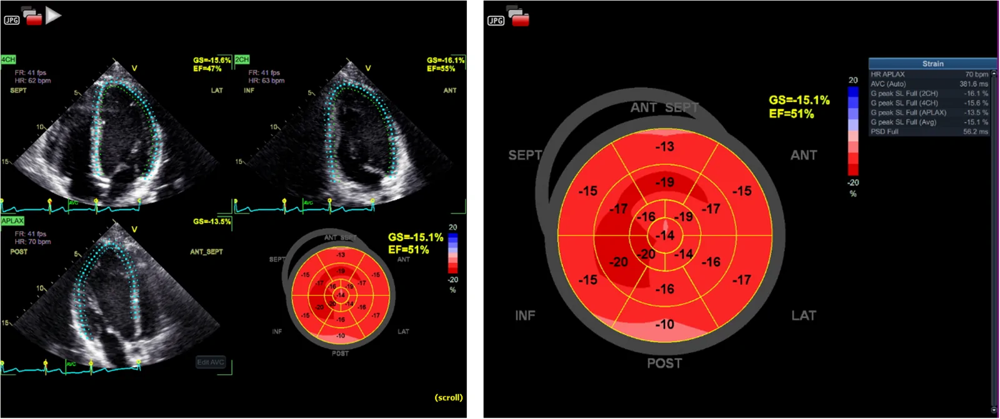
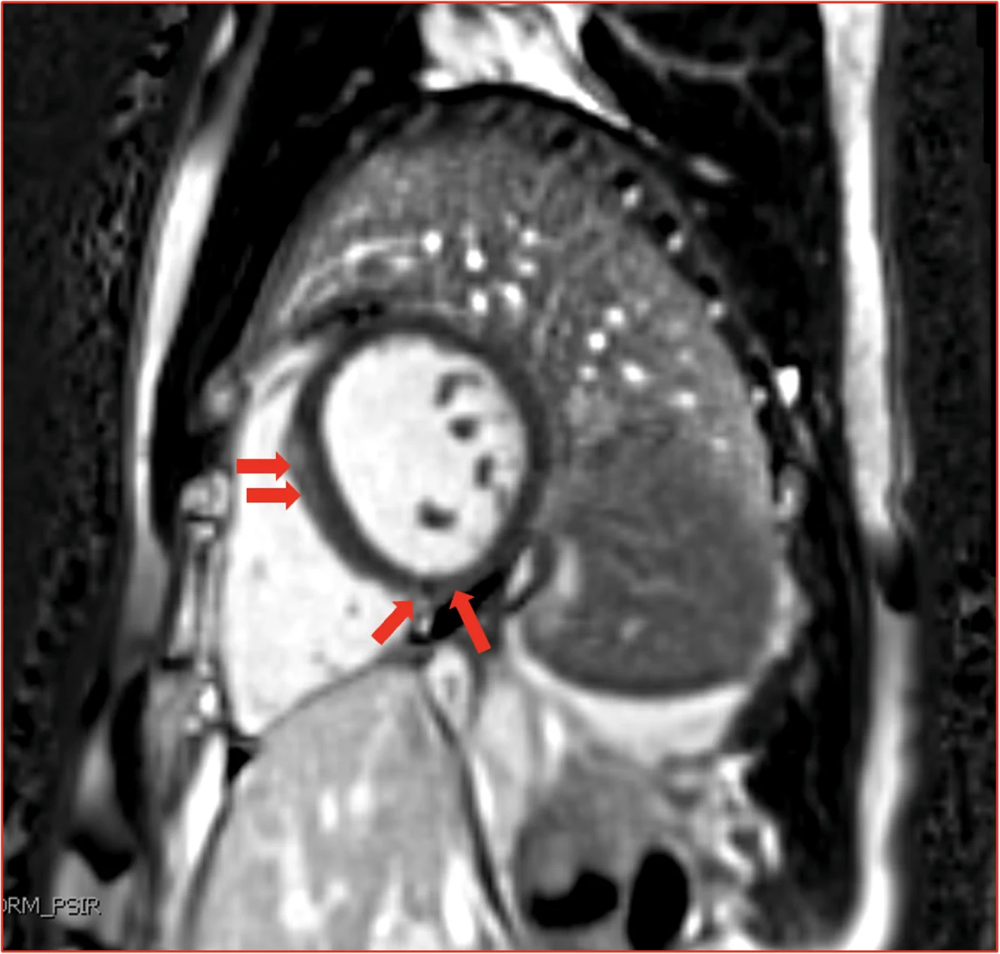
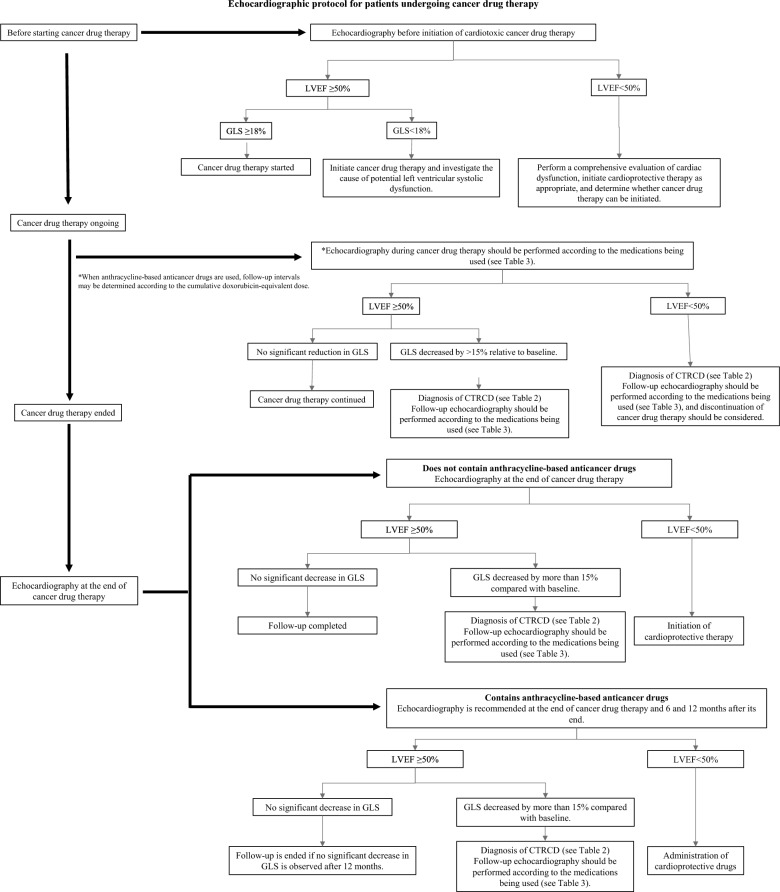
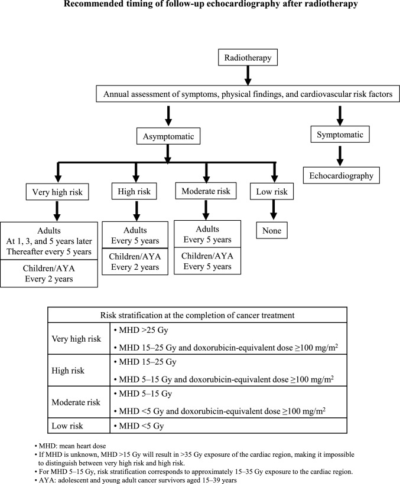
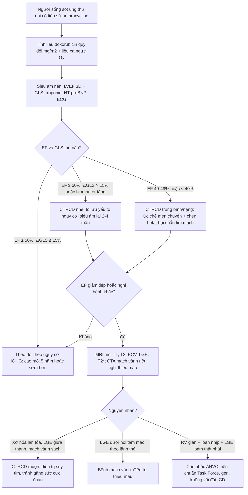

# 6703 — Bệnh cơ tim do anthracycline ở người sống sót ung thư nhi: GLS, CTRCD, MRI tim và ngưỡng khởi trị / Anthracycline cardiomyopathy in childhood cancer survivors

**Tags:** `pattern:ctrcd` `pattern:suy-tim` `pattern:roi-loan-chuc-nang-that-trai` `pattern:lge-midmyocardial` `vung:tim` `score:CTRCD-ESC` `score:CTCAE` `score:IGHG` `protocol:sie-u-am-GLS` `protocol:MRI-tim`
**Mức chắc chắn (certainty):** tổng hợp y văn (literature synthesis) + ca nguyên văn (verbatim case) — nam 26 tuổi, lymphoma Burkitt ở 5 tuổi, **doxorubicin 120 mg/m²**, EF 55–60% nhưng **GLS −15%**, MRI tim có **LGE giữa thành vách** (Chedid M et al., JACC Case Rep 2026, PMC13699096); đối chiếu hướng dẫn siêu âm tim CTRCD 2026 (Tanaka H et al., J Echocardiogr 2026, PMC13222306), tổng quan người sống sót nhi (Leerink JM et al., JACC CardioOncol 2020, PMC8352294), tổng quan MRI tim (Motevalli M et al., BMC Med Imaging 2025, PMC12628630) và hướng dẫn mang thai ở người sống sót (Bansal N et al., J Cardiovasc Dev Dis 2022, PMC9695103).

## 1. Tổng quan — vì sao một liều thuốc ở tuổi lên 5 lại quyết định trái tim ở tuổi 26

- **Anthracycline (doxorubicin, daunorubicin, epirubicin, mitoxantrone) gây chết tế bào cơ tim theo cơ chế tích lũy, không hồi phục:** phức hợp **topoisomerase 2β** → đứt sợi DNA và chết tế bào cơ tim; kèm **stress oxy hóa** do vòng khử–oxy hóa của quinone và rối loạn **sắt ty thể**. Cơ tim **gần như không tái sinh** → mỗi đợt mất tế bào là mất vĩnh viễn, thay bằng **xơ hóa mô kẽ lan tỏa**.
- **Hệ quả hình ảnh (TẠI SAO phải đọc mô, không chỉ đọc EF):** mô kẽ tăng → **native T1 tăng, ECV tăng, T2 tăng**; nhưng vì xơ hóa **lan tỏa** chứ không thành ổ, **LGE thường ÂM TÍNH**. EF chỉ giảm khi đã mất một lượng lớn cơ tim co bóp → **EF là biến muộn, GLS là biến sớm** (sợi dọc dưới nội tâm mạc là nơi chịu lực cắt lớn nhất và tổn thương sớm nhất).
- **Không có ngưỡng liều "an toàn":** ca dưới đây chỉ **120 mg/m²** — dưới ngưỡng "nguy cơ cao 250 mg/m²" của hướng dẫn — mà vẫn có **GLS bất thường và LGE** ở tuổi 26. Ngược lại, hướng dẫn dùng **250 mg/m²** để **phân tầng theo dõi**, không phải để nói "dưới ngưỡng thì yên tâm".
- **Dịch tễ định lượng (người sống sót ung thư nhi — CCS):**
  - **Suy tim (độ 3–5) tích lũy 4,8% đến tuổi 45** (Childhood Cancer Survivor Study — CCSS); đoàn hệ Hà Lan **LATER** ghi nhận **10,6%**.
  - **Bệnh mạch vành tích lũy 5,3% đến tuổi 45**; nam xạ ngực **> 35 Gy** lên tới **20% ở tuổi 50**.
  - **Loạn nhịp có triệu chứng 1,3% đến tuổi 45** (10.724 CCS); yếu tố nguy cơ gồm **anthracycline ≥ 250 mg/m²**, xạ ngực **> 35 Gy**, rối loạn lipid, tăng huyết áp.
- **Phân tầng nguy cơ của IGHG (International Late Effects of Childhood Cancer Guideline Harmonization Group) — dùng để đặt lịch, không để chẩn đoán:**

| Nhóm | Tiêu chí | Theo dõi siêu âm |
|---|---|---|
| **Nguy cơ cao** | Anthracycline **≥ 250 mg/m²**; **hoặc** xạ ngực **≥ 35 Gy**; **hoặc** anthracycline **≥ 100 mg/m² + xạ ngực ≥ 15 Gy** | **Mỗi 5 năm hoặc sớm hơn** (khuyến cáo mạnh) |
| **Nguy cơ trung bình** | Anthracycline **100–250 mg/m²**; **hoặc** xạ ngực **15–35 Gy** | Mỗi 5 năm (hợp lý) |
| **Nguy cơ thấp** | Anthracycline **< 100 mg/m²** | Cân nhắc, không dày |

- **Vì sao hình ảnh học (chứ không phải xét nghiệm máu) là trụ:** **troponin/NT-proBNP có thể bình thường** ở thể muộn (ca dưới đây bình thường cả hai); **ECG và Holter có thể bình thường** dù cơ tim đã xơ. Chẩn đoán dựa trên **siêu âm (LVEF 3D + GLS)** và **MRI tim** khi cần phân định mô.

*Siêu âm đánh dấu mô (speckle tracking) ở nam 26 tuổi: **EF 55–60% nhưng GLS −15%** — "EF bình thường, cơ tim không bình thường". Đây là lý do **GLS phải đo ở mọi lần theo dõi**, không chỉ EF. Ảnh: Chedid M et al., JACC Case Rep 2026;31:110273 (PMC13699096, Fig. 1), CC BY-NC-ND 4.0 (nguyên bản).*

## 2. Mẫu hình + chẩn đoán phân biệt theo vị trí (Gamut)

- **Mẫu hình A — "người trẻ, nhiều năm sau hóa trị, đau ngực/thồi hồi trống ngực, EF bảo tồn":** nghĩ **CTRCD muộn (anthracycline)**; tìm **GLS giảm**, **ECV/native T1 tăng**, **LGE giữa thành vách/bám thất phải**.
- **Mẫu hình B — "suy tim thực sự sau nhiều năm":** thất trái **giãn nhẹ, thành mỏng, EF < 50%**, không có bệnh mạch vành; phân biệt **bệnh cơ tim giãn vô căn** (không tiền sử), **bệnh cơ tim do xạ** (vùng tưới máu trong trường chiếu, van dày), **bệnh cơ tim chu sản**.
- **Mẫu hình C — "loạn nhịp + LGE + RV giãn ở người trẻ":** cạm bẫy lớn — **bệnh cơ tim loạn sản thất phải (ARVC)** có cùng LGE vách/bám thất phải và loạn nhịp khi gắng sức. Ca dưới đây **đạt tiêu chuẩn phụ của ARVC** nhưng bản chất là anthracycline.
- **Mẫu hình D — "thiếu máu cơ tim khi gắng sức":** **bất thường tưới máu, QRS giãn khi gắng sức** có thể do **giảm dự trữ co bóp**, không phải hẹp mạch vành — phải **loại trừ mạch vành** (CTA mạch vành) trước khi kết luận.
- **Mẫu hình E — "suy tim hai buồng thất + hạ oxy":** nghĩ **quá tải sắt** (truyền máu nhiều), **bệnh cơ tim do xạ**, **bệnh phổi mạn**; MRI T2* là chốt.
- **Mẫu hình F — "mang thai làm bộc lộ":** người sống sót nữ có tiền sử anthracycline, **suy tim quanh sinh** — cần đánh giá **trước khi có thai** (bài [490](../490-vong-mac-dai-thao-duong-trong-thai-ky/lesson.md) cho khung mắt; khung tim ở mục 4.4).

*MRI tim thì muộn: **LGE giữa thành (midmyocardial) vách liên thất** và **bám thất phải dưới** (mũi tên) — không theo lãnh thổ mạch vành. Ở một người trẻ có loạn nhịp, hình này **bắt chước ARVC**; chốt phân biệt là **tiền sử anthracycline** + **ECV/T1 toàn ổ** + **không giãn thất phải điển hình**. Ảnh: Chedid M et al., JACC Case Rep 2026 (PMC13699096, Fig. 2), CC BY-NC-ND 4.0 (nguyên bản).*

## 3. Bảng so sánh phân biệt (ma trận đối chiếu)

| Thực thể | Hình ảnh điển hình (siêu âm / MRI tim) | Chốt vào (rule-in) | Chốt loại (rule-out) | Gợi ý xác nhận |
|---|---|---|---|---|
| **CTRCD do anthracycline (muộn)** | EF có thể còn 55–60%; **GLS giảm**; MRI: **ECV/native T1 tăng lan tỏa**, LGE thường âm, đôi khi **LGE giữa thành vách** | **Tiền sử anthracycline** (kể cả **120 mg/m²**) + **ΔGLS > 15%** hoặc EF giảm; xơ hóa lan tỏa | Không phơi nhiễm, bệnh mạch vành rõ, van bệnh nặng → nguyên nhân khác | Siêu âm 3D + GLS; MRI tim T1/ECV; đối chiếu liều **mg/m²** |
| **ARVC** | **RV giãn/giảm chức năng khu trú**, akinesia/dyskinesia, LGE bám thất phải; **loạn nhịp thất khi gắng sức** | **Tiêu chuẩn Task Force ARVC** (điện tim, loạn nhịp, MRI, gia đình/gen) | **LVEF/GLS giảm toàn bộ + xơ hóa lan tỏa + tiền sử hóa trị** → nghi CTRCD hơn | MRI tim (RV, LGE), Holter, gen PKP2/DSG2; **không đặt ICD khi chưa chắc** |
| **Bệnh cơ tim giãn vô căn** | LV giãn, thành mỏng, EF giảm toàn bộ, **không LGE** hoặc LGE vách giữa | Loại trừ nguyên nhân (mạch vành, thuốc, rượu, virus, gia đình) | Tiền sử anthracycline rõ, xơ hóa mô kẽ tăng → CTRCD | Bệnh sử, gen, MRI; không có "xét nghiệm vàng" |
| **Bệnh cơ tim do xạ** | **Van dày/hẹp**, màng tim dày, **xơ hóa vùng trong trường chiếu**, mạch vành hẹp đoạn xa | **Xạ ngực ≥ 15–35 Gy**, tổn thương trong trường chiếu | Tổn thương lan tỏa, không tương ứng trường chiếu → CTRCD | Sơ đồ xạ trị, CTA mạch vành, MRI (LGE theo vùng) |
| **Viêm cơ tim** | **Phù (T2 cao) + LGE dưới thượng tâm mạc/giữa thành**, EF giảm cấp | Khởi phát **cấp–bán cấp**, troponin tăng, triệu chứng nhiễm | Tiến triển **nhiều năm**, troponin bình thường → CTRCD muộn | MRI theo Lake Louise; troponin; hỏi thuốc/ICI |
| **Thiếu máu cơ tim** | **Khuyết tưới máu theo lãnh thổ**, LGE **dưới nội tâm mạc → xuyên thành**, EF giảm vùng | **CTA/ chụp mạch vành có hẹp**, đau khi gắng sức điển hình | Mạch vành sạch, LGE giữa thành → không do thiếu máu | CTA mạch vành; SPECT/PET; **ca dưới đây đã loại trừ** |
| **Quá tải sắt** | **T2* giảm**, EF giảm, gan/lách tăng tín hiệu | Nhiều lần truyền máu, ferritin cao | T2* bình thường → không phải | MRI T2*; ferritin |
| **Bệnh cơ tim chu sản** | LV giãn, EF giảm trong **tháng cuối thai – 5 tháng sau sinh** | **Thai kỳ/sinh** trong cửa sổ thời gian | Xảy ra nhiều năm trước/sau sinh → không phải | Siêu âm; tiền sử sản khoa; phối hợp tim–sản |

- **Phân biệt cốt lõi:** **tiền sử anthracycline (ghi bằng mg/m²) + GLS giảm khi EF còn bảo tồn + xơ hóa lan tỏa**; LGE **giữa thành/không theo lãnh thổ** không loại trừ CTRCD và không đủ để gọi ARVC.

## 4. Protocol theo dõi + phân độ + sơ đồ quyết định

**4.1. Định nghĩa CTRCD (ESC 2022 / CTCAE v6.0 — dùng đúng ngưỡng)**

| Mức | Tiêu chuẩn |
|---|---|
| **Nhẹ (mild)** | **LVEF ≥ 50%** và **ΔGLS giảm tương đối > 15%** so với nền **và/hoặc** biomarker mới tăng (cTnI/cTnT > bách phân vị 99; **BNP ≥ 35 pg/mL**; **NT-proBNP ≥ 125 pg/mL**) |
| **Trung bình (moderate)** | **LVEF 40–49%** và **giảm ≥ 10%** so với nền; **hoặc** giảm < 10% nhưng có **ΔGLS > 15%**/biomarker tăng |
| **Nặng (severe)** | **LVEF mới < 40%**; có triệu chứng cần nhập viện = nặng có triệu chứng |
| **Rất nặng** | Sốc tim, cần inotrope/hỗ trợ tuần hoàn, hoặc phải xét ghép tim |

- **Ngưỡng GLS:** giảm tương đối **> 15%** được coi là bất thường; giảm **< 8%** thường **không có ý nghĩa lâm sàng** — đừng "chase" dao động nhỏ giữa các lần đo/khác máy.

**4.2. Lịch chụp (theo nguy cơ)**

*Thuật toán 2026: **nền** (LVEF 3D + GLS + biomarker) → **trong điều trị** theo nguy cơ và theo chu kỳ → **sau điều trị** theo lịch sống sót. Điểm cần nhớ: mốc **250 mg/m²** là **ngưỡng bắt buộc siêu âm**, không phải ngưỡng "an toàn". Ảnh: Tanaka H et al., J Echocardiogr 2026;24:123–140 (PMC13222306, Fig. 1), CC BY 4.0.*

- **Trước điều trị (nền):** LVEF (ưu tiên **3D**, tối thiểu Simpson 2D) + **GLS** + troponin/NT-proBNP + ECG.
- **Trong điều trị:** nguy cơ thấp/trung bình — trước, **sau chu kỳ 4**, **1 năm**; nguy cơ cao — trước, **sau chu kỳ 2, 4, 6**, **3 tháng**, **1 năm**.
- **Bắt buộc siêu âm khi tổng liều doxorubicin quy đổi > 250 mg/m²**, kể cả nhóm nguy cơ thấp/trung bình; lặp lại khi tăng liều.
- **Sau điều trị (sống sót):** **IGHG** — nguy cơ cao **mỗi 5 năm hoặc sớm hơn**; trung bình mỗi 5 năm. Với **trẻ/người trẻ (children/AYA)** đã xạ trị, bảng của Hội Siêu âm Nhật 2026 khuyến cáo dày hơn (**mỗi 2 năm** ở nhóm rất cao/nguy cơ cao) — xem hình dưới.

*Bảng của Hội Siêu âm Tim Nhật Bản 2026: phân tầng theo **liều tim trung bình (MHD)** và **liều doxorubicin quy đổi**, kèm lịch siêu âm — **người lớn nguy cơ rất cao: 1, 3, 5 năm rồi mỗi 5 năm; trẻ/AYA: mỗi 2 năm**. Lưu ý dòng "nếu MHD 5–15 Gy, phân tầng tương ứng 15–35 Gy cho vùng tim" — **không được cộng sai liều**. Ảnh: Tanaka H et al., J Echocardiogr 2026;24:123–140 (PMC13222306, Fig. 2), CC BY 4.0.*

**4.3. Khi nào MRI tim (không thay siêu âm, mà để trả lời câu hỏi siêu âm không trả lời được)**
- **EF không khớp** giữa các lần đo/2D vs 3D; **không đủ cửa sổ** ở người béo/xạ ngực.
- Cần **định lượng mô**: **native T1, T2, ECV** để phát hiện tổn thương **lan tỏa không có LGE** — đây là dấu sớm và tồn tại lâu ở người sống sót (T1/T2/ECV tăng; **ECV và strain còn bất thường nhiều năm sau**).
- Nghi **bệnh khác**: ARVC (RV), viêm cơ tim, sarcoid, quá tải sắt (T2*), bệnh cơ tim thâm nhiễm.
- **Số liệu:** tổng quan hệ thống MRI tim ở bệnh nhân anthracycline: T1/T2/ECV tăng **ngay cả khi không có LGE**; loạt **249 người sống sót** (trung vị 2,9 năm sau hóa trị): **rối loạn chức năng thất trái 69,9%**, **thất phải 21,7%** (92,6% trong số đó kèm rối loạn thất trái), RVEF giảm gắn với biến cố tim mạch.

**4.4. Điều trị và dự phòng (ngưỡng thực hành)**
- **CTRCD nhẹ (không triệu chứng, EF ≥ 50%, chỉ GLS/biomarker):** tối ưu yếu tố nguy cơ (huyết áp, lipid, đường huyết, ngừng thuốc độc), **theo dõi sát 2–4 tuần**, cân nhắc **ức chế men chuyển + chẹn beta** — chưa có bằng chứng mạnh ở người sống sót nhi.
- **CTRCD trung bình/nặng:** **khởi trị ức chế men chuyển (hoặc ARB) + chẹn beta**, lợi tiểu khi ứ dịch; hội chẩn tim mạch–ung thư; **ngừng/đổi phác đồ ung thư** khi nặng.
- **Dự phòng tiên phát:** **dexrazoxane** không làm tăng suy tim lâm sàng trong RCT nhi, **có thể giảm độc tính không triệu chứng**, nhưng **chưa dùng thường quy cho mọi trẻ** (lo ngại giảm hiệu lực ung thư và ung thư thứ hai — bằng chứng chất lượng cao cho lo ngại này còn thiếu); các chiến lược khác: **liposomal doxorubicin**, **truyền kéo dài**, tránh liều tích lũy cao. **Chẹn beta dự phòng ở người sống sót nhi đang được thử nghiệm** (COG ALTE1621/PREVENT, carvedilol liều thấp) — **chưa phải chuẩn**.
- **Thai kỳ:** **siêu âm đánh giá LVEF/GLS trước khi có thai** cho mọi nữ sống sót đã dùng anthracycline ± xạ ngực; **chức năng tim bình thường trước thai → nguy cơ suy tim khi mang thai thấp**; **đã có độc tính tim trước đó → nguy cơ cao**, cần **đội đa chuyên khoa (sản–tim–gây mê)** theo dõi sát trong và sau sinh.

## 5. Biến thể bình thường và cạm bẫy

- **"EF 56% là bình thường" — sai nếu GLS −15%:** ca dưới đây có **EF 55–60%** nhưng **GLS −15%**, MRI xác nhận LGE. **GLS là chỉ số phải đo**, và phải so với **nền của chính bệnh nhân** (nếu không có nền, dùng ngưỡng tuyệt đối tham chiếu theo tuổi/máy — thận trọng).
- **"Liều thấp thì không sao":** ca bệnh chỉ **120 mg/m²** — dưới ngưỡng 250. **Không có ngưỡng an toàn**; ngưỡng 250 chỉ dùng để **chia nhóm theo dõi**.
- **LGE giữa thành vách ≠ ARVC:** tiêu chuẩn ARVC dựa trên **RV + loạn nhịp + gia đình/gen**; ở người có anthracycline, **LGE vách/bám thất phải có thể là xơ hóa do thuốc**. Đặt ICD sai = nguy cơ nhiễm trùng, loạn nhịp do can thiệp, hạn chế nghề nghiệp — **không vội**.
- **ECV bình thường không loại trừ CTRCD:** ca bệnh có **ECV 20% (bình thường)**; tổn thương khi đó thể hiện bằng **strain giảm + LGE khu trú**. Ngược lại **ECV tăng** là dấu **lan tỏa** — hai kiểu khác nhau, đừng dùng một con số để kết luận.
- **Troponin/NT-proBNP bình thường không loại trừ thể muộn** (ca bệnh bình thường cả hai) — nhưng **tăng** thì có giá trị cảnh báo sớm trong lúc đang hóa trị.
- **Đau ngực + bất thường tưới máu khi gắng sức ≠ bệnh mạch vành:** có thể do **giảm dự trữ co bóp**; vẫn phải **loại trừ mạch vành** bằng CTA trước khi quy cho thuốc — bỏ sót bệnh mạch vành ở người trẻ là lỗi nặng.
- **Xạ ngực cộng dồn:** anthracycline **≥ 100 mg/m² + xạ ≥ 15 Gy** đã vào nhóm **nguy cơ cao**; đừng chỉ nhìn liều thuốc.
- **Trẻ em không dùng ngưỡng người lớn:** EF bình thường theo **Z-score/BSA**, GLS thay đổi theo tuổi; máy và phần mềm strain **khác hãng → khác số** — theo dõi phải **cùng máy/cùng phiên bản** nếu có thể.
- **Không đo GLS trong 24 giờ đầu sau mổ/trong sốc:** tải thể tích và nhịp tim làm GLS giảm giả tạo.

## 6. Tự lượng giá — Blind Quiz

**Ca 1 — Nam 26 tuổi, huấn luyện viên thể hình, đau ngực khi gắng sức + hồi hộp vài tháng. Nhìn ảnh GLS, mô tả trước:**

- Gợi ý: năm 5 tuổi chẩn đoán **lymphoma Burkitt giai đoạn III**, điều trị có **doxorubicin tổng liều 120 mg/m²**; EF nền thời thơ ấu **81%**; ECG và Holter 14 ngày bình thường; troponin/NT-proBNP bình thường; EF hiện tại **55–60%**.
- Hỏi: bất thường chính? 3 chẩn đoán phân biệt? bước tiếp theo?

<b>Bấm để hiện đáp án (findings + chẩn đoán)</b>

- **EF bảo tồn nhưng GLS −15%** — giảm strain dọc toàn bộ, phù hợp **rối loạn chức năng dưới nội tâm mạc sớm**. Đây là **CTRCD nhẹ** theo ESC 2022 (EF ≥ 50% + ΔGLS > 15%).
- Phân biệt: **ARVC** (loạn nhịp thất, RV giãn), **bệnh mạch vành** (đau khi gắng sức), **viêm cơ tim** (troponin tăng, khởi phát cấp), **bệnh cơ tim giãn** (EF đã giảm, LV giãn).
- Bước tiếp: **MRI tim** (T1/T2/ECV/LGE, RV), **CTA mạch vành**, **nghiệm pháp gắng sức**; theo dõi GLS 3–6 tháng; tối ưu yếu tố nguy cơ, hội chẩn tim mạch.
- **Nguồn ca:** Chedid M, Barrett C, Sun M, Lesser A, Hryniewicz K. JACC Case Rep 2026;31:110273 (PMC13699096, Fig. 1), **CC BY-NC-ND 4.0** (nguyên bản).

**Ca 2 — Cùng bệnh nhân, MRI tim. Nhìn ảnh, mô tả trước:**

- Hỏi: mô tả LGE? vì sao hình này dễ bị gọi nhầm ARVC? điều gì giúp chốt?

<b>Bấm để hiện đáp án</b>

- **LGE giữa thành (midmyocardial) vách liên thất từ nền đến giữa**, thêm **LGE ở bám thất phải dưới** — **không theo lãnh thổ mạch vành**, không có LGE dưới nội tâm mạc.
- Dễ nhầm ARVC vì **LGE bám thất phải + RVEF 49% + loạn nhịp khi gắng sức + QRS giãn khi gắng sức** — ca này **đạt tiêu chuẩn phụ ARVC**.
- Chốt: **tiền sử anthracycline 120 mg/m²**, **GLS giảm toàn bộ**, **mạch vành sạch trên CTA**, **ECV 20% bình thường** nhưng LGE khu trú; theo dõi và điều trị suy tim thay vì can thiệp ARVC.
- **Nguồn ca:** Chedid M et al., JACC Case Rep 2026 (PMC13699096, Fig. 2), **CC BY-NC-ND 4.0** (nguyên bản).

**Ca 3 — Bảng phân tầng: bệnh nhân 10 tuổi, xạ ngực MHD 20 Gy + doxorubicin 150 mg/m². Nhìn bảng, trả lời trước:**

- Hỏi: nhóm nguy cơ nào? lịch siêu âm? có cần MRI tim ngay không?

<b>Bấm để hiện đáp án</b>

- **MHD 15–25 Gy + doxorubicin ≥ 100 mg/m²** → **nguy cơ RẤT CAO** (theo bảng: MHD 15–25 Gy và liều quy đổi ≥ 100 mg/m²).
- Lịch: **trẻ/AYA — mỗi 2 năm**; người lớn — **1, 3, 5 năm rồi mỗi 5 năm**.
- **Chưa cần MRI ngay** nếu siêu âm đủ cửa sổ và EF/GLS ổn; MRI khi **EF không khớp, nghi bệnh khác, hoặc cần định lượng ECV/T1**.
- **Nguồn:** Tanaka H, Fukuda Y, Yamada H, et al. J Echocardiogr 2026;24:123–140 (PMC13222306, Fig. 2), **CC BY 4.0**.

## Bài liên quan chéo
- [6700 – Biến chứng muộn & chuyển tiếp ở người sống sót sau Wilms](../6700-di-chung-muon-sau-wilms-va-chuyen-tiep/lesson.md)
- [6107 – Thay khớp háng ở người sống sót ung thư nhi](../6107-thay-khop-hang-nguoi-song-sot-ung-thu-nhi/lesson.md)
- [820 – MRI tim: LGE & mapping](../820-cardiac-mri-lge-mapping/lesson.md)
- [810 – CTA mạch vành & CAD-RADS](../810-coronary-cta-cadrads/lesson.md)
- [481 – Biến chứng nội nhãn sau liệu pháp gen tiêm nội dịch kính](../481-bien-chung-noi-nhan-lieu-phap-gene-tiem-noi-dich-kinh/lesson.md)
- [490 – Võng mạc đái tháo đường trong thai kỳ](../490-vong-mac-dai-thao-duong-trong-thai-ky/lesson.md)
- [092 – Suy thượng thận & suy tuyến yên do ức chế điểm kiểm soát miễn dịch quanh mổ](../092-suy-thuong-than-suy-tuyen-yen-quanh-mo/lesson.md)

## Ảnh
- `6703_ca-GLS_JACCCaseRep_PMC13699096-Fig1.webp` — GLS −15% với EF 55–60% (Chedid M et al., 2026) — **CC BY-NC-ND 4.0** (nguyên bản).
- `6703_ca-CMR-LGE-midmyocardial_JACCCaseRep_PMC13699096-Fig2.webp` — LGE giữa thành vách + bám thất phải (Chedid M et al., 2026) — **CC BY-NC-ND 4.0** (nguyên bản).
- `6703_sieu-am-theo-doi_JJEchocardiogr_PMC13222306-Fig1.jpg` — thuật toán siêu âm trước/trong/sau điều trị (Tanaka H et al., 2026) — **CC BY 4.0**.
- `6703_phan-tang-nguy-co_JJEchocardiogr_PMC13222306-Fig2.jpg` — phân tầng nguy cơ + lịch siêu âm (Tanaka H et al., 2026) — **CC BY 4.0**.
- 2/3 ảnh là **CC BY-NC-ND** → **không crop/ghép**, không tạo composite. Nguồn + giấy phép từng ảnh: `images/CREDITS.md`.

> Không dùng để chẩn đoán độc lập khi chưa có người hướng dẫn.
