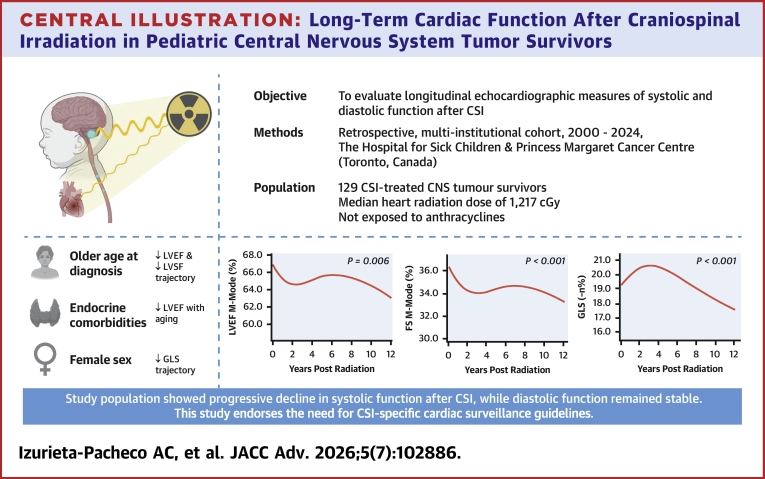
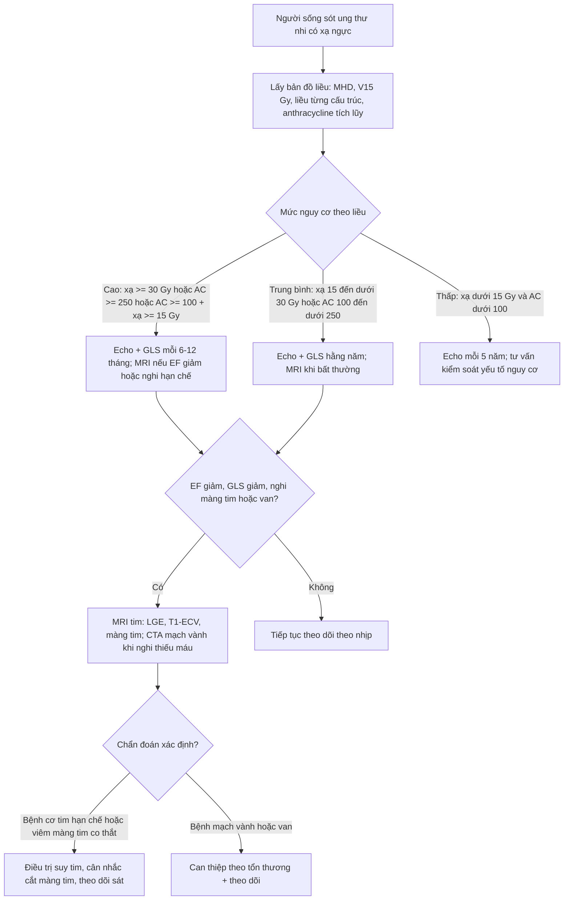
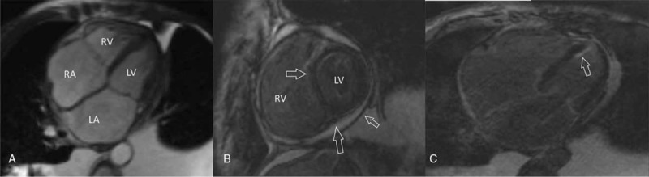
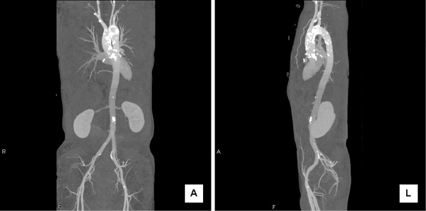

# 6704 — Bệnh cơ tim do xạ ở người sống sót ung thư nhi: trường chiếu quyết định hình ảnh, liều tim trung bình quyết định theo dõi

**Tags:** `pattern:xo-hoa-co-tim` `pattern:day-mang-tim` `pattern:voi-hoa-dong-mach-chu` `vung:tim` `vung:trung-that` `anatomy:co-tim` `score:ECV` `score:GLS` `protocol:MRI-tim` `protocol:CT-tim` `protocol:sieu-am-tim`
**Mức chắc chắn (certainty):** tổng hợp y văn (literature synthesis) — ghép **tổng quan phân tầng nguy cơ 2025** (Cancers 2025, PMC12691200), **127/129 trẻ sống sót u thần kinh trung ương sau xạ toàn trục não–tủy** (JACC Adv 2026, PMC13285839), **117 người sống sót ung thư nhi chụp MRI tim T1 mapping** (Cardiovasc Toxicol 2026, PMC12852242), **tổng quan liều từng cấu trúc tim** (JACC CardioOncol 2026, PMC13282832), **tổng quan hệ thống 21 nghiên cứu MRI sau xạ** (Cardiooncology 2023, PMC10193692) và **ca lâm sàng 57 tuổi sau xạ 22 năm** (Medicine 2017, PMC5293439). Không có ca do nhóm tự chụp.

> **Câu hỏi thực hành:** nữ **57 tuổi**, xạ trị **42 Gy** (Cobalt-60) vì ung thư vú trái **22 năm trước**, không hóa trị; nay khó thở khi gắng sức, phù chi dưới, tràn dịch màng phổi và cổ trướng. **LVEF 68%** (bình thường), NT-proBNP **3.200 pg/mL**. Câu hỏi: **vì sao suy tim mà EF vẫn bình thường, hình ảnh nào chốt nguyên nhân do xạ, và theo dõi thế nào ở người sống sót ung thư nhi?**
> Bài chốt **ba quyết định**: **(1) bệnh tim do xạ là bệnh của "trường chiếu" — tổn thương màng tim, cơ tim, van, mạch vành và hệ dẫn truyền nằm trong vùng liều cao, không lan tỏa như anthracycline; (2) EF bình thường không loại trừ — phải đo ECV/native T1, LGE và GLS; (3) ngưỡng theo dõi là liều tim trung bình (MHD) và anthracycline tích lũy, không phải triệu chứng.** Nối [6703 – Bệnh cơ tim do anthracycline](../6703-benh-co-tim-do-anthracycline-o-nguoi-song-sot-ung-thu-nhi/lesson.md), [820 – MRI tim: LGE xuyên thành vs giữa/dưới thượng tâm mạc](../820-cardiac-mri-lge-mapping/lesson.md), [810 – Vành & CAD-RADS 2.0](../810-coronary-cta-cadrads/lesson.md).

## 1. Tổng quan bệnh học – cơ chế hình ảnh: vì sao tia xạ làm tim "hóa đá" mà EF vẫn có thể bình thường

- **Bốn tầng tổn thương của bệnh tim do xạ (radiation-induced heart disease — RIHD):** **mạch vành** (xơ vữa, hẹp đoạn gần/lỗ), **cơ tim** (xơ hóa lan tỏa, bệnh cơ tim hạn chế), **van** (dày, hở), **màng tim** (dày, tràn dịch, viêm màng tim co thắt); cộng thêm **hệ dẫn truyền** (loạn nhịp, bloc) và **động mạch chủ** (xơ vữa/vôi hóa trong trường chiếu). Đây là **bệnh của nhiều cấu trúc cùng lúc**, không phải một bệnh cơ tim đơn thuần.
- **TẠI SAO xạ gây xơ hóa:** tia xạ gây **đứt gãy DNA** và **tổn thương nội mô vi mạch** → **giảm mao mạch (rarefaction)**, thiếu máu cục bộ vi mô, viêm mạn, rồi **nguyên bào sợi thay thế cơ tim bằng collagen**. Collagen làm cơ tim **cứng (tăng độ cứng)** chứ không phì đại bù trừ như tăng huyết áp — vì vậy **hình ảnh học thấy xơ, không thấy dày thành kiểu HCM**.
- **Vì sao điều này hiện trên MRI:** mô xơ có **khoảng ngoại bào (extracellular volume — ECV) lớn** → **native T1 tăng**, **ECV tăng**, **LGE dương tính** ở vùng xơ. Tổng quan hệ thống 21 nghiên cứu MRI sau xạ ghi nhận **ECV tăng 0,136% cho mỗi Gy**, **LGE tăng dần ở vùng nhận > 30 Gy**, và **T1 tăng ở vùng liều cao** (PMC10193692). Đây là **ngưỡng định lượng** giải thích vì sao tổn thương **theo bản đồ liều**, không đối xứng hai bên.
- **Vì sao EF có thể bình thường:** xơ hóa làm **giảm giãn (diastolic dysfunction)** trước khi giảm co. Trong ca 57 tuổi, **LVEF 68%** nhưng có **viêm màng tim co thắt** và **LGE dưới nội tâm mạc + giữa thành cả hai thất**; chẩn đoán chỉ được xác nhận sau **ghép tim** (PMC5293439). Vì vậy **EF là chỉ số muộn và dễ bỏ sót** — đúng như ở bệnh cơ tim hạn chế.
- **Liều – ngưỡng phân tầng (theo tổng quan 2025):**
  - **Nguy cơ cao:** **anthracycline ≥ 250 mg/m²**, **hoặc xạ ngực ≥ 30 Gy**, **hoặc phối hợp anthracycline ≥ 100 mg/m² + xạ ngực ≥ 15 Gy** (PMC12691200).
  - **Nguy cơ trung bình:** anthracycline **100 – < 250 mg/m²** hoặc xạ ngực **15 – < 30 Gy**.
  - **Nguy cơ thấp:** anthracycline **< 100 mg/m²** và xạ ngực **< 15 Gy**.
  - **> 35 Gy** có nguy cơ **cao hơn rõ rệt** so với **15–35 Gy**; **< 15 Gy** chưa có khuyến cáo riêng (PMC12691200).
- **Ngưỡng theo từng cấu trúc (dữ liệu liều – đáp ứng):**
  - **Mạch vành:** trong xạ trị ung thư phổi, **tổng mạch vành trái V15 Gy ≥ 2,5 cc** và **LAD V15 Gy ≥ 1,5 cc** gắn với biến cố tim cấp; **LV 45 Gy > 2%** tương quan với **xơ hóa trên MRI** và biến cố tim **độ ≥ 3** (PMC13282832).
  - **Van:** người sống sót ung thư nhi có **tỉ lệ bệnh van tim tích lũy 35 năm là 1%**, gắn với **liều trung bình van ba lá/thất phải 5,0–9,9 Gy**; **32%** trong 56 người sống sót Hodgkin phát triển bệnh van (PMC13282832).
  - **Rối loạn nhịp:** **1–3%** ở trẻ sau xạ ngực (PMC13282832).
- **Bằng chứng ở trẻ — kể cả liều "thấp":** **129 trẻ** sống sót u thần kinh trung ương sau **xạ toàn trục não–tủy (CSI)**, **không dùng anthracycline**, **liều tim trung bình 12,17 Gy (IQR 10,86–16,16)**, CSI **23,6 Gy**: **LVEF và LVSF giảm dần theo thời gian (p = 0,006)**, **GLS giảm (p < 0,001)** trong khi chức năng tâm trương ổn định (PMC13285839). Đây là điểm **phản biện ngưỡng 15 Gy**: ngưỡng hành chính không đồng nghĩa "an toàn sinh học" ở trẻ.
- **Không phải chỉ anthracycline:** **117 người sống sót ung thư nhi** (82,9% có anthracycline, trung bình **231,7 ± 92,0 mg/m²**) chụp MRI tim: **LVEF 59,0 ± 5,5% so với 67,2 ± 6,9%** ở nhóm chứng, **MAPSE 12,5 ± 1,7 mm so với 13,9 ± 2,2 mm**, **4 ca có LGE**, nhưng **native T1 và ECV toàn cầu không khác biệt** (PMC12852242). Bài học: **tổn thương có thể khu trú** — T1/ECV toàn cầu bình thường **không loại trừ** xơ hóa vùng.

## 2. Mẫu hình + chẩn đoán phân biệt theo cấu trúc tim (Gamut)

- **Màng tim (pericardium):** dày màng tim **> 4 mm**, tràn dịch, **vôi hóa màng tim**, sinh lý **co thắt** (ventricular interdependence, "dip and plateau"). Đây là tổn thương **sớm và hay gặp nhất** sau xạ trung thất; ca 57 tuổi là ví dụ điển hình **22 năm sau xạ** (PMC5293439).
- **Cơ tim (myocardium):** xơ hóa **dưới nội tâm mạc và giữa thành**, phân bố **theo vùng liều**, dẫn tới **bệnh cơ tim hạn chế**: EF bảo tồn, **E/e' tăng**, **GLS giảm**, nhĩ trái giãn.
- **Mạch vành (coronary):** hẹp **lỗ và đoạn gần** (ostial/proximal), **vôi hóa sớm**, bệnh **nhiều nhánh**, có thể **không đau** do mất cảm giác đau sau xạ.
- **Van (valves):** dày lá van, hở **van động mạch chủ và hai lá**; tổn thương van ba lá/thất phải gắn với **liều 5–9,9 Gy** ở trẻ (PMC13282832). Siêu âm tim là phương tiện sàng lọc; **MRI/CT** khi cần định lượng.
- **Hệ dẫn truyền và động mạch chủ:** **bloc nhánh, bloc AV, loạn nhịp nhĩ/thất** (1–3% ở trẻ); **vôi hóa động mạch chủ trong trường chiếu** — dấu hiệu "trường xạ" rất đặc hiệu trên CT.
- **Gamut theo thời gian sau xạ:**
  - **< 2 năm:** thường **không triệu chứng**; có thể **tràn dịch màng tim**, **giảm GLS**, **tăng thể tích tâm trương thất trái** (trẻ).
  - **2–10 năm:** **bệnh van**, **bệnh mạch vành sớm**, **xơ hóa cơ tim khu trú**.
  - **> 10–20 năm:** **bệnh cơ tim hạn chế**, **viêm màng tim co thắt**, **suy tim**, **loạn nhịp** — đỉnh của biến cố.
- **Mnemonic "RADIO":** **R**estrictive cardiomyopathy, **A**rtery (coronary) disease, **D**iffuse fibrosis (LGE/ECV), **I**nterstitium/pericardium (constriction), **O**stial valve/aortic calcification.

## 3. Bảng so sánh phân biệt (ma trận đối chiếu)

| Thực thể | Hình ảnh điển hình (Echo / MRI / CT) | Chốt vào (rule-in) | Chốt loại (rule-out) | Gợi ý xác nhận |
|---|---|---|---|---|
| **Bệnh cơ tim do xạ** | Xơ hóa **theo trường chiếu**, LGE dưới nội tâm mạc/giữa thành, **ECV tăng ~0,136%/Gy**, GLS giảm, EF bảo tồn giai đoạn đầu | **Tiền sử xạ ngực + tổn thương nhiều cấu trúc (màng tim/van/mạch vành) cùng nằm trong vùng liều + xơ hóa trên MRI** | Xơ hóa lan tỏa không liên quan trường chiếu, không tiền sử xạ | MRI tim: LGE + T1/ECV mapping; đối chiếu **bản đồ liều xạ** |
| **Bệnh cơ tim do anthracycline** | Giảm EF **lan tỏa**, GLS giảm sớm, LGE thường **không có** hoặc rất ít, T1/ECV toàn cầu có thể bình thường | **Tổng liều anthracycline ≥ 250 mg/m² + giảm EF/GLS tiến triển, không có tổn thương van/màng tim** | Có dày màng tim, hẹp mạch vành lỗ, van dày → nghĩ xạ | Echo 3D/GLS; MRI khi EF giảm hoặc không giải thích được |
| **Viêm màng tim co thắt (do xạ hoặc không)** | Màng tim dày **> 4 mm**, vôi hóa, **biatrial enlargement**, **ventricular interdependence**, "dip and plateau" | **Dày màng tim + sinh lý co thắt trên echo/MRI + tiền sử xạ trung thất** | Màng tim mỏng, không có interdependence → loại trừ | Echo Doppler thì hít vào; MRI (real-time); thông tim khi cần |
| **Bệnh cơ tim hạn chế do bệnh khác (amyloid)** | Dày thành **đối xứng**, **LGE dưới nội tâm mạc lan tỏa**, T1/ECV tăng **toàn cầu**, "apical sparing" trên strain | **Dày thành + ECV tăng toàn cầu + strain apical sparing** | Xơ hóa **khu trú theo trường chiếu**, không dày đối xứng | Siêu âm tim + MRI; xạ hình PYP nếu nghi amyloid |
| **Bệnh cơ tim thiếu máu cục bộ** | LGE **dưới nội tâm mạc → xuyên thành** theo **lãnh thổ mạch vành**, giảm tưới máu vùng | **LGE theo lãnh thổ + hẹp mạch vành trên CTA** | LGE không theo lãnh thổ, mạch vành sạch | CTA mạch vành; MRI tưới máu |
| **Bệnh van tim do xạ** | Van dày, hở; **vôi hóa van** trong trường chiếu; thường kèm bệnh màng tim | **Van dày/hở + tiền sử xạ ngực + tổn thương cấu trúc khác trong vùng liều** | Van mỏng, hở do thoái hóa đơn thuần | Echo Doppler định lượng; CT xác định vôi hóa |
| **Bệnh động mạch chủ do xạ** | **Vôi hóa thành động mạch chủ giới hạn đúng trường chiếu**, có thể hẹp/hở van ĐMC | **Vôi hóa "cắt" theo biên trường xạ trên CT** | Vôi hóa lan tỏa toàn động mạch → xơ vữa thông thường | CT ngực không cản quang/có cản quang |

*Central Illustration của loạt **129 trẻ** sống sót u thần kinh trung ương sau **CSI**, **không anthracycline**, **liều tim trung bình 1.217 cGy**: **LVEF (M-mode) giảm từ ~66% xuống ~62%**, **LVSF giảm**, **GLS giảm từ ~20,5% xuống ~17,5%** trong 12 năm (p = 0,006; p < 0,001; p < 0,001); chức năng tâm trương ổn định. Đây là bằng chứng "liều thấp vẫn không an toàn" ở trẻ. Nguồn: JACC Adv 2026 (PMC13285839), **CC BY 4.0**, nguyên bản.*

## 4. Protocol chẩn đoán – phân tầng – theo dõi (kèm sơ đồ quyết định)

- **Bước 0 — thu thập "bản đồ liều" trước khi đọc hình ảnh:** **liều tim trung bình (mean heart dose — MHD)**, **V15 Gy, V25 Gy, V30 Gy**, **liều tối đa (Dmax)**, **liều từng cấu trúc** (LAD, động mạch vành trái, van, màng tim), **kỹ thuật** (Cobalt, photon, proton), **tuổi lúc xạ**, **anthracycline tích lũy**. Không có các số này thì không phân tầng được.
- **Bước 1 — siêu âm tim là tuyến đầu, nhưng phải có GLS:** đo **LVEF, LVSF, GLS**, **E/e', E/A**, **TAPSE**, **độ dày màng tim**, **van**. **GLS giảm sớm hơn EF**; ở loạt CSI, GLS giảm trong khi EF còn "bình thường" (PMC13285839).
- **Bước 2 — MRI tim khi cần chốt cơ chế:** **LGE** (xơ hóa), **native T1 + ECV** (định lượng xơ), **strain**, **đánh giá màng tim/van**, **tưới máu**. Chỉ định: **EF giảm không giải thích**, **nghi bệnh cơ tim hạn chế**, **nghi viêm màng tim co thắt**, **phân biệt xạ với anthracycline/amyloid**. Ngưỡng tham chiếu: **ECV tăng ~0,136% mỗi Gy**, **LGE ở vùng > 30 Gy** (PMC10193692).
- **Bước 3 — CT khi nghi mạch vành, van, động mạch chủ:** **CTA mạch vành** (hẹp lỗ/đoạn gần, vôi hóa), **CT không cản quang** (vôi hóa van, động mạch chủ **giới hạn theo trường chiếu**), **đánh giá màng tim**. Cẩn thận **nhiễu do vôi hóa** và **liều tích lũy ở trẻ** — chỉ định đúng, dùng **protocol ALARA**.
- **Bước 4 — phân tầng và lịch theo dõi (theo mô hình 2025):**
  - **Nguy cơ cao** (AC ≥ 250 mg/m², hoặc xạ ≥ 30 Gy, hoặc AC ≥ 100 mg/m² + xạ ≥ 15 Gy): **đánh giá tim mạch mỗi 2 năm nếu echo bình thường, mỗi năm nếu echo bất thường** (PMC12691200).
  - **Nguy cơ trung bình** (AC 100 – < 250 mg/m² hoặc xạ 15 – < 30 Gy): **mỗi 5 năm nếu echo bình thường, mỗi 2 năm nếu bất thường**.
  - **Nguy cơ thấp** (AC < 100 mg/m² và xạ < 15 Gy): **mỗi 5 năm**; trong điều trị **mỗi 12 tháng**.
  - **Trong 2 năm đầu sau điều trị:** đánh giá sớm hơn (trẻ có thể tăng thể tích tâm trương thất trái **ở 2 năm** — PMC10193692).
- **Bước 5 — dự phòng và điều trị (khung, không phải phác đồ cá nhân):** kiểm soát **huyết áp, đường huyết, lipid**, **không hút thuốc**, **vận động có giám sát**; **ức chế men chuyển/thụ thể angiotensin** và **chẹn beta** khi có suy tim/giảm EF; **can thiệp van/mạch vành** theo tổn thương; **cắt màng tim** khi viêm màng tim co thắt có triệu chứng.
- **Sơ đồ quyết định:**

## 5. Biến thể bình thường và cạm bẫy

- **"EF bình thường" không phải "tim bình thường":** ca 57 tuổi có **LVEF 68%**, vẫn suy tim do **hạn chế + co thắt** (PMC5293439). Luôn đo **GLS, E/e', thể tích nhĩ trái**, và **hỏi triệu chứng**.
- **T1/ECV toàn cầu bình thường không loại trừ xơ hóa:** trong 117 người sống sót, **T1 và ECV toàn cầu không khác chứng** dù LVEF thấp hơn (PMC12852242) — vì xơ hóa **khu trú**. Phải đọc **bản đồ T1/ECV vùng** và **LGE**.
- **Nhầm LGE dưới nội tâm mạc của xạ với amyloid:** amyloid có **dày thành đối xứng + ECV tăng toàn cầu + apical sparing**; xạ có **vùng xơ theo trường chiếu**, thành tim không dày đối xứng. Nếu chỉ nhìn một lát cắt, hai bệnh "giống nhau".
- **Nhầm với bệnh mạch vành thông thường:** mạch vành sau xạ hẹp **lỗ và đoạn gần**, **vôi hóa sớm**, **nhiều nhánh**, và **có thể không đau**; bệnh nhân trẻ không có yếu tố nguy cơ vẫn có thể hẹp nặng. **Không loại trừ bằng "bệnh nhân còn trẻ"**.
- **Vôi hóa "cắt theo biên trường xạ" là dấu hiệu đặc hiệu:** vôi hóa động mạch chủ/van **giới hạn đúng vùng chiếu** khác vôi hóa lan tỏa của xơ vữa — nhìn **coronal/sagittal** và **so với mô phỏng liều** (PMC13106861).
- **Cạm bẫy "chỉ do anthracycline":** ở trẻ vừa xạ vừa hóa trị, **quy hết cho anthracycline** dẫn tới bỏ qua **van, màng tim, mạch vành** — những thứ anthracycline không gây. Phân tầng phải tính **cả hai** (AC ≥ 100 + xạ ≥ 15 Gy = nguy cơ cao).
- **Cạm bẫy "liều thấp là an toàn":** loạt CSI có **MHD 12,17 Gy** vẫn **giảm LVEF/GLS tiến triển**; hướng dẫn hiện hành **không khuyến cáo chụp tim thường quy dưới 15 Gy** ở người không dùng anthracycline, nhưng dữ liệu trẻ **không hoàn toàn ủng hộ** ngưỡng này (PMC13285839).
- **Biến thể bình thường:** **dày màng tim nhẹ < 4 mm** sau xạ không triệu chứng; **tràn dịch màng tim lượng ít** thoáng qua trong 6 tháng đầu; **GLS giảm nhẹ** không kèm triệu chứng — theo dõi, chưa can thiệp.

## 6. Tự lượng giá — Blind Quiz ngay trên trang tĩnh

**Ca 1 — Suy tim 22 năm sau xạ: EF 68% mà vẫn suy tim?**

- **Bối cảnh:** nữ **57 tuổi**, xạ trị **42 Gy** (Cobalt-60) vì ung thư vú trái **22 năm trước**, **không hóa trị**; khó thở, phù, cổ trướng; **LVEF 68%**, NT-proBNP **3.200 pg/mL**.
- **Câu hỏi:** (1) Ảnh A cho thấy gì? (2) Mũi tên ở B và C chỉ cái gì? (3) Vì sao EF bình thường mà vẫn suy tim?

<b>Bấm để hiện đáp án (findings + chẩn đoán)</b>

- **Dấu hiệu:** **(A)** MRI 4 buồng: **nhĩ hai bên giãn (biatrial enlargement)**, thất không giãn; **(B)** màng tim **dày**, ít dịch màng tim (mũi tên), **LGE dưới nội tâm mạc và giữa thành cả hai thất** (mũi tên trắng); **(C)** LGE lan theo thành thất trái.
- **Chẩn đoán:** **viêm màng tim co thắt do xạ + bệnh cơ tim do xạ** — xơ hóa cơ tim và màng tim dày; chẩn đoán mô học xác nhận sau **ghép tim**.
- **Vì sao EF bình thường:** xơ hóa làm tim **cứng, giảm giãn** (hạn chế) chứ không giảm co; EF là chỉ số **co bóp**, không phản ánh **độ giãn**. Do đó phải đo **E/e', GLS, ECV/LGE** và tìm **dày màng tim**.
- **Nguồn ảnh:** Medicine 2017 (PMC5293439), CC BY-NC 4.0, nguyên bản.

**Ca 2 — Trẻ xạ toàn trục não–tủy, liều tim "thấp": có an toàn không?**

- **Bối cảnh:** **129 trẻ** sống sót u thần kinh trung ương, điều trị **CSI 23,6 Gy**, **không anthracycline**, **liều tim trung bình 12,17 Gy**.
- **Câu hỏi:** (1) Ba đường cong thể hiện điều gì? (2) Chỉ số nào giảm sớm và mạnh nhất? (3) Điều này nói gì về ngưỡng 15 Gy?

<b>Bấm để hiện đáp án (findings + chẩn đoán)</b>

- **Dấu hiệu:** **LVEF (M-mode) giảm dần từ ~66% xuống ~62%** (p = 0,006), **LVSF giảm** (p < 0,001), **GLS giảm từ ~20,5% xuống ~17,5%** (p < 0,001); chức năng tâm trương **ổn định**.
- **Chẩn đoán:** **suy chức năng tâm thu dưới lâm sàng tiến triển sau xạ**, dù **không dùng anthracycline** và **liều tim trung bình dưới 15 Gy**.
- **Ý nghĩa:** hướng dẫn hiện hành **không khuyến cáo chụp tim thường quy khi MHD < 15 Gy** nếu không có anthracycline, nhưng dữ liệu này cho thấy **trẻ có thể vẫn tổn thương** — cần **theo dõi GLS** và nghiên cứu thêm, không được coi "dưới 15 Gy là yên tâm".
- **Nguồn ảnh:** JACC Adv 2026 (PMC13285839), CC BY 4.0, nguyên bản.

**Ca 3 — Vôi hóa "cắt" theo trường xạ trên CT**

- **Bối cảnh:** bệnh nhân có tiền sử **xạ trị trung thất vì lymphoma ác tính**, sau đó **hẹp van động mạch chủ** phải thay van; CT được chụp trước mổ.
- **Câu hỏi:** (1) Mô tả vị trí vôi hóa. (2) Vì sao vôi hóa lại "dừng" ở một mức nhất định? (3) Dấu hiệu này gợi ý gì về cơ chế?

<b>Bấm để hiện đáp án (findings + chẩn đoán)</b>

- **Dấu hiệu:** **(A)** coronal và **(B)** sagittal: **vôi hóa dày thành động mạch chủ ngực**, **giới hạn đúng vùng chiếu xạ**, **không có vôi hóa màng tim**; phần động mạch chủ ngoài trường chiếu **không vôi hóa**.
- **Chẩn đoán:** **bệnh động mạch chủ do xạ** — vôi hóa và xơ vữa **theo trường chiếu**, kèm bệnh van động mạch chủ.
- **Vì sao "dừng":** tổn thương do xạ phụ thuộc **bản đồ liều** — vùng nhận liều cao bị **viêm nội mạc mạn, xơ hóa, vôi hóa**; vùng ngoài trường liều thấp thì không. Đây là **dấu hiệu định vị** giúp phân biệt với xơ vữa lan tỏa.
- **Nguồn ảnh:** Intern Med 2026 (PMC13106861), CC BY-NC-ND 4.0, nguyên bản.

## Bài liên quan chéo
- [6703 – Bệnh cơ tim do anthracycline ở người sống sót ung thư nhi](../6703-benh-co-tim-do-anthracycline-o-nguoi-song-sot-ung-thu-nhi/lesson.md)
- [820 – MRI tim: LGE xuyên thành vs giữa/dưới thượng tâm mạc](../820-cardiac-mri-lge-mapping/lesson.md)
- [810 – Vành & CAD-RADS 2.0](../810-coronary-cta-cadrads/lesson.md)

## Ảnh
- `6704_xa-tim_Echo-Central_PMC13285839-CI.jpg` — Central Illustration quỹ đạo LVEF/LVSF/GLS sau CSI ở trẻ (CC BY 4.0).
- `6704_xa-tim_CMR-LGE_PMC5293439-F2.jpg` — MRI tim: nhĩ giãn, màng tim dày, LGE hai thất (CC BY-NC 4.0).
- `6704_xa-tim_CT-voi-hoa_PMC13106861-F1.jpg` — CT: vôi hóa động mạch chủ giới hạn theo trường xạ (CC BY-NC-ND 4.0).
- Không tạo composite: có ảnh **CC BY-NC-ND** (chỉ dùng nguyên bản, không ghép/crop).

> Không dùng để chẩn đoán độc lập khi chưa có người hướng dẫn.
