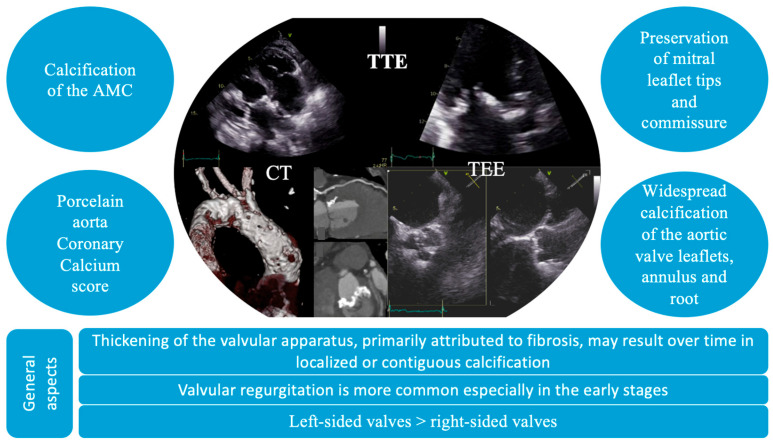
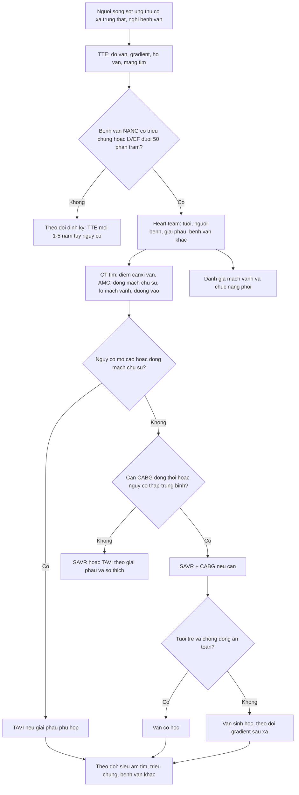
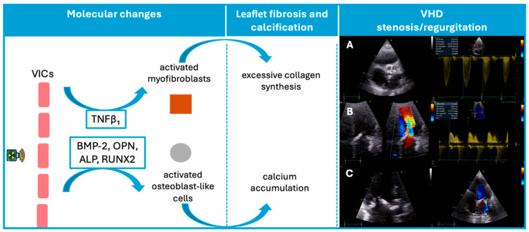
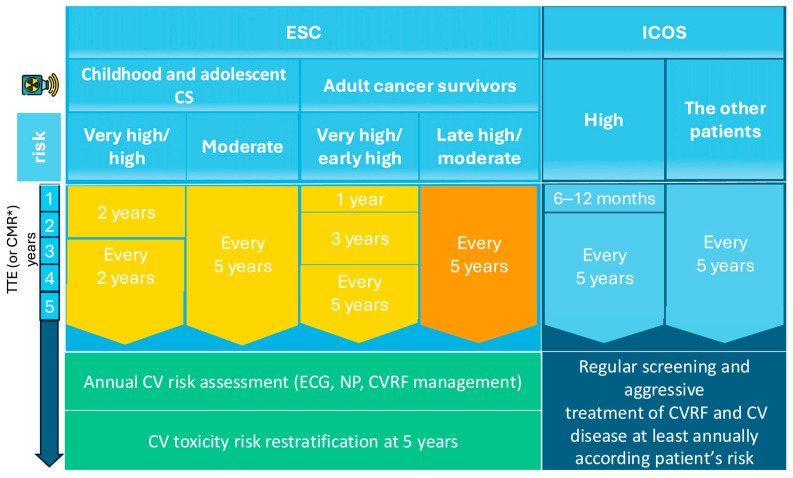

# 6705 — Bệnh van tim do xạ: mổ lúc nào, chọn van cơ học hay sinh học, và cái bẫy "ngực đã xạ"

**Tags:** `pattern:day-van` `pattern:voi-hoa-van` `pattern:hep-van-dong-mach-chu` `vung:tim` `vung:trung-that` `anatomy:van-tim` `score:STS-PROM` `protocol:sieu-am-tim` `protocol:CT-tim` `protocol:TAVI`
**Mức chắc chắn (certainty):** tổng hợp y văn (literature synthesis) — ghép **tổng quan 2026 về bệnh van do xạ** (J Cardiovasc Dev Dis 2026, PMC12842354, CC BY), **156 ca mổ van sau xạ trung thất** (JTCVS Open 2025, PMC11883704), **933 ca thay van ĐMC có tiền sử xạ trung thất, so TAVR–SAVR** (J Soc Cardiovasc Angiogr Interv 2026, PMC13005395) và **23 ca van sinh học nằm trong trường xạ** (Front Cardiovasc Med 2026, PMC13327999). Không có ca do nhóm tự chụp.

> **Kịch bản thực hành (tổng hợp từ các đoàn hệ dưới đây, không phải ca nguyên văn):** nữ **58 tuổi**, xạ trung thất **40 Gy** vì Hodgkin **28 năm trước**, nay khó thở khi gắng sức; siêu âm tim: **hẹp van động mạch chủ nặng**, van dày–vôi hóa lan vào vành van, **vôi hóa động mạch chủ ngực "dừng" đúng biên trường xạ**. Câu hỏi: **mổ lúc nào, chọn van cơ học hay sinh học, và vì sao phải chụp CT trước khi quyết định?**
> Bài chốt **ba quyết định**: **(1) bệnh van do xạ là bệnh của "trường chiếu" — vôi hóa và xơ hóa khu trú theo bản đồ liều, thường van trái, khởi phát 10–20 năm sau xạ; (2) thời điểm mổ theo hướng dẫn bệnh van chung, nhưng phải **giới thiệu sớm** vì ngực đã xạ làm mổ thì đầu khó và mổ lại rất nặng; (3) chọn van theo **tuổi – khả năng chống đông – nguy cơ mổ lại**, không theo "chất liệu van nào tốt hơn" chung chung.** Nối [6704 – Bệnh cơ tim do xạ](../6704-benh-co-tim-do-xa-o-nguoi-song-sot-ung-thu-nhi/lesson.md), [6703 – Bệnh cơ tim do anthracycline](../6703-benh-co-tim-do-anthracycline-o-nguoi-song-sot-ung-thu-nhi/lesson.md), [810 – Vành & CAD-RADS 2.0](../810-coronary-cta-cadrads/lesson.md), [820 – MRI tim: LGE & mapping](../820-cardiac-mri-lge-mapping/lesson.md).

## 1. Tổng quan bệnh học – cơ chế hình ảnh: vì sao tia xạ làm van "hóa đá" mà vẫn giữ nguyên mép van

- **Dịch tễ (epidemiology):** ở người sống sót Hodgkin, bệnh mạch vành gặp **17–23%** và bệnh van tim **8–17%**; bệnh van thường xuất hiện **sau 10–20 năm**, chủ yếu ở **van trái** (PMC12842354). Trong một trung tâm, **2,7%** mọi ca mổ van là do xạ (PMC11883704).
- **Tần suất theo thời gian:** đoàn hệ **1.279** người sống sót Hodgkin: bệnh van **1,4% ở 10 năm – 3,3% ở 15 năm – 5% ở 20 năm**; đoàn hệ **415** ca: **1% – 4% – 6%** (PMC12842354). Ở **294 người không triệu chứng**, hở van ĐMC mức vừa–nặng là **1,1%** khi xạ < 10 năm so với **15%** khi > 20 năm; hở van hai lá **2,3% so với 4,1%** — nghĩa là **thời gian sau xạ là biến số độc lập**, không chỉ liều.
- **Ngưỡng liều – đáp ứng (dose–response):** **1.852** bệnh nhân Hodgkin xạ 2D: so với **≤ 30 Gy**, tần suất bệnh van tăng **1,4 lần (31–35 Gy)**, **3,1 lần (36–40 Gy)** và **11,8 lần (> 40 Gy)** (PMC12842354). Ngay cả **liều tim trung bình (mean heart dose — MHD) 5–15 Gy** cũng làm tăng nguy cơ khi **≥ 50% thể tích tim** nằm trong trường chiếu — **liều và thể tích cùng quyết định**, không thể chỉ nhìn một số.
- **Ở trẻ:** người sống sót ung thư nhi xạ trước 21 tuổi có **tỉ lệ tích lũy bệnh van có ý nghĩa lâm sàng 1,2% ở 35 năm**, trong khi nhóm không xạ **không có biến cố nặng** (PMC12842354). Con số này **không nhỏ** khi đặt cạnh tuổi thọ còn lại của một đứa trẻ được chữa khỏi.
- **TẠI SAO van bị xơ – vôi hóa:** tia xạ gây **đứt gãy DNA** và **tổn thương nội mô vi mạch** của van → **nguyên bào sợi (valve interstitial cell — VIC)** tăng sinh, tăng **TNF-β1**, **BMP-2**, **osteopontin (OPN)**, **ALP** và **RUNX2** → VIC biệt hóa thành **nguyên bào sợi cơ (myofibroblast)** và **tế bào giống tạo xương (osteoblast-like)** → **tổng hợp collagen quá mức + lắng đọng canxi**. Vì vậy hình ảnh học thấy **dày lá van + vôi hóa**, và trên CT đo được **điểm canxi (calcium score) của từng van** — đúng như sơ đồ Figure 1 của PMC12842354.
- **Vì sao van TRÁI nhiều hơn:** van trái chịu **áp lực và ứng suất cơ học cao hơn**, lại nằm sát trường chiếu trung thất; tổn thương xạ cộng với thoái hóa cơ học → **hở van xuất hiện sớm, hẹp van xuất hiện muộn** khi canxi lấp kín lỗ van. Đây là lý do **hở van ĐMC 38,2%**, **hở van hai lá 36,7%**, **hở van ba lá 20,4%**, **hở van phổi 9%**, trong khi **hẹp van ĐMC 16,3%** và **hẹp van hai lá 4%** (PMC12842354).
- **Tương tác với anthracycline:** liều anthracycline tích lũy **≥ 400 mg/m²** làm tăng **3,8 lần** nguy cơ bệnh van sau khi đã hiệu chỉnh liều xạ; nhóm **xạ > 15 Gy + 250–400 mg/m²** có **gánh nặng bệnh van lớn nhất** (PMC12842354). Vì vậy ở người sống sót ung thư nhi, **phải hỏi cả hai phơi nhiễm**, không quy tất cả cho xạ.
- **Vì sao hình ảnh lại "khu trú":** tổn thương phụ thuộc **bản đồ liều** — vùng nhận liều cao bị xơ hóa, vôi hóa; vùng ngoài trường chiếu thì không. Trên CT, **vôi hóa động mạch chủ/van "dừng" đúng biên trường xạ** là dấu hiệu định vị rất đặc hiệu, giúp phân biệt với xơ vữa lan tỏa.

## 2. Mẫu hình + chẩn đoán phân biệt theo van và theo "dấu vân tay trường chiếu"

- **Van động mạch chủ (aortic valve):** **hở van là biểu hiện sớm**, nhưng khi cần can thiệp thường đã là **hẹp van vôi hóa nặng**; canxi lan từ **vành van (annulus)** vào **lá van (cusps)** và **gốc động mạch chủ (aortic root)**, có thể kèm **động mạch chủ "sứ" (porcelain aorta)**. Ở người lớn sống sót ung thư, hẹp van do xạ xuất hiện **sớm hơn hẹp van thoái hóa** — **tuổi 50–60** không phải là hiếm, nhất là người xạ từ nhỏ (PMC12842354).
- **Van hai lá (mitral valve):** **hở van là biểu hiện thường gặp nhất**, có thể trong **thập kỷ đầu** sau xạ; về sau **xơ hóa lá van + vôi hóa vành van** gây **hẹp van hai lá**. Van hai lá **nhạy xạ hơn van ĐMC**, ngưỡng **≥ 30 Gy** làm tăng rõ nguy cơ tổn thương muộn (PMC12842354).
- **Dấu hiệu phân biệt quan trọng — vôi hóa vành van hai lá (mitral annular calcification — MAC):** sau xạ, canxi tập trung ở **vành TRƯỚC và dải van–ĐMC (aorto-mitral curtain — AMC)**; còn MAC thoái hóa thông thường ở **vành SAU**. Đây là **dấu hiệu định vị** trên CT/TEE.
- **Van phải (tricuspid/pulmonary):** ít gặp hơn, nhưng ở trẻ sống sót ung thư có **hở van ba lá** gắn với **liều van ba lá/thất phải 5,0–9,9 Gy** (PMC13282832, dẫn trong 6704). Hở van ba lá đơn độc ở người có tiền sử xạ trung thất **không nên gọi là "van thoái hóa"**.
- **Gamut theo thời gian sau xạ:**
  - **< 10 năm:** thường **không triệu chứng**, có thể **dày lá van nhẹ**, **hở van nhẹ**, **giảm GLS** (nếu kèm tổn thương cơ tim).
  - **10–20 năm:** **hở van ĐMC/hai lá**, **vôi hóa vành van**, **hẹp van tiến triển**.
  - **> 20 năm:** **hẹp van nặng**, **bệnh nhiều van**, **hẹp + hở phối hợp**, kèm **bệnh mạch vành lỗ–đoạn gần**, **bệnh màng tim**, **xơ phổi** — đây là nhóm cần **heart team**.
- **Mnemonic "LARA":** **L**eft-sided (van trái trước), **A**nnulus/AMC calcification (canxi vành van + dải van–ĐMC), **R**egurgitation early (hở sớm), **A**S late (hẹp muộn).

## 3. Bảng so sánh phân biệt (ma trận đối chiếu)

| Thực thể | Hình ảnh điển hình (TTE/TEE/CT) | Chốt vào (rule-in) | Chốt loại (rule-out) | Gợi ý xác nhận |
|---|---|---|---|---|
| **Bệnh van do xạ** | Dày lá van + **vôi hóa khu trú/liên tục**, canxi **vành trước + AMC**, **vôi hóa ĐMC dừng ở biên trường xạ**; hở sớm, hẹp muộn | **Tiền sử xạ trung thất + tổn thương van trái + canxi theo trường chiếu + bệnh nhiều cấu trúc (màng tim/mạch vành)** | Không tiền sử xạ; canxi lan tỏa toàn bộ van và động mạch chủ; mép van dính | Đối chiếu **bản đồ liều**; CT canxi van; TEE |
| **Hẹp van ĐMC thoái hóa** | Canxi ở **trung tâm lá van**, lan ra mép; van 3 lá; thường > 70 tuổi | **Tuổi lớn + canxi trung tâm + không tiền sử xạ** | Canxi **vành trước/AMC** + xạ trung thất → nghĩ xạ | TTE; CT canxi; không cần TEE thường quy |
| **Bệnh van thấp (rheumatic)** | Dày lá van, **dính mép van (commissural fusion)**, canxi hóa, van hai lá là chính; kèm hẹp van hai lá | **Dính mép van + hẹp van hai lá + tiền sử thấp** | **Mép van KHÔNG dính**, canxi khu trú → không phải thấp | TTE/TEE; cấy/ASO nếu cần |
| **Van ĐMC hai lá (bicuspid)** | Hai lá van, **đường đóng (raphe)**; canxi sớm ở tuổi 40–50 | **Chỉ 2 lá van + raphe** | Ba lá van rõ → loại trừ | CT/TEE; tầm soát người thân |
| **MAC do bệnh thận (CKD)** | Canxi **vành sau**, dày đặc, hai bên; không kèm hẹp van ĐMC | **Canxi vành sau + CKD/hạ canxi–phospho** | Canxi **vành trước/AMC** + xạ → nghĩ xạ | CT; xét nghiệm Ca–P–PTH |
| **Bệnh van do carcinoid** | Dày lá van phải, **hở van ba lá**, lá van co rút; di căn gan | **Van phải + hội chứng carcinoid + 5-HIAA tăng** | Van trái đơn độc + xạ → không phải carcinoid | Echocardiography; 5-HIAA; CT gan |
| **Van sinh học thoái hóa trong trường xạ** | Gradient qua van tăng dần sau xạ, không có huyết khối/viêm | **Van sinh học + xạ ngực sau đó + gradient tăng theo liều** | Gradient ổn định, không xạ | Siêu âm tim lặp; CT van nhân tạo nếu cần |

*Vôi hóa dải van–ĐMC (AMC), động mạch chủ "sứ", điểm canxi mạch vành trên CT; TTE/TEE cho thấy dày lá van, **bảo tồn đỉnh lá van và mép van**, vôi hóa lan rộng lá–vành–gốc van ĐMC. Nguồn: J Cardiovasc Dev Dis 2026 (PMC12842354), CC BY 4.0, nguyên bản.*

### Ba dấu hiệu giúp phân biệt tại chỗ
- **Mép van còn mềm, không dính:** bệnh van do xạ **không phá mép van** như thấp tim — đây là điểm khác biệt số một trên TEE.
- **Canxi "liên tục" theo trường chiếu:** từ **vành van → dải van–ĐMC → gốc ĐMC**, có thể thấy **vôi hóa ĐMC dừng đột ngột** ở biên trường.
- **Bệnh nhiều cấu trúc cùng lúc:** van + **màng tim dày** + **mạch vành lỗ/đoạn gần** + **xơ phổi** — một mình bệnh van không giải thích hết hình ảnh.

## 4. Protocol chụp – phân tầng – thời điểm mổ – chọn van

- **Bước 0 — lấy "bản đồ liều" và phơi nhiễm:** **liều trung thất (prescribed dose)**, **MHD**, **V5/V15/V25/V30 Gy**, **liều từng van**, **kỹ thuật** (2D/mantle, 3D-CRT, IMRT/VMAT, proton), **tuổi lúc xạ**, **anthracycline tích lũy**, **xạ ngực lặp lại** (ung thư vú hai bên). Không có các số này thì không phân tầng được.
- **Bước 1 — siêu âm tim (TTE) là tuyến đầu:** đo **vận tốc đỉnh qua van ĐMC (peak velocity)**, **gradient trung bình**, **diện tích lỗ van (AVA)**, **hở van (với định lượng)**; đánh giá **van hai lá**, **áp lực động mạch phổi**, **chức năng thất phải**, **màng tim**. **TEE** khi TTE không kết luận hoặc cần đánh giá mép van/AMC trước can thiệp.
- **Bước 2 — CT tim trước can thiệp (bắt buộc ở ca "ngực đã xạ"):** đo **điểm canxi van ĐMC**, **vôi hóa vành van/AMC**, **động mạch chủ "sứ"**, **khoảng cách lỗ mạch vành–vành van**, **đường kính vành van**, **đường vào mạch đùi**, và **đánh giá mạch vành** (có thể kèm **CTA vành**). CT quyết định **TAVI khả thi hay không** và **nguy cơ chèn lỗ mạch vành** — nhất là khi canxi lan vào LVOT.
- **Bước 3 — MRI tim (CMR):** chỉ định **IIa** khi TTE không kết luận; đánh giá **thể tích, chức năng, xơ hóa cơ tim (LGE/T1/ECV)**, phân biệt tổn thương van đơn thuần với **bệnh cơ tim do xạ** đi kèm (xem 6704).
- **Bước 4 — đánh giá trước mổ "không chỉ quả tim":** **chụp mạch vành xâm lấn/CTA** (bệnh vành lỗ–đoạn gần rất thường gặp), **chức năng phổi (PFT)** vì xơ phổi do xạ, **đánh giá xơ hóa trung thất** trên CT. **STS-PROM/EuroSCORE II đánh giá THẤP hơn thực tế** ở nhóm này vì không tính canxi màng tim, chảy máu, liền vết thương kém, xơ phổi; **tiền sử xạ trung thất đã được đưa vào mô hình STS** (PMC12842354).
- **Bước 5 — thời điểm mổ:** **không có khuyến cáo riêng cho bệnh van do xạ**; áp dụng ngưỡng của hướng dẫn bệnh van (**triệu chứng + hẹp nặng**, hoặc **LVEF < 50%**, hoặc **giãn thất trái**). Điểm khác biệt: **giới thiệu sớm và mổ có kế hoạch**, không chờ suy tim/khẩn cấp, vì **mổ lại trên ngực đã xạ có tử vong 17%** so với **3,7%** mổ lần đầu và **2,3%** ở người không xạ; **HR tử vong 3,19** (PMC12842354). Không mổ chỉ vì "còn ung thư" nếu bệnh đang lui — tiên lượng ung thư không còn là yếu tố quyết định ở phần lớn người sống sót.
- **Bước 6 — chọn đường can thiệp:**
  - **TAVI** khi **≥ 70 tuổi**, **nguy cơ mổ cao/rất cao**, **nguy cơ trung bình có tiền sử xạ trung thất**, hoặc **động mạch chủ "sứ"**. So sánh trực tiếp: **tử vong 30 ngày 1,8% (TAVI) vs 9,1% (SAVR)**, **đột quỵ tàn phế 0% vs 3,6%**, đặt máy tạo nhịp **14,5% vs 7,3%**, rung nhĩ **3,6% vs 32,7%** (PMC12842354). Ở **933 ca có xạ trung thất** (785 TAVR/148 SAVR; 128 cặp sau ghép điểm xu hướng), **5 năm: tử vong 11,7% vs 12,5% (HR 1,04)**, đột quỵ **15,6% vs 13,3%**, nhập viện **56,3% vs 64,1%** — **TAVR không thua SAVR** trong dữ liệu quan sát (PMC13005395).
  - **SAVR** khi **nguy cơ thấp–trung bình**, giải phẫu không phù hợp TAVI, hoặc **cần mổ bắc cầu vành cùng lúc** (khi đó SAVR được ưu tiên). Trong **172 ca hẹp van ĐMC nặng do xạ**, **27% cần CABG đồng thời** và **34% cần thêm thủ thuật trên động mạch chủ** (PMC12842354).
  - **Van cơ học (mechanical)** ở **người trẻ, tuổi thọ còn dài**, ưu tiên **độ bền** để tránh mổ lại — đặc biệt quan trọng vì **mổ lại trên ngực đã xạ rất nặng**. **Van sinh học (bioprosthetic)** khi **không thể chống đông** (ung thư thứ hai, rối loạn đông máu, nguy cơ chảy máu cao) hoặc tuổi lớn.
- **Bước 7 — dữ liệu để tư vấn chọn van:** **156 ca** mổ van sau xạ trung thất (88 cơ học/68 sinh học), **31 năm** từ chẩn đoán ung thư đến mổ: **tử vong 30 ngày 2% vs 3%**, **sống trung vị 11,0 vs 10,9 năm (p = 0,93)**, **12 ca phải can thiệp lại (6/6)**, **3 ca ghép tim**. **Thay hai van ĐMC + hai lá cùng lúc** có sống trung vị **6,2 năm** so với **13,3 năm** khi chỉ thay một van (p < 0,0001) (PMC11883704) — **đừng hứa "mổ xong là xong"** với nhóm bệnh hai van.
- **Bước 8 — van sinh học nằm trong trường xạ về sau:** **23 ca** đặt van sinh học rồi xạ ngực (tổng liều trung vị **46 Gy**, MHD **14 Gy**, thời gian từ đặt van đến xạ **33 tháng**): **gradient qua van tăng dần** theo **tổng liều và MHD** (R² **0,41** trong 12 tháng; **0,62** từ 12–24 tháng), chưa ca nào phải can thiệp lại trong 24 tháng (PMC13327999). Hệ quả thực hành: **theo dõi siêu âm tim định kỳ** sau xạ, và ở người trẻ **cân nhắc van cơ học** nếu chống đông an toàn.
- **Sơ đồ quyết định:**

## 5. Biến thể bình thường và cạm bẫy

- **"Dày nhẹ lá van" ở người trẻ sau xạ không phải bệnh van nặng:** dày < 3 mm, không hở/hẹp đáng kể, không canxi — **theo dõi**, không can thiệp. Nhưng phải **ghi vào hồ sơ** để lần sau không đọc nhầm là tổn thương mới.
- **Bảo tồn đỉnh lá van và mép van là dấu hiệu DƯƠNG TÍNH giả của "bệnh nhẹ":** vì mép van không dính, diện tích lỗ van có thể còn "khá" trên 2D trong khi **canxi vành van đã lan vào LVOT**; phải đo **3D AVA**, **gradient trung bình**, và **CT canxi** trước khi kết luận.
- **Canxi "dừng" ở biên trường xạ rất dễ bị bỏ qua** nếu chỉ nhìn lát cắt ngang: phải xem **coronal/sagittal** và **so với mô phỏng liều** của lần xạ.
- **STS-PROM/EuroSCORE II thấp giả tạo:** bệnh nhân 58 tuổi, STS thấp, nhưng **ngực đã xạ** làm mổ nặng hơn nhiều; **không dùng điểm số đơn thuần để từ chối heart team**.
- **"Chỉ có bệnh van" — bỏ sót bệnh vành lỗ và bệnh màng tim:** trong **172 ca hẹp van ĐMC do xạ**, **27% cần CABG**; màng tim dày/co thắt có thể chi phối triệu chứng sau mổ.
- **Mổ lại trên ngực đã xạ:** **tử vong 17%** so với **3,7%** mổ lần đầu; **18%** phải mở lại xương ức. Đây là lý do **chọn van bền** và **không trì hoãn quá lâu**.
- **Van sinh học trong trường xạ không "hỏng ngay" nhưng gradient tăng sớm:** thay đổi **khiêm tốn** trong 24 tháng đầu, chưa cần can thiệp lại — **không được bỏ theo dõi** vì diễn tiến dài hạn chưa biết.
- **TAVI ở người xạ trung thất: dữ liệu 5 năm còn quan sát, không phải RCT:** kết quả **không thua SAVR** nhưng **không chứng minh tốt hơn**; quyết định theo **giải phẫu và nguy cơ**, không theo "TAVI là lựa chọn mặc định".

## 6. Tự lượng giá — Blind Quiz ngay trên trang tĩnh

**Ca 1 — Ba bệnh nhân, ba kiểu van: nhìn hình, đoán cơ chế**

- **Bối cảnh:** (A) **hẹp van ĐMC nặng** với canxi vành van và lá van; (B) **van hai lá dày, xơ hóa lá van + canxi**, gradient trung bình thì tâm trương **5,22 mmHg**; (C) **lá van hai lá dày nhiều + canxi**, hở van hai lá mức vừa trên Doppler màu.
- **Câu hỏi:** (1) Vì sao cùng một tiền sử xạ mà ba ca lại khác nhau? (2) Dấu hiệu nào trên hình giúp phân biệt với bệnh van thấp? (3) Ca nào cần **CT tim trước can thiệp** nhất?

<b>Bấm để hiện đáp án (findings + chẩn đoán)</b>

- **Dấu hiệu:** (A) **vận tốc đỉnh qua van ĐMC 4,12 m/s** + canxi **vành van và lá van**; (B) **gradient trung bình 5,22 mmHg** = **hẹp van hai lá mức vừa**, lá van dày do xơ; (C) **hở van hai lá mức vừa** kèm dày–canxi lá van.
- **Vì sao khác nhau:** tổn thương do xạ **phụ thuộc liều từng van và thời gian**: van ĐMC → hẹp muộn; van hai lá → hở sớm rồi hẹp; mức độ canxi quyết định kiểu hẹp/hở. **Ba ca là ba điểm trên cùng một quang phổ**, không phải ba bệnh khác nhau.
- **Phân biệt với thấp tim:** **mép van không dính**, canxi **khu trú/liên tục** ở vành van và AMC, **không có dày dính mép kiểu thấp**.
- **Ai cần CT nhất:** **ca A** — hẹp nặng có canxi lan rộng, cần đo **điểm canxi**, **khoảng cách lỗ mạch vành–vành van**, **động mạch chủ "sứ"** để chọn TAVI/SAVR.
- **Nguồn ảnh:** J Cardiovasc Dev Dis 2026 (PMC12842354), CC BY 4.0, nguyên bản.

**Ca 2 — Trước khi mổ: vì sao phải chụp CT, không chỉ siêu âm?**

- **Bối cảnh:** bệnh nhân hẹp van ĐMC nặng sau xạ trung thất, đang được cân nhắc **TAVI hay SAVR**.
- **Câu hỏi:** (1) CT cung cấp ba thông tin gì mà siêu âm không cho? (2) "Động mạch chủ sứ" thay đổi kế hoạch mổ thế nào? (3) TEE bổ sung gì?

<b>Bấm để hiện đáp án (findings + chẩn đoán)</b>

- **Ba thông tin của CT:** (1) **điểm canxi van ĐMC và canxi vành van/AMC** (dự báo khó khăn khi đặt van, nguy cơ chèn LVOT); (2) **động mạch chủ "sứ"** và canxi gốc ĐMC (kẹp ĐMC khi mổ rất nguy hiểm); (3) **khoảng cách lỗ mạch vành – vành van** và **đường vào mạch đùi** cho TAVI.
- **Động mạch chủ "sứ":** kẹp/khâu gốc ĐMC dễ vỡ, tăng nguy cơ đột quỵ và chảy máu → **ưu tiên TAVI** hoặc chiến lược hybrid, tránh SAVR kinh điển nếu có thể.
- **TEE:** xác định **dày lá van, canxi, hở van**, **mép van**, và **AMC** — giúp phân biệt xạ với thoái hóa/thấp và lập kế hoạch đặt van.
- **Nguồn ảnh:** J Cardiovasc Dev Dis 2026 (PMC12842354), CC BY 4.0, nguyên bản.

**Ca 3 — Người sống sót Hodgkin 28 năm: theo dõi thế nào sau khi mổ?**

- **Bối cảnh:** bệnh nhân đã thay van ĐMC, tiền sử xạ trung thất, hiện không triệu chứng; hỏi "bao lâu khám lại?".
- **Câu hỏi:** (1) Lưu đồ khởi đầu theo dõi từ mốc nào? (2) Vì sao vẫn phải theo dõi van hai lá dù đã thay van ĐMC? (3) Yếu tố nào làm tăng nguy cơ và cần khám dày hơn?

<b>Bấm để hiện đáp án (findings + chẩn đoán)</b>

- **Mốc khởi đầu:** **khoảng 10 năm sau xạ trung thất**, rồi **mỗi 5 năm** nếu không có bệnh van; **khám tim mạch hằng năm** (ECG, natriuretic peptide, kiểm soát yếu tố nguy cơ). Nhóm nguy cơ cao theo ICOS: **siêu âm tim trong 6–12 tháng** và **ít nhất một lần trong 5 năm**.
- **Vì sao theo dõi van hai lá:** xạ gây tổn thương **nhiều van cùng lúc**; bệnh van hai lá có thể tiến triển **sau** khi đã thay van ĐMC; **thay hai van cùng lúc** có tiên lượng xấu hơn (**6,2 vs 13,3 năm**).
- **Yếu tố tăng nguy cơ:** **liều cao > 30–40 Gy**, **xạ lúc nhỏ**, **anthracycline ≥ 250–400 mg/m²**, **xạ lặp lại**, **yếu tố nguy cơ tim mạch**, và **bệnh van hiện có**.
- **Nguồn ảnh:** J Cardiovasc Dev Dis 2026 (PMC12842354), CC BY 4.0, nguyên bản.

## Bài liên quan chéo
- [6704 – Bệnh cơ tim do xạ ở người sống sót ung thư nhi](../6704-benh-co-tim-do-xa-o-nguoi-song-sot-ung-thu-nhi/lesson.md)
- [6703 – Bệnh cơ tim do anthracycline](../6703-benh-co-tim-do-anthracycline-o-nguoi-song-sot-ung-thu-nhi/lesson.md)
- [810 – Vành & CAD-RADS 2.0](../810-coronary-cta-cadrads/lesson.md)
- [820 – MRI tim: LGE xuyên thành vs giữa/dưới thượng tâm mạc](../820-cardiac-mri-lge-mapping/lesson.md)
- [600 – Tổng quan Nhi khoa](../600-tong-quan-nhi-khoa/lesson.md)

## Ảnh
- `6705_van-tim-xa_Echo_PMC12842354-F1.jpg` — sơ đồ cơ chế + 3 ca siêu âm (hẹp ĐMC 4,12 m/s; hẹp hai lá 5,22 mmHg; hở hai lá) — CC BY 4.0.
- `6705_van-tim-xa_Multimodality_PMC12842354-F3.jpg` — đặc điểm TTE/CT/TEE: AMC, động mạch chủ sứ, canxi van — CC BY 4.0.
- `6705_van-tim-xa_Followup_PMC12842354-F4.jpg` — lưu đồ theo dõi bệnh van sau xạ — CC BY 4.0.
- Không tạo composite: cả ba ảnh lấy từ **một bài CC BY** nhưng là **hình gốc có chú thích riêng**; giữ nguyên bản.

> Không dùng để chẩn đoán độc lập khi chưa có người hướng dẫn.
