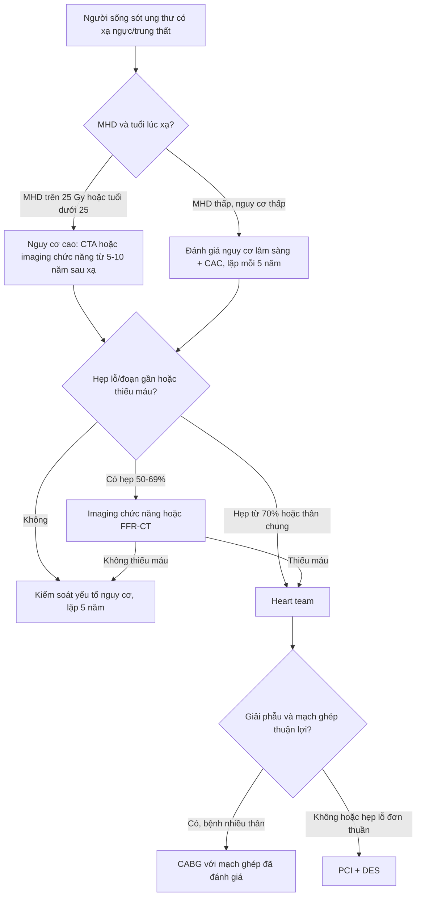
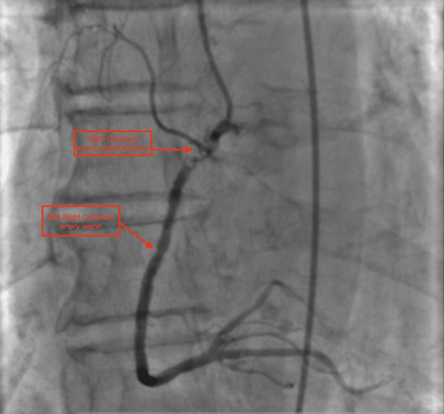
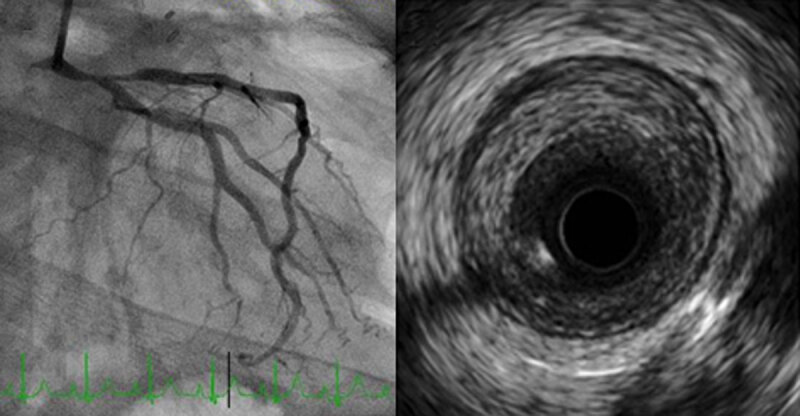
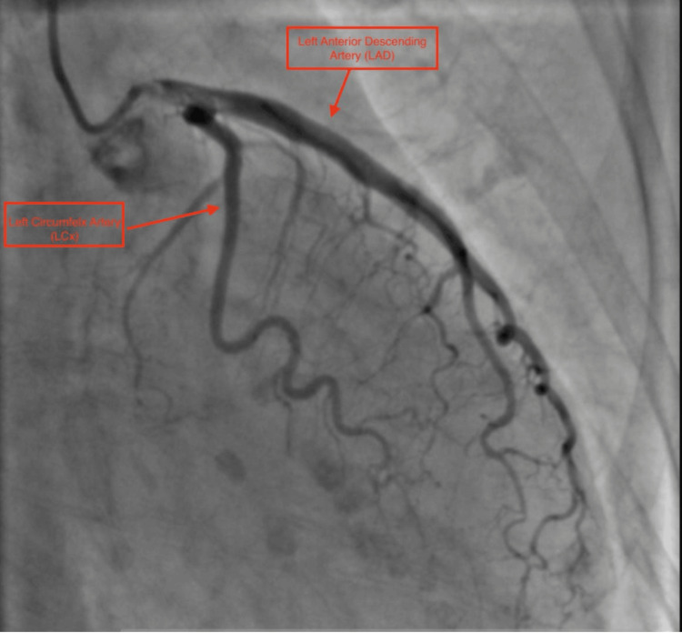

# 6706 — Bệnh động mạch vành do xạ: vì sao hẹp ở LỖ và ĐOẠN GẦN, tầm soát bằng CTA khi nào, và PCI hay CABG

**Tags:** `pattern:hep-mach-vanh` `pattern:voi-hoa-mach-vanh` `pattern:hep-lo-dong-mach` `vung:vanh` `vung:tim` `vung:trung-that` `anatomy:dong-mach-vanh` `protocol:CTA-vanh` `protocol:MRI-tim` `score:CAC` `score:CAD-RADS`
**Mức chắc chắn (certainty):** tổng hợp y văn (literature synthesis) — ghép **tổng quan bệnh mạch vành do xạ** (Methodist DeBakey Cardiovasc J 2025, PMCID **PMC12352380**, CC BY-NC), **tổng quan bệnh tim do xạ ngực 2026** (Curr Cardiol Rep 2026, PMCID **PMC13714108**, CC BY), **ca nguyên văn STEMI do hẹp lỗ động mạch vành phải sau xạ 30 năm** (Cureus 2026, PMCID **PMC13281784**, CC BY) và dữ liệu liều–đáp ứng của y văn (NEJM 2013; Childhood Cancer Survivor Study). Không có ca do nhóm tự chụp.

> **Kịch bản thực hành (ghép từ hai ca dưới đây, không phải ca nguyên văn):** nữ **36 tuổi**, tiền sử **Hodgkin**, xạ trung thất **41 Gy** cách đây **10 năm**, không yếu tố nguy cơ tim mạch cổ điển, vào vì đau ngực khi gắng sức; ECG có **ST chênh lên ở aVR**. Câu hỏi: **hẹp ở đâu, vì sao không vôi hóa, và nếu là hẹp thân chung trái thì nong hay mổ?**
> Bài chốt **ba quyết định**: **(1) RICAD là bệnh của "bản đồ liều" — hẹp LỖ và ĐOẠN GẦN, mảng xơ dài, nhẵn, ít lipid, có thể KHÔNG vôi hóa; (2) CAC = 0 KHÔNG loại trừ RICAD, nên tầm soát bằng CTA/imaging chức năng bắt đầu 5–10 năm sau xạ và lặp mỗi 5 năm; (3) PCI với stent phủ thuốc là lựa chọn hợp lý cho hẹp lỗ/thân chung ở người đã xạ, nhưng CABG không bị "cấm" — quyết định theo heart team và giải phẫu mạch ghép.** Nối [6705 – Bệnh van tim do xạ](../6705-benh-van-tim-do-xa-o-nguoi-song-sot-ung-thu/lesson.md), [6704 – Bệnh cơ tim do xạ](../6704-benh-co-tim-do-xa-o-nguoi-song-sot-ung-thu-nhi/lesson.md), [6703 – Bệnh cơ tim do anthracycline](../6703-benh-co-tim-do-anthracycline-o-nguoi-song-sot-ung-thu-nhi/lesson.md), [810 – Vành & CAD-RADS 2.0](../810-coronary-cta-cadrads/lesson.md).

## 1. Tổng quan bệnh học – cơ chế hình ảnh: vì sao tia xạ làm hẹp đúng "cửa vào" của động mạch vành

- **Dịch tễ (epidemiology):** bệnh mạch vành là **nguyên nhân bệnh tật – tử vong đứng thứ hai** ở người sống sót ung thư ngực – trung thất, sau bệnh van tim; thời gian tiềm tàng (latency) điển hình **khoảng 15 năm** (PMC12352380, PMC13714108). Ở người sống sót Hodgkin, nguy cơ tăng tới **250%**; ở ung thư vú, tăng **25%** so với dân số không xạ (PMC12352380).
- **Thời gian tiềm tàng khác nhau theo bệnh nền:** ung thư vú **~10 năm**, Hodgkin **2–3 thập kỷ** (PMC12352380). Vì vậy một phụ nữ 45 tuổi đau ngực **10 năm sau xạ vú trái** vẫn nằm trong cửa sổ bệnh, không được gọi là "đau ngực cơ năng vì còn trẻ".
- **Ngưỡng liều – đáp ứng (dose–response), không có ngưỡng an toàn:** mỗi **1 Gy** liều tim trung bình (mean heart dose — MHD) làm tăng **7,4%** nguy cơ biến cố vành chính (nhồi máu, tái thông, tử vong do thiếu máu cơ tim) — kết quả của nghiên cứu landmark trên bệnh nhân ung thư vú (NEJM 2013) và được lặp lại ở người sống sót Hodgkin (PMC13714108). Nghĩa là **MHD 20 Gy ≈ +150%** tương đối, không phải "liều thấp thì an toàn".
- **Ở trẻ sống sót ung thư:** xạ tim **15–35 Gy** làm tăng **2,4 lần** nguy cơ nhồi máu; **> 35 Gy** tăng **3,6 lần**; mỗi **10 Gy** thêm vào làm **gấp đôi** nguy cơ bệnh vành ở mốc **30 năm** (Childhood Cancer Survivor Study, dẫn trong PMC13714108). Đây là lý do dải bài 67xx đặt RICAD cạnh bệnh cơ tim và bệnh van do xạ.
- **Hình ảnh học ở người không triệu chứng:** chụp CTA cho **78** người sống sót lymphoma (xạ trung thất trung bình **~36 Gy**, trung vị **16 năm** sau xạ, tuổi trung bình **45 ± 11**) so với **78** người ghép cặp không xạ: hẹp **≥ 50%** gặp ở **59%** so với **36%**; bệnh nhiều thân gấp **~2,7 lần** (PMC13714108). Ở bệnh nhân ung thư phổi xạ ngực, **canxi mạch vành (CAC)** xuất hiện **48,6%** so với **24,6%** ở nhóm chứng, **OR hiệu chỉnh 3,1** (KTC 95% 1,09–9,2) (PMC13714108).
- **TẠI SAO mảng xơ do xạ "nghèo lipid":** tia xạ gây **đứt gãy DNA**, **stress oxy hóa (ROS)**, **mất tế bào nội mô**, **viêm mạn** và tăng **TGF-β** → **tăng sinh xơ nội mạc (fibrointimal proliferation)** và **tái cấu trúc âm (negative remodeling)**. Mô học: mảng **giàu collagen và fibrin, rất ít lipid**, không có lõi hoại tử lớn — khác hẳn mảng xơ vữa cổ điển (PMC12352380). Vì vậy trên **siêu âm trong lòng mạch (IVUS)** mảng **đồng tâm/lệch tâm, xơ, không vôi**, và trên CTA có thể chỉ thấy **hẹp lòng mạch nhẵn, dài** mà **không có vôi hóa**.
- **TẠI SAO đúng LỖ và ĐOẠN GẦN:** các đoạn này nằm sát **gốc động mạch chủ và dải van–ĐMC**, nơi **liều xạ cao nhất** trong trường trung thất và nơi **ứng suất cơ học** lớn nhất; tổn thương xạ cộng xơ vữa → **hẹp lỗ (ostial) và đoạn gần**, **dài, nhẵn, đồng tâm, dạng ống (long, smooth, concentric, tubular)** (PMC12352380). Động mạch **LAD và RCA** hay bị nhất khi xạ trung thất; **LAD** hay bị nhất khi xạ vú trái (PMC13714108).
- **TẠI SAO có ca vôi hóa nặng:** xạ làm **tăng tốc xơ vữa** và **vôi hóa sớm**; ở người có sẵn xơ vữa, xạ "đẩy nhanh" quá trình này. Ca **74 tuổi** xạ vú **30 năm trước** có **hẹp 99% lỗ RCA** kèm **vôi hóa lan** và thêm **hẹp 80% đoạn giữa RCA** (PMC13281784) — vôi hóa **không loại trừ** RICAD, và **không phải mọi mảng do xạ đều không vôi**.
- **TẠI SAO thiếu máu im lặng:** xạ làm tổn thương **sợi thần kinh tự chủ** và **mạng vi mạch**, nên **thiếu máu cơ tim im lặng** và **nhồi máu không đau** gặp nhiều hơn dân số chung (PMC13714108). Triệu chứng lại dễ bị quy cho **viêm phổi do xạ, xơ phổi, viêm màng tim** — cùng nằm trong trường chiếu.

## 2. Mẫu hình + chẩn đoán phân biệt theo vị trí và theo "dấu vân tay trường chiếu"

- **Mẫu hình (pattern) chính:** **hẹp lỗ hoặc đoạn gần** một hoặc nhiều thân, **không vôi hoặc vôi ít**, bờ **nhẵn**, đoạn hẹp **dài**, không có mảng "lồi" phức tạp; thường **bệnh nhiều thân** ở người **trẻ hơn tuổi mạch vành** và **ít yếu tố nguy cơ** (PMC12352380).
- **Gamut theo vị trí:**
  - **Lỗ RCA / lỗ thân chung trái (LM):** điển hình nhất sau xạ trung thất; hẹp **lỗ + đoạn gần**, có thể lan vào **chỗ phân nhánh (bifurcation)** — ca 36 tuổi hẹp **90% thân chung trái xa lan vào LAD gần** (PMC12352380); ca 74 tuổi hẹp **99% lỗ RCA** (PMC13281784).
  - **LAD đoạn gần:** hay gặp sau **xạ vú trái** (trường chiếu tiếp tuyến đi qua tim trái); thường **hẹp dài, nhẵn**.
  - **Đoạn giữa – xa:** ít điển hình hơn, nhưng ca 74 tuổi có thêm **hẹp 80% đoạn giữa RCA** — tức **không được chỉ nhìn lỗ**.
  - **Nhiều thân (multivessel):** gấp **~2,7 lần** so với người không xạ (PMC13714108) → khi thấy một tổn thương lỗ, phải **đọc toàn bộ cây vành**.
- **Gamut chẩn đoán phân biệt của "hẹp vành ở người trẻ không yếu tố nguy cơ":**
  - **RICAD** — tiền sử xạ ngực/trung thất, hẹp lỗ–gần, mảng xơ không vôi.
  - **Xơ vữa cổ điển sớm** — vôi hóa, tổn thương chỗ phân nhánh, có rối loạn lipid/ĐTĐ/hút thuốc.
  - **Bóc tách động mạch vành tự phát (SCAD)** — nữ trẻ, sau sinh, **không có mảng xơ**, hình ảnh **vạt nội mạc (intimal flap)** hoặc **hẹp dài hình ống** trên CTA.
  - **Co thắt mạch vành / bệnh vi mạch do xạ** — động mạch **không hẹp có ý nghĩa** trên CTA nhưng **đau ngực, ST thay đổi**, cần **thử nghiệm co thắt** hoặc **PET tưới máu**.
  - **Thuyên tắc / mảng nứt vỡ** — **hẹp đột ngột, huyết khối**, bờ không đều; khác mảng xơ nhẵn do xạ.
- **Dấu hiệu định vị trên CTA (rất hữu ích):** **vôi hóa động mạch chủ/vanh "dừng" đúng biên trường xạ** và **mảng xơ tập trung ở lỗ** — cùng logic với **canxi vành van trước/AMC** của bài 6705.

## 3. Bảng so sánh phân biệt (ma trận đối chiếu)

| Thực thể (entity) | Hình ảnh điển hình (CTA/IVUS) | Chốt vào (rule-in) | Chốt loại (rule-out) | Gợi ý xác nhận |
|---|---|---|---|---|
| **RICAD (bệnh vành do xạ)** | Hẹp **lỗ/đoạn gần**, dài, nhẵn, **không vôi**; IVUS: mảng xơ đồng tâm, không lõi lipid | **Tiền sử xạ ngực/trung thất** + hẹp lỗ–gần + mảng xơ không vôi ở người trẻ | **Không** loại trừ được bằng CAC = 0 hay không đau ngực | CTA + IVUS/FFR khi can thiệp; đối chiếu **bản đồ liều xạ** |
| **Xơ vữa cổ điển** | Vôi hóa, tổn thương **chỗ phân nhánh**, mảng hỗn hợp | Yếu tố nguy cơ (LDL, ĐTĐ, thuốc lá) + vôi hóa + vị trí phân nhánh | **Không** loại trừ RICAD khi có xơ vữa — hai bệnh **cộng gộp** | CAC, lipid, CTA; vôi hóa "dừng" ở biên xạ gợi ý xạ |
| **SCAD** | Vạt nội mạc, hẹp dài **lan từ đoạn giữa**, không mảng xơ | Nữ trẻ, sau sinh, đau ngực cấp, **troponin** tăng | Không có **tiền sử xạ**; không có mảng xơ lỗ | CTA/IVUS; **tránh PCI** nếu không có thiếu máu tiến triển |
| **Co thắt / bệnh vi mạch do xạ** | Động mạch **không hẹp ≥ 50%**, nhưng **thiếu máu khi gắng sức** | Đau ngực + ST thay đổi + CTA bình thường/thu hẹp nhẹ | Hẹp **≥ 70%** hoặc FFR dương tính thì không gọi là vi mạch đơn thuần | **PET tưới máu**, MRI tưới máu, thử nghiệm acetylcholine |
| **Huyết khối / mảng nứt vỡ** | Hẹp **đột ngột**, bờ không đều, **huyết khối** trong lòng | Hội chứng vành cấp + hình ảnh huyết khối | Mảng **nhẵn, dài, không vôi** không phải mảng nứt vỡ điển hình | Chụp mạch xâm lấn + OCT/IVUS |

- **Ảnh minh họa cơ chế:** `images/6706_mach-vanh-xa_CoChe_PMC13714108-F1.jpg` — sơ đồ chuỗi **DNA → ROS → viêm → xơ hóa** của tổn thương do tia xạ, dùng cho mục (1).

## 4. Protocol chụp + hệ phân độ/điểm chuẩn hóa

- **Ai cần tầm soát (screening):** người **sống sót ung thư có xạ ngực/trung thất**, đặc biệt **Hodgkin**, **ung thư vú trái**, **ung thư phổi**, **u trung thất**; nguy cơ cao nhất khi **tuổi lúc xạ < 25** và **MHD > 25 Gy** (PMC12352380).
- **Mốc bắt đầu:** tổng quan 2026 khuyến nghị **bắt đầu 10 năm sau xạ** và **lặp mỗi 5 năm** (PMC13714108); tổng quan 2025 dùng mốc **5 năm sau xạ** cho nhóm nguy cơ cao (PMC12352380). Cả hai đều thống nhất: **không chờ triệu chứng**, và **lặp lại định kỳ** vì bệnh tiến triển chậm.
- **Chọn phương thức:** **CTA vành** khi cần **giải phẫu** (hẹp lỗ, thân chung, nhiều thân, trước can thiệp); **imaging chức năng** (siêu âm tim gắng sức, SPECT/PET tưới máu, MRI tưới máu) khi cần **bằng chứng thiếu máu** hoặc khi CTA không kết luận; **CAC** hữu ích để xếp nguy cơ nhưng **CAC = 0 không loại trừ** RICAD.
- **Protocol CTA vành (giống 810, thêm lưu ý):** máy **≥ 64 dãy**, lát **0,5–0,625 mm**, **tiền cứu (prospective) ECG-gating** để giảm liều; **kiểm soát nhịp < 65 lần/phút** (chẹn beta ngắn), **nitrate dưới lưỡi**; **tính CAC trước**; với **vôi hóa lỗ nhiều** phải **đọc cả MPR mỏng và so với chụp mạch xâm lấn** vì **blooming** làm hẹp giả.
- **Phân độ CAD-RADS 2.0 (2022):** **0** = 0%; **1** = 1–24%; **2** = 25–49%; **3** = 50–69%; **4** = 70–99% (4A một thân, 4B ba thân/thân chung); **5** = tắc hoàn toàn. Bổ sung **modifier HRP** (mảng nguy cơ cao: thể tích mảng lớn, tái cấu trúc dương, điểm vôi thấp, "napkin-ring") — đúng với mảng xơ do xạ **không vôi nhưng hẹp nặng**. Với **stent** dùng **S**, **cầu nối** dùng **G**, **không đọc được** dùng **N**.
- **Quyết định tái thông (heart team):**
  - **PCI + stent phủ thuốc (DES)** là lựa chọn **hợp lý và được ưu tiên khi khả thi**, kể cả **thân chung trái hoặc ba thân**, vì mổ bị hạn chế bởi **mô xơ, mạch ghép bị xạ, "ĐMC sứ" (porcelain aorta)** (PMC12352380); **DES tốt hơn stent kim loại trần** ở nhóm này (PMC13714108).
  - **CABG không bị cấm:** dữ liệu **National Readmission Database** cho thấy **tử vong trong viện và tái nhập viện 90 ngày tương đương** giữa người có và không có xạ ngực (PMC13714108) — bằng chứng này **phản biện** quan niệm "đã xạ thì không mổ được". Vấn đề thật là **chọn mạch ghép**: **động mạch ngực trong (IMA)** nằm trong trường xạ có thể **xơ, hẹp**, nên phải **chụp/đánh giá trước mổ**.
  - **Yếu tố quyết định:** tuổi, **chức năng thất trái**, bệnh van/màng tim **đồng thời** (bài 6705), **xơ phổi** và **nguy cơ gây mê**, khả năng **tuân thủ kháng kết tập tiểu cầu kép**.
- **Sơ đồ tầm soát – xử trí:**

## 5. Biến thể bình thường và cạm bẫy

- **Cạm bẫy 1 — "CAC = 0 nên không có bệnh vành":** mảng xơ do xạ **nghèo canxi**, nên **điểm canxi 0** vẫn có thể kèm **hẹp 90% thân chung** (đúng ca PMC12352380). Ở người có tiền sử xạ, **CAC chỉ dùng để xếp nguy cơ, không dùng để loại trừ**.
- **Cạm bẫy 2 — blooming ở lỗ mạch:** vôi hóa **lỗ RCA/thân chung** làm CTA **hẹp giả**; phải đọc **lát mỏng, MPR vuông góc**, và **so với chụp mạch** trước khi can thiệp.
- **Cạm bẫy 3 — quy triệu chứng cho phổi/màng tim:** khó thở và đau ngực ở người đã xạ thường bị gán cho **xơ phổi, viêm màng tim, bệnh van** — trong khi **thiếu máu im lặng** là bệnh **song hành**. Ở người sống sót ung thư, **đau ngực không điển hình vẫn phải loại trừ hội chứng vành cấp**.
- **Cạm bẫy 4 — chỉ nhìn một tổn thương:** vì **bệnh nhiều thân gấp 2,7 lần**, thấy hẹp lỗ RCA **không** được bỏ qua **hẹp 80% đoạn giữa RCA** hay tổn thương LAD (ca PMC13281784).
- **Cạm bẫy 5 — gọi co thắt/vi mạch là "bình thường":** CTA không hẹp **không** đồng nghĩa không thiếu máu; bệnh **vi mạch do xạ** cần **PET/MRI tưới máu** và điều trị **yếu tố nguy cơ + chống co thắt**.
- **Cạm bẫy 6 — bỏ sót bệnh đồng thời:** trước can thiệp vành phải **đánh giá van, cơ tim, màng tim, hệ dẫn truyền** (bài 6704, 6705); **hẹp van ĐMC nặng** có thể là lý do chính gây đau ngực.
- **Biến thể bình thường dễ nhầm:** **vôi hóa vành van hai lá (MAC)** và **dày dải van–ĐMC** ở người đã xạ là **dấu hiệu định vị trường chiếu**, không phải "bệnh van" đơn thuần — đọc cùng bài 6705.

## 6. Tự lượng giá — Blind Quiz ngay trên trang tĩnh (không cần app)

**Ca 1 — nữ 74 tuổi, STEMI, tiền sử ung thư vú xạ 30 năm trước**

- Gợi ý lâm sàng (clinical context): nữ **74 tuổi**, **ung thư vú đã xạ 30 năm trước**, vào vì **đau ngực kiểu nhồi máu**, ECG **ST chênh lên ở II, III, aVF**.
- Câu hỏi: Tổn thương ở đâu và mức độ? Vì sao vị trí này gợi ý **bệnh do xạ** chứ không chỉ xơ vữa? Có bỏ sót tổn thương thứ hai không?

<b>Bấm để hiện đáp án (findings + chẩn đoán)</b>

- Dấu hiệu (findings): **hẹp 99% ở LỖ và đoạn gần động mạch vành phải (RCA)**, thêm **hẹp 80% ở đoạn giữa RCA**; có **vôi hóa** lan theo thành mạch.
- Chẩn đoán (diagnosis): **hội chứng vành cấp trên nền bệnh vành do xạ** — hẹp **lỗ** đúng "dấu vân tay" trường chiếu, nhưng **vôi hóa vẫn có** vì xạ đẩy nhanh xơ vữa sẵn có.
- Nguồn ảnh: Cureus 2026, PMCID **PMC13281784**, Figure 3 — **CC BY 4.0**.

**Ca 2 — nữ 36 tuổi, Hodgkin xạ 41 Gy cách 10 năm, đau ngực khi gắng sức**

- Gợi ý lâm sàng: **36 tuổi**, **Hodgkin**, xạ trung thất **41 Gy** cách **10 năm**, **không** yếu tố nguy cơ tim mạch; ECG **ST chênh lên aVR**, ST chênh xuống V1–V6.
- Câu hỏi: Vì sao tổn thương lại ở **thân chung trái xa**? Siêu âm trong lòng mạch cho thấy gì, và nó **loại** giả thuyết nào?

<b>Bấm để hiện đáp án (findings + chẩn đoán)</b>

- Dấu hiệu (findings): **hẹp 90% thân chung trái xa lan vào LAD gần**; IVUS: **mảng xơ lệch tâm, dày, KHÔNG có lõi lipid và KHÔNG vôi hóa**.
- Chẩn đoán (diagnosis): **RICAD** — mảng xơ do xạ, không phải mảng xơ vữa điển hình; đã đặt **stent phủ thuốc** và lui bệnh.
- Phản biện (critique): đây là ca **đơn lẻ**, không đại diện mọi RICAD; một số ca vẫn **vôi hóa** (ca 1).
- Nguồn ảnh: Methodist DeBakey Cardiovasc J 2025, PMCID **PMC12352380**, Figure 1 — **CC BY-NC 4.0**.

**Ca 3 — vì sao "canxi nhiều" không đồng nghĩa "hẹp nặng nhất ở đó"**

- Gợi ý lâm sàng: cùng bệnh nhân ca 1; chụp **tuần hoàn trái** để tìm tổn thương đồng thời.
- Câu hỏi: Hình này chứng minh điều gì về **mối liên hệ giữa canxi và hẹp**? Nếu CTA báo "vôi hóa nặng LAD" thì bước tiếp theo là gì?

<b>Bấm để hiện đáp án (findings + chẩn đoán)</b>

- Dấu hiệu (findings): **LAD và LCx thông**, có **lắng đọng canxi** dọc thành nhưng **không hẹp tương ứng**; tổn thương gây triệu chứng nằm ở **RCA**.
- Chẩn đoán (diagnosis): **canxi là dấu hiệu của quá trình xơ vữa/xạ, không phải thước đo độ hẹp** — phải đọc **lòng mạch**, không đọc "điểm canxi".
- Nguồn ảnh: Cureus 2026, PMCID **PMC13281784**, Figure 2 — **CC BY 4.0**.

## Bài liên quan chéo
- [6705 – Bệnh van tim do xạ](../6705-benh-van-tim-do-xa-o-nguoi-song-sot-ung-thu/lesson.md)
- [6704 – Bệnh cơ tim do xạ ở người sống sót ung thư nhi](../6704-benh-co-tim-do-xa-o-nguoi-song-sot-ung-thu-nhi/lesson.md)
- [6703 – Bệnh cơ tim do anthracycline](../6703-benh-co-tim-do-anthracycline-o-nguoi-song-sot-ung-thu-nhi/lesson.md)
- [810 – CTA vành & CAD-RADS 2.0](../810-coronary-cta-cadrads/lesson.md)
- [820 – MRI tim: LGE & mapping](../820-cardiac-mri-lge-mapping/lesson.md)

## Ảnh
- `6706_mach-vanh-xa_CoChe_PMC13714108-F1.jpg` — sơ đồ cơ chế tổn thương do tia xạ (Curr Cardiol Rep 2026, PMC13714108, CC BY 4.0).
- `6706_mach-vanh-xa_AngioRCA_PMC13281784-F3.jpg` — hẹp 99% lỗ RCA + 80% đoạn giữa (Cureus 2026, PMC13281784, CC BY 4.0).
- `6706_mach-vanh-xa_AngioTrai_PMC13281784-F2.jpg` — tuần hoàn trái, canxi không tương ứng hẹp (Cureus 2026, PMC13281784, CC BY 4.0).
- `6706_mach-vanh-xa_AngioIVUS_PMC12352380-F1.jpg` — thân chung trái 90% + IVUS mảng xơ không vôi (Methodist DeBakey Cardiovasc J 2025, PMC12352380, CC BY-NC 4.0).
- Nguồn + giấy phép từng ảnh: `images/CREDITS.md`; link gốc: `sources.md`.

> Không dùng để chẩn đoán độc lập khi chưa có người hướng dẫn.
