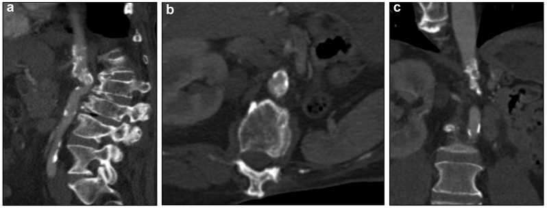
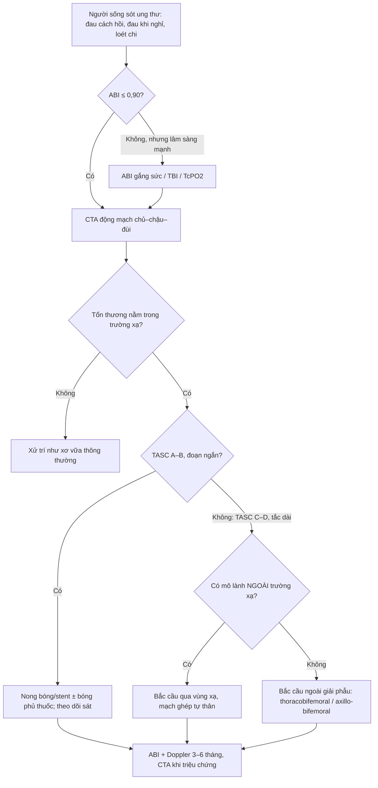
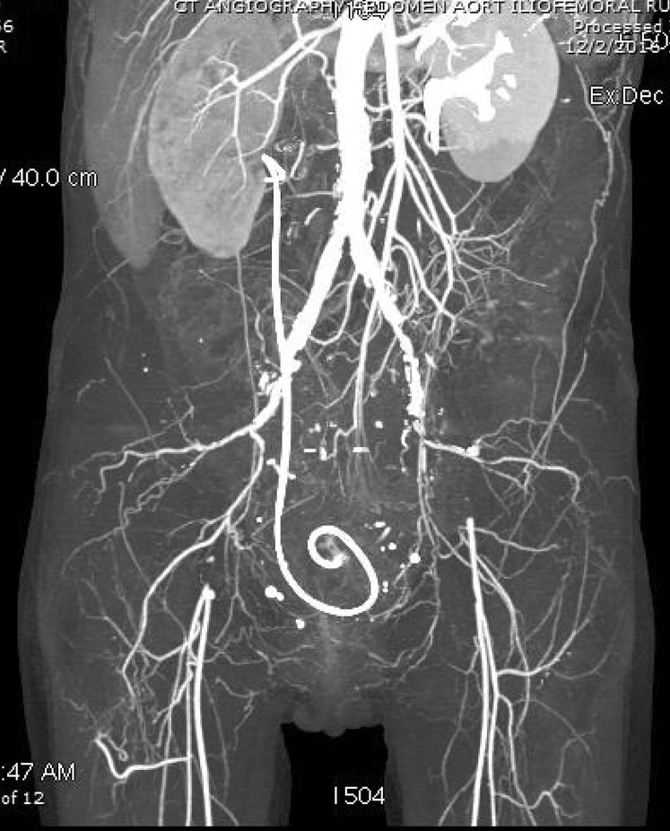
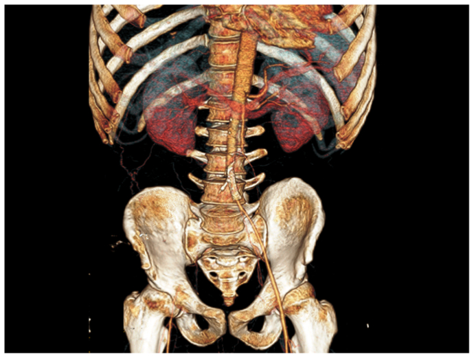

# 6707 — Bệnh động mạch ngoại biên do xạ: vì sao hẹp DÀI – NHẴN – ĐÚNG TRƯỜNG CHIẾU, và khi nào nong mạch, khi nào bắc cầu ra ngoài vùng xạ

**Tags:** `pattern:hep-dong-mach` `pattern:tac-dong-mach` `pattern:hep-dai-khong-voi` `pattern:trong-truong-chieu` `vung:dong-mach-chau` `vung:chi-duoi` `vung:dong-mach-chu-bung` `anatomy:dong-mach-chau-dui` `protocol:CTA-chi-duoi` `protocol:ABI` `score:TASC-II`
**Mức chắc chắn (certainty):** tổng hợp y văn (literature synthesis) — ghép **tổng quan hệ thống 25 nghiên cứu / 43 ca bệnh động mạch chi dưới do xạ** (Int Angiol 2021, PMID **33660497**), **ca TASC D tắc chậu–đùi hai bên sau xạ cổ tử cung** (J Vasc Surg Cases Innov Tech 2018, PMCID **PMC6012990**, CC BY-NC-ND), **ca hẹp ĐMC cạnh tạng 53 năm sau xạ Wilms** (J Vasc Surg Cases Innov Tech 2025, PMCID **PMC12283543**, CC BY 4.0), **ca tắc ĐMC–chậu sau xạ Ewing thời thơ ấu** (J Vasc Surg Cases Innov Tech 2024, PMCID **PMC10788263**, CC BY-NC-ND) và **loạt 12 ca giả phình mạch ngoại biên do xạ** (J Int Med Res 2021, PMCID **PMC8047089**, CC BY-NC). Không có ca do nhóm tự chụp.

> **Kịch bản thực hành (ghép từ ba ca dưới đây, không phải ca nguyên văn):** nữ **51 tuổi**, **ung thư cổ tử cung** đã xạ **45 Gy ngoài + 35 Gy brachy** cách đây **4 năm**, nay **đau cách hồi hai chân** rồi **đau khi nghỉ**; không hút thuốc, không đái tháo đường, lipid bình thường. Câu hỏi: **vì sao mạch "lành" lại tắc, đọc CTA thế nào để không gọi là xơ vữa, và nong hay mổ?**
> Bài chốt **ba quyết định**: **(1) nghi bệnh mạch do xạ khi hẹp/tắc DÀI, NHẴN, ÍT VÔI, nằm ĐÚNG trường chiếu và các mạch NGOÀI trường chiếu tương đối lành — tiềm tàng trung vị 11–12 năm, liều trung vị 40 Gy; (2) mổ hở vẫn là "chuẩn vàng" cho tắc dài TASC D, nhưng **miệng nối phải đặt ngoài vùng xạ** vì nhiễm mạch ghép nhân tạo tới 21%; (3) can thiệp nội mạch dùng được cho tổn thương ngắn/không mổ được, nhưng phải theo dõi lâu — tái phát triệu chứng 16% và can thiệp lại 8% ngay trong các loạt ngắn hạn.** Nối [6706 – Bệnh động mạch vành do xạ](../6706-benh-mach-vanh-do-xa-o-nguoi-song-sot-ung-thu/lesson.md), [6705 – Bệnh van tim do xạ](../6705-benh-van-tim-do-xa-o-nguoi-song-sot-ung-thu/lesson.md), [6700 – Biến chứng muộn sau Wilms](../6700-di-chung-muon-sau-wilms-va-chuyen-tiep/lesson.md), [260 – Hẹp động mạch cảnh do xạ](../260-hep-dong-mach-canh-do-xa/lesson.md), [1670 – Rò động mạch chậu – niệu quản sau xạ](../1670-ro-dong-mach-chau-nieu-quan-sau-xa/lesson.md).

## 1. Tổng quan bệnh học – cơ chế hình ảnh: vì sao mạch trong trường xạ hẹp "kiểu khác" xơ vữa

- **Dịch tễ (epidemiology):** bệnh động mạch chi dưới do xạ (**radiation-induced arteriopathy — RIA**) hiếm nhưng tăng dần vì người sống sót ung thư sống lâu hơn. Tổng quan hệ thống gom **25 nghiên cứu, 43 bệnh nhân**: thời gian từ xạ đến triệu chứng **trung vị 12 năm (9 ngày – 49 năm)**, liều xạ **trung vị 40 Gy** (PMID 33660497). Một loạt khác mô tả khoảng **2–47 năm, trung vị 11 năm**, và thay đổi X-quang của động mạch chậu–đùi xuất hiện sau **39–80 Gy** (dẫn trong PMC6012990).
- **Biểu hiện lâm sàng (presentation):** đau cách hồi **52%**, thiếu máu chi đe dọa (**CLTI**) **11%**, thiếu máu chi cấp (**ALI**) **9%**, chảy máu/khối đập **17%**, không triệu chứng **11%** (43 ca; PMID 33660497). Nghĩa là **một nửa chỉ đau cách hồi** — dễ bị quy cho "đau thần kinh tọa" hoặc "di chứng xạ" và bỏ qua.
- **Vị trí (location):** động mạch **chậu 65%**, **đùi–khoeo 28%**, cả trên và dưới dây chằng bẹn **7%** (PMID 33660497). Đúng với bản đồ liều: khung chậu là nơi xạ cổ tử cung/tiền liệt tuyến/trực tràng đi qua, vùng bẹn là nơi xạ hạch bẹn – chậu.
- **TẠI SAO tế bào nội mô là "bia" chính:** tia xạ gây **đứt gãy DNA**, **stress oxy hóa**, **chết tế bào nội mô** và **viêm mạn** → **tăng sinh xơ nội mạc (fibrointimal proliferation)**, **xơ hóa lớp áo giữa và áo ngoài**, **tổn thương vasa vasorum** (PMC6012990). Kết quả là **dày thành đồng tâm, hẹp lòng dài, nhẵn**, mảng **nghèo lipid** — khác mảng xơ vữa cổ điển có lõi lipid, vôi hóa và tổn thương lệch tâm ở chỗ phân nhánh.
- **TẠI SAO "ít vôi":** mảng xơ do xạ chủ yếu là **collagen/fibrin**, ít lipid nên **không vôi hóa sớm**. Nhưng **không phải tuyệt đối**: xạ cũng **đẩy nhanh xơ vữa sẵn có**, nên ca hẹp ĐMC cạnh tạng sau xạ Wilms có **vôi hóa dày, lan tỏa** (PMC12283543), và ca tắc chậu–đùi sau xạ cổ tử cung có **mảnh vôi rải rác**. Quy tắc thực hành: **vôi hóa không loại trừ bệnh do xạ; vị trí và chiều dài tổn thương mới là manh mối**.
- **TẠI SAO tiềm tàng nhiều năm:** xơ hóa tiến triển **chậm, tích lũy** theo liều; đồng thời xạ làm **mất khả năng tái tạo nội mô** nên tổn thương không "lành" như tổn thương cơ học. Vì vậy một người **32 tuổi** (ca Ewing) đã có **tắc ĐMC–chậu TASC D** sau xạ thời thơ ấu (PMC10788263), còn người **56 tuổi** (ca Wilms) có hẹp ĐMC cạnh tạng **53 năm** sau xạ (PMC12283543).
- **TẠI SAO mạch NGOÀI trường chiếu "lành" là chốt:** xơ vữa là bệnh **toàn thân**, còn RIA **khu trú theo bản đồ liều**. Khi CTA thấy **tắc dài một đoạn chậu–đùi nhưng ĐMC trên thận và động mạch chi đối bên sạch**, phải nghĩ RIA (PMC6012990). Ngược lại, hẹp ngắn ở chỗ phân nhánh + vôi hóa lan + nhiều yếu tố nguy cơ → xơ vữa.
- **TẠI SAO có ca chảy máu/giả phình:** xạ làm thành mạch **mỏng, xơ, mất nuôi dưỡng** → **giả phình (pseudoaneurysm)** và **vỡ muộn** sau nhiều năm, đặc biệt ở bẹn. Loạt **12 ca** giả phình mạch ngoại biên do xạ có kích thước **10–30 mm (trung bình 20,42 mm)** (PMC8047089) — đây là mặt "chảy máu" của cùng bệnh lý, không phải biến chứng ngẫu nhiên.

## 2. Mẫu hình + chẩn đoán phân biệt theo vị trí (gamut)

- **Mẫu hình chính (pattern):** hẹp hoặc tắc **một đoạn dài** (thường **> 5–10 cm**), bờ **nhẵn, đồng tâm**, **không có mảng lồi phức tạp**, **vôi hóa ít hoặc không**, **không có tuần hoàn bàng hệ kiểu "bệnh mạn"** ở đoạn xa; các mạch **ngoài trường chiếu** tương đối bình thường.
- **Gamut theo vị trí:**
  - **Động mạch chậu chung/ngoài (65%):** sau xạ tiểu khung (cổ tử cung, tiền liệt tuyến, trực tràng, bàng quang); thường **hai bên**, có thể kèm **hẹp ĐMC dưới thận**.
  - **Động mạch đùi chung/nông – khoeo (28%):** sau xạ **vùng bẹn** (lymphoma, sarcoma chi dưới, ung thư dương vật) hoặc **tia xạ xuyên qua đùi**; dễ kèm **giả phình** và **loét da**.
  - **ĐMC bụng – cạnh tạng (thể nặng nhất):** sau xạ **bụng thời thơ ấu** (Wilms, neuroblastoma, Ewing); kèm **xơ quanh ĐMC**, **ĐMC nhỏ/hypoplasia**, **khung chậu thiểu sản** — mổ vào bụng cực khó (PMC12283543, PMC10788263).
  - **Cả hai tầng (7%):** hẹp/tắc từ chậu đến khoeo — thường gặp ở người sống sót sarcoma chi dưới.
- **Gamut chẩn đoán phân biệt của "đau cách hồi ở người trẻ/không yếu tố nguy cơ":**
  - **RIA** — tiền sử xạ đúng vùng, hẹp dài, mạch ngoài trường chiếu lành.
  - **Xơ vữa sớm** — rối loạn lipid/Lp(a), hút thuốc, đái tháo đường; tổn thương chỗ phân nhánh, vôi hóa.
  - **Takayasu (viêm ĐMC – mạch lớn)** — nữ trẻ, hẹp ĐMC/dưới đòn/cảnh, thành mạch dày đồng tâm, **ngấm thuốc thành mạch** trên MRI, CRP tăng.
  - **Buerger (viêm tắc mạch Thromboangiitis obliterans)** — hút thuốc, tổn thương **động mạch nhỏ – trung bình ở xa**, "corkscrew", không hẹp chậu.
  - **Bệnh động mạch chậu do đạp xe (iliac endofibrosis)** — vận động viên, hẹp **động mạch chậu ngoài khi gắng sức**, CTA lúc nghỉ thường bình thường.
  - **Chèn ép khoeo/hội chứng động mạch khoeo bắt giữ** — người trẻ, hẹp khi gấp bàn chân.
  - **Thoát vị đĩa đệm/hẹp ống sống** — đau kiểu thần kinh, mạch bình thường; đây là **chẩn đoán nhầm thường gặp** của ca xạ tiểu khung (PMC6012990).

## 3. Bảng so sánh phân biệt (ma trận đối chiếu)

| Thực thể (entity) | Hình ảnh điển hình (CTA/MRA/DUS) | Chốt vào (rule-in) | Chốt loại (rule-out) | Gợi ý xác nhận |
|---|---|---|---|---|
| **Bệnh mạch do xạ (RIA)** | **Hẹp/tắc DÀI, nhẵn, đồng tâm**, ít vôi, **đúng trường chiếu**, mạch ngoài trường chiếu lành | **Tiền sử xạ đúng vùng + hẹp dài + mạch ngoài trường chiếu sạch** | **Không** loại trừ bằng vôi hóa; hẹp ngắn chỗ phân nhánh → nghĩ xơ vữa | CTA chân–chậu; đối chiếu **bản đồ liều xạ**; ABI; MRI thành mạch khi cần |
| **Xơ vữa động mạch** | Mảng **lệch tâm**, chỗ phân nhánh, **vôi hóa**, hẹp ngắn–trung bình | **Nhiều yếu tố nguy cơ + vôi hóa + tổn thương lệch tâm** | Mạch ngoài trường chiếu cũng bệnh, tuổi lớn | Lipid/Lp(a), ĐTĐ, CTA toàn cây |
| **Takayasu** | **Dày thành đồng tâm, ngấm thuốc**, hẹp dài ĐMC/dưới đòn/cảnh, có thể phình | **Nữ trẻ + CRP tăng + dày thành mạch ngấm thuốc** | Hẹp khu trú đúng trường xạ + không viêm | MRI thành mạch, PET-CT, CRP |
| **Buerger** | Tắc **động mạch nhỏ – trung bình ở xa**, "corkscrew", nhảy cóc | **Hút thuốc trẻ + tổn thương xa + mạch gần lành** | Hẹp chậu–đùi lớn → loại | Siêu âm/CTA bàn chân, ngưng thuốc |
| **Bệnh động mạch chậu do gắng sức** | Hẹp **ĐM chậu ngoài** khi gắng sức, nghỉ bình thường | **Vận động viên + hẹp khi gắng sức + không vôi** | Hẹp cả lúc nghỉ + tiền sử xạ | CTA/Doppler sau gắng sức |
| **Giả phình do xạ** | Khối **10–30 mm** sát mạch, **không có lớp áo mạch đủ**, có thể loét da | **Tiền sử xạ + khối đập + thiếu máu cục bộ/loét** | Túi phình thật có cả 3 lớp, vôi hóa viền | CTA, siêu âm Doppler, DSA |

*Ba bình diện CTA: (a) Sagittal — ĐMC hẹp dài, vôi hóa nặng; (b) axial — lòng ĐMC hẹp không đều; (c) coronal — đoạn hẹp ngay trên các nhánh tạng. Đây là "trường chiếu xạ bụng thời thơ ấu": xơ quanh ĐMC + vôi hóa làm nong bóng/stent không khả thi. Nguồn: J Vasc Surg Cases Innov Tech 2025, PMC12283543, Fig. 1 — CC BY 4.0.*

## 4. Protocol chụp + phân độ TASC II + quyết định can thiệp

- **Bước 1 — ABI (ankle–brachial index):** ABI **≤ 0,90** là ngưỡng hẹp có ý nghĩa huyết động; ABI **< 0,40** hoặc áp lực cổ chân **< 50 mmHg** gợi ý thiếu máu chi đe dọa. Nhưng ở **ĐTĐ/calciphylaxis**, động mạch cứng nên ABI có thể **bình thường giả** — dùng **chỉ số ngón chân (TBI)** và **TcPO₂**.
- **Bước 2 — CTA chân–chậu (hoặc MRA nếu suy thận):** lát **≤ 1 mm**, cửa sổ rộng, dựng **MIP/3D**; đọc **cả trục dọc** để đo **chiều dài đoạn hẹp**, không chỉ đo % hẹp. Cần **đối chiếu trường chiếu xạ** trên CT mô phỏng/ghi chép liều.
- **Bước 3 — phân độ TASC II (TransAtlantic Inter-Society Consensus II):** **A–B** = tổn thương ngắn, khu trú → **nội mạch trước**; **C–D** = tắc/hẹp **lan tỏa, dài, hai bên** → **mổ hở** là lựa chọn chính. Ca chậu–đùi hai bên sau xạ cổ tử cung và ca ĐMC–chậu sau xạ Ewing đều là **TASC D** (PMC6012990, PMC10788263).
- **Bước 4 — chọn đường can thiệp:** **không đặt miệng nối/mạch ghép nhân tạo trong vùng xạ**; ưu tiên **mạch ghép tự thân** và **đường đi ngoài vùng xạ** (bắc cầu chéo, **thoracobifemoral**, axillo-bifemoral). Nhiễm mạch ghép nhân tạo trong vùng xạ đã được báo tới **21%** (dẫn trong PMC6012990).
- **Bước 5 — theo dõi:** ABI + siêu âm Doppler **3–6 tháng/lần** trong 2 năm đầu, sau đó **hằng năm**; CTA lặp khi triệu chứng tái phát hoặc ABI giảm **> 0,15**. Trong loạt 43 ca, **16% tái phát triệu chứng** và **8% phải can thiệp lại**, với theo dõi trung bình chỉ **12 tháng** (PMID 33660497) — nên **theo dõi dài hơn** là bắt buộc.

## 5. Biến thể bình thường và cạm bẫy

- **Biến thể bình thường dễ nhầm:** **ĐMC nhỏ và khung chậu thiểu sản** ở người xạ bụng thời thơ ấu là **hậu quả phát triển**, không phải "ĐMC bẩm sinh nhỏ"; đừng đo nhầm thành hẹp. Ngược lại, **vôi hóa mạch chậu ở người > 60 tuổi** là bình thường — không được dùng nó để loại trừ RIA.
- **Cạm bẫy 1 — "không vôi hóa nên không hẹp":** mảng xơ do xạ **nghèo lipid** nên có thể **không vôi**; đọc **lòng mạch** và **chiều dài**, không đọc "điểm canxi".
- **Cạm bẫy 2 — gọi là "đau thần kinh tọa":** ca xạ tiểu khung có thể được chẩn đoán **hẹp ống sống L4–L5** và bỏ qua tắc mạch; **đau khi nghỉ + bàn chân lạnh + mất mạch bẹn** phải chụp mạch (PMC6012990).
- **Cạm bẫy 3 — can thiệp trong vùng xạ:** nong bóng có thể **gây vỡ/rách mạch** ở đoạn xơ, và **stent bị gãy/hẹp lại**; tổn thương **dài + cạnh nhánh tạng** (ca Wilms) là **chống chỉ định tương đối** của nội mạch (PMC12283543).
- **Cạm bẫy 4 — bỏ sót giả phình:** ở bệnh nhân xạ bẹn, **khối 10–30 mm đập theo mạch** có thể bị gọi là "hạch/khối máu tụ"; CTA có **phần trăm ngấm thuốc bằng lòng mạch** mới xác nhận (PMC8047089).
- **Cạm bẫy mặt cắt (cross-sectional):** trên lát ngang, **huyết khối trong lòng + vôi hóa thành** có thể giả "tắc hoàn toàn"; cần xem **lát mỏng đa bình diện** và **MIP** để phân biệt **hẹp nặng còn dòng** với **tắc thật**, và không nhầm **stent cũ** (kim loại) với tổn thương mới.

## 6. Tự lượng giá — Blind Quiz

**Ca 1 — nữ 51 tuổi, xạ cổ tử cung 4 năm trước, đau hai chân khi nghỉ**

- Gợi ý lâm sàng: **ung thư cổ tử cung tái phát**, đã **45 Gy xạ ngoài + 35 Gy brachy** năm 2011; 4 năm sau **đau cách hồi tiến triển, đau khi nghỉ, dị cảm hai bàn chân**; không hút thuốc, không ĐTĐ.
- Câu hỏi: Tổn thương ở đâu, dài hay ngắn? Vì sao vị trí này gợi ý **bệnh do xạ** hơn xơ vữa? Nếu là TASC D thì nong hay mổ?

<b>Bấm để hiện đáp án (findings + chẩn đoán)</b>

- Dấu hiệu (findings): **hẹp động mạch chậu chung trái + tắc hoàn toàn động mạch chậu ngoài hai bên** ngay dưới chỗ phân nhánh, **tái thông ở động mạch đùi nông – đùi sâu**; tổn thương **dài, hai bên**, mạch phía trên vành lành. Hình còn có **stent niệu quản** (dây xoắn) do hẹp niệu quản sau xạ.
- Chẩn đoán (diagnosis): **viêm động mạch do xạ (radiation arteritis) TASC D** — hẹp/tắc **đúng trường chiếu xạ tiểu khung**, mạch ngoài trường chiếu lành; cơ chế là **xơ nội mạc + xơ hóa áo giữa** sau xạ, không phải mảng xơ vữa điển hình.
- Xử trí trong ca: **lai (hybrid)** — nong/stent động mạch chậu + bắc cầu/ghép mạch tự thân qua vùng xạ; ABI cải thiện và hết triệu chứng sau **8 tháng**.
- Phản biện (critique): đây là **ca đơn lẻ**, theo dõi ngắn; tổn thương **TASC D** thường được khuyến cáo **mổ hở**, nên "stent thành công" không được khái quát cho mọi ca.
- Nguồn ảnh: J Vasc Surg Cases Innov Tech 2018, PMCID **PMC6012990**, Fig. 1 — **CC BY-NC-ND 4.0** (nguyên bản, không cắt/ghép).

**Ca 2 — nam 56 tuổi, tiền sử xạ bụng điều trị Wilms lúc 3 tuổi, đau cách hồi nặng**

- Gợi ý lâm sàng: **Wilms thận trái**, **cắt thận + xạ bụng lúc 3 tuổi**; nay **đau cách hồi khoảng cách ngắn**, kèm bệnh mạch vành, tăng huyết áp, ĐTĐ type 2.
- Câu hỏi: Tổn thương ở tầng nào? Vì sao **không thể nong/stent**? Nếu mổ, đường vào nào tránh vùng xạ?

<b>Bấm để hiện đáp án (findings + chẩn đoán)</b>

- Dấu hiệu (findings): **hẹp nặng ĐMC cạnh tạng** (ngay trên/xung quanh các nhánh tạng), **vôi hóa và xơ quanh ĐMC dày**; đoạn hẹp **dài**, sát **động mạch thân tạng – mạc treo tràng trên – động mạch thận**.
- Chẩn đoán (diagnosis): **hẹp ĐMC do xạ** sau xạ bụng thời thơ ấu — xơ quanh ĐMC + vôi hóa làm **nong bóng/stent nguy cơ che nhánh tạng và vỡ ĐMC**; bắc cầu trong ổ bụng cũng không khả thi vì **không có đoạn ĐMC dưới thận lành** để nối.
- Xử trí: **bắc cầu thoracobifemoral (TBF)** qua **đường ngực bên trái + đường hầm sau phúc mạc**, lấy **động mạch chủ ngực lành** làm nguồn vào — "đi vòng" qua vùng xạ.
- Nguồn ảnh: J Vasc Surg Cases Innov Tech 2025, PMCID **PMC12283543**, Fig. 1 — **CC BY 4.0**.

**Ca 3 — nam 32 tuổi, di chứng xạ Ewing, tắc ĐMC–chậu, đã thất bại can thiệp nội mạch**

- Gợi ý lâm sàng: **Ewing thời thơ ấu**, xạ **vùng chậu–ĐMC**; hiện **đau cách hồi hai chân + đau khi nghỉ chân phải**, đi **< nửa dãy nhà**; đã đặt stent nhưng thất bại.
- Câu hỏi: Đọc CTA thấy gì ngoài tắc mạch? Vì sao **khung chậu nhỏ** lại quan trọng với phẫu thuật? Can thiệp nội mạch thất bại vì đâu?

<b>Bấm để hiện đáp án (findings + chẩn đoán)</b>

- Dấu hiệu (findings): **ĐMC bụng thon nhỏ dần**, **tắc ĐMC–chậu TASC D**, **stent cũ chèn vào lỗ động mạch chậu phải**, **khung chậu thiểu sản** (xương chậu nhỏ, hẹp).
- Chẩn đoán (diagnosis): **tắc ĐMC–chậu mạn do xạ** — không chỉ lòng mạch hẹp mà **mô quanh mạch xơ hóa, mất mặt phẳng**, khung chậu nhỏ làm **không gian làm việc và đường vào bị hạn chế**; can thiệp nội mạch thất bại vì **tổn thương dài, vôi hóa, không có đoạn lành để neo stent**.
- Xử trí: **tái tạo ĐMC–chậu bằng mạch ghép**, đi **vòng ngoài vùng xạ**; đây là ca đầu tiên báo cáo tắc ĐMC do xạ kèm **khung chậu thiểu sản**.
- Nguồn ảnh: J Vasc Surg Cases Innov Tech 2024, PMCID **PMC10788263**, Fig. 1 — **CC BY-NC-ND 4.0** (nguyên bản).

## Bài liên quan chéo
- [6706 – Bệnh động mạch vành do xạ](../6706-benh-mach-vanh-do-xa-o-nguoi-song-sot-ung-thu/lesson.md)
- [6705 – Bệnh van tim do xạ](../6705-benh-van-tim-do-xa-o-nguoi-song-sot-ung-thu/lesson.md)
- [6704 – Bệnh cơ tim do xạ](../6704-benh-co-tim-do-xa-o-nguoi-song-sot-ung-thu-nhi/lesson.md)
- [6700 – Biến chứng muộn sau Wilms & chuyển tiếp](../6700-di-chung-muon-sau-wilms-va-chuyen-tiep/lesson.md)
- [260 – Hẹp động mạch cảnh do xạ](../260-hep-dong-mach-canh-do-xa/lesson.md)
- [1670 – Rò động mạch chậu – niệu quản sau xạ](../1670-ro-dong-mach-chau-nieu-quan-sau-xa/lesson.md)

## Ảnh
- `6707_mach-ngoai-bien-xa_CTA_PMC12283543-F1.jpg` — hẹp ĐMC cạnh tạng sau xạ Wilms, 3 bình diện (J Vasc Surg Cases Innov Tech 2025, PMC12283543, CC BY 4.0).
- `6707_mach-ngoai-bien-xa_CTA_PMC6012990-F1.jpg` — hẹp chậu chung trái + tắc chậu ngoài hai bên, TASC D (J Vasc Surg Cases Innov Tech 2018, PMC6012990, CC BY-NC-ND 4.0).
- `6707_mach-ngoai-bien-xa_CTA_PMC10788263-F1.jpg` — tắc ĐMC–chậu TASC D + khung chậu thiểu sản sau xạ Ewing (J Vasc Surg Cases Innov Tech 2024, PMC10788263, CC BY-NC-ND 4.0).
- Nguồn + giấy phép từng ảnh: `images/CREDITS.md`; link gốc: `sources.md`.

> Không dùng để chẩn đoán độc lập khi chưa có người hướng dẫn.
