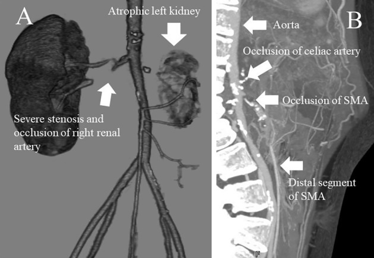
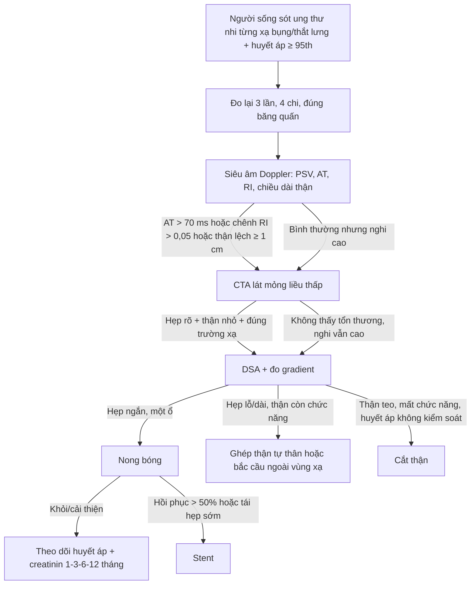
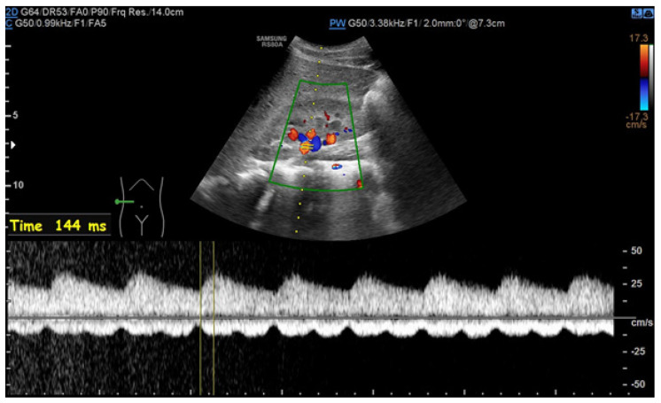
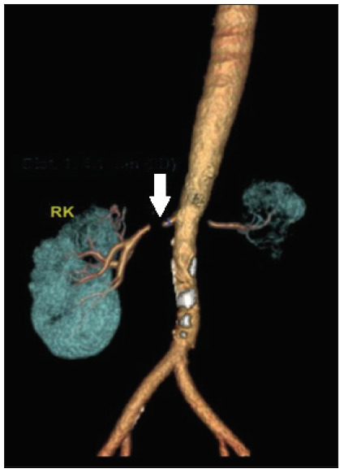

# 6708 — Hẹp động mạch thận do xạ ở trẻ: vì sao huyết áp tăng SAU nhiều năm, phổ parvus–tardus, và khi nào nong bóng, đặt stent, cắt thận

**Tags:** `pattern:hep-dong-mach-than` `pattern:tac-dong-mach` `pattern:than-nho` `pattern:tang-huyet-ap` `pattern:hep-lo-dong-mach` `pattern:teo-than` `vung:than` `vung:dong-mach-chu` `protocol:sieu-am-Doppler` `protocol:CTA` `protocol:MRA` `protocol:DSA`
**Mức chắc chắn (certainty):** tổng hợp y văn (literature synthesis) — ghép **ca nữ 19 tuổi, xạ trị u nguyên bào thần kinh lúc 2 tuổi (12 Gy trong mổ + 9,9 Gy), tăng huyết áp do mạch máu thận phát hiện lúc 12 tuổi, suy tim sung huyết lúc 19 tuổi, ghép thận tự thân** (Intern Med 2019, PMCID **PMC6663535**, CC BY-NC-ND), **ca nam 33 tuổi hẹp động mạch thận hai bên 14 năm sau xạ 45 Gy vùng bụng–chậu, nong bóng + 2 stent, huyết áp về bình thường sau 2 tháng** (Indian J Nephrol 2025, PMCID **PMC11883334**, CC BY-NC-SA), **bài tổng quan hẹp động mạch thận và hội chứng ĐMC giữa ở trẻ** (J Clin Med 2024, PMCID **PMC11594493**, CC BY) cùng **hai bài tổng quan về di chứng thận và tăng huyết áp ở người sống sót ung thư nhi** (Pediatr Nephrol 2026, PMCID **PMC13197264**; Curr Hypertens Rep 2025, PMCID **PMC11909068**). Không có ca do nhóm tự chụp.

> **Kịch bản thực hành (ghép từ các ca trên, không phải ca nguyên văn):** bé gái **2 tuổi** được mổ u nguyên bào thần kinh ổ bụng, có **xạ trị trong mổ 12 Gy** vào vùng cuống thận trái và **hóa–xạ toàn thân 9,9 Gy**, sau đó **ghép tế bào gốc tự thân**. Mười năm sau (**12 tuổi**) khám vì **đau đầu, nhìn mờ**, huyết áp **150/95 mmHg** (bách phân vị > 99 + 12 mmHg theo tuổi/chiều cao). Bé **không phù, không tiểu máu**, nhưng **creatinin 1,4 mg/dL** và **renin hoạt tính 19,0 ng/mL/h** (bình thường 0,3–2,9), **aldosteron 997 pg/mL** (bình thường 29,9–159). Siêu âm: **thận phải 9,8 cm, thận trái 5,2 cm**. Câu hỏi: **huyết áp tăng là do di chứng xạ nhu mô, do hẹp động mạch thận, hay "tăng huyết áp vô căn" của tuổi dậy thì — và đọc Doppler/CTA thế nào để trả lời?**
> Bài chốt **bốn quyết định**: **(1) mọi trẻ sống sót ung thư có xạ bụng/thắt lưng hoặc cắt thận phải đo huyết áp HẰNG NĂM trọn đời — hẹp động mạch thận do xạ xuất hiện sau trung vị 1–9 năm và có thể tới 14 năm; (2) hẹp do xạ điển hình ở LỖ–ĐOẠN GẦN, dài, nhẵn, kèm thận nhỏ cùng bên, và có thể HAI BÊN; (3) siêu âm Doppler chỉ là cửa sàng lọc — phổ parvus–tardus với thời gian tăng tốc (acceleration time, AT) > 70 ms và chênh chỉ số sức cản (resistive index, RI) > 0,05 mới đủ gợi ý, còn chụp mạch (DSA) là chuẩn vàng vì 19/74 trẻ có chụp mạch bất thường dù CTA/MRA/siêu âm bình thường; (4) nong bóng là lựa chọn đầu tay (khỏi hoàn toàn 39,3% sau lần 1, 57,1% sau các lần), stent chỉ khi hồi phục > 50% sau nong hoặc tái hẹp sớm (hẹp lại trong stent 35,5–37%), còn phẫu thuật (ghép thận tự thân/bắc cầu) dành cho tổn thương dài–lỗ không nong được, và cắt thận chỉ khi thận teo mất chức năng mà huyết áp không kiểm soát.** Nối [6707 – Bệnh động mạch ngoại biên do xạ](../6707-benh-dong-mach-ngoai-bien-do-xa/lesson.md), [6706 – Bệnh động mạch vành do xạ](../6706-benh-mach-vanh-do-xa-o-nguoi-song-sot-ung-thu/lesson.md), [6700 – Di chứng muộn sau Wilms](../6700-di-chung-muon-sau-wilms-va-chuyen-tiep/lesson.md), [6117 – Tăng huyết áp do mạch máu thận sau huyết khối sơ sinh](../6117-tang-huyet-ap-mach-than-sau-huyet-khoi-so-sinh/lesson.md), [850 – Loạn sản cơ xơ (FMD) toàn thân ở trẻ](../850-loan-san-co-xo-fibromuscular-dysplasia-toan-than-o-tre/lesson.md).

## 1. Tổng quan bệnh học – cơ chế hình ảnh: vì sao một liều xạ ở tuổi lên 2 lại làm huyết áp tăng ở tuổi 12

- **Hai tổn thương chồng lên nhau trong cùng trường chiếu.** Thận là **cơ quan song song** (parallel organ): mất một phần nhu mô vẫn bù được, nhưng **nhu mô bị xạ** gây **bệnh thận do xạ (radiation nephropathy)** — xơ hóa cầu thận và kẽ thận, tăng huyết áp, protein niệu, suy thận mạn; trong khi **động mạch thận bị xạ** gây **hẹp lỗ–đoạn gần** → **tăng huyết áp do mạch máu thận (renovascular hypertension, RVH)**. Hai cơ chế cho cùng một con số huyết áp nhưng **điều trị khác hẳn**: RVH **chữa được bằng nong mạch**, bệnh thận do xạ chỉ **kiểm soát nội khoa**.
- **Ngưỡng liều (quantitative).** Nguy cơ bệnh thận do xạ **tăng rõ khi tổng liều > 15 Gy**, nên khuyến cáo giữ **liều xạ thận < 10–15 Gy**; thể mạn thường xuất hiện **12–18 tháng** sau xạ với **tăng huyết áp, protein niệu, giảm mức lọc cầu thận** (PMC13197264). Với mạch máu, **thời gian tiềm tàng tới hẹp động mạch thận trung vị 1–9 năm**, tần suất **0,5–10 ca/1.000 ca** tăng huyết áp do nguyên nhân này, và xạ **đẩy nhanh xơ vữa tới 40%** (PMC11883334 dẫn y văn). Ca u nguyên bào thần kinh nhận **12 Gy trong mổ + 9,9 Gy hóa–xạ**, đủ nằm trong vùng nguy cơ, và **RVH được chẩn đoán 10 năm sau** (PMC6663535).
- **Vì sao trẻ sống sót vẫn "lọt" chẩn đoán:** huyết áp ở trẻ **không được đo đúng quy cách** (băng quấn sai cỡ, đo một lần, không so bách phân vị theo tuổi–chiều cao–giới). Hướng dẫn **Children's Oncology Group (COG)** yêu cầu **đo huyết áp hằng năm** cho người sống sót từng **xạ bụng/thắt lưng, xạ đầu–cổ–ngực, ghép tế bào gốc hoặc cắt thận**; **DCOG** (Hà Lan) yêu cầu **ít nhất mỗi 2 năm** (PMC11909068). Thiếu mốc này, trẻ chỉ được phát hiện khi đã **suy tim, nhìn mờ hoặc suy thận** — đúng như ca 19 tuổi nhập viện với **phù phổi, EF 24%, creatinin 1,98 mg/dL** (PMC6663535).
- **TẠI SAO hẹp lại nằm ở LỖ và ĐOẠN GẦN:** tia xạ gây **đứt gãy DNA và stress oxy hóa ở tế bào nội mô**, rồi **IL-1, IL-6, TNF-α, TGF-β** biến nguyên bào sợi thành **nguyên bào sợi sản xuất chất nền** → **dày nội mạc dạng xơ (fibrointimal thickening)**, **xơ hóa lớp áo giữa và áo ngoài (periarterial fibrosis)**, kèm **tổn thương vasa vasorum**; lỗ động mạch thận là nơi **ứng suất cắt (shear stress) cao nhất** và sát **hạch rốn thận được xạ** nên tổn thương tập trung ở đó (PMC11883334, PMC11594493). Vì thành phần chính là **collagen/fibrin chứ không phải lõi lipid**, mảng xơ do xạ **dài, nhẵn, đồng tâm, ít vôi** — nhưng **vôi hóa không loại trừ** vì xạ cũng đẩy nhanh xơ vữa sẵn có (như ca 33 tuổi có **vôi hóa nặng ĐMC dưới thận**).
- **TẠI SAO thận teo và vì sao huyết áp tăng:** hẹp làm **giảm áp lực tưới máu thận** → **tăng tiết renin** → **angiotensin II** co mạch + **aldosteron** giữ muối–nước. Đây là mô hình **Goldblatt**: thận một bên thiếu máu gây tăng huyết áp **phụ thuộc renin**, còn thận bị xạ lâu ngày **teo ống thận + xơ hóa kẽ** nên **ngắn hơn ≥ 1 cm** so với bên đối diện. Ca u nguyên bào thần kinh có **thận trái teo hoàn toàn, không chức năng trên xạ hình**, thận phải **hẹp/tắc ĐM** — tức **cả hai thận đều bệnh**, chỉ khác mức.
- **TẠI SAO Doppler cho phổ parvus–tardus:** theo **Bernoulli rút gọn (ΔP = 4V²)**, hẹp làm **vận tốc tăng tại chỗ hẹp** nhưng **áp lực và vận tốc giảm ở đoạn xa** → sóng **giảm biên độ (parvus)** và **lên đỉnh chậm (tardus)**. Ngưỡng thực hành ở trẻ: **AT > 70 ms** gợi ý rối loạn dòng trước thận (một bên: hẹp động mạch thận; hai bên: hẹp hai bên/hội chứng ĐMC giữa), **chênh RI > 0,05** gợi ý hẹp một bên (PMC11594493). Ảnh Doppler trong bài có **AT = 144 ms** — gấp đôi ngưỡng.
- **TẠI SAO vẫn cần chụp mạch:** CTA có **độ phân giải không gian cao nhất** nhưng **nhiễm xạ** và dễ **bỏ sót tổn thương < 1 mm hoặc nhánh phụ**; MRA **không nhiễm xạ** nhưng **phân giải thấp hơn, đánh giá quá mức hẹp và kém với nhánh phân đoạn** (PMC11594493). Trong **74 trẻ chụp mạch**, **19 trẻ có chụp mạch bất thường nhưng CTA/MRA/siêu âm bình thường**, và **14 trẻ chụp mạch bình thường nhưng CTA/MRA/siêu âm bất thường** (PMC12187876) — nghĩa là **không modality nào thay thế được DSA khi nghi cao**.

## 2. Mẫu hình + chẩn đoán phân biệt theo vị trí (gamut)

- **Mẫu hình chính:** **hẹp hoặc tắc lỗ–đoạn gần** động mạch thận, **một bên hoặc hai bên**, đoạn hẹp **dài, nhẵn, đồng tâm**, **thận cùng bên nhỏ ≥ 1 cm**, kèm **xơ quanh ĐMC** và có thể **hẹp/tắc các nhánh tạng khác trong trường chiếu** (thân tạng, mạc treo tràng trên) — dấu hiệu "cả bản đồ liều cùng bệnh" (PMC6663535, PMC11883334).
- **Gamut theo nguyên nhân ở trẻ:**
  - **Xạ trị bụng/thắt lưng** (u nguyên bào thần kinh, Wilms, Ewing, lymphoma) — tiền sử xạ **đúng trường chiếu**, hẹp lỗ–đoạn gần, có thể kèm bệnh thận do xạ.
  - **Loạn sản cơ xơ (fibromuscular dysplasia, FMD)** — trẻ lớn/nữ, hẹp **giữa–xa**, hình **"chuỗi hạt" (string of beads)**, không có tiền sử xạ (PMC11594493).
  - **Hội chứng động mạch chủ giữa (mid-aortic syndrome, MAS)** — hẹp **ĐMC bụng** ± động mạch thận/thân tạng; **20–48% trẻ RVH có hẹp ĐMC giữa**, chỉ **35% hẹp giới hạn đúng lỗ** (PMC11594493).
  - **Takayasu** — viêm, CRP/VS tăng, thành mạch **dày đồng tâm, ngấm thuốc** trên MRI, hẹp nhiều tầng.
  - **Di chứng huyết khối sơ sinh (catheter động mạch rốn)** — tiền sử sơ sinh, thận teo, tổn thương **một bên** (bài 6117).
  - **Chèn ép từ ngoài** — u Wilms/neuroblastoma tái phát, hạch, lymphocele; **khối nhìn thấy được** trên CT/MRI, khác hẹp trong lòng.
  - **Tăng huyết áp vô căn/do béo phì** — không có tổn thương mạch, thận **đối xứng**, renin bình thường.
- **Gamut theo số bên:** **một bên** → renin cao, thận đối diện bù; **hai bên hoặc thận độc nhất** → **nguy cơ suy thận cấp khi dùng ACEi/ARB**, và **tăng huyết áp thể tích** nhiều hơn.

## 3. Bảng so sánh phân biệt (ma trận đối chiếu)

| Thực thể (entity) | Hình ảnh điển hình | Chốt vào (rule-in) | Chốt loại (rule-out) | Gợi ý xác nhận |
|---|---|---|---|---|
| **Hẹp động mạch thận do xạ** | Hẹp/tắc **lỗ–đoạn gần**, dài, nhẵn, ít vôi; thận cùng bên **nhỏ ≥ 1 cm**; có thể hẹp cả thân tạng/mạc treo trong trường chiếu | **Tiền sử xạ bụng/thắt lưng + tổn thương đúng trường chiếu + thận nhỏ cùng bên** | Thận **đối xứng**, tổn thương **giữa–xa** hoặc **chuỗi hạt** → FMD; không tiền sử xạ | CTA lát mỏng; **DSA + đo gradient**; đối chiếu **bản đồ liều xạ** |
| **FMD** | Hẹp **giữa–xa**, "chuỗi hạt", có thể hai bên; ĐMC bình thường | **Nữ trẻ, không xạ, hẹp giữa–xa** | **Hẹp lỗ đơn thuần + xơ quanh ĐMC** → do xạ/xơ vữa | CTA/MRA; DSA |
| **Hội chứng ĐMC giữa (MAS)** | **ĐMC bụng hẹp** ± lỗ động mạch thận/thân tạng; tuần hoàn bàng hệ | **Chênh huyết áp tay–chân, hẹp ĐMC trên hình** | ĐMC bình thường, chỉ hẹp một động mạch thận | CTA toàn ĐMC; MRA; siêu âm ĐMC |
| **Takayasu** | Thành mạch **dày đồng tâm, ngấm thuốc**, hẹp nhiều tầng, phình; CRP/VS tăng | **Viêm hệ thống + thành mạch dày/ngấm thuốc** | Thành mạch mỏng, không ngấm thuốc, không viêm → không Takayasu | MRI mạch + CRP/VS; PET-CT khi còn viêm |
| **Di chứng huyết khối sơ sinh (UAC)** | Thận **teo một bên**, mất phổ/tắc ĐM thận; tiền sử catheter rốn | **Tiền sử sơ sinh + thận teo một bên** | Có tiền sử xạ đúng vùng → nghĩ do xạ | Siêu âm Doppler; CTA; DSA |
| **Chèn ép từ ngoài (u/hạch/lymphocele)** | **Khối mềm quanh mạch**, đẩy lệch, bờ không đều; thận ứ nước có thể kèm | **Thấy khối trên CT/MRI, tái phát u** | Không có khối, hẹp **trong lòng** đúng trường xạ | MRI bụng; mô bệnh nếu còn nghi |
| **Tăng huyết áp vô căn** | Động mạch thận **bình thường**, hai thận **đối xứng** | **Không tổn thương mạch, renin/aldosteron bình thường** | Có hẹp + thận nhỏ + renin cao → RVH | Theo dõi; đo huyết áp 24 giờ |

*Bệnh nhân nữ 19 tuổi, xạ trị u nguyên bào thần kinh lúc 2 tuổi: (A) **thận trái teo**, **hẹp nặng và tắc động mạch thận phải** (mũi tên); (B) **tắc thân tạng và mạc treo tràng trên** — cả "bản đồ liều" cùng bệnh. Nguồn: Intern Med 2019 (**PMC6663535**), CC BY-NC-ND 4.0 — ảnh nguyên bản, không cắt/ghép.*

## 4. Protocol chụp + phân độ + quyết định can thiệp

- **Đo huyết áp (bước 0, hay bị bỏ):** đo **3 lần, 2–3 lần khám**, băng quấn đúng chuẩn (băng quấn phủ **40% chu vi cánh tay**, **80–100% chiều dài**), so **bách phân vị theo tuổi–chiều cao–giới** (AAP 2017): **bình thường < 90th**, **tăng nhẹ 90–95th**, **tăng huyết áp độ 1 ≥ 95th đến < 95th + 12 mmHg**, **độ 2 ≥ 95th + 12 mmHg**. Đo **cả 4 chi** để không bỏ hẹp eo ĐMC (bài 6116).
- **Siêu âm Doppler (sàng lọc, không xâm lấn):** đầu dò **3–5 MHz**, góc **≤ 60°**, đo **PSV tại lỗ**, **tỷ lệ ĐM thận/ĐMC (renal–aortic ratio)**, **AT**, **RI** hai bên và **chiều dài thận**. Ngưỡng trẻ: **AT > 70 ms**, **chênh RI > 0,05**, **chênh chiều dài thận ≥ 1 cm** (PMC11594493).
- **CTA:** lát **≤ 1 mm**, dựng **MIP/VR**, đọc **lỗ, đoạn gần, nhánh phụ**, **vôi hóa**, **xơ quanh ĐMC**, và **bản đồ các nhánh tạng**; dùng **protocol liều thấp** vì trẻ đã từng bị xạ.
- **MRA:** khi cần tránh nhiễm xạ; nhớ **đánh giá quá mức hẹp** và **kém với nhánh phân đoạn** — không dùng để loại trừ (PMC11594493).
- **DSA (chuẩn vàng):** chụp chọn lọc + **đo gradient áp lực qua chỗ hẹp**; chỉ định khi **nghi cao mà CTA/MRA không giải thích được**, hoặc **để điều trị luôn**. Bằng chứng: **19/74 trẻ có chụp mạch bất thường dù CTA/MRA/siêu âm bình thường** (PMC12187876).
- **Nong bóng (PTA) là lựa chọn đầu tay:** trong **28 trẻ/45 lần nong**, **39,3% khỏi hoàn toàn sau lần 1**, **35,7% cải thiện**, **25% thất bại**; sau các lần tiếp theo **57,1% khỏi, 42,9% cải thiện**; **biến chứng nặng 8,9%** (tách thành mạch, tràn thuốc, co thắt, hẹp lại trong stent) (PMC12187876).
- **Stent: chỉ 3 chỉ định** — **hồi phục > 50% đường kính sau nong**, **tái thông động mạch đã tắc**, **tái hẹp sớm sau nong**; **hẹp lại trong stent 35,5–37%**, nên ở trẻ đang lớn **tránh stent khi có thể** (PMC11594493).
- **Phẫu thuật:** **ghép thận tự thân (renal autotransplantation)** hoặc **bắc cầu** cho tổn thương **lỗ/dài/miệng nối trong vùng xạ**; ca u nguyên bào thần kinh được **ghép thận tự thân + cắt thận trái**, kiểm soát huyết áp **4 năm** không tái nhập viện vì suy tim (PMC6663535). **Cắt thận** chỉ khi **thận teo, mất chức năng, huyết áp không kiểm soát**.
- **Nội khoa:** **ACEi/ARB chống chỉ định tuyệt đối khi hẹp HAI BÊN hoặc thận độc nhất** (nguy cơ suy thận cấp, phù phổi); **≥ 50% trẻ vẫn cần thuốc sau can thiệp** (PMC11594493).

## 5. Biến thể bình thường và cạm bẫy

- **"Huyết áp bình thường ở phòng khám" không loại trừ:** trẻ có thể **tăng huyết áp áo choàng trắng** hoặc **tăng huyết áp ẩn giấu** — cần **đo 24 giờ** khi nghi ngờ; nhưng **không được dùng "huyết áp bình thường một lần" để bỏ tầm soát hằng năm** ở trẻ đã xạ bụng.
- **Thận nhỏ bị gọi là "bẩm sinh":** thận teo do xạ **giảm dần theo thời gian**; so **phim cũ** và **kích thước lúc chẩn đoán ung thư** để phân biệt **thiểu sản bẩm sinh** (không tiến triển) với **teo mắc phải** (tiến triển, kèm hẹp mạch).
- **Chỉ nhìn một bên:** **20–48% trẻ RVH có hẹp ĐMC giữa** và tổn thương có thể **hai bên** (PMC11594493) — luôn dựng **toàn ĐMC bụng** và đo **cả hai** động mạch thận. Bỏ sót bên thứ hai dẫn tới **dùng ACEi → suy thận cấp**.
- **MRA "hẹp nhẹ" ở trẻ:** MRA **đánh giá quá mức** hẹp thân ĐM thận; một "hẹp 50%" trên MRA có thể **không có ý nghĩa huyết động** — chỉ điều trị khi **có bằng chứng huyết động** (gradient, renin, thận nhỏ).
- **Can thiệp vào "hẹp không huyết động":** nong một tổn thương **không gây tăng huyết áp** chỉ thêm nguy cơ; luôn trả lời câu hỏi **"hẹp này có giải thích được huyết áp và renin không"**.
- **Stent ở trẻ đang lớn:** stent **không lớn theo trẻ** → hẹp lại **35,5–37%**; ở trẻ nhỏ ưu tiên **nong bóng lặp lại**, để dành stent cho **hồi phục > 50%** hoặc **tái thông** (PMC11594493).
- **Cản quang ở thận độc nhất/đã xạ:** nguy cơ **bệnh thận do cản quang** cao hơn; bù nước, dùng **liều cản quang tối thiểu**, kiểm tra creatinin sau 48–72 giờ.
- **Thuốc:** **ACEi/ARB** làm giảm áp lực lọc ở thận hẹp → **tăng creatinin cấp**; nếu buộc dùng, theo dõi creatinin **sau 1–2 tuần**.

## 6. Tự lượng giá — Blind Quiz

**Ca 1 — Nữ 19 tuổi, tiền sử u nguyên bào thần kinh được xạ lúc 2 tuổi, nay phù phổi và huyết áp > 200 mmHg. Nhìn hình, mô tả trước.**

- Gợi ý lâm sàng: **EF 24%, creatinin 1,98 mg/dL, BNP 1.793 pg/mL**, renin 19,0 ng/mL/h.
- Câu hỏi: Động mạch thận hai bên thế nào? Thận nào teo? Còn nhánh tạng nào bị tắc? 3 chẩn đoán phân biệt và cách xác nhận?

<b>Bấm để hiện đáp án (findings + chẩn đoán)</b>

- Dấu hiệu: **thận trái teo, không chức năng**; **hẹp nặng và tắc động mạch thận phải**; **tắc thân tạng và mạc treo tràng trên** — tổn thương lan theo **trường chiếu xạ** ở tuổi lệch 2.
- Chẩn đoán: **tăng huyết áp do mạch máu thận sau xạ** (RVH) + **bệnh tim do tăng huyết áp**; đã **ghép thận tự thân + cắt thận trái**, kiểm soát huyết áp 4 năm.
- Vì sao: xạ gây **xơ nội mạc + xơ quanh mạch** ở lỗ–đoạn gần → hẹp dài; thận thiếu máu **teo**, renin tăng → tăng huyết áp **phụ thuộc renin**.
- Nguồn ảnh: Intern Med 2019 (**PMC6663535**), CC BY-NC-ND 4.0.

**Ca 2 — Bé trai 8 tuổi, huyết áp cao, siêu âm Doppler động mạch thận:**

- Câu hỏi: Phổ này gọi là gì? Đo **AT** bao nhiêu và ngưỡng ở trẻ là bao nhiêu? Nó gợi ý tổn thương ở đâu?

<b>Bấm để hiện đáp án</b>

- Dấu hiệu: sóng **giảm biên độ, lên đỉnh chậm** — **parvus–tardus**, với **AT = 144 ms** (ngưỡng gợi ý **> 70 ms**).
- Chẩn đoán: **hẹp trước thận** (động mạch thận hoặc ĐMC); ở bé này là **hội chứng ĐMC giữa**. Phổ **một bên** gợi ý hẹp một bên; phổ **hai bên** gợi ý hẹp hai bên hoặc hẹp ĐMC.
- Vì sao: hẹp làm **mất áp lực đoạn xa** → biên độ giảm và thời gian tăng tốc kéo dài; **ΔP = 4V²** giải thích vận tốc cao tại chỗ hẹp nhưng phổ "dẹt" ở hạ lưu.
- Nguồn ảnh: J Clin Med 2024 (**PMC11594493**), CC BY 4.0.

**Ca 3 — Nam 33 tuổi, huyết áp 200/110 mmHg, creatinin 4,5 mg/dL, tiền sử xạ 45 Gy vùng bụng–chậu 14 năm trước:**

- Câu hỏi: Đoạn hẹp ở đâu, dài bao nhiêu? Thận nào teo? Vì sao phải chụp mạch dù đã có CT?

<b>Bấm để hiện đáp án</b>

- Dấu hiệu: **hẹp gần hoàn toàn động mạch thận phải đoạn 5 mm**, **hẹp lỗ động mạch thận trái đoạn 7 mm**, **thận trái teo**; ĐMC dưới thận **vôi hóa**.
- Chẩn đoán: **hẹp động mạch thận hai bên sau xạ**; chụp mạch xác nhận **tắc hoàn toàn bên phải**, nong bóng **2 × 10 mm** rồi đặt **2 stent 5 × 18 và 5 × 12 mm**; sau 2 tháng huyết áp **120/80 trên 1 thuốc**, creatinin **0,98 mg/dL**.
- Vì sao cần DSA: CTA cho **bản đồ**, nhưng **mức hẹp huyết động** và **khả năng đi qua** chỉ biết khi chụp mạch; 19/74 trẻ có chụp mạch bất thường dù CTA/MRA/siêu âm bình thường.
- Nguồn ảnh: Indian J Nephrol 2025 (**PMC11883334**), CC BY-NC-SA 4.0.

## Bài liên quan chéo
- [6707 – Bệnh động mạch ngoại biên do xạ](../6707-benh-dong-mach-ngoai-bien-do-xa/lesson.md) (cùng cơ chế, mạch chi)
- [6706 – Bệnh động mạch vành do xạ](../6706-benh-mach-vanh-do-xa-o-nguoi-song-sot-ung-thu/lesson.md)
- [6700 – Di chứng muộn sau Wilms và chuyển tiếp](../6700-di-chung-muon-sau-wilms-va-chuyen-tiep/lesson.md)
- [6117 – Tăng huyết áp do mạch máu thận sau huyết khối sơ sinh](../6117-tang-huyet-ap-mach-than-sau-huyet-khoi-so-sinh/lesson.md)
- [6113 – Huyết khối động mạch chủ sơ sinh sau UAC](../6113-huyet-khoi-dong-mach-chu-so-sinh-uac/lesson.md)
- [850 – Loạn sản cơ xơ (FMD) toàn thân ở trẻ](../850-loan-san-co-xo-fibromuscular-dysplasia-toan-than-o-tre/lesson.md)
- [6116 – Hẹp eo động mạch chủ ở trẻ](../6116-hep-eo-dong-mach-chu-o-tre/lesson.md)

## Ảnh
- `6708_hep-dong-mach-than-xa_CTVR_PMC6663535-F2.jpg` — Intern Med 2019, **PMC6663535**, CC BY-NC-ND 4.0 (nguyên bản).
- `6708_parvus-tardus_Doppler_PMC11594493-F3.jpg` — J Clin Med 2024, **PMC11594493**, CC BY 4.0.
- `6708_hep-dong-mach-than_MSCT_PMC11883334-F1.jpg` — Indian J Nephrol 2025, **PMC11883334**, CC BY-NC-SA 4.0.
- Nguồn + giấy phép từng ảnh: `images/CREDITS.md`.

> Không dùng để chẩn đoán độc lập khi chưa có người hướng dẫn.
