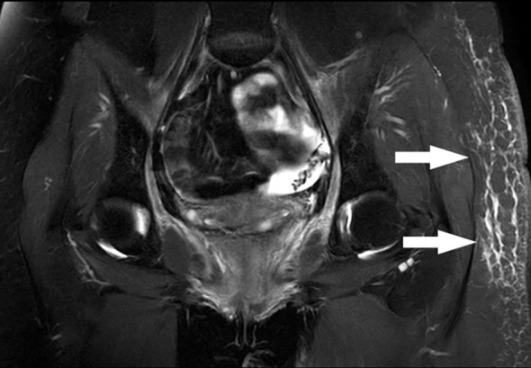
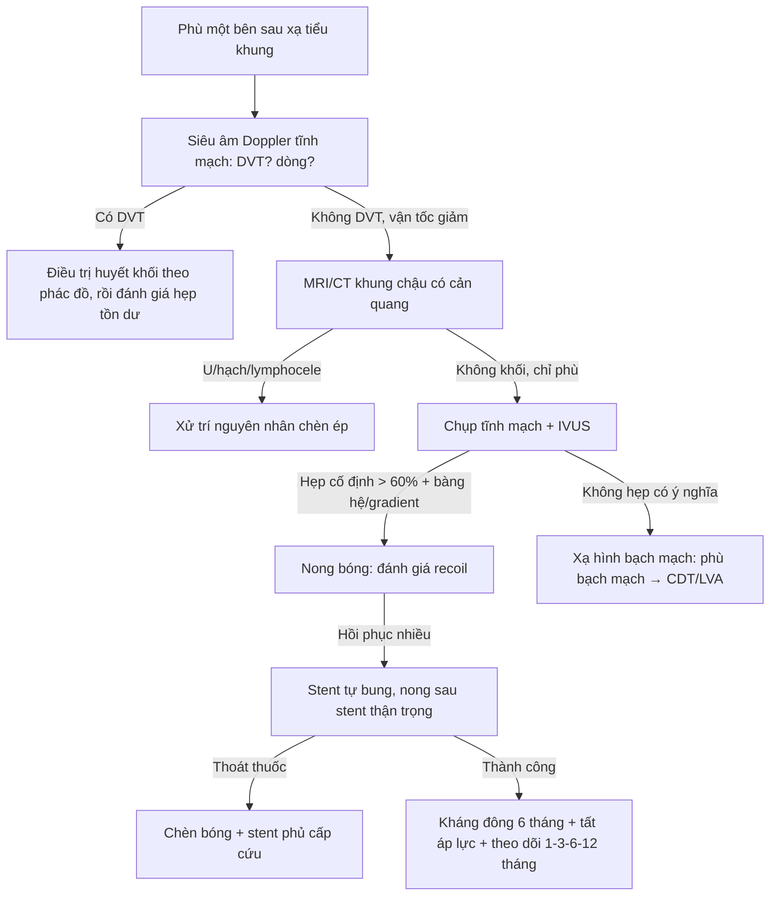
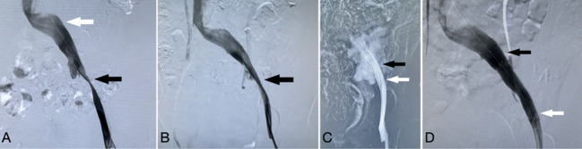
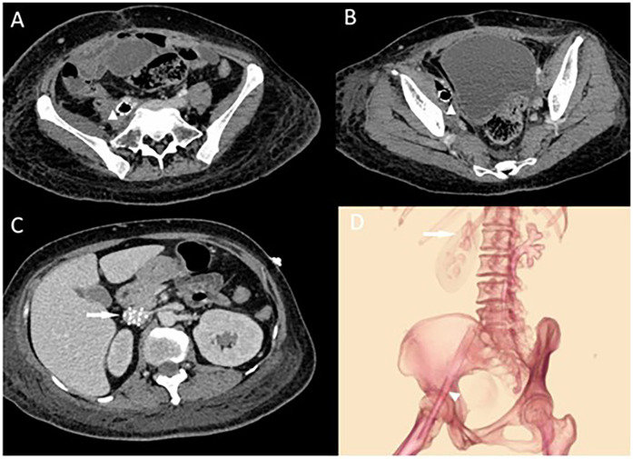

# 6709 — Hẹp tĩnh mạch chậu – đùi do xạ: vì sao phù chân xuất hiện MUỘN sau xạ tiểu khung, khi nào stent, và vì sao nong quá tay làm vỡ tĩnh mạch

**Tags:** `pattern:hep-tinh-mach` `pattern:tac-tinh-mach` `pattern:phu-chi` `pattern:trong-truong-chieu` `pattern:xo-hoa` `vung:chau` `vung:chi-duoi` `anatomy:he-tinh-mach-chau-dui` `protocol:sieu-am-Doppler` `protocol:MRV` `protocol:chup-tinh-mach` `protocol:IVUS`
**Mức chắc chắn (certainty):** tổng hợp y văn (literature synthesis) — ghép **ca nữ 34 tuổi xạ toàn khung chậu 50 Gy/25 phân liều vì ung thư cổ tử cung, phù chân trái 3 tháng sau xạ, hẹp tĩnh mạch chậu ngoài, stent 14 mm rồi vỡ tĩnh mạch khi nong sau stent, cứu bằng stent có màng** (Front Oncol 2023, PMCID **PMC10235677**, CC BY), **ca nữ 43 tuổi nhiễm stent tĩnh mạch chậu sau xạ, ổ mủ quanh stent + rò đại tràng** (Front Cardiovasc Med 2025, PMCID **PMC12066436**, CC BY), **loạt 38 bệnh nhân stent tĩnh mạch chủ–chậu do u chèn ép** (CVIR Endovasc 2024, PMCID **PMC10957860**, CC BY), **11 bệnh nhân phù bạch mạch bị chẩn đoán nhầm là hẹp tĩnh mạch chậu và đặt stent** (PLoS One 2025, PMCID **PMC12533920**, CC BY) và **bài tổng quan biến chứng stent tĩnh mạch sâu** (Cardiovasc Intervent Radiol 2024, PMCID **PMC11621186**, CC BY). Không có ca do nhóm tự chụp.

> **Kịch bản thực hành (ghép từ các ca trên, không phải ca nguyên văn):** nữ **34 tuổi**, ung thư cổ tử cung đã mổ + **xạ toàn khung chậu 50 Gy/25 phân liều** cách đây **1 năm**. Ba tháng sau xạ, **phù tăng dần chân trái**, nặng nhất ở **đùi**; **không đau ngực, không khó thở**. Siêu âm: **không huyết khối tĩnh mạch sâu**, nhưng **vận tốc tĩnh mạch đùi chung giảm**; MRI khung chậu: **không tái phát u, không khối chèn ép**, chỉ **phù dưới da đùi trái**. Câu hỏi: **phù này là di chứng xạ "không chữa được", phù bạch mạch, hay hẹp tĩnh mạch chậu — và nếu đặt stent thì làm sao không làm vỡ tĩnh mạch?**
> Bài chốt **bốn quyết định**: **(1) phù một bên sau xạ tiểu khung là bệnh cảnh có 5 nguyên nhân chồng lấp — xơ tĩnh mạch do xạ, u/hạch chèn ép, lymphocele, huyết khối sau viêm, và phù bạch mạch — phải phân biệt bằng siêu âm + MRI + chụp tĩnh mạch, không được mặc định "di chứng xạ"; (2) hẹp do xạ là hẹp CỐ ĐỊNH, DÀI, HỒI PHỤC sau nong (recoil), khác hẹp do chèn ép mềm; (3) stent là điều trị hiệu quả nhưng tĩnh mạch đã xạ **mất tính đàn hồi** — nong sau stent quá tích cực có thể **vỡ tĩnh mạch, sốc mất máu**, nên cần stent phủ sẵn và nong bóng "dừng đúng lúc"; (4) đặt stent mà không chứng minh được hẹp có ý nghĩa huyết động sẽ không giảm phù — 11/11 bệnh nhân phù bạch mạch bị stent đã không đỡ hoặc tái phát trong 3 tháng.** Nối [6707 – Bệnh động mạch ngoại biên do xạ](../6707-benh-dong-mach-ngoai-bien-do-xa/lesson.md) (mặt động mạch của cùng trường xạ), [1670 – Rò động mạch chậu – niệu quản sau xạ](../1670-ro-dong-mach-chau-nieu-quan-sau-xa/lesson.md), [1767 – Phù bạch mạch đầu cổ sau xạ](../1767-phu-bach-mach-dau-co-sau-xa/lesson.md), [1858 – Ghép hạch bạch huyết (VLNT)](../1858-ghep-hach-bach-huyet-vlnt/lesson.md), [3103 – Rò trực tràng – niệu đạo sau xạ trị tiền liệt tuyến](../3103-ro-truc-trang-nieu-dao-sau-xa-tri-tien-liet-tuyen/lesson.md).

## 1. Tổng quan bệnh học – cơ chế hình ảnh: vì sao tĩnh mạch đã xạ "không chịu nong"

- **Dịch tễ (epidemiology):** hẹp tĩnh mạch chậu do xạ **hiếm hơn nhiều** so với tổn thương động mạch cùng vùng; y văn chủ yếu là **ca bệnh và loạt nhỏ**, trong khi bệnh động mạch chậu–đùi do xạ đã có tổng quan hệ thống 25 nghiên cứu/43 ca (bài 6707). Vì vậy **không có con số tần suất đáng tin** — điều cần nhớ là **bệnh có thật, xuất hiện muộn, và bị bỏ qua vì "phù sau xạ là bình thường"** (PMC10235677).
- **Mô bệnh (pathology):** xạ gây **xơ hóa cả ba lớp thành mạch**, **thay thế lớp áo giữa bằng mô xơ**, **xơ hóa lớp áo ngoài và mô quanh mạch (periarterial/perivenous fibrosis)**; trên động mạch, hình ảnh này **không phân biệt được với xơ vữa** về mặt mô học (PMC10235677 dẫn y văn). Ở tĩnh mạch, cơ chế được **giả định tương tự** vì cùng là **tổn thương tế bào nội mô do bức xạ** — nhưng thành tĩnh mạch **mỏng, áp lực thấp, không có lớp cơ chắc**, nên hệ quả khác: **hẹp cố định + mất tính đàn hồi**, không có "mảng xơ vữa" để bóc.
- **TẠI SAO phù xuất hiện muộn và một bên:** tĩnh mạch chậu là **đường thoát duy nhất** của chi dưới; khi lòng hẹp, **áp lực tĩnh mạch mao mạch tăng** → theo **phương trình Starling**, dịch thoát vào mô kẽ nhiều hơn, vượt khả năng dẫn lưu bạch mạch → phù. Vì xơ hóa tiến triển **nhiều tháng đến nhiều năm**, phù xuất hiện **sau một khoảng trễ**; trong ca chỉ điểm, phù bắt đầu **3 tháng sau khi kết thúc 50 Gy**. Phù **một bên, ở đùi** là dấu hiệu định khu **tĩnh mạch chậu ngoài**, không phải phù toàn thân.
- **TẠI SAO đau khi nong là dấu hiệu cảnh báo:** trong ca chỉ điểm, bệnh nhân **đau dữ dội** khi nong tĩnh mạch chậu ngoài bằng bóng **12 mm ở 8 atm**, trong khi nong tĩnh mạch chậu chung **không đau và không có "eo bóng" (balloon waist)**. Đau dữ dội khi bơm bóng trên **thành tĩnh mạch xơ, mỏng** báo hiệu **căng quá mức** — vài phút sau, khi nong lại **12 mm ở 7 atm** sau khi đặt stent **14 × 80 mm**, tĩnh mạch **vỡ**: mạch **120–140 lần/phút**, huyết áp **70–90/40–60 mmHg**, thoát thuốc trên chụp mạch (PMC10235677).
- **TẠI SAO phải có "kế hoạch vỡ":** tĩnh mạch chậu đã xạ **không co lại như động mạch** và **không có mô đàn hồi đỡ**, nên khi vỡ, **chèn bóng (balloon tamponade) chỉ cầm tạm**; biện pháp quyết định là **stent có màng (covered stent)** đặt bên trong stent rỗng. Ca chỉ điểm: bóng **4 atm** cầm máu tạm, sau **30 phút** vẫn thoát thuốc → đặt **stent phủ 13,5 × 60 mm** trong stent cũ → cầm máu; ngày 3 **hemoglobin 94 g/L**, CT có **máu tụ sau phúc mạc**; xuất viện ngày 8, phù **hết hoàn toàn lúc 6 tháng**, tĩnh mạch **thông** (PMC10235677).
- **TẠI SAO cần IVUS:** chụp tĩnh mạch chỉ thấy **lòng chứa thuốc**, không thấy **thành dày, dây xơ (synechiae), cựa (spurs), van dính, vách trong lòng** và **chèn ép từ ngoài** — IVUS cho **tiết diện thật** để chọn cỡ stent và xác nhận stent áp sát thành. Đây là lý do các khuyến cáo dùng **IVUS chọn lọc** cho mọi ca nghi hẹp tĩnh mạch chậu (PMC10235677).
- **Ngưỡng kỹ thuật (quantitative, theo y văn stent tĩnh mạch):** hẹp **cố định > 60%** là ngưỡng hợp lý để đặt stent; stent **lớn hơn đường kính tĩnh mạch 1–2 mm**; cỡ tham chiếu **tĩnh mạch chậu chung 14–16 mm**, **chậu ngoài 12–14 mm**, **đùi chung 10–12 mm**; **di lệch stent 0,17%**, **gãy stent 0–3,3%**, **biến cố bất lợi nặng 1,2–6,5%**, **biến chứng tại chỗ chọc tới 5%**, **huyết khối trong stent cao nhất trong 2 tuần đầu** (PMC11621186).

## 2. Mẫu hình + chẩn đoán phân biệt theo cơ chế (gamut)

- **Mẫu hình chính:** **hẹp dài, nhẵn, cố định** ở **tĩnh mạch chậu ngoài/chung**, **hồi phục ngay sau nong (recoil)**, không có khối chèn ép, **không huyết khối cấp**, kèm **tuần hoàn bàng hệ** qua tĩnh mạch chậu đối bên/sinh dục; **phù một bên** tăng dần nhiều tháng sau xạ.
- **Gamut theo cơ chế:**
  - **Xơ tĩnh mạch do xạ (intrinsic radiation venopathy):** đúng trường chiếu, **không khối**, MRI âm tính với u, hẹp **cố định**.
  - **Chèn ép từ ngoài do u/hạch tái phát:** **khối thấy trên MRI/CT**, hẹp **lệch trục**, có thể kèm **huyết khối**; trong loạt 38 ca u chèn ép, **57% có huyết khối tĩnh mạch sâu** kèm theo (PMC10957860).
  - **Lymphocele sau nạo hạch:** ổ dịch **bờ mỏng, không ngấm thuốc**, chèn tĩnh mạch chậu; có thể **kèm xạ** — 6 ca sau mổ phụ khoa ± xạ đã được stent và giảm triệu chứng (PMC8562170).
  - **Huyết khối sau viêm/bệnh lý tĩnh mạch hậu huyết khối (post-thrombotic syndrome):** tiền sử DVT, tĩnh mạch **không đều, dày thành**, van hỏng; khác hẹp xơ đơn thuần.
  - **Phù bạch mạch (lymphedema):** phù **mu bàn chân, không mất hố ấn muộn (Stemmer sign)**, **không hẹp có ý nghĩa huyết động**; xạ tiểu khung vừa gây xơ tĩnh mạch **vừa phá hủy bạch mạch** → **phù hỗn hợp** là quy luật, không phải ngoại lệ.
  - **Nhiễm stent tĩnh mạch:** sốt, đau, **khí quanh stent** trên CT, ổ mủ; nguy cơ cao khi **đặt stent trong vùng xạ mới, không đánh giá chỉ định** (PMC12066436).
  - **Hẹp do chèn ép mạn tính kiểu May–Thurner:** hẹp do **động mạch chậu chung đè** ở người **không xạ**; **tần suất hẹp tĩnh mạch chậu trên hình ảnh lên tới 65% dân số chung**, nên **thấy hẹp không có nghĩa là hẹp gây bệnh** (PMC12533920).

## 3. Bảng so sánh phân biệt (ma trận đối chiếu)

| Thực thể (entity) | Hình ảnh điển hình | Chốt vào (rule-in) | Chốt loại (rule-out) | Gợi ý xác nhận |
|---|---|---|---|---|
| **Xơ tĩnh mạch chậu do xạ** | Hẹp **dài, nhẵn, cố định** ở chậu ngoài/chung; **hồi phục sau nong**; không khối; phù một bên nhiều tháng sau xạ | **Tiền sử xạ tiểu khung + hẹp cố định đúng trường chiếu + MRI không có u/khối** | Có **khối chèn ép** hoặc **huyết khối cấp** → nguyên nhân khác | Chụp tĩnh mạch + **IVUS**; đo gradient; thử nong thấy recoil |
| **U/hạch tái phát chèn ép** | **Khối mềm** quanh tĩnh mạch, hẹp **lệch trục**, có thể xâm lấn; **57% kèm DVT** | **Khối thấy trên MRI/CT + bờ không đều + hẹp lệch trục** | Không khối, hẹp **đồng tâm, nhẵn** → do xạ | MRI khung chậu có cản quang; mô bệnh nếu còn nghi |
| **Lymphocele sau nạo hạch** | **Ổ dịch bờ mỏng** cạnh tĩnh mạch chậu, không ngấm thuốc, chèn ép | **Tiền sử nạo hạch + ổ dịch điển hình** | Không có ổ dịch → loại | Siêu âm/CT/MRI; chọc hút nếu cần |
| **Hội chứng hậu huyết khối** | Tĩnh mạch **không đều, dày thành**, van hỏng, **hẹp không đều** | **Tiền sử DVT + thay đổi mạn tính sau huyết khối** | Tĩnh mạch **nhẵn, thành mỏng**, không tiền sử DVT → không phải | Siêu âm (thành, van, dòng); MRV |
| **Phù bạch mạch** | Phù **mu chân**, **Stemmer (+)**; tĩnh mạch **không hẹp có ý nghĩa** | **Xạ hạch + phù kiểu bạch mạch + xạ hình bạch mạch bất thường** | **Hẹp > 60% có gradient** → có nguyên nhân tĩnh mạch | **Xạ hình 99mTc-DX**/ICG; KHÔNG đặt stent khi chưa loại |
| **Nhiễm stent tĩnh mạch** | **Khí quanh stent**, ổ mủ quanh mạch, viêm mô mềm; sốt cao sau đặt | **Sốt + đau + khí quanh stent trên CT** | Không khí, không viêm → loại | CT; cấy máu; tháo stent + dẫn lưu là điều trị |
| **Hẹp kiểu May–Thurner** | Hẹp do **ĐM chậu chung đè** tĩnh mạch chậu trái; **không tiền sử xạ** | **Hình chèn ép điển hình + không xạ** | **Tiền sử xạ đúng vùng + xơ quanh mạch** → nghĩ do xạ | CT/MRV; IVUS |

*MRI khung chậu bệnh nhân 34 tuổi sau xạ 50 Gy: **không tái phát u, không khối chèn ép**, chỉ **phù dưới da đùi trái** (mũi tên) — phù do tĩnh mạch, không phải do u. Nguồn: Front Oncol 2023 (**PMC10235677**), CC BY 4.0.*

## 4. Protocol chụp + kỹ thuật can thiệp

- **Siêu âm Doppler tĩnh mạch (đầu tay):** đánh giá **huyết khối**, **tính chất dòng** (theo nhịp thở, tăng khi bóp), **vận tốc tĩnh mạch đùi chung** — ca chỉ điểm **không có DVT nhưng vận tốc giảm**, gợi ý hẹp phía trên. Không thấy tổn thương trên siêu âm **không loại trừ** hẹp tĩnh mạch chậu.
- **MRI/CT khung chậu có cản quang:** mục tiêu **loại u tái phát, hạch, lymphocele** trước khi kết luận "do xạ"; MRI cũng cho thấy **phù dưới da** và **mức độ xơ quanh mạch**.
- **Chụp tĩnh mạch (venography) + IVUS:** chọc **tĩnh mạch đùi cùng bên**, chụp **nhiều tư thế**, tìm **hẹp, bàng hệ, van dính**; **IVUS** đo **tiết diện lòng và độ dày thành**, chọn cỡ stent. Dùng **heparin 5.000 UI** trước nong (theo ca chỉ điểm).
- **Tiêu chuẩn can thiệp:** **hẹp cố định > 60%** + **triệu chứng** + **bằng chứng huyết động** (gradient, bàng hệ, chậm làm rỗng). **Nong bóng trước** để đánh giá **recoil**: hồi phục nhiều = tổn thương xơ, cần stent.
- **Chọn stent:** **tự bung, nitinol**, đường kính **lớn hơn tĩnh mạch lành 1–2 mm** (chậu ngoài **12–14 mm**; ca chỉ điểm dùng **14 × 80 mm**), **chiều dài phủ trọn đoạn hẹp** và **neo ở đoạn lành**; tránh để stent **băng qua dây chằng bẹn** vì **gãy stent 0–3,3%** (PMC11621186).
- **Cảnh báo nong sau stent:** ở tĩnh mạch đã xạ, **nong sau stent phải thận trọng** — bắt đầu bằng **bóng nhỏ hơn stent 1–2 mm**, **áp lực thấp**, **dừng khi hết "eo"**, theo dõi **đau, huyết áp, tần số tim**; nếu **thoát thuốc** → **chèn bóng** rồi **stent phủ**. Chuẩn bị sẵn **stent phủ** trước khi nong.
- **Kháng đông sau thủ thuật:** ca chỉ điểm dùng **rivaroxaban 20 mg/ngày × 6 tháng**, sau đó **10 mg/ngày duy trì**, kèm **tất áp lực**; huyết khối trong stent **cao nhất 2 tuần đầu** nên không được ngắt kháng đông sớm (PMC11621186).
- **Theo dõi:** lâm sàng + siêu âm **1, 3, 6, 12 tháng** rồi **hằng năm**; mục tiêu **hết phù, stent thông, không tái hẹp**.

## 5. Biến thể bình thường và cạm bẫy

- **"Hẹp tĩnh mạch chậu" là hình ảnh rất thường gặp:** **tới 65% dân số chung** có hẹp tĩnh mạch chậu trên hình ảnh, phần lớn **không triệu chứng**; trong loạt **11 bệnh nhân phù bạch mạch bị đặt stent**, **6 người độ I–IIa đỡ một phần rồi phù tái phát và nặng lên trong 3 tháng**, **5 người còn lại không đỡ chút nào**, sau đó mới được chẩn đoán đúng là **phù bạch mạch** (PMC12533920). **Đừng đặt stent chỉ vì "thấy hẹp".**
- **Bỏ qua u tái phát:** hẹp do xạ và hẹp do hạch **có thể cùng tồn tại**; luôn có **MRI/CT có cản quang** trước can thiệp, và **không bao giờ** kết luận "do xạ" khi chưa loại khối.
- **Nong quá tay:** ca chỉ điểm cho thấy **đau dữ dội khi nong = dấu hiệu nguy hiểm**, không phải "bệnh nhân nhạy cảm"; nong **12 mm ở 7 atm** sau stent **14 mm** đã **làm vỡ tĩnh mạch** — bài học: **bóng nhỏ hơn, áp lực thấp hơn, dừng sớm**, và **chuẩn bị stent phủ**.
- **Quên kháng đông:** huyết khối trong stent **cao nhất 2 tuần đầu**; ngắt kháng đông vì "sắp mổ" hoặc "chảy máu nhẹ" mà không có kế hoạch thay thế = **mất stent**.
- **Nhiễm stent:** đặt stent trong **vùng xạ mới, có ổ nhiễm/hoại tử** mà **không đánh giá chỉ định** có thể dẫn tới **nhiễm stent, nhiễm khuẩn huyết, phải tháo stent + cắt đoạn ruột** (ca 43 tuổi: **khí quanh stent, ổ mủ, rò đại tràng**, phải **tháo 2 stent + sửa rò + hậu môn nhân tạo**) (PMC12066436). **Sốt + đau sau đặt stent = CT ngay.**
- **Gãy stent ở dây chằng bẹn:** stent bắc qua **dây chằng bẹn** chịu lực gập–duỗi lặp lại; **gãy stent 0–3,3%**, thường **1 cm dưới dây chằng bẹn**; đau tái phát sau stent = nghĩ **gãy/di lệch** (PMC11621186).
- **Phù bạch mạch "trá hình":** phù **mu chân, dày da, không mất hố ấn** gợi ý bạch mạch; **xạ hình 99mTc-DX/ICG** trước khi can thiệp tĩnh mạch. Điều trị là **CDT + phẫu thuật bạch mạch**, không phải stent.

## 6. Tự lượng giá — Blind Quiz

**Ca 1 — Nữ 34 tuổi, phù đùi trái 3 tháng sau xạ 50 Gy vì ung thư cổ tử cung. Nhìn MRI, mô tả trước.**

- Câu hỏi: Phù ở đâu? Có khối chèn ép hay tái phát u không? Bước tiếp theo là gì?

<b>Bấm để hiện đáp án</b>

- Dấu hiệu: **phù dưới da đùi trái** (mũi tên), **không khối**, **không hạch**, **không tái phát u**.
- Chẩn đoán: phù do **hẹp tĩnh mạch chậu ngoài sau xạ** (đã xác nhận bằng chụp tĩnh mạch); MRI dùng để **loại nguyên nhân chèn ép**.
- Vì sao: xạ gây **xơ thành tĩnh mạch + xơ quanh mạch** → hẹp cố định; áp lực tĩnh mạch tăng → phù theo **Starling**.
- Nguồn ảnh: Front Oncol 2023 (**PMC10235677**), CC BY 4.0.

**Ca 2 — Cùng bệnh nhân, chụp tĩnh mạch và can thiệp:**

- Câu hỏi: (A) hẹp ở đâu? (B) sau nong có gì bất thường? (C) biến chứng gì? (D) xử trí?

<b>Bấm để hiện đáp án</b>

- (A) **Hẹp nặng tĩnh mạch chậu ngoài** (mũi tên đen) + hẹp nhẹ **tĩnh mạch chậu chung** (mũi tên trắng).
- (B) **Hồi phục (recoil) rõ sau nong** — thành tĩnh mạch xơ không giữ được hình dạng.
- (C) Sau khi đặt stent **14 × 80 mm** và nong lại **12 mm ở 7 atm**: **thoát thuốc (extravasation)** — **vỡ tĩnh mạch**, sốc mất máu.
- (D) **Chèn bóng 4 atm** cầm máu tạm → **stent phủ 13,5 × 60 mm** trong stent cũ; truyền dịch–máu; ngày 3 có **máu tụ sau phúc mạc**, xuất viện ngày 8, phù hết lúc 6 tháng.
- Bài học: tĩnh mạch đã xạ **không chịu nong quá cỡ**; đau dữ dội khi nong là **dấu hiệu cảnh báo**.
- Nguồn ảnh: Front Oncol 2023 (**PMC10235677**), CC BY 4.0.

**Ca 3 — Nữ 43 tuổi, ung thư cổ tử cung xạ 28 lần, phù chân phải 2 tháng sau xạ, đã đặt stent tĩnh mạch chậu; 2 tháng sau sốt cao, đau:**

- Câu hỏi: Dấu hiệu nguy hiểm nhất trên CT là gì? Chẩn đoán? Điều trị?

<b>Bấm để hiện đáp án</b>

- Dấu hiệu: **khí quanh stent tĩnh mạch chậu ngoài/đùi**, **viêm mô mềm quanh mạch**, ổ mủ (tam giác); (D) vị trí **stent và filter** băng qua dây chằng bẹn.
- Chẩn đoán: **nhiễm stent tĩnh mạch + áp-xe sau phúc mạc**, có **rò đại tràng**; phải **tháo stent, dẫn lưu, sửa rò, hậu môn nhân tạo** + kháng sinh mạnh.
- Vì sao: stent đặt **ngay sau khi hút huyết khối, trong vùng xạ mới**, chưa đánh giá đủ chỉ định → **nhiễm**; khí quanh stent là dấu hiệu **cấp cứu**.
- Nguồn ảnh: Front Cardiovasc Med 2025 (**PMC12066436**), CC BY 4.0.

## Bài liên quan chéo
- [6707 – Bệnh động mạch ngoại biên do xạ](../6707-benh-dong-mach-ngoai-bien-do-xa/lesson.md) (mặt động mạch của cùng trường xạ)
- [1670 – Rò động mạch chậu – niệu quản sau xạ](../1670-ro-dong-mach-chau-nieu-quan-sau-xa/lesson.md)
- [1767 – Phù bạch mạch đầu cổ sau xạ](../1767-phu-bach-mach-dau-co-sau-xa/lesson.md)
- [1858 – Ghép hạch bạch huyết (VLNT)](../1858-ghep-hach-bach-huyet-vlnt/lesson.md)
- [3103 – Rò trực tràng – niệu đạo sau xạ trị tiền liệt tuyến](../3103-ro-truc-trang-nieu-dao-sau-xa-tri-tien-liet-tuyen/lesson.md)
- [175 – Chèn ép mạch (vascular compression syndromes)](../175-chen-ep-mach/lesson.md)

## Ảnh
- `6709_phu-chi_MRI_PMC10235677-F1.jpg` — Front Oncol 2023, **PMC10235677**, CC BY 4.0.
- `6709_hep-tinh-mach_CTTM_PMC10235677-F2.jpg` — Front Oncol 2023, **PMC10235677**, CC BY 4.0.
- `6709_nhiem-stent_CT_PMC12066436-F1.jpg` — Front Cardiovasc Med 2025, **PMC12066436**, CC BY 4.0.
- Nguồn + giấy phép từng ảnh: `images/CREDITS.md`.

> Không dùng để chẩn đoán độc lập khi chưa có người hướng dẫn.
