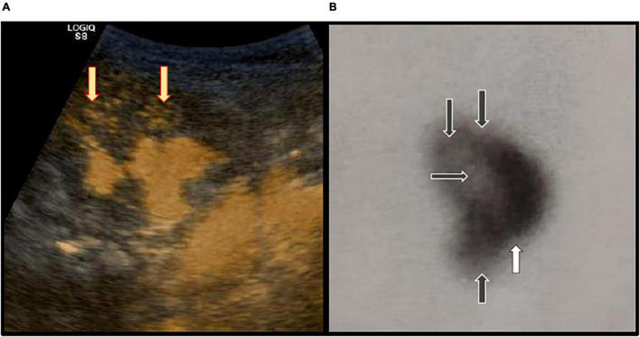
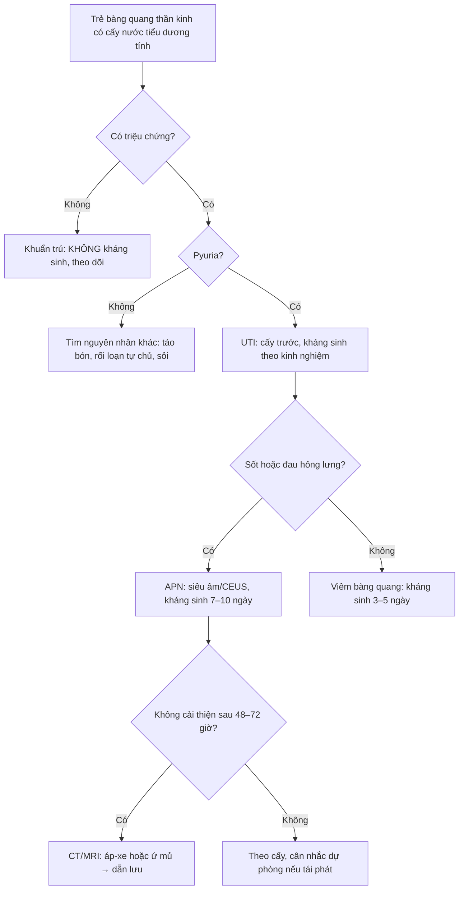
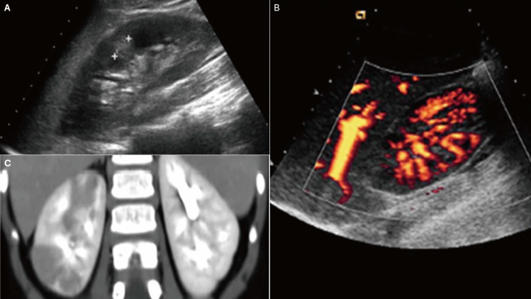
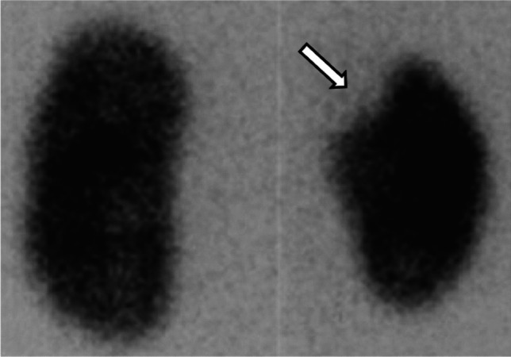
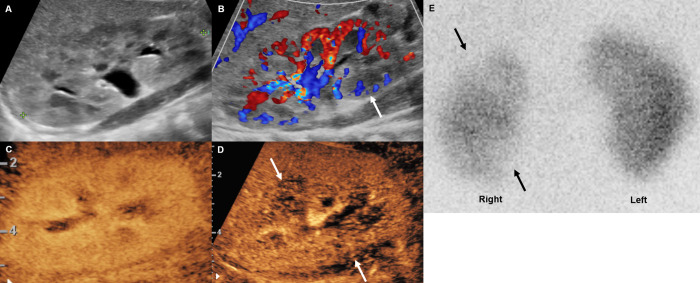

# 671 — Nhiễm trùng tiểu & viêm thận–bể thận ở trẻ có bàng quang thần kinh / UTI & pyelonephritis in pediatric neurogenic bladder

**Tags:** `pattern:viem-nhiem` `vung:tiet-nieu` `protocol:US-than-tiet-nieu` `score:VUR` `anatomy:bang-quang-than-kinh`
**Mức chắc chắn (certainty):** tổng hợp y văn (literature synthesis) — cohort + ca minh họa có ảnh CC BY, ghi PMCID từng ảnh.

## 1. Tổng quan bệnh học – cơ chế hình ảnh

- **Bàng quang thần kinh (neurogenic bladder — NB)** là rối loạn chức năng chứa–tống nước tiểu do tổn thương thần kinh: **spina bifida/myelomeningocele**, chấn thương tủy, sacral agenesis, tethered cord, bại não. Hai kiểu sinh lý bệnh thường gặp: **bàng quang co bóp quá mức/kém giãn** (compliance thấp, áp lực cao) và **bàng quang không co bóp/tồn lưu**; nhiều trẻ có cả hai.
- **Vì sao dễ nhiễm trùng:** tồn lưu nước tiểu + áp lực bàng quang cao + **trào ngược bàng quang–niệu quản (VUR)** + sỏi + đặt catheter định kỳ (CIC) → vi khuẩn bám niêm mạc, tạo **biofilm** và cư trú mạn. Đây là lý do **khuẩn trú (colonization) rất hay gặp** và không đồng nghĩa với nhiễm trùng.
- **Vì sao thận bị tổn thương:** áp lực cao + VUR đưa vi khuẩn lên thận → **viêm thận–bể thận cấp (acute pyelonephritis — APN)** → co kéo, xơ hóa, **sẹo thận (renal scar)** → tăng huyết áp, giảm chức năng thận. Trong một cohort 176 trẻ spina bifida, **14,5%** mẫu cấy dương tính đơn loại, **54,3%** là *E. coli* (Zegers 2017, PMC5228098).
- **TẠI SAO hình ảnh thay đổi:**
  - **Viêm thận–bể thận cấp** gây **phù mô kẽ + giảm tưới máu cục bộ**: trên siêu âm là vùng **giảm âm/không đồng nhất**, mất phân biệt vỏ–tủy; trên **CEUS/power Doppler** là **vùng giảm tưới máu**; trên CT là **vùng hình nêm giảm ngấm thuốc** (“striated nephrogram”).
  - **Áp-xe thận** là ổ dịch hóa có **viền ngấm thuốc**, trung tâm không ngấm; **ứ mủ thận (pyonephrosis)** là hệ đài–bể thận giãn chứa **dịch đục/mảnh vụn**, cần dẫn lưu cấp.
  - **Sẹo thận** là vùng **mất vỏ thận** khu trú, co kéo đài; trên **DMSA** là **vùng giảm/không bắt xạ** — chỉ đánh giá ổn định sau **4–6 tháng** vì tổn thương cấp có thể hồi phục.
- **Ngưỡng định lượng cần nhớ:**
  - **Pyuria:** ≥ **10 bạch cầu/mm³** nước tiểu không ly tâm hoặc ≥ **5 bạch cầu/HPF**; dipstick leukocyte esterase/nitrite chỉ là sàng lọc.
  - **Cấy:** AAP 2011 dùng ngưỡng **≥ 50.000 CFU/mL** một loại uropathogen từ mẫu **catheter/suprapubic/clean-catch** (một số lab dùng **100.000 CFU/mL** cho clean-catch). Ở trẻ CIC, **không điều trị chỉ vì cấy dương tính**.
  - **Yếu tố nguy cơ tổn thương đường tiết niệu trên (UUTD)** ở trẻ NB (nomogram 267 trẻ): **DLPP ≥ 40 cmH₂O** (OR 3,588), **compliance < 20 mL/cmH₂O** (OR 2,444), **UTI tái phát** (OR 2,278), **bàng quang co bóp quá mức** (OR 2,848); **CIC là yếu tố bảo vệ** (OR 0,374) (Li 2023, PMC9768210).
  - **Dịch tễ:** trong 1.065 trẻ NB ≤ 17 tuổi, **18,1%** có nhiễm trùng tiểu dưới; ở nhóm **spina bifida mở** lên tới **54,1%** (Kitta 2023, PMC10179246).

## 2. Mẫu hình + chẩn đoán phân biệt theo vị trí (gamut)

- **Mẫu hình lâm sàng:** trẻ NB có **sốt + đau hông lưng/thắt lưng + nôn** → nghĩ APN; **tiểu buốt, tiểu gấp, đau bụng dưới, không sốt** → nghĩ viêm bàng quang; **sốt + bàng quang căng, không tiểu được** → nghĩ ứ mủ/tắc nghẽn; **không triệu chứng + cấy dương tính** → nghĩ khuẩn trú.
- **Gamut theo vị trí:**
  - **Bàng quang:** viêm bàng quang cấp, viêm bàng quang xuất huyết, sỏi bàng quang, túi thừa, lộ/xói mòn catheter.
  - **Niệu quản–bể thận:** VUR (I–V), ứ nước do hẹp khúc nối, sỏi, ứ mủ thận.
  - **Nhu mô thận:** APN khu trú/ổ, áp-xe thận, viêm đài–bể thận, sẹo thận cũ.
  - **Ngoài đường tiểu:** viêm mào tinh–tinh hoàn, áp-xe cơ thắt lưng–chậu, viêm phúc mạc, **táo bón** (rất hay gặp ở spina bifida), **rối loạn tự chủ (autonomic dysreflexia)**.
- **Bẫy lâm sàng:** trẻ NB có thể **không cảm nhận đau hông lưng** hoặc biểu hiện bằng **tăng huyết áp, vã mồ hôi, co cứng, khó chịu** do rối loạn tự chủ — không được quy mọi triệu chứng cho UTI.

*(A) ceVUS: trào ngược trong thận ở cực trên/giữa (mũi tên vàng). (B) DMSA: khuyết xạ nhiều vùng và sẹo cực dưới (mũi tên). Nguồn: Simičić Majce A et al., Front Pediatr 2022 (PMC9309385), Fig. 1, CC BY 4.0.*

## 3. Bảng so sánh phân biệt (ma trận đối chiếu)

| Thực thể (entity) | Hình ảnh/lâm sàng điển hình | Chốt vào (rule-in) | Chốt loại (rule-out) | Gợi ý xác nhận |
|---|---|---|---|---|
| Khuẩn trú (asymptomatic bacteriuria) | Cấy dương tính nhưng **không triệu chứng**, có thể có pyuria nhẹ; bàng quang thần kinh/CIC | **Cấy dương tính + không sốt/đau + không thay đổi lâm sàng** | **Sốt, đau hông lưng, nôn, thay đổi hành vi → không còn là khuẩn trú** | Không điều trị; theo dõi lâm sàng, không cấy định kỳ |
| Viêm bàng quang cấp | Tiểu buốt/gấp, đau bụng dưới, nước tiểu đục; **không sốt**; US bàng quang dày thành | **Triệu chứng đường tiểu dưới + pyuria + cấy ≥ 50.000 CFU/mL** | **Sốt/đau hông lưng → nghĩ APN, không chỉ cystitis** | Cấy trước kháng sinh; US nếu tái phát |
| Viêm thận–bể thận cấp (APN) | Sốt, đau hông lưng, nôn; US: vùng giảm âm/mất phân biệt vỏ–tủy; **CEUS: giảm tưới máu**; CT: vùng hình nêm giảm ngấm | **Sốt + pyuria + cấy dương tính + ổ giảm tưới máu/giảm ngấm** | **US bình thường KHÔNG loại trừ APN**; phải CEUS/CT/DMSA nếu nghi cao | CEUS hoặc CT có cản quang; DMSA sau 4–6 tháng |
| Áp-xe thận | Ổ dịch **viền ngấm thuốc**, trung tâm không ngấm; sốt dai dẳng, đau nhiều | **Ổ dịch hóa có viền + sốt không giảm sau 48–72 giờ kháng sinh** | **Chỉ APN lan tỏa, không ổ dịch → không cần dẫn lưu** | CT/MRI; dẫn lưu nếu > 3–5 cm hoặc không đáp ứng |
| Ứ mủ thận (pyonephrosis) | Đài–bể thận giãn, **dịch đục/mảnh vụn**, thành dày; nhiễm trùng nặng | **Giãn hệ đài–bể + sốt/nhiễm trùng + dịch đục** | **Giãn đơn thuần không sốt → ứ nước, chưa ứ mủ** | US/CT; dẫn lưu niệu quản hoặc chọc thận cấp |
| Sỏi/ứ nước do tắc | Đau quặn, US giãn đài–bể; CT thấy sỏi cản quang | **Sỏi + giãn hệ đài–bể + đau** | **Giãn nhẹ không sỏi, không đau → theo dõi** | CT không cản quang/CTA; siêu âm Doppler |
| Rối loạn tự chủ (autonomic dysreflexia) | **Tăng huyết áp + nhịp chậm + vã mồ hôi + đau đầu**, không sốt; thường do bàng quang căng/sỏi | **HA tăng đột ngột + kích thích bàng quang/trực tràng** | **Sốt + pyuria + cấy dương → nhiễm trùng là nguyên nhân/thúc đẩy** | Đo HA, làm rỗng bàng quang, tìm ổ kích thích |
| Viêm mào tinh–tinh hoàn | Đau bìu một bên, sưng, sốt; Doppler tăng tưới máu | **Đau bìu + sưng + Doppler tăng tưới máu** | **Xoắn tinh hoàn: đau đột ngột, Doppler giảm/không tưới máu → cấp cứu ngoại** | Siêu âm Doppler; khám niệu dục |

### Dấu hiệu chốt cần đọc đúng
- **APN trên CEUS:** vùng **giảm tưới máu** ở thì nhu mô sớm, có thể thấy rõ hơn power Doppler; trong nghiên cứu 21 trẻ, CEUS đồng thuận với DMSA **κ = 0,80**, trong khi siêu âm grayscale và color Doppler không đồng thuận có ý nghĩa (Lee 2023, PMC10075446).
- **Sẹo thận trên DMSA:** khuyết xạ **khu trú vỏ thận**, bờ rõ, thường ở cực trên/dưới; phân biệt với **thùy thai (fetal lobulation)** và **cột Bertin phì đại** — nhờ hình dạng bờ ngoài và xác nhận bằng DMSA 2 pha/SPECT khi cần.
- **US bàng quang:** thành dày, bè dày (trabeculation), túi thừa, sỏi, cặn; đánh giá **thể tích tồn lưu** sau CIC/đi tiểu. Áp lực bàng quang (DLPP/compliance) lấy từ **niệu động học (urodynamics)**, không lấy từ hình ảnh.

## 4. Protocol chụp + hệ phân độ/điểm chuẩn hóa

- **Lấy mẫu nước tiểu đúng:** ưu tiên **catheter mới** (CIC) hoặc chọc hút trên xương mu ở trẻ nhỏ; **không lấy từ túi dẫn lưu/ống cũ**; cấy **trước** kháng sinh; ghi rõ phương pháp lấy mẫu.
- **Siêu âm thận–bàng quang (RBUS):** chỉ định khi sốt/UTI phức tạp, nghi ứ nước/áp-xe/sỏi; đánh giá kích thước thận, độ dày nhu mô, giãn đài–bể, bàng quang, tồn lưu. Ở trẻ NB, siêu âm **định kỳ** (thường 6–12 tháng) và khi có triệu chứng.
- **CEUS:** khi nghi APN mà siêu âm thường/Doppler không rõ; không dùng iod, có thể lặp lại; đánh giá tưới máu nhu mô.
- **CT/MRI:** khi nghi **áp-xe, ứ mủ, sỏi cản quang, biến chứng** hoặc không đáp ứng điều trị; MRI ưu tiên ở trẻ cần tránh bức xạ.
- **VCUG/ceVUS:** đánh giá VUR (độ I–V) khi có UTI tái phát, bất thường trên siêu âm, hoặc theo dõi NB có VUR đã biết; ceVUS tránh bức xạ.
- **DMSA:** đánh giá sẹo/giảm chức năng vỏ thận **4–6 tháng sau đợt APN**, không làm quá sớm.
- **Niệu động học:** đo **compliance, DLPP, thể tích tồn lưu, áp lực detrusor** để quyết định CIC/kháng cholinergic/Botox; đây là phần “không thể thay bằng hình ảnh”.

- **Điều trị kháng sinh:** viêm bàng quang **3–5 ngày**; APN **7–10 ngày** (10–14 ngày nếu áp-xe/không cải thiện). Chọn theo cấy/kháng sinh đồ; **nitrofurantoin không dùng cho APN** (nồng độ mô thận thấp); tránh fluoroquinolone ở trẻ nếu còn lựa chọn khác.
- **Dự phòng (CAP):** cân nhắc khi **VUR độ III–V** hoặc **UTI sốt tái phát**; lựa chọn nitrofurantoin (tránh < 2 tháng, thiếu G6PD), TMP-SMX, cephalexin; **đánh giá lại sau 6–12 tháng**, không dùng vô thời hạn. **Không điều trị khuẩn trú.**
- **Kiểm soát bàng quang:** CIC đúng kỹ thuật, làm rỗng bàng quang đều, điều trị táo bón, kháng cholinergic khi bàng quang co bóp quá mức, Botox/đặt bàng quang khi compliance thấp; giảm áp lực bàng quang là cách phòng UTI–sẹo thận hiệu quả nhất.
- **Kháng sinh đồ & đa kháng:** trước khi dùng kháng sinh phổ rộng, **cấy lại** và xem yếu tố nguy cơ (nhập viện, kháng sinh gần đây, catheter lưu, CIC); xuống thang khi có kết quả. Trong cohort spina bifida, **ngừng dự phòng kháng sinh** gắn với **giảm tỷ lệ đề kháng** (Zegers 2017, PMC5228098) — nhưng quyết định phải cá thể hóa theo số đợt UTI sốt và mức VUR.

## 5. Biến thể bình thường và cạm bẫy

- **Khuẩn trú là “bình thường” ở nhiều trẻ CIC:** cấy dương tính đơn loại, không triệu chứng, không cần kháng sinh. Điều trị sẽ chọn lọc vi khuẩn đề kháng và tăng nguy cơ *C. difficile*.
- **US bình thường không loại trừ APN:** tổn thương viêm có thể khu trú và chỉ thấy trên CEUS/CT; nếu nghi cao, đừng dừng ở siêu âm grayscale.
- **DMSA quá sớm:** làm trong vòng vài tuần sau APN có thể thấy khuyết xạ do phù/viêm và gọi nhầm là sẹo; chờ **4–6 tháng**.
- **Sẹo thận vs biến thể:** thùy thai, cột Bertin phì đại, lách tiếp giáp cực trên trái có thể giả sẹo trên US; DMSA/CT xác nhận.
- **VUR độ thấp vẫn có thể có sẹo:** trào ngược trong thận (intrarenal reflux) làm sẹo ngay cả ở VUR độ I–II; đừng chỉ dựa vào độ VUR để quyết định.
- **Rối loạn tự chủ:** tăng huyết áp + nhịp chậm ở trẻ chấn thương tủy/spina bifida có thể do bàng quang căng, không phải nhiễm trùng; xử trí làm rỗng bàng quang trước.
- **Táo bón:** rất hay gặp ở spina bifida, gây đau bụng/sốt nhẹ giả UTI; hỏi và khám trực tràng, X-quang bụng khi cần.
- **Catheter lưu lâu ngày:** luôn nghĩ **ổ nhiễm từ biofilm**, sỏi quanh catheter, áp-xe; cấy từ catheter mới, không từ túi.

## 6. Tự lượng giá — Blind Quiz

**Ca 1 — Bé trai 3 tuổi, myelomeningocele, CIC. Sốt 39°C, đau hông lưng, nôn. Siêu âm thận và CT bụng có cản quang.**

- Gợi ý lâm sàng: UTI tái phát nhiều đợt, đang dùng CIC, không có sỏi rõ.
- Câu hỏi: Mô tả 3 dấu hiệu trên 3 phương thức? Chẩn đoán và 3 phân biệt? Bước tiếp theo?

<b>Bấm để hiện đáp án (findings + chẩn đoán)</b>

- **Findings:** (A) siêu âm: vùng **giảm âm/không đồng nhất** ở nhu mô thận; (B) power Doppler: **vùng giảm tưới máu**; (C) CT: **vùng hình nêm giảm ngấm thuốc** ở cực trên thận phải.
- **Chẩn đoán:** viêm thận–bể thận cấp (APN) khu trú.
- **Phân biệt:** áp-xe thận (ổ dịch viền ngấm), ứ mủ thận (giãn đài–bể + dịch đục), sỏi/ứ nước (giãn + sỏi), và khuẩn trú (không sốt/đau).
- **Xử trí:** cấy máu/nước tiểu trước kháng sinh, kháng sinh theo kinh nghiệm phổ đường tiểu 7–10 ngày, theo dõi 48–72 giờ; nếu không cải thiện → CT/MRI tìm áp-xe, dẫn lưu; DMSA sau 4–6 tháng để đánh giá sẹo.
- Nguồn ảnh: Pietropaolo G et al., Pediatr Nephrol 2025 (PMC12187806), Fig. 3, CC BY 4.0 (hình tổng hợp từ nguồn CC BY).

**Ca 2 — Bé gái 5 tuổi, spina bifida, nhiều đợt UTI sốt. DMSA 6 tháng sau đợt gần nhất.**

- Gợi ý lâm sàng: đã điều trị nhiều đợt APN, hiện không sốt; siêu âm thận hơi nhỏ bên phải.
- Câu hỏi: Dấu hiệu trên DMSA? Ý nghĩa tiên lượng? Làm gì để phòng tái phát?

<b>Bấm để hiện đáp án (findings + chẩn đoán)</b>

- **Findings:** **khuyết xạ khu trú cực trên thận phải** (mũi tên), nhu mô còn lại bắt xạ; tương ứng **sẹo thận**.
- **Chẩn đoán:** sẹo thận sau APN tái phát; nguy cơ tăng huyết áp, giảm chức năng thận, và tái phát nếu còn VUR/áp lực bàng quang cao.
- **Phòng tái phát:** tối ưu CIC/làm rỗng bàng quang, điều trị táo bón, đo urodynamics (DLPP/compliance), cân nhắc dự phòng kháng sinh nếu VUR độ III–V hoặc UTI sốt tái phát, theo dõi siêu âm/creatinine/HA.
- Nguồn ảnh: Pietropaolo G et al., Pediatr Nephrol 2025 (PMC12187806), Fig. 7, CC BY 4.0.

**Ca 3 — Bé trai 2 tháng tuổi, sốt, nghi UTI. Siêu âm grayscale bình thường, sau đó CEUS.**

- Gợi ý lâm sàng: cấy nước tiểu *E. coli*; siêu âm thường và color Doppler không thấy ổ bất thường.
- Câu hỏi: CEUS thêm được gì? Vì sao không dừng ở siêu âm thường? Đối chiếu với DMSA ra sao?

<b>Bấm để hiện đáp án (findings + chẩn đoán)</b>

- **Findings:** (A) grayscale bình thường; (B) color Doppler không thấy rõ; (C,D) **CEUS: vùng giảm tưới máu** ở cực giữa/dưới thận; (E) DMSA tương ứng vùng giảm bắt xạ.
- **Chẩn đoán:** APN khu trú. CEUS phát hiện tổn thương mà siêu âm thường/Doppler bỏ sót; trong nghiên cứu 21 trẻ, CEUS đồng thuận với DMSA **κ = 0,80**.
- **Xử trí:** kháng sinh theo cấy, theo dõi; DMSA lặp sau 4–6 tháng nếu cần đánh giá sẹo; tầm soát VUR/urodynamics nếu tái phát.
- Nguồn ảnh: Lee HB et al., PLOS ONE 2023 (PMC10075446), Fig. 2, CC BY 4.0.

## Bài liên quan chéo
- [600 – Tổng quan Nhi khoa](../600-tong-quan-nhi-khoa/lesson.md)
- [635 – Dị tật tiết niệu nhi: SFU, VUR, PUV](../635-di-tat-tiet-nieu-nhi-SFU-VUR-PUV/lesson.md)
- [668 – Theo dõi sau tháo căng tủy & bàng quang thần kinh](../668-theo-doi-sau-thao-cang-tuy-bang-quang-than-kinh/lesson.md)
- [642 – Biến chứng muộn sau chấn thương đường tiết niệu dưới ở trẻ](../642-bien-chung-muon-chan-thuong-nieu-dao-nhi/lesson.md)

## Ảnh
- `671_viem-than-be-than_CT_PMC12187806-F3-CCBY40.jpg` — US/power Doppler/CT của APN; Pietropaolo G et al., Pediatr Nephrol 2025, CC BY 4.0.
- `671_seo-than_DMSA_PMC12187806-F7-CCBY40.jpg` — DMSA: khuyết xạ cực trên = sẹo; Pietropaolo G et al., Pediatr Nephrol 2025, CC BY 4.0.
- `671_viem-than-be-than_CEUS_PMC10075446-F2-CCBY40.jpg` — CEUS phát hiện vùng giảm tưới máu; Lee HB et al., PLOS ONE 2023, CC BY 4.0.
- `671_trao-nguoc-trong-than_ceVUS-DMSA_PMC9309385-F1-CCBY40.jpg` — ceVUS intrarenal reflux + DMSA; Simičić Majce A et al., Front Pediatr 2022, CC BY 4.0.
- Nguồn + giấy phép từng ảnh: `images/CREDITS.md`.

> Không dùng để chẩn đoán độc lập khi chưa có người hướng dẫn.
