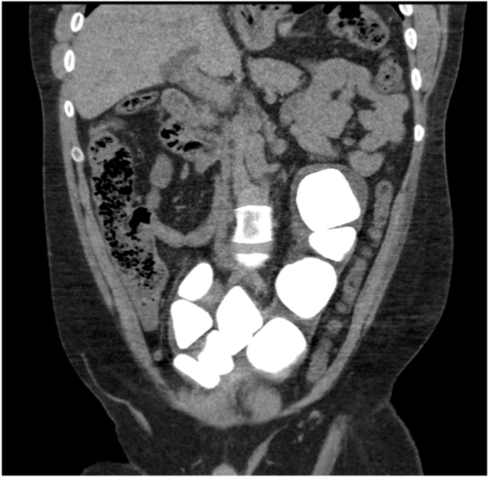
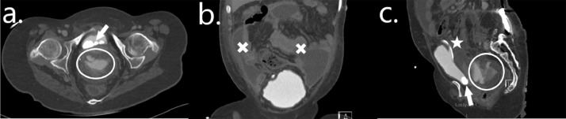
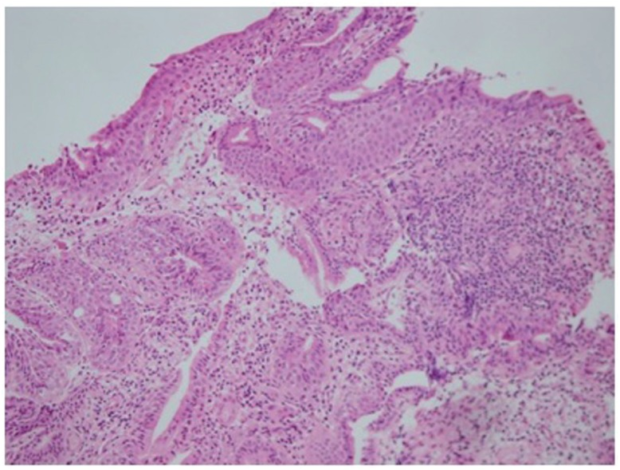
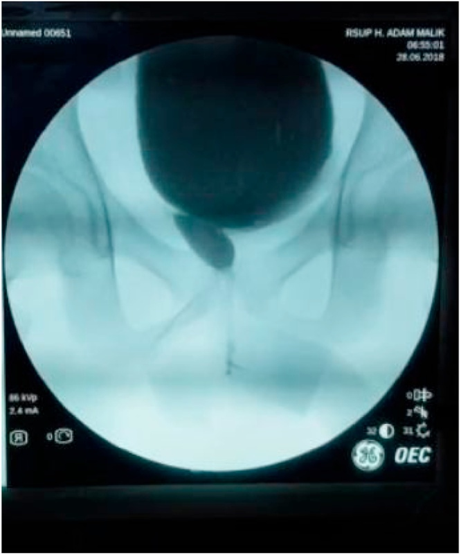
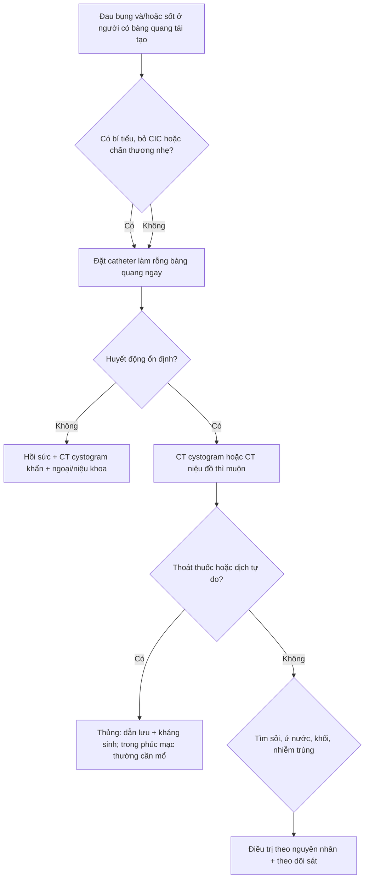
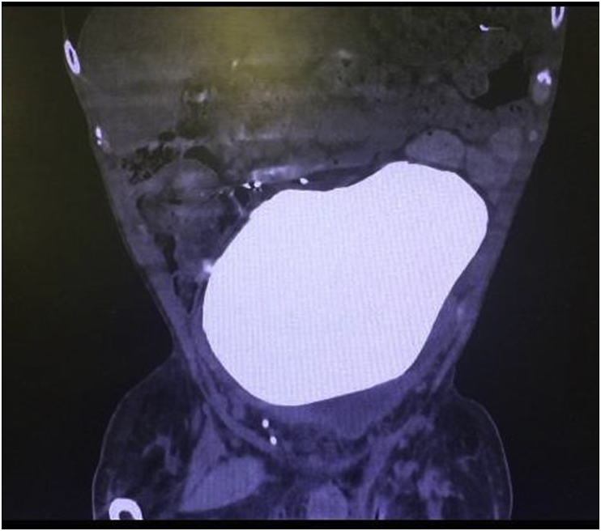

# 672 — Biến chứng muộn sau tái tạo bàng quang bằng ruột: sỏi, thủng tự phát, ung thư tại đoạn ruột / Late complications of augmentation cystoplasty

**Tags:** `pattern:bien-chung-muon` `vung:tiet-nieu` `protocol:CT-KUB` `protocol:CT-cystogram` `score:Clavien-Dindo` `anatomy:bang-quang-than-kinh`
**Mức chắc chắn (certainty):** tổng hợp y văn (literature synthesis) — cohort theo dõi dài hạn + ca minh họa có ảnh CC; ghi PMCID từng ảnh và từng con số.

## 1. Tổng quan bệnh học – cơ chế hình ảnh

- **Tái tạo bàng quang bằng ruột (augmentation cystoplasty — AC, enterocystoplasty)** dùng một đoạn ruột đã **mở dọc và detubular hóa** để làm bể chứa áp lực thấp, tăng dung tích và bảo vệ đường tiết niệu trên. Đoạn hồi tràng thường dùng dài **15–40 cm**, lấy **cách van hồi–manh tràng ít nhất 15–20 cm**; đại tràng sigma là lựa chọn thay thế (Chang 2024, PMC10879155).
- **Sỏi bàng quang (bladder stone)** là biến chứng muộn **thường gặp nhất** và là lý do mổ lại hàng đầu. Cơ chế: **chất nhầy (mucus) của ruột làm nhân kết tinh** + **tồn lưu nước tiểu** + **không tuân thủ CIC/tưới rửa** + **nhiễm khuẩn niệu do vi khuẩn phân hủy urê** + dị vật (staples, bóng catheter). Tỷ lệ trong y văn **10–52%** (Saadat 2018, PMC6022357); cohort trẻ 22 bệnh nhân theo dõi trung bình **13,4 ± 5,9 năm** có **36,4%** sỏi (Chang 2024, PMC10879155). **Phẫu thuật cổ bàng quang làm tăng tỷ lệ sỏi từ 6% lên 14,7%** (PMC6022357).
- **Thủng bàng quang tự phát (spontaneous bladder perforation)** là biến chứng **đe dọa tính mạng**, thường do **căng quá mức vì bỏ CIC** hoặc thiếu máu thành bể chứa. Tỷ lệ được báo cáo **1,9%** trong một tổng quan dài hạn (Jeong 2020, PMC7538291) và **4,5% (1/22)** trong cohort nhi (PMC10879155). Vì bệnh nhân thường **mất cảm giác đau tạng**, biểu hiện có thể chỉ là **sốt, khó chịu, nôn, tăng creatinin** — rất dễ bị quy nhầm cho nhiễm trùng tiểu.
- **Ung thư tại đoạn ruột/bàng quang tái tạo (augmentation malignancy)** hiếm nhưng là biến chứng muộn nặng nhất. Tỷ lệ trong các series **1,2–4,5%** (Mammadov 2017, PMC5734080); một tổng quan so sánh ghi nhận **4,6% so với 2,6%** ở nhóm chứng, với **ung thư biểu mô tuyến 52%, ung thư biểu mô tế bào chuyển tiếp 39%, ung thư biểu mô vảy 6%** (PMC7538291). U thường nằm **quanh đường nối bàng quang–ruột**, xuất hiện sau **nhiều năm** (phần lớn sau **10 năm**), biểu hiện bằng **đái máu vi thể/đại thể** hoặc hẹp–tắc đường tiết niệu.
- **Thiếu vitamin B12 và toan chuyển hóa:** đoạn hồi tràng lấy đi mang theo vị trí hấp thu B12 và muối mật. Một nghiên cứu trích dẫn trong cohort nhi ghi nhận **62%** bệnh nhân có B12 thấp/thấp–bình thường **bắt đầu từ năm thứ 7** sau mổ; cohort 22 bệnh nhân của Chang 2024 chỉ có **1/22 (4,5%)** thiếu B12 thực sự, B12 trung bình **448,8 ± 168,1 pg/mL** (hồi tràng) so với **575,7 ± 274,4 pg/mL** (đại tràng). Toan chuyển hóa tăng chlor máu gặp ở **3,3%** trong tổng quan của Jeong 2020 (PMC7538291), có thể **âm thầm** và ảnh hưởng mật độ xương.
- **TẠI SAO hình ảnh thay đổi:**
  - **Sỏi:** cấu trúc **canxi hóa, cản quang cao**, nằm trong lòng bể chứa; trên CT cửa sổ xương thấy rõ, có thể **rất lớn và chiếm gần toàn bộ bàng quang** (ca 16,8 × 9,2 cm). Trên siêu âm: **cung tăng âm + bóng lưng**; chất nhầy đặc có thể giả sỏi nhưng **không có bóng lưng rõ** và **di động**.
  - **Thủng:** mất tính liên tục thành bể chứa + **thoát thuốc cản quang ra ngoài lòng** trên CT cystogram/CT niệu đồ; kèm **dịch tự do trong phúc mạc**, **dày thành**, **khí ngoài lòng** nếu có. Thủng **trong phúc mạc** thường gây viêm phúc mạc; thủng **ngoài phúc mạc** có thể khu trú hơn.
  - **Ung thư:** mô ruột chuyển sản/loạn sản → khối **đặc, ngấm thuốc không đều**, có thể **loét, vôi hóa**, gây **hẹp lòng** hoặc **ứ nước thận**. Trên MRI, mô u **hạn chế khuếch tán** và ngấm thuốc; cần sinh thiết để chốt.
  - **Di chứng chuyển hóa:** không có tổn thương đặc hiệu trên hình ảnh; chẩn đoán bằng **khí máu, B12, creatinine**, hình ảnh dùng để tìm biến chứng cơ học và theo dõi thận.

## 2. Mẫu hình + chẩn đoán phân biệt theo vị trí (gamut)

- **Theo thời gian:**
  - **Sớm (< 30 ngày):** rò miệng nối, tắc ruột, nhiễm trùng vết mổ, huyết khối tĩnh mạch sâu, suy thận cấp.
  - **Muộn (> 30 ngày):** sỏi, thủng tự phát, hẹp miệng nối, trào ngược/ứ nước, thiếu B12, toan chuyển hóa, loãng xương, ung thư tại đoạn ruột.
- **Theo vị trí:**
  - **Bể chứa (reservoir):** sỏi, chất nhầy, thủng, u tại đường nối, túi thừa giả, dị vật.
  - **Đường nối bàng quang–ruột:** hẹp, rò, u, loét.
  - **Đường tiết niệu trên:** trào ngược bàng quang–niệu quản, ứ nước, sỏi thận, sẹo thận.
  - **Ruột:** dính/tắc ruột, tiêu chảy do mất van hồi–manh tràng, thiếu B12/muối mật.
  - **Toàn thân:** toan chuyển hóa, loãng xương, chậm tăng trưởng.
- **Mẫu hình lâm sàng gợi ý:**
  - **Sỏi:** đái máu, nhiễm trùng tiểu tái phát, đau hạ vị, khó CIC, **tình cờ** trên X-quang/CT.
  - **Thủng:** đau bụng + sốt + nôn + **bụng phản ứng**, có thể **tụt huyết áp**; ở bệnh nhân mất cảm giác, **chỉ số viêm tăng** là cờ đỏ.
  - **Ung thư:** **đái máu** dai dẳng, nhiễm trùng tái phát, đau vùng chậu, sụt cân; đôi khi **hẹp niệu quản** hoặc **ứ nước thận** không rõ nguyên nhân.
  - **B12:** thiếu máu **hồng cầu to**, dị cảm, mất thăng bằng, **thoái hóa tủy sau–bên**; có thể không triệu chứng.
- **Bẫy dịch tễ:** sỏi có thể xuất hiện **rất muộn** (ca 33 tuổi sau mổ từ tuổi thiếu niên; ca 42 tuổi sau ileocystoplasty năm 1996), nên **không loại trừ vì thời gian dài**.

*CT bụng–chậu có cản quang: nhiều sỏi cản quang lớn lấp gần toàn bộ bàng quang tái tạo ở bệnh nhân spina bifida sau ileocystoplasty + Mitrofanoff. Nguồn: Ong K, Murtagh K, Urol Case Rep 2023;50:102536 (PMC10445452), Fig. 2, CC BY-NC-ND 4.0 — giữ nguyên bản, không crop/ghép.*

## 3. Bảng so sánh phân biệt (ma trận đối chiếu)

| Thực thể (entity) | Hình ảnh điển hình (US/CT/MRI) | Chốt vào (rule-in) | Chốt loại (rule-out) | Gợi ý xác nhận |
|---|---|---|---|---|
| Sỏi bàng quang | Cung tăng âm + **bóng lưng** trên US; **khối cản quang** trong lòng trên CT; có thể 16,8 × 9,2 cm | **Cản quang cao + bóng lưng + nằm trong lòng bể chứa** | **Không cản quang, di động, đổi hình khi đổi tư thế → chất nhầy** | CT KUB liều thấp; nội soi/tán sỏi |
| Chất nhầy (mucus ball) | Khối **giả đặc**, tăng âm nhẹ, **không bóng lưng rõ**, di động; có thể gây bí tiểu | **Di động + thay đổi theo tư thế + không cản quang** | **Cản quang cao, cố định, bóng lưng → sỏi** | Tưới rửa bàng quang; US lặp lại |
| Thủng trong phúc mạc | **Thoát thuốc ra phúc mạc**, dịch tự do, dày thành, có thể khí ngoài lòng | **Thoát thuốc + dịch tự do + đau bụng/sốt** | **Không thoát thuốc + không dịch tự do → không thủng** | CT cystogram với thuốc pha loãng qua catheter |
| Thủng ngoài phúc mạc | Dịch/thuốc quanh bàng quang, **không lan vào phúc mạc**; có thể khu trú | **Thoát thuốc ngoài phúc mạc + đau vùng chậu** | **Thoát thuốc vào ổ phúc mạc → thể trong phúc mạc** | CT cystogram; US bàng quang |
| Ung thư tại đoạn ruột | Khối **đặc, ngấm thuốc không đều**, loét/vôi hóa, hẹp lòng; MRI hạn chế khuếch tán | **Đái máu + khối tại đường nối + > 10 năm sau mổ** | **Viêm/chuyển sản đơn thuần, không khối → chưa chốt ung thư** | Cystoscopy + sinh thiết nhiều điểm |
| Viêm bàng quang/túi thừa | Thành dày, bè, túi thừa, cặn; không khối đặc | **Thành dày + bè + cặn lắng** | **Khối đặc ngấm thuốc + hạn chế khuếch tán → nghi u** | US/CT; soi bàng quang nếu nghi |
| Thiếu B12 | Không tổn thương đặc hiệu; MRI tủy có thể **tăng T2 cột sau** | **B12 thấp + hồng cầu to + triệu chứng thần kinh** | **B12 bình thường → tìm nguyên nhân khác** | Xét nghiệm B12, MMA/homocysteine |
| Toan chuyển hóa | Không có hình ảnh đặc hiệu; có thể loãng xương | **HCO₃⁻ thấp + Cl⁻ cao + gap anion bình thường** | **Gap anion cao/toan hô hấp → nguyên nhân khác** | Khí máu, điện giải, đánh giá xương |

### Dấu hiệu chốt cần đọc đúng
- **Sỏi rất lớn có thể che mất mọi cấu trúc lân cận**; luôn đo kích thước 3 chiều và ghi **vị trí so với miệng nối/cổ bàng quang** để lên kế hoạch lấy sỏi.
- **Thủng tự phát có thể không có khí tự do** — không loại trừ bằng CT không cản quang. **CT cystogram** là chốt khi nghi ngờ.
- **Đái máu ở bệnh nhân AC là cờ đỏ ung thư** cho tới khi soi bàng quang loại trừ; đừng chỉ quy cho sỏi.
- **B12 thấp có thể xuất hiện muộn**; cohort riêng có thể chỉ 4,5% nhưng nghiên cứu khác báo tới **62% B12 thấp/thấp–bình thường từ năm thứ 7** — theo dõi định kỳ vẫn cần.

*CT niệu đồ ở bệnh nhân 18 tuổi spina bifida sau augmentation cystoplasty + Mitrofanoff: (A) axial, (B) coronal, (C) sagittal — vòng tròn = thoát thuốc hoạt tính; dấu × = dịch tự do trong phúc mạc; mũi tên = sỏi trong bàng quang tái tạo; ngôi sao = catheter trên xương mu. Nguồn: Anderson S et al., Radiol Case Rep 2022;17(11):4139-4143 (PMC9465360), Fig. 3, CC BY 4.0.*

*Sinh thiết niêm mạc bàng quang tái tạo: **chuyển sản ruột khu trú** (H–E, ×200) trên nền viêm mạn — tổn thương này không đồng nghĩa ung thư nhưng là lý do theo dõi nội soi dài hạn. Nguồn: Mammadov E et al., Int Braz J Urol 2017;43(6):1152-1159 (PMC5734080), Fig. 2, CC BY 4.0.*

## 4. Protocol chụp + hệ phân độ/điểm chuẩn hóa

- **Theo dõi định kỳ (lifelong surveillance):** khám lâm sàng, huyết áp, urinalysis, **creatinine/eGFR**, **khí máu**, **vitamin B12**; siêu âm thận–bàng quang; đánh giá dung tích/áp lực bằng **urodynamics** khi có chỉ định. Jeong 2020 khuyến cáo **theo dõi B12 hàng năm từ năm thứ 5** (PMC7538291); EAU–ESPU–ERN 2026 nhấn mạnh theo dõi **suốt đời** gồm B12, và **nội soi bàng quang hàng năm có thể được xem xét sau một khoảng thời gian hợp lý**, đặc biệt ở người nguy cơ cao (Radmayr 2026, PMC13136771).
- **Sỏi:** **siêu âm + X-quang** là sàng lọc; **CT KUB liều thấp** khi siêu âm không chắc hoặc cần lên kế hoạch can thiệp. Sỏi nhỏ có thể tán qua nội soi; sỏi **rất lớn** (ca 16,8 × 9,2 cm) hoặc chiếm gần toàn bộ bể chứa thường cần **mở bàng quang lấy sỏi** (ca này lấy được 1,66 kg sỏi, PMC6022357). Tránh làm tổn thương **cuff AUS** khi can thiệp.
- **Thủng:** **CT cystogram** (thuốc cản quang pha loãng bơm qua catheter/Mitrofanoff) là tiêu chuẩn; có thể dùng **CT niệu đồ có thì muộn** nếu chưa đặt được catheter. Không dựa vào CT không cản quang để loại trừ.
- **Ung thư:** **cystoscopy + sinh thiết** là chốt; CT/MRI bụng–chậu để đánh giá xâm lấn, hạch, ứ nước. **Không sinh thiết mù** qua da vào bể chứa ruột nếu có thể soi.
- **Phân độ biến chứng:** **Clavien–Dindo I–V** (I: không cần can thiệp; II: thuốc/ truyền máu; III: can thiệp không gây mê/toàn thân; IV: suy cơ quan/ICU; V: tử vong) giúp so sánh mức độ nặng và quyết định mổ lại.
- **Tiêu chuẩn loại trừ AC:** hội chứng ruột ngắn, bệnh ruột thực thể (Crohn), **creatinine clearance < 40 mL/min**, không thể CIC (Jeong 2020, PMC7538291).

*VCUG 3 năm sau ileocystoplasty: bể chứa tái tạo hình cầu, không rò, không hẹp miệng nối — mốc đối chiếu “bình thường sau mổ” để không overcall dày thành/nếp niêm mạc. Nguồn: Indrawan DH, Sigumonrong Y, Int J Surg Case Rep 2021;81:105731 (PMC7970357), Fig. 8, CC BY 4.0.*

## 5. Biến thể bình thường và cạm bẫy

- **Hình ảnh sau mổ bình thường:** thành đoạn ruột dày nhẹ, **staple/clip cản quang**, **khí trong lòng bể chứa**, các nếp niêm mạc/pseudodiverticulum — đừng gọi là u hoặc áp-xe.
- **Chất nhầy đặc** có thể giả **sỏi, nấm, máu cục**; cho bệnh nhân đổi tư thế, tưới rửa rồi chụp lại.
- **Sỏi nhỏ không thấy trên X-quang** vì bị che bởi xương/khí; **CT KUB** nhạy hơn.
- **Thủng có thể biểu hiện “êm”** ở bệnh nhân mất cảm giác; **không có phản ứng thành bụng không loại trừ**. Theo dõi **creatinin, bạch cầu, lactate** và toàn trạng.
- **Đái máu sau AC:** có thể do sỏi, viêm, hoặc ung thư. **Soi bàng quang** nếu đái máu dai dẳng/tái phát dù đã điều trị sỏi.
- **Rối loạn tự chủ (autonomic dysreflexia)** ở tổn thương tủy **trên T6**: bàng quang căng, sỏi, táo bón hoặc loét có thể gây **tăng huyết áp kịch phát, nhịp chậm, vã mồ hôi** — đừng nhầm với nhiễm trùng huyết.
- **Thai kỳ:** bàng quang tái tạo bị đẩy lên/thay đổi hình dạng; ưu tiên **siêu âm**, **MRI không gadolinium** khi cần; nhiễm trùng tiểu thường gặp hơn và cần dự phòng/điều trị sớm.

## 6. Tự lượng giá — Blind Quiz

**Ca 1 — Nam 33 tuổi, spina bifida, đã tái tạo bàng quang + đặt AUS từ tuổi thiếu niên, vào viện vì sốt và nhiễm trùng huyết. Nhìn CT, mô tả trước.**

- Gợi ý: không có chấn thương; bệnh nhân vẫn CIC.
- Hỏi: khối cản quang nằm ở đâu, kích thước ước lượng? Chẩn đoán? Vì sao bệnh nhân dễ tạo sỏi?

<b>Bấm để hiện đáp án (findings + chẩn đoán)</b>

- **Findings:** một khối cản quang **rất lớn, đồng nhất**, chiếm gần toàn bộ bàng quang tái tạo, đo **16,8 × 9,2 cm** trên CT; không thấy khí tự do.
- **Chẩn đoán:** **sỏi bàng quang khổng lồ** sau augmentation + AUS. Mở bàng quang lấy sỏi: một sỏi **1,66 kg** + nhiều sỏi nhỏ.
- **Cơ chế:** chất nhầy ruột làm nhân + tồn lưu + nhiễm khuẩn phân hủy urê; AUS/cổ bàng quang làm tăng nguy cơ.
- **Nguồn ảnh:** Saadat S, Winkle D, Hirst J. Urol Case Rep 2018;20:15-16 (PMC6022357), Fig. 1, CC BY-NC-ND 4.0 — giữ nguyên bản.

**Ca 2 — Nữ 18 tuổi, spina bifida, augmentation cystoplasty + Mitrofanoff, đau bụng và chướng. Xem CT niệu đồ.**

- Hỏi: dấu hiệu chính? Thủng trong hay ngoài phúc mạc? Hướng xử trí ở bệnh nhân này?

<b>Bấm để hiện đáp án (findings + chẩn đoán)</b>

- **Findings:** **thoát thuốc hoạt tính** (vòng tròn) từ bàng quang tái tạo; **dịch tự do trong phúc mạc** (dấu ×); **sỏi** trong bàng quang (mũi tên); catheter trên xương mu (ngôi sao).
- **Chẩn đoán:** **thủng bàng quang trong phúc mạc tự phát** trên bàng quang tái tạo, kèm sỏi.
- **Xử trí:** ca này được **dẫn lưu kín + kháng sinh**, ổn định và tự lành trên cystogram sau 2 tuần; sau đó tán sỏi. Tuy vậy, thủng trong phúc mạc có viêm phúc mạc thường **cần mổ** — quyết định theo toàn trạng.
- **Nguồn ảnh:** Anderson S et al., Radiol Case Rep 2022;17(11):4139-4143 (PMC9465360), Fig. 3, CC BY 4.0.

**Ca 3 — Bệnh nhân 42 tuổi, spina bifida, ileocystoplasty + Mitrofanoff từ 1996, chụp X-quang để kiểm tra shunt và thấy “vật cản quang lớn” ở bụng dưới.**

- Hỏi: đây là gì? Có cần mổ không? Vì sao không nên bỏ qua?

<b>Bấm để hiện đáp án (findings + chẩn đoán)</b>

- **Findings:** nhiều **sỏi cản quang lớn** trong bàng quang tái tạo, một số chiếm gần trọn lòng bể chứa.
- **Chẩn đoán:** **sỏi bàng quang nhiều viên** sau ileocystoplasty; phát hiện tình cờ khi chụp kiểm tra shunt.
- **Vì sao quan trọng:** sỏi lớn gây **nhiễm trùng, đái máu, bí tiểu, thủng**; cần lấy sỏi và duy trì tưới rửa/CIC để phòng tái phát.
- **Nguồn ảnh:** Ong K, Murtagh K. Urol Case Rep 2023;50:102536 (PMC10445452), Fig. 2, CC BY-NC-ND 4.0 — giữ nguyên bản.

## Bài liên quan chéo

- [668 – Theo dõi dài hạn sau tháo căng tủy & bàng quang thần kinh](../668-theo-doi-sau-thao-cang-tuy-bang-quang-than-kinh/lesson.md)
- [671 – Nhiễm trùng tiểu & viêm thận–bể thận ở trẻ có bàng quang thần kinh](../671-nhiem-trung-tieu-bang-quang-than-kinh-o-tre/lesson.md)
- [637 – Chấn thương bàng quang & niệu đạo nhi](../637-chan-thuong-bang-quang-nieu-dao-nhi/lesson.md)
- [642 – Theo dõi & biến chứng dài hạn sau chấn thương đường tiết niệu dưới ở trẻ](../642-bien-chung-muon-chan-thuong-nieu-dao-nhi/lesson.md)
- [600 – Tổng quan Nhi khoa](../600-tong-quan-nhi-khoa/lesson.md)

## Ảnh

- `images/672_bang-quang-tai-tao_CT_PMC6022357-F1-CCBYNCND.jpg` — sỏi khổng lồ, CC BY-NC-ND 4.0 (nguyên bản).
- `images/672_bang-quang-tai-tao_CT-PMC9465360-F3-CCBY.jpg` — thủng tự phát, CC BY 4.0.
- `images/672_bang-quang-tai-tao_CT-PMC10445452-F2-CCBYNCND.jpg` — nhiều sỏi lớn, CC BY-NC-ND 4.0 (nguyên bản).
- `images/672_niem-mac_Sinh-thiet_PMC5734080-F2-CCBY.jpg` — chuyển sản ruột, CC BY 4.0.
- `images/672_bang-quang-tai-tao_VCUG_PMC7970357-F8-CCBY.jpg` — VCUG sau ileocystoplasty (đối chiếu hình thái bình thường), CC BY 4.0.

Nguồn và giấy phép từng ảnh: [`images/CREDITS.md`](images/CREDITS.md).

> Không dùng để chẩn đoán độc lập khi chưa có người hướng dẫn.
