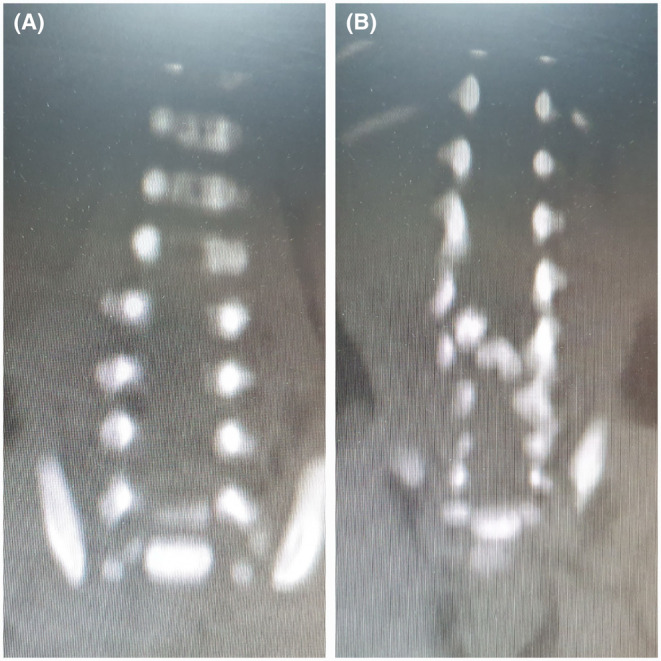
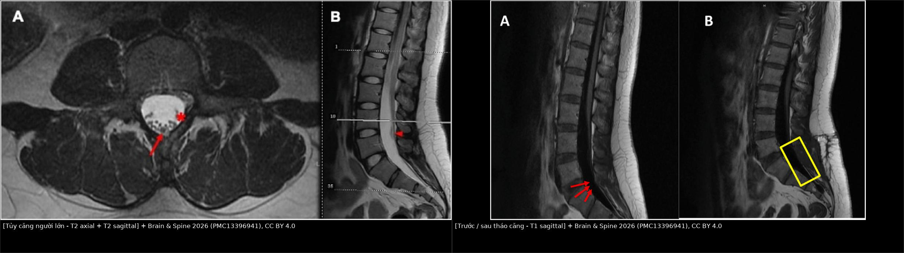
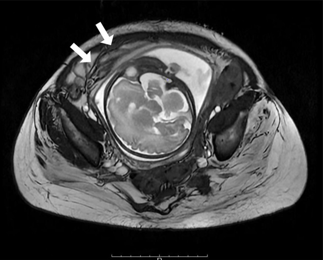
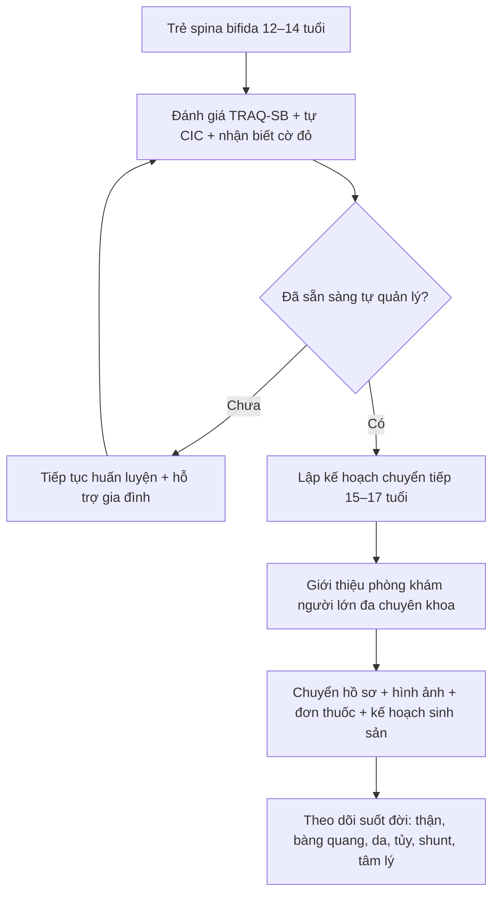
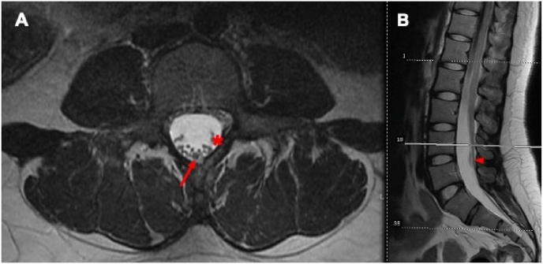
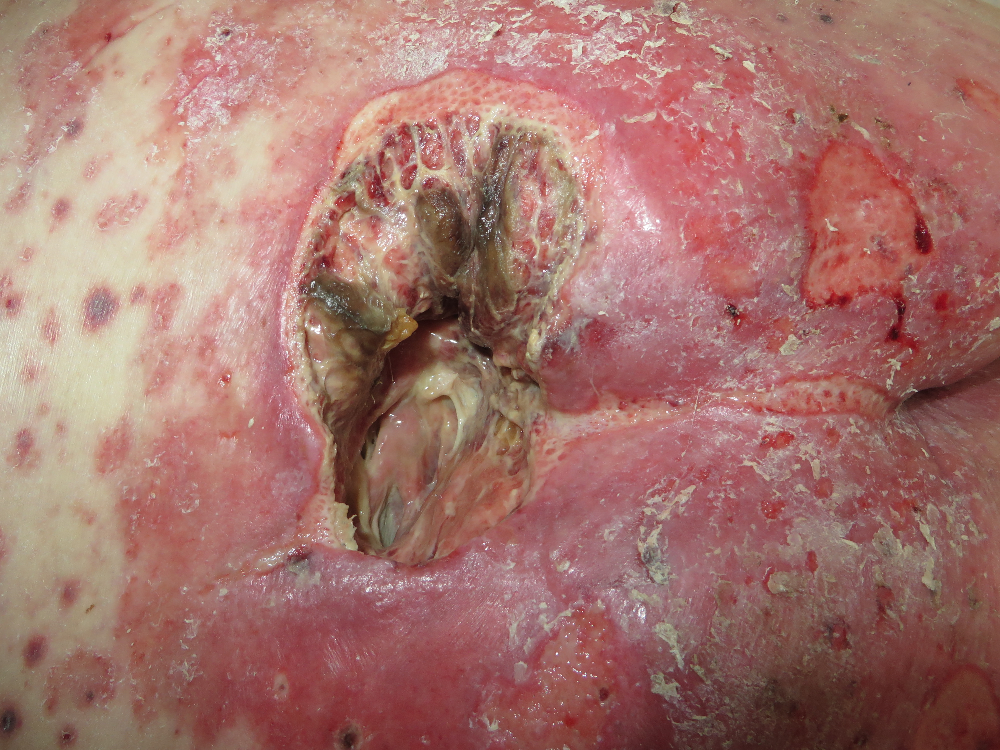

# 673 — Chuyển tiếp sang người lớn ở spina bifida & bàng quang thần kinh: theo dõi suốt đời, dị ứng latex, loét tì đè, sức khỏe sinh sản & tủy căng / Transition to adulthood in spina bifida

**Tags:** `pattern:chuyen-tiep` `vung:tiet-nieu` `vung:tuy-cot-song` `protocol:MRI-cot-song` `score:TRAQ-SB` `anatomy:bang-quang-than-kinh`
**Mức chắc chắn (certainty):** tổng hợp y văn (literature synthesis) — hướng dẫn EAU/ESPU 2026 + cohort chuyển tiếp + ca minh họa có ảnh CC; ghi PMCID từng ảnh và từng con số.

## 1. Tổng quan bệnh học – cơ chế hình ảnh

- **Spina bifida (SB) / myelomeningocele (MMC)** là dị tật ống thần kinh; nhờ phẫu thuật sớm, đa số trẻ **sống tới tuổi trưởng thành**. Đây không còn là “bệnh nhi” mà là **bệnh mạn suốt đời** với **bàng quang thần kinh, ruột thần kinh, não úng thủy, tủy căng, biến dạng cột sống, loét tì đè và các vấn đề sinh sản**.
- **Chuyển tiếp (health care transition — HCT)** là một **quá trình phát triển**, không phải một lần “chuyển hồ sơ”: bắt đầu từ **12–14 tuổi**, tập kỹ năng tự quản lý, rồi **chuyển sang người lớn khoảng 18–21 tuổi** tùy mức sẵn sàng. Trong khảo sát 20 trung tâm tại Mỹ, chỉ **15%** đã triển khai đầy đủ quy trình, **40%** theo dõi được việc chuyển tiếp thành công; rào cản lớn nhất là **thiếu bác sĩ người lớn, bảo hiểm và giao thông** (Hopson 2026, PMC12859455).
- **Vì sao phải theo dõi suốt đời:** **suy thận do bàng quang thần kinh** vẫn là nguyên nhân tử vong **thường gặp và có thể đến đột ngột**; nhiễm trùng tiểu, sỏi, trào ngược và áp lực bàng quang cao là các con đường dẫn tới sẹo thận (Starowicz 2021, PMC8633437). Trong một chương trình chuyển tiếp, **86%** bệnh nhân có vấn đề **điều phối chăm sóc**, **70%** có vấn đề **bàng quang thần kinh**, **42%** có vấn đề **ruột thần kinh**, **31%** có vấn đề **da**, **30%** có vấn đề **sức khỏe sinh sản/tình dục** (PMC8633437).
- **Tủy căng (tethered cord syndrome — TCS):** tủy bị kéo cố định, thường do **lipomyelomeningocele, dây tận cùng dày/mỡ, dính sau mổ**. Chóp tủy bình thường ở người lớn **L1–L2**; **chóp dưới L2** và **dây tận cùng > 2 mm** là bất thường (bài 656). Trên MRI, mô mỡ của dây tận cùng **T1 sáng, tắt tín hiệu khi fat-sat**; tủy nằm thấp, rễ thần kinh bị kéo lệch. **TẠI SAO có triệu chứng:** lực căng cơ học làm giảm tưới máu tủy → đau lưng/đau chân, yếu, rối loạn tiểu–đại tiện, vẹo cột sống tiến triển.
- **Não úng thủy và shunt:** shunt rối loạn có thể biểu hiện **đau đầu, nôn, lơ mơ, thay đổi tri giác** hoặc **chỉ đau bụng**. CT/MRI đánh giá **kích thước não thất** so với phim nền; **X-quang shunt series** tìm đứt/gãy/di trú. Ở người lớn, **đau đầu mạn và suy giảm nhận thức** có thể là dấu hiệu shunt hoạt động kém.
- **Dị ứng latex (latex allergy):** do phơi nhiễm lặp lại qua phẫu thuật, catheter, găng tay. Tỷ lệ **nhạy cảm latex ở trẻ SB 26–47,9%**; khi áp dụng **môi trường không latex từ lúc sinh**, tỷ lệ giảm từ **26,7% xuống 4,5%** (Arasi 2023, PMC10779698). Đây là **dị ứng IgE thật**, có thể **sốc phản vệ** — không phải “kích ứng da”.
- **Loét tì đè (pressure injury):** do **mất cảm giác + liệt + ngồi/ nằm lâu + biến dạng khung chậu**. Tỷ lệ loét tì đè ở trẻ nói chung **0,47–31,2%** tùy bối cảnh; ở người SB, **31%** báo có vấn đề da trong chương trình chuyển tiếp (PMC13292696, PMC8633437). Loét sâu có thể **không đau**, dẫn tới **viêm xương tủy, nhiễm trùng huyết**.
- **Sức khỏe sinh sản:** phụ nữ SB thường **có khả năng sinh sản bình thường** nhưng mang thai là **thai kỳ nguy cơ cao**: nhiễm trùng tiểu, sinh non, mổ lấy thai, tư vấn **acid folic** và **di truyền**. Trong 11 phụ nữ có tiền sử tái tạo bàng quang, **18 lần sinh** có **14 lần mổ lấy thai**, **5/11 thai kỳ không dự phòng có nhiễm trùng tiểu có triệu chứng** (Porela-Tiihonen 2024, PMC11605474).
- **TẠI SAO hình ảnh thay đổi:**
  - **MRI tủy:** T1/T2 cho giải phẫu (chóp tủy, dây tận cùng, mỡ, syrinx); **không cần gadolinium** cho chẩn đoán tủy căng đơn thuần. Dính sau mổ có thể **ngấm thuốc** và **giả u**, nên chẩn đoán dựa vào **hình thái + triệu chứng**, không chỉ tín hiệu.
  - **CT sọ:** xương sọ và não thất; **liều thấp** ở người trẻ; **MRI** tốt hơn cho mô não và shunt programmable (từ trường có thể đổi cài đặt van).
  - **MRI cột sống thắt lưng cùng:** **STIR/T2 fat-sat** làm nổi phù tủy, mỡ, dịch; **T1** phân biệt mỡ với máu/dịch.
  - **Loét/viêm xương tủy:** MRI **STIR/T2** tăng tín hiệu tủy xương, **ngấm thuốc viền**, **đường rò**; CT thấy **phá hủy vỏ xương** muộn hơn; X-quang thường **bình thường sớm**.
  - **Thận:** siêu âm thấy **ứ nước, mỏng nhu mô, sẹo**; DMSA xác định sẹo; **creatinine/cystatin C** đánh giá chức năng.

## 2. Mẫu hình + chẩn đoán phân biệt theo hệ cơ quan (gamut)

- **Tiết niệu:** nhiễm trùng tiểu tái phát, sỏi bàng quang/thận, trào ngược, ứ nước, bàng quang áp lực cao, suy thận, biến chứng sau tái tạo bàng quang.
- **Thần kinh – cột sống:** tủy căng/tái căng, shunt rối loạn, syringomyelia, Chiari, động kinh, đau lưng cơ học.
- **Cơ – xương:** vẹo cột sống, trật khớp háng, gãy xương do loãng xương, biến dạng bàn chân, loét tì đè.
- **Da – dị ứng:** viêm da tiếp xúc, dị ứng latex, loét do tì đè, nhiễm trùng vết mổ, viêm xương tủy.
- **Tiêu hóa:** ruột thần kinh, táo bón, đại tiện không tự chủ, tắc ruột do dính.
- **Sinh sản – tình dục:** rối loạn cương, khô âm đạo, giảm ham muốn, vô sinh, thai kỳ nguy cơ cao, tránh thai.
- **Tâm lý – xã hội:** trầm cảm, lo âu, cô lập, phụ thuộc người chăm sóc, thất nghiệp.
- **Tim mạch – tự chủ:** **rối loạn tự chủ (autonomic dysreflexia)** ở tổn thương **trên T6**, tăng huyết áp, béo bụng, hội chứng chuyển hóa, ngưng thở khi ngủ.

*MRI cột sống thắt lưng cùng ở trẻ sơ sinh có búi lông: (A) khuyết đốt sống/spina bifida; (B) **đôi tủy (diastematomyelia)** và **tủy căng** — chẩn đoán sớm để tránh di chứng thần kinh–tiết niệu khi trưởng thành. Nguồn: Farhadi R, Kazemi SA, Godazandeh F, Clin Case Rep 2024;12:e9267 (PMC11362022), Fig. 3, CC BY-NC 4.0 — giữ nguyên bản.*

## 3. Bảng so sánh phân biệt (ma trận đối chiếu)

| Thực thể (entity) | Hình ảnh/lâm sàng điển hình | Chốt vào (rule-in) | Chốt loại (rule-out) | Gợi ý xác nhận |
|---|---|---|---|---|
| Tủy căng/tái căng | Đau lưng–chân tiến triển, yếu, rối loạn tiểu; MRI **chóp dưới L2**, dây tận cùng **> 2 mm**, mỡ, tủy dính | **Triệu chứng mới + chóp tủy thấp/dây dày + thay đổi so phim nền** | **MRI bình thường + triệu chứng không tương ứng → tìm nguyên nhân khác** | MRI toàn bộ tủy có/không gadolinium; so phim cũ |
| Shunt rối loạn | Đau đầu, nôn, lơ mơ, đau bụng; **não thất giãn hơn** trên CT/MRI so phim nền | **Thay đổi kích thước não thất + triệu chứng tăng áp lực nội sọ** | **Não thất không đổi + không triệu chứng → ít nghĩ shunt** | CT liều thấp/MRI; X-quang shunt series |
| Syringomyelia | Rối cảm giác **ly khai (cape-like)**, yếu tay, đau; MRI **khoang dịch trong tủy** | **Khoang syrinx trên T2 + triệu chứng tủy** | **Không có khoang dịch → không phải syrinx** | MRI T1/T2 toàn bộ tủy |
| Loét tì đè | Vùng cùng cụt/ụ ngồi, **không đau**, hoại tử, chảy dịch; sâu tới cơ/xương | **Mất cảm giác + vùng tì đè + tổn thương sâu** | **Da nguyên vẹn, không tì đè → không phải loét** | Khám da toàn thân; chụp/MRI khi nghi sâu |
| Viêm xương tủy dưới loét | Loét sâu, **lộ xương**, chảy mủ, sốt; MRI **phù tủy xương + ngấm thuốc**, CT phá hủy xương | **Loét + lộ xương + MRI/CT phá hủy xương** | **MRI bình thường + không lộ xương → ít nghĩ viêm xương** | MRI có gadolinium; sinh thiết xương |
| Dị ứng latex | Ngứa, mày đay, phù, co thắt phế quản, **sốc** sau tiếp xúc găng/catheter | **Triệu chứng IgE sau tiếp xúc + tiền sử phẫu thuật nhiều lần** | **Chỉ kích ứng da khu trú, không toàn thân → viêm da tiếp xúc** | Test IgE đặc hiệu; **môi trường không latex** |
| Suy thận do bàng quang áp lực cao | Creatinin tăng, siêu âm **ứ nước/mỏng nhu mô**, bàng quang dày; urodynamics áp lực cao | **Áp lực bàng quang cao + ứ nước/sẹo thận** | **Áp lực bình thường, không ứ nước → tìm nguyên nhân khác** | Urodynamics, US, DMSA |
| Rối loạn tự chủ | **Tăng huyết áp kịch phát, nhịp chậm, vã mồ hôi, đau đầu** khi bàng quang căng/táo bón/loét | **HA tăng + kích thích tạng + tổn thương trên T6** | **Sốt + hạ HA + ổ nhiễm → sốc nhiễm trùng** | Đo HA, làm rỗng bàng quang, tìm ổ kích thích |
| Thai kỳ ở bàng quang tái tạo | Thai phát triển, tử cung đè bể chứa; MRI thấy **cuống mạch/bể chứa bị đẩy** | **Có thai + tiền sử tái tạo bàng quang** | **Ứ nước sinh lý nhẹ, không sốt → theo dõi** | US thai + US thận; MRI không gadolinium khi cần |

### Dấu hiệu chốt cần đọc đúng
- **Tủy căng là chẩn đoán lâm sàng–hình ảnh:** chóp tủy thấp đơn thuần có thể gặp ở người không triệu chứng; **đừng mổ chỉ vì hình ảnh**. Ngược lại, **triệu chứng tiến triển + thay đổi so phim nền** đủ để hội chẩn dù hình ảnh “chưa rõ”.
- **Shunt và tủy căng có thể cùng tồn tại**; đau đầu + nôn + thay đổi não thất ưu tiên shunt; đau lưng + yếu chi + rối loạn tiểu ưu tiên tủy.
- **Loét tì đè ở người mất cảm giác có thể không đau** — hỏi về **sốt, chảy mủ, mùi hôi**, và **thăm khám toàn bộ da** mỗi lần nhập viện.
- **Dị ứng latex không được “premedicate rồi dùng latex”**: biện pháp chính là **loại bỏ latex hoàn toàn** khỏi phòng chụp/phòng mổ.

*Trái: (A) axial T2 — dây tận cùng dày, rễ thần kinh bị đẩy; (B) sagittal T2 — chóp tủy thấp, dây tận cùng mỡ. Phải: (A) T1 sagittal trước mổ — tủy bám thấp (mũi tên đỏ); (B) sau tháo căng — tủy được giải phóng (khung vàng). Nguồn: McGinley C et al., Brain & Spine 2026;6:106177 (PMC13396941), Fig. 2 và Fig. 3, CC BY 4.0; ảnh ghép letterbox.*

## 4. Protocol chụp + hệ phân độ/điểm chuẩn hóa

- **Lộ trình chuyển tiếp (transition pathway):**
  - **12–14 tuổi:** bắt đầu trao đổi, đánh giá **mức sẵn sàng** bằng **TRAQ-SB** (công cụ được **65%** trung tâm dùng trong khảo sát 2026), dạy tự CIC, tự quản lý thuốc, nhận biết dấu hiệu nguy hiểm.
  - **15–17 tuổi:** lập **kế hoạch chuyển tiếp bằng văn bản**, giới thiệu bác sĩ người lớn, chuyển hồ sơ hình ảnh, tư vấn nghề nghiệp/sinh sản.
  - **18–21 tuổi:** chuyển sang **phòng khám người lớn đa chuyên khoa** (niệu–thần kinh–phục hồi chức năng–nội tiết–tâm lý); không chỉ “gửi hồ sơ”.
- **Theo dõi định kỳ gợi ý (lifelong):**
  - **Hằng năm:** huyết áp, cân nặng, urinalysis, **creatinine/eGFR hoặc cystatin C**, siêu âm thận–bàng quang, khám da, đánh giá ruột/bàng quang, tư vấn sinh sản.
  - **Định kỳ:** **urodynamics** khi có triệu chứng hoặc thay đổi thần kinh; **MRI tủy** khi đau lưng/yếu/rối loạn tiểu mới; **CT/MRI sọ** khi nghi shunt; **DEXA** khi có yếu tố nguy cơ loãng xương.
  - **Sau tái tạo bàng quang:** theo dõi **B12, khí máu, siêu âm, nội soi sau 10 năm** (xem bài 672).
- **Protocol hình ảnh:**
  - **MRI tủy toàn bộ** (sagittal T1, T2, STIR; axial T2 lát mỏng qua chóp/tổn thương) — **không cần gadolinium** cho tủy căng; dùng gadolinium khi nghi u/viêm hoặc dính sau mổ.
  - **CT sọ liều thấp** cho shunt; **MRI sọ** nếu cần đánh giá mô não hoặc van programmable (kiểm tra lại cài đặt sau MRI).
  - **Siêu âm thận–bàng quang** là tuyến đầu; **CT KUB** khi nghi sỏi; **DMSA** khi cần xác định sẹo.
  - **Thai kỳ:** **siêu âm** là chính; **MRI 1,5 T không gadolinium** khi cần đánh giá bể chứa/khối; tránh CT trừ khi tối cần.

*MRI axial T2 trong thai kỳ ở người có ileocystoplasty: tử cung và thai chiếm phần lớn ổ bụng; **cuống mạch/bể chứa bị đẩy ra trước** (mũi tên). Đây là lý do cần phối hợp niệu–sản và ưu tiên MRI không gadolinium. Nguồn: Sato A et al., Int J Urol 2026;33(3):458-461 (PMC12957717), Fig. 2, CC BY-NC 4.0 — giữ nguyên bản.*

- **Phân độ/điểm:** **TRAQ-SB** cho mức sẵn sàng chuyển tiếp; **Clavien–Dindo** cho biến chứng can thiệp; **phân độ loét tì đè** theo NPUAP/EPUAP (độ 1–4, không phân độ được nếu nền hoại tử).

Sơ đồ lộ trình chuyển tiếp:

## 5. Biến thể bình thường và cạm bẫy

- **Chóp tủy thấp đơn thuần** có thể là biến thể không triệu chứng; **không mổ chỉ vì chóp dưới L2**. Ngược lại, **MRI “bình thường” không loại trừ tủy căng chức năng** nếu triệu chứng điển hình.
- **Dính sau mổ** ngấm thuốc và dày màng cứng có thể **giả u/tái căng**; so sánh phim nền và đối chiếu triệu chứng.
- **Shunt programmable** có thể bị **đổi cài đặt sau MRI** — kiểm tra và cài lại sau chụp.
- **Loét tì đè:** tổn thương sâu có thể **nhỏ ngoài da nhưng rộng dưới da**; **không đánh giá độ sâu bằng mắt**. Nghi viêm xương tủy khi **lộ xương, chảy mủ kéo dài, sốt** — cần MRI/CT và sinh thiết.
- **Dị ứng latex:** **không có “tiền mê rồi dùng latex”**; phải dùng **môi trường không latex** từ khâu đón tiếp. Hỏi kỹ **dị ứng trái cây (latex-fruit syndrome)**.
- **Thai kỳ:** **ứ nước thận sinh lý** do tử cung chèn ép thường nhẹ và không sốt; **đau hông + sốt + ứ nước tăng** phải loại trừ sỏi/nhiễm trùng/tắc. Ở bàng quang tái tạo, **tử cung có thể đè/làm xoắn cuống mạch** — cần bác sĩ niệu và sản phối hợp.
- **Rối loạn tự chủ** có thể bị nhầm với **tiền sản giật** ở thai phụ (tăng huyết áp, đau đầu) hoặc **nhiễm trùng huyết**; tìm và loại bỏ **kích thích bàng quang/trực tràng/da** trước khi quy cho nguyên nhân khác.

## 6. Tự lượng giá — Blind Quiz

**Ca 1 — Nữ 27 tuổi, spina bifida thể kín, đau lưng–chân tiến triển và nhiễm trùng tiểu tái phát. Xem MRI axial T2.**

- Hỏi: bất thường chính? Chẩn đoán? Vì sao nhiễm trùng tiểu tái phát?

<b>Bấm để hiện đáp án (findings + chẩn đoán)</b>

- **Findings:** **dây tận cùng dày** (mũi tên đỏ) và **rễ thần kinh đuôi ngựa bị đẩy lệch** (mũi tên đỏ đứt) trong ống sống thắt lưng; hình sagittal kèm theo cho thấy **chóp tủy thấp**.
- **Chẩn đoán:** **tủy căng ở người lớn (adult tethered cord syndrome)** do **dây tận cùng mỡ dày** trên nền spina bifida occulta.
- **Liên hệ:** rối loạn thần kinh bàng quang do tủy căng gây **ứ nước tiểu, nhiễm trùng tái phát**; tháo căng vi phẫu cải thiện đau và ngừng nhiễm trùng ở ca này.
- **Nguồn ảnh:** McGinley C et al., Brain & Spine 2026;6:106177 (PMC13396941), Fig. 2, CC BY 4.0.

**Ca 2 — Trẻ sơ sinh có búi lông vùng thắt lưng cùng, được chụp MRI.**

- Hỏi: các bất thường? Vì sao phải theo dõi tới tuổi trưởng thành?

<b>Bấm để hiện đáp án (findings + chẩn đoán)</b>

- **Findings:** **(A)** khuyết cung sau đốt sống (spina bifida); **(B)** **đôi tủy (diastematomyelia)** và **tủy căng** với chóp tủy thấp.
- **Chẩn đoán:** **dị tật tủy kín phức tạp** — búi lông là dấu hiệu da chỉ điểm.
- **Vì sao theo dõi suốt đời:** nguy cơ **tủy căng tái phát, rối loạn tiểu–đại tiện, biến dạng cột sống**; cần **MRI khi có triệu chứng mới**, theo dõi bàng quang–thận và chuyển tiếp sang người lớn.
- **Nguồn ảnh:** Farhadi R, Kazemi SA, Godazandeh F, Clin Case Rep 2024;12:e9267 (PMC11362022), Fig. 3, CC BY-NC 4.0 — giữ nguyên bản.

**Ca 3 — Bệnh nhân trưởng thành spina bifida, ngồi xe lăn, nhập viện vì sốt và chảy mủ vùng cùng cụt; vùng loét không đau (ca minh họa, ảnh minh họa tổn thương).**

- Hỏi: mô tả tổn thương? Biến chứng cần tìm? Hình ảnh nào cần làm?

<b>Bấm để hiện đáp án (findings + chẩn đoán)</b>

- **Findings:** **loét sâu vùng cùng cụt**, đáy có mô hoại tử/mủ, viền da macerated; tổn thương **vượt quá lớp dưới da**, nguy cơ lộ cơ/xương.
- **Chẩn đoán:** **loét tì đè sâu (độ 3–4)** có nhiễm trùng; ở người mất cảm giác có thể **không đau**.
- **Biến chứng cần tìm:** **viêm xương tủy cùng cụt, nhiễm trùng huyết, áp-xe vùng chậu**. Hình ảnh: **MRI khung chậu có gadolinium** (phù tủy xương, ngấm thuốc viền, đường rò) hoặc **CT** khi MRI không khả dụng; X-quang ít nhạy.
- **Xử trí:** cắt lọc, kiểm soát nhiễm trùng, **giảm áp lực**, dinh dưỡng, tư vấn phòng ngừa tái phát.
- **Nguồn ảnh:** AfroBrazilian, Wikimedia Commons, CC BY-SA 4.0 — ảnh nguyên bản.

## Bài liên quan chéo

- [600 – Tổng quan Nhi khoa](../600-tong-quan-nhi-khoa/lesson.md)
- [656 – Bất thường tủy–cột sống kín ở trẻ (tủy căng, đôi tủy, u mỡ)](../656-bat-thuong-tuy-cot-song-nhi/lesson.md)
- [668 – Theo dõi dài hạn sau tháo căng tủy & bàng quang thần kinh](../668-theo-doi-sau-thao-cang-tuy-bang-quang-than-kinh/lesson.md)
- [671 – Nhiễm trùng tiểu & viêm thận–bể thận ở trẻ có bàng quang thần kinh](../671-nhiem-trung-tieu-bang-quang-than-kinh-o-tre/lesson.md)
- [672 – Biến chứng muộn sau tái tạo bàng quang bằng ruột](../672-bien-chung-muon-sau-tai-tao-bang-quang/lesson.md)
- [642 – Theo dõi & biến chứng dài hạn sau chấn thương đường tiết niệu dưới ở trẻ](../642-bien-chung-muon-chan-thuong-nieu-dao-nhi/lesson.md)

## Ảnh

- `images/673_tuy-cang_MRI_PMC13396941-F2-CCBY.jpg` — tủy căng người lớn, CC BY 4.0.
- `images/673_tuy-cang_MRI_PMC13396941-F3-CCBY.jpg` — trước/sau tháo căng, CC BY 4.0.
- `images/composite_tuy-cang-nguoi-lon.jpg` — ảnh ghép từ hai ảnh trên, CC BY 4.0.
- `images/673_spina-bifida_MRI_PMC11362022-F3-CCBYNC.jpg` — đôi tủy/tủy căng, CC BY-NC 4.0 (nguyên bản).
- `images/673_loet-ty-de_Anh_Commons-AfroBrazilian-CCBYSA40.jpg` — loét tì đè, CC BY-SA 4.0.
- `images/673_thai-ky_MRI_PMC12957717-F2-CCBYNC.jpg` — MRI thai kỳ sau ileocystoplasty, CC BY-NC 4.0 (nguyên bản).

Nguồn và giấy phép từng ảnh: [`images/CREDITS.md`](images/CREDITS.md).

> Không dùng để chẩn đoán độc lập khi chưa có người hướng dẫn.
