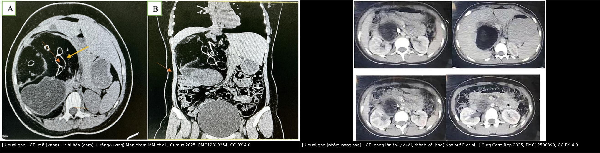
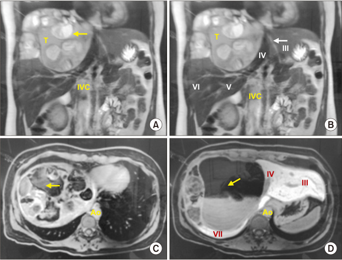
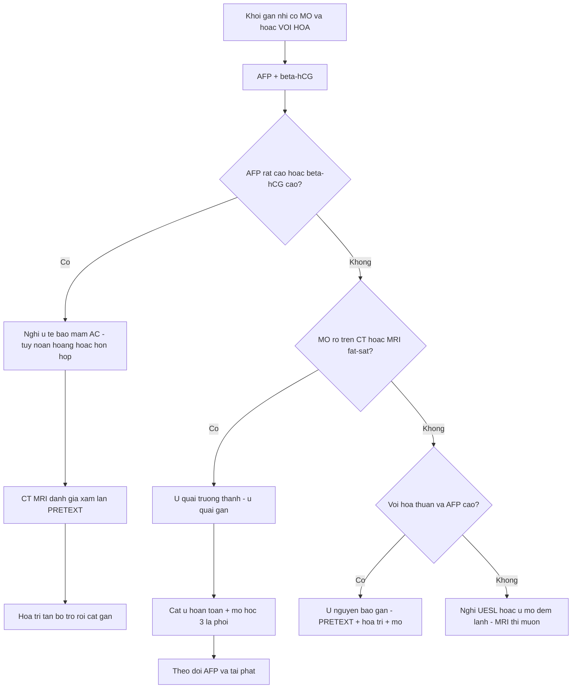
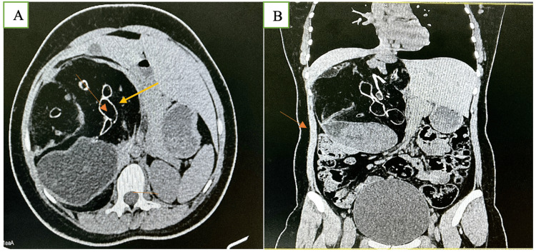
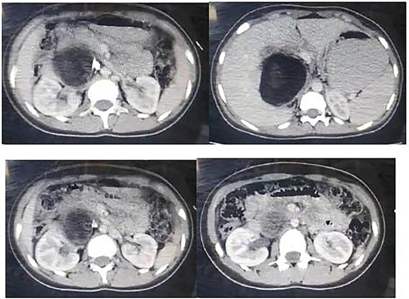
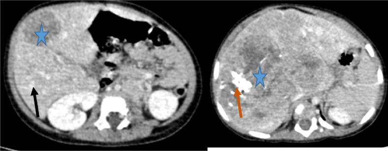

# 674 — U quái & u tế bào mầm vùng gan ở trẻ: khối có MỠ + VÔI HÓA / Hepatic teratoma & germ cell tumor

**Tags:** `pattern:khoi-gan-nhi` `pattern:khoi-co-mo-voi-hoa` `pattern:u-te-bao-mam` `vung:gan` `protocol:US-CT-MRI-gan-nhi` `incidentaloma:khoi-gan-nhi`
**Mức chắc chắn (certainty):** tổng hợp y văn (literature synthesis) — tổng hợp ca nguyên văn có ảnh CC BY/CC BY-NC/CC BY-NC-ND (ghi rõ PMCID + Fig từng ảnh) + đối chiếu bài 665/663/664 trong repo; số liệu lấy trực tiếp từ bài gốc.

## 1. Tổng quan bệnh học – cơ chế hình ảnh

- **U quái gan (hepatic teratoma):** u tế bào mầm (germ cell tumor) **ngoài sinh dục**, cấu tạo từ **cả ba lá phôi (ngoài – giữa – trong)**. Cực kỳ hiếm: **< 1% các u gan**; tới 2018 chỉ có **11 ca u quái gan ở người lớn** được báo cáo (García-Ríos LE et al., *Ann Hepatobiliary Pancreat Surg* 2021, **PMC8639313**). U quái trưởng thành (mature) thường gặp ở **trẻ trước dậy thì** (García-Ríos 2021).
- **Phổ tế bào mầm vùng gan:** **u quái trưởng thành** (lành hơn, mỡ + vôi hóa + mô đặc), **u quái non (immature)**, **u túi noãn hoàng (yolk sac tumor/endodermal sinus tumor)** — ác, tiết **alpha-fetoprotein (AFP)** rất cao. Vì cùng nguồn gốc tế bào mầm, **u túi noãn hoàng gan** có thể mọc thành **khối đặc–hoại tử khổng lồ** ở nhũ nhi (Ez-Zaky S et al., *Radiol Case Rep* 2024, **PMC11419775**).
- **TẠI SAO hình ảnh đặc trưng là "mỡ + vôi hóa" (vật lý):**
  - **Mỡ** trong u quái (mô mỡ trưởng thành) có **đậm độ CT −40 đến −120 HU** (ngưỡng mỡ trên CT) → **giảm đậm độ rõ**; trên **MRI T1W tăng tín hiệu mạnh và TẮT (mất tín hiệu) khi fat-sat** — đây là bằng chứng chốt "thành phần mỡ".
  - **Vôi hóa/răng/xương** (từ lá phôi giữa) → **tăng đậm độ như xương** trên CT và **tối trên mọi chuỗi MRI** — dấu hiệu u quái trưởng thành.
  - **Dịch/nang + mô đặc** (mô thần kinh, biểu mô, keratin) giải thích tính **không đồng nhất** trên mọi chuỗi.
  - Ngược lại, **ung thư đường mật/sarcoma gan (UESL)** hầu như **KHÔNG chứa mỡ** → "mỡ" là điểm phân biệt mạnh.
- **Ngưỡng định lượng bắt buộc:**
  - U quái trưởng thành: **~10,2 × 5,3 cm**, AFP **trong giới hạn bình thường** (Manickam MM et al., *Cureus* 2025, **PMC12819354**); ca khác **7,7 × 9,5 cm**, **thành nang vôi hóa** ở thùy đuôi (Khalouf E et al., *J Surg Case Rep* 2025, **PMC12506890**); ca u quái khổng lồ **160 × 180 × 90 mm** (García-Ríos 2021).
  - **U túi noãn hoàng gan:** nhũ nhi **14 tháng**, **AFP > 20.000 ng/mL**, **βhCG < 2,3 mIU/mL**, khối gan **thùy phải xâm lấn, hoại tử + vôi hóa**, **PRETEXT III** (Ez-Zaky 2024).
  - Đối chiếu **u nguyên bào gan (hepatoblastoma):** vôi hóa thô **40–50%**, **AFP > 10.000 ng/mL**, nhưng **KHÔNG có mỡ** (Shahid M et al., World J Hepatol 2025, PMC12400384 — xem bài [665](../665-khoi-u-gan-nhi/lesson.md)).

## 2. Mẫu hình + chẩn đoán phân biệt theo cơ chế (gamut)

**Gamut "khối gan CÓ MỠ và/hoặc VÔI HÓA ở trẻ":**
- **Có MỠ + vôi hóa + mô đặc, AFP bình thường:** **u quái trưởng thành gan** (chốt chẩn đoán).
- **Có MỠ + AFP rất cao / βhCG cao:** **u tế bào mầm ác** (u túi noãn hoàng, u quái non, hỗn hợp) — khối thường **đặc, hoại tử, xâm lấn** hơn là có mỡ rõ.
- **VÔI HÓA thô KHÔNG mỡ + AFP cao:** **u nguyên bào gan**.
- **Nang nhiều vách, ít mạch, KHÔNG mỡ, không vôi hóa:** **u mô đệm lành** (xem [664](../664-u-mo-dem-lanh-gan-o-tre/lesson.md)).
- **Giả nang ĐẶC ngấm muộn, không vôi hóa, AFP bình thường:** **sarcoma phôi gan (UESL)** (xem [663](../663-sarcoma-phoi-gan-chua-biet-hoa/lesson.md)).
- **Chỉ có MỠ, bờ đều, không vôi hóa:** **u mỡ/lipoblastoma**.
- **Nang + nang con + vôi hóa thành, có dịch tễ:** **nang sán lá gan (hydatid)** — cạm bẫy kinh điển, không mỡ (xem [139](../139-san-la-gan/lesson.md)).

**Mnemonic khối gan nhi có mỡ–vôi hóa — "TERATOID":**
**T**eratoma · **E**chinococcus (vôi hóa thành nang) · **R**habdomyosarcoma/đặc · **A**FP (túi noãn hoàng) · **T**umor nguyên bào gan · **O**mphalomesenteric/ổ nhầy · **I**mmature teratoma · **D**i căn (neuroblastoma/Wilms).

## 3. Bảng so sánh phân biệt (ma trận đối chiếu)

| Thực thể (entity) | Hình ảnh điển hình | Chốt vào (rule-in) | Chốt loại (rule-out) | Gợi ý xác nhận |
|---|---|---|---|---|
| **U quái trưởng thành gan** | Khối **hỗn hợp mỡ (−40 đến −120 HU) + vôi hóa/răng + dịch + mô đặc**, bờ rõ | **MỠ + vôi hóa cùng lúc + AFP/βhCG bình thường** | Không mỡ, chỉ vôi hóa rải rác → nghĩ hepatoblastoma/hydatid | CT + MRI fat-sat; **cắt u hoàn toàn** + mô học 3 lá phôi |
| **U túi noãn hoàng gan (ác)** | Khối **đặc lớn, hoại tử, vôi hóa lấm tấm**, xâm lấn | **AFP > 20.000 ng/mL + βhCG thấp + khối xâm lấn nhũ nhi** | AFP bình thường + mỡ rõ → u quái trưởng thành | AFP/βhCG + **glypican-3, SALL4** (+); hóa trị + cắt gan |
| **U nguyên bào gan** | Khối đặc lớn, **vôi hóa thô 40–50%**, **KHÔNG mỡ** | **AFP > 10.000 ng/mL + 6 tháng–5 tuổi + vôi hóa thô** | Có mỡ rõ → u quái; AFP bình thường → UESL/MH | PRETEXT, sinh thiết; hóa trị tân bổ trợ + mổ |
| **U mô đệm lành gan (MH)** | **Nhiều nang có vách**, ít mạch, không mỡ | **< 2 tuổi + nhiều nang + ít mạch + AFP thường** | **Mỡ + vôi hóa rõ** → u quái | US/CT/MRI + Doppler; cắt u khi đủ nhu mô |
| **Nang sán lá gan (hydatid)** | Nang **vôi hóa thành**, **nang con/water-lily**, **không mỡ** | **Vỏ tách + nang con + tiền sử dịch tễ** | **Mỡ trong khối** → u quái, không phải sán | Huyết thanh + US/CT; albendazole + PAIR |
| **Sarcoma phôi gan (UESL)** | **Giả nang ĐẶC**, T2 sáng, ngấm muộn, **không vôi hóa** | **6–10 tuổi + AFP bình thường + không mỡ/vôi hóa + ngấm vỏ muộn** | **Mỡ + vôi hóa thô** → u quái | MRI thì muộn 3–5 phút; cắt R0 + hóa trị |

*Trái: u quái gan — mũi tên vàng = mỡ, cam = vôi hóa/răng, còn mô đặc [Manickam MM et al., Cureus 2025, PMC12819354, CC BY 4.0]. Phải: ca ban đầu bị chẩn đoán nhầm nang sán, mô học mới ra u quái trưởng thành — nang lớn thùy đuôi, thành vôi hóa [Khalouf E et al., J Surg Case Rep 2025, PMC12506890, CC BY 4.0]. Ảnh ghép letterbox giữ nguyên tỷ lệ.*

### U quái gan — MRI đa tín hiệu

*(A, B) coronal T2W và (C, D) axial: khối u nhiều tín hiệu xen kẽ (mỡ/dịch/mô đặc), chèn ép tĩnh mạch chủ dưới (IVC) và động mạch chủ (Ao) — García-Ríos LE et al., Ann Hepatobiliary Pancreat Surg 2021, PMC8639313, **CC BY-NC 4.0** (giữ nguyên bản, không ghép).*

## 4. Protocol chụp + xử trí

- **Xét nghiệm TRƯỚC/đồng thời với hình ảnh:** **AFP + βhCG** (bắt buộc mọi khối gan nhi, đặc biệt khi có mỡ/vôi hóa) — định hướng u túi noãn hoàng/mixed GCT (βhCG cao gợi ý u quái choriocarcinoma). **Lưu ý sinh lý: AFP cao sinh lý trong 6 tháng đầu** nên đọc thận trọng ở nhũ nhi.
- **Siêu âm bụng:** đầu tay, xác định khối, dịch, tưới máu; **kém nhạy với mỡ/vôi hóa nhỏ**.
- **CT cản quang:** tốt nhất để thấy **đậm độ mỡ (−40 đến −120 HU)** và **vôi hóa** cùng lúc; đánh giá xâm lấn, mạch, PRETEXT nếu nghi ác.
- **MRI (có fat-sat):** chốt **thành phần mỡ** (T1 tăng → tắt khi fat-sat), đánh giá mô mềm/mạch/kênh mật; giúp phân biệt mỡ **thật** với xuất huyết/protein cao T1.
- **Sinh thiết:** **cân nhắc kỹ** — u quái có thể chứa thành phần **chưa trưởng thành**, sinh thiết mù dễ lấy mẫu không đại diện; với ca có mỡ + vôi hóa + AFP bình thường, **phẫu thuật cắt hoàn toàn** (chẩn đoán + điều trị cùng lúc) là lựa chọn.
- **Xử trí:** **cắt u hoàn toàn** cho u quái trưởng thành (García-Ríos 2021, Manickam 2025); **u tế bào mầm ác/u túi noãn hoàng** → **hóa trị (đôi khi tân bổ trợ) + phẫu thuật cắt gan** (Ez-Zaky 2024). Theo dõi **AFP làm dấu ấn tái phát**.
- **Biến chứng cần nhớ:** **vỡ u quái → viêm phúc mạc hóa chất (chemical peritonitis)** và **gliosis/gliomatosis peritonei** (cấy mô thần kinh trưởng thành ra màng bụng), đã gặp trong ca u quái khổng lồ (García-Ríos 2021).

## 5. Biến thể bình thường và cạm bẫy

- **Cạm bẫy lớn nhất — u quái trưởng thành bị chẩn đoán nhầm nang sán:** ca bé gái 14 tuổi được chẩn đoán ban đầu là **nang sán lá gan**, chỉ **mô học sau mổ** mới ra **u quái trưởng thành** (Khalouf 2025). Vì vậy khối nang gan **có mỡ hoặc thành vôi hóa ở trẻ** phải nghĩ **u quái**, đừng gọi sán ngay.
- **Mỡ có thể bị bỏ sót trên siêu âm** — nếu chỉ có US, dễ gọi "khối đặc/nang hỗn hợp"; **CT/MRI mới xác nhận mỡ**.
- **Vôi hóa đơn độc không đặc hiệu:** gặp ở hepatoblastoma (thô 40–50%), sán, u quái, u mạch máu bẩm sinh, di căn xương hóa.
- **AFP bình thường KHÔNG loại trừ u quái non/hỗn hợp** — mô học mới quyết định; ngược lại AFP rất cao gợi u túi noãn hoàng.
- **Đừng nhầm u quái với hepatoblastoma chỉ vì "trẻ nhỏ + vôi hóa"** — thiếu **mỡ** + AFP rất cao mới nghiêng hepatoblastoma/u mầm ác.
- **Thỏa mãn tìm kiếm:** thấy mỡ rồi dừng lại; phải đo **toàn bộ thành phần (mỡ, vôi hóa, dịch, mô đặc)** và tìm ổ **vỡ/gliosis peritonei** vì ảnh hưởng tiên lượng.

## 6. Tự lượng giá — Blind Quiz

**Ca 1 — Nữ 20 tuổi đau bụng âm ỉ 5 tháng, sờ thấy khối hạ sườn phải; AFP bình thường. Đọc CT trước.**

- Câu hỏi: Kể các thành phần đậm độ trong khối. Thành phần nào là "chìa khóa"? 3 chẩn đoán phân biệt? Vì sao u ĐẶC có mỡ + vôi hóa mà không phải ung thư?

<b>Bấm để hiện đáp án (findings + chẩn đoán)</b>

- Dấu hiệu (findings): khối lớn **~10,2 × 5,3 cm**, bờ rõ, **không đồng nhất**; mũi tên **vàng = mỡ (giảm đậm độ)**, **cam = vôi hóa/răng**, phần còn lại là mô đặc; đè đẩy mạch lân cận.
- Chẩn đoán (diagnosis): **u quái trưởng thành của gan (mature cystic teratoma)** — vì có **cả mỡ + vôi hóa/răng + mô đặc** (3 lá phôi) **với AFP bình thường**; mô học sau cắt xác nhận mô trưởng thành từ cả 3 lá phôi.
- Chẩn đoán phân biệt: hepatoblastoma (vôi hóa thô nhưng **không mỡ**), u mô đệm lành (nhiều nang, không mỡ), nang sán (vôi hóa thành, không mỡ).
- Nguồn ảnh: Manickam MM et al., *Cureus* 2025, PMC12819354, **CC BY 4.0**.

**Ca 2 — Bé gái 14 tuổi đau hạ sườn phải, ban đầu nghĩ "nang sán gan". Xem CT rồi biện luận.**

- Câu hỏi: Vì sao dễ nhầm nang sán? Dấu hiệu nào trên CT giúp nghĩ tới u quái hơn là sán? Cần thêm gì để chốt?

<b>Bấm để hiện đáp án (findings + chẩn đoán)</b>

- Dấu hiệu (findings): khối **nang lớn thùy đuôi, kích thước 7,7 × 9,5 cm**, **thành vôi hóa**, kéo dài tới rốn gan — hình thái na ná nang sán vôi hóa.
- Chẩn đoán (diagnosis): **u quái trưởng thành của gan** — ca này **chẩn đoán ban đầu là nang sán lá gan**, chỉ **mô học sau mổ** mới xác nhận; đây là **cạm bẫy kinh điển**.
- Cần thêm: **mô học** (thành phần 3 lá phôi) để chốt; nếu CT/MRI thấy **mỡ** trong khối thì càng nghiêng u quái.
- Nguồn ảnh: Khalouf E et al., *J Surg Case Rep* 2025, PMC12506890, **CC BY 4.0**.

**Ca 3 — Bé trai 14 tháng chướng bụng, khối gan; AFP > 20.000 ng/mL. Đọc CT trước.**

- Câu hỏi: Khối đặc hay nang? Có mỡ không? Với AFP > 20.000 ng/mL + nhũ nhi, chẩn đoán nào và phác đồ ra sao?

<b>Bấm để hiện đáp án (findings + chẩn đoán)</b>

- Dấu hiệu (findings): các khối **đặc liên tục** thùy phải (sao xanh), chừa phân thùy VI, bờ **phân thùy**, có **ổ hoại tử** và **vôi hóa** (mũi tên cam).
- Chẩn đoán (diagnosis): **u túi noãn hoàng của gan (yolk sac tumor)** — u tế bào mầm **ÁC**; **AFP > 20.000 ng/mL**, βhCG < 2,3 mIU/mL; mô học (+)**glypican-3/SALL4** và **thể Schiller–Duval**. Điều trị: **hóa trị tân bổ trợ rồi cắt gan phải**.
- Lưu ý phản biện nguồn: ca này ban đầu **nghĩ hepatoblastoma do tuổi nhũ nhi** — AFP rất cao + đáp ứng hóa trị mới dẫn tới chẩn đoán đúng.
- Nguồn ảnh: Ez-Zaky S et al., *Radiol Case Rep* 2024, PMC11419775, **CC BY-NC-ND 4.0** (giữ nguyên bản).

## Bài liên quan chéo
- [600 – Tổng quan Hệ Nhi khoa](../600-tong-quan-nhi-khoa/lesson.md) (bảng DDx khối gan nhi)
- [665 – Khối u gan ở trẻ em: hepatoblastoma, hemangioma, hamartoma & HCC](../665-khoi-u-gan-nhi/lesson.md) (gamut theo tuổi + AFP)
- [664 – U mô đệm lành của gan ở trẻ](../664-u-mo-dem-lanh-gan-o-tre/lesson.md) (khối nang–đặc, không mỡ)
- [663 – Sarcoma phôi gan chưa biệt hóa (UESL)](../663-sarcoma-phoi-gan-chua-biet-hoa/lesson.md) (giả nang đặc, không vôi hóa)
- [667 – U mạch máu gan ở trẻ & điều trị nội khoa](../667-u-mach-mau-gan-o-tre-va-dieu-tri/lesson.md) (vôi hóa ở thể bẩm sinh)
- [638 – Khối bìu–tinh hoàn ở trẻ (u tế bào mầm)](../638-khoi-biu-tinh-hoan-nhi/lesson.md) (u tế bào mầm vùng sinh dục)
- [139 – Sán lá gan (hydatid)](../139-san-la-gan/lesson.md) (cạm bẫy nang vôi hóa)
- [630 – U bụng nhi: neuroblastoma vs Wilms](../630-u-bung-nhi-neuroblastoma-vs-wilms/lesson.md) (di căn gan, vôi hóa)

## Ảnh
- Tên file: `674_<slug-bệnh>_<modality>_<PMCID>-FigN-...`. Nguồn + giấy phép từng ảnh trong `images/CREDITS.md` và `sources.md`.
- Ảnh **CC BY 4.0** dùng cho ảnh ghép (`composite_teratoma-mo-voihoa-vs-nang.jpg`); ảnh **CC BY-NC** (PMC8639313) và **CC BY-NC-ND** (PMC11419775) **giữ nguyên bản, không ghép**.
- Không tải Google Images/AuntMinnie; nguồn đóng chỉ dẫn link ở `sources.md`.

> Không dùng để chẩn đoán độc lập khi chưa có người hướng dẫn.
