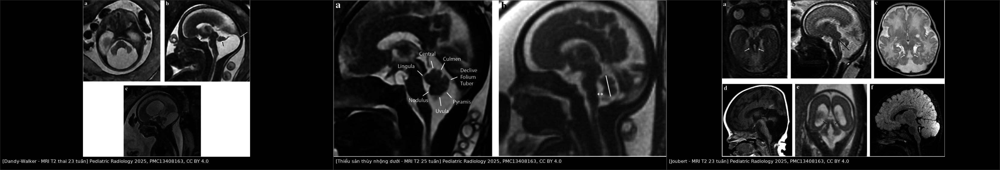
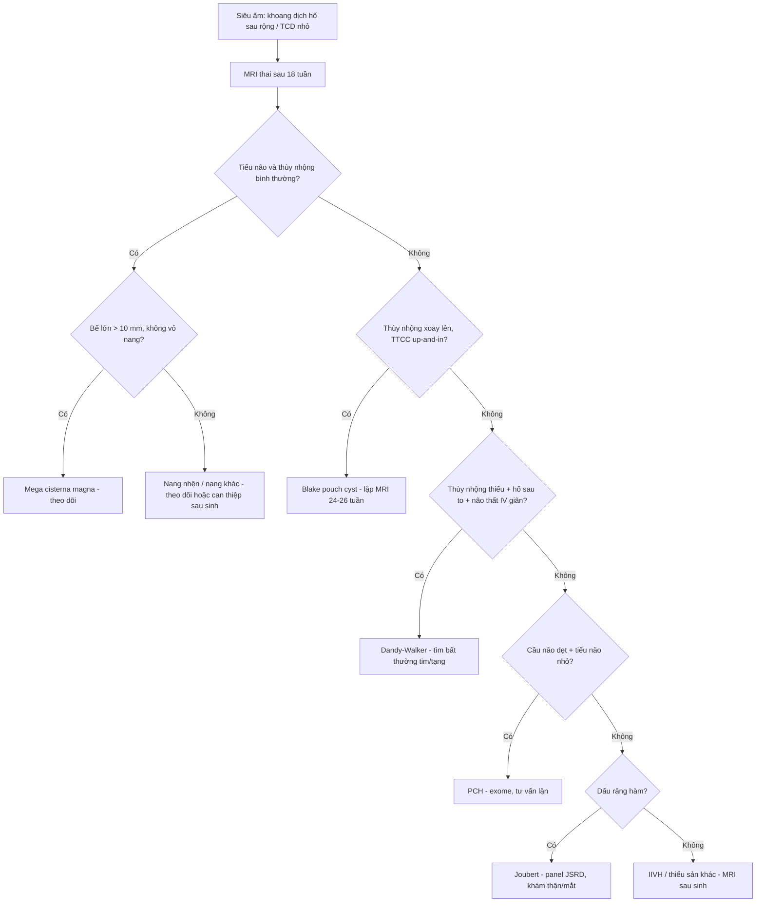
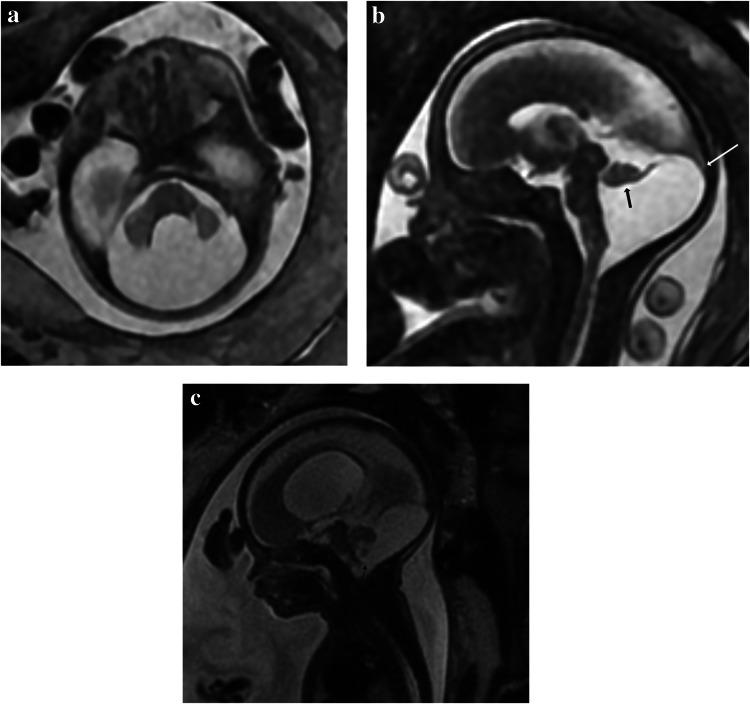
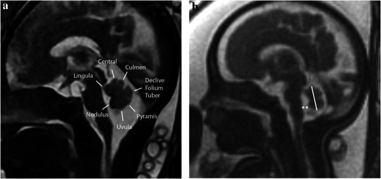
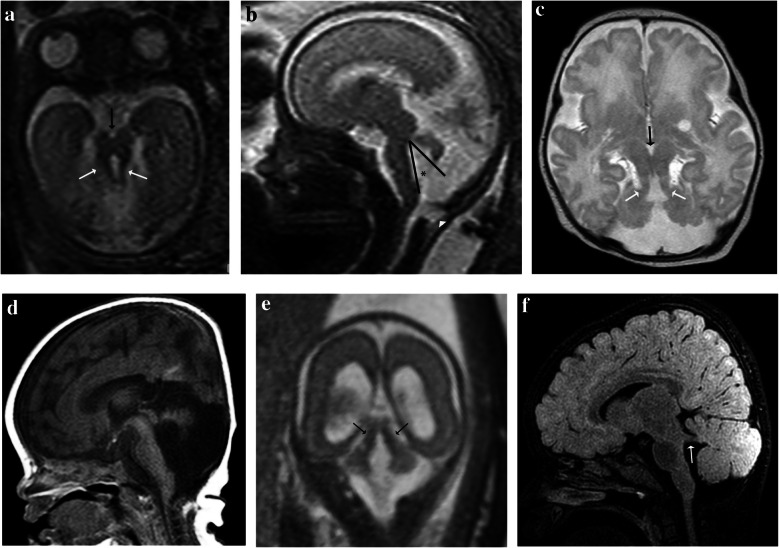

# 675 — Tư vấn tiền sản & MRI thai hố sau: thiểu sản cầu–tiểu não / Prenatal counseling & fetal MRI of the posterior fossa: pontocerebellar hypoplasia

**Tags:** `pattern:thieu-san-tieu-nao` `pattern:bat-thuong-ho-sau` `vung:ho-sau` `vung:thai-nhi` `protocol:MRI-thai` `score:TCD` `score:tegmento-vermian-angle`
**Mức chắc chắn (certainty):** tổng hợp y văn (literature synthesis) — tổng hợp bài tổng quan có ảnh CC BY của *Pediatric Radiology* 2025 về chẩn đoán hình ảnh hố sau thai nhi + đồng thuận di truyền – tư vấn; phần ca quiz là ca nguyên văn của bài gốc.

## 1. Tổng quan bệnh học – cơ chế hình ảnh

### 1.1 Vì sao hố sau thai nhi khó chẩn đoán?

- **Tiểu não và cầu não phát triển kéo dài**, tiếp tục sau sinh; nhiều dị tật **chưa biểu hiện đủ** khi thai còn nhỏ. Vì vậy **không kết luận thiểu sản trước 18 tuần**, và nhiều trường hợp cần **MRI lặp lại muộn hơn** hoặc **MRI sau sinh**.
- **Hố sau chứa 3 nhóm bệnh cảnh chồng lấp:** (1) **bất thường dạng nang/dịch (cystic anomalies)**; (2) **loạn sản/thiểu sản tiểu não (cerebellar hypoplasia/dysgenesis)**; (3) **dị tật thân não (brainstem malformations)**. Cùng một “khoang dịch rộng” có thể là **biến thể lành**, **nang Blake**, **Dandy-Walker** hoặc **teo tiểu não** — cách xử trí và tiên lượng khác hẳn.
- **Tiên lượng phụ thuộc 2 yếu tố:** **có bất thường kèm theo hay không** (não trên lều, tim, thận, mắt) và **loại dị tật**. Với **thể nang đơn độc không kèm bất thường**, **90–95%** trẻ phát triển thần kinh bình thường (mega cisterna magna, nang Blake); với **Dandy-Walker**, chỉ khoảng **50%**.

### 1.2 TẠI SAO MRI thai dùng T2 nhanh, và các con số phải đo

- **Chuỗi T2 nhanh (SSFSE/HASTE)** là chuỗi chính vì **dịch não tủy có T2 rất dài → sáng trắng**, còn **mô não thai chưa myelin hóa → giàu nước, T2 trung gian**, tạo tương phản tự nhiên giữa nhu mô và khoang dịch. Thời gian thu ảnh ngắn (**< 1 giây/lát**) để “đóng băng” chuyển động thai, không cần an thần.
- **T1** giúp phát hiện **máu (methemoglobin sáng T1)**, **vôi hóa** và **mỡ**; **DWI/EPI** giúp phát hiện **nhồi máu/thiếu máu cấp** (khuếch tán hạn chế) — hữu ích khi nghi nhiễm trùng bào thai hoặc tổn thương mạch.
- **Các số đo bắt buộc:**
  - **Đường kính ngang tiểu não (transverse cerebellar diameter — TCD)** so với **bảng percentile theo tuổi thai**. Ví dụ trong bài: thai **19 tuần 4/7**, TCD **13,7 mm** — **dưới bách phân vị 1** (trung vị tuổi này **19,7 mm**).
  - **Bể lớn (cisterna magna)** đo đường trước–sau trên mặt phẳng ngang: **bình thường < 10 mm**; **> 10 mm = mega cisterna magna** (giãn bể lớn).
  - **Góc tegmento–thùy nhộng (tegmento-vermian angle):** bình thường **< 12° trước 24 tuần**, **< 8° sau 24 tuần**.
  - **Khoảng cách thùy nhộng dưới (inferior vermian distance):** bình thường **< 4 mm**.
  - **Tỷ lệ mô thùy nhộng trên/dưới đường fastigium–declive:** bình thường khoảng **2:3**; bất thường sau **20 tuần** khi phần dưới **≤** phần trên.
  - **7/9 thùy nhộng** có thể nhận diện trên MRI **1,5 T từ tuần 22**.

### 1.3 Từ hình ảnh đến cơ chế bệnh

- **Dandy-Walker malformation (DWM — dị tật Dandy-Walker):** hố sau **to bất thường**, **lều tiểu não cao/torcula cao**, **thùy nhộng thiểu sản/không có**, **thùy nhộng xoay lên**, **não thất IV giãn**, **thông rộng với khoang dịch sau tiểu não**. Phức hợp **taenia–tela choroidea (TTCC)** nằm **thấp và ra ngoài (“down and out”)**.
- **Persistent Blake pouch cyst (BPC — nang Blake tồn tại):** màng mái não thất IV không thủng → nang chèn ép, **thùy nhộng xoay lên**, **góc tegmento–thùy nhộng tăng**, nhưng **thùy nhộng và bán cầu tiểu não tạo hình bình thường**; **TTCC nằm cao và vào trong (“up and in”)**. **> 50%** tự thủng và thoái triển giữa **24–26 tuần**.
- **Mega cisterna magna (MCM — bể lớn khổng lồ):** khoang dịch sau tiểu não **> 10 mm**, **không có vỏ nang**, **không chèn ép**, tiểu não và não thất IV bình thường; **falx cerebelli có thể nhân đôi, không lệch**.
- **Cerebellar hypoplasia (thiểu sản tiểu não):** tiểu não **nhỏ hơn tuổi thai** nhưng **lều và TTCC bình thường**, khoang dịch “trống” chứ không phải nang. Nguyên nhân **nhiễm trùng bào thai (CMV)**, **thuốc/độc chất (phenytoin, valproate, rượu)**, **bất thường nhiễm sắc thể**, **rối loạn chuyển hóa**, **hội chứng di truyền**.
- **Pontocerebellar hypoplasia (PCH — thiểu sản cầu–tiểu não):** bệnh **thoái hóa thần kinh khởi phát từ bào thai**, **di truyền lặn nhiễm sắc thể thường**, **19 type** đã mô tả; **cầu não + tiểu não thiểu sản**, thùy nhộng thiếu/thiểu sản; trẻ **chậm phát triển nặng, khó ăn, co giật, đầu nhỏ, giảm/ tăng trương lực**. Có ca **chưa mất thể tích rõ trước sinh** → **MRI sau sinh** mới chẩn đoán.
- **Joubert syndrome (JS — hội chứng Joubert):** **dấu “răng hàm” (molar tooth sign)** trên mặt phẳng ngang trung não — **bể liên cuống não sâu**, **cuống tiểu não trên dày và nằm ngang**, **eo cầu–trung não hẹp**; kèm **thiểu sản thùy nhộng**, có thể **màng não thoát vị chẩm**. Do **bệnh lông mao (ciliopathy)**, **> 30 gen**, di truyền **lặn**; tổn thương **thận (nang), gan, võng mạc, coloboma, đa ngón**; tiên lượng xấu, **nguy cơ tái phát 25%**.
- **Kinked brainstem / L1CAM:** thân não **gấp khúc bất thường (“zig-zag”)**, **não úng thủy do hẹp cống Sylvius**, **bất sản thể chai**, **ngón tay cái khép**; **di truyền liên kết X (L1CAM)** — **50%** con trai của mẹ mang gen bị bệnh.

## 2. Mẫu hình + chẩn đoán phân biệt theo vị trí (gamut)

- **Mẫu hình gốc:** siêu âm thai phát hiện **khoang dịch sau tiểu não rộng**, **TCD nhỏ**, **thùy nhộng không thấy/không đều**, hoặc **não thất giãn** → MRI thai để **phân loại theo hình thái trội**.
- **Gamut theo hình thái trội:**
  - **Khoang dịch sau tiểu não rộng, tiểu não bình thường:** **MCM** (lành), **BPC** (có thể tự khỏi), **nang nhện (arachnoid cyst)** (chèn ép, vỏ rõ).
  - **Tiểu não nhỏ ± thùy nhộng thiếu:** **IIVH (isolated inferior vermian hypoplasia — thiểu sản thùy nhộng dưới đơn độc)**, **thiểu sản bán cầu một bên** (sau xuất huyết/nhiễm trùng), **thiểu sản + loạn sản vỏ não (lissencephaly)**.
  - **Dị tật thân não:** **PCH**, **Joubert**, **kinked brainstem/L1CAM**, **DMJD (diencephalon–mesencephalon junction dysplasia — loạn sản giáp ranh gian não–trung não)**.
  - **Loạn sản tiểu não dạng nang:** **alpha-dystroglycanopathy** (Walker-Warburg, muscle–eye–brain, Fukuyama), **GPR56**.
- **Câu hỏi định hướng:** (1) **tiểu não có nhỏ thật không** (TCD percentile)? (2) **thùy nhộng có đủ và đúng vị trí không** (góc, chiều cao)? (3) **thân não có gấp khúc/cầu não dẹt không**? (4) **có bất thường trên lều/tạng kèm theo không**? (5) **tiền sử gia đình/nhiễm trùng/thuốc?**

## 3. Bảng so sánh phân biệt (ma trận đối chiếu)

| Thực thể (entity) | Hình ảnh điển hình (US/MRI) | Chốt vào (rule-in) | Chốt loại (rule-out) | Gợi ý xác nhận |
|---|---|---|---|---|
| **Mega cisterna magna** | Khoang dịch sau tiểu não **> 10 mm**, không vỏ nang, không chèn ép; **falx cerebelli nhân đôi, không lệch**; tiểu não/não thất IV bình thường | **> 10 mm + tiểu não bình thường + không chèn ép + không vỏ nang** | Có vỏ nang/chèn ép/góc tăng → nghĩ BPC/nang nhện | MRI T2 3 mặt phẳng; đo AP; theo dõi |
| **Persistent Blake pouch cyst** | **Thùy nhộng xoay lên**, **góc tegmento–thùy nhộng tăng**, nang giữa; **TTCC “up and in”**; thùy nhộng tạo hình bình thường | **Xoay thùy nhộng + TTCC cao/trong + thùy nhộng bình thường** | Thùy nhộng thiểu sản thật/không có → nghĩ IIVH/DWM | MRI nhát giữa; lặp lại sau 24–26 tuần (tự khỏi > 50%) |
| **Dandy-Walker malformation** | **Hố sau to, torcula cao**, **thùy nhộng thiểu sản/không có + xoay lên**, **não thất IV giãn**, **TTCC “down and out”** | **Hố sau to + thùy nhộng thiếu + não thất IV giãn + torcula cao** | Thùy nhộng đủ, góc bình thường, không giãn não thất IV → không phải DWM | MRI nhát giữa; tìm bất thường kèm theo (tim ~25%) |
| **IIVH (thiểu sản thùy nhộng dưới)** | Thùy nhộng **ngắn**, **góc tegmento–thùy nhộng tăng**, **khoảng cách thùy nhộng dưới > 4 mm**, tỷ lệ trên/dưới bất thường sau 20 tuần | **Thiếu mô thùy nhộng dưới + góc tăng + IVD > 4 mm** | Thùy nhộng đủ 7/9 thùy, góc < 12°/< 8° → không phải IIVH | MRI nhát giữa; đo chiều cao/AP; MRI sau sinh |
| **PCH** | **Cầu não dẹt + tiểu não nhỏ**, thùy nhộng thiếu; có thể **não thất giãn, thể chai mỏng/không có, trần não dày** | **Cầu não + tiểu não cùng thiểu sản** + chậm phát triển nặng sau sinh | Cầu não bình thường, chỉ tiểu não nhỏ → nghĩ thiểu sản tiểu não đơn độc | MRI thai + sau sinh; **exome/panel PCH**; tư vấn lặn |
| **Joubert syndrome** | **Dấu răng hàm**: bể liên cuống sâu, **cuống tiểu não trên dày/ngang**, eo cầu–trung não hẹp; thiểu sản thùy nhộng; màng não thoát vị chẩm | **Molar tooth sign + thiểu sản thùy nhộng** | Không có dấu răng hàm → nghĩ PCH/IIVH | MRI nhát ngang trung não + nhát giữa; **panel JSRD > 30 gen**; khám thận/mắt |

*Trái: **Dandy-Walker** — hố sau giãn, thùy nhộng thiếu, torcula cao. Giữa: **thiểu sản thùy nhộng dưới** — thùy nhộng ngắn, góc tegmento–thùy nhộng tăng. Phải: **Joubert** — dấu răng hàm + thiểu sản thùy nhộng. Nguồn: *Pediatric Radiology* 2025 (PMC13408163), CC BY 4.0. Ảnh ghép letterbox, không crop/kéo giãn.*

## 4. Protocol chụp + phân loại + tư vấn tiền sản

### 4.1 Protocol MRI thai hố sau

- **Thời điểm:** sau **18 tuần** (tốt nhất **20–24 tuần**); nếu hình ảnh chưa rõ, **lặp lại muộn hơn** (đặc biệt BPC có thể thay đổi sau 24–26 tuần). **Không kết luận thiểu sản tiểu não/thùy nhộng trước 18 tuần.**
- **Máy:** **1,5 T hoặc 3 T**, không cần an thần; mẹ nằm **nghiêng trái nhẹ** để tránh chèn ép tĩnh mạch chủ.
- **Chuỗi:** **T2 SSFSE/HASTE** 3 mặt phẳng (ngang, đứng dọc, đứng ngang) lát **3–4 mm**, FOV đủ rộng; **T1** (máu/vôi), **DWI/EPI** (thiếu máu/nhiễm trùng); **gadolinium chỉ khi thật cần** (không dùng thường quy).
- **Đo và ghi:** **TCD + percentile**, **đường kính trước–sau bể lớn**, **chiều cao/AP thùy nhộng**, **góc tegmento–thùy nhộng**, **khoảng cách thùy nhộng dưới**, **độ dày/cấu trúc cầu não**, **não thất**, **thể chai**, **vỏ não**.
- **Đánh giá toàn thân:** tim, thận, mắt, chi, mặt; **tiền sử gia đình**, **nhiễm trùng/thuốc**.
- **Di truyền:** **CMA (chromosomal microarray)** trước, sau đó **exome/panel** (PCH, JSRD, L1CAM, alpha-dystroglycanopathy) tùy hình thái; **tư vấn di truyền** và **nguy cơ tái phát** (lặn **25%**, L1CAM **50%** ở con trai).

### 4.2 Phân tầng tiên lượng & tư vấn

- **Nhóm thuận lợi:** **MCM** hoặc **BPC đơn độc, không bất thường kèm theo** → **90–95%** phát triển thần kinh bình thường; BPC có thể **tự khỏi > 50%** sau 24–26 tuần; theo dõi siêu âm/MRI, không can thiệp.
- **Nhóm trung gian:** **IIVH đơn độc** — tiên lượng thay đổi, cần **MRI sau sinh** và theo dõi phát triển; không mặc định lành.
- **Nhóm nặng:** **DWM** (chỉ ~**50%** phát triển bình thường; tìm **tim bẩm sinh ~25%**), **PCH** (chậm phát triển nặng, co giật, khó ăn), **Joubert** (đa cơ quan, tiên lượng xấu), **L1CAM/kinked brainstem** (não úng thủy, di chứng).
- **Tư vấn:** giải thích **không chẩn đoán được trước 18 tuần**, **khả năng thay đổi theo tuổi thai**, **giá trị của MRI sau sinh**, **nguy cơ tái phát**, **lựa chọn theo dõi/chấm dứt thai kỳ theo luật địa phương**, và **kế hoạch sinh tại trung tâm có hồi sức nhi**.

## 5. Biến thể bình thường và cạm bẫy

- **“Bể lớn rộng” không đồng nghĩa bệnh:** **MCM** là biến thể lành; phải loại trừ **vỏ nang, chèn ép, thùy nhộng xoay** trước khi kết luận.
- **BPC vs thiểu sản thùy nhộng:** BPC **xoay** thùy nhộng nhưng **không làm mất mô**; đo **chiều cao thùy nhộng** và **góc** thay vì chỉ nhìn “khoang dịch rộng”. **Lặp MRI sau 24–26 tuần** vì BPC tự khỏi > 50%.
- **Chẩn đoán quá sớm:** trước **18 tuần** tiểu não chưa tạo hình đủ; **TCD thấp giả** nếu đo sai mặt phẳng (không qua tiểu não/đồi thị) hoặc thai nằm xấu.
- **Bỏ sót bất thường trên lều:** **DWM** thường kèm **bất sản thể chai, dị tật vỏ não, dị tật tim (~25%)**; luôn khảo sát toàn bộ não và tạng.
- **PCH có thể “bình thường” trước sinh:** bệnh **thoái hóa tiến triển**, mất thể tích có thể chỉ rõ **sau sinh**; nếu nghi ngờ, **MRI sau sinh + exome**, không loại trừ bằng MRI thai bình thường.
- **Joubert dễ bị bỏ sót** nếu chỉ đo thùy nhộng: phải nhìn **mặt phẳng ngang trung não** tìm **dấu răng hàm**; khám **thận, mắt, đa ngón**.
- **Nhiễm trùng/thuốc:** thiểu sản tiểu não **mắc phải** (CMV, phenytoin, valproate, rượu) không di truyền — hỏi kỹ tiền sử, xét nghiệm CMV khi nghi.

## 6. Tự lượng giá — Blind Quiz

**Ca 1 — Thai 23 tuần, siêu âm thấy khoang dịch sau tiểu não rộng, không thấy thùy nhộng rõ.**

- Câu hỏi: Mô tả 3 dấu hiệu chính trên MRI. Chẩn đoán và 2 phân biệt?

<b>Bấm để hiện đáp án (findings + chẩn đoán)</b>

- **Dấu hiệu:** (1) **hố sau giãn rộng**, khoang dịch lớn giữa hai bán cầu tiểu não thay cho thùy nhộng; (2) **torcula/lều tiểu não cao**; (3) **thùy nhộng nhỏ, xoay lên**, **não thất IV giãn**, thông với khoang dịch sau tiểu não; TTCC nằm **thấp/ra ngoài**.
- **Chẩn đoán:** **Dandy-Walker malformation**.
- **Phân biệt:** **BPC** (thùy nhộng tạo hình bình thường, TTCC “up and in”, có thể tự khỏi) và **MCM** (tiểu não bình thường, không vỏ nang, không chèn ép).
- **Nguồn ảnh:** *Pediatric Radiology* 2025, Fig. 4, PMCID [PMC13408163](https://pmc.ncbi.nlm.nih.gov/articles/PMC13408163/), CC BY 4.0.

**Ca 2 — Thai 25 tuần 2/7, MRI nhát giữa thấy thùy nhộng ngắn, góc tegmento–thùy nhộng tăng.**

- Câu hỏi: Đo gì để chốt thiểu sản thùy nhộng dưới? Phân biệt với BPC thế nào?

<b>Bấm để hiện đáp án (findings + chẩn đoán)</b>

- **Dấu hiệu:** **thùy nhộng ngắn**, **góc tegmento–thùy nhộng tăng**, **khoảng cách thùy nhộng dưới > 4 mm**, tỷ lệ mô trên/dưới bất thường; **7/9 thùy nhộng** nhận diện được ở thai bình thường từ 22 tuần.
- **Chẩn đoán:** **thiểu sản thùy nhộng dưới đơn độc (IIVH)**.
- **Phân biệt BPC:** BPC **xoay thùy nhộng lên** nhưng **không mất mô**, TTCC **cao/trong**, và có thể **tự khỏi > 50%** sau 24–26 tuần → **lặp MRI** trước khi kết luận.
- **Nguồn ảnh:** *Pediatric Radiology* 2025, Fig. 6, PMCID [PMC13408163](https://pmc.ncbi.nlm.nih.gov/articles/PMC13408163/), CC BY 4.0.

**Ca 3 — Thai 23 tuần, MRI thấy cuống tiểu não trên dày, bể liên cuống sâu, thùy nhộng thiểu sản.**

- Câu hỏi: Dấu hiệu đặc hiệu là gì? Cần khám thêm cơ quan nào và tư vấn di truyền ra sao?

<b>Bấm để hiện đáp án (findings + chẩn đoán)</b>

- **Dấu hiệu:** **dấu răng hàm (molar tooth sign)** — **bể liên cuống não sâu**, **cuống tiểu não trên dày và nằm ngang**, **eo cầu–trung não hẹp**; kèm **thiểu sản thùy nhộng**, có thể **màng não thoát vị chẩm**.
- **Chẩn đoán:** **hội chứng Joubert (JSRD)** — bệnh lông mao, **> 30 gen**, di truyền **lặn**.
- **Khám thêm:** **thận (nang), gan, võng mạc/coloboma, đa ngón, hô hấp/thần kinh**; **tư vấn nguy cơ tái phát 25%**, xét nghiệm **panel JSRD** cho thai và bố mẹ.
- **Nguồn ảnh:** *Pediatric Radiology* 2025, Fig. 13, PMCID [PMC13408163](https://pmc.ncbi.nlm.nih.gov/articles/PMC13408163/), CC BY 4.0.

## Bài liên quan chéo
- [655 – HIE sơ sinh & dị tật hố sau (Chiari/Dandy-Walker/bất sản thể chai)](../655-hie-so-sinh-va-di-dang-bam-sinh-than-kinh/lesson.md)
- [657 – Dị tật hố sau khác: Joubert & rhombencephalosynapsis](../657-di-dang-ho-sau-joubert-rhombencephalo/lesson.md)
- [659 – Thiểu sản cầu–tiểu não (PCH) & POLR3B](../659-thieu-san-cau-tieu-nao-pch-polr3b/lesson.md)
- [656 – Bất thường tủy–cột sống nhi](../656-bat-thuong-tuy-cot-song-nhi/lesson.md)
- [600 – Tổng quan Nhi khoa](../600-tong-quan-nhi-khoa/lesson.md)

> Không dùng để chẩn đoán độc lập khi chưa có người hướng dẫn.
