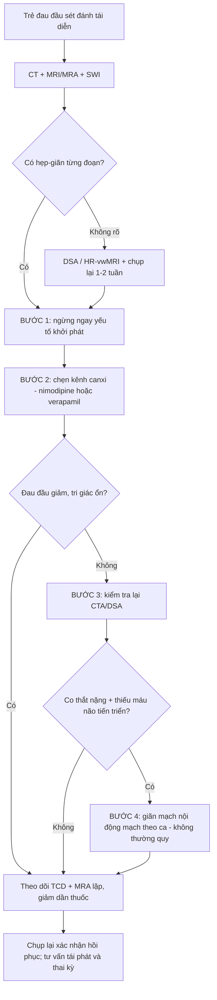
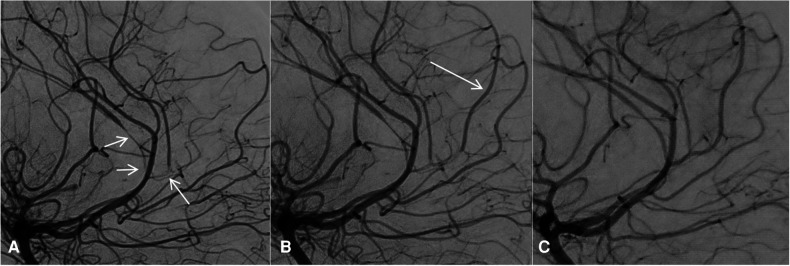
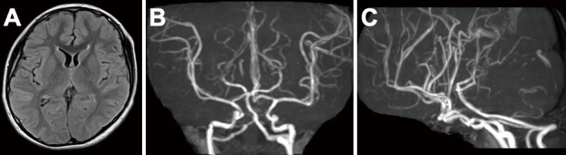
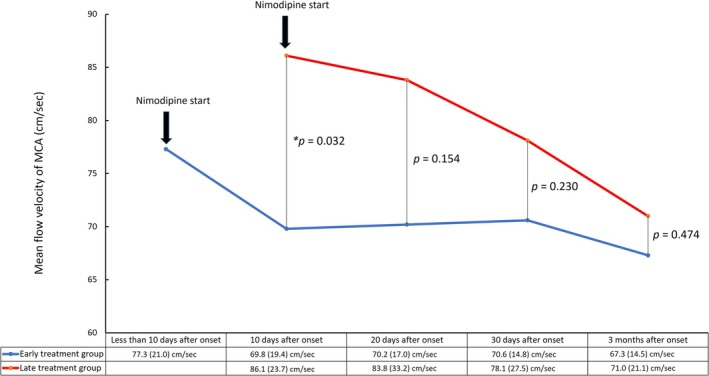
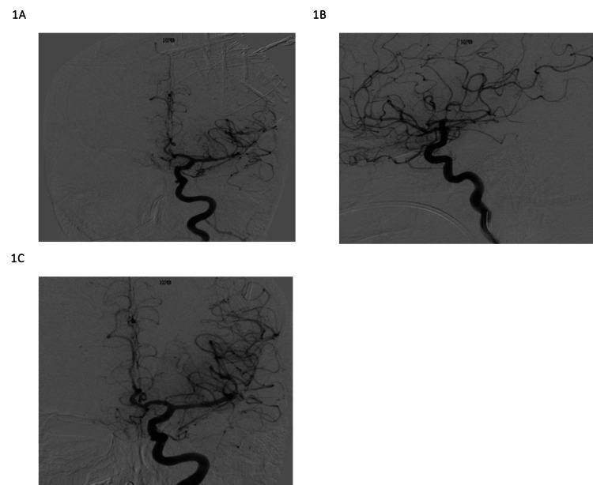

# 676 — RCVS ở trẻ em: bậc điều trị, khi nào can thiệp nội mạch, theo dõi / Pediatric RCVS: treatment ladder and endovascular rescue

**Tags:** `pattern:co-mach-nao` `vung:nao-nhi` `vung:nao` `score:RCVS2` `protocol:DSA-nao` `protocol:MRA-nao-nhi`
**Mức chắc chắn (certainty):** tổng hợp y văn (literature synthesis) — số liệu lấy từ tổng quan RCVS 2026 (PMC13142216), nghiên cứu TCD nimodipine (PMC12497928), khung điều trị đau đầu trẻ có bệnh mạch máu (PMC13653247) và các ca nhi khoa nguyên văn (PMC10020348, PMC12391675, PMC10440144). Ca trong quiz là **ca nguyên văn**, giữ đúng tuổi – triệu chứng – liều ghi trong bài gốc; phần liều người lớn áp cho trẻ được ghi rõ là suy luận.

> **Bài này là "chuyện sau chẩn đoán" của [653 – PRES & RCVS ở trẻ em](../653-pres-rcvs-tre-em/lesson.md).** 653 dạy **nhận diện**; bài này dạy **điều trị, chọn thuốc, khi nào gọi can thiệp mạch và theo dõi đến khi hồi phục** — cũng là phần hay bị bỏ trống vì đa số ca nhi được chẩn đoán rồi chuyển tuyến.

## 1. Tổng quan — vì sao mạch "hẹp rồi tự mở", và vì sao trẻ khác người lớn

- **Định nghĩa:** RCVS (reversible cerebral vasoconstriction syndrome) = **đau đầu sét đánh (thunderclap headache, TCH) tái diễn** + **co thắt–giãn từng đoạn (segmental steno-dilatation) nhiều động mạch não**, **hồi phục trong 12 tuần** (ICHD-3). Chữ "reversible" chỉ được xác lập **khi có ảnh mạch chụp lại** — không phải khi bệnh nhân hết đau đầu.
- **Cơ chế (TẠI SAO hình ảnh trông như vậy):** rối loạn **kiểm soát trương lực cơ trơn mạch não** (mất điều hòa tự điều hòa + yếu tố catecholamin/serotonin/nội mô) → một đoạn mạch co, đoạn kế giãn bù → trên MRA/CTA/DSA thấy **chuỗi hẹp–giãn không đều** ("string of beads"), **không tôn trọng lãnh thổ mạch**, **không có mảng xơ vữa**.
- **Vì sao MRI không phải lúc nào cũng thấy:** co thắt làm **giảm dòng chảy** → mất tín hiệu trên **TOF MRA** (kỹ thuật dựa vào dòng chảy), nên **hẹp có thể bị bỏ sót hoặc bị tạo giả bởi artifact**; **DSA** vẫn là chuẩn tham chiếu vì thấy lòng mạch thật. Ngược lại, **nhu mô não** lại là nơi quyết định tiên lượng (xem dưới).
- **Vật lý 4 kiểu tổn thương nhu mô — đọc để biết nặng hay nhẹ:**
  - **Phù mạch máu (PRES):** nước **ngoại bào** → T2/FLAIR sáng, **DWI âm + ADC tăng**, vùng chuyển tiếp chẩm–đỉnh.
  - **Nhồi máu:** phù **độc tế bào** → **DWI sáng + ADC tối**, theo lãnh thổ/ổ vành.
  - **Xuất huyết:** hemoglobin thoái giáng → **blooming trên SWI/GRE**; hay gặp **SAH vỏ não (convexity SAH)** — dấu hiệu gợi ý mạnh cho RCVS.
  - **Không tổn thương nhu mô:** vẫn có thể là RCVS — **không loại trừ**.
- **Ngưỡng định lượng nằm lòng (đọc bài là phải nhớ số):**
  - **Tái diễn TCH:** **80–100%** bệnh nhân RCVS có **3–4 cơn** trong vài ngày; **aSAH** thì **~80% chỉ một cơn** → đây là điểm phân biệt lâm sàng mạnh nhất.
  - **RCVS2 (người lớn):** điểm **≥ 5** → **Se 90%, Sp 99%** chẩn đoán RCVS; **≤ 2** → **Sp 100%, Se 85%** để loại trừ; **3–4 điểm** là vùng xám (**Sp 86%, Se 10%**).
  - **RCVS-TCH:** **≥ 7 điểm** phân biệt với chẩn đoán khác **Se 80%, Sp 97%** — nhưng **không** dùng để loại trừ aSAH.
  - **Tái phát RCVS ~5%**; yếu tố dự báo tái phát: **migraine, gắng sức, hoạt động tình dục**; **~95%** bệnh nhân ra viện với **mRS 0–2**.
- **Trẻ em khác người lớn ở 3 điểm (quyết định cách xử trí):**
  1. **Tuổi hay gặp: 7–16 tuổi (thiên về vị thành niên)**, **~80% là nam** — ngược hẳn người lớn (nữ chiếm ưu thế).
  2. **~1/3 có bệnh nền huyết học hoặc thấp khớp** (lupus, thiếu máu tán huyết, giảm tiểu cầu…) → phải khám hệ thống, không chỉ đọc mạch não.
  3. **Thuốc là yếu tố khởi phát rất hay gặp ở nhóm tuổi này** (triptan, thuốc co mạch, ức chế miễn dịch) — ngừng thuốc là bước điều trị **đầu tiên và miễn phí**.
- **Điểm mù hay gặp nhất:** trẻ **đau đầu tái diễn được chẩn đoán "migraine"** rồi **được kê triptan** — trong khi triptan chính là yếu tố co mạch. Ca nguyên văn dưới đây là đúng kịch bản đó.

## 2. Mẫu hình + chẩn đoán phân biệt theo bối cảnh (Gamut)

**Theo yếu tố khởi phát ở trẻ:**
- **Thuốc:** triptan (rizatriptan, sumatriptan), thuốc co mạch/giảm sung huyết, **thuốc ức chế miễn dịch (tacrolimus, ciclosporin)**, hóa trị, cocaine/amphetamine.
- **Bệnh hệ thống:** **lupus**, **hội chứng kháng phospholipid**, **thiếu máu tán huyết/TTP/HUS**, **bệnh tăng sinh tủy**, nhiễm trùng nặng (kể cả **MIS-C** sau COVID).
- **Nội tiết – khối u:** **pheochromocytoma** (tăng huyết áp từng cơn ở trẻ), u tiết catecholamin.
- **Mạch máu tại chỗ:** **bóc tách động mạch cảnh nội sọ** (có thể là **nguyên nhân và/hoặc hậu quả** của RCVS), loạn sản cơ, bệnh mô liên kết.
- **Sản khoa:** vị thành niên **sau sinh** (tiền sản giật/eclampsia) → RCVS.
- **Sau can thiệp/chấn thương:** sau phẫu thuật thần kinh, sau truyền máu, sau chấn thương đầu.

**Theo hình thái mạch (gamut hình ảnh):**
- **Nhiều ổ hẹp–giãn lan tỏa, đối xứng tương đối, hồi phục:** RCVS.
- **Hẹp ổ đơn độc + vạt nội mạc/lưỡi lửa, ngấm thành mạch hình đồng tâm:** bóc tách hoặc viêm mạch.
- **Hẹp tiến triển, không hồi phục, kèm ngấm thành mạch mảng:** xơ vữa/viêm mạch.
- **Hẹp + tuần hoàn bàng hệ dày ("puff of smoke") ở trẻ:** moyamoya (bệnh cảnh khác hoàn toàn, không hồi phục).
- **Co thắt sau aSAH:** có túi phình + máu trong bể nền — **thời điểm** (ngày 3–14 sau vỡ) và **bối cảnh** quyết định, không phải hình dạng.

## 3. Bảng so sánh phân biệt (ma trận đối chiếu)

| Thực thể (entity) | Hình ảnh điển hình | Chốt vào (rule-in) | Chốt loại (rule-out) | Gợi ý xác nhận |
|---|---|---|---|---|
| **RCVS** | Hẹp–giãn từng đoạn nhiều mạch, không theo lãnh thổ, ± SAH vỏ não, ± PRES | **Chụp lại thấy hẹp–giãn HỒI PHỤC trong 12 tuần** + ≥ 3 cơn TCH trong vài ngày | Hẹp **cố định** khi chụp lại ≥ 12 tuần → không phải RCVS | MRA/CTA lặp 1–2 tuần; DSA khi còn nghi ngờ |
| **Viêm mạch TKTW (CNS vasculitis)** | Hẹp **một đoạn dài**, thành mạch **ngấm đồng tâm** trên HR-vwMRI, ổ nhồi máu rải rác nhiều lứa tuổi | **Ngấm thành mạch lan tỏa + hẹp không hồi phục** + dịch não tủy viêm | Hẹp–giãn **nhiều ổ hồi phục** + không ngấm thành mạch → loại | HR-vwMRI 3T + DNT + sinh thiết não (hiếm khi cần) |
| **Bóc tách động mạch nội sọ** | **Vạt nội mạc**, hẹp hình lưỡi lửa/túi giả, ngấm thành mạch khu trú | **Vạt nội mạc + máu trong thành (T1 fat-sat sáng)** | Nhiều ổ hẹp–giãn hai bên, đối xứng → loại | HR-vwMRI + DSA |
| **Co thắt sau aSAH** | Co thắt lan tỏa **ngày 3–14** sau vỡ túi phình | **Có túi phình + máu bể nền + đúng mốc thời gian** | Không túi phình, khởi phát bằng TCH tự nhiên → loại | CTA/DSA + CT không cản quang |
| **Moyamoya** | Hẹp đoạn tận ICA + bàng hệ bướu mạch, **tiến triển**, không hồi phục | **Bàng hệ "puff of smoke" trên DSA** | Hồi phục hoàn toàn khi chụp lại → loại | DSA + MRI tưới máu (ASL) |
| **PRES đơn thuần** | Phù mạch máu chẩm–đỉnh, **mạch não bình thường** | **Phù hai bên đối xứng + mạch không hẹp** | Có hẹp–giãn mạch đi kèm → nghĩ RCVS/PRES chồng lấp | MRI + MRA; PRES và RCVS **có thể cùng tồn tại** |

- **Không có "xét nghiệm vàng" duy nhất:** RCVS là chẩn đoán **tổng hợp** (lâm sàng TCH tái diễn + hình mạch + hồi phục). Vì vậy **chụp lại là một phần của tiêu chuẩn chẩn đoán**, không phải việc làm thêm.

## 4. Protocol + bậc điều trị + theo dõi

**Protocol chụp (theo thứ tự thực dụng):**
1. **CT không cản quang** đầu tiên: loại trừ xuất huyết, tìm **SAH vỏ não** (nhạy kém, có thể bỏ sót lượng máu nhỏ → nếu lâm sàng mạnh vẫn phải MRI).
2. **MRI + MRA (TOF) + SWI** trong 24–48 giờ: đánh giá nhu mô (DWI/ADC, FLAIR), vi xuất huyết (SWI), và hình mạch.
3. **MRA/CTA lặp lại 1–2 tuần** (và 3 tháng nếu cần): đây là **chốt chẩn đoán** — hồi phục = RCVS.
4. **DSA** khi: MRA không kết luận, nghi bóc tách/túi phình, hoặc **trước khi can thiệp nội mạch**.
5. **HR-vwMRI 3T** khi phân biệt với viêm mạch là câu hỏi trung tâm (xem [241](../241-hr-vwmri-doc-ngam-thanh-mach/lesson.md)).

**Bậc điều trị (flowchart):**

**Bậc 1 — NGỪNG YẾU TỐ KHỞI PHÁT (bắt buộc, làm trước mọi thứ):** triptan/ergot, thuốc co mạch, giảm sung huyết; xem lại thuốc ức chế miễn dịch với bác sĩ ghép; điều trị tăng huyết áp nhưng **tránh tụt áp** (tụt áp làm tăng nguy cơ nhồi máu vùng ranh giới).

**Bậc 2 — chẹn kênh canxi:** **nimodipine** hoặc **verapamil** là lựa chọn được dùng nhiều nhất ở trẻ; mục tiêu chính là **giảm cường độ và thời gian đau đầu**, bằng chứng đổi diễn tiến bệnh còn yếu.
- **Dữ liệu định lượng ủng hộ dùng SỚM:** nhóm khởi trị nimodipine **< 7 ngày** có vận tốc dòng trung bình ĐM não giữa (MCA MFV) **69,8 ± 19,4 cm/s** so với **86,1 ± 23,7 cm/s** ở nhóm khởi trị muộn tại cùng thời điểm (p = 0,032); **94% (30/32)** không xấu đi sau điều trị; MFV giảm dần **81,9 → 69,3 cm/s** qua 90 ngày. Ngưỡng "xấu đi" trên TCD: **tăng > 20 cm/s** so với baseline.
- **Ca nhi nguyên văn (12 tuổi):** **nimodipine uống 60 mg × 6 lần/ngày** + **milrinone truyền tĩnh mạch 0,7 µg/kg/giờ**, huyết áp và tri giác theo dõi liên tục. Đây là **liều của một ca báo cáo**, không phải phác đồ chuẩn — ghi để thấy trẻ có thể cần liều tương đương người lớn khi bệnh nặng.
- **Ca nhi nguyên văn (10 tuổi, triptan):** **verapamil** giữ **huyết áp tâm thu 110–130 mmHg**, **không tụt áp**, đau đầu giảm dần, tri giác không xấu thêm.

**Bậc 3–4 — khi nào gọi can thiệp nội mạch (câu hỏi khó nhất):**
- **Chỉ khi thất bại điều trị nội khoa và có bằng chứng thiếu máu não tiến triển** (nhồi máu mới, deficit mới, hẹp nặng thêm trên chụp lặp) — **không dùng thường quy**, vì bằng chứng lợi ích chưa rõ và có nguy cơ **hội chứng tái tưới máu**.
- **Kỹ thuật đã báo cáo ở trẻ:** truyền **nimodipine 2 mg + milrinone 2 mg pha trong 50 mL, truyền 30 phút** vào ĐM cảnh trong; lặp **mỗi 12–24 giờ** (ca 12 tuổi cần **10 lần** trong ~10 ngày, giữ nguyên sheath động mạch để tránh chọc lại); **nong bóng** (balloon angioplasty) chỉ dùng cho co thắt lớn kháng trị.
- **Theo dõi trong giai đoạn can thiệp:** **TCD hằng ngày** (đo MFV MCA) + khám thần kinh + MRA cách quãng; đây là cách phát hiện co thắt nặng lên **trước khi** có nhồi máu.

**Corticoid — điều cấm quan trọng nhất của bài này:** glucocorticoid **có thể làm nặng RCVS** (Singhal & Topcuoglu, Neurology 2017). Trong ca 12 tuổi, **methylprednisolone 1 g/ngày** được truyền vì chẩn đoán nhầm viêm mạch, và tác giả nhận định **có thể đã góp phần làm xấu đi** cả lâm sàng lẫn hình ảnh. Vì vậy: **không dùng corticoid để "thử" khi chưa loại trừ RCVS**, đặc biệt khi hình ảnh là hẹp–giãn nhiều ổ.

**Theo dõi sau xuất viện:**
- **Chụp mạch lại** cho tới khi hồi phục hoàn toàn (thường vài tuần – 3 tháng) → chốt chẩn đoán và làm mốc so sánh.
- **Đau đầu tồn tại sau hồi phục gặp tới ~50%** → cần kế hoạch giảm đau **không dùng triptan/ergot**.
- **Tái phát ~5%**; tư vấn tránh gắng sức cực đoan, tránh thuốc co mạch, khai báo tiền sử khi mang thai.
- **Thai kỳ ở vị thành niên/nữ trưởng thành:** RCVS hay gặp **quanh sinh** (sau sinh) — thai kỳ sau cần theo dõi sát huyết áp và đau đầu; **chưa có dữ liệu đủ mạnh** để khuyến cáo dự phòng bằng thuốc (suy luận — cần tra thêm).

## 5. Biến thể bình thường và cạm bẫy

- **MRA bình thường KHÔNG loại trừ RCVS.** Ca 10 tuổi có **MRA ngày 11 hoàn toàn bình thường**, đến ngày 16 mới có SAH vỏ não và hẹp rõ. → **Luôn chụp lại khi lâm sàng mạnh**, đừng đóng hồ sơ bằng một phim âm tính.
- **Artifact TOF MRA hay bị đọc thành hẹp:** **stair-step artifact** (bậc thang ở chỗ nối lát cắt), **in-plane saturation** (mất tín hiệu ở đoạn mạch chạy trong mặt phẳng), **Venetian blind** (mất tín hiệu ở rìa slab). Cách tránh: đối chiếu **MRA có cản quang/CTA** hoặc DSA ở đúng đoạn nghi ngờ — **một ổ hẹp đơn độc trên TOF chưa đủ gọi RCVS**.
- **Xơ vữa giả RCVS ở người trẻ có yếu tố nguy cơ:** hẹp **không đổi** khi chụp lại → nghĩ xơ vữa/viêm mạch, không phải RCVS.
- **SAH vỏ não lượng nhỏ** dễ bị bỏ qua trên CT → **SWI/FLAIR sau tiêm** nhạy hơn; SAH vỏ não + đau đầu sét đánh ở trẻ = gợi ý RCVS, **không** mặc định là túi phình.
- **Bẫy "satisfaction of search":** thấy PRES là dừng lại. **PRES và RCVS chồng lấp rất thường gặp** — luôn đọc MRA khi có PRES không điển hình hoặc đau đầu sét đánh.
- **Bẫy điều trị:** thấy hẹp nhiều ổ + hình ảnh "ngấm thành mạch" trên MRI 1.5T → chẩn đoán viêm mạch → **corticoid liều cao**. Đây là sai lầm đã được ghi nhận trong chính ca 12 tuổi; **HR-vwMRI 3T + chụp lại** rẻ hơn nhiều so với một đợt corticoid liều cao.

## 6. Tự lượng giá — Blind Quiz

**Ca 1 — Bé gái 12 tuổi, đau đầu dữ dội, yếu nửa người, có khối vùng chậu tình cờ.**

- Gợi ý: khởi đầu được chẩn đoán **viêm mạch TKTW** và đã truyền methylprednisolone 1 g/ngày; sau đó DSA cho thấy hình thái khác.
- Câu hỏi: (1) Mô tả bất thường mạch trên ảnh A. (2) Vì sao ảnh B đổi khác chỉ sau một lần truyền? (3) Chẩn đoán và **sai lầm điều trị** đã xảy ra?

<b>Bấm để hiện đáp án</b>

- **Findings:** (A) hẹp lan tỏa, nhiều ổ, đoạn tận ICA và các nhánh MCA/ACA — không theo lãnh thổ; (B) sau truyền nội động mạch, lòng mạch mở rộng và **một nhánh quanh thể chai có dòng trở lại** (mũi tên); (C) ở lần chụp cuối sau 10 ngày điều trị, hẹp gần như mất.
- **Chẩn đoán:** RCVS (thể nặng, có nhồi máu) **kèm bóc tách ĐM cảnh trong nội sọ** — bóc tách vừa là yếu tố khởi phát vừa bị glucocorticoid làm nặng thêm.
- **Sai lầm:** chẩn đoán viêm mạch dựa trên hình "ngấm quanh mạch" trên MRA 1.5T → **corticoid liều cao**; sau khi DSA xác định bóc tách + co thắt, **corticoid được ngừng**.
- **Điều trị thực tế:** nimodipine uống 60 mg × 6/ngày + milrinone TM 0,7 µg/kg/giờ; **10 lần** truyền nội động mạch nimodipine 2 mg + milrinone 2 mg/50 mL trong 30 phút, lặp mỗi 12–24 giờ; TCD hằng ngày.
- Nguồn ảnh: Rizzati F et al., Front Pediatr 2023, PMC10020348, Fig. 2, CC BY 4.0.

**Ca 2 — Bé trai 10 tuổi, đau đầu kéo dài được chẩn đoán migraine, dùng rizatriptan; ngày thứ 5 xuất hiện rối loạn ý thức và yếu nửa người.**

- Câu hỏi: Ảnh này **loại trừ** được RCVS không? Nếu không, làm gì tiếp?

<b>Bấm để hiện đáp án</b>

- **Findings:** MRA **bình thường** — không thấy hẹp. Đây là **âm tính giả theo thời điểm**, không phải bằng chứng loại trừ.
- **Diễn tiến thật:** ngày 16 có **SAH vỏ não trán trái**, chụp mạch thấy hẹp đoạn tận hai ICA + MCA/ACA hai bên; ngày 19 DWI có **nhồi máu tiểu não phải, vùng MCA trái, thùy chẩm phải**.
- **Xử trí:** ngừng **rizatriptan** ngay, khởi trị **verapamil**, giữ huyết áp tâm thu **110–130 mmHg** (không tụt áp), theo dõi sát; đau đầu giảm dần.
- **Bài học:** RCVS có **cửa sổ âm tính** trên MRA; **chụp lại** mới là chìa khóa.
- Nguồn ảnh: Okazaki Y et al., NMC Case Rep J 2025, PMC12391675, Fig. 1, CC BY-NC-ND 4.0 (giữ nguyên bản).

**Ca 3 — Theo dõi bằng TCD: nimodipine sớm có làm khác biệt?**

- Câu hỏi: Đọc 2 đường cong. Nhóm nào giảm MFV rõ hơn, và điều này có ý nghĩa gì cho thực hành?

<b>Bấm để hiện đáp án</b>

- **Findings:** nhóm **sớm (< 7 ngày)** có MFV thấp hơn có ý nghĩa tại mốc 10 ngày: **69,8 ± 19,4** vs **86,1 ± 23,7 cm/s** (p = 0,032); sau đó hai đường hội tụ (p = 0,154 / 0,230 / 0,474).
- **Ý nghĩa:** dùng nimodipine **sớm** giảm mức co thắt đo được trên TCD; **94%** bệnh nhân không xấu đi sau điều trị. TCD là công cụ theo dõi **rẻ, lặp lại được**, phù hợp với trẻ.
- **Lưu ý:** đây là nghiên cứu **người lớn** — áp dụng cho trẻ cần thận trọng (suy luận).
- Nguồn ảnh: Cho S, Seong M, Lee MJ, Headache 2025, PMC12497928, Fig. 6, CC BY-NC-ND 4.0 (giữ nguyên bản).

**Ca 4 — Khi nội khoa thất bại.**

- Câu hỏi: Bậc điều trị nào đang được dùng ở đây? Vì sao **không** làm ngay từ đầu?

<b>Bấm để hiện đáp án</b>

- **Findings:** (A) co thắt lan tỏa; (B) vẫn còn co thắt **dù đã nong bóng + nicardipine nội động mạch nhiều lần**; (C) hết co thắt sau khi dùng **nicardipine nội tủy (intrathecal)**.
- **Bậc:** đây là **bậc 4 — can thiệp cứu vãn**, chỉ đặt ra khi thất bại nội khoa và có thiếu máu tiến triển; **không thường quy** vì nguy cơ **hội chứng tái tưới máu**, chảy máu, và bằng chứng lợi ích còn yếu.
- **Ca này là người lớn** — với trẻ, kỹ thuật đã báo cáo là truyền nội động mạch lặp lại (Ca 1); nội tủy chỉ nên coi là lựa chọn cuối ở trung tâm có kinh nghiệm.
- Nguồn ảnh: Wakefield C et al., Cureus 2023, PMC10440144, Fig. 1, CC BY 4.0.

**Ca 5 — Hình mạch "điển hình" để nhớ.**

<b>Bấm để hiện đáp án</b>

- **Findings:** hẹp–giãn từng đoạn nhiều nhánh (đầu mũi tên) + **giãn sau hẹp** thân nền (mũi tên) — dấu hiệu "chuỗi hạt" kinh điển, không theo lãnh thổ mạch.
- **Chẩn đoán:** RCVS. Ca nguyên văn là **phụ nữ mang thai**, MRA chụp **ngày 17** sau khởi phát — nhắc rằng hình ảnh có thể còn rõ sau 2 tuần.
- Ảnh cặp dưới cho thấy **hồi phục chỉ sau 2 ngày** ở một ca khác — chứng minh vì sao "chụp lại" là tiêu chuẩn chẩn đoán:

- Nguồn ảnh: Kim SA et al., J Headache Pain 2025, PMC12036309, Fig. 1 và Fig. 8, CC BY 4.0.

## Bài liên quan chéo
- [653 – PRES & RCVS ở trẻ em: biến thể không điển hình](../653-pres-rcvs-tre-em/lesson.md) (chẩn đoán)
- [219 – RCVS: tổng quan & PRES/RCVS](../219-pres-rcvs/lesson.md)
- [241 – Ngấm thành mạch trên HR-vwMRI](../241-hr-vwmri-doc-ngam-thanh-mach/lesson.md) (phân biệt viêm mạch)
- [652 – Đột quỵ mạch máu não nhi: moyamoya & viêm mạch](../652-dot-quy-mach-mau-nao-nhi-moyamoya-viem-mach/lesson.md) (bệnh mạch không hồi phục)

## Ảnh
- Nguồn + giấy phép từng ảnh: `images/CREDITS.md`; danh mục nguồn: `sources.md`.
- Ảnh **CC BY-NC-ND** (PMC12391675, PMC12497928) giữ **nguyên bản**, không crop/ghép.

> Không dùng để chẩn đoán độc lập khi chưa có người hướng dẫn.
