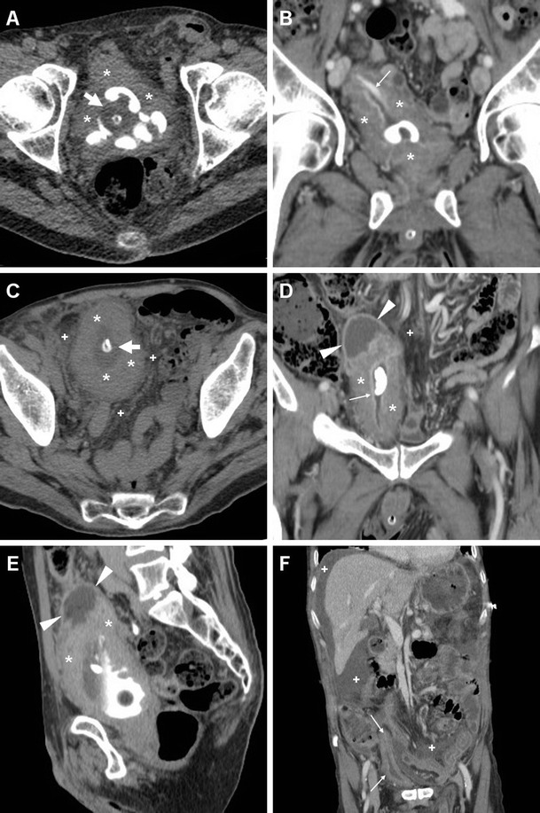
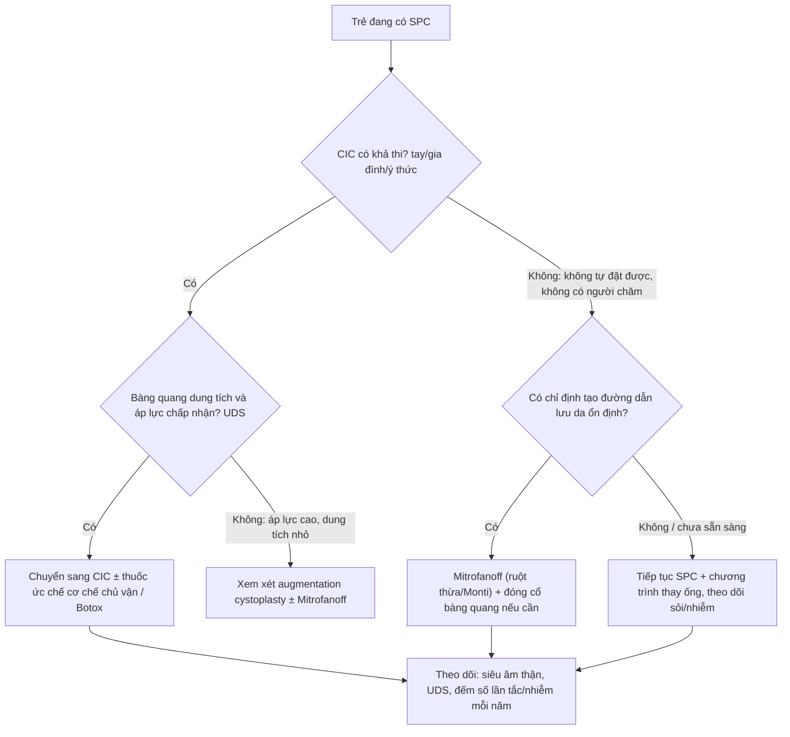
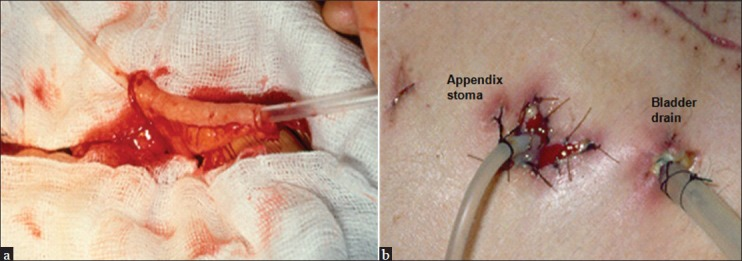
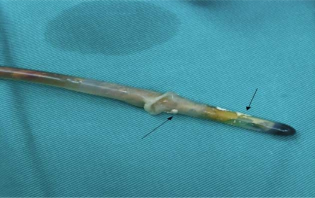

# 677 — Chăm sóc & biến chứng ống dẫn lưu trên xương mu (SPC) ở trẻ: tắc – sỏi – nhiễm đường hầm & khi nào chuyển CIC/Mitrofanoff / Suprapubic catheter in children

**Tags:** `pattern:bien-chung-catheter` `pattern:soi-bang-quang` `pattern:nhiem-trung-duong-ham` `vung:bang-quang-nieu-dao-nhi` `vung:thanh-bung-duoi` `score:EAN-INUS-2025` `protocol:sieu-am` `protocol:XR` `protocol:CT` `protocol:cystography` `incidentaloma:soi-bang-quang`
**Mức chắc chắn (certainty):** tổng hợp y văn (literature synthesis) — nhóm tự biên từ bài mở toàn văn (Eur J Neurol 2025, PMC11984325 — guideline EAN/EFAS/INUS; J Med Eng Technol 2015, PMC4673556 — sinh học catheter; Insights Imaging 2016, PMC5028337 — hình ảnh nhiễm trùng đường tiểu dưới; Libyan J Med 2010, PMC3066753 — catheter đóng vảy; Ann R Coll Surg Engl 2012, PMC3954289 — kỹ thuật SPC; Indian J Urol 2013, PMC3822348 — Mitrofanoff; Pediatr Nephrol 2008, PMC2335291 — bàng quang thần kinh spina bifida; J Indian Assoc Pediatr Surg 2024, PMC11762777 — tổn thương niệu đạo do catheter ở trẻ trai). Ảnh: 2 CC BY/CC BY-NC dùng nguyên bản, 1 CC BY-NC-SA dùng nguyên bản (không crop/ghép). Ca minh họa người lớn được ghi rõ bối cảnh.

## 1. Tổng quan — ống SPC là "cửa thoát" tạm, nhưng đường hầm là mô sống: vì sao nó tắc, đóng vảy, nhiễm

- **Chỉ định ở trẻ:** (a) **sau chấn thương niệu đạo** (đứt niệu đạo sau do vỡ khung chậu, rách niệu đạo do đặt catheter) — dẫn lưu trên xương mu để **niệu đạo nghỉ** 1–2 tuần; (b) **bàng quang thần kinh** khi **CIC không khả thi** (bàn tay không đủ chức năng, gia đình không làm được, bàng quang áp lực cao); (c) **tắc nghẽn đường ra** (van niệu đạo sau, hẹp niệu đạo) chờ mổ.
- **Vì sao SPC được ưu tiên hơn catheter niệu đạo khi phải dẫn lưu dài hạn:** guideline **EAN/EFAS/INUS 2025** khuyến cáo **SPC ưu tiên hơn niệu đạo** vì **giảm tổn thương niệu đạo** (tạo đường giả, hẹp, rách cơ thắt, hypospadias do chấn thương) và **dễ chăm sóc khi ngồi/hoạt động tình dục**; nhưng phải **cùng quyết định với gia đình** vì có nguy cơ riêng (PMC11984325).
- **Ngưỡng định lượng phải nhớ:**
  - **Tổn thương niệu đạo do đặt catheter ở trẻ trai: 13,4/1.000 lần đặt** (PMC11762777) — đây chính là lý do nhiều ca chuyển sang SPC.
  - **Đường hầm cần ~2 tuần để "thành thục"** trước khi dùng làm đường vào bàng quang (thay catheter qua đường hầm, đặt guidewire) (PMC3066753).
  - **Mọi catheter lưu đều bị vi khuẩn xâm nhập sau ~1 tháng**; tuổi thọ **cơ học** của bóng Foley ~**12 tuần** — nghĩa là **nhiễm khuẩn là quy luật, không phải biến chứng** (PMC4673556).
  - **Cấy nước tiểu — ngưỡng đúng đường lấy:** **> 10⁴ cfu/mL** (lấy giữa dòng), **> 10² cfu/mL** (qua CIC), và **bất kỳ mọc nào** trên **chọc hút trên xương mu** (PMC11984325). Cấy qua **túi nước tiểu/leg bag là sai** — chỉ lấy từ catheter mới đặt hoặc cổng lấy mẫu.
- **TẠI SAO ống "đóng vảy" (encrustation) — vật lý + vi sinh:**
  - Vi khuẩn sinh **urease** (*Proteus mirabilis* điển hình) phân hủy urê → **NH₃** → nước tiểu **kiềm** → kết tủa **struvite (MgNH₄PO₄)** và **hydroxyapatite** trên **biofilm** phủ catheter.
  - Tinh thể lắng **quanh lỗ thoát và lòng ống** → **tắc**; mảnh vụn bong ra thành **nhân sỏi bàng quang**, và sỏi lại **nuôi vi khuẩn** → vòng xoắn tắc–nhiễm–sỏi (PMC4673556).
  - **Tắc catheter là cấp cứu**: áp lực bàng quang cao → **trào ngược lên niệu quản**, đau, nguy cơ nhiễm trùng huyết; xử trí là **thay catheter ngay**, không chờ.
- **TẠI SAO nhiễm đường hầm trông nặng trên CT:** đường hầm xuyên **cân, mỡ trước bàng quang và cơ thẳng bụng**; nhiễm khuẩn lan theo **mô mỡ lỏng** → **viêm mô tế bào, áp-xe thành bàng quang, khí trong thành**; trên CT thấy **dày thành bàng quang, mô mỡ quanh bàng quang thâm nhiễm, tụ dịch/khí**. Vì vậy **CT có cản quang là chìa khóa** khi trẻ sốt + đau bụng dưới + SPC (PMC5028337).
- **Phản biện (fidelity):** phần lớn bằng chứng về **tần suất biến chứng SPC ở trẻ** rất mỏng; đa số số liệu đến từ **người lớn có catheter lưu dài hạn** và từ **bàng quang thần kinh**. Đừng trích các tỷ lệ của người lớn như thể là của trẻ — trong bài này mọi số của người lớn đều được ghi rõ nguồn/bối cảnh.

## 2. Mẫu hình (pattern) + chẩn đoán phân biệt theo thời điểm (Gamut)

- **Khuôn 1 — Ngay sau đặt (0–72 giờ): đau, chướng, không ra nước tiểu.** Gamut: **đặt sai vị trí** (vào niệu đạo/ổ bụng/mạc treo) vs **thủng ruột** vs **máu tụ/hematuria** vs **bàng quang chưa căng đủ**.
  Chốt: **không có nước tiểu + đau nhiều + bụng phản ứng** → nghi đặt sai/thủng; **siêu âm tại giường** tìm bóng catheter trong lòng bàng quang là bước đầu.
- **Khuôn 2 — Vài tuần: tắc tái diễn, nước tiểu đục, cặn.** Gamut: **đóng vảy/encrustation** vs **sỏi bàng quang** vs **co thắt bàng quang** vs **catheter bị gập/kẹt**.
  Chốt: **tắc tái diễn nhiều lần = phải tìm sỏi** (PMC4673556); siêu âm thấy **điểm tăng âm kèm bóng lưng quanh bóng catheter**, X-quang thấy **cản quang dạng vòng/chuỗi quanh catheter**.
- **Khuôn 3 — Sốt + đau bụng dưới + rỉ mủ quanh lỗ SPC.** Gamut: **nhiễm đường hầm/viêm mô tế bào** vs **áp-xe thành bàng quang** vs **viêm thận–bể thận** vs **viêm phúc mạc do thủng muộn**.
  Chốt: **CT cản quang**: dày thành bàng quang + mô mỡ quanh bàng quang thâm nhiễm + tụ dịch/khí; **khí trong thành bàng quang** = thể nặng (PMC5028337). Siêu âm thận để loại **ứ nước/thận ứ mủ**.
- **Khuôn 4 — Muộn (tháng–năm): chảy máu lỗ SPC, u sùi quanh lỗ, hẹp đường hầm.** Gamut: **hạt quá sản/xơ** vs **sỏi kẹt cổ bàng quang** vs **ung thư biểu mô tại đường hầm SPC** (rất hiếm, nhưng có ca người lớn — PMC3198751) vs **lộn niêm mạc**.
  Chốt: **tổn thương sùi, cứng, chảy máu tái diễn** → **sinh thiết**, không chỉ đốt điện.
- **Khuôn 5 — Trẻ "không chịu" ống SPC (đau, rò quanh ống, bong).** Gamut: **bóng quá căng/ống quá ngắn** vs **đường hầm chưa thành thục** vs **co thắt bàng quang** vs **táo bón/chướng bụng làm tăng áp lực**.
  Chốt: kiểm tra **thể tích bóng theo hướng dẫn** (thường 5–10 mL ở trẻ, không bơm quá) + **cố định ống** + điều trị táo bón.
- **Gợi nhớ "T.A.M." cho SPC ở trẻ:** **T**ắc (blockage/encrustation), **A**p-xe/nhiễm đường hầm, **M**igration/misplacement (di trú, đặt sai) — cộng thêm **sỏi** khi tắc tái diễn.

## 3. Bảng so sánh phân biệt (ma trận đối chiếu)

| Tình huống / thực thể | Hình ảnh điển hình | Chốt vào (rule-in) | Chốt loại (rule-out) | Gợi ý xác nhận |
|---|---|---|---|---|
| **Đóng vảy catheter (encrustation)** | Siêu âm: **dày/echo dày quanh bóng và tip**; X-quang: **cản quang viền quanh catheter**; nội soi: cặn vàng–nâu | **Tắc tái diễn + cặn/đục + cấy *Proteus*** | **Catheter trơn, không cặn, tắc do gập ống** → không phải đóng vảy | Thay catheter + soi bàng quang nếu còn cặn |
| **Sỏi bàng quang quanh catheter** | Siêu âm: **điểm tăng âm + bóng lưng**, di động quanh bóng; X-quang/CT: **sỏi cản quang ôm catheter** | **Tắc tái diễn + sỏi thấy trên US/CT** | **Bóng catheter bơm căng** (echo dày, không bóng lưng) → không phải sỏi | CT không cản quang (sỏi acid uric vẫn thấy), nội soi tán sỏi |
| **Nhiễm/áp-xe đường hầm – thành bàng quang** | CT: **dày thành bàng quang, mô mỡ quanh bàng quang thâm nhiễm, tụ dịch, khí trong thành** | **Sốt + đau khu trú + CT có tụ dịch/khí** | **Chỉ đỏ da quanh lỗ, không sốt, CT mô mỡ sạch** → viêm da khu trú | CT cản quang; siêu âm dẫn lưu nếu có ổ |
| **Viêm thận–bể thận / ứ mủ thận** | Siêu âm: **thận to, ứ nước, echo dày xoang**; CT: **dày thành đài–bể thận, giảm ngấm** | **Sốt cao + đau hông lưng + CRP tăng** | **Thận bình thường, không ứ nước** → không phải nguồn | Siêu âm thận ± CT; cấy máu/nước tiểu |
| **Đặt sai vị trí (niệu đạo/ổ bụng)** | X-quang: **catheter đi lệch đường giữa, bóng ngoài bàng quang**; US: **không thấy bóng trong lòng bàng quang** | **Không có nước tiểu + đau + bóng không trong bàng quang** | **Bóng trong bàng quang, nước tiểu chảy tốt** → loại | Chụp bàng quang qua ống (cystography) trước khi dùng |
| **Thủng ruột do đặt SPC** | CT: **catheter xuyên quai ruột, khí/dịch tự do, dày quai** | **Đau bụng + sốt + khí tự do** sau đặt | **Catheter trong bàng quang, không khí tự do** → loại | CT bụng cấp cứu; mổ nếu thủng |
| **Ung thư tại đường hầm SPC (muộn, rất hiếm)** | Tổn thương **sùi, cứng quanh lỗ**, chảy máu tái diễn; MRI/CT: **khối xâm lấn đường hầm** | **Chảy máu + sùi + không lành sau xử trí** | **Hạt xơ mềm, không lớn sau 4–6 tuần** → lành tính | Sinh thiết bắt buộc |

*A–F: nhiễm trùng đường tiểu dưới có biến chứng ở bệnh nhân **có catheter lưu** (ca người lớn — minh họa mô hình hình ảnh, áp dụng cho trẻ): dày thành bàng quang lan tỏa (*), mô mỡ quanh bàng quang thâm nhiễm (+), **khí trong thành/lòng bàng quang** (mũi tên lớn), ổ tụ dịch và dịch tự do (đầu mũi tên). Bóng Foley thấy rõ trong lòng bàng quang. Nguồn: Tonolini M et al., Insights Imaging 2016 (PMC5028337), CC BY 4.0.*

## 4. Protocol — chăm sóc ống, chẩn đoán hình ảnh theo triệu chứng & thuật toán chuyển CIC/Mitrofanoff

- **Kỹ thuật đặt (để tránh biến chứng sớm):** bàng quang **phải căng**; rạch **~1 cm, cách khớp mu 2 khoát ngón tay**; dùng trocar có **lỗ báo nước tiểu** xác nhận vào bàng quang; **đưa catheter nhanh + bơm bóng ngay**; catheter **14 Fr** cho người lớn, **nhỏ hơn ở trẻ** theo tuổi; kháng sinh dự phòng 1 liều (PMC3954289).
- **Sau đặt:** xác nhận vị trí trước khi dùng đường hầm (chụp qua ống/ siêu âm); **chờ ~2 tuần** cho đường hầm thành thục rồi mới thay/dùng làm đường vào (PMC3066753).
- **Chăm sóc dài hạn (nguyên tắc):**
  - **Không điều trị khuẩn trú không triệu chứng.** Chỉ cấy khi có triệu chứng; lấy mẫu đúng (không lấy từ túi) — ngưỡng như mục 1 (PMC11984325).
  - **Thay catheter theo lịch và khi tắc**; catheter bị tắc là **cấp cứu**, thay ngay.
  - **Uống đủ nước**, xem xét **nước uống chứa citrate** để nâng pH kết tinh (bằng chứng còn hạn chế) (PMC4673556).
  - **Không bơm bóng quá thể tích**; cố định ống để tránh kéo–bong.
  - **Theo dõi tăng trưởng/thận** (siêu âm định kỳ) ở trẻ bàng quang thần kinh.
- **Chẩn đoán hình ảnh — chọn theo câu hỏi lâm sàng:**

| Câu hỏi | Bước 1 | Bước 2 | Ghi chú |
|---|---|---|---|
| Ống có trong bàng quang? | Siêu âm tại giường (bóng = cấu trúc echo dày trong lòng) | X-quang bụng thấp | Không thấy bóng trong lòng → nghi đặt sai |
| Tắc do gì? | Siêu âm: cặn quanh bóng, sỏi | X-quang/CT không cản quang | Tắc tái diễn → tìm sỏi |
| Sốt + đau bụng dưới | Siêu âm bụng–thận | **CT cản quang** (thành bàng quang, mô mỡ, khí, tụ dịch) | Nghi thủng ruột → CT cấp cứu |
| Rò quanh ống/rò bàng quang–da | Chụp bàng quang qua ống (cystography) | CT cystography | Xác định đường rò trước khi sửa |
| Chảy máu lỗ SPC muộn | Soi bàng quang | MRI/CT khung chậu + **sinh thiết** | Loại ung thư đường hầm |
- **Khi nào chuyển khỏi SPC (thuật toán):**

- **Chuyển CIC/Mitrofanoff — ngưỡng thực hành (PMC2335291, PMC3822348):**
  - **CIC** là lựa chọn đầu tay khi trẻ/gia đình làm được; **SPC chỉ khi CIC không khả thi**.
  - **Mitrofanoff** (dùng **ruột thừa** làm ống dẫn — hoặc **Monti** khi không có ruột thừa): chỉ định khi **không thể đặt catheter qua niệu đạo** (hẹp, đau, không tiếp cận được) hoặc **không tự đặt được**; cần **bàng quang áp lực thấp, dung tích đủ** (nếu không phải **augmentation** kèm).
  - **Biến chứng dài hạn của Mitrofanoff:** **hẹp ống dẫn, són, phải mổ lại** là 3 vấn đề chính; dùng **niệu quản** làm ống → **40% biến chứng nặng**; dùng **vách bàng quang** → **hẹp tới 60%** → ưu tiên **ruột thừa** (PMC3822348).

*a: kiểm tra lòng ruột thừa bằng catheter trước khi tạo ống; b: **lỗ mở ruột thừa ra da** (appendicostomy) cạnh **dẫn lưu bàng quang** tạm thời. Đây là đích cuối của trẻ bàng quang thần kinh không tự đặt catheter qua niệu đạo được. Nguồn: Veeratterapillay R et al., Indian J Urol 2013 (PMC3822348), CC BY-NC-SA 4.0 — dùng nguyên bản.*

## 5. Cạm bẫy (pitfall) & biến thể bình thường

- **Bóng catheter ≠ sỏi:** trên siêu âm, bóng bơm căng là **cấu trúc echo dày, tròn, không có bóng lưng**; sỏi có **bóng lưng rõ** và **di động** khi đổi tư thế. Đừng tán sỏi "bóng catheter".
- **Khí trong bàng quang ≠ luôn là biến chứng:** khí có thể do **đặt ống/khí từ túi**; nhưng **khí trong THÀNH bàng quang** kèm sốt là **nhiễm sinh khí** (emphysematous cystitis) — khác hẳn bóng khí tự do trong lòng.
- **Khuẩn trú là bình thường:** ở trẻ có catheter, **cấy dương tính không triệu chứng không phải chỉ định kháng sinh**; điều trị chỉ vì cấy → chọn chủng kháng thuốc (PMC11984325).
- **Đừng lấy nước tiểu từ túi/leg bag** để cấy — kết quả phản ánh vi khuẩn trong túi, không phải bàng quang.
- **Sốt sau đặt SPC trong 72 giờ:** nghĩ **thủng ruột/thấm dịch ổ bụng** trước khi nghĩ "nhiễm tiểu"; CT bụng là bắt buộc nếu đau bụng lan tỏa.
- **Rỉ nước tiểu quanh lỗ SPC kéo dài:** thường do **đường hầm chưa thành thục** hoặc **bóng quá nhỏ/quá căng**; chụp qua ống trước khi quyết định mổ lại.
- **"Tắc do cặn" nhưng soi sạch:** nghĩ **gập ống dưới băng/cố định**, hoặc **co thắt bàng quang** — đừng thay ống liên tục mà bỏ sót nguyên nhân cơ năng.

*Catheter Foley sau khi lấy ra: **cặn đóng vảy** (mũi tên) bám quanh bóng và tip — nguyên nhân làm bóng **không xẹp được** và catheter **kẹt không rút ra**; ca này phải đặt SPC để lấy catheter kẹt. Nguồn: Ho CC et al., Libyan J Med 2010 (PMC3066753), CC BY-NC 4.0 — dùng nguyên bản.*

## 6. Tự lượng giá — Blind Quiz

**Ca 1 — Bé trai 6 tuổi, bàng quang thần kinh sau thoát vị tủy–màng tủy, đang có SPC. Ba ngày nay sốt 38,8°C, đau bụng dưới, nước tiểu đục, vùng quanh lỗ SPC đỏ. Nhìn CT: mô tả trước khi kết luận.**

- Hỏi: dấu hiệu nào trên CT cho biết nhiễm đã **lan khỏi lòng bàng quang**? Có cần chọc hút/dẫn lưu không?

<b>Bấm để hiện đáp án</b>

- **Dày thành bàng quang lan tỏa** + **mô mỡ quanh bàng quang thâm nhiễm** + **khí trong thành/lòng** + tụ dịch quanh bàng quang → nhiễm đã lan **ngoài lòng** (viêm mô tế bào/áp-xe thành bàng quang), không còn là "nhiễm khuẩn trú".
- Xử trí: **kháng sinh đường tĩnh mạch + dẫn lưu ổ tụ dịch nếu có** + đảm bảo ống SPC thông; **cấy nước tiểu lấy từ catheter mới**, không lấy từ túi. Nếu khí lan rộng + sốc → cân nhắc **cắt lọc/mổ**.
- Lưu ý nguồn: ca minh họa là **người lớn có catheter lưu**; mô hình hình ảnh áp dụng cho trẻ, nhưng không trích tỷ lệ của ca này cho trẻ.
- Nguồn: Tonolini M et al., Insights Imaging 2016 (PMC5028337), CC BY 4.0.

**Ca 2 — Bé gái 9 tuổi có SPC vì hẹp niệu đạo. Mỗi 3–4 tuần lại tắc ống, nước tiểu đục, có lần phải thay ống cấp. Siêu âm bàng quang: cấu trúc echo dày quanh bóng, có bóng lưng. Bước tiếp theo?**

<b>Bấm để hiện đáp án</b>

- **Tắc tái diễn + cặn + điểm tăng âm có bóng lưng quanh catheter** → nghĩ **đóng vảy + sỏi bàng quang quanh catheter** (vòng xoắn *Proteus* → struvite → sỏi → tắc).
- Bước tiếp: **X-quang/CT không cản quang** xác nhận sỏi, **soi bàng quang + tán sỏi**, thay catheter; điều trị nhiễm khuẩn theo cấy; xem xét **citrate/uống đủ nước** và **giảm thời gian lưu ống** bằng cách chuyển sang **CIC** nếu khả thi.
- Đừng chỉ "thay ống định kỳ" — tắc tái diễn là **chỉ định tìm sỏi**.
- Nguồn: PMC4673556 (cơ chế đóng vảy–sỏi), PMC3066753 (catheter kẹt do cặn).

**Ca 3 — Bé trai 4 tuổi, sau đặt SPC 12 giờ: không có nước tiểu ra túi, đau nhiều, bụng chướng, sốt. X-quang thấy catheter lệch khỏi đường giữa. Nghĩ gì và làm gì trước tiên?**

<b>Bấm để hiện đáp án</b>

- Nghĩ **đặt sai vị trí** (vào niệu đạo/ổ bụng) hoặc **thủng ruột**; **không được bơm thêm bóng hay rút ống mù**.
- Trước tiên: **siêu âm tại giường** xem bóng có trong lòng bàng quang không; nếu không rõ → **CT bụng–khung chậu cấp cứu** (tìm khí/dịch tự do, catheter xuyên quai ruột).
- Nguyên tắc phòng: bàng quang **phải căng**, dùng trocar có **lỗ báo nước tiểu**, đưa catheter + bơm bóng **ngay** (PMC3954289); chờ **~2 tuần** cho đường hầm thành thục trước khi dùng làm đường vào (PMC3066753).

## Bài liên quan chéo
- [600 – Tổng quan Nhi khoa](../600-tong-quan-nhi-khoa/lesson.md)
- [637 – Chấn thương bàng quang & niệu đạo nhi](../637-chan-thuong-bang-quang-nieu-dao-nhi/lesson.md) (chỉ định SPC sau chấn thương)
- [642 – Theo dõi & biến chứng muộn sau chấn thương niệu đạo dưới](../642-bien-chung-muon-chan-thuong-nieu-dao-nhi/lesson.md)
- [671 – Nhiễm trùng tiểu & viêm thận–bể thận ở bàng quang thần kinh](../671-nhiem-trung-tieu-bang-quang-than-kinh-o-tre/lesson.md)
- [672 – Biến chứng muộn sau tái tạo bàng quang](../672-bien-chung-muon-sau-tai-tao-bang-quang/lesson.md)
- [673 – Chuyển tiếp sang người lớn ở spina bifida](../673-chuyen-tiep-nguoi-lon-spina-bifida-bang-quang-than-kinh/lesson.md)
- [635 – Tiết niệu nhi: SFU, VUR, PUV](../635-di-tat-tiet-nieu-nhi-SFU-VUR-PUV/lesson.md)
- [668 – Theo dõi dài hạn sau tháo căng tủy & bàng quang thần kinh](../668-theo-doi-sau-thao-cang-tuy-bang-quang-than-kinh/lesson.md)

> Không dùng để chẩn đoán độc lập khi chưa có người hướng dẫn.
