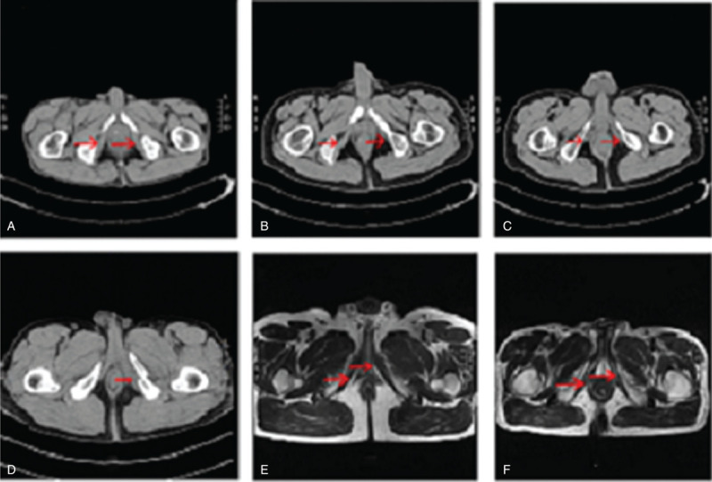
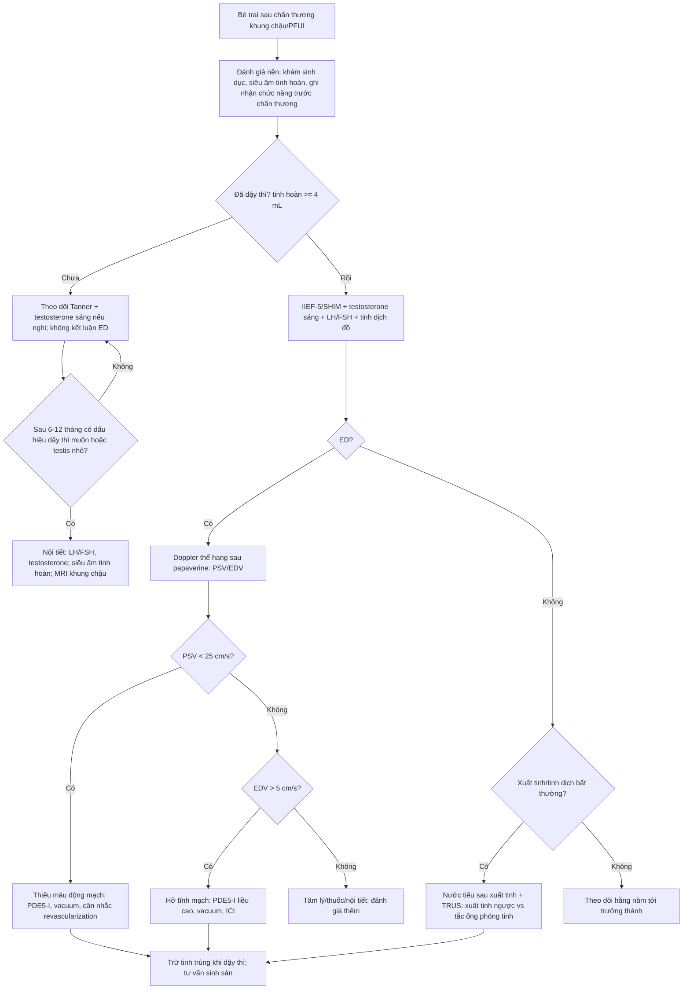
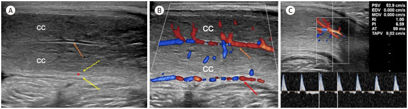

# 678 — Đánh giá & phục hồi chức năng cương – sinh sản ở bé trai sau chấn thương khung chậu/PFUI / Erectile and reproductive function after paediatric pelvic trauma

**Tags:** `pattern:roi-loan-cuong` `pattern:roi-loan-xuat-tinh` `pattern:chan-thuong-khung-chau` `vung:khung-chau-nhi` `vung:sinh-duc-nam` `score:IIEF-5` `score:PSV` `protocol:sieu-am-Doppler` `protocol:MRI` `protocol:TRUS` `protocol:xet-nghiem-noi-tiet`
**Mức chắc chắn (certainty):** tổng hợp y văn (literature synthesis) — nhóm tự biên từ y văn mở (Europe PMC/PMC: *Indian J Urol* 2026, *BMJ Open* 2021, *Arab J Urol* 2015, *OTA Int* 2020, *BMC Pediatr* 2025, *Transl Androl Urol* 2026, *J Korean Soc Radiol* 2025) + ngưỡng tinh dịch WHO 2021. Ảnh CC BY 4.0 và CC BY-NC 4.0.

## 1. Tổng quan — vì sao chấn thương khung chậu làm hỏng cương và sinh sản

- **Bối cảnh:** ở trẻ trai, chấn thương khung chậu thường kèm **đứt niệu đạo sau (pelvic fracture urethral injury — PFUI)**; tổn thương không chỉ ở niệu đạo mà còn ở **thần kinh thể hang (cavernous nerve), động mạch thẹn trong–động mạch thể hang, cơ ngồi hang (ischiocavernosus muscle — ICM)** và **mô cương (corpus cavernosum)**. Hậu quả: **rối loạn cương (erectile dysfunction — ED)**, **rối loạn xuất tinh**, **suy sinh dục**, **hẹp niệu đạo tái phát**.
- **Ngưỡng định lượng bắt buộc:**
  - Sau **PFUI**: **34%** (95% CI 25–45%) có ED; sau **nắn chỉnh nội soi thì đầu (primary realignment)** **16%** (8–26%); **tạo hình niệu đạo muộn** cộng thêm **3%** (2–5%), tức **37% de novo ED** ở nhóm mổ muộn (PMC4435659).
  - Sau **gãy vòng chậu** (mọi loại): **37%** (26–50%), **không phụ thuộc mức độ nặng của gãy** (PMC8166614).
  - Ở **trẻ trai**: **29,3%** (12/41 được đánh giá) sau tạo hình niệu đạo, theo dõi trung vị **112 tháng**; không khác biệt mổ sớm ≤ 10 ngày vs muộn ≥ 3 tháng (**35,7% vs 25,9%**, p > 0,05) (PMC13355245). Loạt 68 bé: ED **15,4%** (nắn chỉnh thì đầu) vs **3,5%** (dẫn lưu trên xương mu + mổ muộn), p = 0,231 (PMC11969931).
  - **Tổn thương cơ ngồi hang** gặp **29,4%** ở 776 nam gãy khung chậu; ED **27,3%**, trong đó **39,6% hồi phục** và **60,4% không hồi phục** (PMC8022899).
- **TẠI SAO hình ảnh trông như vậy (vật lý + mô bệnh):**
  - **Siêu âm Doppler thể hang:** cương là **tăng dòng động mạch + giảm dòng tĩnh mạch thoát**. Sau tiêm **papaverine 30 mg** (hoặc alprostadil 10–20 µg), đo **vận tốc đỉnh tâm thu (peak systolic velocity — PSV)**: **PSV < 25 cm/s = thiếu máu động mạch**; **25–30 cm/s = vùng giáp biên**; **≥ 30–35 cm/s = đủ dòng**. **Vận tốc cuối tâm trương (end-diastolic velocity — EDV) > 5 cm/s = hở tĩnh mạch (venous leak)**. Trong 97 nam PFUI: **93/97 thiếu máu động mạch thể hang**, **83/97 thiếu máu động mạch lưng**, **26/97 (26,8%) hở tĩnh mạch** (PMC13375042) — tỷ lệ cao vì đây là nhóm đã chọn mổ.
  - **MRI:** mô cương bình thường **T2 tăng tín hiệu** (máu + nội mô xốp); **xơ hóa thể hang → T2 giảm**; **mỡ thay thế/teo cơ → T1 tăng, T2 giảm** ở giai đoạn mạn. **ICM** dễ thấy trên **CT/MRI lát mỏng khung chậu**: đứt nguyên ủy, phù/máu tụ cấp, teo + thâm nhiễm mỡ mạn (PMC8022899).
  - **Nội tiết:** testosterone toàn phần **buổi sáng < 300 ng/dL (10,4 nmol/L)** được coi là thấp (EAU/AUA); đo **LH/FSH** để phân biệt **suy sinh dục nguyên phát (tinh hoàn)** vs **trung ương** — quan trọng vì chấn thương có thể kèm **tổn thương tinh hoàn** hoặc **dùng opioid/steroid** sau chấn thương.
- **Điểm cốt lõi:** ED sau chấn thương là **đa yếu tố** (mạch máu – thần kinh – cơ – tâm lý – nội tiết) và **có thể hồi phục** (39,6% trong loạt ICM) → **không kết luận vĩnh viễn sớm**, nhưng **phải đánh giá đúng lúc** để không bỏ cửa sổ điều trị và không bỏ cơ hội **trữ tinh trùng/mô tinh hoàn**.

## 2. Mẫu hình (pattern) + chẩn đoán phân biệt theo cơ chế (Gamut)

- **Khuôn 1 — ED sau chấn thương, cương buổi sáng còn.** Gamut: **tâm lý** vs **thuốc/đau** vs **nhẹ do mạch**. Chốt: **cương tự nhiên còn + Doppler bình thường** → nghiêng tâm lý/thuốc; **PSV < 25 cm/s** → mạch máu.
- **Khuôn 2 — ED + đau tầng sinh môn + không cương buổi sáng.** Gamut: **tổn thương động mạch thể hang** vs **tổn thương ICM** vs **đứt thần kinh thể hang**. Chốt: **PSV < 25 cm/s** → động mạch; **MRI có đứt/phù ICM hoặc teo–mỡ hóa** → cơ/ICM; **EDV > 5 cm/s** → hở tĩnh mạch.
- **Khuôn 3 — Cương được nhưng không xuất tinh/ít tinh dịch.** Gamut: **xuất tinh ngược (retrograde ejaculation)** vs **không xuất tinh do thần kinh** vs **tắc ống phóng tinh**. Chốt: **nước tiểu sau xuất tinh có tinh trùng** → xuất tinh ngược; **TRUS giãn ống phóng tinh/ống tinh** → tắc.
- **Khuôn 4 — Tinh hoàn nhỏ + testosterone thấp sau chấn thương.** Gamut: **suy sinh dục nguyên phát (tổn thương tinh hoàn/xoắn/chiếu xạ)** vs **suy sinh dục trung ương (tổn thương tuyến yên/opioid)** vs **chậm dậy thì sinh lý**. Chốt: **FSH/LH cao + testis nhỏ** → nguyên phát; **FSH/LH thấp** → trung ương; **tanner G1 + tuổi xương phù hợp** → chờ.
- **Khuôn 5 — Dương vật cong/lệch sau chấn thương.** Gamut: **xơ hóa thể hang (corporeal fibrosis)** vs **bệnh Peyronie** vs **ngắn dương vật sau tạo hình niệu đạo**. Chốt: **mảng xơ, T2 giảm, cong khi cương** → xơ hóa/Peyronie.
- **Gợi nhớ "VAND":** **V**ascular (động mạch/hở tĩnh mạch), **A**natomic (ICM, thể hang, niệu đạo), **N**eurologic (thần kinh thể hang/tủy), **D**rugs–Endocrine–Psychogenic (thuốc, nội tiết, tâm lý).

## 3. Bảng so sánh phân biệt (ma trận đối chiếu)

| Thực thể (entity) | Hình ảnh điển hình | Chốt vào (rule-in) | Chốt loại (rule-out) | Gợi ý xác nhận |
|---|---|---|---|---|
| **Thiếu máu động mạch thể hang** | Doppler sau papaverine: phổ **PSV thấp**, dạng sóng giảm biên độ; MRI có thể thấy tổn thương ĐM thẹn trong | **PSV < 25 cm/s** sau kích thích đủ | **PSV ≥ 30–35 cm/s** → không thiếu máu | Doppler lặp 2 lần; MRA/CTA chọn lọc |
| **Hở tĩnh mạch (venous leak)** | Doppler: **EDV > 5 cm/s**, phổ còn dòng tâm trương | **EDV > 5 cm/s** + cương kém duy trì | **EDV < 5 cm/s** → không hở tĩnh mạch đáng kể | Doppler; cavernosometry (hiếm dùng ở trẻ) |
| **Tổn thương thần kinh thể hang** | MRI không thấy dây thần kinh tổn thương trực tiếp; **ICM/khung chậu** là dấu hiệu gián tiếp; **cương phản xạ mất** | **Mất cương buổi sáng + không đáp ứng sau tiêm** + bối cảnh đứt niệu đạo sau | **Đáp ứng tốt với tiêm** → không thuần thần kinh | Đáp ứng ICI; NPT/RigiScan (≥ 18 tuổi) |
| **Tổn thương cơ ngồi hang (ICM)** | **CT/MRI**: đứt nguyên ủy, phù/máu tụ cấp; mạn: **teo + mỡ hóa (T1 tăng, T2 giảm)** | **Đứt/phù ICM trên CT/MRI + ED** | **ICM liên tục, không phù** → không do ICM | MRI lát mỏng khung chậu; EMG (nghiên cứu) |
| **Xơ hóa thể hang** | **T2 thể hang giảm tín hiệu**, mảng xơ, cong khi cương; thể tích giảm | **T2 giảm + cong/mảng xơ** | **T2 đồng nhất bình thường** → không xơ rõ | MRI; siêu âm mô mềm |
| **Suy sinh dục** | Tinh hoàn **thể tích nhỏ** trên siêu âm; không có tổn thương đặc hiệu | **Testosterone sáng < 300 ng/dL** + LH/FSH bất thường | **Testosterone bình thường, LH/FSH bình thường** | Xét nghiệm 2 lần sáng; siêu âm tinh hoàn |
| **Xuất tinh ngược** | Không có tổn thương trên TRUS; **bàng quang chứa tinh trùng** | **Nước tiểu sau xuất tinh có tinh trùng** | **Không tinh trùng trong nước tiểu + azoospermia** → nghĩ tắc/không xuất tinh | Xét nghiệm nước tiểu sau xuất tinh; TRUS |
| **Tắc ống phóng tinh** | **TRUS**: giãn ống phóng tinh/ống tinh, nang; MRI xác nhận | **Giãn ống phóng tinh + thể tích tinh dịch thấp + fructose thấp** | **TRUS bình thường** → không tắc | TRUS ± MRI; sinh thiết tinh hoàn khi cần |

*(A) ICM bình thường; (B, C) **đứt nguyên ủy ICM** (mũi tên đỏ); (D) ICM **phù, máu tụ**, đầu xương gãy cắm vào cơ; (E, F) giai đoạn mạn: **teo + thâm nhiễm mỡ**, T2 **giảm tín hiệu**. Đây là tổn thương **nhìn thấy được** trên hình ảnh và liên quan trực tiếp tới ED. Nguồn: Chen Z et al., OTA Int 2020, Fig. 1, CC BY 4.0.*

### Đọc Doppler thể hang đúng — các ngưỡng và giới hạn
- **PSV:** bình thường **≥ 30–35 cm/s**; **25–30** giáp biên; **< 25** thiếu máu. Đo **hai bên**, lấy **bên cao hơn** để tránh bỏ sót tổn thương một bên.
- **EDV:** **> 5 cm/s** gợi ý hở tĩnh mạch; **EDV âm** (dòng ngược cuối tâm trương) là bình thường.
- **Sau tiêm 5–10 phút** mới đo; **lo lắng/phòng lạnh** làm PSV thấp giả → **lặp lại** hoặc dùng kích thích hình ảnh.
- **Giới hạn ở trẻ:** Doppler thể hang **chỉ đáng tin sau dậy thì** (thể hang đủ lớn); trước dậy thì dựa vào **lâm sàng + nội tiết + MRI**, không áp ngưỡng người lớn.

## 4. Protocol đánh giá theo tuổi – điều trị – theo dõi + lưu đồ

- **Mốc thời gian:** đánh giá nền **ngay sau chấn thương** (khám sinh dục, siêu âm tinh hoàn, ghi nhận chức năng trước chấn thương nếu có); đánh giá chức năng **≥ 6 tháng** sau mổ (khi qua giai đoạn hồi phục thần kinh sớm) và **lặp lại 12 tháng**; sau đó **hằng năm tới tuổi trưởng thành**.
- **Theo tuổi:**
  - **< 9 tuổi / trước dậy thì:** không dùng IIEF-5; theo dõi **Tanner, thể tích tinh hoàn (Prader)**, testosterone sáng nếu nghi; **siêu âm tinh hoàn** (thể tích, tổn thương, varicocele); **không kết luận ED** — chỉ ghi nhận và tư vấn.
  - **Dậy thì:** Tanner G2 (tinh hoàn **≥ 4 mL**) → đánh giá lại; testosteron sáng, LH/FSH; bắt đầu hỏi chức năng cương/xuất tinh; **trữ tinh trùng** nếu có thể.
  - **≥ 18 tuổi:** **IIEF-5/SHIM** (22–25 không ED; 8–21 nhẹ–trung bình; ≤ 7 nặng), **Doppler thể hang**, **tinh dịch đồ**.
- **Xét nghiệm:** testosterone toàn phần sáng (**< 300 ng/dL = thấp**) + LH/FSH + prolactin; **tinh dịch đồ theo WHO 2021** (thể tích **≥ 1,4 mL**, tổng số tinh trùng **≥ 39 triệu**, di động toàn phần **≥ 42%**, di động tiến tới **≥ 30%**, hình thái bình thường **≥ 4%**) — đây là **phân vị 5 của quần thể sinh sản tự nhiên**, **không phải tiêu chuẩn chẩn đoán vô sinh**.
- **Hình ảnh:**
  - **Siêu âm bìu:** thể tích tinh hoàn, cấu trúc, varicocele, tổn thương sau chấn thương.
  - **MRI khung chậu lát mỏng (T1 + T2 fat-sat):** **ICM**, thể hang, máu tụ, di lệch giải phẫu sau gãy; giai đoạn mạn tìm **teo/mỡ hóa**.
  - **Doppler thể hang** (sau dậy thì) theo ngưỡng PSV/EDV ở trên.
  - **TRUS** khi nghi **tắc ống phóng tinh/xuất tinh ngược** hoặc thể tích tinh dịch thấp.
- **Điều trị (bậc thang):**
  - **PDE5-I**: tadalafil **5 mg/ngày × 6 tháng** là phác đồ phục hồi đã dùng trong loạt PFUI (PMC13375042); meta-analysis: PDE5-I **tăng IIEF-5 +6,5 điểm** (95% CI 2,54–10,46) sau **3 tháng** (PMC8166614).
  - **Bơm hút chân không (vacuum erection device)** + vòng ép: hỗ trợ cương, duy trì mô.
  - **Tiêm nội thể hang alprostadil** khi PDE5-I thất bại (sau dậy thì).
  - **Phẫu thuật**: **tạo hình mạch máu dương vật (penile revascularization)** còn **tranh luận**, chọn ca rất chặt (PMC13145762); **đặt thể hang nhân tạo** chỉ ở người trưởng thành, sau khi đã tối ưu điều trị và **sau dậy thì**.
  - **Sinh sản:** **trữ tinh trùng** ở tuổi dậy thì trước mọi can thiệp thêm; **trữ mô tinh hoàn** ở bé trước dậy thì là lựa chọn **thử nghiệm** theo ESHRE 2025 (PMC12314154); **xuất tinh ngược** → thu thập tinh trùng từ nước tiểu sau xuất tinh (rửa, dùng cho IVF/ICSI).
- **Theo dõi:** đánh giá lại **cương – xuất tinh – nội tiết – tinh dịch** mỗi 6–12 tháng; **không ngừng theo dõi khi hết hẹp niệu đạo** — ED và suy sinh dục có thể xuất hiện muộn.

## 5. Biến thể bình thường và cạm bẫy

- **Cạm bẫy "dùng IIEF-5 cho trẻ":** bộ câu hỏi này dành cho **người có hoạt động tình dục**; ở bé trai phải dùng **Tanner + thể tích tinh hoàn + nội tiết**, và hỏi **cha mẹ/bệnh nhân** về cương buổi sáng.
- **Cạm bẫy "một lần Doppler thấp = tổn thương vĩnh viễn":** lo lắng, lạnh, liều thuốc chưa đủ làm **PSV thấp giả**; phải **lặp lại** sau 5–10 phút, đo hai bên.
- **Cạm bẫy "PSV bình thường là không ED":** hở tĩnh mạch (**EDV > 5 cm/s**) và tổn thương thần kinh vẫn gây ED với PSV bình thường.
- **Cạm bẫy "ED sau chấn thương là vĩnh viễn":** **39,6% hồi phục** trong loạt ICM; đừng đặt thể hang nhân tạo/prognosis xấu quá sớm.
- **Cạm bẫy "không xuất tinh = chắc chắn tắc":** phải loại **xuất tinh ngược** bằng **nước tiểu sau xuất tinh** trước khi nghĩ tắc ống phóng tinh.
- **Cạm bẫy "testosterone thấp một lần":** đo **buổi sáng, 2 lần**, kèm LH/FSH; testosterone thấp sau chấn thương có thể do **opioid/steroid/đau–stress**, không chỉ do tổn thương tinh hoàn.
- **Cạm bẫy "tinh dịch đồ bất thường = vô sinh":** ngưỡng WHO là **phân vị 5**, không phải chẩn đoán; cần lặp lại và đánh giá lâm sàng.
- **Cạm bẫy bỏ sót ICM:** ED sau gãy khung chậu có thể do **ICM** — đọc kỹ **CT/MRI khung chậu** (đứt nguyên ủy, phù, teo–mỡ hóa), đừng chỉ nhìn niệu đạo.

## 6. Tự lượng giá — Blind Quiz

**Ca 1 — Bé trai 12 tuổi, gãy khung chậu do tai nạn xe đạp, đứt niệu đạo sau. Đọc CT/MRI khung chậu.**

- Gợi ý: đau tầng sinh môn, không đánh giá được cương trước dậy thì.
- Câu hỏi: Mũi tên đỏ chỉ gì? Tổn thương này giải thích ED bằng cơ chế nào? Có kết luận ED vĩnh viễn ở tuổi này không?

<b>Bấm để hiện đáp án (findings + chẩn đoán)</b>

- **Findings:** (B, C) **đứt nguyên ủy cơ ngồi hang (ICM)**; (D) **phù, máu tụ**, đầu xương gãy cắm vào cơ; (E, F) mạn: **teo + mỡ hóa**, T2 giảm.
- **Cơ chế:** ICM là **cơ chèn ép thể hang** khi cương; tổn thương → **cương không đủ cứng**, kèm tổn thương **động mạch/thần kinh thể hang** cùng vùng.
- **Không kết luận vĩnh viễn:** ở tuổi này chưa đánh giá được bằng IIEF-5/Doppler; theo dõi **Tanner, thể tích tinh hoàn, testosterone**, đánh giá lại khi dậy thì; **39,6%** ca ICM hồi phục.
- Nguồn ảnh: Chen Z et al., OTA Int 2020, Fig. 1, CC BY 4.0.

**Ca 2 — Nam 22 tuổi (tiền sử PFUI lúc 10 tuổi), ED 2 năm. Đọc Doppler sau papaverine.**

- Gợi ý: hình chuẩn của **người bình thường** để so sánh; bệnh nhân của bạn có PSV 18 cm/s hai bên.
- Câu hỏi: Các trị số trên phổ bình thường là bao nhiêu? PSV 18 cm/s xếp loại gì? Cần làm gì tiếp?

<b>Bấm để hiện đáp án (findings + chẩn đoán)</b>

- **Findings:** (A) giải phẫu siêu âm dọc; (B) Doppler màu **động mạch thể hang (CC)** và **động mạch lưng**; (C) phổ **PSV 52,9 cm/s, EDV 0,000 cm/s** — **bình thường**.
- **Ngưỡng:** PSV **≥ 30–35 cm/s** bình thường; **< 25 cm/s** thiếu máu. Bệnh nhân PSV **18 cm/s** → **thiếu máu động mạch thể hang**.
- **Tiếp theo:** lặp Doppler (loại yếu tố gây nhiễu), đánh giá **hở tĩnh mạch (EDV)**, thử **PDE5-I** (tadalafil 5 mg/ngày × 6 tháng), vacuum; cân nhắc **revascularization** rất chọn lọc; **tư vấn sinh sản + trữ tinh trùng**.
- Nguồn ảnh: Sharma A et al., J Korean Soc Radiol 2025, Fig. 2, CC BY-NC 4.0 (giữ nguyên bản).

**Ca 3 — Nam 19 tuổi, PFUI lúc 8 tuổi, cương được nhưng "không có tinh dịch" sau xuất tinh.**

- Gợi ý: thể tích tinh dịch rất thấp, pH nước tiểu sau xuất tinh kiềm.
- Câu hỏi: Hai chẩn đoán chính? Xét nghiệm/định hình nào chốt? Điều trị sinh sản ra sao?

<b>Bấm để hiện đáp án (findings + chẩn đoán)</b>

- **Chẩn đoán:** **xuất tinh ngược (retrograde ejaculation)** do **hở cổ bàng quang** sau chấn thương/mổ, hoặc **tắc ống phóng tinh**.
- **Chốt:** **nước tiểu sau xuất tinh có tinh trùng** → xuất tinh ngược; **TRUS** giãn ống phóng tinh/ống tinh → tắc. Tinh dịch **thể tích thấp (< 1,4 mL)** và **fructose thấp** gợi ý tắc/thiếu đóng góp túi tinh.
- **Điều trị:** thu thập tinh trùng từ **nước tiểu sau xuất tinh** (rửa, dùng cho IVF/ICSI); **trữ tinh trùng** trước mọi can thiệp; nếu tắc → can thiệp qua TRUS/chuyển tiết niệu; tư vấn **trữ mô tinh hoàn** nếu không lấy được tinh trùng.
- Nguồn số liệu: WHO 2021 (PMC10929669); ESHRE 2025 (PMC12314154).

## Bài liên quan chéo
- [642 – Theo dõi & biến chứng dài hạn sau chấn thương đường tiết niệu dưới ở trẻ](../642-bien-chung-muon-chan-thuong-nieu-dao-nhi/lesson.md)
- [637 – Chấn thương bàng quang & niệu đạo nhi](../637-chan-thuong-bang-quang-nieu-dao-nhi/lesson.md)
- [645 – Vỡ khung chậu ở trẻ](../645-vo-khung-chau-o-tre/lesson.md)
- [643 – Chấn thương âm đạo – đáy chậu & sinh dục ngoài ở trẻ](../643-chan-thuong-day-chau-sinh-duc-nhi/lesson.md)
- [638 – Khối bìu–tinh hoàn ở trẻ](../638-khoi-biu-tinh-hoan-nhi/lesson.md)
- [636 – Cấp cứu niệu–sinh dục nhi: chấn thương thận & xoắn tinh hoàn](../636-cap-cuu-nieu-sinh-duc-nhi/lesson.md)

## Ảnh
- `images/678_cuong-sinh-san_MRI_PMC8022899.jpg`, `images/678_cuong-sinh-san_US-Doppler_PMC11973117.jpg`. Nguồn + giấy phép từng ảnh trong `images/CREDITS.md`.

> Không dùng để chẩn đoán độc lập khi chưa có người hướng dẫn.
