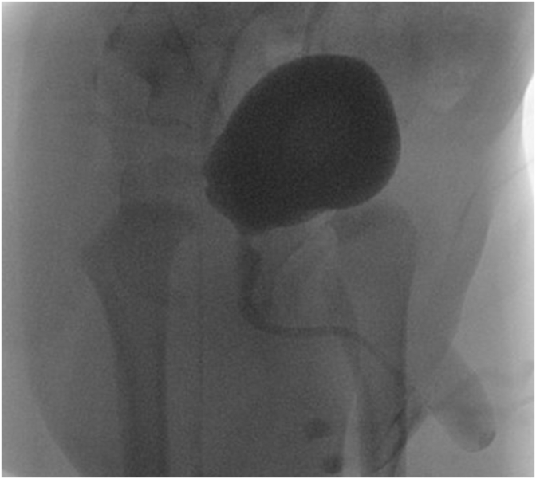
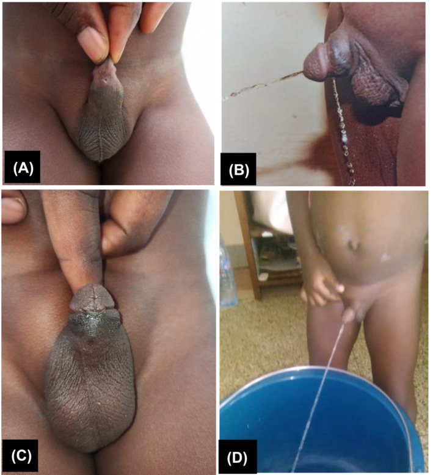
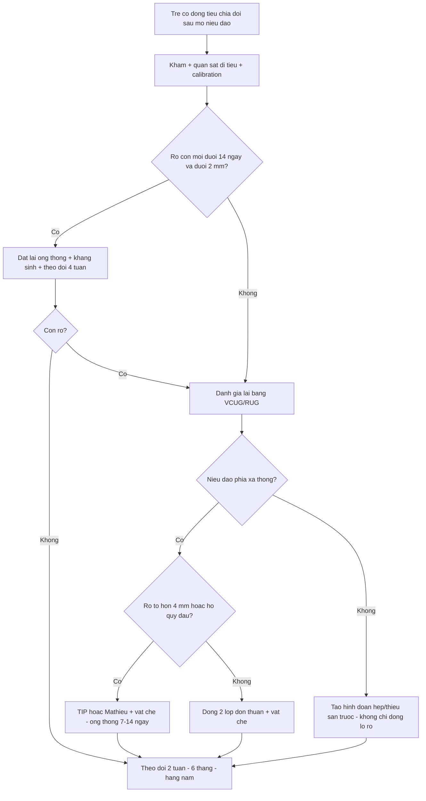
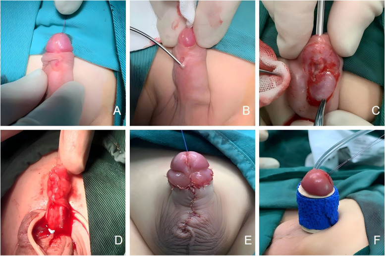

# 679 — Rò niệu đạo–da ở trẻ sau tạo hình niệu đạo: chẩn đoán, thời điểm mổ lại & kỹ thuật / Urethrocutaneous fistula

**Tags:** `pattern:ro` `pattern:dong-tieu-chia-doi` `vung:nieu-dao` `vung:sinh-duc-nhi` `anatomy:nieu-dao-truoc` `protocol:VCUG-RUG-sieu-am`
**Mức chắc chắn (certainty):** tổng hợp y văn (literature synthesis) — số liệu lấy **trực tiếp** từ toàn văn mở (ghi PMCID từng chỗ); ảnh CC BY dùng/ghép được, ảnh **CC BY-NC-ND giữ nguyên bản**. Chưa gắn một ca nguyên văn duy nhất của nhóm.

## 1. Tổng quan bệnh học – cơ chế hình ảnh

- **Rò niệu đạo–da (urethrocutaneous fistula — UCF)** là **đường thông có biểu mô lót** giữa lòng niệu đạo và da, làm nước tiểu thoát ra ngoài **song song với lỗ tiểu** → **dòng tiểu chia đôi (bifid stream)** hoặc **nhiều tia**. Đây là **biến chứng hay gặp nhất sau mổ hypospadias** và cũng gặp sau **cắt bao quy đầu, chấn thương, áp-xe niệu đạo, sỏi niệu đạo**.
- **Phân loại theo nguồn gốc (quan trọng vì tiên lượng khác nhau):**
  - **Mắc phải sau tạo hình niệu đạo (acquired, phổ biến nhất):** trong một loạt **425 bệnh nhân** sửa rò sau mổ hypospadias, **71 ca (16,7%)** bị **rò tái phát** (Yang F et al., *Transl Androl Urol* 2022, **PMC9547158**).
  - **Mắc phải sau cắt bao quy đầu / chấn thương / áp-xe:** loạt **35 trẻ** ở Cameroon: **74,28% rò nhỏ**, **> 70% chỉ cần đóng đơn thuần**, kết quả tốt **91,4%** sau theo dõi trung bình **91,85 tháng**; triệu chứng xuất hiện trung bình **3,68 tháng** sau cắt bao quy đầu (Mbouche LO et al., *BJUI Compass* 2024, **PMC11250727**).
  - **Bẩm sinh (congenital anterior urethrocutaneous fistula — CAUCF):** **cực hiếm**, khoảng **50 ca** trong y văn; đa số nằm **rãnh quy đầu/thân dương vật**, chỉ **3 ca** ở **ngã ba dương vật–bìu (penoscrotal)** được báo cáo (Batie SF et al., *Urol Case Rep* 2022, **PMC8683582**).
- **TẠI SAO rò hình thành (cơ chế mô học – giải phẫu):** niệu đạo tân tạo sống nhờ **mạng mạch của vạt che phủ** (dartos, tunica vaginalis, vạt da). Ba yếu tố làm đường khâu **hở ra thành lỗ rò**: (1) **thiếu máu** đầu vạt/đường khâu, (2) **căng** do thiếu tổ chức che, (3) **tăng áp lực trong lòng** do **hẹp/tắc niệu đạo phía xa** hoặc do **dẫn lưu bằng ống thông niệu đạo kém**. Hệ quả lâm sàng: **rò là "van an toàn" của chỗ tắc phía xa** — sửa rò mà không giải quyết hẹp phía xa thì rò tái phát.
- **TẠI SAO dẫn lưu bằng ống thông lại bảo vệ:** so sánh **195 trẻ có rò**, nhóm **rò bội nhiễm (multiple UCF) 61 ca (31,3%)** có **dẫn lưu bằng ống thông niệu đạo thấp hơn** (19,7% vs 47,0%) và **dẫn lưu bằng ống thông bàng quang qua da (vesicostomy) cao hơn** (80,3% vs 53,0%) — **vesicostomy: OR 6,574 (95% CI 2,720–15,891)**; **dịch niệu đạo mủ sau sửa rò lần đầu: OR 2,723 (95% CI 1,214–6,109)** (Tian G et al., *Front Pediatr* 2023, **PMC10072279**).
- **TẠI SAO ảnh X-quang (VCUG/RUG) lại "chốt":** dùng **thuốc cản quang i-ốt** bơm ngược/ngược dòng → cản quang **đi theo đường có lòng** nên **chỉ đường rò thật mới hiện**; **niệu đạo phía xa không ngấm thuốc** là dấu hiệu **gợi ý teo/hẹp/tắc phía xa** (ca "skip lesion" bên dưới là ví dụ kinh điển). Trên siêu âm, đường rò là **dải giảm âm** xuyên thành niệu đạo → da, có thể thấy **dòng chảy Doppler** khi bơm nước tiểu/dung dịch.
- **Ngưỡng định lượng bắt buộc:**
  - **Rò nhỏ ≤ 2 mm, phát hiện sớm ≤ 14 ngày sau rút ống thông** → **có thể tự đóng**; tỷ lệ đóng **53,8–62,5%** ở các loạt chính; đặt lại ống thông + kháng sinh + kháng cholinergic đạt **66% (6/9)** trong một thử nghiệm (Simanjuntak BC et al., *World J Urol* 2026, **PMC13275626**).
  - **Rò ≥ 4 mm ở rãnh quy đầu, hoặc có hở quy đầu (glans dehiscence)** → cần **tạo hình niệu đạo (TIP/Mathieu)**, không đóng đơn thuần.
  - **Thời điểm mổ:** **≥ 6 tháng** sau mổ trước; nếu **sẹo còn cứng/viêm** → **chờ thêm 3–6 tháng** (PMC9547158).
  - **Rò tái phát theo kỹ thuật:** TIP **24,1%**, Mathieu **14,3%**, thắt đôi (double ligation) **15,1%**, đóng kinh điển **16,7%**, trap-door **22,2%** (PMC9547158).

## 2. Mẫu hình + chẩn đoán phân biệt theo vị trí (gamut)

**Mẫu hình cốt lõi:** **dòng tiểu chia đôi/tia phụ khi đi tiểu** + **lỗ nhỏ trên da dương vật** rỉ nước tiểu, **lỗ tiểu chính vẫn có** (rãnh quy đầu, thân dương vật, ngã ba dương vật–bìu, bìu, đáy chậu).

**Gamut theo VỊ TRÍ (thứ tự hay gặp sau mổ hypospadias):**
- **Rãnh quy đầu (coronal):** hay nhất; rò nhỏ thường đóng được; nếu **hở quy đầu** phải mổ lại bằng TIP/Mathieu.
- **Thân dương vật (penile shaft):** thường do **thiếu vạt che** hoặc **căng đường khâu**.
- **Ngã ba dương vật–bìu / bìu / đáy chậu:** hiếm; với CAUCF đây là thể **"skip lesion"** — niệu đạo **phía xa có thể teo**, dễ bị chẩn đoán nhầm thành hẹp niệu đạo.
- **Nhiều lỗ rò (multiple UCF):** **31,3%** trong loạt 195 trẻ — nguy cơ cao hơn với **vesicostomy** và **dịch mủ sau sửa lần đầu** (mục 1).

**Gamut theo CƠ CHẾ (mnemonic "FISTULA"):**
**F**ailure of flap (thiếu máu vạt) · **I**nfection (mủ, áp-xe) · **S**tricture phía xa (tăng áp lực) · **T**ension (đường khâu căng) · **U**rethral diverticulum (túi niệu đạo) · **L**arge defect / glans dehiscence · **A**nomaly bẩm sinh (CAUCF, niệu đạo đôi).

## 3. Bảng so sánh phân biệt (ma trận đối chiếu)

| Thực thể (entity) | Hình ảnh điển hình | Chốt vào (rule-in) | Chốt loại (rule-out) | Gợi ý xác nhận |
|---|---|---|---|---|
| **Rò niệu đạo–da (UCF)** | **Tia tiểu phụ** từ lỗ trên da; VCUG/RUG: cản quang **thoát ra ngoài** tại một điểm, **niệu đạo phía xa vẫn hiện** (trừ khi kèm hẹp) | **Lỗ có biểu mô + tia tiểu phụ + cản quang thoát đúng vị trí lỗ** | Không có tia phụ, chỉ phồng da khi tiểu → nghĩ túi niệu đạo | Soi niệu đạo + calibration; test xanh methylene |
| **Túi niệu đạo (urethral diverticulum)** | **Phồng/thừa da mặt bụng dương vật**, xẹp sau tiểu, **tiểu nhỏ giọt sau khi tiểu xong** | **Khối phồng xẹp theo thì tiểu + cản quang đọng trong túi** | Có tia tiểu phụ ra da → rò | VCUG thì đi tiểu + siêu âm |
| **Hở quy đầu (glans dehiscence)** | **Miệng niệu đạo rộng, tụt về rãnh**, không có đường hầm riêng | **Toàn bộ đường khâu quy đầu hở, không có lỗ rò riêng** | Có **lỗ rò có biểu mô tách biệt** với lỗ tiểu → rò thật | Khám + soi; xử trí như tạo hình lại quy đầu |
| **Hẹp niệu đạo phía xa (distal stricture)** | Niệu đạo **hẹp đều/đoạn**, **cản quang không qua được**, bàng quang căng | **Không đặt được ống thông cỡ tuổi qua chỗ hẹp** | Qua được ống thông + niệu đạo đều → không hẹp | RUG + calibration; **phải loại trừ TRƯỚC khi sửa rò** |
| **CAUCF thể "skip lesion"** | **Rò ở ngã ba dương vật–bìu**, VCUG: chỉ thấy niệu đạo **đoạn gần**, **không thấy niệu đạo dương vật phía xa** | **Lỗ tiểu bình thường + rò gần + niệu đạo xa KHÔNG ngấm thuốc** | Niệu đạo xa ngấm thuốc liên tục → rò đơn thuần sau mổ | MRI/soi niệu đạo; thì mổ phải tạo hình cả đoạn thiểu sản |
| **Niệu đạo đôi (urethral duplication)** | **Hai lòng niệu đạo** chạy song song, một lỗ tiểu **lệch vị trí** trên dương vật | **Hai lòng riêng biệt trên RUG/MRI** | Một lòng niệu đạo + một đường rò → UCF | RUG nghiêng + MRI; soi niệu đạo |
| **Áp-xe/rò sau chấn thương hoặc sỏi** | Khối viêm, **sỏi cản quang** trong niệu đạo, rò ở mặt bụng | **Sỏi/thay đổi viêm quanh + tiền sử chấn thương** | Không sỏi, không viêm, sau mổ hypospadias → rò do mổ | X-quang niệu đạo + siêu âm; nội soi lấy sỏi |

*Bé trai 15 tháng, CAUCF thể gần: bàng quang đầy cản quang, niệu đạo đoạn gần hiện, **thuốc thoát ra ngoài tại ngã ba dương vật–bìu**, **không thấy niệu đạo dương vật phía xa** = hình ảnh **"skip lesion"** (niệu đạo xa thiểu sản/teo) — đây là cạm bẫy: nếu chỉ đóng "lỗ rò" mà không tạo hình đoạn thiểu sản thì thất bại [Batie SF et al., Urol Case Rep 2022, PMC8683582, **CC BY-NC-ND 4.0** — nguyên bản, không cắt/ghép].*

### Hai kiểu trình bày lâm sàng kinh điển

*(A) Rò nhỏ vùng rãnh quy đầu ở bé trai 6 tuổi; (B) **tia tiểu chia đôi** khi đi tiểu; (C) lỗ rò đã đóng ngày hậu phẫu 10; (D) dòng tiểu **một tia bình thường** [Mbouche LO et al., BJUI Compass 2024, PMC11250727, CC BY 4.0].*

- **Dấu hiệu vàng:** **nhìn trẻ đi tiểu** (không chỉ hỏi bố mẹ) — dòng chia đôi chỉ lộ khi có dòng nước tiểu.
- **Đo kích thước lỗ rò bằng que calibration**: quyết định **theo dõi** (< 2 mm, sớm) hay **mổ** (≥ 4 mm, hoặc hở quy đầu).

## 4. Protocol chụp + hệ phân độ/điểm chuẩn hóa

**Chẩn đoán (thứ tự thực hành):**
1. **Khám + quan sát đi tiểu** (dòng chia đôi/tia phụ), **calibration** bằng que nong/ống thông mềm để đánh giá **niệu đạo phía xa** và **đường kính lỗ rò**.
2. **Siêu âm** dương vật: dải giảm âm xuyên thành, đánh giá **túi niệu đạo** kèm theo; **siêu âm sau đi tiểu** nếu nghi túi thừa.
3. **VCUG (voiding cystourethrography)** — thì **đi tiểu** mới đánh giá đúng; ghi rõ **vị trí lỗ rò**, **có/không cản quang ở niệu đạo phía xa**, **có hẹp/túi thừa**.
4. **RUG (retrograde urethrography)** với ống thông nhỏ đặt **qua lỗ tiểu** khi cần xác định **chiều dài đoạn thiểu sản** (CAUCF thể gần) hoặc hẹp.
5. **Soi niệu đạo** (urethroscopy) khi RUG không kết luận hoặc nghi niệu đạo đôi.

**Phân tầng xử trí theo kích thước – thời điểm – vị trí:**

| Nhóm | Tiêu chí | Xử trí | Tỷ lệ thành công / tái phát |
|---|---|---|---|
| **Theo dõi** | Rò **≤ 2 mm**, phát hiện **≤ 14 ngày** sau rút ống thông, không nhiễm trùng | Đặt lại ống thông + kháng sinh + kháng cholinergic, theo dõi | Đóng **53,8–62,5%**; đặt lại ống thông **66% (6/9)** |
| **Đóng đơn thuần** | Rò **nhỏ, rãnh quy đầu/thân**, mô quanh mềm | Cắt đường rò + đóng **2 lớp**, có vạt che | Tái phát **16,7%** (đóng kinh điển) |
| **Tạo hình niệu đạo** | Rò **≥ 4 mm**, **hở quy đầu**, rò tái phát, mô xơ | **TIP** hoặc **Mathieu** + vạt che (dartos/tunica vaginalis) | Tái phát **24,1% (TIP)**, **14,3% (Mathieu)** |
| **Sửa phức tạp** | Rò lớn, nhiều lỗ, đã mổ nhiều lần, thiếu da | Vạt da bìu/inguinal, **Cecil-Culp** thì hai | Tái phát thấp hơn nhưng nhiều thì mổ |

**Nguyên tắc kỹ thuật (5 chữ "W"):**
- **W**ait: **≥ 6 tháng** sau mổ trước; sẹo cứng → thêm **3–6 tháng**.
- **W**aterproof: đóng **kín nước 2 lớp**, lớp che **có mạch nuôi** (không ghép mô tự do).
- **W**ide: **cắt bỏ toàn bộ đường rò có biểu mô** + làm mới mép.
- **W**ithout tension: **không căng**, có thể dùng vạt.
- **W**ay out: **bảo đảm không hẹp phía xa** trước khi đóng; ống thông **7–14 ngày** (CAUCF: **12–14 ngày**).

**Theo dõi sau mổ:** khám + xem dòng tiểu ở **2 tuần**, **6 tháng**, sau đó **hàng năm** (PMC9547158); **tái phát muộn vẫn xảy ra** vì sẹo co kéo — tỷ lệ chung **16,7%** ở nhóm sửa rò sau hypospadias.

## 5. Biến thể bình thường và cạm bẫy

- **Biến thể "bình thường" dễ nhầm:** **lỗ tiểu lệch nhẹ/ rãnh quy đầu sau mổ** tạo **tia tiểu hơi lệch** nhưng **không có lỗ rò**; **nếp da thừa mặt bụng dương vật** (sau mổ) giả "túi thừa". Phân biệt bằng **quan sát đi tiểu + calibration**, không dựa vào ảnh tĩnh.
- **Cạm bẫy 1 — sửa rò mà bỏ qua hẹp phía xa:** đây là nguyên nhân tái phát hàng đầu; **luôn calibration/VCUG trước khi mổ**.
- **Cạm bẫy 2 — mổ quá sớm (< 6 tháng):** mô còn phù, sẹo chưa mềm → dễ rách lại; chờ **3–6 tháng** thêm nếu sẹo cứng.
- **Cạm bẫy 3 — coi "hở quy đầu" là rò nhỏ:** hở quy đầu cần **tạo hình lại quy đầu**, đóng đơn thuần sẽ thất bại.
- **Cạm bẫy 4 — CAUCF thể gần ("skip lesion"):** VCUG **không thấy niệu đạo dương vật phía xa** → phải **tạo hình cả đoạn thiểu sản**, không chỉ đóng lỗ rò (ca trong bài).
- **Cạm bẫy 5 — chọc/rạch "áp-xe" vùng rò:** khối viêm quanh rò có thể là **túi niệu đạo bội nhiễm** hoặc **rò do sỏi**; **siêu âm trước khi rạch**.
- **Cạm bẫy ảnh:** trên **VCUG tư thế chếch**, dòng cản quang thoát ra có thể **che lấp lỗ rò** hoặc **giả tạo đường rò** do trào ngược vào nếp da — cần **≥ 2 bình diện** và thì **đi tiểu thật**.

## 6. Tự lượng giá — Blind Quiz (ảnh trơn ngoài, đáp án ẩn trong khối chi tiết)

**Ca 1 — Bé trai 15 tháng, tiểu ra hai tia từ nhỏ, không mổ gì trước đó. Nhìn VCUG trước.**

- Gợi ý: lỗ tiểu **ở vị trí bình thường**, không hẹp bao quy đầu, không chấn thương.
- Câu hỏi: Cản quang thoát ra ở đâu? Vì sao **niệu đạo dương vật phía xa không hiện**? Chẩn đoán và sai lầm cần tránh?

<b>Bấm để hiện đáp án (findings + chẩn đoán)</b>

- **Dấu hiệu:** bàng quang đầy cản quang, niệu đạo đoạn gần hiện; **thuốc thoát ra ngoài tại ngã ba dương vật–bìu**; **không có cản quang ở niệu đạo dương vật phía xa**.
- **Chẩn đoán:** **rò niệu đạo–da bẩm sinh thể gần (CAUCF tại ngã ba dương vật–bìu)** với **"skip lesion"** — đoạn niệu đạo dương vật phía xa **thiểu sản/teo** nên không ngấm thuốc.
- **Sai lầm cần tránh:** chỉ **đóng lỗ rò** — phải **tạo hình cả đoạn niệu đạo thiểu sản**, nếu không sẽ hẹp/rò lại. Đây là lý do **RUG/soi niệu đạo** bắt buộc trước mổ.
- Nguồn ảnh: Batie SF et al., *Urol Case Rep* 2022, **PMC8683582** Fig 1, **CC BY-NC-ND 4.0**.

**Ca 2 — Bé trai 6 tuổi, sau cắt bao quy đầu: nhìn ảnh, đoán trước khi mở đáp án.**

- Câu hỏi: Mô tả 4 panel (A–D). Vì sao **cùng một lỗ rò nhỏ** lại có thể chỉ cần **đóng đơn thuần**? Tiêu chí nào khiến phải **tạo hình niệu đạo**?

<b>Bấm để hiện đáp án (findings + chẩn đoán)</b>

- **Dấu hiệu:** (A) **lỗ rò nhỏ vùng rãnh quy đầu**; (B) **tia tiểu chia đôi** khi đi tiểu; (C) lỗ rò **đã đóng ngày hậu phẫu 10**; (D) **một tia tiểu bình thường**.
- **Chẩn đoán:** **rò niệu đạo–da sau cắt bao quy đầu** — rò **nhỏ**, mô quanh mềm → **đóng 2 lớp** là đủ.
- **Tiêu chí chuyển sang tạo hình niệu đạo:** rò **≥ 4 mm**, **hở quy đầu**, rò **tái phát**, hoặc mô quanh **xơ/thiếu da** — khi đó **TIP/Mathieu** (tái phát **24,1%/14,3%**) tốt hơn đóng đơn thuần.
- Nguồn ảnh: Mbouche LO et al., *BJUI Compass* 2024, **PMC11250727** Fig 2, CC BY 4.0.

**Ca 3 — Rò thân dương vật tái phát lần 2: xem chuỗi mổ và nêu nguyên tắc.**

- Câu hỏi: Vì sao phải **đặt ống thông qua chính lỗ rò** (B)? Vai trò của bước (D) "dùng cân quanh niệu đạo che phủ"? Thời điểm mổ hợp lý?

<b>Bấm để hiện đáp án (findings + chẩn đoán)</b>

- **Dấu hiệu:** (A) lỗ rò **mặt bụng thân dương vật** (CAUCF thân giữa); (B) ống thông đi **qua lỗ rò** để xác định đường và **đánh giá niệu đạo phía xa**; (C) khâu tấm niệu đạo; (D) **dùng cân quanh niệu đạo che phủ** đường khâu; (E) tạo hình lại dương vật; (F) băng.
- **Chẩn đoán:** **rò niệu đạo–da thân dương vật** (thể CAUCF thân giữa) — xử trí **tạo hình niệu đạo 1 thì + lớp che có mạch**.
- **Vì sao lớp che (D) quan trọng:** lớp khâu niệu đạo **không có mạch nuôi riêng**; vạt cân/dartos che phủ cung cấp mạch và **giảm căng** → giảm rò tái phát.
- **Thời điểm:** rò sau mổ → **≥ 6 tháng**; sẹo cứng → thêm **3–6 tháng**; ống thông **7–14 ngày**.
- Nguồn ảnh: Yang C et al., *Front Surg* 2025, **PMC12209207** Fig 1, CC BY 4.0.

## Bài liên quan chéo
- [642 – Biến chứng muộn sau chấn thương đường tiết niệu dưới ở trẻ](../642-bien-chung-muon-chan-thuong-nieu-dao-nhi/lesson.md) (hẹp niệu đạo sau chấn thương — cùng nhóm "phải loại trừ hẹp trước khi sửa")
- [637 – Chấn thương bàng quang & niệu đạo ở trẻ](../637-chan-thuong-bang-quang-nieu-dao-nhi/lesson.md)
- [677 – Chăm sóc & biến chứng ống dẫn lưu trên xương mu ở trẻ](../677-cham-soc-ong-dan-luu-tren-xuong-mu-o-tre/lesson.md) (dẫn lưu thay thế khi không đặt được ống niệu đạo)
- [636 – Cấp cứu niệu–sinh dục nhi](../636-cap-cuu-nieu-sinh-duc-nhi/lesson.md) (áp-xe, chấn thương, dị vật niệu đạo)
- [635 – Dị tật tiết niệu nhi: SFU, VUR, PUV](../635-di-tat-tiet-nieu-nhi-SFU-VUR-PUV/lesson.md) (tắc đường tiểu dưới)
- [638 – Khối bìu ở trẻ](../638-khoi-biu-tinh-hoan-nhi/lesson.md) (phân biệt khối vùng bìu/ngã ba dương vật–bìu)

## Ảnh
- `679_ro-nieu-dao-da_VCUG_PMC8683582-Fig1-penoscrotal-CCBYNCND.jpg` — VCUG, **CC BY-NC-ND 4.0** (nguyên bản, không cắt/ghép).
- `679_ro-nieu-dao-da_Anh_PMC11250727-Fig2-truoc-sau-CCBY.jpg` — ảnh lâm sàng trước/sau, CC BY 4.0.
- `679_ro-nieu-dao-da_Anh_PMC12209207-Fig1-mo-tung-buoc-CCBY.jpg` — chuỗi mổ, CC BY 4.0.
- Nguồn + giấy phép từng ảnh: `images/CREDITS.md`; link bài gốc: `sources.md`.

> Không dùng để chẩn đoán độc lập khi chưa có người hướng dẫn.
