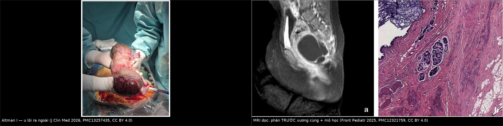
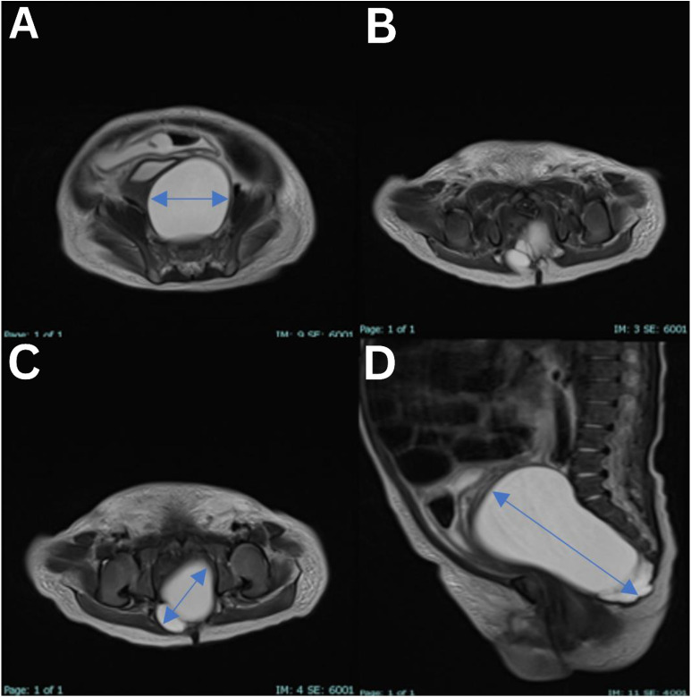
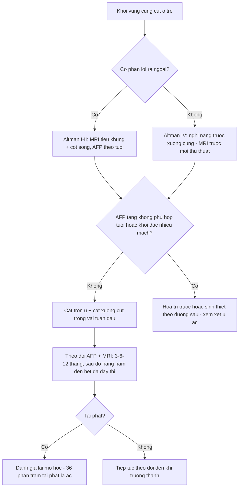
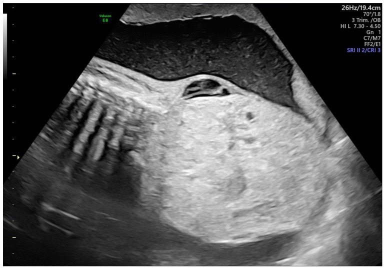
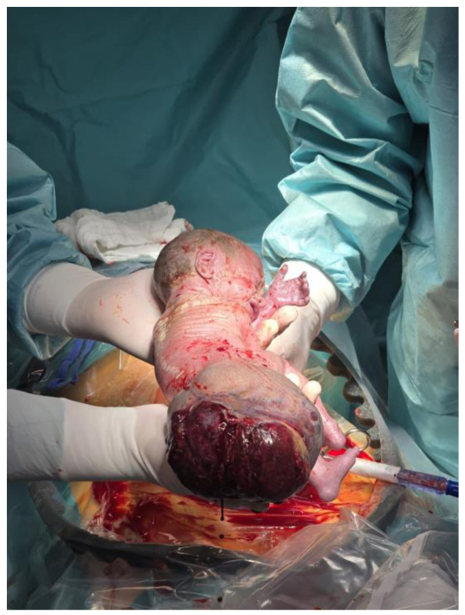
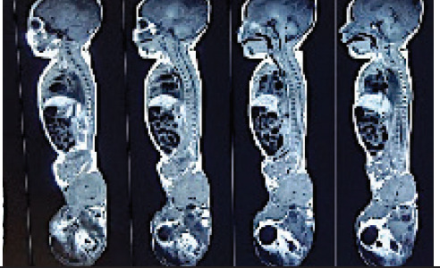

# 680 — U quái cùng cụt ở trẻ: Altman I–IV, mỡ + vôi hóa & nguy cơ ác tính theo tuổi / Sacrococcygeal teratoma

**Tags:** `pattern:khoi-cung-cut` `pattern:khoi-dac-nang` `pattern:khoi-co-mo-voi-hoa` `vung:cung-cut` `vung:khung-chau-nhi` `protocol:US-MRI-thai-va-sau-sinh` `incidentaloma:khoi-cung-cut-so-sinh` `score:Altman`
**Mức chắc chắn (certainty):** tổng hợp y văn (literature synthesis) — số liệu lấy **trực tiếp** từ các bài toàn văn mở (ghi PMCID từng chỗ); ảnh CC BY/CC BY-ND dùng nguyên bản, ảnh CC BY-NC-ND giữ nguyên không cắt ghép. Chưa gắn một ca nguyên văn duy nhất của nhóm.

## 1. Tổng quan bệnh học – cơ chế hình ảnh

- **U quái cùng cụt (sacrococcygeal teratoma — SCT)** là u tế bào mầm (germ cell tumor) **ngoài sinh dục hay gặp nhất ở trẻ**, phát sinh từ tế bào toàn năng vùng **nút Hensen (Hensen node)** ở đuôi phôi — vì thế u chứa **cả ba lá phôi** (ngoài – giữa – trong): da/niêm mạc, mỡ, sụn, xương/răng, mô thần kinh, ruột, tụy. Dịch tễ: **1/35.000–40.000 trẻ sinh sống** (Park J et al., *Front Pediatr* 2025, **PMC11973306**); **nam : nữ ≈ 1 : 3** (Wang Y et al., *World J Clin Oncol* 2026, **PMC12836064**).
- **Mô học quyết định tiên lượng:** trong một cohort quốc gia, **48% trưởng thành (mature), 34% non (immature), 18% ác tính (malignant)**; **sơ sinh đại đa số là tổn thương lành** — u ác thường lộ diện **sau 2 tuổi hoặc lúc tái phát** (Langiewicz J et al., *J Clin Med* 2026, **PMC13257435**).
- **TẠI SAO hình ảnh là "khối hỗn hợp mỡ + vôi hóa + nang + mô đặc" (vật lý):**
  - **Mỡ trưởng thành:** **−40 đến −120 HU** trên CT → giảm đậm độ rõ; **T1W tăng tín hiệu mạnh và TỤT (mất tín hiệu) trên chuỗi fat-sat** — đây là bằng chứng "có mỡ", không phải máu hay mucin.
  - **Xương/răng/vôi hóa** (lá phôi giữa): tăng đậm độ kiểu xương (khoảng **+300 đến +1.000 HU**), **tối trên mọi chuỗi MRI**.
  - **Nang dịch** (biểu mô tiết nhầy, mô thần kinh): **0–20 HU**, **T2W rất sáng**, không ngấm thuốc; **phần đặc** ngấm thuốc và có thể có **shunt động–tĩnh mạch** trong u.
  - **TẠI SAO khối to gây phù thai/đa ối:** shunt mạch trong u làm **tăng cung lượng tim thai** → tim to, suy tim → **hydrops**, đa ối; u càng **đặc, nhiều mạch, lớn nhanh** thì nguy cơ càng cao. **U > 10 cm, mạch máu nhiều/tăng nhanh: tử vong chu sinh ~50%**, trong khi u **chủ yếu nang thì gần như không tử vong** (PMC11973306).
  - **Ngưỡng tiên lượng trước sinh:** **tỷ lệ thể tích u/thai (tumor-to-fetus ratio — TFR) > 0,12 trước 24 tuần** gắn với tiên lượng xấu (PMC13257435).
- **TẠI SAO vị trí lại quyết định biến chứng cơ năng:** phần **trước xương cùng** chèn trực tràng, bàng quang, đám rối cùng → **Altman III–IV có tỷ lệ rối loạn đại tiện, tiểu tiện và vận động chi dưới cao hơn** hẳn thể lồi ra ngoài (PMC13257435). Đây là lý do phải **đo và mô tả phần trong khung chậu**, không chỉ nhìn khối lồi sau mông.

## 2. Mẫu hình + chẩn đoán phân biệt theo vị trí (gamut)

**Phân loại Altman (Surgical Section, American Academy of Pediatrics) — theo vị trí, không theo mô học:**
- **Type I:** chủ yếu **lồi ra ngoài**, thành phần trước xương cùng **tối thiểu**.
- **Type II:** khối ngoài + **phần trong khung chậu đáng kể**.
- **Type III:** chủ yếu **trong khung chậu**, phần ngoài **nhỏ**.
- **Type IV:** **hoàn toàn trước xương cùng, KHÔNG có phần ngoài** → dễ phát hiện muộn, dễ nhầm nang vô danh.
- Altman còn chia **kích thước**: nhỏ **2–5 cm**, vừa **5–10 cm**, lớn **> 10 cm** (PMC11973306).

**Gamut khối vùng cùng cụt ở trẻ, xếp theo "thành phần chủ đạo":**
- **Nang + mô đặc lẫn mỡ/vôi hóa, có/không lồi ra ngoài:** **SCT** (chốt).
- **Chỉ có MỠ, liên tục với ống sống, khuyết cung sau:** **u mỡ – tủy màng não (lipomyelomeningocele)** — bệnh cảnh **dây chằng neo tủy (tethered cord)**.
- **Nang trước xương cùng + khuyết xương cùng hình liềm (scimitar sacrum):** **màng não trước xương cùng (anterior sacral meningocele)** — nối ống sống qua lỗ cùng.
- **Bộ ba Currarino:** **khuyết xương cùng + khối trước xương cùng (u quái/màng não) + dị dạng hậu môn trực tràng**, di truyền trội **MNX1 (HLXB9)**.
- **Nang trùng lặp trực tràng / nang ruột:** nang thành có lớp cơ, **dính trực tràng**, không mỡ.
- **Khối đặc xâm lấn:** **rhabdomyosarcoma**, **neuroblastoma vùng chậu**, **chordoma** (người lớn, **hủy xương cùng**).
- **Viêm:** **áp-xe quanh hậu môn/cùng cụt** (sốt, đau, có mủ) — u quái **bội nhiễm** cũng có thể giả áp-xe.

**Mnemonic "SACRAL":** **S**acrococcygeal teratoma · **A**nterior sacral meningocele · **C**urrarino triad · **R**ectal duplication cyst · **A**typical lipoma / lipomyelomeningocele · **L**ymphangioma & các khối mạch – mô mềm khác.

## 3. Bảng so sánh phân biệt (ma trận đối chiếu)

| Thực thể (entity) | Hình ảnh điển hình | Chốt vào (rule-in) | Chốt loại (rule-out) | Gợi ý xác nhận |
|---|---|---|---|---|
| **U quái cùng cụt (SCT)** | Khối **hỗn hợp**: mỡ (−40 đến −120 HU, T1 sáng, tắt fat-sat) + vôi hóa/răng + nang dịch + mô đặc ngấm thuốc; **thường lệch phải**, đẩy trực tràng ra trước | **Có MỠ + nang + mô đặc trong cùng một khối vùng cùng cụt** | Khối thuần nang, không mỡ, không vôi hóa, thành mỏng đều → nghĩ nang khác | MRI có fat-sat + AFP/βhCG; cắt u **kèm xương cụt** |
| **U mỡ – tủy màng não** | Mỡ **liên tục với ống sống** qua khuyết cung sau, tủy **neo thấp** (dưới L2–L3) | **Mỡ nối ống sống + khuyết cung sau + tủy thấp** | Không liên tục ống sống, có vôi hóa/răng → SCT | MRI toàn bộ cột sống T1/T2, không cản quang |
| **Màng não trước xương cùng** | Nang dịch đơn thuần **trước xương cùng**, **khuyết xương cùng hình liềm**, cuống qua lỗ cùng | **Cuống nối ống sống + khuyết xương cùng** | Có mỡ/vôi hóa trong khối → SCT; không cuống → nang khác | MRI T2 dọc cùng cụt; **không chọc hút** |
| **Bộ ba Currarino** | Khuyết xương cùng **hình liềm** + khối trước xương cùng + **dị dạng hậu môn trực tràng** | **Đủ 3 thành phần** | Chỉ có khối, xương cùng bình thường → không phải Currarino | X-quang/MRI xương cùng, đánh giá hậu môn trực tràng, gen **MNX1** |
| **Nang trùng lặp trực tràng** | Nang **thành dày có lớp cơ**, áp sát/ dính thành trực tràng, dịch trong | **Thành có cơ + dính trực tràng + không mỡ** | Có mỡ, vôi hóa, mô thần kinh → SCT | MRI tiểu khung + nội soi/ siêu âm qua trực tràng |
| **Chordoma xương cùng** | Khối **phá hủy xương cùng**, calci hóa dạng "khói", **người lớn/trẻ lớn** | **Hủy xương + khối mô mềm lớn** | Xương cùng còn nguyên vỏ, có mỡ/răng → SCT | CT xương + MRI + sinh thiết |
| **Rhabdomyosarcoma vùng chậu** | Khối **đặc, xâm lấn**, không mỡ, không vôi hóa, ngấm thuốc mạnh | **Khối đặc xâm lấn, không mỡ/vôi hóa, lớn nhanh** | Có thành phần mỡ + vôi hóa → SCT | Sinh thiết, hóa mô miễn dịch |

*Trái: sơ sinh với khối cùng cụt khổng lồ lồi ra ngoài — thể Altman I [Langiewicz J et al., J Clin Med 2026, PMC13257435, CC BY 4.0]. Phải: MRI T2 dọc (a) cho thấy **thành phần nang trước xương cùng** (Altman II–III) và (b) mô học u quái trưởng thành [Front Pediatr 2025, PMC12321759, CC BY 4.0]. Ảnh ghép letterbox, giữ nguyên tỷ lệ.*

### Ba dấu hiệu "đọc đúng" trên MRI

*MRI T2 (A–C axial, D sagittal) — nang **7,0 × 3,9 × 3,8 cm** sau tử cung/bàng quang, trước xương cùng, **thuần dịch, vách mỏng** = u quái cùng cụt **type IV hoàn toàn trước xương cùng**, không khuyết xương cùng, không xâm lấn ống sống [Almaawali AK et al., Sultan Qaboos Univ Med J 2026, PMC13227553, **CC BY-ND 4.0** — giữ nguyên bản, không cắt/ghép].*

- **Thành phần mỡ:** phải thấy **tắt tín hiệu trên T1 fat-sat** (hoặc **−40 đến −120 HU** trên CT) thì mới gọi là mỡ thật.
- **Quan hệ với ống sống:** luôn chụp **T2 dọc toàn bộ cột sống** — mỡ/u chui vào ống sống đổi hoàn toàn đường mổ.
- **Phần trước xương cùng:** đo 3 chiều và ghi **thể tích**, đừng chỉ mô tả "khối sau mông".

## 4. Protocol chụp + hệ phân độ/điểm chuẩn hóa

**Trước sinh (khi phát hiện khối cùng cụt trên siêu âm thai):**
- **Siêu âm thai** là tuyến đầu; đo **3 chiều → thể tích** (dài × trước–sau × ngang × **0,523**), **tỷ lệ đặc/nang**, **TFR**, Doppler mức tưới máu, **đa ối**, **hydrops**, **siêu âm tim thai** (tìm suy tim cung lượng cao).
- **MRI thai** khi cần đánh giá phần trong khung chậu/ống sống hoặc chuẩn bị can thiệp.
- **Ngưỡng tiên lượng:** **TFR > 0,12 trước 24 tuần** → nguy cơ xấu; khối **> 10 cm, đặc, nhiều mạch** → nguy cơ tử vong chu sinh cao (PMC13257435; PMC11973306).
- **Can thiệp bào thai** chỉ cho ca chọn lọc (hydrops, khối đặc tăng nhanh): sống sau mổ mở **60,9%**, can thiệp ít xâm lấn khác **58,2%**, nhóm đốt/nghiền/keo **44,6%** (Cianci MC et al., *Front Pediatr* 2025, **PMC12185440**) — tư vấn phải nêu cả nguy cơ mẹ (vỡ ối non, tiền sản giật, HELLP).

**Sau sinh:**
- **MRI tiểu khung + toàn bộ cột sống** (T1W, T2W, **T1 fat-sat**, sau tiêm) — bắt buộc trước mổ; **CT** chỉ thêm khi cần đánh giá xương cùng.
- **Xét nghiệm:** **AFP, βhCG, LDH**. **AFP phải đọc theo tuổi** — sơ sinh đủ tháng **trung bình 41.687 ng/mL ngày 0** (khoảng 95,5%: **9.120–190.546**), **chu kỳ bán rã 5,5 ngày** lúc sinh, **11 ngày** ở 14–30 ngày tuổi, **33 ngày** tới 4 tháng; về mức người lớn (**≤ 10–15 ng/mL**) trong **8–12 tháng** (Głowska-Ciemny J et al., *Cancers* 2023, **PMC10486785**).
- **Phẫu thuật:** cắt trọn u **kèm cắt xương cụt (coccygectomy)** — **bỏ xương cụt là yếu tố nguy cơ tái phát độc lập** (Wang Y et al., **PMC12836064**: 13/13 ca không cắt xương cụt đều tái phát).
- **Hóa trị:** u quái **non/ác** hoặc **tái phát ác** (thường là u túi noãn hoàng — yolk sac tumor, chiếm **22–56%** ca tái phát ác).

**Nguy cơ ác tính & tái phát — số của cohort toàn cầu 3.407 trẻ (van Heurn LJ et al., *Int J Surg* 2024, **PMC11573091**):**

| Mốc | Nguy cơ ác tính tích lũy |
|---|---|
| 3 tháng tuổi | **3,3%** |
| 6 tháng | **5,1%** |
| 1 tuổi | **10,1%** |
| 2 tuổi | **32,9%** |
| Sau 6 tuổi | trần **64%**, không tăng thêm |

- **Tái phát 10,2%** (349/3.407), trong đó **36,1% là tái phát ác**; yếu tố nguy cơ: **Altman II (OR 1,6)**, **Altman III (OR 1,6)**, mô học **non (OR 1,9)**, mô học **ác (OR 4,0)**.

## 5. Biến thể bình thường và cạm bẫy

- **Lúm cùng cụt (sacrococcygeal dimple) — biến thể bình thường:** lúm **giữa rãnh**, **< 5 mm**, cách hậu môn **> 2,5 cm**, **không** kèm búi lông, u mỡ, nốt sắc tố, chảy dịch hay bất thường thần kinh → **không cần MRI**. Ngược lại: lúm **≥ 5 mm**, **< 2,5 cm từ hậu môn**, hoặc có dấu da kèm theo → **MRI cột sống cùng cụt** để loại u mỡ/tủy neo.
- **Cạm bẫy 1 — chọc hút/dẫn lưu nang:** nang trước xương cùng có thể là **màng não** hoặc **u quái**; chọc hút gây **viêm màng não, nhiễm trùng, rò dịch não tủy**. Không chọc khi chưa có MRI.
- **Cạm bẫy 2 — "chỉ cắt phần lồi ra ngoài":** bỏ sót phần **trước xương cùng** (Altman II–IV) là nguồn **tái phát** kinh điển; phải cắt **kèm xương cụt**.
- **Cạm bẫy 3 — AFP sơ sinh:** dùng ngưỡng người lớn (**10–15 ng/mL**) sẽ gọi oan mọi sơ sinh là "AFP tăng"; phải so **bảng theo tuổi** (mục 4) và theo dõi **động học** (AFP giảm chậm hơn nửa đời → nghi còn u).
- **Cạm bẫy 4 — u quái bội nhiễm giả áp-xe:** khối đau, sốt, có mủ vẫn có thể là SCT hoại tử/nhiễm; **siêu âm/MRI trước khi rạch**.
- **Cạm bẫy mặt cắt:** trên CT/MRI ngang, **u quái type IV** nằm **sau trực tràng, trước xương cùng** — khác **nang tuyến tiền liệt/utricle** (bé trai, nằm trước trực tràng, dính sàn niệu đạo) và **nang buồng trứng** (bé gái, xuất phát từ phần phụ, thường lệch sang bên, có "daughter cyst"). Vị trí tương quan với **trực tràng** là mốc phân biệt đầu tiên.

## 6. Tự lượng giá — Blind Quiz (ảnh trơn ngoài, đáp án ẩn trong khối chi tiết)

**Ca 1 — Thai 3 tháng cuối, siêu âm thấy khối sau cùng cụt. Nhìn ảnh trước, mô tả trước.**

- Gợi ý lâm sàng: khối **11 × 11 cm**, thể tích ước tính **657,3 mL**, **TFR 0,48**, không đa ối, không hydrops.
- Câu hỏi: Thành phần khối **đặc hay nang**? TFR 0,48 nói gì về tiên lượng? Ba chẩn đoán phân biệt và bước tiếp theo?

<b>Bấm để hiện đáp án (findings + chẩn đoán)</b>

- **Dấu hiệu:** khối **hỗn hợp đặc–nang** lớn vùng cùng cụt, phần đặc chiếm ưu thế; không thấy hydrops/đa ối trong ca này.
- **Chẩn đoán:** **u quái cùng cụt (SCT)**. **TFR 0,48 > 0,12** → nằm trong nhóm **tiên lượng xấu** theo ngưỡng trước 24 tuần; cần **siêu âm tim thai**, theo dõi tăng trưởng u và tư vấn **sinh tại trung tâm sản–nhi**.
- **Vì sao:** phần **đặc, nhiều mạch** tạo shunt → suy tim cung lượng cao → hydrops; đây là cơ chế tử vong chu sinh chính, không phải chèn ép đơn thuần.
- Nguồn ảnh: Langiewicz J et al., *J Clin Med* 2026, **PMC13257435** Fig 1, CC BY 4.0.

**Ca 2 — Bé gái 2 tuần tuổi, khối vùng cùng cụt nhưng KHÔNG thấy gì lồi ra ngoài khi khám. Nhìn MRI.**

- Câu hỏi: Khối nằm ở đâu so với trực tràng và xương cùng? Altman type mấy? Có được chọc hút để "xác định bản chất" không?

<b>Bấm để hiện đáp án (findings + chẩn đoán)</b>

- **Dấu hiệu:** nang **đơn thùy, thuần dịch, vách mỏng**, **7,0 × 3,9 × 3,8 cm**, nằm **sau tử cung/bàng quang, trước xương cùng**; **không khuyết xương cùng, không xâm lấn ống sống**.
- **Chẩn đoán:** **u quái cùng cụt Altman type IV** (hoàn toàn trước xương cùng) — mô học sau mổ là **u quái trưởng thành** (đủ 3 lá phôi, không thành phần non/ác).
- **Không chọc hút:** khối trước xương cùng có thể là **màng não trước xương cùng**; chọc gây rò dịch não tủy/viêm màng não. Đường chẩn đoán là **MRI**, xác nhận là **mô học sau cắt trọn kèm xương cụt**.
- Nguồn ảnh: Almaawali AK et al., *Sultan Qaboos Univ Med J* 2026, **PMC13227553** Fig 1, **CC BY-ND 4.0** (nguyên bản).

**Ca 3 — Sơ sinh có khối lớn lồi sau mông. Hai ảnh: lâm sàng và CT toàn thân.**

- Câu hỏi: Mô tả phân bố **ngoài cơ thể vs trước xương cùng** (kích thước **16,5 × 10,2 × 6,0 cm**)? Vì sao vẫn phải chụp MRI cột sống? Điều gì quyết định tái phát?

<b>Bấm để hiện đáp án (findings + chẩn đoán)</b>

- **Dấu hiệu:** khối **đa thùy, hỗn hợp đặc–nang**, **phần ngoài cơ thể chiếm ưu thế + phần trước xương cùng nhỏ** → **Altman type I–II**.
- **Vì sao vẫn cần MRI cột sống:** loại **u mỡ – tủy màng não** (mỡ chui vào ống sống, tủy neo thấp) — nếu bỏ sót sẽ mổ sai đường và để lại bệnh lý tủy.
- **Quyết định tái phát:** **cắt trọn + cắt xương cụt**; bỏ xương cụt là yếu tố nguy cơ tái phát độc lập, và **36,1%** ca tái phát là **ác tính** (PMC11573091).
- Nguồn ảnh: Langiewicz J et al., *J Clin Med* 2026, **PMC13257435** Fig 2, CC BY 4.0; Shrestha R et al., *JNMA* 2025, **PMC12750976** Fig 1, CC BY 4.0.

## Bài liên quan chéo
- [600 – Tổng quan Nhi khoa](../600-tong-quan-nhi-khoa/lesson.md)
- [674 – U quái & u tế bào mầm vùng gan ở trẻ](../674-u-quai-te-bao-mam-gan-o-tre/lesson.md) (cùng họ tế bào mầm, khác vị trí)
- [656 – Bất thường tủy sống ở trẻ](../656-bat-thuong-tuy-cot-song-nhi/lesson.md) (u mỡ – tủy màng não, tủy neo)
- [630 – U bụng nhi: neuroblastoma vs Wilms](../630-u-bung-nhi-neuroblastoma-vs-wilms/lesson.md)
- [635 – Dị tật tiết niệu nhi: SFU, VUR, PUV](../635-di-tat-tiet-nieu-nhi-SFU-VUR-PUV/lesson.md) (chèn ép đường tiểu dưới)
- [645 – Vỡ khung chậu ở trẻ](../645-vo-khung-chau-o-tre/lesson.md) (đau vùng cùng cụt sau chấn thương)

## Ảnh
- `680_u-quai-cung-cut_US-thai_PMC13257435-Fig1-CCBY.jpg` — siêu âm thai, CC BY 4.0.
- `680_u-quai-cung-cut_Anh_PMC13257435-Fig2-so-sinh-CCBY.jpg` — ảnh lâm sàng sơ sinh, CC BY 4.0.
- `680_u-quai-cung-cut_MRI-PMCT_PMC12321759-Fig2-truoc-xuong-cung-CCBY.jpg` — MRI dọc + mô học, CC BY 4.0.
- `680_u-quai-cung-cut_MRI_PMC13227553-Fig1-nang-type-IV-CCBYND.jpg` — MRI type IV, **CC BY-ND 4.0** (nguyên bản, không cắt/ghép).
- `680_u-quai-cung-cut_CT_PMC12750976-Fig1-coronal-CCBY.jpg` — CT coronal, CC BY 4.0.
- `composite_ngoai-vs-truoc-xuong-cung.jpg` — ảnh ghép letterbox từ hai ảnh CC BY 4.0 ở trên.
- Nguồn + giấy phép từng ảnh: `images/CREDITS.md`; link bài gốc: `sources.md`.

> Không dùng để chẩn đoán độc lập khi chưa có người hướng dẫn.
