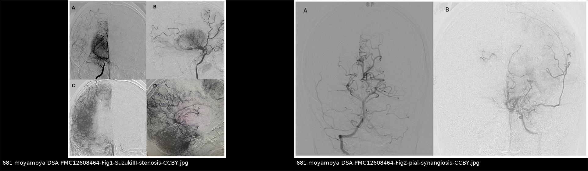
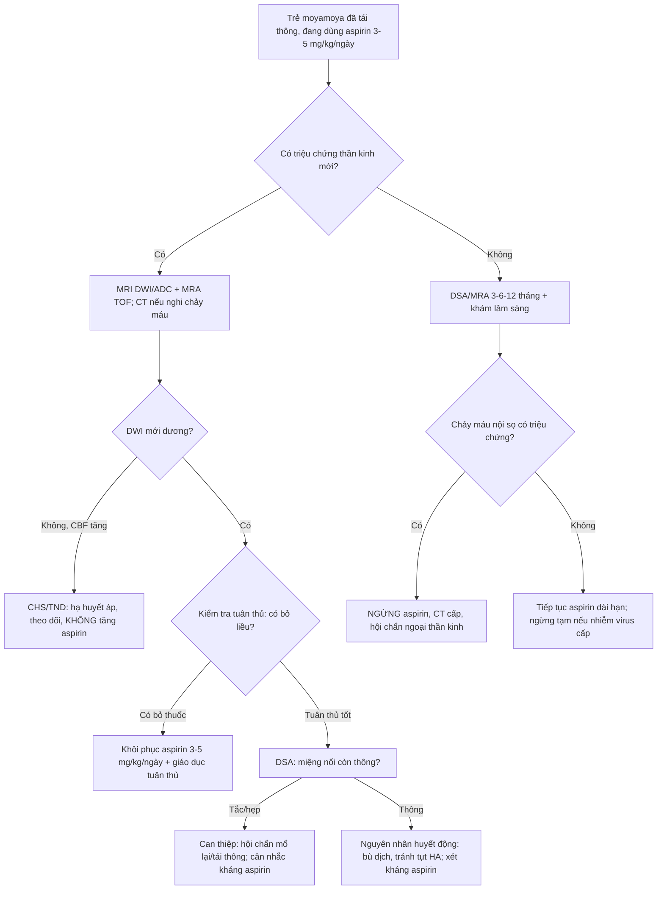
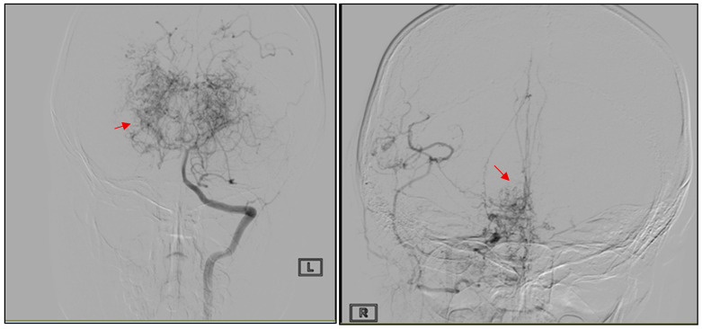
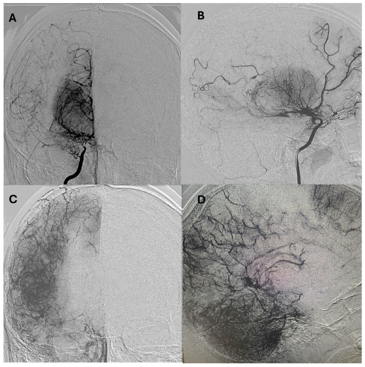
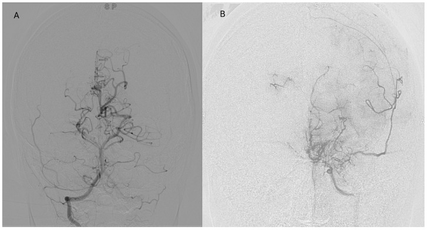

# 681 — Chống kết tập tiểu cầu sau tái thông mạch não ở trẻ: liều aspirin mg/kg, thời gian dùng, nguy cơ chảy máu & khi nào ngừng

**Tags:** `pattern:hep-tac-mach` `pattern:nhoi-mau-nao` `pattern:xuat-huyet-nao` `vung:nao-nhi` `protocol:DSA` `protocol:MRA-TOF` `protocol:xet-nghiem-ngung-tieu-cau`
**Mức chắc chắn (certainty):** tổng hợp y văn (literature synthesis) — **không có thử nghiệm ngẫu nhiên nào về aspirin sau tái thông ở trẻ**; bài ghép (1) khuyến cáo/đồng thuận, (2) đoàn hệ nhi có ghi liều mg/kg và biến cố, (3) dữ liệu người lớn dùng để hiểu cơ chế nhưng **không suy diễn nguyên tần suất cho trẻ** — chỗ nào suy luận thì ghi rõ.

> **Điểm chốt của bài:** sau khi mổ tái thông, câu hỏi không còn là "có mổ hay không" mà là **"miệng nối còn thông không, và thuốc đang giúp hay đang hại?"**. Ba câu phải trả lời theo thứ tự: **(1) liều bao nhiêu mg/kg?** (3–5 mg/kg/ngày, không phải 81 mg cho mọi trẻ); **(2) dùng bao lâu?** (đoàn hệ nhi duy trì **lâu dài/không thời hạn** trừ khi có chống chỉ định); **(3) khi nào ngừng?** (chảy máu nội sọ có triệu chứng, phẫu thuật lớn, nhiễm virus cấp — Reye) — và **ngừng "cho an toàn" không có bằng chứng lại là cách gây tái phát thiếu máu**.

## 1. Tổng quan bệnh học – cơ chế hình ảnh

### 1.1 Vì sao miệng nối tái thông ở trẻ cần kháng kết tập tiểu cầu

Bệnh moyamoya gây hẹp–tắc tiến triển đoạn tận động mạch cảnh trong (internal carotid artery, ICA); tái thông đưa máu từ hệ động mạch cảnh ngoài (external carotid artery, ECA) vào vỏ não ([652](../652-dot-quy-mach-mau-nao-nhi-moyamoya-viem-mach/lesson.md), [1780](../1780-chon-ky-thuat-tai-thong-moyamoya-o-tre/lesson.md)). Miệng nối là **mạch rất nhỏ**: động mạch thái dương nông (superficial temporal artery, STA) thường **< 1–2 mm**, nhánh M4 nhận **≥ 1 mm** — đúng ngưỡng mà một cục huyết khối tiểu cầu vài trăm micromet có thể bít hoàn toàn.

- **Vật lý dòng chảy (định luật Poiseuille):** lưu lượng tỉ lệ với **bán kính mũ 4**. Giảm đường kính lòng mạch 20% → lưu lượng còn **≈ 41%** (0,8⁴ = 0,41), tức **mất ~59%**. Vì vậy co mạch, tụt huyết áp, giảm thể tích hoặc một cục tiểu cầu nhỏ đều gây thiếu máu **không tương xứng với "độ nhỏ" của tổn thương** — đây là lý do hình ảnh học phải đọc **cả miệng nối lẫn tưới máu nhu mô**, không chỉ nhìn chỗ nối.
- **TẠI SAO huyết khối ở đây lại giàu tiểu cầu:** nội mạc bị bóc tách khi khâu nối + dòng chảy chậm ở đoạn nối nhỏ tạo điều kiện ngưng tập tiểu cầu (không phải huyết khối đỏ ứ trệ như ở tĩnh mạch) → **aspirin (kháng COX-1) đúng đích sinh lý**, còn heparin/kháng vitamin K không đúng đích.
- **TẠI SAO aspirin liều thấp đã đủ:** aspirin acetyl hóa **serine-529 của COX-1** trong tiểu cầu → không tạo thromboxane A2 (TXA2) → ức chế ngưng tập trong **suốt đời sống tiểu cầu (7–10 ngày)**; tiểu cầu mới sinh bù ~10%/ngày. Hiệu quả đạt **gần mức tối đa ở liều thấp**, nên tăng liều chỉ tăng độc tính dạ dày–thận chứ không tăng hiệu quả chống huyết khối.

### 1.2 Ngưỡng định lượng bắt buộc nhớ

- **Liều aspirin nhi sau tái thông:** **3–5 mg/kg/ngày**, bắt đầu **trước mổ**, duy trì **không thời hạn** trừ khi có chống chỉ định — 14 trẻ (Savoldi AM, J Clin Med 2025, PMC12608464).
- **Ca minh họa liều tuyệt đối:** **75 mg/ngày** (trẻ 7 tuổi — Grigore I, PMC13027288); **3 mg/kg/ngày ≈ 45 mg/ngày** (ca ~15 kg — Clinical Case Reports 2026, PMC12929019).
- **Liều người lớn (để so sánh, KHÔNG dùng cho trẻ):** **81–100 mg/ngày** (Hallan D, PMC13629840; Nakamura A, PMC10945227).
- **Định nghĩa "kháng aspirin" ở trẻ:** ngưng tập **> 5 ohm** trên aggregometry với **acid arachidonic 0,5 mM**; PFA-200 collagen/epinephrine **closure time < 180 giây**; bleeding time Ivy cải tiến **≤ 7 phút** (Poparn H, PMC11571927).
- **Tần suất kháng aspirin ở trẻ:** **2,7% (1/37)** trẻ ≤ 15 tuổi dùng 3–5 mg/kg/ngày (cùng nguồn).
- **Biến cố tái phát trong đoàn hệ nhi có aspirin:** **4,4% (2/45)** — 1 nhồi máu **sau khi đã ngừng aspirin**, 1 xuất huyết ở tuổi 17 **6 năm sau** tái thông hai bên (Nurimanov C, PMC13406446).
- **Nhồi máu mới DÙ đang dùng aspirin:** **14% (2/14)** sau tái thông gián tiếp (Savoldi AM, PMC12608464).
- **Xuất huyết liên quan kháng kết tập trong đoàn hệ nhi:** **0 ca** (cùng nguồn).

### 1.3 Hình ảnh học trả lời câu hỏi gì (và KHÔNG trả lời câu hỏi gì)

Aspirin **không có "dấu hiệu hình ảnh"**. Hình ảnh chỉ trả lời được 4 câu, và mỗi câu cần một chuỗi khác nhau:

1. **Bệnh nền còn tiến triển không?** → DSA (chuẩn) hoặc MRA TOF: hẹp tận ICA, tuần hoàn bàng hệ "khói thuốc" (moyamoya vessels), phân độ **Suzuki**.
2. **Miệng nối có thông không?** → DSA là chuẩn; MRA TOF **có thể mất tín hiệu giả** ở mạch < 1–2 mm (xem mục 5).
3. **Có nhồi máu mới không?** → **DWI/ADC** (nhồi máu cấp: DWI sáng, ADC tối) — đây là cách phân biệt "đau đầu do tăng tưới máu" với "nhồi máu thật".
4. **Có chảy máu không?** → **CT không cản quang** (ưu thế: nhanh, nhạy với máu cấp) hoặc **SWI/T2*** trên MRI (vi chảy máu, hemosiderin).

> **Cạm bẫy khái niệm:** "đang dùng aspirin mà vẫn nhồi máu" **không** chứng minh aspirin vô dụng — có thể do **kháng aspirin**, **bỏ thuốc**, hoặc nguyên nhân **huyết động** (tụt huyết áp, thiếu dịch, co mạch), mà kháng kết tập tiểu cầu không thể chữa. Phân biệt hai cơ chế này là mục đích của mục 3.

## 2. Mẫu hình + chẩn đoán phân biệt theo trình tự thời gian (Gamut)

Mọi biến cố sau tái thông ở trẻ được xếp **theo ngày**, không theo triệu chứng:

- **Trước mổ – chờ mổ (tuần–tháng):** TIA/nhồi máu tái diễn do bệnh nền tiến triển. Đây là lý do **bắt đầu aspirin ngay khi chẩn đoán**, không đợi mổ (đoàn hệ Brazil: **100% trẻ chưa được dùng kháng kết tập trước khi chuyển đến** — Nurimanov C, PMC13406446).
- **POD 0–7 ("cửa sổ miệng nối"):** **tắc miệng nối do huyết khối tiểu cầu** (nhồi máu mới, DWI +), **hội chứng tưới máu quá mức (CHS)** (đau đầu, co giật, DWI âm, tăng CBF — [660](../660-theo-doi-sau-tai-thong-moyamoya-o-tre/lesson.md)), **tụ máu ngoài/dưới màng cứng** tại chỗ mổ.
- **1–3 tháng ("cửa sổ lành mạch"):** tắc muộn, hẹp miệng nối, **nhồi máu vùng phân thủy** khi huyết áp dao động.
- **> 1 năm ("cửa sổ dài hạn"):** tái phát thiếu máu (**thường gắn với bỏ aspirin**), **xuất huyết muộn** (moyamoya bản chất vẫn có nguy cơ chảy máu, nhất là khi bàng hệ từ mạch màng mạch/tưới máu mỏng manh), hẹp tiến triển bên đối diện.

Gợi nhớ **"4T" sau tái thông:** **T**hrombosis (tắc miệng nối, ngày 0–7) — **T**ension (tăng tưới máu, ngày 0–7) — **T**ime (thời gian: bỏ thuốc → tái phát thiếu máu) — **T**earing (chảy máu muộn, > 1 năm).

## 3. Bảng so sánh phân biệt (ma trận đối chiếu)

| Thực thể (entity) | Hình ảnh điển hình | Chốt vào (rule-in) | Chốt loại (rule-out) | Gợi ý xác nhận |
|---|---|---|---|---|
| **Tắc miệng nối sớm (huyết khối tiểu cầu)** | DSA: **mất dòng chảy tại chỗ nối**, không thấy nhánh M4 nhận; DWI **mới** vùng lãnh thổ | **DWI mới + mất tín hiệu/dòng tại miệng nối trên DSA + xảy ra POD 0–7** | Miệng nối thông tốt trên DSA → nguyên nhân huyết động, không phải tắc | DSA (không chỉ MRA); siêu âm Doppler STA; đối chiếu ASL/CTP |
| **CHS / TND (tăng tưới máu)** | ASL/SPECT: **CBF vùng mổ tăng trội**; FLAIR phù vỏ–dưới vỏ; **DWI âm** | **Triệu chứng thoáng qua + CBF tăng + DWI âm** | DWI dương theo lãnh thổ → nhồi máu thật, không phải CHS | ASL/SPECT; hạ huyết áp; theo dõi D1–D7 ([660](../660-theo-doi-sau-tai-thong-moyamoya-o-tre/lesson.md)) |
| **Nhồi máu do huyết động (giảm tưới máu)** | DWI mới **vùng phân thủy/chuyển tiếp**, miệng nối **vẫn thông**; ASL giảm | **DWI mới + miệng nối thông + bối cảnh tụt HA/mất nước** | Tắc miệng nối → không có dòng trên DSA | Đo HA, cân nặng, hematocrit; DSA đối chiếu |
| **Tái phát thiếu máu do BỎ aspirin** | DWI mới ở lãnh thổ đã tái thông; **bệnh nhân xác nhận đã ngừng thuốc** | **Tiền sử ngừng aspirin + DWI mới + miệng nối còn thông** | Đang dùng đều, nồng độ/ức chế tiểu cầu đạt → tìm nguyên nhân khác | Hỏi thuốc trực tiếp; xét kháng aspirin nếu tái phát dù tuân thủ |
| **Kháng aspirin (thất bại dược lý)** | Không có hình ảnh đặc hiệu; **DWI mới tái diễn dù uống đủ liều** | **Tái phát huyết khối khi tuân thủ tốt + xét nghiệm ngưng tập còn cao** | Tuân thủ kém/bỏ thuốc → không gọi là kháng | Aggregometry/PFA-200 (ngưỡng mục 1.2); **chỉ làm khi tái phát** |
| **Xuất huyết muộn (bệnh nền, không do thuốc)** | CT: máu trong nhu mô/trong não thất; SWI: vi chảy máu; **thường ở người trẻ tuổi hơn sau nhiều năm** | **Máu trên CT + bàng hệ mỏng/mạch màng mạch giãn + nhiều năm sau mổ** | Máu tụ khu trú tại vị trí mổ, sớm sau mổ → biến chứng ngoại khoa | CT không cản quang; CTA/DSA nếu cần; đánh giá lại chỉ định kháng kết tập |
| **Giả hẹp/mất tín hiệu trên MRA TOF** | MRA: mất tín hiệu "miệng nối"; **DSA cùng ngày: miệng nối thông tốt** | **DSA thông + MRA mất tín hiệu** | DSA cũng mất dòng → tắc thật | Luôn đọc **source images**; DSA để kết luận |

*Trái: trước mổ — hẹp tận ICA, M1/A1 "dạng sợi chỉ", tái lập qua tuần hoàn đậu vân (Suzuki III), pha nhu mô có vùng giảm mạch. Phải: sau pial synangiosis dùng STA — bàng hệ xuyên màng cứng mọc vào, thấy rõ tuần hoàn ECA→ICA từ động mạch màng não giữa và STA. Nguồn: Savoldi AM, J Clin Med 2025 (PMC12608464), Fig. 1 & 2, CC BY 4.0; ghép letterbox bằng `tools/make_composite.py`.*

## 4. Protocol: liều – thời gian – theo dõi – ngưỡng ngừng

### 4.1 Liều và thời điểm (khác biệt cốt lõi giữa trẻ và người lớn)

| Tình huống | Liều | Thời điểm | Ghi chú |
|---|---|---|---|
| Trẻ ≤ 15–18 tuổi, mọi cân nặng | **3–5 mg/kg/ngày** (1 lần/ngày) | **Trước mổ** (ngay khi chẩn đoán) và **tiếp tục sau mổ** | Dùng cân nặng thực; trần thực hành thường **75–100 mg/ngày** ở trẻ lớn (Grigore I, PMC13027288 dùng 75 mg) |
| Người lớn / trẻ đã trưởng thành xương | **81–100 mg/ngày** | ERAS: **tiếp tục hoặc khôi phục ngay POD 1** | Hallan D, Neurosurg Pract 2026 (PMC13629840); Nakamura A, PMC10945227 |
| Sau khi **ngừng vì lý do an toàn** | Khôi phục **3–5 mg/kg/ngày** | Sớm nhất khi cầm máu ổn định và không còn chống chỉ định | Không có ngưỡng thời gian chuẩn — quyết định đa chuyên khoa |

- **Thời gian dùng:** đoàn hệ nhi duy trì **"indefinitely unless contraindicated"** (Savoldi AM, PMC12608464) và "long-term" (Nurimanov C, PMC13406446) — **không có bằng chứng cho việc ngừng sau 3–6 tháng** ở trẻ; ngừng sớm đã gắn với tái phát thiếu máu (1 ca trong PMC13406446).
- **Không dùng kháng kết tập kép (DAPT) thường quy** sau tái thông ngoại khoa ở trẻ: không có dữ liệu, và nguy cơ chảy máu tăng. DAPT chỉ thuộc về **stent nội mạch** (bài 248/249), không thuộc về bypass.

### 4.2 Theo dõi: cái gì cần, cái gì KHÔNG cần

1. **Lâm sàng mỗi lần khám:** đau đầu, TIA, yếu/tê, co giật, chảy máu cam–lợi, phân đen, bầm tím bất thường; **hỏi trực tiếp "có bỏ liều nào không"** (nguyên nhân tái phát số 1).
2. **Hình ảnh:** DSA hoặc MRA TOF theo lịch trung tâm (**3–6–12 tháng**, sau đó hằng năm đến khi bàng hệ ổn định) + **MRI DWI** mỗi lần có triệu chứng mới.
3. **Xét nghiệm ngưng tập tiểu cầu:** **KHÔNG thường quy** — khuyến cáo chỉ làm khi **tái phát huyết khối dù tuân thủ tốt** hoặc trước phẫu thuật lớn (Poparn H, PMC11571927: "routine screening is discouraged").
4. **KHÔNG cần** đếm tiểu cầu/đông máu định kỳ chỉ vì dùng aspirin liều thấp.

### 4.3 Khi nào ngừng (và ngừng bao lâu)

| Chỉ định ngừng | Xử trí | Bằng chứng / lý do |
|---|---|---|
| **Xuất huyết nội sọ có triệu chứng** | Ngừng ngay; CT cấp; hội chẩn ngoại thần kinh; truyền tiểu cầu nếu chảy máu nặng/đe dọa tính mạng | Ưu tiên cứu sống; nguy cơ huyết khối tăng lại sau ~3–5 ngày nên phải cân nhắc khôi phục sớm |
| **Phẫu thuật lớn / nha khoa xâm lấn** | Thường **không cần ngừng** cho thủ thuật nhỏ (aspirin liều thấp); với mổ lớn theo quyết định phẫu thuật–gây mê | Tiếp tục quanh mổ **không tăng chảy máu** trong loạt 96 ca người lớn: nhồi máu có triệu chứng **5,1%**, **0** xuất huyết (Nakamura A, PMC10945227) |
| **Nhiễm virus cấp (thủy đậu, cúm) ở trẻ** | **Ngừng tạm** trong đợt sốt phát ban | Aspirin **chống chỉ định** ở trẻ ≤ 18 tuổi nghi nhiễm virus vì **hội chứng Reye** (Children 2026, PMC13114626) |
| **Xuất huyết tiêu hóa / loét dạ dày** | Ngừng, PPI, đánh giá lại | Biến chứng dạ dày–tá tràng của aspirin |
| **Dị ứng thật / hen do aspirin** | Đổi thuốc (clopidogrel) sau hội chẩn | Không có phác đồ nhi chuẩn — ngoại suy |

### 4.4 Đối chiếu với y văn người lớn — chỗ mâu thuẫn phải nói rõ

- **Tổng quan hệ thống (người lớn):** kháng kết tập tiểu cầu **giảm xuất huyết não** (HR **0,47**; KTC 95% 0,24–0,94) nhưng **KHÔNG giảm nhồi máu** (HR **0,80**; KTC 95% 0,33–1,94) và **không tăng tỉ lệ sống độc lập** (RR 1,02) — Kijpaisalratana N, Cerebrovasc Dis Extra 2024 (PMC11250630). Meta-analysis khác: Liu T, Front Neurol 2023 (PMC10318533).
- **Nghịch lý cần nhớ:** ở người lớn, lợi ích rõ nhất lại là **giảm chảy máu**, không phải giảm nhồi máu. Ở trẻ, lợi ích được kỳ vọng là **giữ miệng nối thông** (sinh lý huyết khối tiểu cầu), và dữ liệu chỉ ở mức đoàn hệ nhỏ.
- **Vì sao vẫn dùng ở trẻ:** (1) sinh lý miệng nối nhỏ rất dễ huyết tắc; (2) đoàn hệ nhi cho thấy **an toàn chảy máu tốt** (0 ca trong 14 trẻ — PMC12608464); (3) một ca tái phát thiếu máu **xảy ra đúng sau khi ngừng aspirin** (PMC13406446). Đây là **suy luận hợp lý, không phải bằng chứng mức I** — phải nói với gia đình như vậy.
- **Đồng thuận chuyên gia:** khuyến cáo kháng kết tập ở moyamoya thiếu máu sau khi cân nhắc nguy cơ chảy máu, mức bằng chứng **trung bình, khuyến cáo mạnh** — Ni W, Stroke Vasc Neurol 2026 (PMC13540286); bài này **không đưa liều nhi cụ thể**, nên liều mg/kg phải lấy từ đoàn hệ/đồng thuận nhi.

## 5. Biến thể bình thường và cạm bẫy

- **MRA TOF "mất miệng nối" ≠ tắc miệng nối.** Mạch < 1–2 mm + hiệu ứng mất tín hiệu dòng chảy → giả hẹp. Luôn đọc **source images** và chỉ kết luận bằng **DSA**. Đây là cạm bẫy hay gặp nhất khiến trẻ bị mổ lại không cần thiết.
- **"Đang dùng aspirin mà vẫn nhồi máu" ≠ aspirin thất bại.** Phải tách 3 khả năng: **bỏ thuốc** (hay nhất), **kháng aspirin** (2,7% — chỉ xét khi tuân thủ tốt), **nguyên nhân huyết động** (tụt HA, thiếu dịch, thiếu máu, co mạch). Điều trị ba khả năng này khác nhau hoàn toàn.
- **Bắt đầu aspirin quá muộn.** Nhiều trẻ đến viện **chưa từng** được dùng kháng kết tập (PMC13406446) — bỏ lỡ cửa sổ phòng ngừa trước mổ. Chẩn đoán moyamoya = chỉ định khởi trị, không đợi ngày mổ.
- **Ngừng aspirin "cho an toàn" trước thủ thuật nhỏ.** Với aspirin liều thấp, nguy cơ chảy máu của thủ thuật nhỏ thấp hơn nhiều nguy cơ huyết tắc miệng nối; ngừng tùy tiện là nguyên nhân tái phát đã ghi nhận.
- **Tương tác NSAID:** ibuprofen/naproxen **cạnh tranh vị trí COX-1** và có thể **vô hiệu hóa** tác dụng chống kết tập của aspirin liều thấp → tránh dùng chung; nếu cần giảm đau, chọn paracetamol.
- **Reye:** ở trẻ, aspirin **không dùng** khi nghi nhiễm virus cấp (thủy đậu/cúm) — nguy cơ hội chứng Reye (PMC13114626). Đây là lý do phải **hỏi lại mỗi đợt sốt**, không chỉ kê đơn một lần.
- **Sai lầm "mổ xong là xong":** không theo dõi bên đối diện và chất lượng bàng hệ → bỏ lỡ tiến triển (xem [660](../660-theo-doi-sau-tai-thong-moyamoya-o-tre/lesson.md)).
- **Cạm bẫy nguồn:** phần lớn số liệu "an toàn" là **đoàn hệ hồi cứu rất nhỏ (14–45 trẻ)**, có **thiên lệch chọn bệnh**; đừng trình bày như bằng chứng cấp cao.

## 6. Tự lượng giá — Blind Quiz (ảnh trơn ngoài, đáp án ẩn trong khối chi tiết)

**Ca 1 — Bé gái 7 tuổi, yếu nửa người phải, đã được chẩn đoán moyamoya. Ảnh DSA lúc 7 tuổi. Mô tả trước khi mở đáp án.**

- Gợi ý: hai bình diện (AP và nghiêng) của cùng một lần chụp.
- Câu hỏi: (1) Đoạn mạch nào tắc? (2) Đám mạch bất thường là gì và vì sao nó xuất hiện? (3) Nếu muốn giảm nguy cơ huyết tắc sau mổ, thuốc nào đúng đích và liều ở trẻ?

<b>Bấm để hiện đáp án (findings + chẩn đoán)</b>

- **Dấu hiệu:** tắc **đoạn tận động mạch cảnh trong hai bên**; mạng lưới mạch bàng hệ dày đặc ở nền não (**"moyamoya" vessels**, mũi tên đỏ) — "khói thuốc" trên DSA.
- **Chẩn đoán:** bệnh moyamoya tiến triển; mạng bàng hệ là **mạch đậu vân/màng mạch giãn bù** cho thiếu máu mạn, không phải dị dạng.
- **Vì sao quan trọng:** đây là bệnh nền quyết định chỉ định tái thông; **aspirin phải bắt đầu từ lúc chẩn đoán** (3–5 mg/kg/ngày), không đợi mổ.
- Nguồn ảnh: Grigore I, J Clin Med 2026 (PMC13027288), Fig. 1, CC BY 4.0.

**Ca 2 — Cùng bệnh nhi, 4 năm sau: MRI sọ. Đọc tổn thương và trả lời "có nhồi máu mới không?"**

- Gợi ý: ba ảnh là T1, FLAIR và MRA TOF (trái → phải).
- Câu hỏi: Tổn thương trên T1/FLAIR là cấp hay mạn? Nếu bệnh nhi đột ngột yếu tay, chuỗi nào phân biệt "nhồi máu mới" với "sẹo cũ"?

<b>Bấm để hiện đáp án (findings + chẩn đoán)</b>

- **Dấu hiệu:** T1 **giảm tín hiệu** và FLAIR **tăng tín hiệu** dải vỏ–dưới vỏ **chẩm–đỉnh phải**, không phù, không hiệu ứng khối → **di chứng thiếu máu mạn (gliosis)**; MRA TOF cho thấy thay đổi mạch phù hợp moyamoya.
- **Chẩn đoán:** sẹo thiếu máu cũ, **không phải nhồi máu cấp**.
- **Phân biệt cấp/mạn:** cần **DWI/ADC** — nhồi máu cấp **DWI sáng + ADC tối**; sẹo cũ DWI không sáng (có thể tăng nhẹ T2 shine-through nhưng ADC **không tối**).
- Nguồn ảnh: Grigore I, J Clin Med 2026 (PMC13027288), Fig. 3, CC BY 4.0.

**Ca 3 — Trẻ moyamoya, DSA động mạch cảnh trong phải trước can thiệp. Phân độ Suzuki và giải thích "dạng sợi chỉ".**

- Gợi ý: (A) AP, (B) nghiêng, (C–D) pha nhu mô.
- Câu hỏi: Vì sao M1/A1 mảnh như sợi chỉ mà vẫn thấy MCA/ACA? Pha nhu mô nói gì về mật độ mao mạch?

<b>Bấm để hiện đáp án (findings + chẩn đoán)</b>

- **Dấu hiệu:** hẹp nặng đoạn tận ICA, **M1 và A1 "dạng sợi chỉ"**; MCA/ACA được **tái lập qua tuần hoàn đậu vân** (lenticulostriate collaterals) → **Suzuki III**. Pha nhu mô: **vùng giảm mạch khu trú** = giảm mật độ mao mạch, thiếu máu mạn.
- **Chẩn đoán:** moyamoya Suzuki III — chỉ định tái thông; **aspirin chu phẫu 3–5 mg/kg/ngày**.
- **Vì sao quan trọng:** lưu lượng ∝ bán kính⁴ → đoạn "sợi chỉ" là điểm hẹp quyết định, dù nhìn "vẫn còn mạch".
- Nguồn ảnh: Savoldi AM, J Clin Med 2025 (PMC12608464), Fig. 1, CC BY 4.0.

**Ca 4 — Sau pial synangiosis: DSA động mạch đốt sống phải (A) và ICA trái (B). Đây là thành công hay thất bại, và vì sao?**

- Gợi ý: mổ gián tiếp lấy STA làm cuống nuôi.
- Câu hỏi: Mạch mới đến từ hệ nào? Có cần tăng liều aspirin khi thấy hình này không?

<b>Bấm để hiện đáp án (findings + chẩn đoán)</b>

- **Dấu hiệu:** **bàng hệ xuyên màng cứng mọc mạnh**, thấy rõ tuần hoàn **ECA→ICA** từ **động mạch màng não giữa và STA** → tái thông gián tiếp **thành công**.
- **Chẩn đoán:** miệng nối/bàng hệ hoạt động tốt. **Không tăng liều aspirin** vì hình ảnh tốt — liều giữ 3–5 mg/kg/ngày; tăng liều chỉ tăng chảy máu, không tăng hiệu quả.
- **Bẫy:** "bàng hệ đẹp" **không** cho phép ngừng aspirin; tái phát đã xảy ra đúng ở trẻ đã ngừng thuốc.
- Nguồn ảnh: Savoldi AM, J Clin Med 2025 (PMC12608464), Fig. 2, CC BY 4.0.

**Ca 5 — Câu hỏi không có ảnh (dùng cho buổi thảo luận): trẻ 13 tuổi sau tái thông gián tiếp 12 tháng, DSA cho thấy bàng hệ < 1/3 lãnh thổ MCA, ASL giảm CBF bán cầu trái. Có đổi chiến lược kháng kết tập không?**

<b>Bấm để hiện đáp án</b>

- **Chẩn đoán:** **Matsushima C** + giảm CBF — tái thông **chưa đủ**, không phải vấn đề huyết khối (Nurimanov C, Children 2026, PMC13406446).
- **Xử trí:** **không tăng aspirin** (thuốc không tạo mạch); cân nhắc **mổ lại/đổi kỹ thuật tái thông** và đánh giá **bên đối diện** ([660](../660-theo-doi-sau-tai-thong-moyamoya-o-tre/lesson.md), [1780](../1780-chon-ky-thuat-tai-thong-moyamoya-o-tre/lesson.md)).
- **Vì sao:** aspirin chống huyết tắc trên mạch đã có; **chất lượng bàng hệ** quyết định tưới máu — hai vấn đề khác nhau, đừng lẫn.

## Bài liên quan chéo
- [652 – Đột quỵ & bệnh mạch máu não ở trẻ (moyamoya, FCA, viêm mạch, CVST)](../652-dot-quy-mach-mau-nao-nhi-moyamoya-viem-mach/lesson.md) — chẩn đoán, Suzuki.
- [660 – Theo dõi sau tái thông moyamoya ở trẻ: CHS, thiếu máu muộn, Matsushima](../660-theo-doi-sau-tai-thong-moyamoya-o-tre/lesson.md) — biến chứng hậu phẫu & bàng hệ.
- [1780 – Chọn kỹ thuật tái thông moyamoya ở trẻ (EDAS/EDAMS vs STA–MCA vs EDMS)](../1780-chon-ky-thuat-tai-thong-moyamoya-o-tre/lesson.md) — kỹ thuật và đường kính mạch.
- [682 – Bệnh mạch máu não & quá tải sắt ở thalassemia/huyết tán khác](../682-benh-mach-nao-qua-tai-sat-thalassemia/lesson.md) — moyamoya syndrome thứ phát.
- [661 – Đột quỵ do hồng cầu hình liềm ở trẻ](../661-dot-quy-hong-cau-hinh-liem-o-tre/lesson.md) — nguyên nhân thiếu máu não khác cần kháng kết tập/không kháng kết tập.
- [248 – Can thiệp nội mạch giả phình & bóc tách động mạch cổ](../248-can-thiep-noi-mach-gia-phinh-boc-tach-dong-mach-co-dot-song/lesson.md) — nơi DAPT thực sự thuộc về (stent).

## Ảnh
- Tên file: `681_..._Modality_SourceID.jpg`; nguồn + giấy phép từng ảnh trong `images/CREDITS.md`.
- Toàn bộ ảnh dùng trong bài là **CC BY 4.0** (cho phép tải, ghép, ghi nguồn). Ảnh ghép letterbox giữ nguyên tỉ lệ, không crop.

> **Disclaimer:** Bài học dành cho mục đích học tập, không dùng để chẩn đoán độc lập khi chưa có bác sĩ chuyên khoa hướng dẫn. Liều aspirin, thời điểm bắt đầu/ngừng và chỉ định tái thông phải theo phác đồ tại cơ sở và hội chẩn ngoại thần kinh – huyết học nhi.
