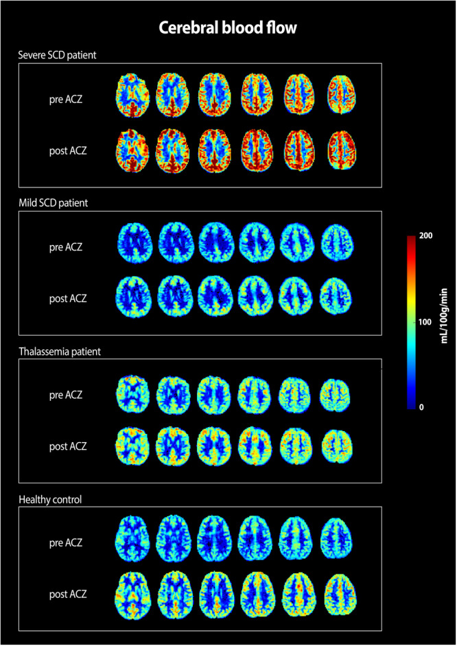
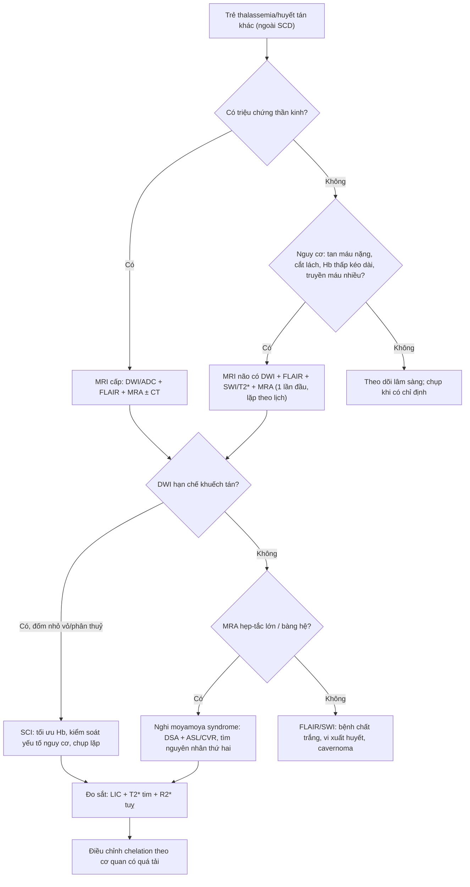
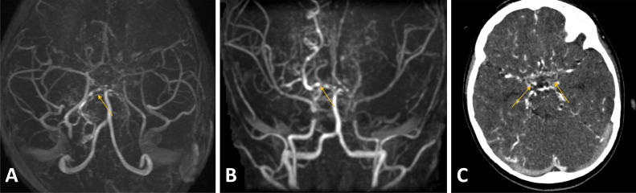
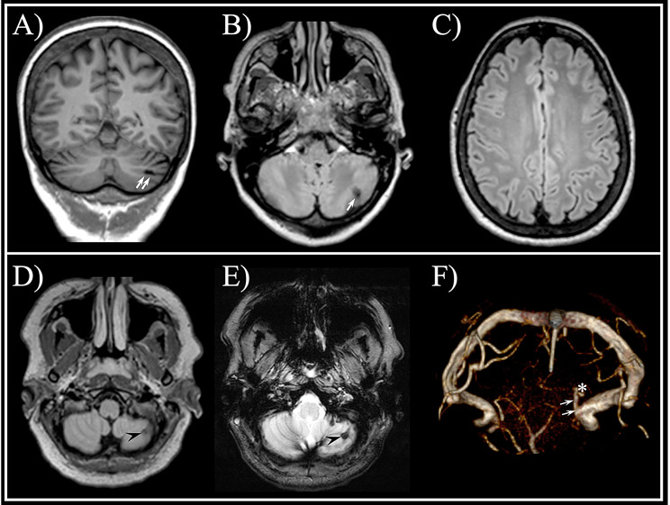

# 682 — Bệnh mạch máu não & quá tải sắt ở thalassemia và huyết tán khác (ngoài hồng cầu hình liềm)

**Tags:** `pattern:nhoi-mau-nao` `pattern:dốm-t2-sao` `vung:nao` `protocol:MRI-T2-sao` `protocol:QSM` `protocol:CVR-acetazolamide` `incidentaloma:dot-quy-im-lang`
**Mức chắc chắn (certainty):** tổng hợp y văn (literature synthesis) — ghép **nghiên cứu tưới máu–chuyển hoá oxy có nhóm chứng** (thalassemia vs hồng cầu hình liềm vs người khoẻ), **ca moyamoya ở β-thalassemia thể nặng**, **thuần tập huyết tán khác (hereditary spherocytosis)** và **nghiên cứu sắt đa cơ quan bằng MRI**; chỗ nguồn mâu thuẫn được ghi rõ.

> **Điểm chốt của bài:** với thalassemia, **não thiếu máu theo cơ chế "lưu lượng cao – chiết xuất oxy thấp"**, chứ **không** theo cơ chế tắc mạch lớn như hồng cầu hình liềm; vì vậy **đột quỵ im lặng (silent cerebral infarct, SCI)** có thể có **mà không có hẹp mạch lớn**, và **moyamoya chỉ là chuyện hiếm** (< 6 ca β-thalassemia thể nặng trong y văn). Ngược lại, **quá tải sắt** là vấn đề **đo được** (T2*/R2*, QSM) nhưng **chưa chứng minh là nguyên nhân đột quỵ**; đừng gộp hai chuyện. Bài này dạy **đọc đúng ba nhóm hình ảnh** (nhồi máu im lặng, dự trữ tưới máu, sắt/dị vật) và **tránh hai lỗi**: bỏ sót SCI và overcall moyamoya.

## 1. Tổng quan bệnh học – cơ chế hình ảnh

### 1.1 Vì sao thalassemia gây bệnh não *khác* hồng cầu hình liềm

- **Thiếu máu mạn → giãn mạch não bù:** nghiên cứu có nhóm chứng (75 SCD nặng, 26 SCD nhẹ, **18 thalassemia**, 30 người khoẻ) cho thấy **CBF cao hơn** ở SCD nặng **và thalassemia** so với SCD nhẹ/người khoẻ (p < 0,05), trong khi **OEF và CMRO₂ thấp hơn** (p < 0,01) ([PMC11610621](https://pmc.ncbi.nlm.nih.gov/articles/PMC11610621/)). Nói cách khác: **não "chạy" bằng lưu lượng lớn nhưng chiết xuất oxy kém hiệu quả** — khác hẳn cơ chế **tắc vi mạch do hồng cầu hình liềm** ([661](../661-dot-quy-hong-cau-hinh-liem-o-tre/lesson.md)).
- **Dự trữ tưới máu cạn dần:** sau **acetazolamide** (chất giãn mạch), **lượng oxy cung cấp tăng ít hơn** ở SCD nặng và thalassemia (p < 0,01) → **CVR giảm**. Đây chính là điều **đo được trên ảnh CBF** (ảnh ca 1) và là nền lý luận cho "não đang ở sát ngưỡng".
- **SCI có ở thalassemia, không chỉ SCD:** SCI **không gây triệu chứng khu trú** nhưng gắn với **học tập kém, chất lượng sống thấp**; tỉ lệ SCI ở trẻ **SCD lên tới 37%** và **tăng theo tuổi** ([PMC11610621](https://pmc.ncbi.nlm.nih.gov/articles/PMC11610621/)). **Lưu ý trung thực:** con số 37% là **của SCD**, **không** phải thalassemia; thể tích SCI trong nghiên cứu **không khác** giữa SCD nhẹ/nặng và thalassemia (p > 0,05) → **không suy ra tỉ lệ cho thalassemia**.
- **Tăng đông (hypercoagulability):** tan máu mạn + **cắt lách** (giảm thanh thải mảnh hồng cầu, tăng tiểu cầu hoạt hoá, tăng kết dính hồng cầu vào nội mô) tạo **trạng thái tiền huyết khối** — đây là lý do **huyết khối tĩnh mạch não (CVST)** và nhồi máu **không do hẹp mạch lớn** vẫn xảy ra ([PMC12751497](https://pmc.ncbi.nlm.nih.gov/articles/PMC12751497/)).
- **Moyamoya ở thalassemia là hiếm:** ca β-thalassemia thể nặng 6 tuổi có moyamoya syndrome — bài gốc ghi **"< 6 ca được ghi nhận"** ([PMC12159822](https://pmc.ncbi.nlm.nih.gov/articles/PMC12159822/)). Vì vậy **thấy hẹp–tắc lớn ở trẻ thalassemia thì phải tìm nguyên nhân thứ hai** (RNF213, xạ trị cũ, bệnh mô liên kết), không mặc định "do thalassemia".

### 1.2 TẠI SAO MRI thấy được sắt và máu cũ (vật lý, không phải khẩu quyết)

- **T2* (gradient-echo) và R2*:** sắt (ferritin/hemosiderin) và **sản phẩm máu cũ** là **chất thuận từ (paramagnetic)** → làm **từ trường cục bộ không đồng nhất** → spin **mất pha nhanh** → **tín hiệu tụt nhanh khi TE tăng** → đo được **R2* = 1000/T2\*** (đơn vị 1/ms) ([PMC13607556](https://www.ebi.ac.uk/europepmc/webservices/rest/PMC13607556/fullTextXML)). **Không** phải "sắt đen" một cách hình thức: **mức tối tỉ lệ với nồng độ sắt** — vì thế T2* **định lượng** được, không chỉ mô tả.
- **QSM (quantitative susceptibility mapping):** dùng **pha** của ảnh gradient-echo để **tách độ cảm từ** → đo **nồng độ sắt** chính xác hơn hình thái, **không bị hiệu ứng "blooming" như SWI** ([PMC10155013](https://pmc.ncbi.nlm.nih.gov/articles/PMC10155013/)). Nhưng QSM **nhạy với khí–xương–mô mềm** ở nền sọ → **cạm bẫy vùng thái dương–hố yên**.
- **DWI/ADC:** nhồi máu **cấp** = **hạn chế khuếch tán** (DWI sáng, ADC tối) do **phù tế bào** làm nước **không khuếch tán tự do**; SCI là **cùng cơ chế nhưng nhỏ, không triệu chứng** → chỉ thấy khi **chủ động tìm** (ảnh ca 2).
- **FLAIR:** tổn thương **mạn/dịch kẽ** (gliosis, white matter hyperintensity) — **không đặc hiệu** cho thiếu máu; ở người huyết tán, **không được quy mọi đốm trắng cho bệnh máu**.

**Ngưỡng định lượng dùng trong bài:**

- **LIC (MRI, theo đường chuẩn Wood):** **≥ 3 mg/g khô** = quá tải sắt gan (PMC13607556).
- **T2\* cơ tim:** **< 20 ms** = quá tải sắt cơ tim có ý nghĩa (PMC13408573, PMC13120626); **R2\* = 1000/T2\*** để chuyển đổi và so sánh giữa các trung tâm (PMC13607556).
- **CBF sau acetazolamide:** tăng **ít hơn** nhóm chứng (p < 0,01) → **CVR giảm** (PMC11610621).
- **OEF và CMRO₂:** **thấp hơn** nhóm chứng ở thalassemia (p < 0,01) → **chiết xuất oxy kém** (PMC11610621).

## 2. Mẫu hình + chẩn đoán phân biệt theo vị trí (gamut)

- **Vỏ não/dưới vỏ, đốm nhỏ hạn chế khuếch tán (DWI sáng/ADC tối), không triệu chứng:** **SCI** — mẫu hình hay gặp nhất ở trẻ thalassemia/SCD; vị trí **phân thuỷ (watershed)** và **vỏ–dưới vỏ**.
- **Chất trắng quanh não thất, FLAIR sáng, không hạn chế khuếch tán:** **white matter hyperintensity** — ở huyết tán **không khác người khoẻ** trong thuần tập HS (49,3% vs 50%, p > 0,05) ([PMC12751497](https://pmc.ncbi.nlm.nih.gov/articles/PMC12751497/)) → **đừng quy cho bệnh máu**.
- **Hẹp–tắc đoạn tận ICA/đa giác Willis, "beaded" + "puff of smoke":** **moyamoya syndrome** — **hiếm** ở thalassemia (< 6 ca), nhưng phải nhận ra vì **đổi hoàn toàn điều trị** ([1780](../1780-chon-ky-thuat-tai-thong-moyamoya-o-tre/lesson.md)).
- **Đốm tối trên T2*/SWI ở vỏ–dưới vỏ, không có phù:** **vi xuất huyết/hemosiderin** (microbleed) hoặc **cavernoma** — phân biệt bằng **hình dạng, bờ, có/không có phù, có/không có "popcorn"**.
- **Nang hóa, teo vùng theo lãnh thổ mạch:** nhồi máu **cũ** (encephalomalacia) — thường là **dấu vết của SCI tích luỹ**.

## 3. Bảng so sánh phân biệt (ma trận đối chiếu)

| Thực thể (entity) | Hình ảnh điển hình | Chốt vào (rule-in) | Chốt loại (rule-out) | Gợi ý xác nhận |
|---|---|---|---|---|
| **SCI do thiếu máu mạn (thalassemia/SCD)** | DWI: đốm **hạn chế khuếch tán** vỏ–dưới vỏ/phân thuỷ, **không triệu chứng**; FLAIR muộn: đốm sáng nhỏ | **DWI+/ADC− nhỏ, không phù, không hiệu ứng khối** | Tổn thương lớn theo lãnh thổ + triệu chứng → **đột quỵ thật**, không phải SCI | MRI **DWI + FLAIR** theo lịch; so sánh lần trước |
| **Moyamoya syndrome (hiếm ở thalassemia)** | MRA/CTA: **hẹp–tắc đoạn tận ICA**, "beaded" đa giác Willis; DSA: **"puff of smoke"**; có thể nhồi máu vỏ | **Hẹp–tắc lớn + mạng bàng hệ nền** | MRA bình thường, không bàng hệ | MRA/CTA **và** DSA khi nghi; ASL/CVR |
| **Vi xuất huyết / hemosiderin** | T2*/SWI: **đốm tối**, không phù; QSM xác nhận **thuận từ** | **Tối trên T2*/SWI + không phù + không ngấm** | Đốm tối có phù/ngấm → **u hoặc ổ viêm** | SWI + T2*; QSM nếu cần |
| **Cavernoma** | T2*/GRE: nhân **"popcorn" hỗn hợp**, viền hemosiderin tối; 3D-venography: **tĩnh mạch dẫn lưu nhỏ** | **Viền hemosiderin hoàn chỉnh + tĩnh mạch dẫn** | Viền không hoàn chỉnh, phù xung quanh → không phải cavernoma điển hình | SWI/T2* + venography; MRI theo dõi |
| **Bệnh chất trắng không đặc hiệu** | FLAIR: đốm quanh não thất, **không hạn chế khuếch tán** | **FLAIR+/DWI−, đối xứng, không tiến triển nhanh** | Có hạn chế khuếch tán hoặc lan nhanh → **nhồi máu/viêm/di truyền** | So sánh với người khoẻ; không quy cho huyết tán |
| **Quá tải sắt (gan/tim/tuỵ)** | MRI: **T2* giảm** (R2* tăng) ở gan/cơ tim/tuỵ; tim: **T2* < 20 ms** | **T2* thấp + bối cảnh truyền máu** | T2* bình thường → không có quá tải tại cơ quan đó | Hiệu chuẩn Wood cho LIC; T2* cơ tim |

*Sáu lát cắt CBF **trước (pre ACZ)** và **sau (post ACZ)** acetazolamide. **SCD nặng**: CBF nền rất cao, **tăng thêm ít** sau ACZ; **thalassemia**: CBF nền cao tương tự SCD nặng nhưng **mức tăng sau ACZ thấp**; **SCD nhẹ** và **người khoẻ**: CBF nền thấp hơn, **tăng rõ** sau ACZ. Thang 0–200 mL/100 g/phút. Nguồn: Afzali-Hashemi L et al., HemaSphere 2024, PMC11610621 — **CC BY-NC-ND** (giữ nguyên bản, không cắt/ghép).*

## 4. Protocol chụp + hệ phân độ/điểm chuẩn hóa

### 4.1 Bộ MRI não "tầm soát thiếu máu" (tối thiểu, không cản quang)

1. **DWI + ADC** (b=1000) — **chốt SCI cấp**; **FLAIR** trục — tổn thương mạn; **SWI hoặc T2\*** — máu cũ/sắt; **T1** — giải phẫu.
2. **MRA TOF (hoặc CTA nếu có chống chỉ định MRI)** — tầm soát **hẹp–tắc lớn/moyamoya**; đọc cả **source images**.
3. **ASL (hoặc CTP/MR perfusion)** khi nghi giảm dự trữ; **acetazolamide** chỉ dùng trong nghiên cứu/chọn lọc vì cần quy trình giãn mạch có kiểm soát.
4. **TCD** (đặc biệt SCD): đo **vận tốc dòng MCA** — công cụ **sàng lọc** chuẩn ở SCD; với thalassemia **chưa có ngưỡng được xác lập** (ghi "chưa rõ"), **không** áp ngưỡng của SCD.

### 4.2 Bộ MRI sắt đa cơ quan (khi có truyền máu/chelation)

| Cơ quan | Chuỗi | Ngưỡng hành động |
|---|---|---|
| **Gan** | R2* → **LIC theo đường chuẩn Wood** | **≥ 3 mg/g khô** = quá tải; theo dõi xu hướng |
| **Cơ tim** | T2* đa echo, lát giữa thất | **< 20 ms** = quá tải có ý nghĩa; **thấp hơn nữa = nguy cơ suy tim** |
| **Tuỵ** | R2* | Tăng R2* = sắt tuỵ, gắn với **đái tháo đường** |
| **Não** | R2*/QSM/SWI | **Chưa có ngưỡng lâm sàng** — dùng để nghiên cứu, **không** dùng để quyết định chelation |

**Lý do "não chưa có ngưỡng":** tổng quan về sắt não ở β-thalassemia nêu R2/R2*, SWI, QSM **đo được** sắt não và **liên quan nhận thức**, nhưng **chưa có cut-off được chấp nhận** ([PMC10155013](https://pmc.ncbi.nlm.nih.gov/articles/PMC10155013/)) → **không bịa ngưỡng**.

### 4.3 Vì sao **không** chụp MRI não hàng loạt cho mọi bệnh nhân thalassemia

- **Chưa có bằng chứng** rằng phát hiện SCI rồi thay đổi điều trị (tăng Hb mục tiêu, thêm thuốc) **cải thiện kết cục** ở thalassemia; ở SCD có chương trình riêng (TCD + truyền máu), **không chuyển nguyên khối** sang thalassemia.
- **Nguy cơ overcall:** thuần tập **hereditary spherocytosis** (190 bệnh nhân; 69 người chụp MRI so với 56 chứng) **không** thấy tăng hẹp mạch, **không** moyamoya, **không** tăng nhồi máu chất xám, **không** tăng white matter lesion so với chứng (p > 0,05) ([PMC12751497](https://pmc.ncbi.nlm.nih.gov/articles/PMC12751497/)) → **y văn ca bệnh làm bệnh trông nặng hơn thực tế**; đừng "khám cả não" cho mọi huyết tán.

## 5. Biến thể bình thường và cạm bẫy

- **T2* tối không phải lúc nào cũng là sắt:** **vôi hóa**, **khí trong xoang**, **xương nền sọ**, **kim loại/artifact** đều làm tối tín hiệu; **QSM** giúp phân biệt **thuận từ (sắt/máu)** vs **nghịch từ (vôi hóa)**.
- **"Puff of smoke" giả:** mạng mạch bàng hệ **bẩm sinh** hoặc **ống thông**; phải có **hẹp–tắc tiến triển đoạn tận ICA** mới gọi moyamoya.
- **SCI chỉ thấy khi có DWI:** nếu chỉ chụp FLAIR, **bỏ sót SCI cấp**; ngược lại **FLAIR đốm trắng đơn độc** không đủ gọi SCI.
- **Cavernoma "nhỏ" trên T2\***: viền hemosiderin **không hoàn chỉnh** → không phải cavernoma; theo dõi, đừng mổ.
- **Cạm bẫy nguồn:** con số SCI **37% là của SCD trẻ**, **không** phải thalassemia; **T2* < 20 ms** là ngưỡng **cơ tim**, **không** dùng cho não.
- **Bẫy lâm sàng:** trẻ thalassemia **đau đầu + thiếu máu** → đừng mặc định "do thiếu máu"; **huyết khối xoang (CVST)** có thể là nguyên nhân và **cần MRV/CTV**.

*Bé gái 6 tuổi β-thalassemia thể nặng, yếu nửa người trái: (A) T1 **iso–giảm**, (B) T2 **iso–tăng** vùng vỏ chẩm trái (mũi tên) với **(C) hạn chế khuếch tán trên DWI** và **(D) ADC tối** = **nhồi máu cấp**; **tăng tín hiệu T1 theo dải vỏ (gyral)** ở thuỳ chẩm trái (đầu mũi tên) = **hoại tử tầng (laminar necrosis)** của lần thiếu máu trước. Nguồn: Radiol Case Rep 2025, PMC12159822 — CC BY 4.0.*

## 6. Tự lượng giá — Blind Quiz (ảnh trơn ngoài, đáp án ẩn trong khối chi tiết)

**Ca 1 — Bốn bản đồ CBF (6 lát cắt, trước và sau acetazolamide) của bốn nhóm: SCD nặng, SCD nhẹ, thalassemia, người khoẻ. Nhóm nào "cạn dự trữ" và vì sao?**

- Gợi ý: đọc **màu nền (pre)** trước, rồi **mức tăng khi sang post**.
- Câu hỏi: Nhóm nào có CBF nền cao nhất? Nhóm nào tăng ít nhất sau ACZ? Điều đó nói gì về **dự trữ tưới máu**?

<b>Bấm để hiện đáp án (findings + chẩn đoán)</b>

- **Dấu hiệu:** **SCD nặng** và **thalassemia** có **CBF nền cao** (đỏ/cam nhiều); sau ACZ **tăng ít**. **SCD nhẹ** và **người khoẻ** có CBF nền thấp hơn (xanh), **tăng rõ** sau ACZ.
- **Chẩn đoán:** **giảm dự trữ tưới máu (CVR)** ở SCD nặng và thalassemia — mạch đã giãn gần tối đa để bù thiếu máu, nên **không còn "dư địa"** khi bị stress.
- **Cơ chế:** thiếu máu mạn → CBF cao, **OEF/CMRO₂ thấp**; khi cần tăng cung cấp oxy, **mức tăng bị chặn** (p < 0,01 so nhóm khác).
- **Ý nghĩa:** đây là nền để hiểu **SCI xuất hiện dù không hẹp mạch lớn**; và là lý do **không** dùng ngưỡng TCD của SCD cho thalassemia.
- Nguồn ảnh: Afzali-Hashemi L et al., HemaSphere 2024 (PMC11610621), Fig. 1 — **CC BY-NC-ND** (nguyên bản).

**Ca 2 — Bé gái 6 tuổi β-thalassemia thể nặng, yếu nửa người trái. Đọc 4 chuỗi: tổn thương cấp hay cũ, ở đâu, và dấu hiệu nào cho biết đã có lần thiếu máu trước đó?**

- Gợi ý: so sánh **(C) DWI** với **(D) ADC**; chú ý thêm dải tăng tín hiệu **T1 ở vỏ não**.
- Câu hỏi: Tổn thương **hạn chế khuếch tán** nằm ở đâu? Vì sao nói có **thiếu máu từ trước**? Chẩn đoán phân biệt?

<b>Bấm để hiện đáp án (findings + chẩn đoán)</b>

- **Dấu hiệu:** vùng vỏ **chẩm trái**: T1 iso–giảm, T2 iso–tăng, **DWI sáng + ADC tối** = **hạn chế khuếch tán** → **nhồi máu cấp**. Kèm **tăng tín hiệu T1 dạng dải theo vỏ (gyral)** = **hoại tử tầng** của lần thiếu máu **trước**.
- **Chẩn đoán:** **nhồi máu não cấp** trên nền β-thalassemia thể nặng; ca gốc chẩn đoán **moyamoya syndrome** (MRA "beaded" + "puff of smoke" — ca 3).
- **Vì sao quan trọng:** trẻ thalassemia có triệu chứng khu trú **phải chụp cấp** — SCI không triệu chứng là chuyện khác; và **dấu hiệu cũ** (laminar necrosis) chứng tỏ **đã có thiếu máu não trước đó mà không được ghi nhận**.
- Nguồn ảnh: Radiol Case Rep 2025 (PMC12159822), Fig. 1 — CC BY 4.0.

**Ca 3 — Cùng bệnh nhi trên: MRA 3D trục (A) và coronal (B), rồi CTA trục (C). Mô tả bất thường mạch và gọi tên dấu hiệu.**

- Gợi ý: nhìn **đường viền mạch** (có "chuỗi hạt" không) và **đám mạch nhỏ ở nền não**.
- Câu hỏi: Dấu hiệu "beaded" nằm ở đâu? "Puff of smoke" là gì? Vì sao đây là **moyamoya syndrome** chứ không phải moyamoya disease?

<b>Bấm để hiện đáp án (findings + chẩn đoán)</b>

- **Dấu hiệu:** **đa giác Willis "beaded"** (đầu mũi tên) + **mạng bàng hệ dày đặc ở nền não** ("puff of smoke", mũi tên trên CTA).
- **Chẩn đoán:** **moyamoya syndrome** — vì có **bệnh nền (β-thalassemia thể nặng)**; "moyamoya disease" chỉ dùng khi **vô căn**.
- **Vì sao hiếm nhưng phải nhớ:** β-thalassemia + moyamoya **< 6 ca** trong y văn → gặp là **bất thường cần tìm nguyên nhân thứ hai**; nhưng khi có thì **điều trị tái thông** (bài 1780), không chỉ truyền máu.
- Nguồn ảnh: Radiol Case Rep 2025 (PMC12159822), Fig. 2 — CC BY 4.0.

**Ca 4 — Bệnh nhân hereditary spherocytosis: (A,B) T1/FLAIR có ổ nhồi máu nhỏ ở tiểu não trái; (D,E,F) một tổn thương khác — trên T2* **tối rõ** và có **tĩnh mạch dẫn**. Hai tổn thương này khác nhau thế nào về bản chất?**

- Gợi ý: tổn thương ở hàng dưới **tối trên T2*** nhưng **không có phù**; chú ý **(F)**.
- Câu hỏi: Vì sao tổn thương hàng dưới tối trên T2*? Dấu hiệu nào xác nhận **cavernoma**? Vì sao **không** kết luận "huyết tán gây bệnh mạch máu nặng"?

<b>Bấm để hiện đáp án (findings + chẩn đoán)</b>

- **Dấu hiệu:** hàng trên — **ổ nhồi máu vỏ tiểu não trái nhỏ** (T1/FLAIR), không tổn thương khác trên FLAIR trên lều. Hàng dưới — tổn thương vỏ tiểu não **tối rõ trên T2*** do **hemosiderin**, **(F) 3D-venography** thấy **tĩnh mạch dẫn nhỏ** xuất phát từ tổn thương → **cavernoma**.
- **Vì sao T2* tối:** hemosiderin **thuận từ** → mất pha nhanh → tín hiệu tụt; đây là **vật lý**, không phải "u ác".
- **Vì sao không overcall:** thuần tập 190 bệnh nhân HS (MRI 69 vs 56 chứng) **không** tăng hẹp mạch, moyamoya, nhồi máu hay white matter lesion so với chứng → **ca bệnh đơn lẻ ≠ tỉ lệ quần thể**.
- Nguồn ảnh: Orphanet J Rare Dis 2025 (PMC12751497), Fig. 1 — CC BY 4.0.

## Bài liên quan chéo
- [661 – Đột quỵ do hồng cầu hình liềm ở trẻ](../661-dot-quy-hong-cau-hinh-liem-o-tre/lesson.md) — cơ chế tắc vi mạch, TCD, truyền máu.
- [652 – Đột quỵ & bệnh mạch máu não ở trẻ (moyamoya, FCA, viêm mạch, CVST)](../652-dot-quy-mach-mau-nao-nhi-moyamoya-viem-mach/lesson.md) — chẩn đoán mạch lớn.
- [1780 – Chọn kỹ thuật tái thông moyamoya ở trẻ](../1780-chon-ky-thuat-tai-thong-moyamoya-o-tre/lesson.md) — khi đã có moyamoya syndrome.
- [660 – Theo dõi sau tái thông moyamoya ở trẻ](../660-theo-doi-sau-tai-thong-moyamoya-o-tre/lesson.md) — CHS, Matsushima.
- [453 – Bệnh võng mạc tăng huyết áp và thiếu máu](../453-benh-vong-mac-tang-huyet-ap-va-thieu-mau/lesson.md) — tổn thương cơ quan đích do thiếu máu/tăng huyết áp.
- [242 – PACNS duy trì & theo dõi](../242-pacns-duy-tri-theo-doi/lesson.md) — phân biệt viêm mạch với bệnh mạch máu do bệnh máu.

## Ảnh
- `682_thalassemia_CBF-acetazolamide_PMC11610621-Fig1-CCBY-NC-ND.jpg` — CBF trước/sau acetazolamide (SCD nặng/nhẹ, thalassemia, chứng), **CC BY-NC-ND** (nguyên bản).
- `682_thalassemia_DWI_PMC12159822-Fig1-nhoi-mau-cap-CCBY.jpg` — nhồi máu cấp vỏ chẩm + hoại tử tầng cũ, CC BY 4.0.
- `682_thalassemia_MRA_PMC12159822-Fig2-puff-of-smoke-CCBY.jpg` — MRA/CTA "beaded" + "puff of smoke", CC BY 4.0.
- `682_huyet-tan_MRI_PMC12751497-Fig1-nhoi-mau-cavernoma-CCBY.jpg` — nhồi máu nhỏ vs cavernoma (T2*, venography) ở HS, CC BY 4.0.
- Nguồn + giấy phép từng ảnh: `images/CREDITS.md`.

> **Disclaimer:** Bài học dành cho mục đích học tập, không dùng để chẩn đoán độc lập khi chưa có bác sĩ chuyên khoa hướng dẫn. Ngưỡng Hb mục tiêu, chỉ định truyền máu/chelation và thuốc chống đông phải theo phác đồ huyết học tại cơ sở.
