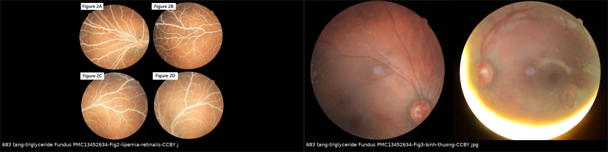
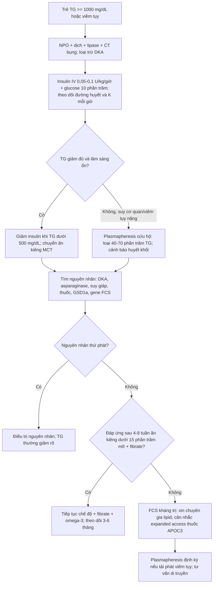
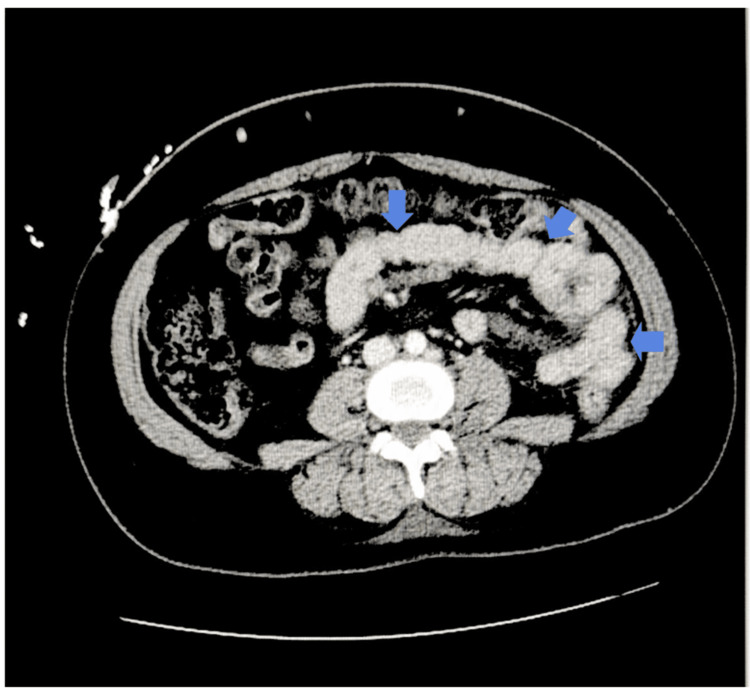
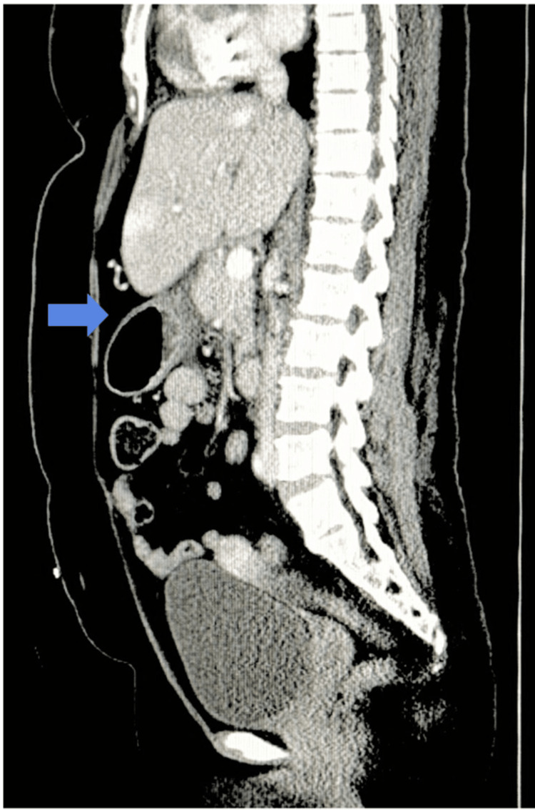
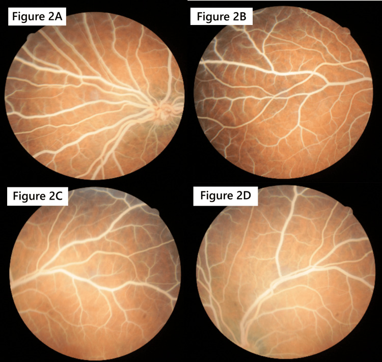
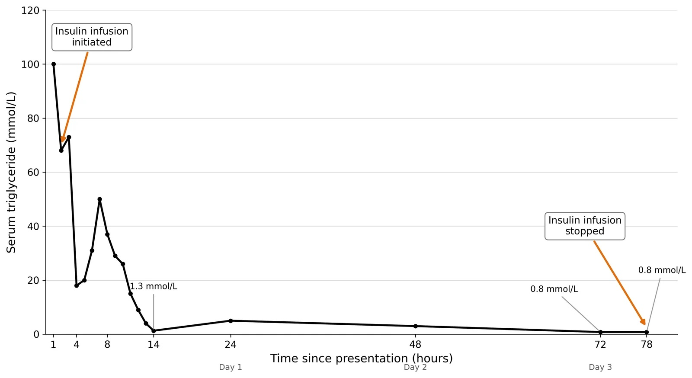
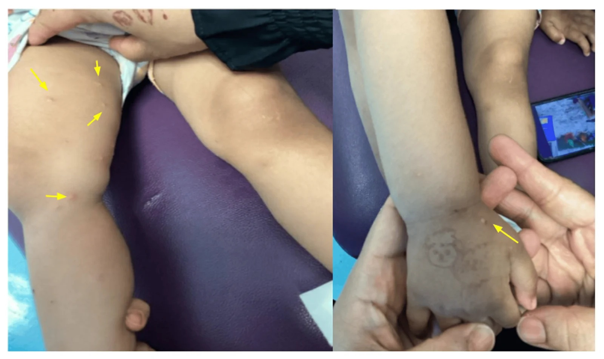

# 683 — Tăng triglyceride kháng trị ở trẻ: fibrate/omega-3, ức chế PCSK9, olezarsen (siRNA APOC3), liệu pháp gen LPL & khi nào lặp plasmapheresis

**Tags:** `pattern:tang-triglyceride` `pattern:viem-tuy-cap` `pattern:hoang-diem-lipid` `vung:tuy` `vung:vong-mac` `score:Endocrine-Society-TG` `protocol:CT-bung` `protocol:MRCP` `incidentaloma:khong`
**Mức chắc chắn (certainty):** tổng hợp y văn (literature synthesis) — ghép ca nguyên văn (verbatim case) có PMCID với tổng quan điều trị; **phần lớn thuốc mới (olezarsen, volanesorsen, plozasiran, liệu pháp gen) CHƯA có chỉ định ở trẻ < 18 tuổi** — chỗ nào là ngoại suy/kinh nghiệm trung tâm đều ghi rõ.

> **Điểm chốt của bài:** "kháng trị" là **một tuyên bố cần chứng minh**, không phải cảm giác. Trước khi leo thang sang thuốc đắt tiền, phải trả lời 3 câu: **(1) đã loại nguyên nhân thứ phát chưa?** (ĐTĐ/DKA, asparaginase, suy giáp, thuốc, béo phì); **(2) bệnh nhi có thật sự ăn < 10–15% calo từ mỡ và tuân thủ không?**; **(3) TG đang ở mức nào theo phân độ tuổi?** Chỉ khi (1)–(3) rõ ràng mới gọi là kháng trị — và khi đó, **thứ tự leo thang là: insulin (cấp) → plasmapheresis (cứu hộ) → thuốc hạ TG dài hạn → thuốc nhắm đích RNA/liệu pháp gen**.

## 1. Tổng quan bệnh học – cơ chế hình ảnh

### 1.1 Con đường chylomicron và chỗ "tắc" sinh lý

Triglyceride (TG) ngoại sinh đi từ ruột dưới dạng **chylomicron** (lõi TG, vỏ phospholipid + apoB-48). Tại mao mạch mô mỡ/cơ, **lipoprotein lipase (LPL)** — do tế bào nội mô sản xuất, neo vào mặt trong lòng mạch nhờ **GPIHBP1** — thủy phân TG thành acid béo tự do. LPL cần **apoC-II** làm cofactor, bị **apoC-III** ức chế, và bị **ANGPTL3/4/8** điều hòa ngược. Bất kỳ mắt xích nào trong chuỗi **LPL – APOC2 – APOA5 – GPIHBP1 – LMF1** hỏng (thể **hai alen**, autosomal recessive) → **hội chứng chylomicronemia gia đình (familial chylomicronemia syndrome, FCS)**: TG thường **> 1.500 mg/dL**, có thể **> 15.000 mg/dL** (Ismail AZ, Cureus 2026, PMC13452634).

- **Vì sao trẻ sơ sinh đã biểu hiện:** chylomicron xuất hiện ngay sau bữa ăn đầu tiên; trẻ bú mẹ/sữa công thức giàu mỡ → TG tăng vọt trong **vài tuần đầu** (ca 36 ngày tuổi: TG **2.742,2 mg/dL**; ca 21 tháng: **~8.850 mg/dL ≈ 100 mmol/L** — PMC13452634, PMC13544194).
- **Vì sao "kháng trị" hay gặp ở FCS:** thiếu hụt LPL hoàn toàn thì **fibrate (tăng biểu hiện LPL) và statin (tăng thanh thải LDL) gần như vô hiệu** — không có enzym để hoạt hóa. Đây là lý do sinh học khiến FCS **không đáp ứng** thuốc hạ lipid thông thường, khác hẳn tăng TG đa yếu tố.

### 1.2 TẠI SAO TG rất cao gây viêm tụy

Hai cơ chế phối hợp, giải thích được cả hình ảnh lẫn xét nghiệm:

1. **Cơ học–huyết động:** chylomicron là hạt rất lớn (đường kính ~75–1.200 nm) → **tăng độ nhớt** máu trong mao mạch tụy, gây **thiếu máu cục bộ** đầu tụy và toan nội bào.
2. **Hóa học:** LPL tại tụy thủy phân TG thành **acid béo tự do** nồng độ cao → tổn thương màng ty thể tế bào nang tụy → hoạt hóa trypsinogen → **viêm tụy tự tiêu**.

Hệ quả **trên hình ảnh và xét nghiệm** (rất dễ đọc sai):
- **CT:** tụy **phù, đồng đậm/tăng nhẹ**, **dịch và mỡ quanh tụy** (peripancreatic stranding/fluid) — hình thái **viêm tụy kẽ cấp (interstitial edematous pancreatitis)**; hoại tử tụy **không thấy sớm** (cần cản quang và thường **≥ 72 giờ** mới rõ).
- **Siêu âm:** tụy to, giảm âm, có thể **bị che khuất hoàn toàn bởi hơi ruột** → **siêu âm bình thường KHÔNG loại trừ viêm tụy**.
- **Máu "trắng sữa":** huyết thanh đục do tán xạ ánh sáng của chylomicron → **sai lệch nhiều xét nghiệm**: **hạ natri giả** (pseudohyponatremia), **Hb/hématocrit sai**, **amylase có thể bình thường hoặc thấp giả**, đông máu khó đo. Đây là lý do phải **ly tâm và pha loãng** đúng, và **không tin một xét nghiệm đơn lẻ**.

### 1.3 TẠI SAO võng mạc trắng (lipemia retinalis) — vật lý thuần túy

Mạch võng mạc là mạch **nông, thành mỏng, không có lớp myelin**; khi lòng mạch đầy chylomicron, các hạt lớn **tán xạ ánh sáng** (tán xạ Mie cho hạt ~ bước sóng) → mạch máu hiện **trắng sữa** trên nền võng mạc hồng cá hồi.

- **Ngưỡng:** triệu chứng xuất hiện khi TG **> ~1.500 mg/dL**; khi **≥ ~5.000 mg/dL**, mạch trắng như kem, **không phân biệt được động mạch với tĩnh mạch** (chỉ còn khác về đường kính) — Ismail AZ, Cureus 2026 (PMC13452634).
- **Ý nghĩa lâm sàng:** **không gây mù ngay** và **hồi phục hoàn toàn** khi TG giảm (ca 36 ngày tuổi: TG 2.742 → 499,6 mg/dL sau 3 tháng, đáy mắt trở lại bình thường — xem ảnh ghép mục 3). Vì vậy đáy mắt là **dấu hiệu chỉ điểm rẻ tiền** của TG cực cao, không phải bệnh lý mắt nguyên phát.

### 1.4 Ngưỡng định lượng bắt buộc nhớ (theo tuổi)

**Phân độ theo khuyến cáo Endocrine Society** (trích trong Spoială EL, J Clin Med 2026, PMC12842282, Bảng 2):

- **0–9 tuổi (mg/dL):** bình thường **< 75** · ranh giới 75–99 · cao 100–499 · rất cao 500–999 · **nặng 1.000–1.999** · **rất nặng ≥ 2.000**.
- **10–19 tuổi (mg/dL):** bình thường **< 90** · ranh giới 90–129 · cao 130–499 · rất cao 500–999 · **nặng 1.000–1.999** · **rất nặng ≥ 2.000**.

**Ngưỡng xử trí:**

- **TG ≥ 500 mg/dL (5,6 mmol/L):** "tăng TG nặng" — bắt đầu tầm soát nguyên nhân & điều trị (PMC12842282; PMC13553409).
- **TG > 1.000 mg/dL (11,3 mmol/L):** **nguy cơ viêm tụy ~5%**; thường là bệnh lý lipid **nguyên phát/di truyền** (PMC12842282).
- **TG > 2.000 mg/dL (22,6 mmol/L):** **nguy cơ viêm tụy 10–20%** (PMC12842282).
- **TG > 1.500 mg/dL:** ngưỡng xuất hiện **lipemia retinalis**; **≥ 5.000 mg/dL**: mạch võng mạc trắng kem, mất phân biệt ĐM–TM (PMC13452634).
- **TG > 5,6 mmol/L kéo dài trong DKA:** trong loạt 21 trẻ, đây là mốc theo dõi để cân nhắc **plasmapheresis** khi insulin không đủ nhanh (Liu M, PMC13553409).

## 2. Mẫu hình + chẩn đoán phân biệt theo cơ chế (Gamut)

- **Nhóm 1 — Khiếm khuyết thanh thải chylomicron (nguyên phát, monogenic):** FCS (LPL, APOC2, APOA5, GPIHBP1, LMF1), **GSD1a** (tăng TG do tăng sinh VLDL + giảm ly giải), hội chứng chylomicronemia **đa yếu tố** (MCS — nhiều gen nguy cơ + béo phì/ĐTĐ/rượu; hay gặp ở người lớn, trẻ béo phì).
- **Nhóm 2 — Thứ phát (phải loại trước khi gọi "kháng trị"):** **DKA/ĐTĐ kiểm soát kém** (ức chế LPL do thiếu insulin), **asparaginase/pegaspargase** trong ALL, **corticoid**, thiazide, isotretinoin, sirolimus, estrogen, **suy giáp**, **hội chứng thận nhiễm mỡ**, béo phì/kháng insulin.
- **Nhóm 3 — "Kháng trị giả":** không tuân thủ chế độ **< 10–15% calo từ mỡ**, còn ăn mỡ ẩn, dùng dầu MCT không đúng, **bỏ thuốc**, hoặc **lấy mẫu TG không lúc đói**.
- Gợi nhớ **"CHYLO":** **C**hylomicronemia monogenic (FCS) — **H**ormone (suy giáp, ĐTĐ/DKA) — **Y**oung obese (MCS) — **L**iver (GSD1a, thận nhiễm mỡ) — **O**ther drugs (asparaginase, corticoid, thiazide, isotretinoin).

## 3. Bảng so sánh phân biệt (ma trận đối chiếu)

| Thực thể (entity) | Hình ảnh / xét nghiệm điển hình | Chốt vào (rule-in) | Chốt loại (rule-out) | Gợi ý xác nhận |
|---|---|---|---|---|
| **FCS (monogenic)** | TG **> 1.500**, thường **> 2.000** ngay từ nhũ nhi; **huyết thanh trắng sữa**, **lipemia retinalis**, **xanthoma ban dạng sẩn**, **gan–lách to**; CT: viêm tụy kẽ tái diễn | **TG rất cao từ nhỏ + không đáp ứng fibrate/statin + di truyền lặn + đột biến LPL/APOC2/APOA5/GPIHBP1/LMF1** | TG chỉ tăng khi béo phì/ĐTĐ và **giảm rõ khi điều trị nguyên nhân** → MCS/thứ phát | Gene panel lipid; thử đáp ứng sau 4–8 tuần ăn kiêng nghiêm |
| **MCS (đa yếu tố)** | TG **500–2.000**, thiếu hụt LPL **một phần**, béo phì/kháng insulin; ít xanthoma | **TG tăng vừa–nặng + béo phì/ĐTĐ + đáp ứng một phần với ăn kiêng/fibrate** | TG **> 2.000** từ nhũ nhi, không đáp ứng gì → nghĩ FCS | Cân nặng, HbA1c, insulin; gene panel âm |
| **Tăng TG do DKA** | Đường huyết cao, toan ceton; TG **> 11,3 mmol/L**; tụy có thể chưa viêm | **DKA + TG > 11,3 mmol/L**; giảm nhanh khi truyền insulin | TG vẫn cao sau khi hết toan ceton → nguyên nhân lipid độc lập | Khí máu, ceton; theo dõi TG sau 24–48 giờ |
| **Tăng TG do asparaginase (ALL)** | TG tăng trong/ngay sau đợt truyền; thường **không triệu chứng**; có thể viêm tụy | **TG tăng theo mốc truyền asparaginase + giảm khi ngừng** | TG cao ngoài đợt truyền → tìm nguyên nhân khác | TG trước–trong–sau mỗi đợt (xem BACKLOG: bài riêng) |
| **GSD1a** | **Gan to**, hạ đường huyết lúc đói, acid lactic cao, TG rất cao **kháng trị** | **Hạ glucose + lactate cao + gan to + TG cao** | TG cao không kèm hạ glucose/lactate → không phải GSD1a | Glucose/lactate, siêu âm gan, xét nghiệm enzym |
| **"Kháng trị giả" (kém tuân thủ)** | TG dao động, **giảm mạnh đột ngột khi nhập viện** rồi tăng lại khi về nhà | **TG giảm > 50% chỉ sau khi nhập viện/ăn kiêng** | TG vẫn cao dù đã kiểm soát chế độ 4–8 tuần | Nhật ký ăn, phỏng vấn dinh dưỡng, hỏi thuốc |

*Trái: đáy mắt lúc 36 ngày tuổi — TG 2.742,2 mg/dL, mạch võng mạc trắng sữa, gai thị nhạt. Phải: sau 1 tháng chế độ MCT + giảm mỡ — TG 499,6 mg/dL, mạch và gai thị trở lại bình thường. Nguồn: Ismail AZ, Cureus 2026 (PMC13452634), Fig. 2 & 3, CC BY 4.0; ghép letterbox bằng `tools/make_composite.py`.*

## 4. Protocol điều trị + phân độ + sơ đồ quyết định

### 4.1 Cấp cứu: hạ TG nhanh (khi TG ≥ 1.000 mg/dL hoặc có viêm tụy)

1. **Nhịn ăn (NPO)** + bù dịch; đánh giá lại **đau bụng, lipase, CT** (viêm tụy kẽ).
2. **Insulin truyền tĩnh mạch liên tục 0,05–0,1 U/kg/giờ** + **glucose 10%** (kỹ thuật "two-bag") để giữ đường huyết bình thường; theo dõi **glucose và kali mỗi giờ**. Insulin hoạt hóa LPL và ức chế ly giải mỡ ở mô mỡ.
   - Hiệu quả định lượng: **0,1 U/kg/giờ** → TG giảm **55% sau 24 giờ, 76% sau 48 giờ, 82% sau 96 giờ** (trẻ 11 tuổi, TG > 4.000 mg/dL; không hạ đường huyết) — Spoială EL, J Clin Med 2026 (PMC12842282).
   - Ca 21 tháng: TG **100 mmol/L → 1,3 mmol/L trong 14 giờ** — Chan SYC, Cureus 2026 (PMC13544194).
   - **Ngừng insulin** khi TG **< 500 mg/dL (5,6 mmol/L)**, giảm liều dần trong **24–48 giờ** — không ngắt đột ngột (TG "bật lại" đã ghi nhận trên biểu đồ).
3. **Plasmapheresis (trao đổi huyết tương) — cứu hộ, không phải tuyến đầu:** loại bỏ **40–70% TG** trong một lần; chỉ định khi **kháng insulin, suy cơ quan, viêm tụy nặng/đa cơ quan**. Kinh nghiệm nhi **rất hạn chế**.
   - **Cảnh báo định lượng:** trong loạt 21 trẻ DKA có TG nặng, **7 trẻ được plasmapheresis** (nhóm này đạt TG < 5,6 mmol/L nhanh hơn) nhưng **4/7 trẻ xuất hiện huyết khối tĩnh mạch** — Liu M, Front Endocrinol 2026 (PMC13553409). Đây là lý do **không** dùng plasmapheresis đại trà.
   - **Lặp lại:** không có phác đồ chuẩn ở trẻ. Ở người lớn FCS kháng trị, mô hình đã báo cáo là **plasmapheresis định kỳ hằng tuần, tăng lên 2 lần/tuần** khi TG vẫn cao, qua catheter trung tâm — Ahmad CM, Cureus 2026 (PMC13094452). Với trẻ, quyết định theo **TG trước mỗi lần + số cơn viêm tụy**, không theo lịch cứng.

### 4.2 Dài hạn: chế độ ăn là nền, thuốc là bổ trợ

| Can thiệp | Ngưỡng/liều ở trẻ | Ghi chú |
|---|---|---|
| **Hạn chế mỡ** | **< 10–15% calo (~10–20 g mỡ/ngày)** trong FCS; bổ sung **acid béo thiết yếu** và **vitamin tan mỡ** | Theo dõi suy dinh dưỡng/thiếu EFA — biến chứng của chính điều trị |
| **Dầu MCT** | MCT đi thẳng tĩnh mạch cửa, **không tạo chylomicron** → nguồn năng lượng an toàn | Ca 21 tháng và ca 11 tuổi đều dùng công thức giàu MCT |
| **Fibrate** | **Gemfibrozil 70 mg/kg/ngày** (nhũ nhi 2 tháng); **900 mg/ngày** (15 tuổi); fenofibrate chỉ dùng cùng chuyên gia lipid | "Dùng ở trẻ em chỉ với sự hỗ trợ của chuyên gia lipid" (PMC12842282, Bảng 4) |
| **Omega-3** | Người lớn **2–4 g/ngày**; trẻ chỉ có nghiên cứu nhỏ/ca lẻ | Không phải "thuốc chữa FCS"; hiệu quả hạn chế trong FCS |
| **Statin** | **Không khởi trị trước 10 tuổi** trừ nguy cơ rất cao | Chủ yếu hạ LDL; vai trò trong TG hạn chế |
| **Ức chế PCSK9** | **Evolocumab ≥ 10 tuổi** (HeFH/HoFH), **140 mg dưới da mỗi 2 tuần** hoặc **420 mg mỗi 4 tuần**; **alirocumab ≥ 8 tuổi** | Chỉ định là **tăng cholesterol**, không phải TG; tác dụng hạ TG **khiêm tốn** — Đồng thuận EAS 2026 (PMC13337236) |

### 4.3 Thuốc nhắm đích RNA & liệu pháp gen: **hiện chưa có chỉ định cho trẻ**

| Thuốc | Cơ chế | Hiệu quả định lượng | Trạng thái ở trẻ |
|---|---|---|---|
| **Olezarsen** | ASO gắn mRNA **APOC3** ở gan → giảm apoC-III → giải phóng LPL | Thử nghiệm **Balance** (FCS, 80 mg mỗi 4 tuần): TG **−43,5%** so với placebo ở 6 tháng; **giảm 88% cơn viêm tụy cấp** — Soran H, J Comp Eff Res 2026 (PMC13329855) | **Chỉ định cho NGƯỜI LỚN FCS** — **chưa có dữ liệu < 18 tuổi** |
| **Volanesorsen** | ASO APOC3 thế hệ trước | Giảm TG **> 70%**, giảm viêm tụy; **giảm tiểu cầu** là độc tính chính | **"Safety and efficacy in < 18s not established"** (PMC12842282, Bảng 5) |
| **Plozasiran (ARO-APOC3)** | **siRNA** APOC3 | Đang phát triển, giảm TG mạnh, hồ sơ an toàn thuận lợi | **Thử nghiệm/người lớn** |
| **Evinacumab** | Kháng thể **ANGPTL3** | Hạ TG và LDL không phụ thuộc thụ thể LDL | Duyệt cho **HoFH ≥ 5 tuổi** — **không** có chỉ định cho tăng TG đơn thuần |
| **Lomitapide** | Ức chế **MTP** | Hạ LDL | **Chưa xác lập < 18 tuổi** |
| **Alipogene tiparvovec (Glybera)** | **AAV1** chuyển gen **LPL-S447X** vào cơ | Giảm TG **~60%**, giảm cơn viêm tụy; **một nửa** bệnh nhân đạt mức giảm ≥ 40% ở tuần 3–12, sau đó TG **quay về nền** — Gaudet D, Gene Ther 2013 (PMC4956470) | **Duyệt EMA 2012, RÚT KHỎI thị trường châu Âu 2017** vì chi phí/vector; thế hệ mới **AAV8 pVR59** cần liều thấp hơn **10–100 lần** — Gurevitz C, Eur Heart J 2025 (PMC12448413) |

> **Cách nói với gia đình (trung thực):** với FCS, **hiện tại ở trẻ** chỉ có ăn kiêng + MCT + fibrate ± omega-3 ± insulin khi cấp; **các thuốc RNA và liệu pháp gen là của người lớn/tương lai**, có thể xin **chương trình mở rộng tiếp cận (expanded access)** nhưng không được trình bày như điều trị chuẩn.

## 5. Biến thể bình thường và cạm bẫy

- **"Hạ natri" giả:** TG rất cao làm **giảm tỉ lệ nước trong huyết tương** → natri đo bằng phương pháp gián tiếp **thấp giả**. Truyền natri ưu trương theo con số này là sai nguy hiểm.
- **Amylase/lipase "bình thường" không loại trừ viêm tụy** trong bối cảnh tăng TG (mẫu đục làm sai lệch; lipase đáng tin hơn amylase nhưng vẫn có thể không cao).
- **CT quá sớm không loại trừ hoại tử tụy:** hoại tử cần thời gian; nếu lâm sàng xấu lên, **chụp lại CT có cản quang sau ≥ 72 giờ**.
- **Lấy mẫu TG sau khi đã điều trị cấp** → TG thấp giả → **phân loại nhầm FCS thành MCS**. Phải lấy **TG lúc đói trước điều trị** hoặc chờ ổn định rồi lấy lại.
- **Ngừng insulin quá sớm:** TG bật lại nhanh (biểu đồ ca 11 tuổi: có lần tăng lại từ 68 → 73 mmol/L và 18 → 50 mmol/L khi giảm/ngắt insulin). Giảm **từ từ trong 24–48 giờ**, theo TG.
- **Ăn kiêng quá tay:** hạn chế mỡ < 10% calo kéo dài → **thiếu acid béo thiết yếu, thiếu vitamin tan mỡ, chậm tăng trưởng**. Phải bổ sung và theo dõi dinh dưỡng, không chỉ nhìn TG.
- **Nhầm "kháng trị" với "không tuân thủ":** TG giảm > 50% ngay khi nhập viện là dấu hiệu rất gợi ý của **không tuân thủ chế độ** ở nhà, không phải kháng thuốc.
- **Cạm bẫy nguồn:** **olezarsen/volanesorsen/plozasiran chưa được chứng minh ở trẻ**. Trong bài này, mọi số liệu hiệu quả của chúng là **người lớn**; dùng cho trẻ hiện là **ngoài chỉ định/expanded access** — phải ghi rõ khi tư vấn.

## 6. Tự lượng giá — Blind Quiz (ảnh trơn ngoài, đáp án ẩn trong khối chi tiết)

**Ca 1 — Bé gái 21 tháng, TG ~100 mmol/L, đau bụng. CT bụng có cản quang. Mô tả trước khi mở đáp án.**

- Gợi ý: bệnh nhi có xanthoma dạng sẩn và huyết thanh trắng sữa.
- Câu hỏi: (1) Dấu hiệu chính là gì, định vị ở đâu? (2) Có hoại tử tụy không, và có loại trừ được bằng ảnh này? (3) Ba chẩn đoán phân biệt của tăng TG mức này ở nhũ nhi?

<b>Bấm để hiện đáp án (findings + chẩn đoán)</b>

- **Dấu hiệu:** **dịch và thâm nhiễm mỡ quanh thân–đuôi tụy** (mũi tên), tụy phù, **không thấy ổ hoại tử** → **viêm tụy kẽ cấp (interstitial edematous pancreatitis)**.
- **Chẩn đoán:** viêm tụy cấp do tăng TG cực cao trên nền **hội chứng chylomicronemia** (FCS là khả năng hàng đầu ở nhũ nhi).
- **Giới hạn của ảnh:** **không loại trừ hoại tử** — cần CT cản quang lặp lại **sau ≥ 72 giờ** nếu lâm sàng xấu đi.
- **Phân biệt:** FCS (LPL/APOC2/APOA5/GPIHBP1/LMF1) · tăng TG đa yếu tố (béo phì/ĐTĐ) · thứ phát (DKA, thuốc, suy giáp) · GSD1a.
- Đối chiếu mặt phẳng đứng dọc — dịch viêm lan theo bờ cong lớn, dày thành dạ dày phản ứng:

- Nguồn ảnh: Ahmad CM, Cureus 2026 (PMC13094452), Fig. 1 & 2, CC BY 4.0.

**Ca 2 — Cùng bệnh nhi: đáy mắt. Bạn thấy gì và nó nói lên điều gì về con số TG?**

- Gợi ý: bốn ảnh là hai mắt, hai vùng (hậu cực và ngoại vi).
- Câu hỏi: Tại sao mạch máu lại trắng? TG khoảng bao nhiêu thì xuất hiện? Khi nào mất phân biệt động–tĩnh mạch?

<b>Bấm để hiện đáp án (findings + chẩn đoán)</b>

- **Dấu hiệu:** **mạch võng mạc trắng sữa, hơi giãn**, gai thị nhạt; không xuất huyết, không phù hoàng điểm.
- **Chẩn đoán:** **lipemia retinalis** — dấu hiệu chỉ điểm của TG cực cao, **hồi phục hoàn toàn** khi hạ TG.
- **Ngưỡng:** xuất hiện khi TG **> ~1.500 mg/dL**; **≥ ~5.000 mg/dL** thì trắng kem và **không phân biệt được động–tĩnh mạch**. Cơ chế: **tán xạ ánh sáng** của hạt chylomicron trong lòng mạch nông.
- **Đối chiếu:** xem ảnh ghép mục 3 — cùng mắt, sau 1 tháng, TG 499,6 mg/dL, đáy mắt bình thường.
- Nguồn ảnh: Ismail AZ, Cureus 2026 (PMC13452634), Fig. 2, CC BY 4.0.

**Ca 3 — Trẻ 11 tuổi, TG > 4.000 mg/dL, viêm tụy tái diễn. Đọc biểu đồ TG theo ngày và trả lời: can thiệp nào đã tạo ra cú giảm đầu tiên?**

- Gợi ý: hai mũi tên đánh dấu hai can thiệp khác nhau.
- Câu hỏi: (1) Mũi tên đầu là gì và vì sao nó hiệu quả? (2) Vì sao TG vẫn còn ~500–1.000 mg/dL sau đó? (3) Khi nào chuyển sang can thiệp thứ hai?

<b>Bấm để hiện đáp án (findings + chẩn đoán)</b>

- **Dấu hiệu:** TG đỉnh **~4.000 mg/dL**, **giảm dốc** ngay sau mũi tên **"Insulin"** (truyền TM liên tục), rồi **giảm chậm** và có lần tăng nhẹ; mũi tên **"MCT"** đánh dấu chuyển sang công thức giàu triglyceride chuỗi trung bình.
- **Chẩn đoán:** tăng TG nặng nguyên phát; **insulin là can thiệp cấp**, MCT là **can thiệp dinh dưỡng dài hạn**.
- **Cơ chế:** insulin **hoạt hóa LPL** và ức chế ly giải mỡ; MCT **không tạo chylomicron** nên không làm TG tăng lại.
- Nguồn ảnh: Spoială EL, J Clin Med 2026 (PMC12842282), Fig. 1, CC BY 4.0.

**Ca 4 — Nhũ nhi 21 tháng: TG (mmol/L) theo giờ sau khi bắt đầu truyền insulin. Bạn rút ra ngưỡng nào để ngừng insulin?**

- Gợi ý: trục tung là **mmol/L**, không phải mg/dL (1 mmol/L ≈ 88 mg/dL).
- Câu hỏi: TG giảm bao nhiêu lần trong 14 giờ đầu? Vì sao có **hai lần TG tăng lại**? Ngưỡng ngừng insulin hợp lý?

<b>Bấm để hiện đáp án (findings + chẩn đoán)</b>

- **Dấu hiệu:** TG từ **~100 mmol/L (~8.800 mg/dL)** xuống **1,3 mmol/L (~115 mg/dL) trong 14 giờ**; có **hai đợt tăng lại** (68 → 73 và 18 → 50 mmol/L) ngay sau khi giảm/ngắt insulin.
- **Chẩn đoán:** tăng TG cực nặng; **insulin hiệu quả nhanh nhưng phải giảm liều từ từ**.
- **Ngưỡng thực hành:** tiếp tục insulin đến khi **TG < 5,6 mmol/L (< 500 mg/dL)**, rồi **giảm dần trong 24–48 giờ**; theo dõi glucose/K mỗi giờ (nguy cơ hạ đường huyết).
- **Bài học:** "bật lại" TG khi ngắt insulin đột ngột là cạm bẫy hay gặp.
- Nguồn ảnh: Chan SYC, Cureus 2026 (PMC13544194), Fig. 3, CC BY 4.0.

**Ca 5 — Dấu hiệu ngoài da ở nhũ nhi 21 tháng, cùng bệnh nhi. Chẩn đoán và vì sao dễ nhầm?**

- Gợi ý: tổn thương rải rác thân mình, chi dưới, mu tay.
- Câu hỏi: Đây là gì? Vì sao dễ chẩn đoán nhầm thành bệnh nhiễm trùng? Nó gợi ý TG ở mức nào?

<b>Bấm để hiện đáp án (findings + chẩn đoán)</b>

- **Dấu hiệu:** nhiều **sẩn–mụn nước nhỏ, không liên kết**, rải rác → **xanthoma ban dạng sẩn (eruptive xanthoma) không điển hình** ở nhũ nhi.
- **Chẩn đoán:** xanthoma do tăng TG–chylomicron; gợi ý TG **rất cao (thường > 2.000 mg/dL)**.
- **Vì sao dễ nhầm:** hình thái giống **ban mụn nước do virus**; nhưng không sốt, không lan theo tiếp xúc, và **mờ dần khi TG giảm**.
- **Giá trị:** đây là "phim chụp miễn phí" của tình trạng tăng TG — khám da toàn thân ở mọi trẻ TG cao.
- Nguồn ảnh: Chan SYC, Cureus 2026 (PMC13544194), Fig. 1, CC BY 4.0.

## Bài liên quan chéo
- [628 – Viêm tụy do tăng triglyceride ở trẻ](../628-viem-tuy-tang-triglyceride-o-tre/lesson.md) — cấp cứu, insulin, plasmapheresis.
- [626 – Viêm tụy cấp ở trẻ](../626-viem-tuy-cap-nhi/lesson.md) — chẩn đoán hình ảnh & phân biệt.
- [629 – Viêm tụy mạn ở trẻ & suy tụy ngoại tiết](../629-viem-tuy-man-o-tre-suy-tuy-ngoai-tiet/lesson.md) — hậu quả dài hạn của viêm tụy tái diễn.

## Ảnh
- Tên file: `683_..._Modality_SourceID.jpg`; nguồn + giấy phép từng ảnh trong `images/CREDITS.md`.
- Toàn bộ ảnh là **CC BY 4.0** (Cureus, J Clin Med) — được phép tải và ghép, ghi nguồn. Ảnh ghép letterbox, không crop.

> **Disclaimer:** Bài học dành cho mục đích học tập, không dùng để chẩn đoán độc lập khi chưa có bác sĩ chuyên khoa hướng dẫn. Liều insulin, chỉ định plasmapheresis và mọi thuốc hạ lipid ở trẻ phải theo phác đồ tại cơ sở và hội chẩn chuyên gia lipid/nội tiết nhi.
