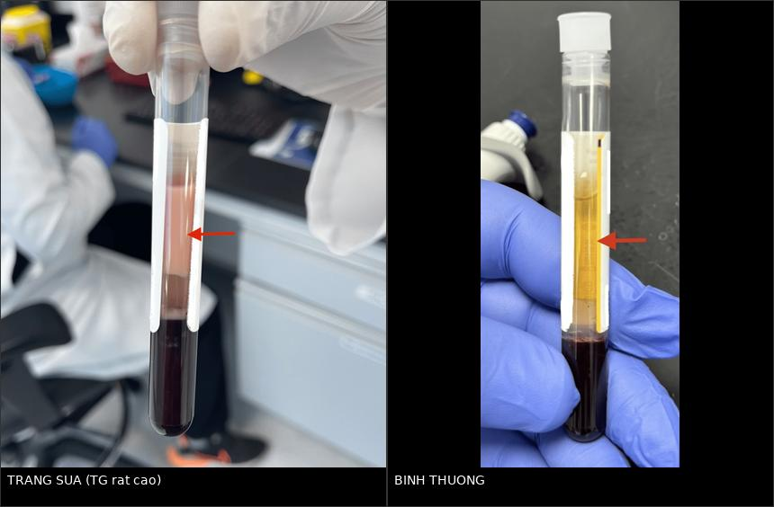
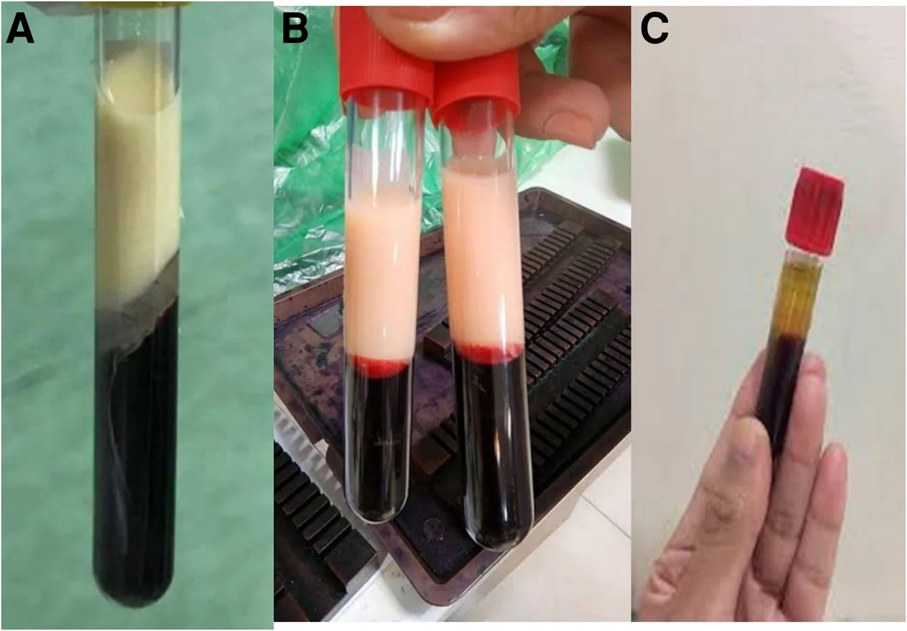
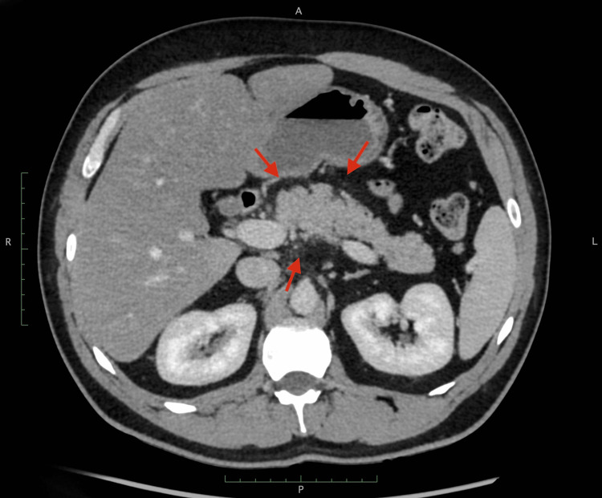
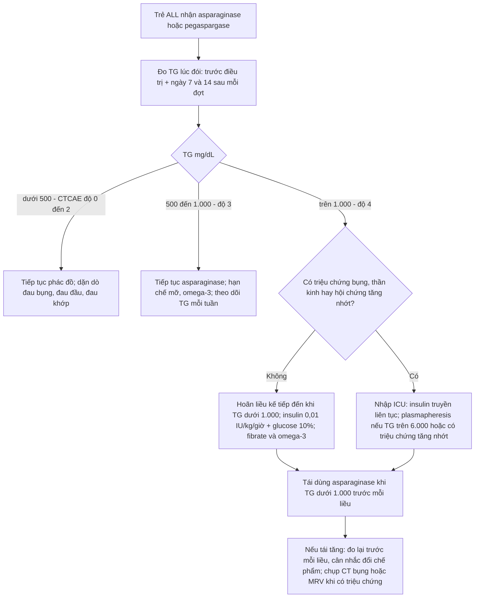
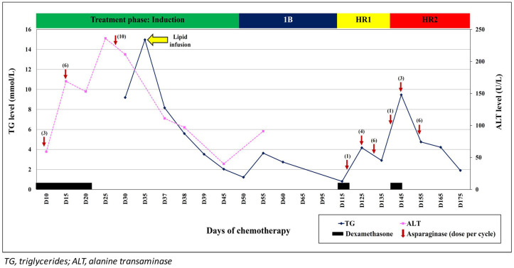

# 684 — Tăng triglyceride do asparaginase/pegaspargase ở trẻ ALL: ngưỡng giữ – giảm – ngừng liều, khi nào tái dùng & biến chứng (viêm tụy, huyết khối xoang)

**Tags:** `pattern:tang-triglyceride` `pattern:viem-tuy-cap` `pattern:huyet-khoi-xoang` `vung:tuy` `vung:mach-nao` `score:CTCAE-HTGT` `protocol:CT-bung` `protocol:MRV` `incidentaloma:khong`
**Mức chắc chắn (certainty):** tổng hợp y văn (literature synthesis) — ghép 3 nghiên cứu đoàn hệ lớn (598, 641, 586 trẻ) + 1 phân tích gộp + 2 ca nguyên văn có ảnh; **không có thử nghiệm ngẫu nhiên nào về ngưỡng ngừng/tái dùng asparaginase** — mọi "ngưỡng xử trí" dưới đây là tổng hợp thực hành, ghi rõ chỗ là đồng thuận và chỗ là suy luận.

> **Điểm chốt của bài:** tăng triglyceride (TG) do asparaginase **thường KHÔNG có triệu chứng** (83% trong loạt 12 ca) và **tự hồi phục** — nên câu hỏi thực hành không phải "có ngừng thuốc không?" mà là **"có biến chứng gì đang xảy ra mà hình ảnh phải tìm?"**: viêm tụy (kể cả khi amylase/lipase bình thường), huyết khối xoang tĩnh mạch não (CVST), hoại tử xương, và **sai lệch xét nghiệm do lipemia** (hạ natri giả, amylase giả thấp). Đồng thuận chuyên gia hiện hành: **tăng TG đơn thuần không phải lý do giảm liều/ngừng asparaginase** — nhưng phải chứng minh TG **dưới 1.000 mg/dL trước mỗi liều tiếp theo** và phải loại trừ biến chứng bằng lâm sàng + hình ảnh.

## 1. Tổng quan bệnh học – cơ chế hình ảnh

### 1.1 TẠI SAO asparaginase làm TG tăng: ba mắt xích enzym

Asparaginase (ASNase) thủy phân asparagine tuần hoàn thành aspartate + amoniac, làm tế bào lympho non thèm asparagine chết. Nhưng enzym này **cạn asparagine ở mọi tế bào**, kể cả tế bào gan và nội mô — nơi tổng hợp **lipoprotein lipase (LPL)** và **apoC-II**. Hệ quả:

1. **Giảm hoạt tính LPL** (enzym duy nhất thủy phân TG trong chylomicron/VLDL tại mao mạch) → TG không được thanh thải.
2. **Tăng tổng hợp và bài tiết VLDL từ gan** (gan nhiễm mỡ do thiếu asparagine + corticoid đồng vận).
3. **Corticoid liều cao** trong cùng phác đồ làm tăng VLDL và giảm hoạt tính LPL → **hiệp lực**, không phải hai nguyên nhân riêng lẻ.

Bằng chứng định lượng cho "hiệp lực" này: hai thử nghiệm St. Jude có **cùng phác đồ corticoid** nhưng khác chế phẩm — nhóm dùng **PEG-asparaginase** có TG tăng **4,5 lần** và **tăng TG nặng (> 1.000 mg/dL) 10,5%** so với **5,5%** ở nhóm dùng asparaginase *E. coli* tự nhiên (p = 0,007); ở tuần 7, **dexamethasone đơn thuần không làm TG tăng**, chỉ khi **có thêm asparaginase** (Finch ER et al., Pediatr Blood Cancer 2020, PMC6868303).

- **Ngưỡng bão hòa LPL:** khi TG **> 885 mg/dL**, LPL không còn khả năng thanh thải chylomicron hiệu quả → tích lũy và tăng nguy cơ viêm tụy (AHA 2026, dẫn trong Barbar M et al., Front Oncol 2026, PMC13337426).
- **Vì sao PEG-asparaginase nặng hơn:** thời gian bán thải dài, hoạt tính enzym kéo dài → ức chế LPL liên tục; **calaspargase pegol** còn dài hơn, với khoảng khởi phát rộng **3–69 ngày** (MD Anderson, dẫn trong PMC13337426).

### 1.2 TẠI SAO huyết thanh "trắng sữa" — vật lý thuần túy

Chylomicron là hạt **đường kính ~75–1.200 nm**, lớn hơn bước sóng ánh sáng khả kiến → **tán xạ Mie** mạnh. Huyết thanh bình thường trong (ánh sáng truyền qua), huyết thanh đầy chylomicron **tán xạ trắng đục như sữa**. Đây là dấu hiệu **nhìn thấy bằng mắt, miễn phí, trước khi có kết quả TG** — và là cách phát hiện chính trong thực hành (8/12 ca của loạt Barbar được phát hiện vì ống máu đục).

Hệ quả **xét nghiệm** (rất dễ đọc sai):
- **Hạ natri giả (pseudohyponatremia):** thể tích pha nước bị chylomicron chiếm chỗ → Na đo được thấp giả. Công thức hiệu chỉnh: **Na hiệu chỉnh = Na đo được + 0,002 × TG (mg/dL)** (tương đương + 0,2 × TG tính bằng g/L) — Hinson A et al., Case Rep Pediatr 2014 (PMC4227320). Trong 12 ca Barbar, 1 ca nhập viện vì **hạ natri giả + đau đầu + nhìn mờ** (TG 3.900 mg/dL).
- **Amylase/lipase có thể bình thường hoặc thấp giả** do lipemia gây nhiễu quang học/pha loãng → **men tụy bình thường KHÔNG loại trừ viêm tụy**; đây là lý do hình ảnh có vai trò quyết định (mục 4).
- **TG > 1.000 mg/dL làm tắc máy xét nghiệm sinh hóa** (đồng thuận Haematologica 2025, PMC12666278) → phải pha loãng, ly tâm, hoặc báo phòng xét nghiệm.

### 1.3 TẠI SAO tăng TG lại liên quan huyết khối và hoại tử xương

- **Huyết khối:** asparaginase giảm tổng hợp **antithrombin III** và **fibrinogen**; đồng thời TG rất cao làm **tăng độ nhớt** và hoạt hóa bạch cầu → trạng thái **giảm đông – tăng đông song song** (đông máu nội mạch). Trong loạt 741 trẻ ALL, **CVST do pegaspargase 1,4%** (11 ca); nhóm nhập ICU có **liều tích lũy 4.000 IU/m²** so với **2.250 IU/m²** ở nhóm điều trị thường (r = 0,75 giữa liều tích lũy và độ nặng) — Cao L et al., Transl Pediatr 2026 (PMC12877869).
- **Hoại tử xương (ON):** trong phân tích gộp 13 nghiên cứu (3.425 trẻ), **TG độ 3/4 làm tăng nguy cơ ON: OR 4,27 (KTC 95% 2,77–6,61)**; liên quan viêm tụy **OR 1,60 (0,53–4,82)** và huyết khối **OR 2,45 (0,86–7,01)** đều **không có ý nghĩa** (Laumann RD et al., Pediatr Blood Cancer 2023) — nghĩa là **tăng TG là dấu hiệu nguy cơ của ON và có thể của huyết khối, chứ không phải nguyên nhân trực tiếp của viêm tụy**.

### 1.4 Ngưỡng định lượng bắt buộc nhớ

**Phân độ CTCAE v5.0** (thang chuẩn dùng trong mọi phác đồ ung thư nhi; trích từ Zawitkowska J et al., Cancer Manag Res 2026, PMC12934241):

- **Độ 0 (bình thường):** TG **< 150 mg/dL** (< 1,7 mmol/L).
- **Độ 1:** **150–300 mg/dL** (1,71–3,42 mmol/L).
- **Độ 2:** **> 300–500 mg/dL** (> 3,42–5,7 mmol/L).
- **Độ 3:** **> 500–1.000 mg/dL** (> 5,7–11,4 mmol/L).
- **Độ 4:** **> 1.000 mg/dL** (> 11,4 mmol/L) — ngưỡng "nặng" theo AHA 2026; **> 2.000** là "rất nặng".

**Ngưỡng xử trí (AHA 2026, khoa nhi):** **nặng (severe) > 1.000 mg/dL**; **rất nặng (very severe) > 2.000 mg/dL** — mốc gắn với tăng nguy cơ viêm tụy cấp.

**Tần suất thực tế (để không hoảng và không chủ quan):**
- Tăng TG bất kỳ trong điều trị ALL: **6,7%–85%**, trung vị **27%** (13 nghiên cứu, 3.425 trẻ — Laumann 2023).
- Tăng TG **nặng > 1.000 mg/dL**: **2%** (12/598, Barbar 2026 — tác giả ghi rõ đây là **ước lượng tối thiểu** vì không theo dõi TG định kỳ), **4%–19%** theo y văn, **7%** (18/257, Bhojwani D et al., Eur J Cancer 2014), và **10,5%** với PEG-ASP (Finch 2020).
- Loạt quốc gia Ba Lan (641 trẻ): **11,1%** (72 ca) có tăng TG, **72% trong số đó là độ 3–4**; TG đỉnh trung vị **1.385 mg/dL** (IQR 525–2.533); **không ca nào viêm tụy**; biến chứng 5,6% (ĐTĐ 1, hoại tử xương 2, viêm gan 1); gián đoạn điều trị trung vị **5,67 ngày**; TG sau điều trị về **136 mg/dL** (Zawitkowska 2026).

## 2. Mẫu hình + chẩn đoán phân biệt theo cơ chế (Gamut)

Mẫu hình cần nhận ra: **trẻ ALL đang/ngay sau asparaginase, ống máu đục, TG tăng đơn độc hoặc kèm tăng cholesterol, có thể kèm hạ natri "không giải thích"**. Gamut theo **cơ chế**, không theo hình thái:

- **Nhóm 1 — Thuốc ức chế LPL/thanh thải:** asparaginase (mọi chế phẩm: native *E. coli*, PEG, Erwinia, calaspargase), corticoid liều cao, **sirolimus/ức chế mTOR**, isotretinoin, estrogen, propofol.
- **Nhóm 2 — Thiếu insulin/tăng VLDL:** **DKA/ĐTĐ kiểm soát kém** (rất hay gặp song hành, nhất là khi dùng corticoid), béo phì/kháng insulin, hội chứng chuyển hóa.
- **Nhóm 3 — Di truyền (nền tảng ẩn):** FCS thể đồng hợp/dị hợp kép (LPL, APOC2, APOA5, GPIHBP1, LMF1), **thể dị hợp LPL/APOA5** làm tăng nhạy cảm với thuốc — 2 ca của Krivosheina M et al. (World J Clin Pediatr 2026, PMC13491175) mang **LPL rs1801177 (1,6% dân số)**, **LPL rs268 (1,97%)** và **APOA5 VUS**; **5/7 ca có TG nền > 150 mg/dL** trước điều trị (Barbar 2026).
- **Nhóm 4 — Dinh dưỡng/TPN:** **nhũ tương lipid (SMOFlipid, propofol)** — chính là "liều lipid" làm TG tăng thêm (xem ảnh biểu đồ mục 3); chế độ ăn nhiều mỡ.
- **Nhóm 5 — Thứ phát khác:** suy giáp, hội chứng thận nhiễm mỡ, bệnh gan ứ mật, rượu (người lớn).

Gợi nhớ **"LIPID"**: **L**PL (asparaginase ức chế + đột biến LPL), **I**nsulin thiếu (DKA), **P**rednisone/corticoid, **I**nherited (APOA5/FCS) + **I**nfusion lipid, **D**iet/obesity.

**Điểm phân biệt quan trọng nhất trên lâm sàng:** tăng TG do thuốc **hồi phục** sau khi giảm/ngừng thuốc và giảm mỡ trong **vài ngày đến vài tuần**; FCS **không hồi phục** với chế độ ăn thông thường và TG **> 1.500 mg/dL từ nhũ nhi**. Đừng dán nhãn "do asparaginase" cho một FCS bị bỏ sót — hậu quả là trẻ tiếp tục ăn mỡ và tái viêm tụy.

## 3. Bảng so sánh phân biệt (ma trận đối chiếu)

| Thực thể (entity) | Hình ảnh / xét nghiệm điển hình | Chốt vào (rule-in) | Chốt loại (rule-out) | Gợi ý xác nhận |
|---|---|---|---|---|
| **Tăng TG do asparaginase (AAHTG)** | TG tăng **5–21 ngày** sau liều (trung vị 12), **không triệu chứng 83%**; ống máu đục; CT bụng thường **bình thường** | **TG tăng theo mốc liều + giảm sau khi ngừng/giảm liều + tái tăng khi tái dùng** | TG cao **không đổi** dù đã ngừng asparaginase 4–6 tuần → tìm nguyên nhân khác | TG trước – ngày 7–14 sau mỗi đợt; xem ống máu |
| **Viêm tụy cấp do TG (HTG-AP)** | Tụy phù, **thấm mỡ quanh tụy (stranding)**, dịch quanh tụy; **hoại tử cần ≥ 72 giờ** mới rõ trên CECT; **amylase/lipase có thể BÌNH THƯỜNG** | **Đau bụng điển hình + hình ảnh** (2/3 tiêu chuẩn Atlanta, không cần enzym) | CT bình thường trong 24–48 giờ đầu **không loại trừ**; lặp siêu âm/CT sau 48–72 giờ | Siêu âm bụng trước (ALARA), CECT khi chẩn đoán chưa rõ hoặc nghi hoại tử |
| **FCS / tăng TG di truyền** | TG **> 1.500** (có ca **8.014 mg/dL** lúc 5 tháng tuổi), **huyết thanh trắng sữa từ nhũ nhi**, gan lách to, **lipemia retinalis**, xanthoma | **TG rất cao từ nhỏ + không đáp ứng chế độ ăn + biến thể LPL/APOA5/LMF1** | TG giảm mạnh khi hạn chế mỡ < 10–15% calo → gợi ý nguyên nhân môi trường/thuốc | Gene panel lipid (LPL, APOA5, LMF1, GPIHBP1, APOC2); TG mẹ |
| **Tăng TG do corticoid đơn thuần** | TG tăng nhẹ–vừa, **không tăng vọt sau liều asparaginase**; thường kèm tăng glucose, béo trung tâm | **TG tăng trong giai đoạn corticoid, không theo mốc asparaginase** | TG tăng vọt 1–3 tuần sau liều PEG-ASP → do asparaginase | Đối chiếu lịch liều; TG ở tuần không có asparaginase |
| **DKA / thiếu insulin** | Đường huyết cao, toan ceton, TG thường **500–2.000**; tụy có thể chưa viêm | **DKA + TG cao, giảm nhanh khi truyền insulin** | TG vẫn > 1.000 sau khi hết toan ceton → nguyên nhân lipid độc lập | Khí máu, ceton, HbA1c |
| **Huyết khối xoang tĩnh mạch não (CVST)** | **CT tĩnh mạch/MRV: khuyết thuốc xoang**, xoang ngang/dọc trên giãn, nhồi máu xuất huyết hai bên | **Đau đầu + co giật/liệt khu trú ở trẻ đang asparaginase + khuyết thuốc xoang** | CT không cản quang bình thường **không loại trừ** CVST | **MRV/CTV** (bài 216); D-dimer không loại trừ |

*Trái: huyết thanh **trắng đục như sữa** — dấu hiệu nhìn thấy bằng mắt của TG rất cao. Phải: huyết thanh trong bình thường (đối chiếu). Nguồn: Ibrahim H et al., Cureus 2024 (PMC11246614), Fig. 2 & 3, CC BY 4.0; ghép letterbox bằng `tools/make_composite.py`.*

*Ba thời điểm ở một nhũ nhi 5 tháng tuổi bị **hội chứng chylomicronemia gia đình (FCS)** — dùng để hiểu **động học** của lipemia, không phải ca asparaginase: (A) lúc nhập viện, TG **8.014 mg/dL** (207,2 mmol/L) — lớp trên đặc như kem; (B) vẫn đục sau 1 tháng; (C) sau can thiệp chế độ ăn — huyết thanh **trở lại trong**. Bài học: độ đục của ống máu **theo dõi được bằng mắt** và **hồi phục** khi TG giảm; nếu ống máu vẫn đục dù đã ngừng asparaginase 4–6 tuần → nghĩ nguyên nhân di truyền. Nguồn: Kumar PR et al., JCEM Case Reports 2026 (PMC13634674), Fig. 1, CC BY 4.0.*

*CT bụng có cản quang (ca người lớn tăng TG — dùng làm mẫu hình, **không phải** ca asparaginase nhi): **thấm mỡ (stranding) thưa quanh thân–đuôi tụy** (mũi tên) — viêm tụy cấp thể kẽ **rất kín đáo**, dễ đọc "bình thường" nếu không đo và không so sánh mật độ mỡ quanh tụy. Nguồn: Ibrahim H et al., Cureus 2024 (PMC11246614), Fig. 1, CC BY 4.0.*

## 4. Protocol chụp + hệ phân độ/điểm chuẩn hóa

### 4.1 Theo dõi TG — "protocol" thực tế (chưa có chuẩn quốc tế)

Không có khuyến cáo quốc tế thống nhất về lịch đo TG (Zawitkowska 2026 ghi rõ: *"triglyceride measurements are currently not standardized and are not performed at predefined time points"*). Tổng hợp thực hành đã công bố:

- **Trước điều trị:** lipid panel lúc đói (TG, cholesterol, HDL) — **5/7 ca có TG nền > 150 mg/dL**, và **50% có BMI ≥ 85th percentile**, tức là **nhóm nguy cơ nhận diện được trước khi tiêm** (Barbar 2026; Finch 2020: điểm đa gen TG giải thích nhiều nhất ở **thời điểm nền**, giảm dần trong điều trị).
- **Trong điều trị:** TG **ngày 7 và 14 sau mỗi đợt PEG-ASP** (khoảng khởi phát 5–21 ngày, trung vị 12) + **bất kỳ lúc nào thấy ống máu đục**. Với **calaspargase pegol**, cửa sổ rộng hơn (**3–69 ngày**) → không được chỉ đo một lần.
- **Sau một đợt AAHTG:** đo TG **trước mỗi liều tiếp theo**; chỉ tiêm khi **TG < 1.000 mg/dL** (Barbar 2026 — 8 ca tái dùng, chỉ **1 ca (12,5%) tái tăng**).
- **Theo dõi dài hạn:** lipid panel sau kết thúc điều trị (TG về **136 mg/dL** trung vị trong loạt Ba Lan; 12/12 ca Bhojwani bình thường hóa sau khi kết thúc phác đồ).

### 4.2 Ngưỡng hành động (flowchart)

### 4.3 Điều trị — số liệu từ loạt lớn nhất

| Biện pháp | Liều / cách dùng | Bằng chứng & lưu ý |
|---|---|---|
| **Hạn chế mỡ + omega-3** | Mỡ < 10–15% calo; omega-3 (EPA/DHA) | Nền tảng ở mọi mức; TG về bình thường trung vị **8 ngày** (3 ngày–6 tháng) trong loạt Barbar |
| **Insulin truyền liên tục** | **0,01 IU/kg/giờ** + glucose 10%, theo dõi đường huyết mỗi 2 giờ | 11/12 ca; hạ TG xuống < 1.000 sau trung vị **3 ngày** (1–9); **hạ đường huyết KHÔNG triệu chứng 80%** → phải theo dõi đường huyết, không chỉ nhìn triệu chứng |
| **Fibrate / statin** | Fibrate (gemfibrozil 70 mg/kg/ngày trong ca nhi) | Dùng ở 41,7% loạt Ba Lan; đồng thuận Haematologica: fibrate còn giúp **giảm nhiễu máy xét nghiệm** khi TG > 1.000 |
| **Heparin** | Truyền | 34,7% loạt Ba Lan; giải phóng LPL nội mô **tạm thời**, **nguy cơ chảy máu** khi có giảm tiểu cầu/giảm fibrinogen — không dùng thường quy |
| **Plasmapheresis (TPE)** | 1 lần (đa số) | Chỉ định: **TG > 6.000** hoặc **hội chứng tăng nhớt**; 1 lần đưa TG < 1.000 ở **3/3 ca** (Barbar); 8,3% loạt Ba Lan. Không khuyến cáo thường quy (ASFA) |
| **Ngừng asparaginase vĩnh viễn** | — | Chỉ khi: **có triệu chứng** (viêm tụy, tăng nhớt), **kháng trị**, hoặc đã hết liều theo phác đồ (4/12 ca Barbar). Đồng thuận Haematologica: **tăng TG đơn thuần KHÔNG đủ lý do** giảm liều/ngừng |

### 4.4 Hình ảnh: chụp gì, khi nào, để trả lời câu gì

| Câu hỏi lâm sàng | Modality ưu tiên | Dấu hiệu cần tìm | Lưu ý kỹ thuật |
|---|---|---|---|
| **Có viêm tụy không** (khi đau bụng, enzym không tin được) | **Siêu âm bụng** trước (ALARA) → **CT bụng có cản quang** nếu chưa rõ | Tụy to/giảm âm; **thấm mỡ quanh tụy**, dịch quanh tụy, dày cân mạc treo | CECT: hoại tử **chưa thấy trước 72 giờ**; chụp sớm chỉ để loại trừ biến chứng mạch/ổ bụng |
| **Biến chứng tại chỗ** (sau 2–4 tuần) | **MRI/MRCP** (trẻ, cần nhiều lần) hoặc CT | **Nang giả tụy (pseudocyst)** sau **≥ 4 tuần**, hoại tử có vách (WON), rò ống tụy | Nang giả gặp **26%** trung bình (tới **60%**) sau viêm tụy do asparaginase; **56%** ca có di chứng hình ảnh |
| **Huyết khối xoang não** (đau đầu, co giật, nhìn mờ) | **MRV hoặc CTV** | Khuyết thuốc xoang, xoang giãn, nhồi máu xuất huyết | CT thường **bình thường** → phải chụp tĩnh mạch (bài 216) |
| **Hoại tử xương** (đau khớp, đi khập khiễng) | **MRI** (X-quang muộn) | Dải giảm tín hiệu dưới sụn, phù tủy, sau đó sụp | TG độ 3/4 → **OR 4,27** cho ON; đau khớp ở trẻ ALL **không được quy cho corticoid mà bỏ qua MRI** |

*Biểu đồ ca nhi: TG (xanh) và ALT (hồng) theo ngày; mũi tên đỏ = từng liều asparaginase, thanh đen = dexamethasone, mũi tên vàng = **truyền lipid**. Ba bài học: (1) TG tăng **sau** liều 10–15 ngày rồi tự giảm; (2) **truyền lipid làm TG vọt lên** lần nữa (D35); (3) TG và ALT **không song hành** — tổn thương gan không dùng để ước lượng TG. Nguồn: Lau SCD et al., Front Pediatr 2021 (PMC8100240), Fig. 1, CC BY 4.0.*

## 5. Biến thể bình thường và cạm bẫy

- **Cạm bẫy 1 — tin amylase/lipase bình thường.** Trong lipemia, amylase có thể **bình thường hoặc thấp giả**; tiêu chuẩn Atlanta 2012 chỉ cần **2/3** tiêu chí (đau điển hình, enzym ≥ 3× ULN, **hình ảnh**). Vì vậy **đau bụng + CT có thấm mỡ = viêm tụy** dù enzym bình thường.
- **Cạm bẫy 2 — hạ natri giả bị điều trị như hạ natri thật.** Na thấp + ống máu đục → **tính Na hiệu chỉnh** trước khi truyền NaCl 3%; điều trị "hạ natri" ở đây có thể gây **tăng natri**.
- **Cạm bẫy 3 — CT bình thường trong 24 giờ đầu.** Viêm tụy thể kẽ trên CT chỉ là **vài vệt thấm mỡ** (xem ảnh mục 3); nếu lâm sàng mạnh, **lặp siêu âm/CT sau 48–72 giờ**, không kết luận "không viêm tụy".
- **Cạm bẫy 4 — quy mọi đau khớp cho corticoid.** TG độ 3–4 làm tăng ON **OR 4,27** → trẻ đau khớp/đi khập khiễng cần **MRI**, không chỉ giảm vận động.
- **Cạm bẫy 5 — ngừng asparaginase vì con số TG.** Đồng thuận chuyên gia: **không** giảm liều/ngừng vì tăng TG đơn thuần; ngừng thuốc làm **giảm liều tích lũy asparaginase**, yếu tố gắn với **tăng tái phát** (bài 589/598). Ngược lại, **không được chủ quan**: 1,4% CVST, và tử vong do viêm tụy nặng đã được báo cáo (1/586 trong Total XVI).
- **Cạm bẫy 6 — nhầm "nang giả" với "hoại tử có vách".** Trước **4 tuần** là **dịch tụ tụy cấp (APFC)**; **≥ 4 tuần** mới gọi **pseudocyst** (không có mô hoại tử) hay **WON** (có hoại tử) — tên gọi quyết định **khi nào can thiệp** (thường chờ ≥ 4 tuần để vách trưởng thành).
- **Biến thể bình thường:** trẻ **béo phì** có TG nền cao hơn; **nhũ tương lipid trong TPN** làm TG tăng thoáng qua mà không phải bệnh lý; **đo TG không lúc đói** sau bữa nhiều mỡ có thể tăng 2–5 lần — luôn ghi rõ tình trạng đói.

## 6. Tự lượng giá — Blind Quiz ngay trên trang tĩnh

**Ca 1 — Trẻ 7 tuổi ALL, đau bụng sau đợt pegaspargase; amylase/lipase bình thường.**

- Gợi ý lâm sàng: đau thượng vị lan ra sau, nôn; enzym tụy **trong giới hạn bình thường**; ống máu lấy xét nghiệm **đục**.
- Câu hỏi: Dấu hiệu chính trên CT? Vì sao enzym bình thường mà vẫn chẩn đoán viêm tụy? Cần chụp gì tiếp nếu nghi biến chứng?

<b>Bấm để hiện đáp án (findings + chẩn đoán)</b>

- Dấu hiệu: **thấm mỡ thưa quanh thân–đuôi tụy** (mũi tên), mật độ mỡ quanh tụy tăng nhẹ so với mỡ mạc treo xa; **không hoại tử**, không dịch tự do lượng lớn.
- Chẩn đoán: **viêm tụy cấp thể kẽ do tăng TG** — chẩn đoán theo Atlanta 2012 chỉ cần **2/3** tiêu chí; enzym có thể bình thường/thấp giả vì lipemia gây nhiễu.
- Tiếp theo: **siêu âm/MRI sau 48–72 giờ** nếu đau kéo dài; **MRCP** nếu nghi rò ống tụy; tìm **huyết khối** nếu đau đầu.
- Nguồn ảnh: Ibrahim H et al., Cureus 2024 (PMC11246614), Fig. 1, CC BY 4.0 — **ca người lớn tăng TG, không phải ca asparaginase nhi**; dùng làm mẫu hình dấu hiệu.

**Ca 2 — Trẻ 10 tuổi ALL, natri máu 125 mmol/L, không phù, không mất nước.**

- Gợi ý lâm sàng: đang giai đoạn tăng cường, vừa nhận pegaspargase 12 ngày trước; tỉnh, không co giật.
- Câu hỏi: Vì sao natri thấp? Cần xét nghiệm gì trước khi truyền NaCl? Tính Na hiệu chỉnh nếu TG = 4.000 mg/dL.

<b>Bấm để hiện đáp án (findings + chẩn đoán)</b>

- Dấu hiệu: ống máu **trắng đục** (trái) so với ống bình thường (phải) → **lipemia nặng**.
- Chẩn đoán: **hạ natri giả do tăng TG** (pseudohyponatremia) — chylomicron chiếm thể tích pha nước.
- Na hiệu chỉnh = 125 + 0,002 × 4.000 = **133 mmol/L** → **không cần truyền NaCl 3%**; điều trị "hạ natri" thật sẽ gây **tăng natri**.
- Việc cần làm: đo TG, hạn chế mỡ, theo dõi thần kinh (đau đầu/nhìn mờ = hội chứng tăng nhớt → cân nhắc plasmapheresis).
- Nguồn ảnh: Ibrahim H et al., Cureus 2024 (PMC11246614), Fig. 2 & 3, CC BY 4.0; ghép letterbox.

**Ca 3 — Trẻ ALL, TG 1.400 mg/dL sau đợt thứ 3, không triệu chứng. Bố mẹ hỏi "có phải ngừng hóa trị?".**

- Gợi ý: trẻ tỉnh, ăn uống được, không đau bụng, không đau đầu; ALT 80 U/L.
- Câu hỏi: Có ngừng asparaginase không? Ngưỡng nào cho phép tái dùng? Hai biến chứng phải chủ động tìm là gì?

<b>Bấm để hiện đáp án (findings + chẩn đoán)</b>

- Nhận định: TG **độ 4 CTCAE** nhưng **không triệu chứng** → theo đồng thuận Haematologica 2025 và loạt Barbar 2026, **không có chỉ định ngừng vĩnh viễn**; hoãn liều kế tiếp và **tái dùng khi TG < 1.000 mg/dL trước mỗi liều**.
- Điều trị: hạn chế mỡ, omega-3, cân nhắc fibrate; **insulin 0,01 IU/kg/giờ** nếu TG > 2.000 hoặc cần hạ nhanh; theo dõi đường huyết (hạ đường huyết không triệu chứng 80%).
- Hai biến chứng phải tìm: **huyết khối (CVST — hỏi đau đầu, chụp MRV nếu có)** và **hoại tử xương (đau khớp → MRI)**; viêm tụy ít liên quan hơn về mặt thống kê (OR 1,60; KTC 0,53–4,82) nhưng vẫn phải hỏi đau bụng.
- Nguồn ảnh: Lau SCD et al., Front Pediatr 2021 (PMC8100240), Fig. 1, CC BY 4.0 — biểu đồ ca nhi có truyền lipid làm TG tăng vọt.

## Bài liên quan chéo
- [628 – Viêm tụy cấp do tăng triglyceride & nguyên nhân chuyển hóa ở trẻ](../628-viem-tuy-tang-triglyceride-o-tre/lesson.md) — chẩn đoán – điều trị viêm tụy cấp, Atlanta nhi
- [683 – Tăng triglyceride kháng trị ở trẻ](../683-tang-triglyceride-khang-tri-o-tre/lesson.md) — FCS, olezarsen, plasmapheresis
- [626 – Viêm tụy cấp ở trẻ](../626-viem-tuy-cap-nhi/lesson.md) — nguyên nhân & MRCP
- [216 – Dị dạng mạch não & huyết khối xoang tĩnh mạch (CVST)](../216-di-dang-mach-CVST/lesson.md) — MRV/CTV, chẩn đoán CVST
- [629 – Viêm tụy mạn ở trẻ & suy tụy ngoại tiết](../629-viem-tuy-man-o-tre-suy-tuy-ngoai-tiet/lesson.md) — di chứng dài hạn
- [199 – Quy trình xét nghiệm gen & tầm soát gia đình](../199-quy-trinh-xet-nghiem-gen-tam-soat-gia-dinh/lesson.md) — khi nào gửi gene panel lipid

## Ảnh
- Tên file: `684_asparaginase_<Modality>_<PMCID>-FigN-<mô tả>-CCBY.jpg`; nguồn + giấy phép từng ảnh trong `images/CREDITS.md`.
- Ảnh **CC BY 4.0** (PMC11246614, PMC13634674, PMC8100240) — được tải, được ghép letterbox, ghi nguồn.
- Ảnh minh họa mẫu hình từ **ca người lớn** đều ghi rõ trong chú thích — không gán cho ca nhi.

> Không dùng để chẩn đoán độc lập khi chưa có người hướng dẫn.
