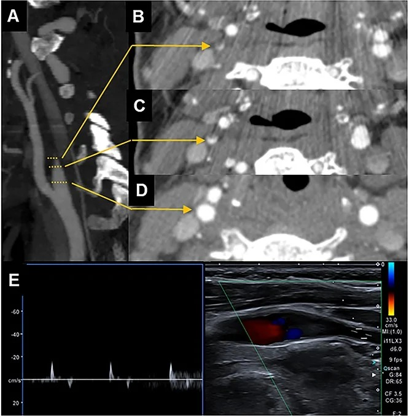
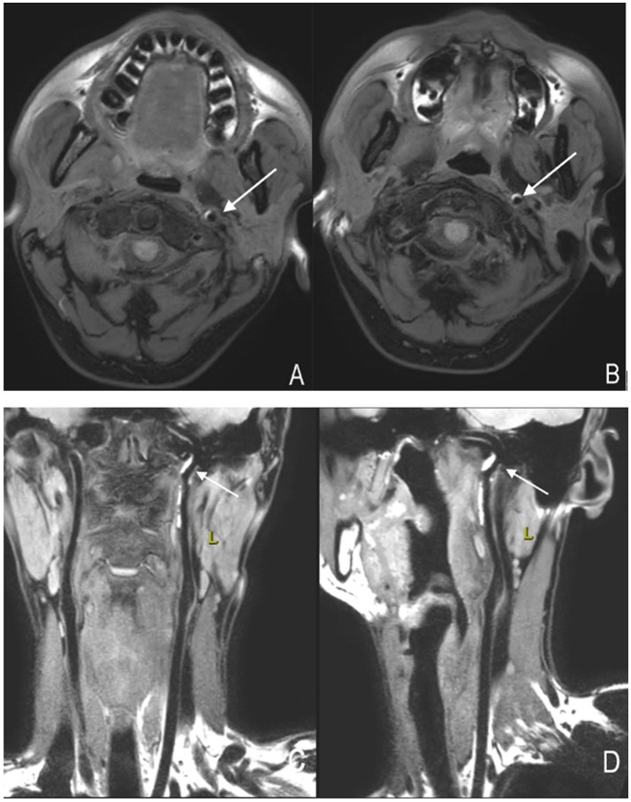
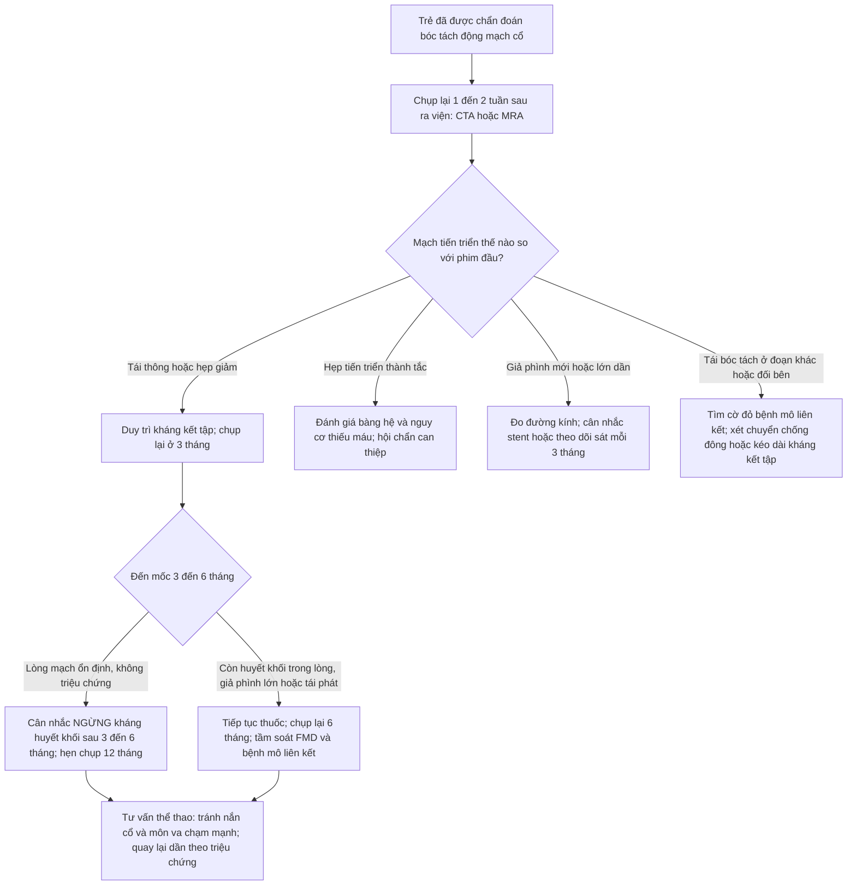
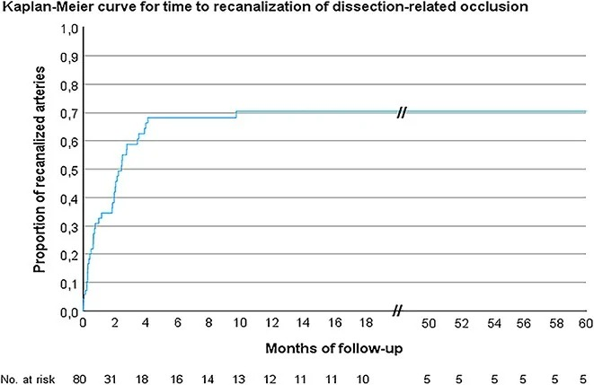
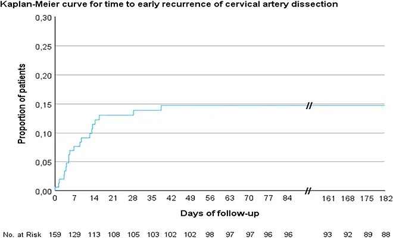

# 685 — Theo dõi dài hạn & ngừng thuốc sau bóc tách động mạch cổ ở trẻ: tái thông – hẹp tồn dư – tầm soát bệnh mô liên kết & tư vấn thể thao

**Tags:** `pattern:boc-tach-mach` `pattern:hep-tac-mach` `pattern:gia-phinh-mach` `pattern:tai-thong-mach` `vung:mach-co-dau-co` `vung:nao-nhi` `protocol:CTA-co` `protocol:MRA-co` `protocol:MRI-thanh-mach` `incidentaloma:khong`
**Mức chắc chắn (certainty):** tổng hợp y văn (literature synthesis) — ghép 1 phân tích gộp (29 nghiên cứu, 5.898 người), 1 đoàn hệ theo dõi siêu âm 10 năm (159 người, 191 động mạch), 1 tổng quan hình ảnh và 1 nghiên cứu gene 183 người. **Cảnh báo mức chắc chắn: gần như TOÀN BỘ số liệu là người lớn** (tuổi trung bình 42–45) — dữ liệu riêng cho trẻ **gần như chỉ có ca lâm sàng**; mọi ngưỡng dưới đây phải áp cho trẻ với mức dè dặt và ghi rõ là ngoại suy.

> **Điểm chốt của bài:** bóc tách động mạch cổ **là quá trình động, không phải chẩn đoán tĩnh**. Trong vòng **6 tuần đầu**, mạch thay đổi liên tục (tái thông, tiến triển tắc, tái bóc tách); hầu hết **tái thông xong trong 4 tháng**; và **tái phát 4% (7% trong năm đầu, chỉ 2% kèm thiếu máu)**. Vì vậy ba quyết định lớn — **(1) khi nào chụp lại, (2) khi nào ngừng kháng kết tập/chống đông, (3) ai cần tầm soát bệnh mô liên kết di truyền** — phải dựa trên **bằng chứng số** và **hình thái mạch đang tiến triển**, không dựa trên một lần chụp lúc chẩn đoán.

## 1. Tổng quan bệnh học – cơ chế hình ảnh

### 1.1 Bóc tách "lành" như thế nào — vật lý của hồi phục

Bóc tách = máu vào thành mạch (do vỡ vasa vasorum tạo **khối máu tụ trong thành (intramural hematoma)** hoặc rách nội mạc tạo **vạt nội mạc/vòi giả**). Quá trình hồi phục gồm 3 cơ chế song song, mỗi cơ chế có dấu hiệu hình ảnh riêng:

1. **Tái hấp thu khối máu tụ trong thành** → mạch nở lại. Trên **MRI thành mạch độ phân giải cao (HR-vessel wall)**, máu tụ có **tín hiệu cao hình lưỡi liềm trên T1** ở pha cấp/bán cấp; khi hồi phục, **tín hiệu này mất dần và chuyển thành tổ chức xơ** — nhiều tác giả xem **đặc điểm tín hiệu T1 theo thời gian là dấu ấn tiên lượng lành trong 3 tháng** (Li T et al., Front Neurol 2025, PMC12282257).
2. **Tái thông lòng mạch (recanalization)** khi huyết khối trong lòng tan và dòng chảy tái lập. Trong đoàn hệ 159 người theo dõi siêu âm duplex, **tái thông 40/80 động mạch bị tắc (70,4% tích lũy)**; **tiến triển từ hẹp sang tắc 9/109 (10,0%)**; **mọi thay đổi trừ 1 ca đều xảy ra trong 4 tháng** (Eur Stroke J 2026, PMC13636090).
3. **Tổ chức hóa xơ (fibrosis)** → **hẹp tồn dư vĩnh viễn** dù lòng mạch đã "lành". Thời gian tái thông hoàn toàn/ gần hoàn toàn trung bình **~4,7 tháng**; pha cấp được định nghĩa là **≤ 14 ngày**, giai đoạn nguy cơ TIA/đột quỵ tái phát cao nhất (PMC12282257).

**Vì sao trẻ khác người lớn:** ở trẻ, bóc tách thường gặp trong hai bối cảnh — **(a) chấn thương kín (BCVI)**, thường ở động mạch cảnh trong đoạn nền sọ/cổ cao, và **(b) tự phát** liên quan **loạn sản cơ xơ (fibromuscular dysplasia — FMD)**, bệnh mô liên kết, hoặc **thao tác vùng cổ** (đã có ca 20 tháng tuổi bóc tách động mạch đốt sống V4 sau **nắn chỉnh cổ bằng tay** — Arnold JC et al., Childs Nerv Syst 2026, PMC13038740). Ở trẻ, **mạch nhỏ hơn, thành mạch mềm hơn**, và **không có xơ vữa** — nên bất kỳ "hẹp/huyết khối" nào trên hình ảnh sau này đều **không được quy cho xơ vữa**.

### 1.2 Vì sao phải theo dõi theo lịch, không chụp một lần

- **Mạch đổi nhanh trong 6 tuần đầu:** trong 159 người, **62 thay đổi mạch hoặc tổn thương mới ở 50 người (31,4%)**, trong đó **42/62 xảy ra trong 6 tuần đầu**; **tái bóc tách trong 6 tuần gặp ở 20/159 (14,7%)** (PMC13636090).
- **Tái phát muộn vẫn có:** 7/159 người (13,7% trong nhóm theo dõi dài) tái bóc tách **từ 2 đến 7 năm** → **không được "kết thúc theo dõi" sau 6 tháng** nếu còn triệu chứng hoặc còn bệnh mô liên kết.
- **Tái phát kèm thiếu máu thì thấp:** phân tích gộp 29 nghiên cứu/5.898 người cho **tái bóc tách 4% (KTC 95% 3–7%)**, **2% trong 1 tháng đầu**, **7% trong năm đầu**, và **chỉ 2% (1–3%) kèm biến cố thiếu máu** (Lounsbury E et al., 2024, PMC10964388). Con số này là **nền tảng để tư vấn thể thao** — nhưng tác giả ghi rõ **không có hướng dẫn dựa trên bằng chứng** cho việc trở lại vận động.

### 1.3 Ngừng thuốc — bằng chứng định lượng

- **Thời gian kháng huyết khối thường dùng: 3–6 tháng**; nếu chọn chống đông, **chuyển sang kháng kết tập tiểu cầu trong vòng 180 ngày là hợp lý** (PMC12282257).
- **Ngừng sau 6 tháng KHÔNG làm tăng nguy cơ thiếu máu não** trong theo dõi (theo Pezzini và cộng sự, dẫn trong PMC12282257); **dùng kháng kết tập kéo dài > 6 tháng KHÔNG cải thiện tái thông** (theo Wadhwa và cộng sự, cùng nguồn) → **kéo dài thuốc vô hạn không có lợi ích chứng minh**, chỉ tăng nguy cơ chảy máu.
- **Quan trọng cho trẻ:** các thử nghiệm lớn (CADISS, TREAT-CAD, CATIS) **chỉ tuyển người lớn**; xu hướng thực hành hiện nay **ưu tiên kháng kết tập tiểu cầu hơn chống đông** ở bóc tách cổ, và ở trẻ chấn thương (BCVI) **nhiều trung tâm chuyển sang kháng kết tập tiểu cầu trước khi ra viện** (Murillo A et al., J Clin Med 2026, PMC13257469).

### 1.4 Ai cần tầm soát bệnh mô liên kết di truyền — đừng xét nghiệm tất cả

Nghiên cứu NGS trên **183 người bóc tách cổ tự phát không chọn lọc**: **chỉ 1,1% mang biến thể gây bệnh** (COL3A1, ABCC6) và **16,4% có biến thể VUS**; phân tích gộp 14 nghiên cứu/330 người cho tỉ lệ mang biến thể gây bệnh **0,4% ở nhóm không chọn lọc** so với **23,4% ở nhóm có tiền sử gia đình bóc tách** → **kết luận: KHÔNG xét nghiệm gene thường quy cho mọi ca**, chỉ làm khi **xác suất trước xét nghiệm cao** (Corradi L et al., Neurol Sci 2026, PMC13538227).

**Cờ đỏ gợi ý bệnh mô liên kết (định hướng, không phải tiêu chuẩn):** bóc tách **nhiều mạch/hai bên**, **tái phát**, **tiền sử gia đình** bóc tách/phình mạch/đột quỵ trẻ, **dáng Marfan** (vóc cao, sải tay > chiều cao, ngón dài, vòm miệng cao), **sa van hai lá**, **phình/giãn gốc động mạch chủ**, **da mỏng – dễ bầm – sẹo teo (vEDS)**, **khớp tăng động (điểm Beighton cao)**, **vết rách gân/tràn khí màng phổi tự phát**. Ca bóc tách đốt sống là biểu hiện đầu tiên của **Marfan chưa chẩn đoán** đã được báo cáo (PMC13397990); vEDS (COL3A1) biểu hiện bằng **phình cảnh + phình nhiều tạng** (PMC13499471).

## 2. Mẫu hình + chẩn đoán phân biệt theo hình thái (Gamut)

Mẫu hình cần phân loại: **trên phim chụp lại sau 3–6 tháng, mạch không trở về bình thường**. Gamut theo **hình thái**:

- **Hẹp tồn dư có/không vạt nội mạc (residual stenosis / intimal flap):** lành bằng xơ hóa → hẹp mềm, đều, **không có vôi hóa**; nếu còn **vạt nội mạc di động** thì chưa lành hoàn toàn.
- **Giả phình (pseudoaneurysm):** túi lồi ra khỏi lòng mạch, thường ở **đoạn cảnh trong cổ cao (C1–C3)** sau chấn thương; nguy cơ thuyên tắc xa và **có thể lớn dần**; là tổn thương **tồn tại được nhiều tháng–năm**.
- **Tắc mạch không tái thông (persistent occlusion):** tiên lượng tái thông thấp hơn nếu **huyết khối ngược dòng lan xa**; có thể tái thông muộn tới **2 năm** (PMC12282257).
- **Huyết khối trong lòng mới:** cần phân biệt **huyết khối cấp (tăng đậm độ trên CT, giảm tín hiệu TOF)** với **vạt nội mạc**.
- **Loạn sản cơ xơ (FMD):** "chuỗi hạt" ở **đoạn giữa động mạch cảnh trong/đốt sống**, thường **hai bên**, gặp nhiều ở nữ; FMD vừa là **nguyên nhân** vừa là **bẫy** khi đọc phim sau bóc tách.
- **Co mạch/RCVS, viêm mạch, co thắt do ống thông:** hẹp **đối xứng, nhiều đoạn, thay đổi giữa hai lần chụp**, không có máu tụ trong thành → hồi phục.
- **Bẫy kỹ thuật:** **MRA TOF làm hẹp giả** ở đoạn mạch đổi hướng/giảm dòng; **CTA vôi hóa giả**; **siêu âm phụ thuộc người làm**; **artifact chuyển động**.

## 3. Bảng so sánh phân biệt (ma trận đối chiếu)

| Thực thể (entity) | Hình ảnh điển hình trên phim theo dõi | Chốt vào (rule-in) | Chốt loại (rule-out) | Gợi ý xác nhận |
|---|---|---|---|---|
| **Hẹp tồn dư đã lành** | Hẹp mềm, bờ đều, **không vôi hóa**, không máu tụ trong thành trên HR-MRI, dòng chảy ổn định qua nhiều lần chụp | **Hẹp đứng yên 3–6 tháng + HR-MRI không còn tín hiệu máu tụ T1** | Hẹp **tiến triển** giữa hai lần chụp → chưa lành/tái bóc tách | HR-MRI thành mạch + siêu âm duplex; so sánh chính xác cùng mặt cắt |
| **Giả phình sau bóc tách** | Túi lồi **lệch tâm**, cổ rộng/hẹp, giữ nguyên hình qua các thì, thường ở cảnh trong cổ cao | **Túi lồi + dòng xoáy chậm trong túi** | Lồi **mất đi** khi chụp lại → không phải giả phình thật | CTA (tốt nhất), MRA; **đo đường kính mỗi lần** để phát hiện lớn dần |
| **Tắc không tái thông** | Không thấy dòng chảy; **mô mạch teo nhỏ**; tuần hoàn bàng hệ qua đa giác Willis | **Không dòng chảy ≥ 6 tháng + mạch teo** | Có dòng chảy yếu, tái thông muộn tới 2 năm | CTA/MRA + DSA khi cân nhắc can thiệp; bài 248 |
| **FMD (loạn sản cơ xơ)** | **"Chuỗi hạt"** đoạn giữa mạch, **hai bên**, có thể kèm phình trong sọ | **Nhiều chỗ hẹp–giãn xen kẽ đối xứng + hai bên** | Hẹp đơn độc, một bên, không thay đổi hình thái → nghĩ di chứng bóc tách | CTA/MRA toàn bộ động mạch cổ–thận (FMD thường đa vị trí) |
| **Tái bóc tách** | **Tổn thương MỚI** ở đoạn khác/đối bên hoặc **tiến triển hẹp → tắc** | **Máu tụ trong thành MỚI trên HR-MRI + thay đổi so với phim trước** | Hình thái y hệt phim cũ nhiều lần → không phải mới | HR-MRI T1 fat-sat; so sánh cạnh nhau mọi lần chụp |
| **Co mạch/RCVS – viêm mạch** | Hẹp **nhiều đoạn, đối xứng, lan tỏa**, thay đổi giữa hai lần chụp cách vài tuần | **Hẹp hồi phục trong vài tuần–3 tháng, không máu tụ trong thành** | Có máu tụ trong thành/giả phình → thực thể mạch, không phải co mạch | MRA/CTA lặp sau 4–8 tuần; bài 219/676 |
| **Bẫy kỹ thuật (TOF/artifact)** | Hẹp **chỉ thấy trên MRA TOF**, không thấy trên CTA/DSA/siêu âm | **Hẹp biến mất khi đổi modality** | Hẹp xác nhận trên ≥ 2 modality → tổn thương thật | CTA hoặc DSA xác nhận; không tăng thuốc vì một phim TOF |

*CTA tái tạo đứng dọc (A) + các mặt cắt ngang (B–D) của **động mạch cảnh trong đoạn ngoài sọ bị bóc tách gây tắc**, kèm siêu âm duplex (E) — mạch **teo nhỏ, không thấy dòng chảy**, đây là hình thái nền để so sánh ở mọi lần chụp lại. Nguồn: Eur Stroke J 2026 (PMC13636090), Fig. 1, CC BY 4.0.*

*HR-MRI thành mạch động mạch cảnh trái: **khối máu tụ trong thành hình lưỡi liềm tín hiệu cao** (mũi tên) làm hẹp lòng mạch, thấy rõ trên mặt cắt ngang (A, B) và tái tạo đứng dọc (C, D). Đây là dấu hiệu **theo dõi được theo thời gian**: tín hiệu T1 mất dần khi máu tụ tổ chức hóa → gợi ý lành. Nguồn: Li T et al., Front Neurol 2025 (PMC12282257), Fig. 3, CC BY 4.0.*

## 4. Protocol chụp + hệ phân độ/điểm chuẩn hóa

### 4.1 Lịch chụp lại (tổng hợp từ thực hành đã công bố)

| Thời điểm | Modality | Mục đích |
|---|---|---|
| **Cấp (0–24 giờ)** | **CTA cổ–não** (hoặc MRA nếu trẻ ổn định, ưu tiên không xạ) | Chẩn đoán, phân độ **Denver/Biffl I–V**, tìm tổn thương đối bên |
| **1–2 tuần sau ra viện** | **CTA** (phổ biến nhất trong thực hành nhi) hoặc **MRA + siêu âm duplex** | Phát hiện **tiến triển tắc**, giả phình sớm, tái bóc tách (**42/62 thay đổi xảy ra trong 6 tuần đầu**) |
| **3 tháng** | **CTA/MRA + HR-MRI thành mạch** | Đánh giá **tái thông** và **máu tụ trong thành**; mốc để cân nhắc **ngừng thuốc** |
| **6 tháng** | CTA/MRA | Quyết định **ngừng kháng huyết khối** (ngừng sau 6 tháng không tăng thiếu máu não — Pezzini); ghi **đường kính giả phình** |
| **12 tháng, rồi khi có triệu chứng** | MRA (không xạ) hoặc siêu âm | Tái phát muộn (**7/159 ca tái bóc tách 2–7 năm**); theo dõi giả phình lớn dần |

- **Nguyên tắc ALARA cho trẻ:** ưu tiên **MRA/siêu âm** ở các lần theo dõi; **CTA** khi cần độ phân giải cao cho **giả phình/đo đường kính** hoặc khi MRA không kết luận.
- **HR-MRI thành mạch (T1 fat-sat + T2)** là modality tốt nhất để **phân biệt máu tụ trong thành với mảng xơ vữa** (không gặp ở trẻ) và để **theo dõi lành bệnh theo tín hiệu**.
- **DSA** chỉ khi: cân nhắc can thiệp (stent/coil), nghi tổn thương tầng (tandem), hoặc CTA/MRA không kết luận.

### 4.2 Ngưỡng quyết định (flowchart)

### 4.3 Tầm soát bệnh mô liên kết & tư vấn thể thao

- **Xét nghiệm gene panel (COL3A1, FBN1, TGFBR1/2, SMAD3, COL5A1...):** **chỉ định có chọn lọc** — 1,1% biến thể gây bệnh ở nhóm không chọn lọc so với **23,4% khi có tiền sử gia đình** (PMC13538227). Cờ đỏ: bóc tách nhiều mạch/hai bên/tái phát, gia đình, dáng Marfan, da mỏng dễ bầm, khớp tăng động, phình gốc động mạch chủ.
- **Trước khi gửi gene:** khám **hội chứng Marfan (tiêu chuẩn Ghent)**, **siêu âm tim + đo gốc động mạch chủ (Z-score theo tuổi/giới)**, **điểm Beighton**, khám da, hỏi **tiền sử tràn khí màng phổi tự phát/rách gân**; khám **toàn bộ hệ mạch** (cảnh–đốt sống–thận–vành) để tìm **FMD**.
- **Thể thao:** **không có hướng dẫn dựa trên bằng chứng** (chính tác giả phân tích gộp ghi rõ) — nhưng nền tảng số để tư vấn là: **tái phát 4% chung, 7% năm đầu, chỉ 2% kèm thiếu máu**. Thực hành hợp lý: **tránh nắn chỉnh cổ, môn va chạm/giật cổ (vật, judo, bóng bầu dục, đấu vật) và tư thế ưỡn cổ kéo dài**; khuyến khích vận động aerobic không va chạm; **tránh nâng tạ nặng/Valsalva mạnh** nếu có phình tồn dư hoặc bệnh mô liên kết.

## 5. Biến thể bình thường và cạm bẫy

- **Cạm bẫy 1 — "hẹp giả" trên MRA TOF.** Ở đoạn mạch đổi hướng (cảnh trong đoạn nền sọ) hoặc khi dòng chảy chậm, **TOF làm hẹp giả hoặc mất tín hiệu giả tắc**. Luôn **xác nhận bằng CTA/siêu âm/DSA** trước khi leo thang điều trị — đây là bẫy dẫn tới kéo dài thuốc hoặc can thiệp vô ích.
- **Cạm bẫy 2 — "tái thông = đã khỏi".** Tái thông **không** đồng nghĩa hết nguy cơ: giả phình có thể **tồn tại và lớn dần**, và **tái phát muộn 2–7 năm** đã được ghi nhận. Trẻ tái thông vẫn cần **theo dõi và tư vấn thể thao**.
- **Cạm bẫy 3 — ngừng thuốc quá sớm hoặc quá muộn.** Ngừng **trước 3 tháng** khi còn **huyết khối trong lòng hoặc hẹp tiến triển** làm mất tác dụng bảo vệ; ngược lại **duy trì > 6 tháng** không cải thiện tái thông mà **tăng nguy cơ chảy máu** — quyết định dựa trên **hình thái mạch ở lần chụp 3–6 tháng**, không theo thói quen.
- **Cạm bẫy 4 — bỏ sót tổn thương đối bên.** **6/159 người bóc tách hai bên**; luôn chụp **cả 4 mạch cổ** ở mọi lần theo dõi, kể cả khi trẻ không có triệu chứng mới.
- **Cạm bẫy 5 — quy "hẹp tồn dư" cho xơ vữa.** Ở trẻ **không có xơ vữa**; hẹp tồn dư là **di chứng xơ hóa của bóc tách**, còn **chuỗi hạt hai bên** là **FMD** — hai thực thể có tiên lượng và theo dõi khác nhau.
- **Cạm bẫy 6 — bỏ qua thao tác vùng cổ.** Tiền sử **nắn chỉnh cổ, xoa bóp mạnh, tư thế đầu–cổ bất thường khi chơi thể thao** là yếu tố cần hỏi và cần **tư vấn loại trừ** — đã có ca **trẻ 20 tháng tuổi bóc tách đốt sống V4 sau nắn chỉnh cổ** (PMC13038740).

## 6. Tự lượng giá — Blind Quiz ngay trên trang tĩnh

**Ca 1 — Trẻ 12 tuổi, yếu nửa người phải, CTA cổ phát hiện tắc động mạch cảnh trong trái.**

- Gợi ý lâm sàng: đột quỵ nhồi máu bán cầu trái; không xơ vữa, không yếu tố nguy cơ tim mạch; khởi phát sau một cú ưỡn cổ khi chơi thể thao.
- Câu hỏi: Mô tả hình thái mạch trên CTA? Vì sao mạch "teo nhỏ" quan trọng? Chụp lại khi nào và bằng modality nào ở trẻ?

<b>Bấm để hiện đáp án (findings + chẩn đoán)</b>

- Dấu hiệu: CTA tái tạo đứng dọc (A) và các mặt cắt ngang (B–D) cho thấy **mạch bị tắc, teo nhỏ, không có dòng chảy**; siêu âm duplex (E) không ghi được phổ dòng chảy.
- Chẩn đoán: **bóc tách động mạch cảnh trong đoạn ngoài sọ gây tắc** (phân độ Denver/Biffl IV nếu trong bối cảnh chấn thương — bài 662).
- Vì sao "teo nhỏ" quan trọng: mạch teo là dấu hiệu **tắc mạn**, giúp phân biệt với **co mạch cấp**; đồng thời là mốc so sánh cho các lần chụp sau.
- Tiếp theo: **MRA/siêu âm ở 1–2 tuần** (mạch đổi nhanh trong 6 tuần đầu); cân nhắc **HR-MRI thành mạch** để tìm máu tụ; **chụp lại 3–6 tháng** trước khi quyết định ngừng thuốc.
- Nguồn ảnh: Eur Stroke J 2026 (PMC13636090), Fig. 1, CC BY 4.0 — **ca người lớn**; dùng làm mẫu hình (dữ liệu nhi còn hạn chế).

**Ca 2 — Cùng bệnh nhi, sau 3 tháng: bố mẹ hỏi "mạch đã thông lại chưa, có phải uống thuốc mãi không?".**

- Gợi ý: trẻ hồi phục vận động tốt, không đau đầu; đang dùng một thuốc kháng kết tập tiểu cầu.
- Câu hỏi: Đọc đường cong này để tư vấn gì? Tỉ lệ tái thông tích lũy? Mốc nào để bàn ngừng thuốc?

<b>Bấm để hiện đáp án (findings + chẩn đoán)</b>

- Đọc hình: **tỉ lệ tái thông tích lũy 70,4%** (40/80 động mạch tắc), **tăng nhanh trong 4 tháng đầu rồi đi ngang** — nghĩa là **nếu chưa tái thông sau ~4 tháng thì khả năng tái thông thêm rất thấp**.
- Tư vấn: **hầu hết thay đổi mạch xảy ra trong 4 tháng** (trừ 1 ca); tái thông **không đồng nghĩa hết nguy cơ** (còn giả phình và tái phát muộn).
- Ngừng thuốc: dựa trên hình thái mạch ở **3–6 tháng**; **ngừng sau 6 tháng không làm tăng nguy cơ thiếu máu não**, và dùng > 6 tháng **không cải thiện tái thông**.
- Nguồn ảnh: Eur Stroke J 2026 (PMC13636090), Fig. 2, CC BY 4.0.

**Ca 3 — Trẻ 10 tuổi, 5 tuần sau bóc tách: đau cổ mới, không yếu liệt.**

- Gợi ý: không sốt; không chấn thương mới; vừa được xoa bóp cổ ở nhà.
- Câu hỏi: Nguy cơ tái bóc tách sớm ở tuần 5 là bao nhiêu? Cần chụp gì? Dấu hiệu nào trên hình ảnh xác nhận tổn thương MỚI?

<b>Bấm để hiện đáp án (findings + chẩn đoán)</b>

- Đọc hình: đường cong tái phát sớm **dốc lên trong 6 tuần đầu** rồi đi ngang; trong đoàn hệ này **20/159 (14,7%) tái bóc tách trong 6 tuần**, và **42/62 thay đổi mạch xảy ra trong 6 tuần đầu**.
- Chụp gì: **CTA/MRA cổ ngay** (so sánh trực tiếp với phim đầu), thêm **HR-MRI thành mạch** để tìm **máu tụ trong thành MỚI** (T1 fat-sat tín hiệu cao) — đây là dấu hiệu xác nhận tổn thương mới, khác với hẹp tồn dư cũ.
- Xử trí: **không ngừng thuốc** ở thời điểm này; cân nhắc **kéo dài kháng kết tập** hoặc chuyển chống đông nếu có huyết khối trong lòng; **tầm soát cờ đỏ bệnh mô liên kết** nếu tái phát/nhiều mạch.
- Nguồn ảnh: Eur Stroke J 2026 (PMC13636090), Fig. 3, CC BY 4.0.

## Bài liên quan chéo
- [662 – Bóc tách động mạch cổ ở trẻ](../662-boc-tach-dong-mach-co-o-tre/lesson.md) — chẩn đoán cấp, phân độ Denver, chống đông/kháng kết tập ban đầu
- [247 – Bóc tách động mạch cảnh/đốt sống](../247-boc-tach-dong-mach-co-dot-song-cervical-artery-dissection/lesson.md) — CTA gộp Se/Sp, CADISS/TREAT-CAD
- [248 – Can thiệp nội mạch giả phình & bóc tách cổ/đốt sống](../248-can-thiep-noi-mach-gia-phinh-boc-tach-dong-mach-co-dot-song/lesson.md) — stent/coil, khi nào can thiệp
- [652 – Đột quỵ động mạch & bệnh mạch máu não ở trẻ](../652-dot-quy-mach-mau-nao-nhi-moyamoya-viem-mach/lesson.md) — bàng hệ, MRA/ASL
- [216 – Dị dạng mạch não & huyết khối xoang tĩnh mạch](../216-di-dang-mach-CVST/lesson.md) — phân biệt huyết khối tĩnh mạch
- [199 – Quy trình xét nghiệm gen & tầm soát gia đình](../199-quy-trinh-xet-nghiem-gen-tam-soat-gia-dinh/lesson.md) — khi nào gửi gene panel, tư vấn gia đình

## Ảnh
- Tên file: `685_boc-tach-co_<Modality>_<PMCID>-FigN-<mô tả>-CCBY.jpg`; nguồn + giấy phép từng ảnh trong `images/CREDITS.md`.
- Ảnh **CC BY 4.0** (PMC13636090, PMC12282257) — được tải, chuyển định dạng (webp→jpg, không crop), ghi nguồn.
- Số liệu dùng cho bài chủ yếu từ **đoàn hệ người lớn** — đã ghi rõ ở mục mức chắc chắn và trong chú thích ảnh.

> Không dùng để chẩn đoán độc lập khi chưa có người hướng dẫn.
