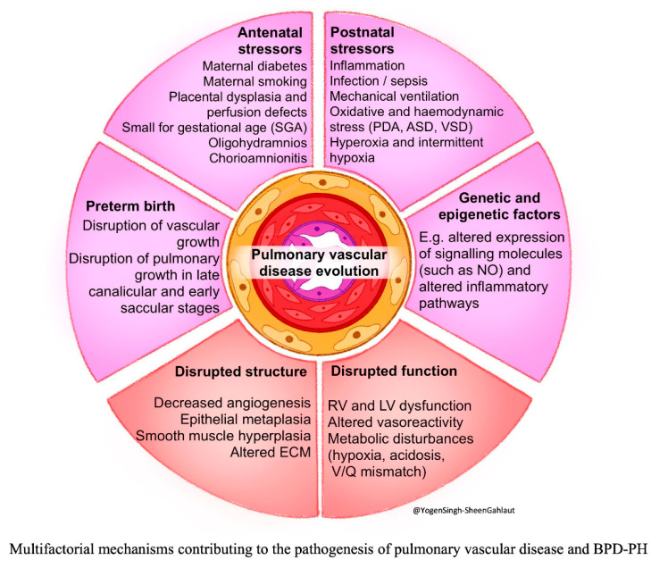
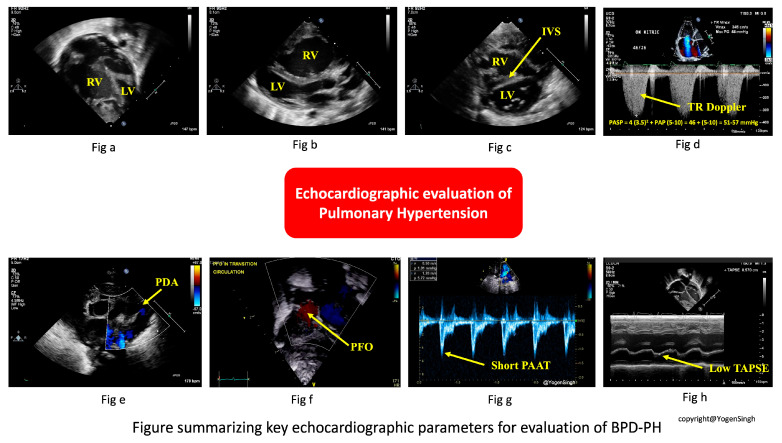
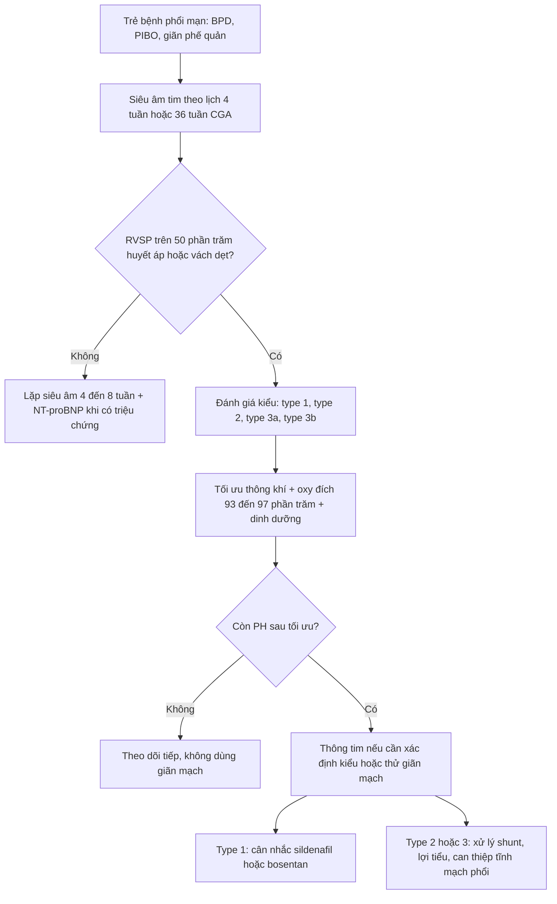
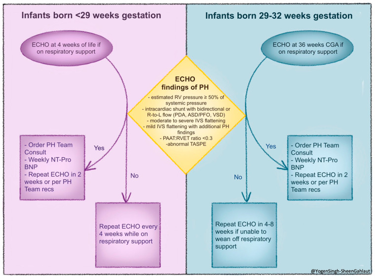
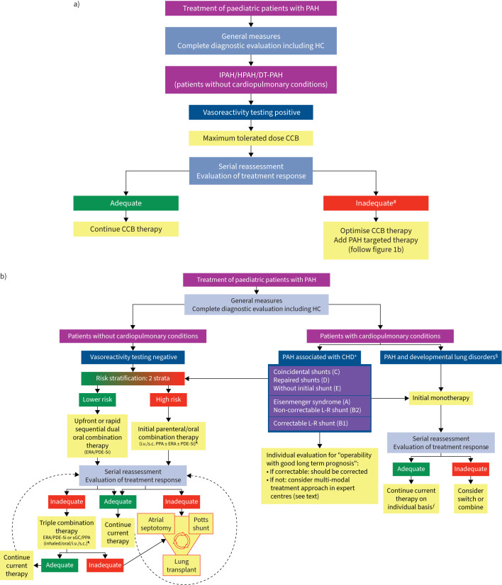
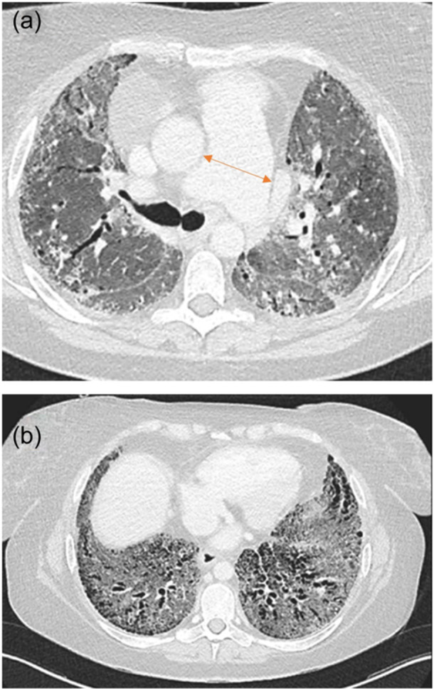

# 686 — Tăng áp lực động mạch phổi & hạ oxy mạn trong bệnh phổi mạn nhi (BPD, PIBO, giãn phế quản) / Pulmonary hypertension and chronic hypoxaemia in paediatric chronic lung disease

**Tags:** `pattern:ph-gian-mach` `pattern:tim-phai` `pattern:u-khi` `vung:phoi-nhi` `score:WSPH-2024` `protocol:sieu-am-tim` `protocol:oxy-luu-dong`
**Mức chắc chắn (certainty):** tổng hợp y văn (literature synthesis) — tổng hợp từ y văn mở 2024–2026 (Europe PMC: Singh Y et al. *Children* 2026, PMC12940002; Ivy D et al. *Eur Respir J* 2024, PMC11525338; Vitulo P et al. *Pulm Circ* 2024, PMC11629413) + số liệu BPD trong repo (bài 606); số chưa kiểm chứng ghi "chưa rõ".

## 1. Tổng quan bệnh học – cơ chế hình ảnh

- **Định nghĩa (nhóm 3 WSPH — PH do bệnh phổi và/hoặc thiếu oxy):** tăng áp lực động mạch phổi khi **mPAP > 20 mmHg** lúc nghỉ, kèm **PVR ≥ 3 Wood units (WU)** cho thể **trước mao mạch**, và **PCWP > 15 mmHg** cho thể **sau mao mạch** (WSPH/EPPVAD, theo Singh Y et al. 2026). *Lưu ý ngưỡng:* **ESC/ERS 2022 ở người lớn** dùng **PVR > 2 WU**; với trẻ, bài này giữ **≥ 3 WU** theo nguồn nhi khoa đã đọc — **không trộn hai ngưỡng** khi so sánh nghiên cứu.
- **Chuỗi bệnh sinh (TẠI SAO trẻ bệnh phổi mạn lại tăng áp phổi):**
  1. **Thiếu oxy phế nang (alveolar hypoxia)** → **co mạch phổi do thiếu oxy (hypoxic pulmonary vasoconstriction, HPV)** — cơ chế sinh lý bảo vệ tưới máu, nhưng **kéo dài** thì thành **tăng áp lực**.
  2. **Mất giường mạch (vascular rarefaction):** ở BPD, phế nang ít và to hơn, mao mạch giảm → **diện cắt mạch giảm**, mỗi đơn vị máu phải qua ít mạch hơn → **PVR tăng**.
  3. **Tái cấu trúc mạch (remodeling):** phì đại lớp cơ trung mạc, muscularization mạch xa, vỡ sợi chun → **mạch cứng, kém giãn**; cuối cùng là **suy thất phải**.
  4. **Tăng gánh thể tích** (PDA, PFO/ASD, VSD) → **tăng dòng phổi (flow-dependent PH)**, dần dẫn tới tái cấu trúc và tăng PVR.
- **Vì sao BPD là mô hình chuẩn của nhóm 3 ở trẻ:** BPD là **phổi bị ngừng phát triển phế nang và mạch** (arrested alveolarization + angiogenesis) sau sinh non, với các yếu tố **viêm, oxy hóa, thông khí áp lực, shunt**. Số liệu định lượng:
  - **Tỷ lệ BPD-PH tăng theo độ nặng: ~5% BPD nhẹ, ~18% BPD trung bình, > 40% BPD nặng.**
  - **Gần một nửa trẻ sinh cực non có BPD-PH tử vong trong 2 năm** kể từ lúc chẩn đoán.
  - **Hồi phục:** khoảng **47%** hết PH sau 1 năm; **79–94%** hết sau **2–2,25 năm** — nghĩa là **PH có thể thoái triển**, nhưng cửa sổ nguy cơ nằm đúng giai đoạn phát triển thần kinh.
- **PIBO và giãn phế quản nhi:** cùng nhóm 3 nhưng cơ chế chính là **tắc nghẽn đường thở nhỏ → ứ khí → giảm thông khí khu trú → co mạch do thiếu oxy + mất giường mạch do xơ hóa**. Trong PIBO, **ứ khí và mosaic** trên HRCT thì **thở ra** chính là nơi **giảm thông khí** tương ứng — cùng bản đồ với vùng **giảm tưới máu**. **Tỷ lệ PH ở PIBO nhi: chưa rõ — cần tra** (không có con số đã kiểm chứng trong nguồn đã đọc).
- **Cơ chế hình ảnh (vật lý):**
  - **Siêu âm tim:** chênh áp qua van ba lá tính bằng **Bernoulli rút gọn: ΔP = 4 × v²**; do đó **RVSP = 4 × (vận tốc hở ba lá)² + áp lực nhĩ phải** (ở sơ sinh lấy **3–5 mmHg**). Vì **RVSP ≥ 50% áp lực hệ thống** đã gợi ý PH, đây là **ngưỡng sàng lọc**, không phải chẩn đoán.
  - **Hình dạng vách liên thất:** khi áp lực thất phải ≥ thất trái, vách **dẹt** thì tâm trương (quá tải thể tích) hoặc **cả thì tâm thu** (quá tải áp lực) → **chỉ số lệch tâm (eccentricity index, EI) ≥ 1,3**.
  - **PAAT:RVET < 0,30** phản ánh **PVR tăng** (thời gian tăng tốc dòng động mạch phổi ngắn lại), hiệu chỉnh được theo nhịp tim.
  - **CT:** **động mạch phổi chính giãn** — nguyên lý là **áp lực thành mạch tỉ lệ với bán kính (Laplace)** và **giãn theo thời gian**; trên CT, so **đường kính ĐMP/ĐMC lên** và đo **ĐMP chính** trên lát trục. Không có ngưỡng mm tuyệt đối dùng chung cho trẻ — phải **so theo tuổi/diện tích cơ thể**, các ngưỡng người lớn không chuyển trực tiếp được.

## 2. Mẫu hình + chẩn đoán phân biệt theo kiểu huyết động (gamut)

**Bước 1 — xác định có PH thật không** (đừng nhầm với **thất phải giãn do shunt** hoặc **do thở máy**). **Bước 2 — xếp kiểu** vì **điều trị khác nhau hoàn toàn** (Singh Y et al. 2026):

- **Type 1 — trước mao mạch do tăng PVR (thể chiếm ưu thế ở BPD):** phổi **kém giãn nở, không đồng nhất**, thiếu oxy mạn, mạch **thưa + muscularized**. Siêu âm: **RV phì đại/giãn, hở ba lá, vách dẹt thì tâm thu, EI ≥ 1,3, PAAT ngắn, TAPSE thấp**, shunt có thể **hai chiều hoặc phải–trái**. Điều trị: **tối ưu thông khí + oxy + tăng trưởng**, rồi **giãn mạch phổi**.
- **Type 2 — phụ thuộc dòng (flow-dependent):** **PDA/PFO/ASD/VSD** hoặc **tuần hoàn bàng hệ chủ–phổi** → **tăng dòng phổi (Qp:Qs tăng)**. Siêu âm: **buồng nhĩ–thất giãn**, vách dẹt **thì tâm trương**; PDA gây **giãn nhĩ trái/thất trái**, **vận tốc tĩnh mạch phổi > 50 cm/s**. Điều trị: **lợi tiểu + đóng shunt**; **giãn mạch phổi có thể làm nặng** (tăng dòng, phù phổi).
- **Type 3 — sau mao mạch do tăng PCWP:**
  - **3a — suy chức năng thất trái/hẹp–hở hai lá:** hoặc sau **thoát vị hoành bẩm sinh (CDH)**; điều trị **tăng co bóp/giảm hậu gánh**, **tránh giãn mạch phổi** (gây phù phổi).
  - **3b — hẹp tĩnh mạch phổi (pulmonary vein stenosis, PVS):** gặp tới **30%** ca BPD-PH, **tiến triển muộn**, **vận tốc tĩnh mạch phổi > 160 cm/s**, mất dạng sóng hai/ba pha; **không thấy trên CT thường** nếu không tìm. Điều trị: can thiệp bóng/stent/phẫu thuật — **giãn mạch phổi trước khi giải ép tĩnh mạch làm nặng phù phổi**.
- **Gamut "thất phải giãn/to ở trẻ có bệnh phổi mạn":** BPD-PH (type 1–3), PIBO/giãn phế quản, **CDH sau mổ**, **thoát vị hoành – thiểu sản phổi**, **PVS**, **bệnh tim trái bẩm sinh**, **shunt bẩm sinh**, **tăng áp phổi thoáng qua sau ngừng oxy**, và **nhiễm trùng hô hấp cấp** làm PH nặng lên.

## 3. Bảng so sánh phân biệt (ma trận đối chiếu)

| Kiểu / thực thể | Hình ảnh – siêu âm điển hình | Chốt vào (rule-in) | Chốt loại (rule-out) | Gợi ý xác nhận |
|---|---|---|---|---|
| **Type 1 — BPD-PH trước mao mạch** | RV phì đại/giãn; **vách dẹt thì tâm thu, EI ≥ 1,3**; **PAAT:RVET < 0,30**; TAPSE thấp; phổi kém giãn nở, không đồng nhất | **Bệnh phổi mạn + RVSP ≥ 50% áp lực hệ thống + vách dẹt tâm thu** | **Vách dẹt chỉ thì tâm trương + buồng trái giãn** → nghĩ type 2 | Siêu âm lặp lại; NT-proBNP; **thông tim** khi nặng/không đáp ứng |
| **Type 2 — phụ thuộc dòng** | **PDA/PFO/ASD/VSD**; nhĩ–thất giãn; vách dẹt **tâm trương**; **vận tốc tĩnh mạch phổi > 50 cm/s**; tăng B-line | **Shunt trái–phải rõ + Qp:Qs tăng + giãn buồng trái** | **Không có shunt, buồng trái bình thường** → không phải type 2 | Siêu âm Doppler; đóng shunt rồi đánh giá lại |
| **Type 3a — sau mao mạch do tim trái** | Giãn nhĩ trái, **sóng S tĩnh mạch phổi giảm, D tăng, Ar lớn**; chức năng thất trái giảm | **PCWP > 15 mmHg** trên thông tim; hở/hẹp hai lá | **PCWP bình thường + không bệnh tim trái** | Thông tim; siêu âm tim chuyên sâu |
| **Type 3b — hẹp tĩnh mạch phổi** | **Vận tốc tĩnh mạch phổi > 160 cm/s**, mất dạng sóng, hẹp khu trú; tiến triển muộn | **Doppler tĩnh mạch phổi bất thường ở ≥ 1 tĩnh mạch + tiền sử non tháng/BPD** | **Doppler 4 tĩnh mạch bình thường, dạng sóng đủ** → ít nghĩ PVS | **Siêu âm tim chuyên sâu 4 tĩnh mạch mỗi lần theo dõi**; CT/MRI mạch; thông tim |
| **PIBO / giãn phế quản nhi có PH** | HRCT: **mosaic + ứ khí thì THỞ RA**, giãn phế quản; RVSP tăng, vách dẹt | **Bệnh đường thở nhỏ mạn + RVSP ≥ 50% + thiếu oxy khi gắng sức/ngủ** | **Mosaic giữ nguyên cả 2 thì + RVSP bình thường** → mosaic do mạch, không phải PH | HRCT thì thở ra; đa ký giấc ngủ; siêu âm tim |
| **Tăng áp phổi "giả" do thông khí** | RVSP cao khi đang **toan hô hấp/thiếu oxy cấp**, giảm sau tối ưu thông khí | **RVSP giảm ≥ 20% sau tối ưu oxy/thông khí** | **RVSP vẫn cao sau tối ưu** → PH thật | Đánh giá lại sau 24–72 giờ tối ưu hỗ trợ hô hấp |

*Sáu nhóm yếu tố cùng đẩy **bệnh mạch phổi**: sang thương trước sinh, sinh non, sang thương sau sinh, bất thường cấu trúc, bất thường chức năng, và yếu tố gen–biểu sinh. Đây là lý do **không có một "phép đo" duy nhất** chẩn đoán BPD-PH. Nguồn: Singh Y et al., Children 2026 (PMC12940002), CC BY 4.0.*

### Siêu âm tim — bảy thông số phải đo và ghi vào phiếu theo dõi

| Thông số | Cách đo | Ngưỡng gợi ý PH (trẻ) | Ý nghĩa |
|---|---|---|---|
| Vận tốc hở ba lá (TR jet) | Doppler liên tục, mặt cắt 4 buồng/RV inflow | **RVSP ≥ 50% áp lực hệ thống** | Ước lượng áp lực thất phải; **mất sóng ở 30–40%** sơ sinh non tháng |
| Hình dạng vách liên thất / EI | Mặt cắt cạnh ức trục ngắn, ngang cơ nhú | **EI tâm thu ≥ 1,3** | Quá tải **áp lực**; EI tâm trương ↑ = quá tải **thể tích** |
| PAAT | Doppler xung đường ra thất phải | **PAAT ngắn** | Phản ánh **PVR** tăng |
| PAAT:RVET | Tỉ số | **< 0,30** | Hiệu chỉnh theo nhịp tim |
| TAPSE | M-mode vòng van ba lá | **z-score < −2** | Chức năng thất phải giảm |
| Dòng shunt (PDA/PFO/ASD/VSD) | Doppler màu + phổ | **Hai chiều hoặc phải–trái** | Gợi ý áp lực phổi ≥ hệ thống |
| Doppler tĩnh mạch phổi (4 tĩnh mạch) | Doppler xung, mặt cắt trên ức | **> 50 cm/s (quá tải dòng)**; **> 160 cm/s (hẹp)** | Phân biệt **type 2** với **type 3b** |

*Từ trái sang phải, trên xuống: (a,b) thất phải giãn so với thất trái; (c) **vách liên thất dẹt (IVS)**; (d) **phổ Doppler hở ba lá** để tính RVSP; (e) **PDA**; (f) **PFO** với shunt; (g) **PAAT ngắn**; (h) **TAPSE thấp**. Nguồn: Singh Y et al., Children 2026 (PMC12940002), CC BY 4.0.*

## 4. Protocol chụp/sàng lọc + hệ phân độ và ngưỡng điều trị

**4.1. Sàng lọc bằng siêu âm tim (lịch theo tuổi thai và tuổi sau sinh):**

- **Trẻ sinh < 29 tuần:** siêu âm tim lúc **4 tuần tuổi** nếu còn hỗ trợ hô hấp.
- **Trẻ sinh 29–32 tuần:** siêu âm tim lúc **36 tuần tuổi hiệu chỉnh (CGA)** nếu còn hỗ trợ hô hấp.
- **Không có PH:** lặp lại **mỗi 4–8 tuần** khi còn phụ thuộc hỗ trợ hô hấp.
- **Có PH:** hội chẩn **nhóm PH**, **NT-proBNP mỗi tuần**, lặp siêu âm **~2 tuần/lần** (hoặc theo nhóm PH).
- **Trước xuất viện:** siêu âm tim nếu còn hỗ trợ hô hấp; **đánh giá lại** khi **chậm tăng trưởng, tăng nhu cầu oxy, nhập viện tái diễn**.
- **Chỉ định thông tim (chuẩn vàng):** khi cần **xác định kiểu huyết động**, **thử giãn mạch**, **tăng bậc điều trị**, hoặc **không rõ chẩn đoán**. Đo **mPAP, PVR, PCWP, Qp:Qs**; ngưỡng: **mPAP > 20 mmHg**, **PVR ≥ 3 WU** (trước mao mạch), **PCWP > 15 mmHg** (sau mao mạch).

**4.2. Oxy và hỗ trợ hô hấp (can thiệp nền, không phải "phụ")**

- **Đích SpO₂ 93–97%** ở trẻ **BPD-PH** (theo AHA/ATS–PPHNet, Singh Y et al. 2026); theo dõi **histogram SpO₂**, cố giữ **> 80% số ghi** trong khoảng đích.
- **Đối chiếu với bài 606:** với BPD nói chung, nhiều đơn vị dùng **SpO₂ 90–95%** để cân bằng **nguy cơ bệnh võng mạc do sinh non (ROP)**; khi **đã có PH**, đích **cao hơn (93–97%)** vì **co mạch do thiếu oxy** là cơ chế chính. **Hai đích khác nhau có chủ đích** — ghi rõ lý do trong hồ sơ.
- **Oxy lưu động tại nhà:** chỉ định khi **thiếu oxy mạn/thiếu oxy khi ngủ hoặc khi gắng sức**; trước khi cho về cần **đa ký giấc ngủ (polysomnography)** nếu nghi **giảm oxy khi ngủ**, và **đo lại SpO₂ khi bú/ngủ**.
- **Tối ưu thông khí:** tránh **xẹp phổi** và **căng giãn quá mức**; đánh giá **mềm sụn phế quản (tracheobronchomalacia)**, **phì đại amidan/VA**, **hẹp dưới thanh môn**, **liệt dây thanh**; nội soi mềm khi nghi tắc nghẽn động.
- **Xử lý phần "ung thư" của bệnh phổi mạn:** điều trị **trào ngược/vi hít sặc**, **nhiễm trùng hô hấp**, **dinh dưỡng – tăng trưởng** (tăng trưởng phổi là điều trị sinh học thật sự).

**4.3. Thuốc giãn mạch phổi — chỉ định theo kiểu, không theo "SUV" hay "độ nặng cảm tính"**

| Thuốc | Đường tác động | Vai trò | Cảnh báo chính |
|---|---|---|---|
| **Oxy** | Giảm co mạch do thiếu oxy | **Nền tảng, đầu tay** | Tránh **tăng oxy quá mức** (stress oxy hóa) |
| **iNO** | NO–cGMP | Cơn PH cấp, cai ECMO/ thử đáp ứng | Đáp ứng **thay đổi**, chỉ dùng ngắn hạn |
| **Sildenafil** | PDE5 → tăng cGMP | **Điều trị mạn thường dùng**, hỗ trợ cai iNO | **Tụt huyết áp hệ thống** |
| **Milrinone** | PDE3 → tăng cAMP | Suy chức năng thất/suy tim | **Tụt huyết áp, nặng phù phổi** |
| **Bosentan** | Đối kháng thụ thể endothelin | Điều trị mạn chọn lọc | **Độc gan** — theo dõi men gan |
| **Iloprost/treprostinil/epoprostenol** | Prostacyclin → cAMP | PH nặng/kháng trị | **Ít dữ liệu ở sơ sinh**, đường dùng phức tạp |

- **Nguyên tắc sống còn:** **nhóm 3 không phải nhóm 1.** Giãn mạch phổi **không sửa được nguyên nhân** và có thể **làm nặng V/Q mismatch** (tăng tưới máu vùng phổi không thông khí) → **chỉ dùng sau khi đã tối ưu thông khí/oxy**, và **tránh ở type 2/type 3**.
- **Theo dõi khi dùng thuốc:** **huyết áp, SpO₂, NT-proBNP, siêu âm tim** sau mỗi lần tăng liều; **men gan** nếu dùng bosentan; **đánh giá lại sau 3–6 tháng** để quyết định duy trì/giảm.

*Nhánh trái: **< 29 tuần** — siêu âm lúc **4 tuần tuổi**; nhánh phải: **29–32 tuần** — siêu âm lúc **36 tuần CGA**. Tiêu chí dương trong ô vàng: **RVSP ≥ 50% áp lực hệ thống**, shunt **phải–trái**, **vách dẹt vừa/nặng**, **PAAT:RVET < 0,3**, **TAPSE bất thường**. Nguồn: Singh Y et al., Children 2026 (PMC12940002), CC BY 4.0.*

*Nhánh **b** (phải): bệnh nhân **PAH kèm bệnh phổi – phát triển** đi thẳng vào **đơn trị liệu ban đầu** rồi đánh giá lại — khác hẳn nhóm **PAH vô căn** (thử giãn mạch → chẹn kênh canxi → phối hợp). Nguồn: Ivy D et al., Eur Respir J 2024 (PMC11525338), **CC BY-NC 4.0**.*

## 5. Biến thể bình thường và cạm bẫy

- **Không đo được vận tốc hở ba lá ở 30–40% sơ sinh non tháng** → **không được kết luận "không PH"**; phải dùng **vách liên thất, PAAT:RVET, TAPSE, dòng shunt**.
- **Shunt lớn làm sai lệch chênh áp:** khi PDA/VSD lớn, **chênh áp qua van ba lá không phản ánh đúng áp lực phổi** (hai buồng "thông nhau" về áp lực) — đọc **hướng shunt** thay vì chỉ đọc con số.
- **RVSP là ước lượng, không phải mPAP:** **RVSP ≠ mPAP**; chỉ **thông tim** mới đo mPAP/PVR/PCWP. Đừng ghi "mPAP 60" khi chỉ có siêu âm.
- **Thiếu oxy cấp do thủ thuật/toan hô hấp** làm RVSP tăng thoáng qua → **đo lại sau tối ưu**, tránh gán nhãn PH mạn.
- **Hai đích SpO₂ khác nhau:** **90–95%** (BPD chung, giảm nguy cơ ROP) vs **93–97%** (khi có PH) — **không áp đích cao cho mọi trẻ non tháng**, nhưng **không để thấp ở trẻ đã có PH**.
- **Giãn mạch phổi ở nhóm 3:** tăng tưới máu vùng phổi **không thông khí** → **SpO₂ giảm, CO₂ tăng, phù phổi**; nếu SpO₂ tụt sau khi bắt đầu sildenafil, **nghĩ V/Q mismatch hoặc PVS chưa giải ép**, không phải "thuốc chưa đủ liều".
- **Bỏ sót PVS:** tĩnh mạch phổi **không được khảo sát Doppler đủ 4 nhánh ở mọi lần siêu âm** là lỗi hệ thống; PVS **tiến triển muộn** và là nguyên nhân tử vong.
- **Cạm bẫy mặt cắt trên HRCT:** **mosaic do mạch** giữ nguyên **cả thì hít vào và thở ra**; **mosaic do tiểu phế quản** **rõ hơn ở thì thở ra** (ứ khí). Chỉ chụp thì hít vào sẽ **bỏ sót PIBO**.
- **Phản biện nguồn:** phần lớn khuyến cáo BPD-PH đến từ **đồng thuận chuyên gia + nghiên cứu quan sát**, **không có thử nghiệm ngẫu nhiên lớn**; ngưỡng **PVR 3 WU** khác **ESC/ERS 2022 (2 WU)** — khi trích dẫn phải nói rõ **khung nào**.

## 6. Tự lượng giá — Blind Quiz

**Ca 1 — Trẻ sinh 26 tuần, 4 tuần tuổi, còn CPAP. Siêu âm tim dưới đây: bạn đo gì, và có gọi là PH không?**

- Gợi ý lâm sàng: BPD đang hình thành, đang thở CPAP, không shunt lớn; NT-proBNP tăng nhẹ.
- Câu hỏi: Ba dấu hiệu nào trên hình gợi ý **quá tải áp lực thất phải**? Tính RVSP thế nào nếu vận tốc hở ba lá là **2,8 m/s**? Bước tiếp theo?

<b>Bấm để hiện đáp án (findings + chẩn đoán)</b>

- Dấu hiệu: **(c) vách liên thất dẹt thì tâm thu**, **(g) PAAT ngắn** (PAAT:RVET < 0,30), **(h) TAPSE thấp**; kèm **(a,b) thất phải giãn** so với thất trái.
- Tính RVSP: **4 × 2,8² = 31,4 mmHg**, cộng áp lực nhĩ phải **3–5 mmHg** → **~34–36 mmHg**. Nếu áp lực hệ thống tâm thu ~60 mmHg thì **RVSP > 50%** → **gợi ý PH**.
- Bước tiếp: **tối ưu thông khí + giữ SpO₂ 93–97%**, **NT-proBNP mỗi tuần**, lặp siêu âm **~2 tuần**; **thông tim** nếu nặng, không đáp ứng, hoặc cần phân biệt type 2/3.
- Nguồn ảnh: Singh Y et al., *Children* 2026, PMC12940002, **CC BY 4.0**.

**Ca 2 — Trẻ 30 tuần, 36 tuần CGA, còn thở oxy. Dùng lưu đồ dưới đây: làm gì nếu siêu âm âm tính? Và nếu dương tính?**

- Câu hỏi: Thời điểm sàng lọc? Tiêu chí nào trong ô vàng là **"dương"**? Khoảng lặp lại siêu âm khi **âm** và khi **dương**?

<b>Bấm để hiện đáp án (findings + chẩn đoán)</b>

- Thời điểm: **36 tuần CGA** (nhóm 29–32 tuần) nếu còn hỗ trợ hô hấp; nhóm **< 29 tuần** làm ở **4 tuần tuổi**.
- Dương khi: **RVSP ≥ 50% áp lực hệ thống**, **shunt phải–trái**, **vách dẹt vừa/nặng**, **PAAT:RVET < 0,3**, **TAPSE bất thường**.
- Âm: **lặp mỗi 4–8 tuần** khi còn phụ thuộc hỗ trợ hô hấp. Dương: **hội chẩn nhóm PH + NT-proBNP mỗi tuần + siêu âm ~2 tuần/lần** (hoặc theo nhóm PH).
- Nguồn: Singh Y et al., *Children* 2026, PMC12940002, **CC BY 4.0**.

**Ca 3 — Bệnh nhân người lớn có xơ phổi nặng, khó thở tăng; CT dưới đây. Dấu hiệu nào gợi ý tăng áp phổi, và vì sao nguyên lý này áp dụng được cho trẻ?**

- Câu hỏi: Mũi tên chỉ gì? Vì sao giãn ĐMP là dấu hiệu **gián tiếp**? Ở trẻ, cần so với gì thay vì dùng ngưỡng mm người lớn?

<b>Bấm để hiện đáp án (findings + chẩn đoán)</b>

- Mũi tên: **động mạch phổi chính giãn** trên nền phổi xơ nặng (hình (a)); hình (b) là nhu mô phổi xơ – kính mờ đối chiếu.
- Vì sao gián tiếp: giãn là **hệ quả của áp lực thành mạch tăng kéo dài** (Laplace) và **tăng thể tích**, không đo trực tiếp áp lực; **không có ngưỡng mm tuyệt đối** dùng chung.
- Ở trẻ: so **ĐMP/ĐMC**, **z-score theo tuổi/diện tích cơ thể**; chẩn đoán vẫn dựa **siêu âm tim + thông tim**, CT chỉ là **dấu hiệu hỗ trợ**.
- **Lưu ý trung thực nguồn:** ca trong ảnh là **người lớn xơ phổi**, dùng để minh họa **nguyên lý giãn ĐMP**, **không phải ca nhi**. Nguồn: Vitulo P et al., *Pulm Circ* 2024, PMC11629413, **CC BY-NC 4.0**.

## Bài liên quan chéo
- [600 – Tổng quan Nhi khoa](../600-tong-quan-nhi-khoa/lesson.md)
- [606 – BPD: bệnh phổi mạn ở trẻ sinh non](../606-bpd-tre-sinh-non/lesson.md)
- [610 – Suy hô hấp sơ sinh & dị dạng phổi](../610-suy-ho-hap-so-sinh-va-di-dang-phoi/lesson.md)
- [669 – Theo dõi dài hạn PIBO & Swyer–James](../669-theo-doi-dai-han-BO-Swyer-James/lesson.md)
- [619 – Di chứng hô hấp sau hoại tử phổi & cắt thùy](../619-di-chung-ho-hap-sau-hoai-tu-phoi-cat-thuy/lesson.md)
- [604 – Dẫn lưu màng ngoài tim như nhi](../604-dan-luu-mang-ngoai-tim-nhu-nhi/lesson.md)
- [605 – Siêu âm phổi điểm sơ sinh](../605-sieu-am-phoi-diem-so-sinh/lesson.md)

## Ảnh
- `images/686_co-che-BPD-PH_CT_PMC12940002.jpg` — CC BY 4.0.
- `images/686_sieu-am-tim-PH_ECHO_PMC12940002.jpg` — CC BY 4.0.
- `images/686_luu-do-tam-soat-BPD-PH_ECHO_PMC12940002.jpg` — CC BY 4.0.
- `images/686_chien-luoc-dieu-tri-PAH-nhi_CT_PMC11525338.jpg` — CC BY-NC 4.0.
- `images/686_dong-mach-phoi-gian_CT_PMC11629413.jpg` — CC BY-NC 4.0 (ca người lớn, minh họa nguyên lý).
- Nguồn + giấy phép từng ảnh: `images/CREDITS.md`; link gốc: `sources.md`.

> Không dùng để chẩn đoán độc lập khi chưa có người hướng dẫn.
