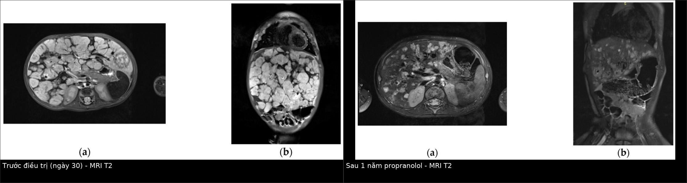
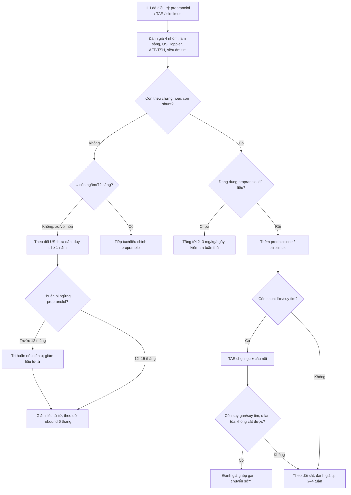
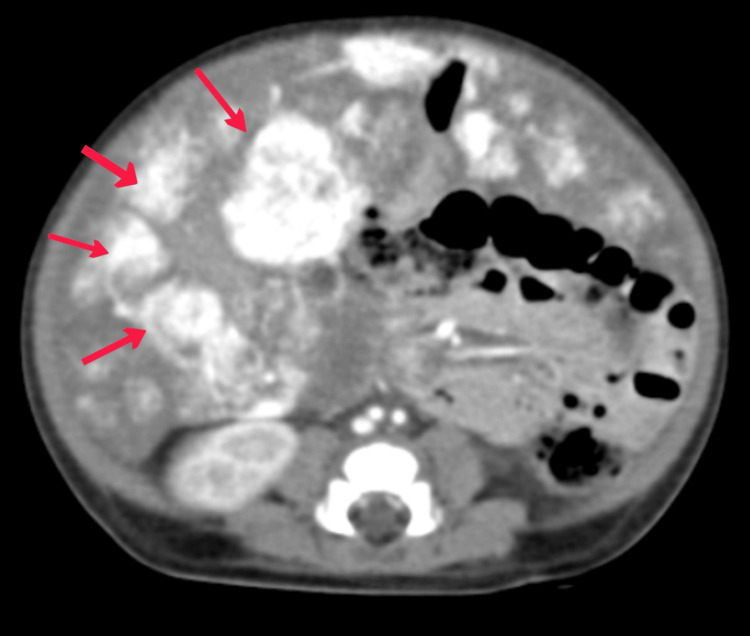
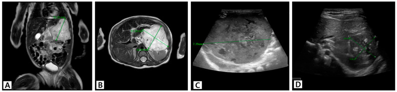

# 687 — Theo dõi & điều trị IHH sau can thiệp: sirolimus, nút mạch, ghép gan & ngừng propranolol / Post-intervention management of infantile hepatic hemangioma

**Tags:** `pattern:khoi-gan-nhi` `vung:gan` `score:IHH-response` `protocol:US-MRI-theo-doi` `protocol:TAE` `incidentaloma:khoi-gan-nhi`
**Mức chắc chắn (certainty):** tổng hợp y văn (literature synthesis) — tổng hợp từ các nghiên cứu đoàn hệ, ca nguyên văn và review mở; các ca minh họa là ca nguyên văn có ảnh CC BY, ghi rõ PMCID từng ảnh. Không có thử nghiệm ngẫu nhiên lớn cho phác đồ sau can thiệp.

> **Bài này nối tiếp 667.** 667 trả lời “chẩn đoán & điều trị bước đầu”; bài này trả lời **“sau khi đã dùng propranolol/TAE/sirolimus thì theo dõi gì, khi nào leo thang, khi nào ngừng thuốc và khi nào ghép gan”**.

## 1. Tổng quan bệnh học – cơ chế hình ảnh

- **U mạch máu gan nhũ nhi (infantile hepatic hemangioma, IHH)** là u mạch máu lành tính **GLUT-1 dương**, xuất hiện/tăng sau sinh, có **pha tăng sinh** rồi **pha thoái triển**. Khác với **u mạch máu bẩm sinh (congenital hepatic hemangioma, CHH)** — đã có đủ lúc sinh, **GLUT-1 âm**, thường không đáp ứng propranolol (bài 667).
- **Diễn tiến tự nhiên:** tăng nhanh trong **8–12 tháng đầu**, sau đó thoái triển chậm trong **4–7 năm**; vì vậy phần lớn trẻ không cần điều trị. Tuy nhiên thể **lan tỏa (diffuse)** có thể gây **suy tim cung lượng cao, suy giáp tiêu thụ, hội chứng khoang bụng, giảm tiểu cầu/rối loạn đông máu** và tử vong.
- **Vì sao phải theo dõi sau can thiệp?** Thuốc/can thiệp làm giảm shunt và thể tích u, nhưng:
  1. **U có thể còn mô sống** ở rìa hoặc trong vùng hoại tử/xơ → cần phân biệt **mô xơ không ngấm** với **nốt còn mạch nuôi**;
  2. **Rebound** sau ngừng propranolol;
  3. **Biến chứng của chính can thiệp** (TAE, sirolimus, mổ, ghép gan);
  4. **Suy giáp tiêu thụ** có thể kéo dài dù u nhỏ lại.
- **Cơ chế hình ảnh (TẠI SAO):**
  - IHH là **hồ mạch chảy chậm**: trên **siêu âm Doppler** là khối tăng hồi âm/không đồng nhất có mạch trong u; trên **MRI** khối **T1W tối, T2W sáng** do nhiều nước/hồ mạch (không có mỡ nên không mất tín hiệu trên fat-sat); trên **CEUS/MRI động** ngấm **viền nốt ngoại vi không liên tục → đầy dần vào trung tâm (centripetal fill-in)** vì thuốc vào hồ mạch chậm.
  - Sau điều trị, mô u thay bằng **xơ/collagen và vôi hóa** → **giảm tín hiệu T2, giảm/không ngấm thuốc**; mô u còn sống vẫn **T2 sáng và ngấm thuốc**.
  - **Vôi hóa** gặp nhiều ở CHH và sau điều trị/hoại tử; trên CT là **ổ tăng đậm độ > 200 HU**, không nên nhầm với mảnh xương/dị vật.
- **Ngưỡng định lượng đáng nhớ:**
  - **U lớn (large HH): > 4 cm** — nhóm có nguy cơ biến chứng, cần điều trị chứ không chỉ theo dõi.
  - Trong đoàn hệ 87 trẻ: **12 trẻ được điều trị**; **5,7% có suy tim**; kết cục **hoàn toàn 60,9% – một phần 27,6% – không đáp ứng 11,5%**; theo dõi trung vị **581 ngày**.
  - **AFP** trung vị lúc chẩn đoán ở nhóm điều trị **76.818,7 ng/mL** so với **627,2 ng/mL** ở nhóm quan sát; AFP **phải giảm dần** — **AFP tăng** là cờ đỏ của hepatoblastoma.
  - **Propranolol:** khởi đầu **1 mg/kg/ngày**, tăng tới **2–3 mg/kg/ngày**; duy trì **ít nhất 6 tháng** và **đến 12 tháng tuổi**.
  - **Rebound sau ngừng propranolol: 10–25%**, có thể xuất hiện **muộn tới 6 tháng** sau khi ngừng; nguy cơ cao nhất nếu ngừng **< 12 tháng tuổi (đặc biệt < 9 tháng)**, thấp nhất khi ngừng **12–15 tháng tuổi**.
  - **Sirolimus:** liều tham chiếu **1,6 mg/m²/ngày** (đoàn hệ Hàn Quốc) hoặc **0,45–0,5 mg/m²** khởi đầu ở sơ sinh với **nồng độ đáy 7–12 ng/mL**; một số phác đồ dùng **0,8 mg/m² × 2 lần/ngày**, đích **5–15 ng/mL**.
  - **Ghép gan:** chỉ là **cứu cánh cuối** cho thể lan tỏa/không cắt được, thất bại với thuốc và nút mạch; trong các loạt nhỏ, **4/4 và 3/3 trẻ ghép còn sống** (theo dõi 6–168 tháng), nhưng **4 ca tử vong khi đang chờ ghép** trong một loạt 31 ca.

*Trái: MRI T2 ngày 30 của điều trị — nhiều ổ lớn, bờ gồ ghề, thay gần hết hai thùy gan. Phải: sau 1 năm propranolol — tổn thương nhỏ lại, gan giảm kích thước, cấu trúc bên trong vẫn không đồng nhất. Nguồn: Tukhvatullina RR et al., Children 2026 (PMC13297738, Fig. 1–2), CC BY 4.0. Ảnh ghép letterbox giữ tỷ lệ.*

## 2. Mẫu hình + chẩn đoán phân biệt theo kiểu đáp ứng (gamut)

Sau can thiệp, đừng chỉ hỏi “u nhỏ chưa?” — hãy phân loại **kiểu đáp ứng** để quyết định bước tiếp:

- **Đáp ứng hoàn toàn (complete resolution):** không còn thấy tổn thương trên siêu âm; AFP/TSH về bình thường; không còn shunt trên siêu âm tim.
- **Đáp ứng một phần (partial resolution):** tổn thương còn thấy nhưng **nhỏ hơn**, mạch trong u giảm, lâm sàng cải thiện. Ca Patient 10: khối **7,2 × 5,2 × 7,4 cm** giảm còn **3,7 × 3,2 × 2,8 cm** sau sirolimus.
- **Không đáp ứng/ổn định:** kích thước không đổi hoặc tăng nhẹ, còn shunt/triệu chứng.
- **Rebound:** u **tăng lại** sau giảm liều/ngừng propranolol, thường trong **10–25%**, có thể sau **6 tháng**.
- **Biến chứng do can thiệp:** hoại tử gan, áp-xe, hẹp/tắc đường mật sau TAE; loét miệng, tăng men gan, tăng triglyceride, giảm tế bào máu do sirolimus; hẹp miệng nối, thải ghép, nhiễm trùng sau ghép gan.

**Gamut theo hình thái còn lại trên MRI/CEUS:**
- **Nốt T2 sáng + ngấm viền nốt → đầy dần:** mô IHH còn sống → tiếp tục/leo thang điều trị.
- **Vùng T2 tối + không ngấm + vôi hóa:** xơ/hoại tử → theo dõi, không đánh giá là “u còn sống”.
- **Nốt mới trong gan, AFP tăng nhanh:** **hepatoblastoma** hoặc u ác khác → không được mặc định là “IHH tái phát”.
- **Ổ dịch/quanh ổ hoại tử, sốt, đau bụng sau TAE:** **áp-xe/hoại tử đường mật** → cần dẫn lưu/kháng sinh, không phải “u to lên”.
- **Gan to + cổ trướng + suy gan sau ghép:** biến chứng ghép (hẹp miệng nối, thải ghép, tắc mạch gan).

**Mnemonic “R-T-E-S”:** **R**esidual (mô sống), **T**oxicity (độc tính thuốc), **E**scalation (khi nào leo thang), **S**top (khi nào ngừng).

## 3. Bảng so sánh phân biệt (ma trận đối chiếu)

| Thực thể/chiến lược | Hình ảnh & theo dõi điển hình | Chốt vào (rule-in) | Chốt loại (rule-out) | Gợi ý xác nhận |
|---|---|---|---|---|
| Tiếp tục propranolol | US: u nhỏ dần, mạch trong u giảm; MRI: giảm T2, giảm ngấm | **Đang đáp ứng, không có biến chứng, còn trong tuổi tăng sinh** | **U tăng lại dù đủ liều 2–3 mg/kg/ngày → không đơn thuần là “chưa đủ thời gian”** | Cân nặng, liều mg/kg/ngày, ECG, glucose, US 2–4 tuần/lần giai đoạn đầu |
| Sirolimus | MRI/US: giảm kích thước, giảm mạch; không có dấu hiệu ác tính | **Thất bại/không dung nạp propranolol ± prednisolone; u còn triệu chứng** | **U đã xơ hóa/không ngấm hoàn toàn → không cần thêm thuốc** | Nồng độ đáy sirolimus, công thức máu, men gan, lipid, loét miệng |
| Nút mạch (TAE) | Chụp mạch: giảm shunt; CT/MRI sau: vùng hoại tử không ngấm, có thể vôi hóa | **Shunt lớn gây suy tim không kiểm soát; cầu nối trước mổ/ghép** | **Tổn thương đã hoại tử toàn bộ, không còn shunt → TAE thêm không lợi** | Chụp mạch chọn lọc, đánh giá tưới máu gan còn lại, chức năng gan |
| Phẫu thuật cắt u | CT/MRI: khối khu trú, còn mô lành đủ để cắt | **Khu trú + suy tim/biến chứng không đáp ứng thuốc, còn gan lành** | **Lan tỏa/thay gần hết nhu mô → cắt không thể** | Thể tích gan còn lại, PRETEXT-like assessment, siêu âm tim |
| Ghép gan | Gan nhận: tưới máu, đường mật, không thải ghép | **Lan tỏa/không cắt được + suy gan/suy tim dai dẳng dù thuốc + TAE** | **Còn khả năng kiểm soát nội khoa hoặc còn mô gan lành để cắt** | Đánh giá đa chuyên khoa, chờ ghép, chống chỉ định nhiễm trùng |

### Phân biệt “mô xơ sau điều trị” với “u còn sống”
- **Mô xơ:** T2 tối, không ngấm hoặc ngấm rất ít, có thể vôi hóa; kích thước ổn định qua nhiều lần chụp.
- **U còn sống:** T2 sáng, ngấm viền nốt/đầy dần, kích thước tăng hoặc không giảm; có thể kèm AFP không giảm như kỳ vọng.
- **Áp-xe sau TAE:** ổ dịch có viền ngấm, khí trong ổ, sốt/đau; **không phải u tái phát**.
- **Hepatoblastoma:** khối đặc, vôi hóa thô, AFP rất cao/tăng nhanh; **sinh thiết nếu còn nghi ngờ và an toàn**.

## 4. Protocol theo dõi + hệ phân độ/điểm chuẩn hóa

### 4.1. Lịch theo dõi sau can thiệp
- **Siêu âm gan + Doppler:** lần đầu **2 tuần** sau chẩn đoán/đổi điều trị; nếu ổn định, **cộng dần 2 tuần vào mỗi khoảng** (2 → 4 → 6 tuần…), **duy trì ít nhất 1 năm** và đến khi kích thước/mạch máu ổn định. Theo dõi sát hơn nếu còn triệu chứng, còn shunt hoặc đang giảm liều.
- **Xét nghiệm mỗi lần khám:** **AFP**, **TSH/fT4**, công thức máu, men gan, đông máu; **siêu âm tim** khi có shunt/suy tim; **nồng độ sirolimus** khi dùng thuốc.
- **MRI gan có cản quang** hoặc **CEUS** khi: siêu âm không phân biệt xơ/u sống, u lan tỏa, trước quyết định mổ/ghép, hoặc nghi áp-xe/biến chứng đường mật.
- **CT** ưu tiên khi cần đánh giá vôi hóa, mạch máu, biến chứng cấp; hạn chế lặp vì bức xạ (ALARA).

### 4.2. Ngưỡng và cách leo thang
- **Propranolol:** duy trì **2–3 mg/kg/ngày** chia 2–3 lần; nếu **không đáp ứng ở 1–1,5 mg/kg/ngày**, tăng lên 3 mg/kg/ngày **ít có khả năng tạo thêm đáp ứng** — đánh giá lại chẩn đoán (CHH?) hoặc chuyển thuốc.
- **Prednisolone:** **1–2 mg/kg/ngày** phối hợp khi thể lan tỏa/nặng; tapering theo đáp ứng.
- **Sirolimus:** khởi đầu **0,45–0,5 mg/m²** ở sơ sinh (theo dõi đáy **7–12 ng/mL**) hoặc **1,6 mg/m²/ngày** theo phác đồ đoàn hệ; theo dõi **loét miệng, tăng men gan, tăng triglyceride, giảm tế bào máu, nhiễm trùng**.
- **TAE:** chỉ định khi **shunt lớn/suy tim không kiểm soát** hoặc **cầu nối** trước mổ/ghép; chọn nhánh động mạch gan nuôi u, tránh tắc mạch gan lành; biến chứng: **hoại tử gan, áp-xe, hẹp/tắc đường mật, chảy máu, suy gan**.
- **Phẫu thuật:** u **khu trú > 4 cm** gây suy tim/biến chứng, còn đủ gan lành; cắt bỏ hoàn toàn giúp khỏi bệnh.
- **Ghép gan:** **cứu cánh cuối** khi lan tỏa/không cắt được, thất bại nội khoa + TAE, suy gan/suy tim dai dẳng. Chuyển tuyến **sớm** khi thấy không còn đường lui — tử vong khi chờ ghép đã được ghi nhận.

### 4.3. Ngừng propranolol & xử trí rebound
- Duy trì **ít nhất 6 tháng** và **đến 12 tháng tuổi**; có thể kéo dài hơn ở thể lan tỏa/đáp ứng chậm.
- **Giảm liều từ từ** (không ngừng đột ngột), theo dõi **10–25% rebound**, có thể xuất hiện **muộn tới 6 tháng**; một số trung tâm kéo dài điều trị hơn 12 tháng tùy thể và mức đáp ứng.
- **Ngừng < 12 tháng tuổi (nhất là < 9 tháng)** → nguy cơ rebound cao nhất; **12–15 tháng** → nguy cơ thấp nhất.
- Rebound: **khởi động lại propranolol** ở liều hiệu quả trước đó, đánh giá lại AFP/TSH và hình ảnh; nếu tái phát nhiều lần → cân nhắc sirolimus/TAE/mổ.

### 4.4. An toàn propranolol
- **Chống chỉ định/tương đối:** **cân nặng < 2 kg**, **non tháng < 5 tuần tuổi hiệu chỉnh**, tiền sử hạ đường huyết, block nhịp độ 2–3, hen/phế quản co thắt, tụt huyết áp nặng.
- **Hạ đường huyết:** cho bú đều trước mỗi liều, không bỏ bữa; theo dõi đường huyết ở nhũ nhi nhỏ/bú kém; dừng thuốc và xử trí ngay nếu li bì, vã mồ hôi, co giật.
- **Theo dõi:** nhịp tim, huyết áp, ECG khi khởi đầu/tăng liều; tăng kali máu đã được báo cáo ở **2 mg/kg/ngày**.

### 4.5. Sơ đồ sau can thiệp

## 5. Biến thể bình thường và cạm bẫy

- **“U nhỏ lại” không đồng nghĩa “hết mạch nuôi”:** sau TAE, vùng trung tâm hoại tử nhưng **viền nốt ngoại vi vẫn ngấm** = mô sống; đọc CEUS/MRI động, đừng chỉ đo đường kính.
- **Vôi hóa sau điều trị** có thể trông như “dị vật/xương”; đối chiếu CT và bệnh sử, không chọc nhầm.
- **AFP cao sinh lý 6 tháng đầu:** xu hướng **giảm** mới là điều quan trọng; **AFP tăng/tăng nhanh** phải loại hepatoblastoma, kể cả khi hình ảnh “giống IHH”.
- **Suy giáp tiêu thụ có thể dai dẳng** dù u đã nhỏ: tiếp tục TSH/fT4 và LT4 theo endocrinology; không ngừng LT4 chỉ vì u nhỏ.
- **Rebound sau ngừng propranolol** có thể xảy ra muộn **6 tháng**; hẹn tái khám và dặn phụ huynh theo dõi bụng/tái xuất hiện khối.
- **Hạ đường huyết do propranolol** dễ bị bỏ qua ở nhũ nhi (li bì, bú kém, vã mồ hôi) — kiểm tra glucose mao mạch khi có triệu chứng.
- **Đừng quên ổ thứ hai:** sau khi thấy IHH lan tỏa, soát **da, tuyến giáp, tim**; bỏ sót suy tim/shunt là nguyên nhân tử vong chính.
- **TAE không phải “thủ thuật nhẹ”:** nguy cơ hoại tử gan/áp-xe/hẹp đường mật; một ca IHH lan tỏa đã tử vong trong giai đoạn hậu thủ thuật sau propranolol + TAE.

## 6. Tự lượng giá — Blind Quiz

**Ca 1 — Bé gái 1 tháng, bụng to nhanh từ ngày 15, có u mạch máu ở da vùng cung mày trái. Đọc MRI trước và sau điều trị.**

- Gợi ý lâm sàng: bụng chướng, vòng bụng **47,5 cm**, gan **5 cm dưới bờ sườn**, thở nhanh > 60 lần/phút; TSH **90,99 mIU/L**, AFP **10.564,1 IU/mL**, tiểu cầu **48 × 10⁹/L**.
- Câu hỏi: Mô tả tổn thương trước điều trị? Biến chứng cấp nào đang xảy ra? Sau 1 năm, hình ảnh thay đổi ra sao và còn cần theo dõi gì?

<b>Bấm để hiện đáp án (findings + chẩn đoán)</b>

- Dấu hiệu: MRI T2 ngày 30 — **nhiều ổ lớn tăng tín hiệu, bờ gồ ghề, thay gần hết hai thùy gan**, gan to; sau 1 năm propranolol — các ổ **nhỏ hơn rõ**, gan giảm kích thước, cấu trúc vẫn không đồng nhất.
- Chẩn đoán: **IHH lan tỏa (diffuse infantile hepatic hemangioma)** có **hội chứng khoang bụng** (bụng căng, vòng bụng 47,5 cm), **suy giáp tiêu thụ** (TSH 90,99; fT4 thấp), **giảm tiểu cầu** và **suy tim/suy hô hấp**.
- Điều trị trong ca: propranolol **0,5 mg/kg/ngày → tăng 0,5 mg/kg mỗi 3 ngày → 3 mg/kg/ngày**, kèm LT4, hỗ trợ hô hấp; **ngày 10 hết ACS** (vòng bụng 42 cm, gan 3 cm dưới bờ sườn), cai máy.
- Theo dõi sau: US Doppler thưa dần, AFP/TSH/fT4, siêu âm tim; chuẩn bị **giảm liều propranolol từ từ quanh 12–15 tháng tuổi** và theo dõi rebound.
- Nguồn ảnh: Tukhvatullina RR et al., *Children* 2026 (PMC13297738, Fig. 1–2), CC BY 4.0. Ảnh ghép letterbox.

**Ca 2 — Bé gái 2 tháng, vàng da, bụng chướng, có u mạch máu da đùi trái và hõm trên đòn phải. Đọc CT bụng.**

- Gợi ý lâm sàng: vàng da, phân bạc màu, đi ngoài phân đen; TSH **90,6 µIU/mL**, AST **264 U/L**.
- Câu hỏi: Chẩn đoán? Vì sao không sinh thiết? TAE có vai trò gì và nguy cơ nào?

<b>Bấm để hiện đáp án (findings + chẩn đoán)</b>

- Dấu hiệu: **nhiều khối lớn, đa thùy trong gan**, có **vôi hóa lấm tấm**; thì tĩnh mạch cửa ngấm **viền nốt ngoại vi rồi đầy dần vào trung tâm**.
- Chẩn đoán: **IHH đa ổ/lan tỏa** kèm **suy giáp tiêu thụ**; không sinh thiết vì **nguy cơ chảy máu cao** và hình ảnh đủ điển hình.
- TAE: làm giảm shunt động–tĩnh mạch, hỗ trợ kiểm soát suy tim; nhưng có thể gây **hoại tử gan, áp-xe, hẹp đường mật, suy gan**. Trong ca này, trẻ được propranolol + TAE nhưng **tử vong trong giai đoạn hậu thủ thuật** — không được xem TAE là can thiệp “nhẹ”.
- Nguồn ảnh: Kaplish D et al., *Cureus* 2024;16(8):e66507 (PMC11381096, Fig. 3), CC BY 4.0.

**Ca 3 — Bé gái 1 ngày tuổi, khối gan trái 5,2 × 4,3 × 5,1 cm. Propranolol 3 tuần + prednisolone nhưng khối tăng lên 7,2 × 5,2 × 7,4 cm. Đọc chuỗi ảnh.**

- Gợi ý lâm sàng: bú kém, bụng chướng; không có suy tim nặng.
- Câu hỏi: Bước tiếp theo hợp lý? Liều sirolimus tham chiếu? Kết quả sau 5 tháng?

<b>Bấm để hiện đáp án (findings + chẩn đoán)</b>

- Dấu hiệu: (A,B) MRI ngày 3 — khối **thùy trái, đa thùy, T2 sáng**, kích thước **5,2 × 4,3 × 5,1 cm**; (C) siêu âm 6 tuần — khối **tăng lên 7,2 × 5,2 × 7,4 cm**; (D) sau sirolimus — còn **3,7 × 3,2 × 2,8 cm**.
- Chẩn đoán: **IHH khu trú không đáp ứng propranolol + prednisolone** → thêm **sirolimus 1,6 mg/m²/ngày**; đáp ứng một phần, triệu chứng cải thiện.
- Theo dõi: nồng độ đáy sirolimus, men gan/lipid/công thức máu, loét miệng; tiếp tục US/MRI và đánh giá khả năng cắt u nếu còn khối lớn.
- Nguồn ảnh: Lee S et al., *J Clin Med* 2024;13(10):2839 (PMC11122465, Fig. 4), CC BY 4.0.

## Bài liên quan chéo
- [600 – Tổng quan Hệ Nhi khoa](../600-tong-quan-nhi-khoa/lesson.md) (bảng DDx khối gan nhi)
- [667 – U mạch máu gan ở trẻ & điều trị nội khoa](../667-u-mach-mau-gan-o-tre-va-dieu-tri/lesson.md) (chẩn đoán, propranolol, biến chứng)
- [665 – Khối u gan ở trẻ em (hepatoblastoma, hemangioma, hamartoma, HCC)](../665-khoi-u-gan-nhi/lesson.md)
- [646 – Hội chứng khoang bụng ở trẻ](../646-hoi-chung-khoang-bung-o-tre/lesson.md) (biến chứng ACS của IHH lan tỏa)
- [663 – Sarcoma phôi gan chưa biệt hóa (UESL)](../663-sarcoma-phoi-gan-chua-biet-hoa/lesson.md) (chẩn đoán phân biệt khối gan nhi)

## Ảnh
- Tên file `687_ihh_<Modality>_PMC...`; nguồn + giấy phép từng ảnh trong `images/CREDITS.md`.
- Ảnh CC BY 4.0 được phép ghép đối chiếu; ảnh ghép letterbox giữ nguyên tỷ lệ, không crop/kéo giãn.
- Không tải Google Images/AuntMinnie; nguồn đóng chỉ dẫn link trong `sources.md`.

> Không dùng để chẩn đoán độc lập khi chưa có người hướng dẫn.
