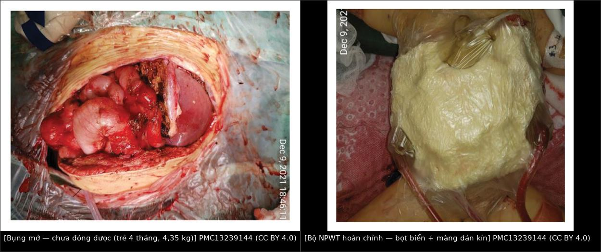
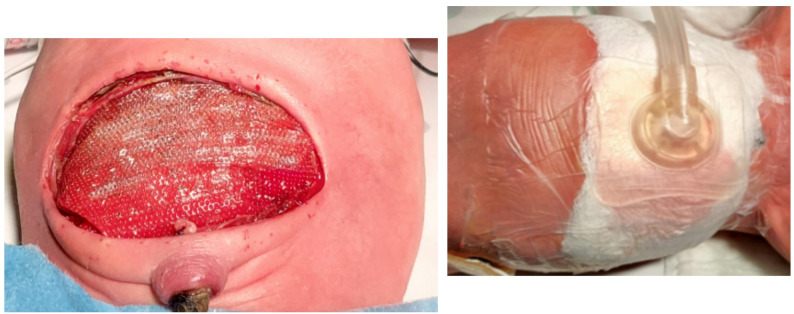
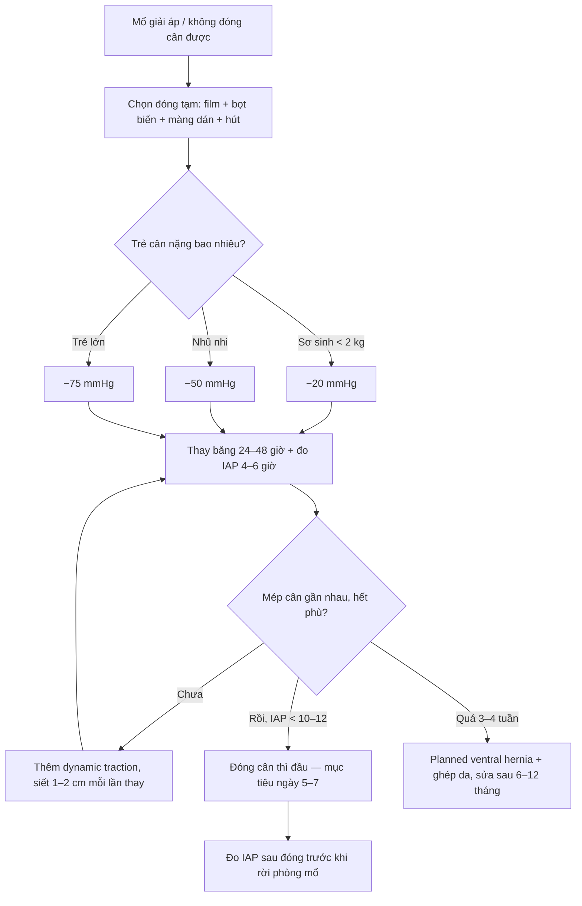
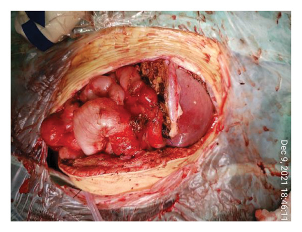
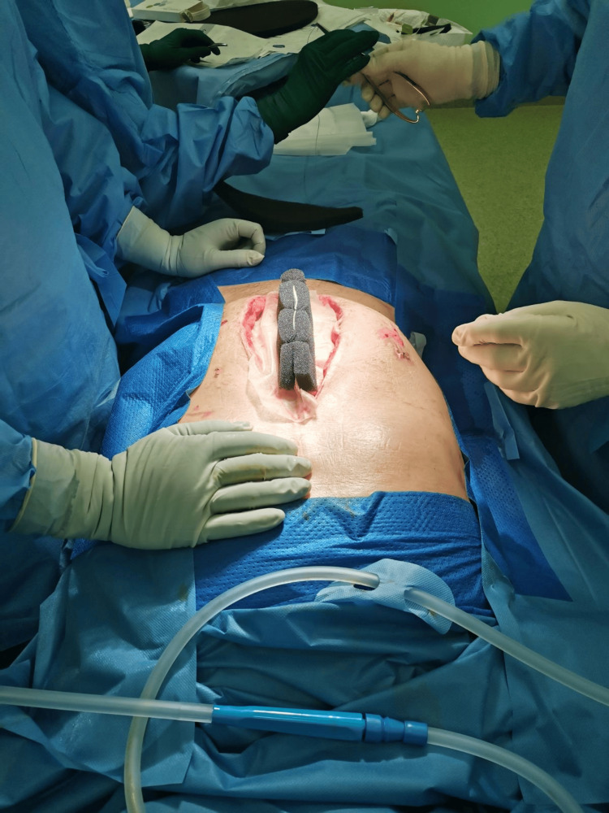

# 688 — Đóng bụng tạm thời & liệu pháp áp lực âm (NPWT) ở trẻ sau mở bụng giải áp / Temporary abdominal closure and negative pressure wound therapy in children

**Tags:** `pattern:bung-mo` `vung:thanh-bung` `protocol:NPWT` `score:bjorck-1A-4`
**Mức chắc chắn (certainty):** tổng hợp y văn (literature synthesis) — ngưỡng/kỹ thuật từ tổng quan có hệ thống và review đọc trực tiếp (PMC13581991, PMC13337969, PMC13239144), ca nguyên văn sơ sinh (PMC13072599), ngưỡng áp lực trẻ em từ khảo sát/đồng thuận (PMC3390295). Chưa có thử nghiệm ngẫu nhiên riêng cho **mức áp lực** ở trẻ — đây là khoảng trống bằng chứng phải nói rõ.

## 1. Tổng quan bệnh học – cơ chế hình ảnh

- **Định nghĩa:** **bụng mở tạm thời (open abdomen, OA; laparostomy)** = cố ý **không đóng cân (fascia)** sau mổ, che tạng bằng vật liệu tạm, để **mổ lại có kế hoạch** và **đóng thì sau** khi phù giảm. Đây là bước **tiếp theo của mổ giải áp** trong hội chứng khoang bụng (xem bài 646).
- **Chỉ định (3 nhóm — theo review 2026, PMC13337969):**
  - **Sinh lý:** huyết động không ổn định, cần mổ cấp cứu nhiều lần (damage control); toan chuyển hóa/nhiễm toan; hạ thân nhiệt.
  - **Giải phẫu:** **không thể đóng cân nếu không gây căng** — phù tạng nặng, **mất miền (loss of domain)**, thoát vị hoành bẩm sinh/thành bụng bẩm sinh, **ghép gan mảnh quá lớn (GRWR ≥ 2,5–3,5%)** ở trẻ.
  - **Hậu cầu:** nhiễm trong ổ bụng **không kiểm soát được nguồn** trong một lần mổ, dự kiến **second look**.
- **Ngưỡng áp lực ở TRẺ (khác người lớn — bắt buộc nhớ):**
  - **IAP bình thường ở trẻ bệnh nặng: 7 ± 3 mmHg.**
  - **IAH ≥ 10 mmHg**; **độ I 10–12**, **độ II 13–15**, **độ III 16–18**, **độ IV > 18 mmHg** (bảng adapt WSACS của Kaussen 2012; một số bản adapt khác dùng III 16–19 và IV ≥ 20 — luôn ghi rõ bản đang dùng, đừng trộn hai bảng).
  - **ACS = IAP ≥ 10 mmHg + rối loạn chức năng cơ quan mới**, với **APP = MAP − IAP**.
  - Hệ quả thực hành: **ngưỡng của người lớn (≥ 12 mmHg; ACS > 20 mmHg) KHÔNG dùng cho trẻ** — trẻ có MAP thấp nên chỉ cần IAP 10–15 mmHg đã mất tưới máu tạng (PMC3390295).
- **TẠI SAO NPWT có tác dụng (cơ chế, không phải "thần dược"):**
  1. **Hút dịch + giảm phù gian bào** → giảm thể tích tạng → giảm lực căng thành bụng.
  2. **Tăng tưới máu vi mô** và **tạo mô hạt** trên bề mặt cân/tạng.
  3. **Quan trọng nhất — kéo mép cân vào giữa (fascial medialization)**, nhưng **chỉ khi có lực kéo trung gian chủ động** (dynamic fascial traction/mesh-mediated traction). **NPWT đơn thuần không thắng được co kéo bên của cân:**
     - **NPWT đơn thuần: đóng cân thì đầu 18–59%.**
     - **NPWT + dynamic traction: 77–100%.**
     - Nhóm ghép: **80–90%** đóng thì đầu ở ca chọn lọc; mục tiêu đóng **ngày 5–7** (PMC13337969).
- **TẠI SAO áp lực phải THẤP ở trẻ (vật lý):** lực hút tuyệt đối = **áp suất × diện tích**; bụng trẻ **diện tích nhỏ nhưng thành bụng mỏng, ít mỡ, tạng non**, nên **cùng một mmHg gây chèn ép tương đối lớn hơn** lên tĩnh mạch cửa, mảnh ghép gan và quai ruột. Vì vậy:
  - **Người lớn:** thường **−75 đến −125 mmHg**.
  - **Trẻ/nhũ nhi:** **−50 và −75 mmHg** là mức hay dùng nhất; dải ghi nhận **−10 đến −125 mmHg**.
  - **Sơ sinh non tháng:** ca NEC toàn bộ **1.570 g** dùng **−20 mmHg** với **film dẫn lưu trong ổ bụng**, mổ lại sau **72 giờ** (PMC13072599).
  - **Ghép gan nhi:** dùng **−40 đến −60 mmHg** dao động, và bài báo nêu rõ **áp lực cao kiểu 125 mmHg có thể làm giảm tưới máu mảnh ghép** (PMC13239144).
- **Số liệu nền của nhóm nhũ nhi (tổng quan hệ thống 38 nghiên cứu, 226 nhũ nhi, 161 bụng mở — PMC13581991):**
  - **Thời gian NPWT trung vị 14 ngày** (IQR 10–33,5; khoảng 1–180 ngày).
  - **Kết cục đóng:** **47% lành thì hai (secondary intention)**, **53% đóng thì ba (delayed primary)**; chỉ **3,7%** cần tạo hình bằng mảnh ghép/vạt.
  - **Biến chứng nhẹ và ít:** kích ứng da, **2 ca nhiễm trùng**; **1 ca giảm SpO₂ do quấn băng ngoài quá chặt** (ca đó đặt NPWT **−80 mmHg** rồi quấn thêm băng quanh bộ dressing) — bài học: **không quấn thêm băng ngoài**.
- **Số liệu người lớn để so sánh (EuraHS 2023, trích trong PMC13337969):** thời gian bụng mở trung bình **20,8 ngày** → **tử vong 27,9%**, **rò ruột–khí quyển (EAF) ~7%**. Đây là lý do **phải đóng sớm**, không "để bụng mở cho tiện".

## 2. Mẫu hình + chẩn đoán phân biệt theo hình thái (gamut)

- **Mẫu hình 1 — "bụng mở + sốt/dịch đục sau 48–72 giờ":** nghĩ **nhiễm vết mổ/viêm phúc mạc còn sót**, **ổ tụ dịch**, **hoại tử ruột**, **rò ruột mới**. Chốt bằng **mổ lại (second look)**, không bằng CT đơn thuần — vì **dressing NPWT chứa khí và kim loại** làm CT khó đọc.
- **Mẫu hình 2 — "bụng mở không đóng được sau 7–10 ngày":** **mất miền (loss of domain)**, **frozen abdomen**, **mép cân co cứng**, **mô hạt phủ cân**. Đây là nhóm cần **dynamic traction** sớm, không chờ.
- **Mẫu hình 3 — "khí trong ổ bụng trên X-quang bụng mở":** 4 khả năng — **khí trong bọt biển NPWT** (hay gặp nhất, hình ảnh "bong bóng" đều trong ô băng), **khí trong ruột**, **khí tự do thật** (tràn khí màng bụng), **khí trong ổ áp-xe**. Chốt bằng **đối chiếu vị trí với bộ dressing** + mổ lại, không tự động mở bụng vì "có khí".
- **Mẫu hình 4 — "bụng mở + suy dinh dưỡng, sụt cân":** mất **dịch–protein qua bề mặt bụng mở** (có thể **hàng lít/ngày** ở người lớn); đây là chỉ định **nuôi ăn sớm** và **bù dịch có kiểm soát**, không phải biến chứng nhiễm.
- **Gamut theo mức độ dính (phân loại Björck sửa đổi 2016 — dùng để quyết định còn đóng được hay không):**
  - **1A** sạch, không dính; **1B** nhiễm, không dính; **1C** có rò ruột, không dính.
  - **2A/2B/2C** như trên **nhưng đã bắt đầu dính (developing fixation)**.
  - **3A/3B** **frozen abdomen** (dính dày, mất miền).
  - **4** **frozen abdomen + rò ruột–khí quyển (EAF)** — nặng nhất.

## 3. Bảng so sánh phân biệt các kiểu đóng bụng tạm thời (ma trận đối chiếu)

| Kỹ thuật (entity) | Đặc điểm/hình ảnh đặc trưng | Chốt vào (rule-in) | Chốt loại (rule-out) | Gợi ý xác nhận |
|---|---|---|---|---|
| **Bogota bag (túi nilon vô khuẩn)** | Túi 3 L may vào mép cân; **không hút, không kéo lực** | Bụng căng, cần che tạng **ngay, rẻ, sẵn có** | Không đóng được sau 5–7 ngày; không giảm phù | Theo dõi IAP + đổi sang NPWT nếu kéo dài |
| **NPWT đơn thuần** | Bọt biển + màng dán + hút liên tục; **không có lực kéo mép cân** | Cần **hút dịch, giảm phù, bảo vệ tạng** | **Đóng thì đầu chỉ 18–59%** → không đủ nếu mục tiêu đóng sớm | Đo khoảng cách mép cân mỗi lần thay băng |
| **NPWT + dynamic fascial traction (VAWCM)** | NPWT **+ lưới khâu vào mép cân, siết dần** | **Đóng thì đầu 77–100%**, mục tiêu **ngày 5–7** | Không dùng khi **cân đã hoại tử/nhiễm nặng** | Siết lưới mỗi **48 giờ** khi thay băng |
| **Wittmann patch / Velcro** | Hai tấm dính khâu vào hai mép cân, dán lại từng bước | Cần **kéo đều, điều chỉnh tại giường** | Không kiểm soát được dịch nếu không kèm NPWT | Ghi lại số lần siết mỗi ngày |
| **Đóng da đơn thuần (skin-only)** | Chỉ khâu da, cân hở bên dưới | Cứu cánh khi **không còn cách nào** | **Nguy cơ thoát vị thành bụng gần như chắc chắn** | Kế hoạch sửa thoát vị sau 6–12 tháng |
| **Đóng cân thì đầu (primary fascial closure)** | Khâu cân giữa, không căng | **Đích cuối cùng** — IAP sau đóng **< 10–12 mmHg** ở trẻ | **Không đóng khi còn phù/còn căng** | Đo IAP **sau khi đóng** trước khi rời phòng mổ |

### Ranh giới cần nhớ
- **NPWT không thay thế việc mổ lại:** mục tiêu là **đóng sớm**, không phải "để yên và chờ".
- **Không có "một mức áp lực chuẩn" cho trẻ:** tổng quan hệ thống ghi nhận **không nghiên cứu nào mô tả cách chọn áp lực**; dải dùng thực tế **−10 đến −125 mmHg**, phổ biến **−50 và −75** (PMC13581991). Vì vậy phải **chọn theo cân nặng/tuổi + đáp ứng**, và ghi lại mức đã dùng.

## 4. Protocol + phân độ + flowchart

- **Bước 1 — Trước khi để bụng mở:** đo **IAP** (bàng quang, thì thở ra) làm mốc; đặt **sonde dạ dày + sonde bàng quang**; chuẩn bị **bộ NPWT cỡ nhỏ** (bọt biển cắt theo kích thước vết mổ, **không để bọt biển chạm trực tiếp vào ruột**).
- **Bước 2 — Các lớp của bộ dressing (thứ tự từ trong ra):**
  1. **Film nhựa đục lỗ (fenestrated plastic sheet/film dẫn lưu)** phủ toàn bộ tạng — **lớp bảo vệ chống rò ruột vào bọt biển**.
  2. **Bọt biển polyurethane** (lỗ 400–600 µm) cắt vừa vết mổ; với vết mổ nhỏ có thể dùng **bọt biển trắng PVA** (ít mô hạt xâm nhập hơn).
  3. **Màng dán kín (adhesive drape)** phủ kín, **dán mép 5 cm** ra da lành.
  4. **Đầu hút (pad)** nối máy, đặt **ở vị trí thấp** để dịch thoát.
- **Bước 3 — Mức áp lực (chọn theo tuổi, ghi vào hồ sơ):**

| Nhóm | Áp lực khởi đầu hợp lý | Nguồn/ghi chú |
|---|---|---|
| Sơ sinh non tháng (< 2 kg) | **−20 mmHg** | Ca NEC 1.570 g (PMC13072599) |
| Nhũ nhi/nhi nhỏ | **−50 mmHg** | Mức phổ biến nhất trong tổng quan (PMC13581991) |
| Trẻ lớn | **−75 mmHg** | Mức phổ biến thứ hai; trần thực hành **−125** |
| Ghép gan nhi (nguy cơ thiếu máu mảnh ghép) | **−40 đến −60 mmHg** dao động | PMC13239144 |
| Người lớn (để so sánh) | **−75 đến −125 mmHg** | PMC13337969 |

- **Bước 4 — Theo dõi & thay băng:**
  - Thay băng/mổ lại **mỗi 24–48 giờ** (hoặc sớm hơn nếu sốt, dịch đục, mất áp lực).
  - **Đo IAP mỗi 4–6 giờ** trong 48 giờ đầu; **IAP ≥ 10 mmHg kèm rối loạn chức năng = ACS** (bài 646).
  - Mỗi lần thay: đo **khoảng cách hai mép cân**, đánh giá **mô hạt, nhiễm, rò ruột**, và **siết lưới/traction thêm 1–2 cm** nếu mép cân còn mềm.
- **Bước 5 — Ngưỡng và thời điểm đóng:**
  - **Đóng khi:** hết phù tạng, **IAP < 10–12 mmHg**, hai mép cân **gần nhau không căng**, không nhiễm, không rò.
  - **Mục tiêu: ngày 5–7.** Nếu **> 3–4 tuần** không đóng được → chuyển **thoát vị thành bụng có kế hoạch (planned ventral hernia)**: ghép da lên mô hạt, sửa thành bụng sau **6–12 tháng**.
- **Bước 6 — Điều trị hỗ trợ có bằng chứng:**
  - **Nuôi ăn đường tiêu hóa sớm 24–48 giờ** khi huyết động ổn → tỉ lệ đóng thành bụng thì đầu **tới 74%** so với nhóm nuôi ăn muộn (PMC13337969).
  - **Hạn chế dịch tinh thể** (goal-directed), tránh phù nặng thêm.
  - **Giảm đau, giữ ấm, kháng sinh theo ổ nhiễm** (không kháng sinh dự phòng kéo dài).

## 5. Biến thể bình thường và cạm bẫy

- **Cạm bẫy 1 — áp ngưỡng người lớn cho trẻ:** dùng **≥ 12 mmHg** hoặc **ACS > 20 mmHg** sẽ **bỏ sót ACS ở trẻ**; ngưỡng trẻ là **IAH ≥ 10**, **ACS ≥ 10 + rối loạn chức năng** (PMC3390295).
- **Cạm bẫy 2 — hút quá mạnh:** **−125 mmHg** ở trẻ sơ sinh/nhũ nhi dễ gây **chèn ép, thiếu máu tạng, hoại tử ruột**; ca ghép gan nhi nêu rõ **áp lực cao kiểu 125 mmHg có thể làm giảm tưới máu mảnh ghép** (PMC13239144). Bắt đầu thấp, tăng dần theo đáp ứng.
- **Cạm bẫy 3 — quấn băng ngoài:** một ca **giảm SpO₂ do quấn băng ngoài quá chặt** (NPWT −80 mmHg + quấn băng quanh bộ dressing) (PMC13581991). **Không quấn thêm băng ngoài** lên màng dán.
- **Cạm bẫy 4 — tưởng khí trong bọt biển là khí tự do:** bọt biển chứa khí tạo **hình ảnh khí "ngoài lòng ruột"** trên X-quang/CT; luôn **đối chiếu với vị trí bộ dressing** trước khi kết luận tràn khí/thủng.
- **Cạm bẫy 5 — bỏ lớp film bảo vệ ruột:** bọt biển **tiếp xúc trực tiếp với quai ruột** làm tăng **rò ruột–khí quyển (EAF)** — biến chứng khó cứu nhất. Ở trẻ, **bọt biển phải luôn có film/vải bảo vệ** bên dưới.
- **Cạm bẫy 6 — đóng cân quá sớm:** đóng khi còn phù → **ACS tái phát**, **giảm tưới máu mảnh ghép**, **bục vết mổ**. Luôn **đo IAP sau khi đóng** trước khi rời phòng mổ.
- **Cạm bẫy 7 — chỉ dùng NPWT mà không kéo lực:** tỉ lệ đóng **18–59%** so với **77–100%** khi có dynamic traction (PMC13337969) — **NPWT một mình là "che tạng", không phải "đóng bụng"**.
- **Biến thể bình thường:** **mô hạt đỏ tươi, ướt** dưới bọt biển là **lành tính** — không phải nhiễm; chỉ lo khi **mủ, mùi, mô xám/hoại tử**, hoặc **mất áp lực đột ngột** (hở màng dán).

## 6. Tự lượng giá — Blind Quiz

**Ca 1 — Bé gái 4 tháng (4,35 kg) ghép gan mảnh lớn, cuối mổ không đóng được cân.**

- Gợi ý: **GRWR 4,3%**, bụng căng, thở máy.
- Câu hỏi: vì sao không đóng cân ngay? Ba việc phải làm trong 24 giờ đầu?

<b>Bấm để hiện đáp án (findings + chẩn đoán)</b>

- Hình ảnh: **bụng mở**, ruột và gan phủ film; **không thể đóng cân nếu không gây căng** (mảnh ghép lớn hơn ổ bụng).
- Chẩn đoán: **bụng mở tạm thời do mảnh ghép quá lớn (large-for-size graft)** — chỉ định giải phẫu.
- Ba việc: (1) **film đục lỗ phủ tạng + bọt biển + màng dán + hút −40 đến −60 mmHg**; (2) **đo IAP 4–6 giờ/lần**, mục tiêu **≤ 10–12 mmHg**, theo dõi **vận tốc tĩnh mạch cửa ≥ 40 cm/s** bằng Doppler; (3) **nuôi ăn sớm + hạn chế dịch**, mổ lại thay băng mỗi 24–48 giờ.
- Nguồn ảnh: PMC13239144, Fig 2a — CC BY 4.0.

**Ca 2 — Sơ sinh 32 tuần, 1.570 g, NEC toàn bộ, đã mở bụng.**

- Câu hỏi: lớp bên trái là gì và tại sao bắt buộc phải có? Áp lực nào hợp lý?

<b>Bấm để hiện đáp án (findings + chẩn đoán)</b>

- Hình ảnh: (trái) **film dẫn lưu trong ổ bụng (intra-abdominal drainage film)** đục lỗ phủ ruột; (phải) **gạc Kerlix AMD + màng dán kín** với đầu hút.
- Vì sao bắt buộc: ngăn **bọt biển tiếp xúc trực tiếp quai ruột** → giảm nguy cơ **rò ruột–khí quyển** và **hoại tử/chèn ép ruột**.
- Áp lực: **−20 mmHg**, mổ lại sau **72 giờ**; bệnh nhi hồi phục, ăn miệng từ ngày thứ 5 sau mổ.
- Nguồn ảnh: PMC13072599, Fig 2 — **CC BY-NC-ND 4.0** (giữ nguyên bản, không cắt/ghép).

**Ca 3 — Người lớn (để so sánh kỹ thuật): bụng mở sau viêm phúc mạc, đã khâu lưới vào mép cân.**

- Câu hỏi: vì sao phải **gấp nếp và siết lưới** thay vì chỉ đặt bọt biển?

<b>Bấm để hiện đáp án (findings + chẩn đoán)</b>

- Hình ảnh: lưới khâu vào hai mép cân, **gấp nếp (plicated)** và siết dần; bọt biển + hút đặt trên phần còn hở.
- Chẩn đoán: **NPWT + dynamic fascial traction (VAWCM)** — kiểu đóng tạm cho **đóng cân thì đầu 77–100%**, so với **18–59%** nếu chỉ NPWT.
- Vì sao: lưới tạo **lực kéo trung gian liên tục** chống co kéo bên của cân, giữ **miền bụng (domain)**; NPWT chỉ loại dịch và phù.
- Nguồn ảnh: PMC11921756, Fig 9 — CC BY 4.0.

## Bài liên quan chéo
- [646 – Hội chứng khoang bụng ở trẻ](../646-hoi-chung-khoang-bung-o-tre/lesson.md)
- [1625 – Rò ruột–khí quyển (EAF) sau bụng mở ở trẻ: biến chứng của chính bụng mở kéo dài](../1625-ro-ruot-khi-quen-o-tre/lesson.md) (bước SAU của bài này) (bước trước: đo IAP, phân độ, chỉ định mổ giải áp)
- [649 – Khi trung thất hoại tử & sinh khí ở trẻ](../649-khi-trung-that-hoai-tu-va-sinh-khi-o-tre/lesson.md) (cùng nhóm nhiễm hoại tử, cần mổ lại)
- [640 – Khớp háng nhi: DDH, Perthes, SCFE & NAT](../640-khop-hang-nhi-DDH-Perthes-SCFE-va-NAT/lesson.md)
- [644 – Phục hồi chức năng hô hấp & chuyển tiếp ở trẻ](../644-phuc-hoi-chuc-nang-ho-hap-va-chuyen-tiep-o-tre/lesson.md)

## Ảnh
- `688_bung-mo_Anh-mo_PMC13239144-f2a.jpg` — bụng mở ở trẻ 4 tháng, 4,35 kg (PMC13239144, CC BY 4.0).
- `688_NPWT_Anh-mo_PMC13239144-f2c.jpg` — bộ NPWT hoàn chỉnh (PMC13239144, CC BY 4.0).
- `composite_bung-mo-den-NPWT.jpg` — ảnh ghép letterbox "bụng mở → NPWT" (CC BY 4.0).
- `688_lop-dressing_Anh-mo_PMC13072599-f2.jpg` — film trong ổ bụng + gạc/màng dán ở trẻ non tháng (PMC13072599, **CC BY-NC-ND 4.0**, giữ nguyên bản).
- `688_NPWT-tren-luoi_Anh-mo_PMC11921756-f9.jpg` — NPWT trên lưới gấp nếp (PMC11921756, CC BY 4.0) — xem `images/CREDITS.md`.

> Không dùng để chẩn đoán độc lập khi chưa có người hướng dẫn.
