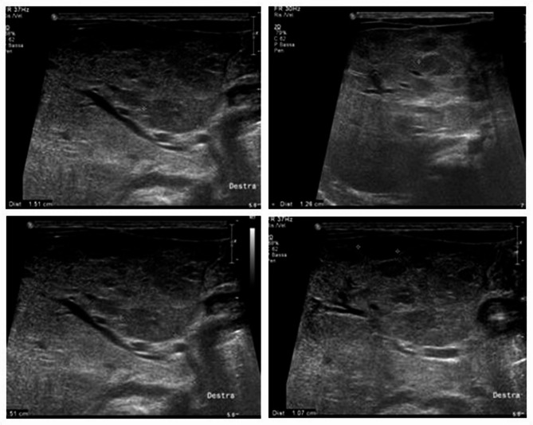
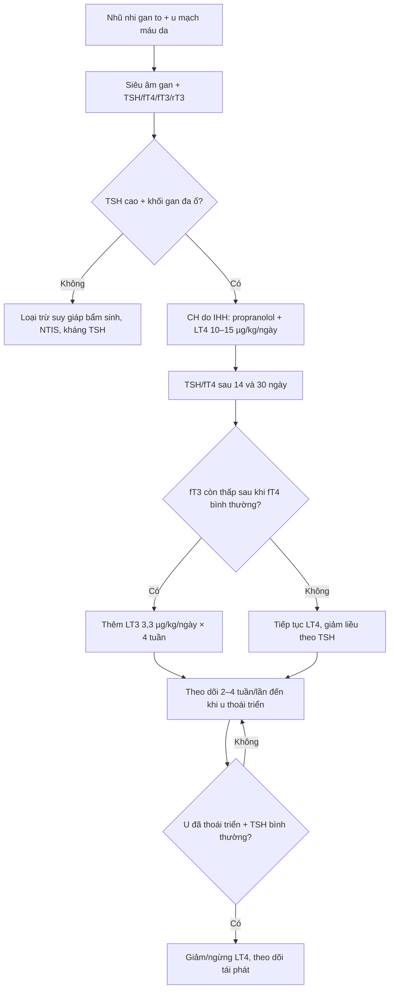
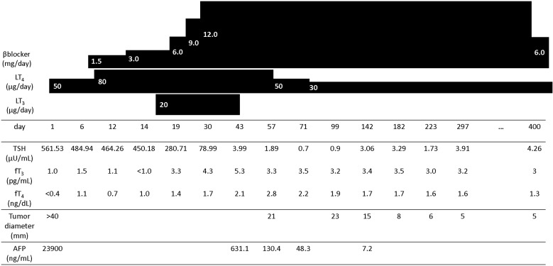
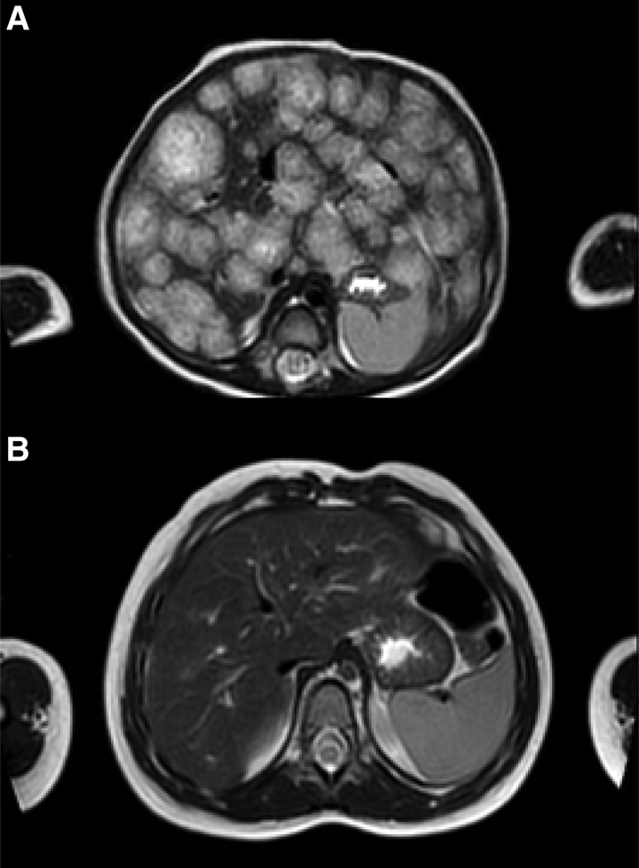

# 689 — Suy giáp tiêu thụ do u mạch máu ở trẻ / Consumptive hypothyroidism in infantile hemangioma

**Tags:** `pattern:khoi-gan-nhi` `pattern:suy-giap` `vung:gan` `vung:tuyen-giap` `protocol:TSH-fT4-rT3`
**Mức chắc chắn (certainty):** tổng hợp y văn (literature synthesis) — số liệu lấy từ 3 loạt ca/bài tổng quan đọc trực tiếp (PMC12186321, PMC10158424, PMC6356094) và các ca bổ sung (PMC6083462, PMC13225080); chưa có thử nghiệm ngẫu nhiên riêng cho **ngưỡng liều LT4** ở suy giáp tiêu thụ.

## 1. Tổng quan bệnh học – cơ chế hình ảnh

- **Suy giáp tiêu thụ (consumptive hypothyroidism, CH)** là hội chứng cận ung thư (paraneoplastic) do mô u mạch máu tăng biểu hiện **men khử iod loại 3 (type 3 iodothyronine deiodinase, D3/DIO3)**. D3 khử vòng trong: **T4 → reverse T3 (rT3)** và **T3 → 3,3′-diiodothyronine (T2)** — cả hai đều **không có hoạt tính sinh học**. Kết quả là hormone bị “đốt” ngoại vi nhanh hơn tuyến giáp sản xuất, dù tuyến giáp lành và trục tuyến yên–giáp hoạt động bình thường.
- **TẠI SAO u càng lớn càng nặng:** D3 được cảm ứng bởi **bFGF và VEGF** trong nội mô u; hoạt tính D3 tăng song song với **thể tích u** chứ không phụ thuộc vị trí. Vì vậy CH hay gặp ở thể **lan tỏa (diffuse)** thay thế gần toàn bộ nhu mô gan, và lui khi u co lại dưới propranolol.
- **Tần suất – ngưỡng định lượng:** CH gặp ở khoảng **5,3%** các ca u mạch máu gan nhũ nhi (infantile hepatic hemangioma, IHH); trong loạt IHH thể lan tỏa, **> 70%** có suy giáp và **11 ca** cần điều trị. Tổng quan **64 ca** (2000–2023) cho thấy TSH lúc chẩn đoán trung bình **145,5 mU/L** (khoảng **15–475**), tử vong **7/64 (10,93%)**.
- **TẠI SAO xét nghiệm sàng lọc sơ sinh có thể bình thường:** u chưa đủ lớn lúc sinh; D3 tăng dần trong pha tăng sinh sau sinh. Trong **43 ca** có dữ liệu, sàng lọc sơ sinh **bình thường ở 13 ca**, chỉ **7 ca** phát hiện qua sàng lọc; tuổi chẩn đoán trung bình **1 tháng** (trung vị **2 tháng**). Đây là cạm bẫy số 1: **sàng lọc sơ sinh bình thường không loại trừ CH.**
- **TẠI SAO liều LT4 cao hơn suy giáp bẩm sinh:** trẻ suy giáp bẩm sinh thường cần **10–15 µg/kg/ngày**, nhưng CH cần bù phần hormone bị D3 phá hủy liên tục. Trong 64 ca, **52/56 (92,85%)** dùng levothyroxine (LT4), **liều tối đa trung bình 24,04 µg/kg/ngày** (khoảng **1–110**); **15/52 (28,8%)** phải thêm liothyronine (LT3).
- **TẠI SAO phải thêm LT3:** khi LT4 đã kéo fT4 về bình thường nhưng **fT3 vẫn rất thấp** (T3 cũng bị D3 giáng hóa), tăng LT4 đơn thuần chỉ làm tăng rT3. Ca minh họa: LT4 **13 µg/kg/ngày** làm fT4 lên **1,0 ng/dL** nhưng fT3 vẫn **< 1,0 pg/mL**, phải thêm LT3 **3,3 µg/kg/ngày** trong **4 tuần**.
- **Hình ảnh gan – TẠI SAO:** IHH là u nội mô GLUT-1 dương, giàu mạch, nhiều hồ máu. Siêu âm: nhiều ổ **giảm âm, bờ rõ**, có thể “giả nốt” trên nền gan không đồng nhất. MRI: ổ **tăng tín hiệu T2** do nhiều nước/hồ máu, **trung tâm giảm tín hiệu** do xơ/huyết khối/calci; sau tiêm ngấm **viền nốt rồi đầy dần vào trung tâm** (centripetal) — khác kiểu ngấm toàn bộ nhanh của hepatoblastoma. Không cần sinh thiết gan vì nguy cơ chảy máu; chẩn đoán CH dựa vào **TSH cao + rT3 cao + đáp ứng kém với LT4 thường + giảm khi u co**.

*Siêu âm bụng lúc chẩn đoán: gan to, nhiều ổ giảm âm–đồng âm bờ rõ, đường kính trung bình 15 mm. Nguồn: Bettini I và cs., Ital J Pediatr 2025;51:198 (PMC12186321), Fig. 2, CC BY 4.0.*

## 2. Mẫu hình + chẩn đoán phân biệt theo vị trí (gamut)

**Mẫu hình gợi ý:** nhũ nhi **1–6 tháng**, gan to + bú kém/chậm tăng cân + nhiều u mạch máu da (đôi khi **0–1 tổn thương da**), kèm **nhịp nhanh, suy tim cung lượng cao** hoặc xét nghiệm **TSH rất cao, fT4 thấp/bình thường, fT3 thấp**. Trong loạt 64 ca, **48,43% là nữ**, tuổi trung vị **2 tháng**.

**Gamut theo “TSH cao + fT4 thấp hoặc bình thường” ở nhũ nhi:**

- **Tại gan (có khối gan):** CH do IHH thể lan tỏa/nhiều ổ; CH do u mạch máu gan khu trú lớn; ít gặp hơn là u mạch máu ngoài gan (da, tuyến mang tai) hoặc u nguyên bào cơ vân ác tính của thận (malignant rhabdoid tumor) — tất cả đều biểu hiện D3.
- **Tại tuyến giáp (không có khối gan):** suy giáp bẩm sinh do loạn sản/bất sản tuyến giáp hoặc rối loạn tổng hợp hormone (dyshormonogenesis); kháng TSH (TSH resistance, đột biến TSHR); viêm giáp tự miễn rất hiếm ở tuổi này.
- **Bối cảnh bệnh nặng:** hội chứng bệnh không do tuyến giáp (non-thyroidal illness syndrome, NTIS) — T3 thấp, TSH thấp/bình thường, rT3 cao; không phải suy giáp nguyên phát.
- **Thuốc/iod/assay:** quá tải iod, amiodarone, tương tác xét nghiệm (macro-TSH, kháng thể heterophile) — TSH cao giả hoặc thật nhưng không có khối gan.

**Gamut khối gan ở nhũ nhi (phải loại trừ trước khi gọi IHH):** hepatoblastoma (AFP thường rất cao, tuổi < 3 tuổi), u mô đệm lành (mesenchymal hamartoma — nhiều nang vách), sarcoma phôi gan chưa biệt hóa (UESL — khối đặc giả nang), di căn neuroblastoma, áp-xe gan. **AFP tăng không loại trừ IHH:** các ca ghi nhận AFP **13.923 ng/mL**, **23.900 ng/mL** và **470 ng/mL**; tỷ lệ **AFP-L3 chỉ 1,9%** giúp nghiêng về IHH.

*MRI T2 axial: gan to, vô số ổ tăng tín hiệu T2, đường kính tối đa 20 mm, gần như thay thế toàn bộ nhu mô gan — thể lan tỏa. Nguồn: Bettini I và cs., Ital J Pediatr 2025;51:198 (PMC12186321), Fig. 3, CC BY 4.0.*

## 3. Bảng so sánh phân biệt (ma trận đối chiếu)

| Thực thể (entity) | Hình ảnh điển hình | Chốt vào (rule-in) | Chốt loại (rule-out) | Gợi ý xác nhận |
|---|---|---|---|---|
| **CH do IHH** | Gan to, nhiều ổ giảm âm/T2 sáng; ngấm viền nốt rồi đầy dần; nhiều u mạch máu da | **TSH cao + rT3 cao + fT3 thấp + khối gan đa ổ + đáp ứng kém với LT4 10–15 µg/kg/ngày** | TSH bình thường hoàn toàn, không có khối gan, rT3 bình thường → tìm nguyên nhân khác | TSH, fT4, fT3, rT3; siêu âm/MRI gan; theo dõi TSH sau 2–4 tuần điều trị |
| **CH do u mạch máu ngoài gan** | U da/tuyến mang tai lớn; **không có khối gan** | **U mạch máu + TSH cao + rT3 cao**, hết khi u thoái triển | Không thấy u mạch máu nào → suy giáp bẩm sinh/NTIS | Khám da toàn thân, siêu âm phần mềm/tuyến mang tai |
| **Suy giáp bẩm sinh** | Tuyến giáp nhỏ/không thấy trên siêu âm; không có khối gan | **Sàng lọc sơ sinh dương tính** hoặc TSH cao ngay tuần đầu + fT4 thấp | Sàng lọc bình thường + khối gan lớn + rT3 cao → nghĩ CH | TSH/fT4, siêu âm tuyến giáp, xạ hình nếu cần |
| **Kháng TSH (TSHR)** | Tuyến giáp bình thường, không khối gan | **TSH cao nhẹ, fT4 bình thường, gia đình có người tương tự** | TSH rất cao + fT3 thấp + khối gan → không phải kháng TSH đơn thuần | Giải trình tự TSHR, theo dõi tăng trưởng |
| **NTIS** | Trẻ bệnh nặng, không khối gan | **T3 thấp, TSH thấp/bình thường, rT3 cao**, hồi phục khi hết bệnh | TSH rất cao + fT4 thấp kéo dài + khối gan → không phải NTIS | Đánh giá bệnh nền, lặp xét nghiệm sau hồi phục |
| **Hepatoblastoma** | Khối gan đặc, có thể vôi hóa; AFP rất cao | **AFP tăng theo tuổi + AFP-L3 cao + khối đặc** | **AFP-L3 thấp (1,9%) + nhiều ổ mạch + TSH cao** → nghiêng IHH | AFP, AFP-L3, MRI gan, sinh thiết chọn lọc |
| **U mô đệm lành / UESL** | Nhiều nang vách hoặc khối đặc giả nang | **< 2 tuổi + nhiều vách + ít mạch** (u mô đệm); **khối đặc + 19q13.4/C19MC** (UESL) | Nhiều ổ tăng mạch + TSH cao + u da → IHH | MRI, mô bệnh học khi cần |

## 4. Protocol chụp + hệ phân độ/điểm chuẩn hóa

- **Khi nào tầm soát gan:** hướng dẫn hiện hành khuyến cáo **siêu âm bụng khi có ≥ 5 u mạch máu da**; tuy nhiên IHH có thể xuất hiện với **0–1 tổn thương da**, nên **siêu âm bụng khi có bất kỳ u mạch máu da + dấu hiệu toàn thân** (gan to, bú kém, chậm tăng cân, suy tim, thiếu máu).
- **Bộ xét nghiệm lúc chẩn đoán:** **TSH, fT4, fT3, rT3** (nếu có); **siêu âm tuyến giáp** + **anti-TPO/anti-Tg** để loại trừ viêm giáp; **AFP và AFP-L3**; **công thức máu, đông máu** (Kasabach–Merritt), **siêu âm tim** tìm shunt/suy tim; đánh giá khoang bụng nếu gan quá lớn.
- **Chẩn đoán CH:** không cần sinh thiết gan. Chốt khi **TSH cao + rT3 cao + fT4 thấp/bình thường + fT3 thấp**, kèm khối gan và **đáp ứng kém với liều LT4 thông thường**; rT3 không có sẵn thì dựa vào TSH + khối gan + đáp ứng điều trị.
- **Điều trị u:** **propranolol 1 mg/kg/ngày**, tăng lên **2 mg/kg/ngày** sau **5 ngày**, có thể **3 mg/kg/ngày**; theo dõi nhịp tim, huyết áp, đường huyết. U co là yếu tố quyết định CH lui.
- **Điều trị CH:** khởi đầu **LT4 10–15 µg/kg/ngày**, tăng dần theo TSH/fT4 (liều tối đa trung bình trong y văn **24,04 µg/kg/ngày**, cá biệt **110 µg/kg/ngày**); nếu fT4 đã bình thường mà **fT3 vẫn thấp**, thêm **LT3 3,3 µg/kg/ngày** trong **4 tuần** rồi đánh giá lại. Không ngừng LT4 khi u chưa thoái triển.
- **Theo dõi:** xét nghiệm tuyến giáp lúc chẩn đoán, **sau 14 ngày và 30 ngày** (mốc dùng trong các ca), sau đó **mỗi 2–4 tuần** khi đang chỉnh liều/đang tăng sinh, rồi **mỗi 1–3 tháng** đến khi u thoái triển; siêu âm gan **hàng tháng** đến khi ổn định, sau đó **mỗi 3 tháng** đến khi thoái triển hoàn toàn. Không có lịch chuẩn hóa duy nhất — phải cá thể hóa theo thể tích u và tốc độ tăng TSH.
- **Ngừng thuốc:** giảm LT4 từ từ khi TSH/fT4 ổn định và u đã thoái triển; tiếp tục theo dõi sau ngừng vì **suy giáp có thể tái phát cùng lúc u to lại** (một ca tái phát lúc **32 tháng** sau khi ngừng hormone, kèm hai nốt gan to lên).

## 5. Biến thể bình thường và cạm bẫy

- **Sàng lọc sơ sinh bình thường** không loại trừ CH — u tăng sinh sau sinh; phải đo lại TSH/fT4 khi có khối gan hoặc nhiều u da.
- **AFP tăng sinh lý ở nhũ nhi** và **IHH cũng làm AFP tăng** (13.923; 23.900; 470 ng/mL). Đừng gọi hepatoblastoma chỉ vì AFP cao; xem **AFP-L3** (1,9% trong ca IHH) và hình thái mạch.
- **Siêu âm gan “giả nốt”** trên nền gan không đồng nhất dễ bị đọc là di căn/áp-xe; MRI T2 + ngấm viền nốt giúp định hướng.
- **Tuyến giáp bình thường trên siêu âm** không loại trừ CH (trục tuyến giáp lành, bệnh ở ngoại vi).
- **rT3 không có sẵn:** đừng chờ rT3 mới điều trị khi TSH rất cao + khối gan + fT3 thấp; điều trị thử và đánh giá đáp ứng.
- **Quá liều LT4:** fT4 có thể vọt lên **29,6 pmol/L** sau **11 ngày** với liều 9,6 µg/kg/ngày — theo dõi fT4, tránh chỉnh liều theo TSH đơn thuần.
- **LT3 kéo dài** có thể gây nhiễm độc giáp; dùng liệu trình ngắn (4 tuần) và giảm khi fT3 bình thường.
- **Bỏ sót u ngoài gan:** u mạch máu tuyến mang tai/da đơn thuần vẫn gây CH; khám da và vùng đầu–cổ.
- **Ngừng thuốc quá sớm:** CH có thể tái phát khi u còn hoạt tính; theo dõi TSH sau ngừng ít nhất vài tháng.

## 6. Tự lượng giá — Blind Quiz

**Ca 1 — Bé trai 2 tháng, bú kém, gan to, 10 u mạch máu da < 5 mm. Đọc MRI T2.**

- Gợi ý lâm sàng: sinh 36 tuần, 2.120 g; gan to; TSH 33,05 mU/L, fT4 16,8 pg/mL, fT3 3,7 pg/mL, rT3 2,0 ng/mL; AFP 13.923 ng/mL.
- Câu hỏi: Mô tả dấu hiệu chính? Nghĩ đến cơ chế nào? Xét nghiệm nào chốt?

<b>Bấm để hiện đáp án (findings + chẩn đoán)</b>

- Dấu hiệu: gan to, vô số ổ **tăng tín hiệu T2**, đường kính tối đa 20 mm, gần như thay thế toàn bộ nhu mô — IHH thể lan tỏa.
- Chẩn đoán: **suy giáp tiêu thụ do IHH** — TSH cao, **rT3 2,0 ng/mL** (bình thường 0,5–0,95), fT3 thấp; D3 trong u chuyển T4→rT3 và T3→T2.
- Xử trí: propranolol **1 → 2 mg/kg/ngày**; TSH về **5** sau 14 ngày và **1,88** sau 30 ngày, rT3 **0,67** — không cần LT4 vì u đáp ứng nhanh.
- Nguồn: Bettini I và cs., Ital J Pediatr 2025;51:198 (PMC12186321), Fig. 3, CC BY 4.0.

**Ca 2 — Bé trai 4 tháng, gan to 5 cm dưới bờ sườn, TSH 561,5 µIU/mL, fT4 < 0,7 ng/dL, fT3 1,0 pg/mL. Đọc biểu đồ điều trị.**

- Gợi ý: AFP 23.900 ng/mL, AFP-L3 1,9%; propranolol 0,25 → 2 mg/kg/ngày; LT4 50 → 80 µg/ngày.
- Câu hỏi: Vì sao fT4 lên bình thường mà fT3 vẫn thấp? Làm gì tiếp theo?

<b>Bấm để hiện đáp án (findings + chẩn đoán)</b>

- Dấu hiệu: dưới LT4 **13 µg/kg/ngày**, fT4 lên **1,0 ng/dL** nhưng fT3 vẫn **< 1,0 pg/mL** — vì D3 giáng hóa cả T3, không chỉ T4.
- Xử trí: thêm **LT3 20 µg/ngày (3,3 µg/kg/ngày)** trong **4 tuần**, TSH chuẩn hóa sau khoảng **1 tháng**; propranolol ngừng lúc **1 tuổi 1 tháng**, phát triển tâm vận động bình thường lúc **1 tuổi 5 tháng**.
- Bài học: khi fT4 đã bình thường mà fT3 còn thấp, **thêm LT3** thay vì tiếp tục tăng LT4.
- Nguồn: Osada A và cs., Clin Pediatr Endocrinol 2019;28:9–14 (PMC6356094), Fig. 3, CC BY-NC-ND 4.0 (giữ nguyên, không chỉnh sửa).

**Ca 3 — Bé gái 3 tháng, gan to, TSH 58,7 mIU/L; MRI trước và sau 19 tháng điều trị.**

- Gợi ý: LT4 **10 µg/kg/ngày**, propranolol **1–3 mg/kg/ngày**; không có u da rõ.
- Câu hỏi: Hai ảnh khác nhau ở đâu? Vì sao có thể ngừng LT4?

<b>Bấm để hiện đáp án (findings + chẩn đoán)</b>

- Dấu hiệu: (A) vô số ổ tăng tín hiệu T2 thay thế nhu mô gan; (B) sau 19 tháng propranolol/10 tháng LT4, các ổ **biến mất**, gan về cấu trúc gần bình thường.
- Chẩn đoán: **CH do IHH nhiều ổ**; LT4 ngừng ở **13 tháng**, propranolol ngừng ở **22 tháng**, phát triển bình thường lúc **4 tuổi**.
- Vì sao ngừng được: khi u thoái triển, nguồn D3 mất → nhu cầu LT4 giảm; giảm liều từ từ theo TSH/fT4.
- Nguồn: Siano MA và cs., JPGN Rep 2022;3:e270 (PMC10158424), Fig. 1, CC BY-NC-ND 4.0 (giữ nguyên, không chỉnh sửa).

## Bài liên quan chéo
- [600 – Tổng quan Nhi khoa](../600-tong-quan-nhi-khoa/lesson.md)
- [667 – U mạch máu gan ở trẻ & điều trị nội khoa](../667-u-mach-mau-gan-o-tre-va-dieu-tri/lesson.md)
- [687 – Theo dõi & điều trị IHH sau can thiệp](../687-theo-doi-va-dieu-tri-ihh-sau-can-thiep/lesson.md)
- [665 – Khối u gan ở trẻ: hepatoblastoma vs HCC vs hemangioendothelioma](../665-khoi-u-gan-nhi/lesson.md)
- [674 – U quái & u tế bào mầm vùng gan ở trẻ](../674-u-quai-te-bao-mam-gan-o-tre/lesson.md)
- [646 – Hội chứng khoang bụng ở trẻ](../646-hoi-chung-khoang-bung-o-tre/lesson.md)

> Không dùng để chẩn đoán độc lập khi chưa có người hướng dẫn.
