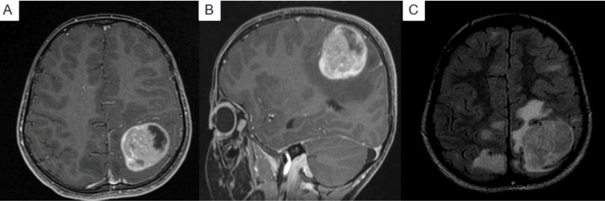
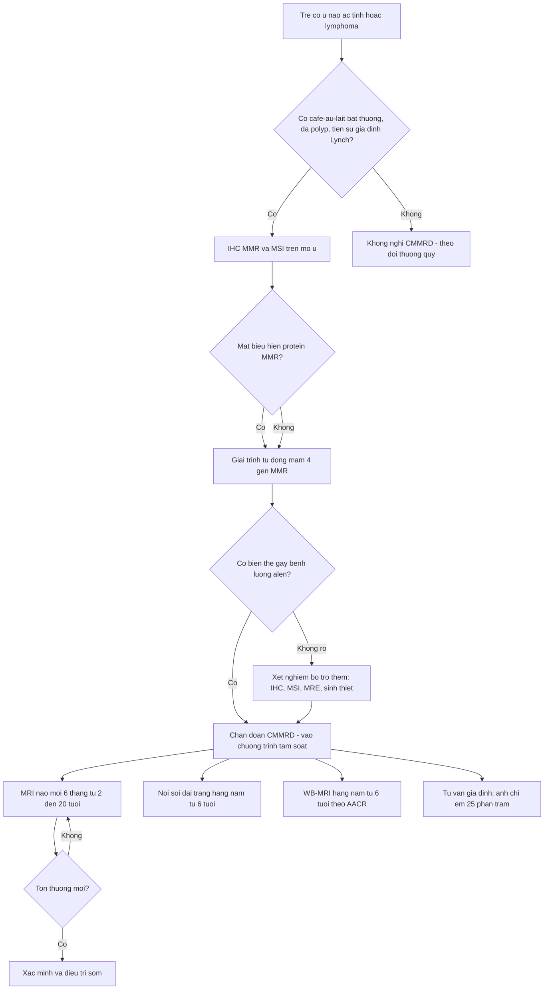
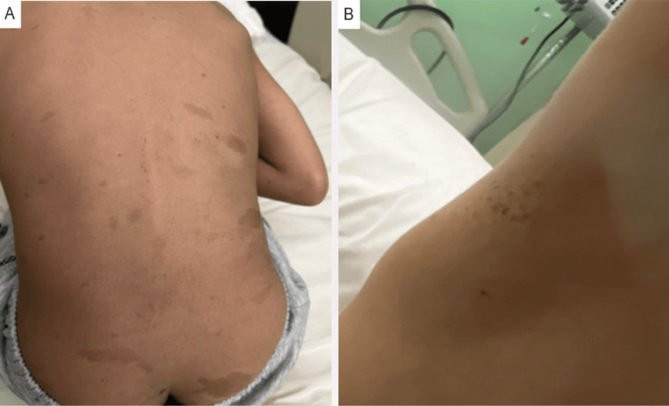

# 690 — CMMRD (mất bù sửa chữa lệch bẩm sinh): u não, đa polyp, café-au-lait & lịch tầm soát ở trẻ

**Tags:** `pattern:u-nao-nhi` `pattern:da-polyp` `pattern:cafe-au-lait` `vung:nao` `vung:dai-trang` `vung:toan-than` `score:C4CMMRD` `protocol:WB-MRI` `protocol:MRI-nao` `incidentaloma:ton-thuong-toan-than`
**Mức chắc chắn (certainty):** tổng hợp y văn (literature synthesis) — từ bài tổng quan CMMRD 2025 (PMC12062528), so sánh protocol C4CMMRD vs AACR 2026 (PMC13303765), ca bệnh mang MSH6 đồng hợp 2025 (PMC12539020, CC BY 4.0), loạt u não C4CMMRD 2019 (PMC7212899) và tổng quan PMS2-CMMRD 2025 (PMC12665659). Không có ca nguyên văn riêng của nhóm.

## 1. Tổng quan — "ung thư thứ hai mỗi 2 năm" và tại sao hình ảnh phải bắt đầu từ trẻ

- **Bệnh học:** **CMMRD (constitutional mismatch repair deficiency — thiếu hụt sửa chữa lệch bẩm sinh)** do **đột biến lưỡng alen (biallelic) gen sửa chữa lệch (MMR: MLH1, MSH2, MSH6, PMS2)**, di truyền **lặn**; bố mẹ thường là người lành mang một alen (giống Lynch). **PMS2 là thể phân tử hay gặp nhất** (PMC12665659).
- **Cơ chế hình ảnh – TẠI SAO u ác và đa ổ:** mất MMR → sai sót lặp lại vi vệ tinh (microsatellite) không được sửa → **tần suất đột biến cực cao (hypermutation)** → ung thư **nhiều ổ, nhiều cơ quan, xuất hiện sớm và liên tiếp**. Trên MRI, u não CMMRD là **high-grade glioma (HGG)** tế bào sinh sôi nhanh → **DWI sáng/ADC thấp**, ngấm thuốc mạnh, hoại tử, phù quanh u; **5/15 ca có nhiều u não** và có thể kèm **dị dạng mạch phát triển** (PMC7212899).
- **Ngưỡng định lượng nằm lòng:**
  - **Tuổi khởi phát trung vị < 10 tuổi**; **nguy cơ tích lũy > 90% ở tuổi 18** và **~100% ở tuổi 40**; **ung thư mới trung bình mỗi ~2 năm** (PMC12062528).
  - **Phổ u (339 u / 201 bệnh nhân):** **TKTW 51%** (tuổi trung vị **9,7**), **tiêu hóa 22%** (trung vị **20,1**; ung thư đại tràng tích lũy **42% ở tuổi 20**), **huyết học 18%** (trung vị **9,7**), u khác 9% (PMC12062528).
  - **U não (C4CMMRD, 49 bệnh nhân / 56 u):** **50/56 là HGG**, **16/21 u được duyệt lại có tế bào khổng lồ đa nhân**; tuổi trung vị u não đầu **9,2 (1,1–40,6)**, **9 bệnh nhân > 18 tuổi**; **sống 3 năm 30%**, **5 năm 22%**; riêng HGG **sống 3 năm 20,5%** (PMC7212899).
  - **Dấu hiệu da:** **café-au-lait 40/41**, **đốm giảm sắc tố 16–29%**; **dị dạng phát triển não 11/15**; **hôn nhân cận huyết 20/38 gia đình** (PMC7212899, PMC12062528).
  - **Polyp:** có thể xuất hiện **từ 6 tuổi**; **> 10 polyp adenoma trước 18 tuổi** (sau khi loại trừ đa polyp khác) là tiêu chuẩn gợi ý (PMC12062528).
- **Vì sao phải tầm soát bằng hình ảnh chứ không chờ triệu chứng:** u não và lymphoma tăng nhanh trong **vài tuần**; **30% sống 3 năm** nghĩa là tiên lượng rất kém khi chẩn đoán muộn. Tầm soát đa phương thức (MRI não + WB-MRI + nội soi) là **chuẩn chăm sóc**, không phải "làm thêm".

## 2. Mẫu hình + gamut theo CƠ QUAN (thứ tự xuất hiện)

- **TKTW (51%, trung vị 9,7 tuổi):** **HGG bán cầu** (có **tế bào khổng lồ**; **5/15 ca có nhiều u não**), **u phôi (medulloblastoma)**, glioma độ thấp; kèm **dị dạng mạch phát triển** (AVM "đầu sứa"/jellyfish head) và **dị dạng chất xám (gray matter heterotopia)** (PMC7212899, PMC12062528).
- **Tiêu hóa (22%, trung vị 20,1 tuổi):** **ung thư đại tràng**, **ung thư ruột non**, dạ dày; **đa polyp adenoma** xuất hiện sớm — đây là "cửa sổ" để chẩn đoán trước khi ung thư.
- **Huyết học (18%, trung vị 9,7 tuổi):** **lymphoma lymphoblastic T (T-LBL)** hay gặp nhất, B-lymphoma, **B-ALL**, AML.
- **Khác:** **vú, đường niệu–sinh dục, tụy, da** (u pilomatrixoma, melanoma) — xuất hiện sớm hơn dân số chung rất nhiều.
- **Mẫu hình "gợi ý mạnh" trên hình ảnh:** trẻ **< 10 tuổi** có **u não ác** (có thể nhiều ổ); **đa polyp** ở tuổi học đường; **café-au-lait bờ nham nhở + đốm giảm sắc tố**; **dị dạng mạch não** không giải thích được.
- **Gợi nhớ "C-A-L-M":** **C**NS tumour sớm · **A**denomatous polyposis · **L**ymphoma/leukemia · **M**acules café-au-lait (kèm **hôn nhân cận huyết**).

## 3. Bảng so sánh phân biệt (ma trận đối chiếu)

| Thực thể (entity) | Hình ảnh / phổ u điển hình | Chốt vào (rule-in) | Chốt loại (rule-out) | Gợi ý xác nhận |
|---|---|---|---|---|
| **CMMRD** | Trẻ < 10 tuổi: **HGG nhiều ổ/tế bào khổng lồ**, lymphoma T, **đa polyp đại tràng**, **café-au-lait bờ nham nhở + đốm giảm sắc tố**, dị dạng mạch não | **U não/lymphoma + CALM + tiền sử gia đình Lynch**; **≥ 10 polyp adenoma < 18 tuổi**; bố mẹ cùng huyết thống | CALM đơn thuần, không u, không polyp → **không** chẩn đoán CMMRD | **IHC MMR + MSI** trên mô u, rồi giải trình tự dòng mầm (bài này) |
| **NF1** | **Glioma thị giác**, neurofibroma, **loạn sản xương bướm**, CALM **bờ đều**, u não ít khi đa ổ | **Tiêu chuẩn NIH NF1** (≥ 2 dấu hiệu) | CALM + u não nhưng **không đủ tiêu chuẩn NF1**, NF1/SPRED1 âm tính → nghĩ CMMRD | Khám da–mắt, MRI sọ/hốc mắt, giải trình tự NF1 (bài 377) |
| **LFS (TP53)** | Sarcoma xương/mô mềm, **ACC**, u não, **vú < 31 tuổi**; **không** có đa polyp | **Tiêu chuẩn Chompret** | Đa polyp + CALM + lymphoma T → **không** phải LFS | Giải trình tự TP53 (bài 198) |
| **Lynch (MMR đơn alen)** | **Đại tràng/nội mạc tử cung ở người lớn** (thường > 30 tuổi); **không** u não thời thơ ấu | Tiêu chuẩn Amsterdam/Bethesda; MSI cao | **U não trẻ + polyp sớm** → CMMRD, không phải Lynch | IHC MMR, giải trình tự; tư vấn lặn (25% anh chị em) |
| **HGG lẻ tẻ ở trẻ** | Một khối đơn độc, không CALM, không polyp, không tiền sử gia đình | Không có dấu hiệu ngoài thần kinh | **Nhiều ổ + CALM + polyp** → không được coi là lẻ tẻ | Mô bệnh + IHC MMR nếu có bất kỳ dấu hiệu gợi ý |

*Bé trai 7 tuổi, u não ác tính: **(A, B)** T1 sau tiêm — khối **hỗn hợp nang–đặc 4,3 × 3,5 × 3,5 cm** thùy đỉnh trái, bờ không rõ, phù chất trắng quanh u; **(C)** T2-FLAIR — **nhiều ổ tăng tín hiệu dưới vỏ không đối xứng, hai bên** (ổ lớn nhất thùy đỉnh phải). Mô bệnh: **high-grade glioma** (đa hình nhân, hoại tử giả hàng rào, tăng sinh mạch). Nguồn: Althomali A và cs., *Cureus* 2025 (PMC12539020), CC BY 4.0.*

## 4. Protocol — tiêu chuẩn chẩn đoán & lịch tầm soát (C4CMMRD vs AACR)

- **Chẩn đoán = gen + xét nghiệm bổ trợ + phenotype.** Nhóm đồng thuận quốc tế đưa **7 tiêu chuẩn**: **4 tiêu chuẩn "chẩn đoán chắc"** (bằng chứng mạnh) và **3 tiêu chuẩn "chẩn đoán có khả năng"** (bằng chứng vừa); **cả hai nhóm đều phải vào chương trình tầm soát** (PMC12062528).
  - **Mạnh:** (1) **lưỡng alen P/P xác nhận in trans** — không cần xét nghiệm bổ trợ nếu < 25 tuổi; (2) **P/LP hoặc LP/LP in trans** + **1 xét nghiệm bổ trợ** cho u điển hình (2 nếu theo tiêu chí C4CMMRD); (3) **dị hợp P/LP** + **1 xét nghiệm bổ trợ** + **u điển hình CMMRD**; (4) **không có P/LP** (kể cả VUS/VUS) + **2 xét nghiệm bổ trợ** + **u điển hình**.
  - **Trung bình:** biallelic P/LP **không xác nhận in trans**; không có P/LP + 1 xét nghiệm + u điển hình; dị hợp/không xét nghiệm được + 2 xét nghiệm + **tiêu chí C4CMMRD ≥ 3 điểm** (hoặc **< 18 tuổi có đặc điểm NF1**).
- **Vì sao cần xét nghiệm bổ trợ:** trong 12 gia đình CMMRD, chỉ **67% có biallelic P/LP**, **17% biallelic VUS**, **8% dị hợp đơn alen**, **8% không tìm thấy biến thể** → **IHC MMR/MSI** trên mô u là bắt buộc khi gen không rõ (PMC12062528).
- **Lịch tầm soát — hai bộ khuyến cáo song song (PMC13303765, bảng 3):**

| Khảo sát | C4CMMRD | AACR (IRRDC) |
|---|---|---|
| Khám lâm sàng | từ lúc chẩn đoán, **mỗi 6 tháng** | — |
| **MRI não** | **2–20 tuổi: mỗi 6 tháng**; > 20 tuổi: hằng năm | từ lúc chẩn đoán, mỗi 6 tháng (**lần đầu có cản quang**) |
| **Nội soi đại tràng** | từ **6 tuổi**, **hằng năm** (6 tháng khi đã có polyp) | từ **6 tuổi**, hằng năm |
| Nội soi trên + **video capsule** | nội soi trên từ **10 tuổi**, hằng năm | từ **6 tuổi**, hằng năm |
| Khám phụ khoa / siêu âm | từ **20 tuổi**, hằng năm | từ **12 tuổi**, hằng năm |
| **WB-MRI** | **ít nhất 1 lần lúc chẩn đoán** (hoặc khi không cần gây mê); **thảo luận hằng năm** | từ **6 tuổi**, **hằng năm** |
| Khám da | — | từ lúc chẩn đoán, hằng năm |

- **Điểm chưa đồng thuận (ghi rõ):** **WB-MRI hằng năm** là khuyến cáo của **AACR/IRRDC từ 6 tuổi**, còn **C4CMMRD** chỉ yêu cầu **một lần lúc chẩn đoán + thảo luận hằng năm**; **tuổi bắt đầu khám phụ khoa** khác nhau (12 vs 20) do đã ghi nhận ung thư niệu–sinh dục **ở tuổi 14** (PMC13303765). Khi trả lời gia đình, phải nói rõ **đang theo bộ khuyến cáo nào**.
- **Kỹ thuật:** MRI não **lần đầu có cản quang**, sau đó theo dõi; WB-MRI **không cản quang** (T1/T2/DWI) để giảm gánh nặng gây mê ở trẻ nhỏ. **Video capsule** có nguy cơ **kẹt capsule** ở trẻ đã mổ tiêu hóa → cân nhắc **patency capsule** (PMC13303765).

## 5. Biến thể bình thường và cạm bẫy

- **Café-au-lait "giả NF1" là cạm bẫy số 1:** CALM trong CMMRD **bờ nham nhở, sắc tố không đều**, kèm **đốm giảm sắc tố (16–29%)** — khác NF1; **chỉ một số ít** bệnh nhi CMMRD thỏa tiêu chuẩn NIH NF1. Trẻ **nghi NF1 nhưng NF1/SPRED1 âm tính** + có ung thư ở anh chị em → **phải nghĩ CMMRD** (PMC12062528).
- **"Một u não đơn độc" không loại trừ:** CMMRD có thể biểu hiện **một khối lớn** như ca 7 tuổi ở trên; manh mối nằm ở **CALM, polyp, tiền sử gia đình, cận huyết** — không nằm ở hình ảnh đơn thuần. Hỏi và khám da **trước khi kết luận "HGG lẻ tẻ"**.
- **Nhiều ổ tăng tín hiệu FLAIR hai bên** ở trẻ có u não: đừng chỉ gọi là "phù quanh u" — có thể là **tổn thương thứ hai** hoặc bất thường phát triển; so sánh với các chuỗi và theo dõi.
- **Dị dạng mạch não "đầu sứa" ở trẻ** là dấu hiệu gợi ý CMMRD, không phải bất thường ngẫu nhiên (PMC7212899).
- **IHC bình thường không loại trừ hoàn toàn:** biến thể **missense** có thể còn protein nhưng mất chức năng → vẫn cần **MSI/giải trình tự**; **không được dừng ở IHC** khi phenotype mạnh.
- **WB-MRI không thay nội soi:** tổn thương **ruột non/đại tràng nhỏ** có thể âm tính trên hình ảnh; **nội soi + capsule** mới là công cụ phát hiện polyp. Ngược lại, nội soi không thấy u não — hai phương thức **bổ sung**, không thay thế.
- **Kẹt capsule:** trẻ đã mổ tiêu hóa có nguy cơ **capsule retention** → dùng **patency capsule** trước (PMC13303765).
- **Tia xạ lặp lại:** ưu tiên **MRI** thay CT khi theo dõi; CMMRD là bệnh **hypermutation** nên tránh tia xạ không cần thiết, dù xạ trị vẫn có vai trò trong u não ác tính.
- **Anh chị em ruột:** nguy cơ **25%** (di truyền lặn) — khác LFS (50%); tư vấn sai kiểu di truyền là lỗi thực hành nghiêm trọng.

## 6. Tự lượng giá — Blind Quiz

**Ca 1 — Bé trai 7 tuổi, co giật, trước đó khỏe mạnh.**

- Hỏi: (1) Mô tả khối và các bất thường ngoài khối? (2) Ba chẩn đoán phân biệt cho khối này? (3) Trên lâm sàng bạn sẽ tìm dấu hiệu gì để nghĩ đến hội chứng di truyền?

<b>Bấm để hiện đáp án (findings + chẩn đoán)</b>

- **Findings:** khối **hỗn hợp nang–đặc 4,3 × 3,5 × 3,5 cm** thùy đỉnh trái, **ngấm thuốc không đồng nhất**, phù chất trắng quanh u, hiệu ứng khối; **T2-FLAIR còn nhiều ổ tăng tín hiệu dưới vỏ hai bên, không đối xứng**.
- **Chẩn đoán:** **high-grade glioma** (mô bệnh: đa hình nhân dữ dội, hoạt động phân bào, **hoại tử giả hàng rào**, tăng sinh mạch) — sau đó bé được chẩn đoán thêm **lymphoma lymphoblastic T**.
- **Phân biệt:** **HGG lẻ tẻ**, **u phôi (medulloblastoma)**, **áp-xe/nang viêm**, **di căn** (hiếm ở trẻ).
- **Dấu hiệu lâm sàng phải tìm:** **café-au-lait bờ nham nhở**, **đốm giảm sắc tố**, **nhiều polyp/đi cầu máu**, **tiền sử gia đình ung thư đại tràng ở người trẻ**, **bố mẹ cùng huyết thống**.
- **Xác nhận:** IHC **MSH6 mất một phần** ở u và mô lành; giải trình tự phát hiện **MSH6 đồng hợp c.3680T>G (p.Ile1227Arg)**, bố mẹ dị hợp → **CMMRD**.
- Nguồn: Althomali A và cs., *Cureus* 2025 (PMC12539020), CC BY 4.0.

**Ca 2 — Bé trai 7 tuổi: nhiều vết nâu trên thân mình và "tàn nhang" ở nách.**

- Hỏi: (1) Đây là dấu hiệu của bệnh gì? (2) Vì sao **không được** dừng ở chẩn đoán NF1? (3) Xét nghiệm/hình ảnh tiếp theo?

<b>Bấm để hiện đáp án (findings + chẩn đoán)</b>

- **Findings:** **(A)** nhiều **macule café-au-lait** rải rác thân mình, lưng, mông — **bờ nham nhở, kích thước và sắc tố không đều**; **(B)** **tàn nhang (freckling) ở nách phải**.
- **Chẩn đoán:** dấu hiệu da **giống NF1 nhưng thuộc CMMRD**; ở bệnh nhi này, chẩn đoán CMMRD đến từ **u não HGG + lymphoma T** trước đó.
- **Vì sao không dừng ở NF1:** **chỉ một số ít** bệnh nhi CMMRD thỏa tiêu chuẩn NIH NF1; **NF1/SPRED1 âm tính** mà vẫn có CALM + ung thư ở anh chị em/gia đình Lynch → **phải tìm CMMRD**. CALM CMMRD có **đốm giảm sắc tố** (16–29%) — không có trong NF1.
- **Tiếp theo:** IHC MMR + MSI trên mô u (nếu có), giải trình tự 4 gen MMR; **MRI não** và **nội soi đại tràng từ 6 tuổi**; tư vấn **25%** cho anh chị em.
- **Phản biện nguồn:** ca này là **thể MSH6 đồng hợp hiếm** (biến thể mới, trước đó chưa báo cáo ở thể đồng hợp) — hình ảnh da không đặc hiệu, giá trị nằm ở việc **nhận ra cụm dấu hiệu**.
- Nguồn: Althomali A và cs., *Cureus* 2025 (PMC12539020), CC BY 4.0.

## Bài liên quan chéo
- [199 – Quy trình xét nghiệm gen & tầm soát người thân (WB-MRI, ONCO-RADS, cascade)](../199-quy-trinh-xet-nghiem-gen-tam-soat-gia-dinh/lesson.md)
- [198 – Li-Fraumeni (TP53): Chompret, phổ u & tư vấn di truyền](../198-li-fraumeni-tp53-chompret-tu-van/lesson.md)
- [377 – U thần kinh đệm dạng đám rối & MPNST (NF1)](../377-u-than-kinh-dang-dam-roi-va-mpnst-nf1/lesson.md)
- [378 – Điều trị u đám rối NF1 (selumetinib)](../378-dieu-tri-u-dam-roi-nf1-selumetinib/lesson.md)
- [600 – Tổng quan hệ Nhi khoa (bản đồ bài)](../600-tong-quan-nhi-khoa/lesson.md)
- [674 – U quái tế bào mầm gan ở trẻ](../674-u-quai-te-bao-mam-gan-o-tre/lesson.md)

> Không dùng để chẩn đoán độc lập khi chưa có người hướng dẫn.
