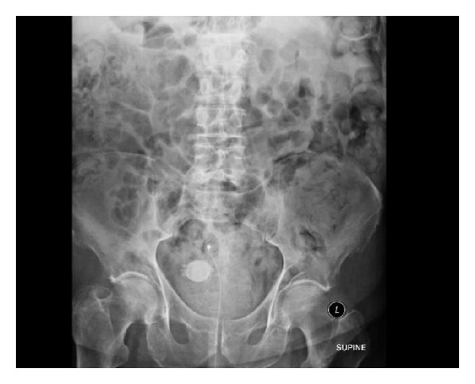
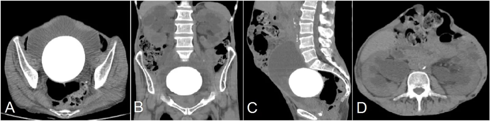
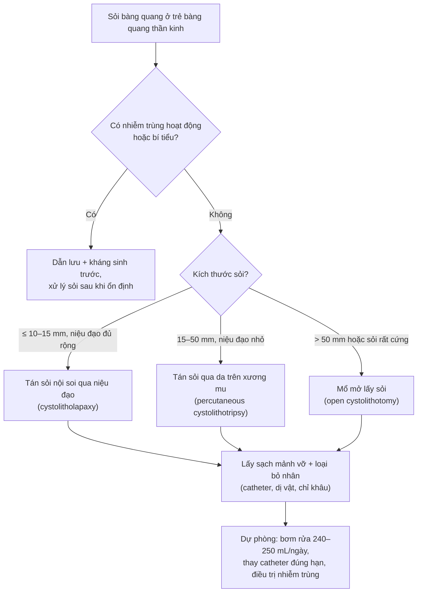
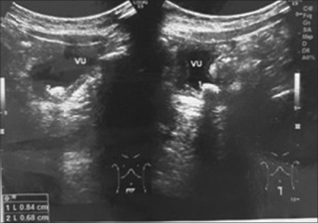

# 691 — Sỏi bàng quang & sỏi quanh catheter ở trẻ bàng quang thần kinh / Bladder calculi and catheter-associated stones in pediatric neurogenic bladder

**Tags:** `pattern:soi-bang-quang` `pattern:voi-hoa` `vung:tiet-nieu` `vung:bang-quang` `protocol:US-than-tiet-nieu` `protocol:CT-khong-can-quang` `anatomy:bang-quang-than-kinh`
**Mức chắc chắn (certainty):** tổng hợp y văn (literature synthesis) — đoàn hệ trẻ sau tạo hình bàng quang bằng ruột, loạt ca sỏi bàng quang nhi được điều trị qua da, ca sỏi quanh catheter bị bỏ quên, và tổng quan về sỏi sau augmentation; số liệu giữ nguyên như nguồn, chỗ chưa rõ ghi "chưa rõ".

> Bài này bàn **sỏi bàng quang hình thành trên nền bàng quang thần kinh** (đặc biệt khi có catheter lưu, CIC, hoặc bàng quang tạo hình bằng ruột) và **sỏi quanh catheter**. Nhiễm trùng tiểu trên nền bàng quang thần kinh ở [671](../671-nhiem-trung-tieu-bang-quang-than-kinh-o-tre/lesson.md); dị tật tiết niệu nhi (SFU, VUR, PUV) ở [635](../635-di-tat-tiet-nieu-nhi-SFU-VUR-PUV/lesson.md); theo dõi sau tháo căng tủy ở [668](../668-theo-doi-sau-thao-cang-tuy-bang-quang-than-kinh/lesson.md).

*Phim bụng: sỏi bàng quang lớn, bờ **gai/nan hoa** (spiculated) nằm trong tiểu khung; bóng catheter mềm bị sỏi cọ xát nên xẹp và catheter "tụt ra" ba lần trong bốn ngày. Nguồn: Wek C et al., Case Rep Urol 2013 (PMC3745917), Fig. 1, CC BY 3.0.*

## 1. Tổng quan bệnh học – cơ chế hình ảnh

- **Sỏi bàng quang chiếm ~5% sỏi đường tiết niệu**; ở nhũ nhi, bàng quang là vị trí **hay gặp nhất của sỏi đường tiết niệu dưới**. Ba nhóm: **sỏi nguyên phát/đặc hữu** (liên quan dinh dưỡng, hay gặp ở nước đang phát triển), **sỏi thứ phát** (ứ trệ, nhiễm trùng, dị vật), và **sỏi di trú từ trên xuống**.
- **Trên nền bàng quang thần kinh, sỏi thường là sỏi nhiễm trùng (struvite):** ứ nước tiểu + vi khuẩn sinh urease (*Proteus*, *Klebsiella*, *Ureaplasma*) → phân hủy urê thành amoniac → **nước tiểu kiềm (pH > 7)** → kết tủa **magie amoni phosphate (struvite)** và **carbonate apatite**. Trong ca bàng quang thần kinh sau chấn thương tủy, nước tiểu có **pH 7,0**, nhiều tế bào mủ và **14 viên sỏi** (lớn nhất **2,1 cm**) sau **1,5 năm** đặt catheter lưu (PMC13263394).
- **Vì sao trẻ có bàng quang tạo hình bằng ruột (augmentation cystoplasty) đặc biệt dễ sỏi:** đoạn ruột tiết **nhầy (mucus)** — nhầy làm **nhân (nidus)** cho tinh thể; bàng quang không co bóp đều → **ứ trệ**; thường xuyên có **khuẩn trú**; nhiều trẻ có **lỗ thông bụng (Mitrofanoff)** làm tăng nguy cơ. Sỏi là **biến chứng muộn hay gặp nhất** sau augmentation, được báo cáo **10,5–52%**; trong một đoàn hệ 22 trẻ, **36,4%** có sỏi (bàng quang **22,7%**, thận **13,6%**), sỏi bàng quang xuất hiện trung bình **5,3 ± 5,2 năm** sau mổ, **3 trẻ tái phát** (PMC10879155). Y văn cũ ghi tới **~50% trong 10 năm**, với **~50% tái phát trong 5 năm** sau lần đầu (PMC4739984).
- **Sỏi quanh catheter (catheter-associated stone/encrustation):** catheter lưu là **dị vật** — canxi/muối bám thành **vảy (encrustation)** rồi thành sỏi. Thời gian càng dài, sỏi càng lớn: trong loạt 3 ca catheter bị bỏ quên, sỏi đo **4 × 3 cm** sau **6 tháng** và **8 × 6 cm** sau **10 tháng** (PMC9890249). Sỏi có thể **kẹp catheter**, làm **bóng catheter xẹp**, gây **catheter tụt ra tái diễn** và **bí tiểu** (PMC3745917).
- **TẠI SAO hình ảnh thay đổi:**
  - **Siêu âm:** sỏi là **cấu trúc tăng âm mạnh (hyperechoic) + bóng lưng sạch (clean posterior acoustic shadowing)**; sỏi **di động theo tư thế** (nằm ở vị trí thấp nhất của bàng quang). Đây là lý do phải quét **tư thế nằm ngửa và nghiêng** để phân biệt sỏi với u/bướu máu bám thành.
  - **X-quang KUB:** sỏi canxi **cản quang**; nhưng sỏi **acid uric** có thể **không cản quang** → phim âm **không loại trừ** sỏi.
  - **CT không cản quang:** **nhạy nhất** — đo **số lượng, kích thước, tỷ trọng (HU)**, phát hiện sỏi nhỏ/không cản quang, đánh giá **ứ nước thận** và **dị vật đi kèm** (mảnh bóng catheter, chỉ khâu). Tỷ trọng giúp so sánh với mô mềm và giữa các lần chụp; sỏi canxi thường đặc hơn sỏi struvite/acid uric, nhưng **giá trị tuyệt đối thay đổi theo máy — chưa có ngưỡng thống nhất**.
  - **MRI:** sỏi **không có proton di động** → **tín hiệu trống (signal void) trên TẤT CẢ chuỗi xung** (T1, T2, DWI). Đây là **cạm bẫy**: tín hiệu trống này **không phải** u máu, không phải "flow void" mạch máu, và **không ngấm thuốc**.
- **Ngưỡng định lượng cần nhớ:**
  - **Kích thước sỏi quyết định đường can thiệp:** niệu đạo trẻ nhỏ giới hạn dụng cụ; **cystolithotomy qua da an toàn cho sỏi tới 5 cm**; loạt ca nhi dùng **sheath 18–28 Fr** cho sỏi **8–22 mm**, mổ **45–55 phút**, ra viện **ngày 3** (PMC8815350).
  - **Dự phòng tái phát sau augmentation:** **bơm rửa bàng quang 240–250 mL/ngày** làm **tỷ lệ không sỏi 67% sau 5 năm**, tái phát **10–15% sau 10 năm**; thêm citrate/mucolytic **không** cải thiện thêm (PMC4739984).
  - **Đái máu/ nhiễm trùng:** sỏi thường kèm **khuẩn trú**; **không điều trị khuẩn trú đơn thuần**, nhưng **phải cấy nước tiểu trước mổ** và điều trị nhiễm trùng hoạt động trước can thiệp.

## 2. Mẫu hình + chẩn đoán phân biệt theo vị trí (gamut)

- **Mẫu hình lâm sàng → nghĩ sỏi bàng quang:**
  - **Đái máu, đái buốt, nước tiểu đục** ở trẻ có bàng quang thần kinh/CIC.
  - **Catheter tụt ra tái diễn, bóng xẹp, khó thay catheter** → sỏi quanh catheter.
  - **Bí tiểu cấp** hoặc **đau bụng dưới** ở trẻ có lỗ thông bụng.
  - **Nhiễm trùng tiểu tái phát** cùng một loại vi khuẩn sinh urease.
  - **Tình cờ** trên siêu âm theo dõi định kỳ — trong đoàn hệ augmentation, nhiều trẻ **không triệu chứng**, sỏi chỉ được phát hiện khi theo dõi thường quy.
- **Gamut theo vị trí:**
  - **Trong lòng bàng quang:** sỏi struvite, calcium oxalate, uric acid, sỏi di trú từ niệu quản.
  - **Quanh catheter/bóng catheter:** vảy canxi trên catheter, sỏi "kẹp" catheter, mảnh bóng catheter bị vỡ làm nhân sỏi (đã có ca mảnh bóng Foley gây sỏi).
  - **Thành bàng quang:** vôi hóa thành (xạ trị, schistosomiasis, amyloid), sỏi trong **túi thừa (diverticulum)**, sỏi bám chỉ khâu.
  - **Bàng quang tạo hình/lỗ thông bụng:** sỏi trong bàng quang tân tạo, sỏi quanh van Mitrofanoff, hẹp miệng nối.
  - **Đường tiết niệu trên:** sỏi thận/niệu quản kèm ứ nước — phải khảo sát **toàn bộ** đường tiết niệu, không chỉ bàng quang.
  - **Ngoài đường tiết niệu (bắt chước sỏi):** u bàng quang vôi hóa, búi máu (blood clot), bóng nấm (fungus ball), dị vật, **phlebolith**/vôi hóa tử cung–phần phụ ở bé gái, vôi hóa tuyến tiền liệt (nam trưởng thành).

*(A–C) CT không cản quang: sỏi bàng quang **khổng lồ** (khối cản quang lớn chiếm gần hết lòng bàng quang) trên bàng quang đã tạo hình; (D) ứ nước–niệu quản hai bên. Nguồn: Khorram AA, Urol Case Rep 2026;69:103594 (PMC13577874), Fig. 1, CC BY 4.0.*

## 3. Bảng so sánh phân biệt (ma trận đối chiếu)

| Thực thể (entity) | Hình ảnh điển hình | Chốt vào (rule-in) | Chốt loại (rule-out) | Gợi ý xác nhận |
|---|---|---|---|---|
| Sỏi struvite (nhiễm trùng) | Sỏi lớn, có thể **hình san hô/thô**, bờ không đều; nước tiểu **pH > 7**, có tinh thể; thường trên bàng quang thần kinh/catheter | **Sỏi + nước tiểu kiềm + vi khuẩn sinh urease + ứ trệ** | Sỏi nhỏ, nước tiểu acid, không nhiễm trùng → nghĩ calcium oxalate/uric acid | Cấy nước tiểu, phân tích sỏi, CT |
| Sỏi calcium oxalate | Sỏi cản quang, bờ gai/"nan hoa", **rất cứng**; có thể một hoặc nhiều viên | **Cản quang mạnh + bờ gai + tiền sử sỏi/tăng calci niệu** | Sỏi **không cản quang** trên KUB → không phải calcium oxalate thuần | CT (HU cao), phân tích sỏi, calci/máu/niệu 24 giờ |
| Sỏi acid uric | **Không cản quang** trên X-quang, thấy trên CT; thường ở bàng quang do ứ trệ, pH acid | **CT có sỏi nhưng KUB âm + pH nước tiểu acid** | KUB âm và CT âm → không có sỏi | CT không cản quang; thử hòa tan bằng kiềm hóa (chọn lọc) |
| Sỏi/vảy quanh catheter | **Tăng âm dọc catheter + bóng lưng**; trên phim: cản quang dạng **vòng/chuỗi** quanh catheter; catheter khó rút | **Cản quang bám catheter + catheter tụt/kẹt tái diễn + bóng xẹp** | Catheter trơn, không cản quang bám, rút dễ → không phải sỏi quanh catheter | Soi bàng quang; thay catheter; CT |
| U bàng quang vôi hóa | Khối trong lòng, **không di động**, có thể ngấm thuốc; vôi hóa **không đều, bám thành** | **Khối cố định + ngấm thuốc + vôi hóa không tạo bóng lưng sạch** | Khối **di động + bóng lưng sạch + không ngấm** → sỏi | Siêu âm Doppler, CT có cản quang, soi sinh thiết |
| Búi máu (blood clot) | Khối tăng âm **không có bóng lưng**, di động, thay đổi theo thời gian | **Khối thay đổi hình dạng giữa các lần siêu âm + không bóng lưng** | Bóng lưng sạch, cứng, không đổi → sỏi | Siêu âm lặp; bơm rửa; soi bàng quang |
| Bóng nấm (fungus ball) | Khối tăng âm **không bóng lưng** hoặc bóng mờ, ở trẻ **đặt catheter lưu dài/kháng sinh kéo dài** | **Cấy nấm dương tính + khối mềm, không cản quang trên CT** | Cản quang rõ, bóng lưng sạch → sỏi | Cấy nước tiểu nấm; soi bàng quang |
| Vôi hóa thành bàng quang/túi thừa | Vôi hóa **bám thành**, hình vòng cung, không di động; có thể trong túi thừa | **Vôi hóa thành + không di động + không tạo bóng lưng di động** | Di động tự do trong lòng → sỏi | CT; soi bàng quang |
| Dị vật (mảnh bóng, chỉ khâu, stent) | Cản quang **hình ống/mảnh**, có thể làm nhân sỏi; tiền sử can thiệp | **Hình dạng dị vật + tiền sử đặt stent/catheter/mổ** | Không tiền sử, hình sỏi tròn nhẵn → sỏi nguyên phát | CT, soi bàng quang |
| Vôi hóa ngoài bàng quang (phlebolith, u xơ tử cung) | Nốt cản quang **ngoài lòng bàng quang**, không di chuyển theo bàng quang; thường nhiều nốt tròn nhỏ | **Nằm ngoài thành bàng quang trên CT + không thấy trong lòng khi soi** | Nằm trong lòng, di động → sỏi bàng quang | CT; siêu âm; soi bàng quang |

### Dấu hiệu chốt cần đọc đúng

- **Bóng lưng sạch (clean shadowing)** là chốt của sỏi; **bóng mờ/bóng bẩn** gợi khí trong ruột hoặc mô mềm.
- **Di động theo tư thế:** sỏi luôn "rơi" về vị trí thấp nhất; khối u/búi máu bám thành thì không.
- **Sỏi quanh catheter:** tìm **vòng cản quang** hoặc **vảy tăng âm dọc catheter**, đặc biệt khi **khó rút/thay catheter** — đây là dấu hiệu lâm sàng rất gợi ý.
- **MRI:** sỏi là **signal void trên mọi chuỗi**; đừng nhầm với mạch máu (flow void chỉ ở mạch, có tín hiệu thành mạch) hay u (ngấm thuốc).

## 4. Protocol chụp + hệ phân độ/điểm chuẩn hóa

- **Siêu âm thận–bàng quang (first-line):** bàng quang **căng đủ**, quét **ngửa + nghiêng/phải–trái**; đo **kích thước sỏi**, ghi **số lượng**, đánh giá **thành bàng quang, túi thừa, tồn lưu**, và **ứ nước thận hai bên**. Siêu âm là phương thức **đầu tay ở trẻ** (không xạ, lặp lại được).
- **X-quang KUB:** đánh giá sỏi cản quang, số lượng, vị trí; **không loại trừ** sỏi không cản quang.
- **CT không cản quang (low-dose):** khi siêu âm nghi ngờ, cần **đếm chính xác số sỏi/kích thước**, tìm **sỏi không cản quang**, **dị vật**, **ứ nước**, hoặc trước can thiệp; là **chuẩn vàng** về độ nhạy.
- **MRI:** chỉ khi cần đánh giá mô mềm/ổ viêm hoặc chống chỉ định CT; nhớ **sỏi = signal void**.
- **Soi bàng quang (cystoscopy):** xác nhận sỏi, lấy dị vật/nhân, đánh giá niệu đạo và lỗ thông; thường **kết hợp điều trị**.
- **Xét nghiệm trước can thiệp:** cấy nước tiểu + kháng sinh đồ, pH nước tiểu, chức năng thận; **điều trị nhiễm trùng hoạt động trước** khi can thiệp (trừ khi cần dẫn lưu cấp).
- **Lựa chọn can thiệp theo kích thước/đường vào:**

> Ngưỡng kích thước trong sơ đồ là **thực hành tham khảo** (không phải ngưỡng từ một guideline duy nhất): quyết định còn phụ thuộc niệu đạo, độ cứng sỏi, dụng cụ và kinh nghiệm. Nguồn chỉ xác nhận **cystolithotomy qua da an toàn tới 5 cm** và **sheath 18–28 Fr cho sỏi 8–22 mm** ở trẻ (PMC8815350).

- **Kỹ thuật qua da ở trẻ:** sheath **18–28 Fr**, thời gian mổ **45–55 phút**, lưu catheter **8–10 Fr** **2–5 ngày**, ra viện **ngày 3**; an toàn cho sỏi tới **5 cm** (PMC8815350). Với trẻ có **lỗ thông bụng (Mitrofanoff)**, có thể dùng **bộ mini-PCNL qua lỗ thông** để tránh làm tổn thương niệu đạo.
- **Theo dõi sau can thiệp:** siêu âm kiểm tra **sạch sỏi** (hoặc CT nếu cần), cấy nước tiểu, và **theo dõi tái phát** — y văn cũ ghi **~50% tái phát trong 5 năm** sau lần sỏi đầu ở nhóm augmentation.
- **Dự phòng (quan trọng hơn điều trị):**
  - **Bơm rửa bàng quang đều đặn 240–250 mL/ngày** ở trẻ sau augmentation (bằng nước muối sinh lý, qua lỗ thông hoặc catheter) — bằng chứng mạnh nhất hiện có.
  - **Thay catheter đúng hạn** theo hướng dẫn của cơ sở (ca nguồn khuyến cáo thay **hàng tháng** với catheter trên xương mu; không để "bỏ quên" nhiều tháng).
  - **Điều trị nhiễm trùng có triệu chứng**, không điều trị khuẩn trú; cân nhắc dự phòng kháng sinh khi có chỉ định (xem bài [671](../671-nhiem-trung-tieu-bang-quang-than-kinh-o-tre/lesson.md)).
  - **Làm rỗng bàng quang tốt** (CIC đúng kỹ thuật, điều trị táo bón, kiểm soát áp lực bàng quang).
  - **Đánh giá chuyển hóa** khi tái phát ≥ 2 lần: calci/máu, calci/acid uric/creatinin niệu 24 giờ, citrate, oxalate.

## 5. Biến thể bình thường và cạm bẫy

- **Vảy canxi trên catheter lưu** có thể chỉ là **encrustation mỏng**, chưa thành sỏi; nhưng là **dấu hiệu cảnh báo** phải thay catheter và tìm sỏi thật.
- **Sỏi nhỏ không triệu chứng** ở trẻ CIC: có thể theo dõi nếu sỏi nhỏ, **không nhiễm trùng, không ứ nước** — nhưng phải **theo dõi định kỳ** vì sỏi sẽ lớn dần.
- **Sỏi trong túi thừa** dễ bị bỏ sót trên siêu âm 2D; CT/soi bàng quang xác nhận.
- **Siêu âm bình thường không loại trừ sỏi nhỏ/không cản quang:** nếu nghi cao, CT không cản quang.
- **Bóng lưng do khí ruột** có thể giả sỏi; khí ruột **di chuyển theo nhu động**, bóng lưng "bẩn", và không nằm cố định ở đáy bàng quang.
- **MRI signal void** của sỏi dễ bị đọc thành "huyết khối/mạch máu" hoặc "u không ngấm"; luôn đối chiếu CT/siêu âm.
- **Sỏi quanh catheter làm bóng catheter xẹp** → catheter "tự tụt" và **bí tiểu tái diễn**; nếu chỉ thay catheter mà không tìm sỏi, sự cố lặp lại (ca điển hình: **3 lần trong 4 ngày**).
- **Sau khi lấy sỏi, bỏ sót nhân (nidus):** mảnh bóng catheter, chỉ khâu không tiêu, stent cũ → sỏi tái phát nhanh; phải **soi và lấy sạch**.
- **Nhầm sỏi với vôi hóa ngoài bàng quang** (phlebolith, u xơ tử cung ở bé gái lớn): xác định bằng CT/soi, tránh mổ oan.

## 6. Tự lượng giá — Blind Quiz

> Ca 1 lấy đúng ca trong loạt ca nguồn; Ca 2–3 là **tình huống minh họa** dựng trên ảnh nguồn (Ca 2 là người lớn, giữ để minh họa cơ chế sỏi quanh catheter).

**Ca 1 — Bé trai 5 tuổi, tiểu buốt, nước tiểu đục từng đợt. Siêu âm bàng quang.**

- Gợi ý lâm sàng: không sốt, cấy nước tiểu có khuẩn niệu nhẹ; làm siêu âm trước mổ.
- Câu hỏi: Mô tả dấu hiệu siêu âm? Chẩn đoán? Vì sao phải quét thêm tư thế nghiêng?

<b>Bấm để hiện đáp án (findings + chẩn đoán)</b>

- **Findings:** trong lòng bàng quang (**VU**) có **ổ tăng âm mạnh** kèm **bóng lưng sạch** phía sau → sỏi bàng quang; sỏi nằm ở vị trí thấp nhất.
- **Chẩn đoán:** sỏi bàng quang (đơn độc, ~8 × 6 mm trong ca nguồn). Ở trẻ, đây là nguyên nhân hay gặp của tiểu buốt/đái mủ tái diễn.
- **Vì sao quét tư thế nghiêng:** sỏi **di động** theo trọng lực; khối u/búi máu bám thành **không di chuyển**. Đây là nghiệm pháp phân biệt đơn giản, không xâm lấn.
- **Xử trí:** tán sỏi qua da (ca nguồn: sheath 28 Fr, mổ 50 phút, lưu catheter 8 Fr 2 ngày, ra viện ngày 3); cấy nước tiểu trước mổ.
- **Nguồn ảnh:** Dahril et al., *Urol Ann* 2022;14:85-88 (PMC8815350), Fig. 1, CC BY-NC-SA 4.0.

**Ca 2 — Ông 90 tuổi (ca người lớn, minh họa cơ chế), catheter lưu lâu ngày. Catheter "tụt ra" 3 lần trong 4 ngày, bóng xẹp. Phim bụng.**

- Gợi ý lâm sàng: mỗi lần vào cấp cứu đều được thay catheter rồi về; lần này bí tiểu.
- Câu hỏi: Vì sao catheter tụt ra tái diễn? Dấu hiệu trên phim? Nguyên tắc xử trí?

<b>Bấm để hiện đáp án (findings + chẩn đoán)</b>

- **Findings:** sỏi bàng quang lớn, **bờ gai/nan hoa**, cản quang trong tiểu khung. Bề mặt gai cọ vào **bóng catheter** làm bóng **xẹp/rách** → catheter mất neo và tụt ra.
- **Chẩn đoán:** sỏi bàng quang có gai (spiculated calculus) gây **hỏng catheter tái diễn**; bí tiểu do sỏi kẹp cổ bàng quang/catheter.
- **Vì sao không chỉ thay catheter:** thay catheter không loại bỏ nguyên nhân; sự cố lặp lại và có thể gây **bí tiểu, nhiễm trùng, tổn thương niệu đạo**.
- **Xử trí:** lấy sỏi (tán qua nội soi/qua da/mổ mở tùy kích thước), loại bỏ nhân, cấy nước tiểu, thay catheter đúng hạn; với trẻ bàng quang thần kinh, **dự phòng bằng bơm rửa và lịch thay catheter**.
- **Nguồn ảnh:** Wek C et al., *Case Rep Urol* 2013;2013:346891 (PMC3745917), Fig. 1, CC BY 3.0.

**Ca 3 — Bệnh nhân nữ trưởng thành trẻ, bàng quang tạo hình bằng ruột (ileocystoplasty) 15 năm trước, nay mệt, thiếu máu, đau hông lưng. CT bụng.**

- Gợi ý lâm sàng: creatinin tăng, siêu âm thấy ứ nước hai bên; không sốt.
- Câu hỏi: Dấu hiệu chính? Biến chứng nào đe dọa chức năng thận? Vì sao sỏi lại gây suy thận ở nhóm này?

<b>Bấm để hiện đáp án (findings + chẩn đoán)</b>

- **Findings:** (A–C) sỏi bàng quang **khổng lồ**, cản quang, chiếm gần hết lòng bàng quang đã tạo hình; (D) **ứ nước–niệu quản hai bên**.
- **Chẩn đoán:** sỏi bàng quang khổng lồ sau ileocystoplasty gây **ứ nước thận hai bên** và **suy thận** (ca nguồn: sỏi **610 g**, suy thận 15 năm sau mổ).
- **Vì sao nguy hiểm:** bàng quang tạo hình không co bóp hiệu quả + sỏi lớn chèn cổ bàng quang/lỗ niệu quản → ứ trệ mạn → **bệnh thận mạn**, trong khi triệu chứng có thể **nghèo nàn** (chỉ mệt, thiếu máu).
- **Xử trí:** hồi sức/dẫn lưu nước tiểu, kháng sinh, rồi **lấy sỏi** (mổ mở nếu sỏi quá lớn), giải áp đường tiết niệu; sau đó **dự phòng** bằng bơm rửa, theo dõi siêu âm/creatinin định kỳ.
- **Nguồn ảnh:** Khorram AA, *Urol Case Rep* 2026;69:103594 (PMC13577874), Fig. 1, CC BY 4.0.

## Bài liên quan chéo
- [600 – Tổng quan Nhi khoa](../600-tong-quan-nhi-khoa/lesson.md)
- [671 – Nhiễm trùng tiểu & viêm thận–bể thận ở trẻ bàng quang thần kinh](../671-nhiem-trung-tieu-bang-quang-than-kinh-o-tre/lesson.md)
- [635 – Dị tật tiết niệu nhi: SFU, VUR, PUV](../635-di-tat-tiet-nieu-nhi-SFU-VUR-PUV/lesson.md)
- [668 – Theo dõi sau tháo căng tủy & bàng quang thần kinh](../668-theo-doi-sau-thao-cang-tuy-bang-quang-than-kinh/lesson.md)
- [677 – Chăm sóc ống dẫn lưu trên xương mu ở trẻ](../677-cham-soc-ong-dan-luu-tren-xuong-mu-o-tre/lesson.md)
- [3001 – Hẹp lỗ thông Mitrofanoff ở trẻ: channelogram phân tầng hẹp, ống giãn dư không phải hẹp](../3001-hep-lo-thong-mitrofanoff-o-tre/lesson.md)
- [252 – Biến chứng muộn của shunt não thất](../252-bien-chung-muon-cua-shunt-nao-that/lesson.md) (khi shunt đổ vào bàng quang)

## Ảnh
- `691_soi-bang-quang_US_PMC8815350-F1-CCBYNCSA.jpg` — siêu âm sỏi bàng quang ở trẻ (tăng âm + bóng lưng sạch); Dahril et al., *Urol Ann* 2022, CC BY-NC-SA 4.0.
- `691_soi-bang-quang_XR_PMC3745917-F1-CCBY30.jpg` — phim bụng sỏi bàng quang bờ gai gây catheter tụt tái diễn; Wek C et al., *Case Rep Urol* 2013, CC BY 3.0.
- `691_soi-bang-quang-sau-augment_CT_PMC13577874-F1-CCBY40.jpg` — CT sỏi khổng lồ sau ileocystoplasty + ứ nước hai bên; Khorram AA, *Urol Case Rep* 2026, CC BY 4.0.
- `691_soi-bang-quang-sau-augment_3D_PMC13577874-F2-CCBY40.jpg` — dựng hình 3D sỏi khổng lồ; Khorram AA, CC BY 4.0.
- `691_soi-sau-lay_PCNL_PMC13263394-F1-CCBY40.jpg` — 14 viên sỏi lấy qua cystolithotomy qua da ở bệnh nhân bàng quang thần kinh; Ammad SH et al., *Clin Case Rep* 2026, CC BY 4.0.
- Nguồn + giấy phép từng ảnh: `images/CREDITS.md`. Ảnh CC BY-NC-SA/CC BY giữ nguyên bản, không crop/ghép.

> Không dùng để chẩn đoán độc lập khi chưa có người hướng dẫn.
