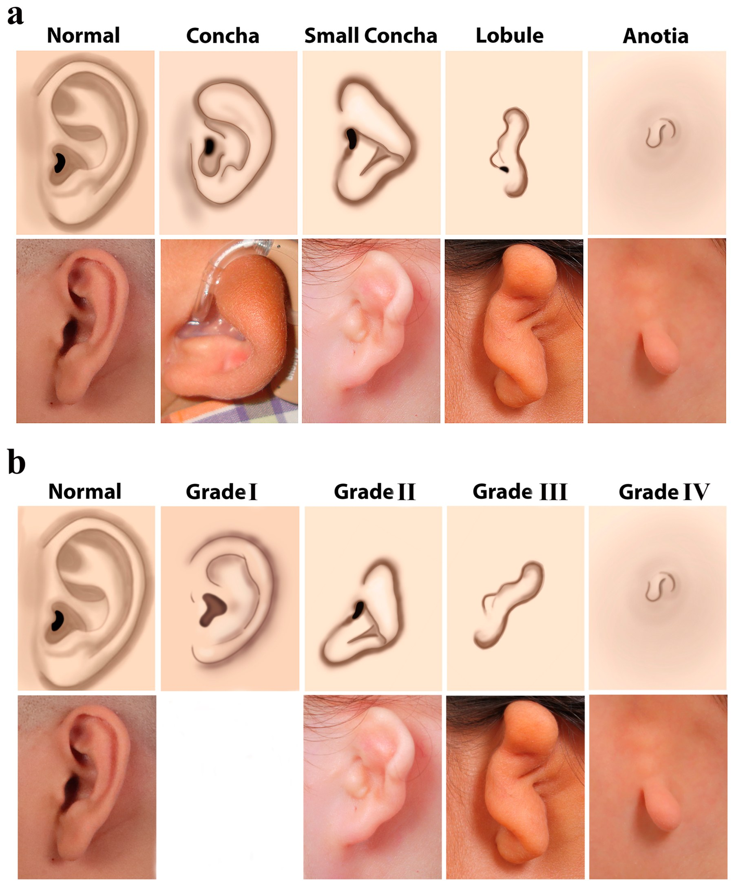
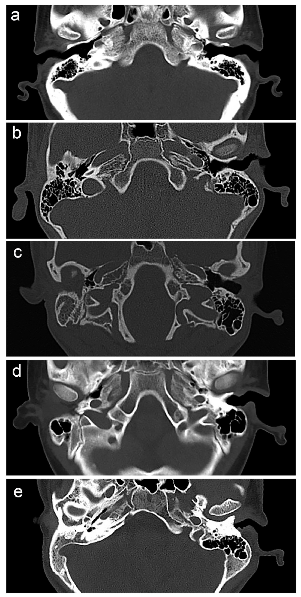
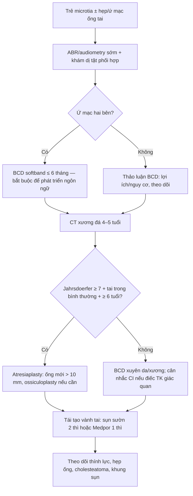
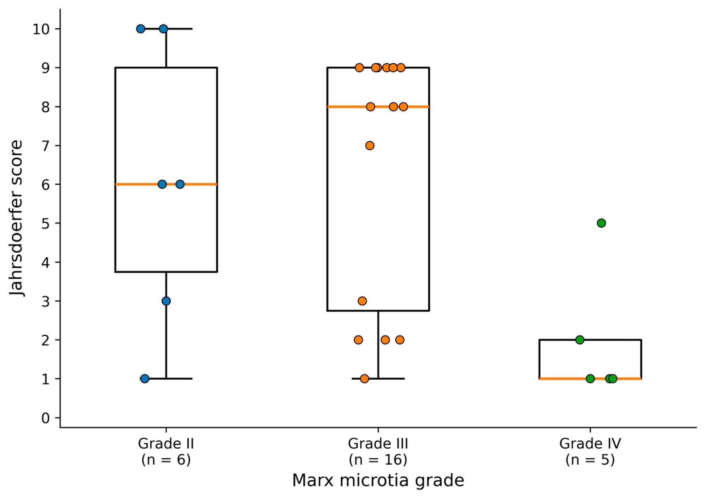

# 692 — Microtia & hẹp/ứ mạc ống tai ngoài: Marx/Nagata, điểm Jahrsdoerfer & chọn tái tạo vành tai hay phục hồi thính lực / Microtia–atresia

**Tags:** `pattern:microtia` `pattern:atresia-ong-tai` `vung:tai` `score:Jahrsdoerfer` `score:Marx-Nagata` `protocol:CT-xuong-da` `protocol:audiometry`
**Mức chắc chắn (certainty):** tổng hợp y văn (literature synthesis) — tổng hợp đoàn hệ, review và ca nguyên văn mở; số liệu lấy trực tiếp từ bài gốc ghi PMCID trong `sources.md`; ảnh CC BY 4.0, không suy đoán tên tác giả.

> **Bài này nối tiếp 658 (phổ OAVS/Goldenhar & dị tật cung mang) và 603 (Pierre Robin).** 658 trả lời “dị dạng vành tai nằm trong phổ bệnh nào”; bài này trả lời **“phân loại vành tai, đọc CT xương đá theo điểm Jahrsdoerfer, và chọn giữa tái tạo vành tai, đặt thiết bị dẫn âm xương hay mổ mở ống tai”**.

## 1. Tổng quan bệnh học – cơ chế hình ảnh

- **Microtia** là dị dạng bẩm sinh của vành tai, thường kèm **hẹp hoặc ứ mạc ống tai ngoài (external auditory canal atresia/stenosis)** và dị dạng xương con. **> 90%** ca ứ mạc ống tai ngoài kèm microtia (Lee 2020, PMC7575916).
- **Dịch tễ:** khoảng **1–10/10.000 ca sinh sống** tùy định nghĩa/nguồn (Solmaz 2026 ghi ~1/10.000; Patel 2022 ghi 1–4/10.000; Shiravani 2026 ghi 3–10/10.000). **Một bên ~90%**, **tai phải gấp đôi tai trái**, nam nhiều hơn; **hai bên ~10–11%** (Solmaz 2026; Patel 2022).
- **Phôi thai – vì sao vành tai và ống tai đi cùng nhau:** vành tai hình thành từ các **củ His (auricular hillocks)** của cung mang I–II; ống tai ngoài từ **khe mang I**; xương con từ cung I–II (**tuần 4–16**); ống tai **canal hóa từ tháng 6**. Vì chung nguồn gốc, dị dạng vành tai và ống tai–tai giữa thường song hành (Lee 2020).
- **Vì sao nghe kém:** ứ mạc ống tai + dị dạng xương con → **điếc dẫn truyền (conductive hearing loss, CHL)**, thường **50–60 dB**; tai trong thường bình thường. Đây là lý do **phải đo thính lực sớm**, không chỉ nhìn vành tai.
- **Phân loại vành tai:**
  - **Marx I–IV** theo mức khiếm khuyết: I nhẹ (vành tai nhỏ, còn cấu trúc) → **IV = anotia** (không có vành tai).
  - **Nagata:** **concha type, small concha type, lobule type, anotia** — phân loại theo hình thái còn lại để **lập kế hoạch tái tạo**.
  - Hai hệ **bổ sung nhau**, không thay thế nhau (Solmaz 2026).
- **Phân loại ống tai (đồng thuận IMAW 2019, theo Lee 2020):**
  - **Type A — stenosis:** ống tai hẹp, màng nhĩ nhỏ nhưng còn; xương con thường bình thường.
  - **Type B — partial atresia:** còn một phần ống tai sụn/xương, màng nhĩ thiếu/rudimentary.
  - **Type C — total atresia:** không có ống tai, dị dạng tai giữa nhiều mức.
- **TẠI SAO phải CT xương đá (không chỉ siêu âm/clinical):** CT là cách duy nhất **đếm điểm Jahrsdoerfer** — đánh giá **xương bàn đạp (stapes), cửa sổ bầu dục, cửa sổ tròn, khoang tai giữa, đường đi dây VII, phức hợp malleus–incus, khớp incus–stapes, độ khí hóa xương chũm, ống tai ngoài**. Điểm càng cao → tai giữa càng thuận lợi cho **mổ mở ống tai (atresiaplasty)**.
- **Ngưỡng định lượng đáng nhớ:**
  - **Jahrsdoerfer tối đa 10 điểm:** **xương bàn đạp 2 điểm**; mỗi cấu trúc sau **1 điểm**: cửa sổ bầu dục, cửa sổ tròn, khoang tai giữa, dây VII, phức hợp malleus–incus, khí hóa xương chũm, khớp incus–stapes, **vành tai** (bản gốc) hoặc **ống tai ngoài** (bản sửa đổi Ishimoto). **≥ 7/10** là ngưỡng được dùng để cân nhắc atresiaplasty, kèm **tai trong bình thường** và **tuổi ≥ 6** (Lee 2020).
  - **Cholesteatoma:** gặp tới **20%** ca ứ mạc ống tai ngoài — phải tìm trên CT/MRI và khám lâm sàng (Lee 2020).
  - **Mổ mở ống tai:** đường kính ống mới **> 10 mm**; ghép da mỏng **0,008–0,011 inch**; **ossiculoplasty** cần ở **6,9–46%** ca (Lee 2020).
  - **Kết quả nghe:** atresiaplasty cải thiện trung bình **24,1 dB** (516 tai); **thiết bị dẫn âm xương xuyên da (osseointegrated BCD)** cải thiện **38 dB** (100 tai) trong phân tích gộp của Nadaraja (Lee 2020 dẫn lại). Bonebridge đơn thuần báo cáo **45 dB** ở 14 bệnh nhân; BAHA/Bonebridge khoảng **35 dB** ở 34 bệnh nhân.

*Hàng trên: sơ đồ; hàng dưới: ảnh lâm sàng. (a) Nagata: normal – concha – small concha – lobule – anotia. (b) Marx: normal – grade I – II – III – IV. Grade III là thể “peanut” kinh điển; grade IV là anotia. Nguồn: Solmaz E et al., J Clin Med 2026;15(18):7031 (PMC13607474, Fig. 2), CC BY 4.0.*

## 2. Mẫu hình + chẩn đoán phân biệt theo vị trí và mức độ (gamut)

- **Microtia đơn lẻ (isolated):** chỉ vành tai ± ống tai, không dị tật khác. Thường **Marx III, Nagata lobule**.
- **Microtia trong hội chứng:**
  - **OAVS/Goldenhar (craniofacial microsomia):** bất đối xứng nửa mặt, **microtia một bên**, dermoid kết–giác mạc, bất thường đốt sống; có thể kèm **dây VII lạc chỗ**, thiểu sản xương hàm dưới (bài 658).
  - **Treacher–Collins:** gò má dẹt, hở mi dưới, thiếu lông mi, microtia; gen **TCOF1/POLR1C/POLR1D**.
  - **CHARGE:** ứ mạc khoang mũi, dị tật tim, chậm phát triển, dị tật sinh dục; **coloboma**.
  - **BOR (branchio-oto-renal):** nang/rò khe mang, dị dạng tai, bất thường thận; gen **EYA1/SIX1/SIX5**.
  - **Nager, Miller, hemifacial microsomia** — hiếm.
- **Nghe kém dẫn truyền — gamut theo cơ chế:**
  - **Ứ mạc/hẹp ống tai** (bẩm sinh) — nguyên nhân chính trong microtia.
  - **Dị dạng/xơ cứng xương con** (incus–stapes discontinuity, stapes fixation).
  - **Cholesteatoma bẩm sinh** trong ứ mạc/stenosis — nguy cơ **tới 20%**.
  - **Viêm tai giữa tiết dịch** (effusion) — hay gặp, điều trị được.
  - **Otosclerosis** — rất hiếm ở trẻ; **chấn thương** — có tiền sử.
- **Bẫy “vành tai nhỏ nhưng tai trong bình thường”:** đa số microtia–atresia có **tai trong bình thường**, nên **không được mặc định là điếc thần kinh**; đo ABR/audiometry để phân biệt.
- **Sau mổ — gamut biến chứng:** **hẹp/tái hẹp ống tai** (restenosis), **cholesteatoma ống tai mới**, **liệt dây VII**, **điếc thần kinh giác quan (SNHL)** do khoan, **nhiễm trùng/lộ khung sụn** (đặc biệt Medpor), **tụt/hỏng thiết bị BCD**.

## 3. Bảng so sánh phân biệt (ma trận đối chiếu)

| Thực thể (entity) | Hình ảnh/lâm sàng điển hình | Chốt vào (rule-in) | Chốt loại (rule-out) | Gợi ý xác nhận |
|---|---|---|---|---|
| Microtia Marx III + ứ mạc hoàn toàn | Vành tai dạng “peanut”/lobule, không có ống tai; CT: không thấy ống tai, xương con dị dạng | **Vành tai rudimentary + CT không có ống tai + CHL** | **Vành tai gần bình thường, ống tai thông → không phải thể nặng** | Ảnh lâm sàng + CT xương đá + audiometry |
| Microtia Marx IV/anotia | Không có vành tai, chỉ mô mềm; CT thường **Jahrsdoerfer rất thấp** | **Anotia + CT tai giữa kém phát triển** | **Còn sụn vành tai rõ → không phải anotia** | CT 3D + khám + hội chẩn tạo hình |
| Hẹp ống tai (type A) | Ống tai nhỏ nhưng thông; màng nhĩ nhỏ; nghe kém nhẹ–vừa | **Ống tai thông + màng nhĩ hiện diện** | **Không thấy ống tai/màng nhĩ → type B/C** | Otoscopy, CT, audiometry |
| Cholesteatoma trong ứ mạc | Khối mô mềm trong ống tai/xương đá, hủy xương, có thể liệt VII | **Hủy xương + khối mô mềm trên CT/MRI DWI** | **Không hủy xương, không khối → viêm/tắc đơn thuần** | CT/MRI, phẫu thuật kiểm tra |
| OAVS/Goldenhar | Bất đối xứng mặt, microtia một bên, dermoid limbus, đốt sống bất thường | **Bất đối xứng nửa mặt + microtia + dấu hiệu mắt/cột sống** | **Hai tai đối xứng, không dấu hiệu mặt → isolated** | Khám mắt–tai–cột sống, CT sọ mặt |
| Treacher–Collins | Gò má dẹt, hở mi dưới, microtia, khe hở vòm | **Hở mi dưới + gò má dẹt + tiền sử gia đình** | **Mặt bình thường, không hở mi** | Gen TCOF1/POLR1C/POLR1D, khám mắt |
| Hẹp/tái hẹp sau atresiaplasty | Ống tai mới hẹp dần, chảy dịch, nghe kém lại | **Đường kính ống giảm + triệu chứng tái phát** | **Ống rộng ổn định, không triệu chứng** | Nội soi/CT, đo thính lực lại |

*(a) Tai bình thường: ống tai ngoài thông, xương con rõ. (b) Concha type. (c) Small concha type. (d) Lobule type. (e) Anotia — ống tai ngoài mất, tai giữa kém phát triển. Hình ảnh vành tai bên ngoài **không dự báo chắc chắn** mức dị dạng xương bên trong. Nguồn: Solmaz E et al., J Clin Med 2026;15(18):7031 (PMC13607474, Fig. 3), CC BY 4.0.*

## 4. Protocol chụp – phục hồi thính lực – phẫu thuật & thang điểm Jahrsdoerfer

### 4.1. Mốc thời gian (theo Patel 2022, PMC9764815)

| Tuổi | Việc cần làm |
|---|---|
| Sơ sinh – 3 tháng | **Sàng lọc thính lực sơ sinh**; nếu nghi → **ABR không an thần trong 3 tháng đầu**; khám tai–mặt–mắt–cột sống; tư vấn di truyền |
| ≤ 6 tháng | **Thử BCD đeo vành (softband/adherent)** — đặc biệt **ứ mạc hai bên**; với một bên, thảo luận lợi ích/nguy cơ |
| 9–12 tháng | **Audiogram hành vi** lần đầu, sau đó **mỗi 6 tháng**; theo dõi phát triển ngôn ngữ |
| 4–5 tuổi | **CT xương đá** (không an thần nếu hợp tác) cho ứ mạc hoàn toàn; chụp sớm hơn nếu **hẹp có nguy cơ cholesteatoma** |
| ≥ 5 tuổi | Có thể **đặt BCD xuyên da/xương**; **atresiaplasty** thường sau khi hoàn tất tái tạo vành tai |
| 10–12 tuổi (hoặc 6–7) | **Tái tạo vành tai bằng sụn sườn** khi đủ chất liệu; một số trung tâm bắt đầu **6–7 tuổi**; Medpor có thể một thì |

- **Vì sao chờ 4–5 tuổi mới CT:** giảm nhu cầu an thần, giảm liều xạ, xương chũm–hộp sọ đủ dày cho BCD xuyên da; **nhưng** hẹp ống tai/nguy cơ cholesteatoma thì **chụp sớm** (Patel 2022).
- **Vì sao chờ ≥ 6 tuổi mới atresiaplasty:** trẻ hợp tác theo dõi, giảm nguy cơ hẹp lại; **tai trong phải bình thường**, **Jahrsdoerfer ≥ 7** (Lee 2020).

### 4.2. Thang điểm Jahrsdoerfer (bản gốc 10 điểm)

| Cấu trúc trên CT | Điểm |
|---|---|
| Xương bàn đạp (stapes) hiện diện | **2** |
| Cửa sổ bầu dục mở | 1 |
| Khoang tai giữa | 1 |
| Dây thần kinh VII bình thường | 1 |
| Phức hợp malleus–incus | 1 |
| Khí hóa xương chũm | 1 |
| Khớp incus–stapes | 1 |
| Cửa sổ tròn | 1 |
| Vành tai (bản gốc) / ống tai ngoài (bản sửa đổi) | 1 |
| **Tổng** | **10** |

- **Cách đọc:** **≥ 7/10** + tai trong bình thường + tuổi ≥ 6 → **có thể cân nhắc atresiaplasty**; **< 5** thường **không thuận lợi**, ưu tiên **BCD**; **5–6** là vùng chồng lấp, quyết định theo bệnh nhân và kinh nghiệm trung tâm (Lee 2020; Solmaz 2026 dùng phân tầng < 5 / 5–8 / > 8 cho mô tả).
- **Lưu ý bản sửa đổi:** Ishimoto thay “vành tai” bằng “ống tai ngoài” để tách ảnh hưởng của hình thái vành tai; điểm vẫn tối đa 10 (Solmaz 2026).

### 4.3. Chọn can thiệp

- **Tái tạo vành tai:**
  - **Sụn sườn tự thân (autologous costal cartilage):** 2–3 thì; thường **10–12 tuổi** khi đủ sụn (Patel 2022); đoàn hệ 229 bệnh nhân: **49/81 (60%)** chọn sụn sườn, tuổi trung vị **8,3 (5–32)**; ưu điểm sống, ít lộ khung; nhược điểm nhiều thì, đau vùng lấy sụn.
  - **Medpor (polyethylene xốp):** 1 thì; **atresiaplasty nên làm TRƯỚC** tái tạo Medpor để tránh nhiễm trùng/lộ khung; nếu dùng sụn sườn, **tái tạo vành tai trước, atresiaplasty sau** (Lee 2020).
  - **Phục hình vành tai (prosthesis):** lựa chọn khi không muốn/không thể mổ nhiều thì (2/229 trong đoàn hệ Patel).
- **Phục hồi thính lực:**
  - **BCD đeo vành (softband)** — sớm, không mổ; **BCD xuyên da (Bonebridge, BAHA Attract, Osia)** hoặc **xuyên xương (BAHA Connect/Ponto)** — sau 5 tuổi; **ưu điểm nghe tốt hơn atresiaplasty** trong phân tích gộp (**38 vs 24,1 dB**) nhưng có nguy cơ da/vị trí cấy.
  - **Atresiaplasty** — chọn khi giải phẫu thuận lợi; nghe cải thiện ~**24 dB**, có thể cần mổ lại; nguy cơ **hẹp ống, cholesteatoma, liệt VII, SNHL**.
  - **Trường hợp xương hộp sọ quá mỏng/dị dạng:** có thể đặt **BCD xuyên da trên màng não thùy giữa (middle fossa dura)** thay vì xương chũm — kỹ thuật thay thế ở trẻ dị dạng sọ mặt (Sousa Menezes 2026, PMC13220714).

*Box plot điểm Jahrsdoerfer theo Marx. Marx II trung vị 6,0 (3,75–9,0); Marx III trung vị 8,0 (2,75–9,0); Marx IV trung vị 1,0 (1,0–2,0). **Không thể suy ra điểm CT từ hình thái vành tai** — phải chụp CT từng bên. Nguồn: Solmaz E et al., J Clin Med 2026;15(18):7031 (PMC13607474, Fig. 4), CC BY 4.0.*

## 5. Biến thể bình thường và cạm bẫy

- **Vành tai bên ngoài không dự báo được CT:** trong 27 tai, tương quan nghịch giữa Marx và Jahrsdoerfer chỉ **ρ = −0,380, p = 0,051**; Marx III có trung vị **8,0** (cao hơn Marx II **6,0**), và **40,7%** tai xếp loại nặng (< 5) nằm rải ở cả II–IV. Đừng “nhìn vành tai rồi đoán mổ được hay không” (Solmaz 2026).
- **Anotia/Marx IV:** điểm thường rất thấp (trung vị **1,0**), atresiaplasty ít khả thi → **BCD/tái tạo vành tai** là trục chính.
- **“Chỉ là vấn đề thẩm mỹ”:** sai — **> 90%** ứ mạc kèm microtia, nghe kém dẫn truyền ảnh hưởng ngôn ngữ; **đo thính lực ngay**, không chờ đến tuổi mổ vành tai.
- **Hẹp ống tai + cholesteatoma:** **tới 20%** ca ứ mạc có cholesteatoma; đau/chảy dịch/liệt VII là cờ đỏ, cần CT/MRI sớm (Lee 2020).
- **Dây VII lạc chỗ:** thường đi **phía trước** hơn bình thường trong ứ mạc; phải mô tả trên CT trước mổ để tránh liệt mặt.
- **Hẹp lại sau mổ:** nguy cơ **restenosis** giảm khi mổ muộn hơn; cần **nong/đặt stent ống tai** và theo dõi dài hạn; đừng hứa “mổ một lần là xong”.
- **Thứ tự mổ:** với **sụn sườn**, tái tạo vành tai trước rồi mới atresiaplasty (đảm bảo mạch máu da); với **Medpor**, atresiaplasty trước để tránh nhiễm trùng khung nhân tạo (Lee 2020).
- **BCD không phải “đặt là xong”:** cần đủ độ dày xương/da, theo dõi nhiễm trùng, da mỏng, di trú; ở trẻ dị dạng nặng có thể phải dùng **middle fossa dura**.
- **Một bên vs hai bên:** **hai bên** phải phục hồi sớm (nguy cơ chậm ngôn ngữ); **một bên** BCD là lựa chọn, không bắt buộc — quyết định chia sẻ với gia đình (Lee 2020; Patel 2022).

## 6. Tự lượng giá — Blind Quiz

**Ca 1 — Bé trai 8 tuổi, vành tai phải nhỏ, không thấy ống tai, nghe kém bên phải. Ảnh lâm sàng:**

- Gợi ý: không có bất thường mặt–mắt–cột sống; tai trái bình thường.
- Câu hỏi: Xếp loại vành tai theo Marx và Nagata? Có thể dự đoán điểm Jahrsdoerfer từ hình thái không? Bước tiếp theo?

<b>Bấm để hiện đáp án (findings + chẩn đoán)</b>

- **Findings:** vành tai chỉ còn thùy/“peanut”, không có ống tai → **Marx III**, **Nagata lobule type**; khả năng cao **ứ mạc ống tai ngoài**.
- **Chẩn đoán:** microtia–atresia một bên; **không suy ra điểm Jahrsdoerfer từ ảnh** — cần **CT xương đá** (khoảng 4–5 tuổi hoặc sớm hơn nếu hẹp/cholesteatoma) và **audiometry**.
- **Bước tiếp:** ABR/audiogram, tư vấn BCD/atresiaplasty, kế hoạch tái tạo vành tai (sụn sườn 10–12 tuổi hoặc Medpor).
- **Nguồn ảnh:** Solmaz E et al., J Clin Med 2026;15(18):7031 (PMC13607474, Fig. 2), CC BY 4.0.

**Ca 2 — Bé gái 6 tuổi, microtia phải, CT xương đá lát trục:**

- Câu hỏi: Mô tả ống tai ngoài và tai giữa ở các panel. Dấu hiệu nào quyết định khả năng mổ mở ống tai?

<b>Bấm để hiện đáp án (findings + chẩn đoán)</b>

- **Findings:** (a) bình thường — ống tai thông, xương con rõ; (b–e) microtia phải — **mất ống tai ngoài**, tai giữa kém phát triển, mức độ nặng dần từ concha → anotia.
- **Chẩn đoán:** microtia–atresia; **khả năng atresiaplasty phụ thuộc điểm Jahrsdoerfer** (stapes 2 điểm, cửa sổ bầu dục/tròn, khoang tai giữa, dây VII, malleus–incus, khí hóa chũm, khớp incus–stapes, ống tai) — **≥ 7** thuận lợi.
- **Cạm bẫy:** hình thái vành tai bên ngoài **không** dự báo điểm CT (Marx III có thể điểm 8; Marx IV thường điểm 1).
- **Nguồn ảnh:** Solmaz E et al., J Clin Med 2026;15(18):7031 (PMC13607474, Fig. 3), CC BY 4.0.

**Ca 3 — Hội chẩn: 27 tai microtia, điểm Jahrsdoerfer 1–10. Biểu đồ phân bố:**

- Câu hỏi: Nhóm nào có điểm thấp nhất? Vì sao không thể dùng Marx/Nagata thay CT để chọn mổ?

<b>Bấm để hiện đáp án (findings + chẩn đoán)</b>

- **Findings:** Marx IV (anotia) trung vị **1,0**; Marx III trung vị **8,0**; Marx II **6,0**; **chồng lấp lớn** giữa II và III.
- **Kết luận:** hình thái vành tai chỉ là **gợi ý**, không thay thế **CT từng bên**; tương quan nghịch không đạt ý nghĩa thống kê (ρ = −0,380; p = 0,051).
- **Nguồn ảnh:** Solmaz E et al., J Clin Med 2026;15(18):7031 (PMC13607474, Fig. 4), CC BY 4.0.

## Bài liên quan chéo

- [600 – Tổng quan Hệ Nhi khoa](../600-tong-quan-nhi-khoa/lesson.md)
- [658 – Phổ mắt–tai–cột sống (OAVS/Goldenhar) & dị tật cung mang I–II](../658-pho-oavs-goldenhar-va-cung-mang/lesson.md)
- [603 – Hội chứng Pierre Robin & tắc nghẽn đường thở trên](../603-pierre-robin-tac-nghen-duong-tho/lesson.md)
- [720 – Xương đá & cholesteatoma: scutum, DWI & mặt](../720-temporal-bone-cholesteatoma/lesson.md)

## Ảnh

- `692_microtia_Lam-sang_JCM2026-F2.jpg` — phân loại Nagata/Marx (PMC13607474, Fig. 2), CC BY 4.0.
- `692_microtia_CT_JCM2026-F3.jpg` — CT xương đá các thể microtia–atresia (PMC13607474, Fig. 3), CC BY 4.0.
- `692_microtia_Jahrsdoerfer_JCM2026-F4.jpg` — phân bố điểm Jahrsdoerfer theo Marx (PMC13607474, Fig. 4), CC BY 4.0.

> Không dùng để chẩn đoán độc lập khi chưa có người hướng dẫn.
