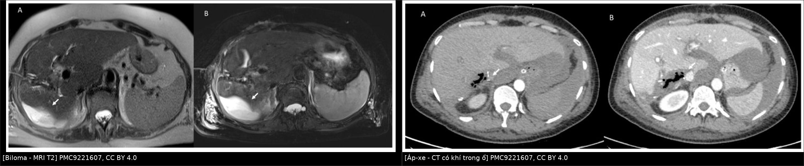
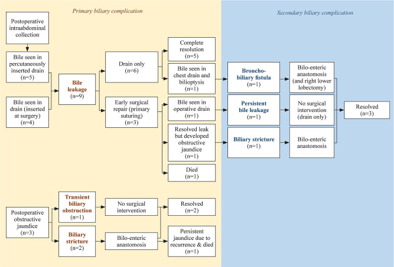
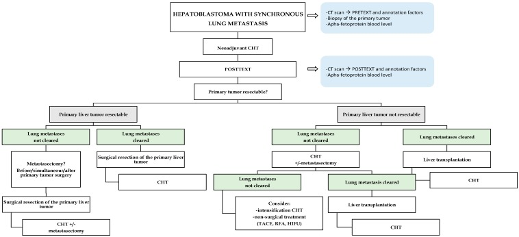
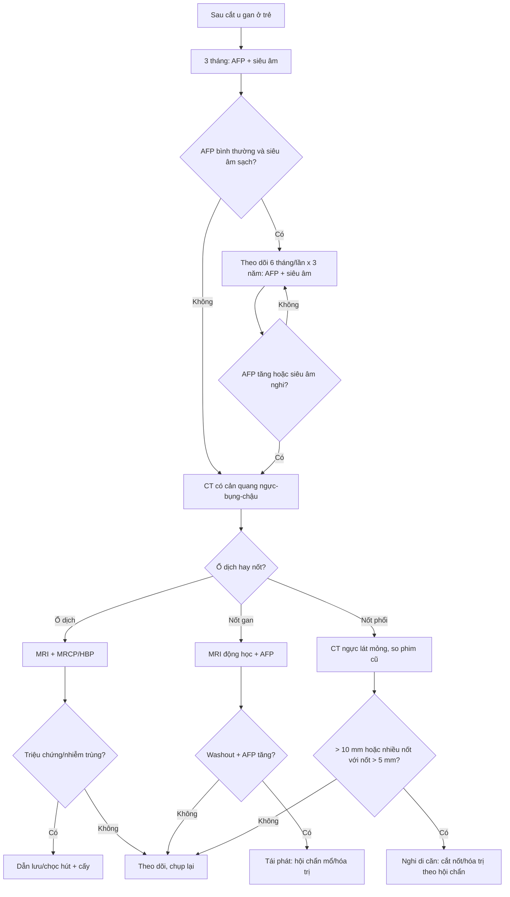
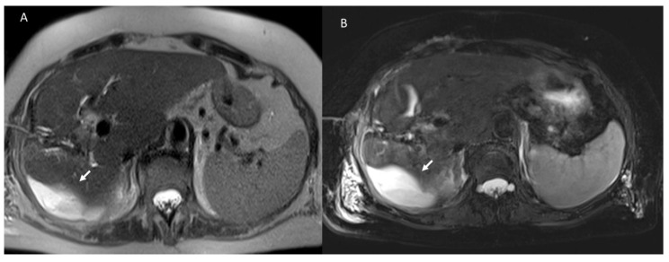
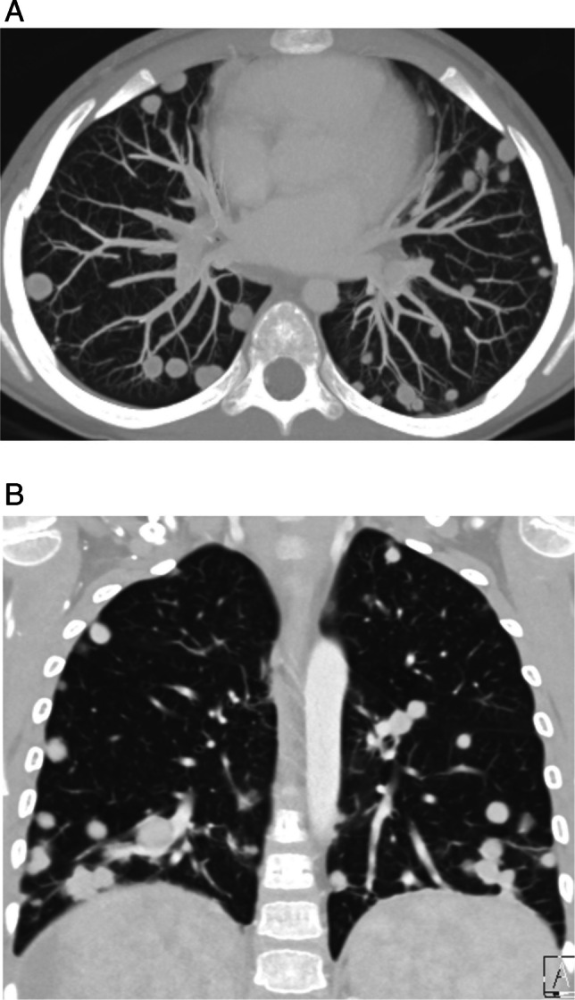
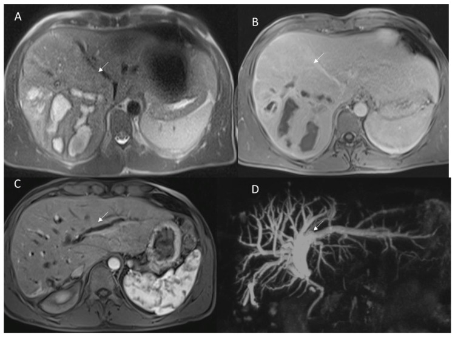

# 693 — Theo dõi và biến chứng sau cắt u gan ở trẻ: biloma, hẹp đường mật, tái phát & di căn phổi / Post-resection liver tumours in children

**Tags:** `pattern:o-dich-sau-mo` `pattern:hep-duong-mat` `vung:gan` `protocol:CT-MRI` `protocol:AFP` `incidentaloma:di-can-phoi`
**Mức chắc chắn (certainty):** tổng hợp y văn (literature synthesis) — đoàn hệ hồi cứu, review hình ảnh và thuật toán từ y văn mở; số liệu đọc trực tiếp từ bài gốc ghi PMCID trong `sources.md`; ảnh CC BY/CC BY-NC, tên tác giả đối chiếu `authorString` Europe PMC.

> **Bài này nối tiếp 664 (u mô đệm lành), 665 (khối u gan nhi), 666 (nang ống mật chủ) và 663 (sarcoma phôi gan).** Các bài trước trả lời “u là gì, cắt hay không”; bài này trả lời **“sau khi cắt u, ổ dịch nào là bình thường – ổ nào là biến chứng, hẹp đường mật đọc thế nào, và làm sao phát hiện tái phát/di căn phổi sớm”**.

## 1. Tổng quan bệnh học – cơ chế hình ảnh

- **Bối cảnh:** hepatoblastoma (HB) là u gan ác hay gặp nhất ở trẻ **< 3 tuổi**; cắt gan + hóa trị tân bổ trợ (PLADO/SIOPEL) là chuẩn. Trong một đoàn hệ 26 trẻ, **19 ca (73%) được cắt gan**, **2 ca (10,5%) tái phát**, sống không bệnh **89,5%**, sống toàn bộ **81,8%** ở 3 và 5 năm (Shah 2026, PMC13061486).
- **Biến chứng đường mật sau cắt gan ở trẻ không hiếm:** **12/86 ca (14%)** có biến chứng đường mật nguyên phát — **9 rò mật (bile leak)** và **3 hẹp/tắc đường mật (biliary obstruction)** (Othman 2023, PMC10335567). Đây là lý do mọi ổ dịch sau mổ phải được đọc theo **bản chất mật – máu – mủ**, không chỉ theo kích thước.
- **TẠI SAO biloma hình thành:** mặt cắt gan để lại các nhánh đường mật nhỏ bị cắt; nếu không được khâu kín hoặc bị thiếu máu, mật rò vào khoang cắt. Mật là chất **gây viêm mạnh** (muối mật, enzyme tiêu hóa) → tạo ổ dịch có vỏ xơ, dễ bội nhiễm. Vị trí điển hình: **dưới cơ hoành/khoang cắt**, cạnh gan, hoặc **quanh đường mật**.
- **Vì sao biloma sáng trên T2 và tối trên T1:** dịch mật gần như nước tự do → thời gian T2 dài (**rất sáng**), T1 dài (**tối**); không có tế bào gan nên **không ngấm gadoxetate ở thì gan–mật (hepatobiliary phase, HBP)**. Trên CT, biloma là dịch **0–20 HU**, bờ mỏng, không vôi hóa, không khí (trừ khi vừa mổ/đã đặt dẫn lưu).
- **Vì sao áp-xe khác biloma:** ổ mủ có nhiều tế bào, protein và xác bạch cầu → **hạn chế khuếch tán** (DWI sáng, ADC thấp), **vách dày ngấm thuốc**, có thể **khí trong ổ (−1000 HU)**. Khí một mình không chứng minh nhiễm trùng vì có thể vào trong lúc mổ hoặc qua ống dẫn lưu.
- **Máu tụ (hematoma):** máu cấp **50–80 HU** trên CT; trên MRI đổi tín hiệu theo tuổi máu — **hemoglobin khử (deoxyhemoglobin)** T1 đồng/tối, T2 rất tối; **methemoglobin bán cấp** T1 sáng. Đây là điểm phân biệt với biloma (T1 luôn tối).
- **Hẹp đường mật sau cắt:** thường do **thiếu máu** hoặc tổn thương ống mật tại mặt cắt/miệng nối. Trên MRI, hẹp là chỗ **tín hiệu mật giảm đột ngột** kèm **giãn đường mật phía trên**; trên MRCP thấy “cây mật” giãn không liên tục. HBP có thể cho thấy đoạn mật không ngấm/ứ trệ.
- **TẠI SAO tái phát khó đọc:** mô hạt lành sau mổ **ngấm thuốc thì động mạch** và có thể giả “nốt”; nhưng mô hạt **không có washout điển hình** và **giảm dần theo thời gian**, trong khi tái phát HB thường **ngấm mạnh thì động mạch rồi thải thuốc** và **tăng kích thước**, kèm **AFP tăng**.
- **Di căn phổi — ngưỡng định nghĩa:** khoảng **20%** trẻ HB có di căn lúc chẩn đoán, hay gặp nhất ở phổi; di căn phổi được định nghĩa là **một nốt > 10 mm** hoặc **nhiều nốt với ít nhất một nốt > 5 mm**; **CT là tiêu chuẩn vàng** (Angelico 2019, PMC6895839).
- **Tần suất tái phát và vị trí:** trong 25 trẻ cắt gan/ghép gan, **5 ca (20%) tái phát, TOÀN BỘ là di căn xa** (phổi hoặc hạch trung thất); **xâm lấn mạch (cửa hoặc gan) p = 0,038** và **phải ghép gan p = 0,016** là yếu tố liên quan tái phát (Jivani 2026, PMC13446955).
- **Tiên lượng khi có di căn phổi:** tổng hợp 434 trẻ HB có di căn phổi đồng thời cho thấy sống toàn bộ khoảng **83%**, **tái phát 40%** sau trung vị 4 năm theo dõi; mổ nốt phổi (metastasectomy) bằng **cắt bờ (wedge resection)** được khuyến cáo để giữ chức năng phổi (Angelico 2019).

## 2. Mẫu hình + chẩn đoán phân biệt theo vị trí và thời điểm (gamut)

- **Gamut theo thời gian sau mổ:**
  - **0–30 ngày:** **tụ máu/seroma** (ổ dịch đơn thuần), **biloma sớm**, **áp-xe**, **tắc đường mật thoáng qua do phù nề**, huyết khối tĩnh mạch cửa/gan, suy gan cấp.
  - **1–6 tháng:** **biloma/áp-xe tồn tại**, **hẹp đường mật**, **giả phình động mạch gan → hemobilia**, hẹp miệng nối mật–ruột (nếu có), tràn dịch màng phổi do rò mật qua cơ hoành (**bilothorax**).
  - **> 6 tháng:** **tái phát tại diện cắt**, **hẹp đường mật muộn**, **di căn phổi/hạch**, **nốt tăng sản lành (FNH-like)** sau hóa trị, biến chứng muộn của ruột non–mạc treo.
- **Gamut theo vị trí:**
  - **Khoang cắt/dưới hoành:** biloma, áp-xe, máu tụ, seroma, tái phát tại diện cắt.
  - **Rốn gan/đường mật:** rò mật, hẹp, sỏi mật sau mổ, viêm đường mật.
  - **Mạch máu:** giả phình động mạch gan (hemobilia), huyết khối tĩnh mạch cửa, hẹp động mạch gan.
  - **Phổi–trung thất:** di căn phổi, hạch trung thất, tràn dịch/tràn khí màng phổi sau mổ.
- **Mẹo định khu “ổ dịch cạnh gan”:**
  - **Biloma** thường **bờ mỏng, đơn thùy**, nằm sát diện cắt, có thể **thay đổi theo tư thế**.
  - **Áp-xe** thường **vách dày, bờ không đều, có khí**, kèm sốt/CRP tăng.
  - **Máu tụ** có **HU cao (50–80)** ở thì không cản quang, **T1 sáng** khi bán cấp.
  - **Seroma** là dịch **0–20 HU**, không triệu chứng, **tự teo dần**.

*Trái: biloma — MRI T2, ổ dịch tăng tín hiệu mạnh, bờ mỏng, không khí. Phải: áp-xe — CT, ổ dịch có **khí trong ổ** và vách dày. Cả hai ảnh: PMC9221607, CC BY 4.0; ảnh ghép letterbox giữ nguyên tỷ lệ.*

## 3. Bảng so sánh phân biệt (ma trận đối chiếu)

| Thực thể (entity) | Hình ảnh điển hình (CT/MRI) | Chốt vào (rule-in) | Chốt loại (rule-out) | Gợi ý xác nhận |
|---|---|---|---|---|
| Biloma (rò mật khu trú) | Ổ dịch **0–20 HU**, bờ mỏng, sát diện cắt; **T2 rất sáng, T1 tối**, không ngấm; HBP không ngấm (trừ khi thông với đường mật) | **Dịch mật + vị trí sát mặt cắt + không khí/vách** | **T1 sáng hoặc HU > 40 → nghĩ máu tụ** | Siêu âm + MRI/MRCP; định lượng bilirubin dịch hút |
| Áp-xe trong ổ cắt | Ổ dịch **vách dày ngấm thuốc**, **khí trong ổ**, phù nề quanh; **DWI sáng/ADC thấp** | **Sốt + CRP tăng + vách dày/khí** | **Không triệu chứng, vách mỏng, không hạn chế khuếch tán → không phải áp-xe** | Chọc hút/cấy; CT có cản quang |
| Máu tụ/seroma | Máu cấp **50–80 HU**, T1 đồng/tối, T2 tối; seroma **0–20 HU**, T1 tối, T2 sáng | **HU cao hoặc T1 sáng (methemoglobin)** | **Dịch thuần nước, không tăng HU → seroma** | CT không cản quang, MRI T1/T2 |
| Hẹp đường mật | Hẹp đột ngột + **giãn đường mật trên chỗ hẹp**; MRCP thấy cây mật gián đoạn; HBP ứ trệ | **Giãn đường mật trên + hẹp tại miệng nối/mặt cắt** | **Không giãn trên chỗ hẹp → không tắc nghẽn** | MRCP/HBP; ERCP/PTC nong hoặc mổ lại |
| Tái phát tại diện cắt | Nốt **ngấm mạnh thì động mạch + washout**, tăng kích thước; có thể xâm lấn mạch | **Ngấm–thải thuốc + AFP tăng + tăng kích thước** | **Ngấm đều, không washout, teo dần → mô hạt** | MRI gan động học + AFP; sinh thiết khi còn nghi |
| Di căn phổi | Nốt đặc, bờ rõ, **ngoại vi/đáy phổi**; có thể canxi hóa; nhiều nốt hai bên | **Nốt > 10 mm hoặc nhiều nốt với ≥ 1 nốt > 5 mm** | **Nốt < 5 mm đơn độc, bờ mờ, có vôi hóa trung tâm → nghĩ lành** | CT ngực lát mỏng; so phim cũ; sinh thiết/cắt nốt chọn lọc |
| Nốt tăng sản lành sau hóa trị | Nốt **ngấm đồng nhất**, không washout, kích thước ổn định/giảm; thường nhiều nốt nhỏ | **Ổn định qua 2 lần chụp + AFP bình thường** | **Washout + AFP tăng → không phải lành** | MRI gan + AFP theo dõi |

*Sơ đồ 86 ca cắt gan ở trẻ: 9 rò mật (5 chỉ dẫn lưu, 3 mổ sớm, 1 dẫn lưu + đặt stent), 3 tắc mật (1 thoáng qua, 2 hẹp thật), 1 rò mật–phế quản, và các biến chứng thứ phát (hẹp, rò dai dẳng). Nguồn: Othman MY, Teh KH, Zahari Z, World J Pediatr Surg 2023;6(3):e000589 (PMC10335567, Fig. 1), **CC BY-NC** — dùng phi thương mại, giữ nguyên bản.*

## 4. Protocol theo dõi + hệ phân tầng và thuật toán

- **Mốc chụp/xét nghiệm (theo chương trình dùng trong đoàn hệ 25 trẻ — Jivani 2026, PMC13446955):**
  - **Sau mổ 3 tháng:** khám + **AFP + siêu âm (USG)**.
  - **Sau đó mỗi 6 tháng trong 3 năm:** AFP + USG.
  - **CT có cản quang (CECT) ngực–bụng–chậu** khi **AFP tăng** hoặc **USG nghi ngờ** — không chụp CT định kỳ chỉ vì lịch.
  - **Lưu ý trung thực:** đây là **phác đồ của một trung tâm**, không phải đồng thuận toàn cầu; SIOPEL/COG có thể khác về nhịp và thời gian theo dõi. Bài không khẳng định một “chuẩn duy nhất”.
- **Đánh giá ổ dịch sau mổ:**
  - **Siêu âm là bước đầu** (rẻ, không xạ): xác định ổ dịch, vách, khí, Doppler mạch.
  - **CT có cản quang** khi nghi áp-xe, máu tụ, giả phình, hoặc cần đánh giá mạch.
  - **MRI + MRCP/HBP** khi nghi **rò mật/hẹp đường mật**: T2 thấy ổ dịch và giãn mật; HBP (gadoxetate) thấy mật rò ra ngoài đường mật ở thì gan–mật muộn (khoảng **20 phút**); MRCP cho bản đồ cây mật.
  - **Chọc hút/dẫn lưu** khi ổ dịch có triệu chứng, nhiễm trùng, hoặc chèn ép; **không có ngưỡng kích thước được đồng thuận** — quyết định theo triệu chứng và diễn tiến (bài gốc chỉ mô tả dẫn lưu ở các ca có triệu chứng).
- **Xử trí rò mật theo bậc (Othman 2023):**
  - **Rò nhẹ, không nhiễm trùng:** **dẫn lưu qua da** — 6/9 ca chỉ dẫn lưu, có **1 ca tiến triển thành bilothorax**.
  - **Rò dai dẳng/có biến chứng:** **mổ sớm khâu lại** (3/9 ca) hoặc **tái tạo đường mật (biliary reconstruction)** (4 ca).
  - **Hẹp đường mật:** nong bóng/stent qua ERCP hoặc PTC; thất bại → **nối mật–ruột (hepaticojejunostomy)**; trong đoàn hệ 86 ca, **4 ca** cần tái tạo đường mật (gồm cả hẹp và rò phức tạp).
  - **Theo dõi sau khi hết rò vẫn bắt buộc:** biến chứng đường mật thứ phát có thể xuất hiện **sau khi rò đã khỏi** (Othman 2023).
- **Tầm soát di căn phổi:**
  - **CT ngực lát mỏng** là tiêu chuẩn vàng; ngưỡng nghi: **1 nốt > 10 mm** hoặc **nhiều nốt, ít nhất 1 nốt > 5 mm** (Angelico 2019).
  - **Nốt nhỏ < 5 mm** thường không đặc hiệu (hạch nội phổi, ổ viêm, hạt canxi); cần **so sánh phim cũ** và chụp lại thay vì sinh thiết ngay.
  - Khi di căn phổi còn sau hóa trị: **cắt bờ phổi (wedge resection)** ± điều trị tại chỗ; với HB không mổ được gan, **di căn phổi phải kiểm soát được trước khi ghép gan** (Angelico 2019).

*Luồng quyết định: chẩn đoán → hóa trị tân bổ trợ → đánh giá u gan mổ được hay không → cắt u ± cắt nốt phổi hoặc ghép gan; di căn không kiểm soát được là chống chỉ định ghép gan. Nguồn: Angelico R et al., Cancers (Basel) 2019 (PMC6895839, Fig. 2), CC BY 4.0.*

- **Phân tầng nguy cơ tái phát (dùng để tăng nhịp theo dõi):** **xâm lấn mạch** (tĩnh mạch cửa/gan) và **phải ghép gan** liên quan tái phát có ý nghĩa trong đoàn hệ 25 trẻ (p = 0,038 và p = 0,016) — Jivani 2026; đây là dữ liệu một trung tâm, cần xác nhận thêm.

## 5. Biến thể bình thường và cạm bẫy

- **Ổ dịch sớm sau mổ là bình thường:** hầu hết trẻ có ít dịch/dày mô mềm quanh diện cắt trong **1–2 tuần đầu**; chỉ gọi biến chứng khi **tăng kích thước, có triệu chứng, khí/vách dày, hoặc bilirubin trong dịch cao**.
- **Khí trong ổ ≠ áp-xe:** khí có thể do **mổ mở, ống dẫn lưu, hoặc kim chọc**; phải kết hợp **sốt, CRP, vách ngấm thuốc** và **cấy dịch**.
- **Biloma có thể gây tràn dịch màng phổi (bilothorax):** rò mật qua cơ hoành — đã gặp trong đoàn hệ 86 ca; đừng chỉ đọc “tràn dịch” mà bỏ qua ổ dưới hoành.
- **HBP không phải lúc nào cũng “bắt” rò:** nếu ổ dịch **không thông** với cây mật, HBP chỉ thấy ổ **không ngấm** — không loại trừ rò kín. Ngược lại, **mật ứ trong đường mật giãn** có thể ngấm và giả “u”.
- **Mô hạt sau mổ ngấm thuốc:** đừng gọi tái phát chỉ vì có nốt ngấm; cần **washout, tăng kích thước, AFP tăng**, và **so sánh 2 lần chụp**.
- **Nốt phổi nhỏ:** **< 5 mm** thường lành (hạch nội phổi, ổ viêm, canxi); CT có **dương tính giả** đáng kể ở trẻ — tránh mổ nốt phổi vô ích.
- **Sau hóa trị, gan có thể “giả nốt”:** nốt tăng sản lành (FNH-like) ngấm đồng nhất, không washout; **AFP bình thường** là chốt hỗ trợ.
- **Bỏ sót di căn hạch trung thất:** tái phát HB có thể biểu hiện **hạch trung thất** chứ không chỉ nốt phổi (5/5 ca tái phát trong đoàn hệ Jivani là di căn xa) — đọc CT ngực phải ghi hạch.
- **Cạm bẫy “thỏa mãn tìm kiếm”:** thấy biloma rõ rồi bỏ qua nốt gan mới hoặc nốt phổi nhỏ — luôn đọc **toàn bộ gan + phổi + hạch** trên cùng một lần chụp.

## 6. Tự lượng giá — Blind Quiz

**Ca 1 — Ca minh họa người lớn: bệnh nhân cắt phân thùy VIII vì di căn gan 1 tuần trước, sốt nhẹ, siêu âm thấy ổ dịch dưới hoành phải. Ở trẻ sau cắt u gan, biloma có hình ảnh tương tự.**

- Hỏi: Ổ dịch nằm ở đâu, tín hiệu gì? Ba khả năng và dấu hiệu nào giúp phân biệt?

<b>Bấm để hiện đáp án (findings + chẩn đoán)</b>

- **Dấu hiệu:** ổ dịch dưới hoành phải, **tăng tín hiệu mạnh trên T2 (A)** và **T2 fat-sat (B)**, bờ mỏng, không có vách dày/khí; mũi tên chỉ ổ dịch sát diện cắt.
- **Chẩn đoán:** **biloma** (ổ dịch mật) sau cắt gan — tín hiệu dịch thuần nước, không ngấm thuốc.
- **Phân biệt:** **áp-xe** (vách dày, khí, hạn chế khuếch tán, sốt/CRP cao), **máu tụ** (T1 sáng/HU cao), **seroma** (dịch đơn thuần, không triệu chứng). **Chốt:** vị trí sát diện cắt + T2 rất sáng + không vách dày.
- **Lưu ý nguồn:** ca trong bài gốc là **người lớn** (cắt phân thùy VIII vì di căn); dấu hiệu hình ảnh áp dụng cho trẻ nhưng **không phải ca nhi** — đây là chú thích phản biện, không sửa nguồn.
- **Nguồn ảnh:** PMC9221607 (Diagnostics 2022), CC BY 4.0 — Cutolo C et al.

**Ca 2 — Bé trai 6 tuổi, theo dõi sau cắt hepatoblastoma; AFP tăng nhẹ, không triệu chứng.**

- Hỏi: Mô tả phân bố nốt? Ngưỡng nào gọi là di căn? Cần làm gì tiếp?

<b>Bấm để hiện đáp án (findings + chẩn đoán)</b>

- **Dấu hiệu:** **nhiều nốt đặc, bờ rõ, kích thước khác nhau, hai bên phổi**, ưu thế **ngoại vi và thùy dưới**; hình MIP (A) và coronal (B) cho thấy phân bố rải rác.
- **Chẩn đoán:** **di căn phổi của hepatoblastoma** (đã xác nhận bằng sinh thiết trong bài gốc).
- **Ngưỡng:** **một nốt > 10 mm** hoặc **nhiều nốt với ít nhất một nốt > 5 mm** (Angelico 2019); ca này vượt ngưỡng rõ.
- **Việc cần làm:** **CT ngực lát mỏng** (nếu chưa), đối chiếu phim cũ, hội chẩn ung thư–phẫu thuật; nếu di căn còn sau hóa trị → **cắt bờ phổi** ± điều trị tại chỗ.
- **Nguồn ảnh:** PMC12831686 (Pediatr Radiol 2026), CC BY 4.0 — Tanimoto AA et al.

**Ca 3 — Ca minh họa người lớn: bệnh nhân 8 tháng sau cắt gan vì hepatosarcoma, vàng da nhẹ, siêu âm thấy đường mật trong gan giãn. Hình ảnh hẹp–giãn đường mật áp dụng tương tự ở trẻ.**

- Hỏi: Dấu hiệu chính? Chẩn đoán? Hai hướng xử trí và khi nào chuyển mổ?

<b>Bấm để hiện đáp án (findings + chẩn đoán)</b>

- **Dấu hiệu:** **giãn đường mật trong gan phía trên** một chỗ **hẹp/gián đoạn** (mũi tên); MRCP (D) thấy cây mật giãn, mất liên tục tại chỗ hẹp; HBP (C) cho thấy đoạn mật ứ trệ.
- **Chẩn đoán:** **hẹp đường mật sau cắt gan** (thiếu máu/miệng nối) gây ứ mật.
- **Xử trí:** **nong bóng/stent qua ERCP hoặc PTC** trước; nếu thất bại/tái hẹp → **nối mật–ruột (hepaticojejunostomy)**. Chỉ định mổ khi **hẹp không qua được, tái hẹp sau 2 lần nong, hoặc có biến chứng nhiễm trùng/ứ mật nặng**.
- **Lưu ý nguồn:** ca gốc là bệnh nhân **hepatosarcoma người lớn**; hình ảnh hẹp–giãn đường mật áp dụng chung, nhưng **không phải ca nhi** — chú thích phản biện.
- **Nguồn ảnh:** PMC9221607 (Diagnostics 2022), CC BY 4.0 — Cutolo C et al.

## Bài liên quan chéo
- [664 – U mô đệm lành của gan ở trẻ](../664-u-mo-dem-lanh-gan-o-tre/lesson.md)
- [665 – Khối u gan ở trẻ: tiếp cận chẩn đoán](../665-khoi-u-gan-nhi/lesson.md)
- [666 – Nang ống mật chủ (Todani I–V)](../666-nang-ong-mat-chu-o-tre/lesson.md)
- [663 – Sarcoma phôi gan chưa biệt hóa (UESL)](../663-sarcoma-phoi-gan-chua-biet-hoa/lesson.md)
- [641 – Theo dõi hậu phẫu Kasai ở teo đường mật](../641-theo-doi-hau-phau-kasai/lesson.md)

## Ảnh
- Nguồn và giấy phép từng ảnh: `images/CREDITS.md`. Ảnh **CC BY 4.0** dùng/ghép được; ảnh **CC BY-NC** (PMC10335567) dùng phi thương mại, **giữ nguyên bản, không ghép**.
- Ảnh ghép letterbox **không crop/kéo giãn**. Ảnh không tải được vì bản quyền: chỉ dẫn link trong `sources.md`.

> Không dùng để chẩn đoán độc lập khi chưa có người hướng dẫn.
