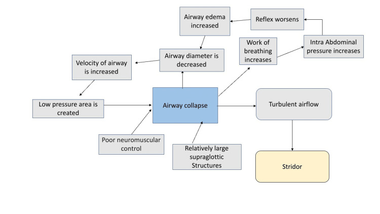
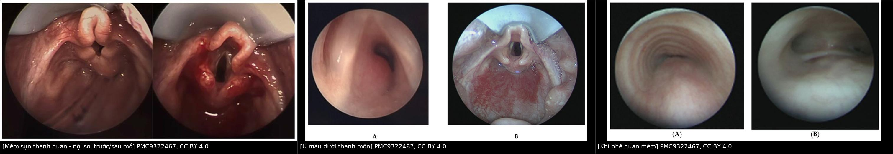
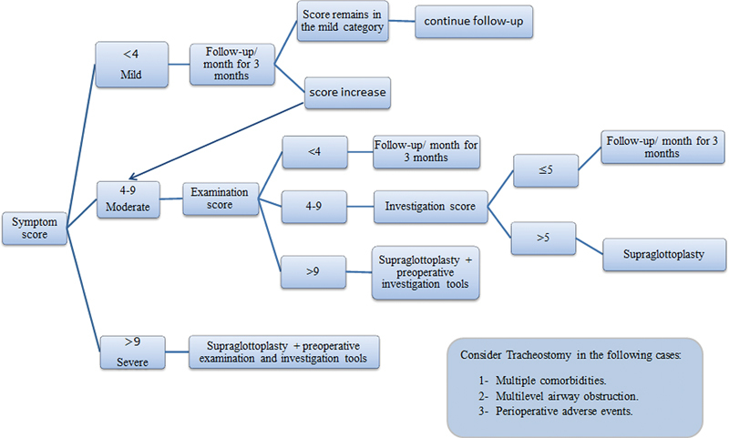
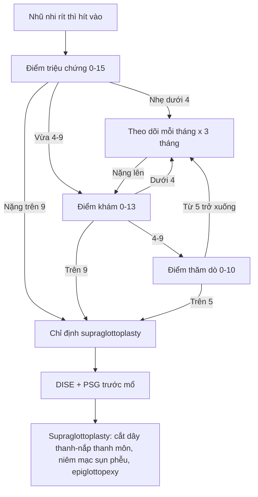
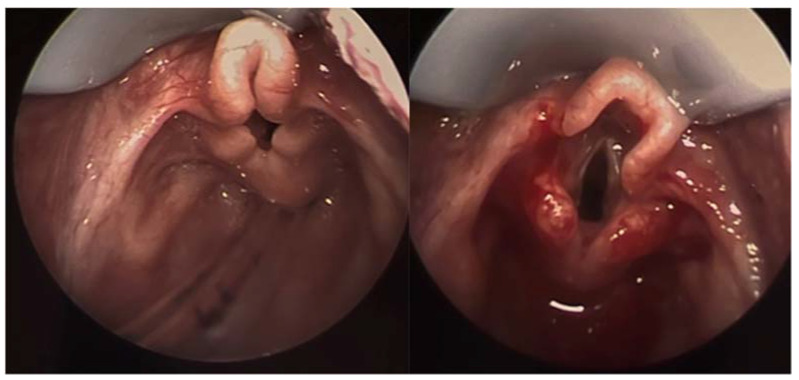
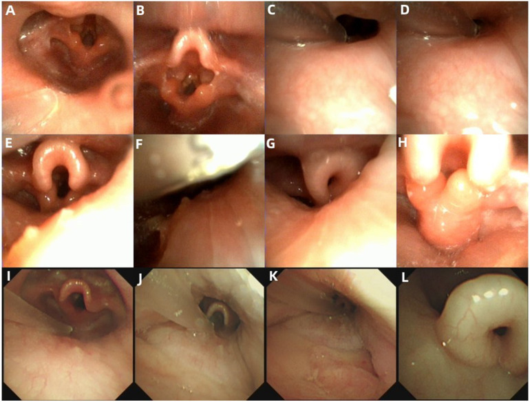
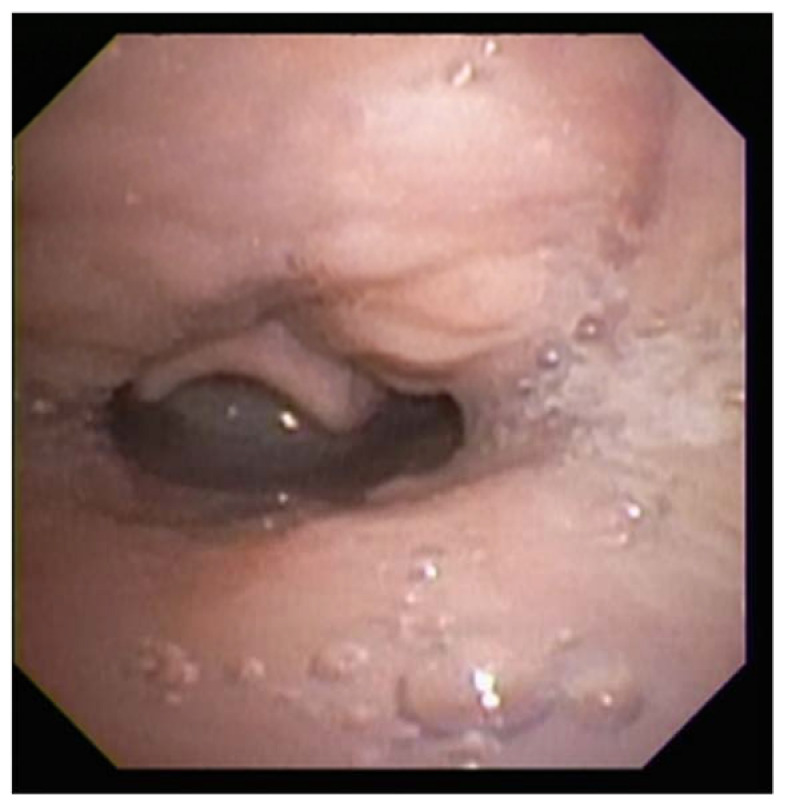

# 694 — Mềm sụn thanh quản ở nhũ nhi: phân độ, nội soi khi ngủ (DISE) & chỉ định mổ / Infantile laryngomalacia

**Tags:** `pattern:sa-thanh-mon` `vung:thanh-quan` `score:Elsobki-2025` `score:Attya-2025` `protocol:DISE` `protocol:PSG`
**Mức chắc chắn (certainty):** tổng hợp y văn (literature synthesis) — đoàn hệ tiến cứu, nghiên cứu phân độ, PSG và RCT từ y văn mở; số liệu đọc trực tiếp từ bài gốc ghi PMCID trong `sources.md`; ảnh CC BY 4.0, tên tác giả đối chiếu `authorString` Europe PMC.

> **Bài này nối tiếp 603 (Pierre Robin & tắc nghẽn đường thở trên) và 612 (cấp cứu đường thở trẻ em).** 603 trả lời “khối chèn ép nào gây tắc nghẽn”; bài này trả lời **“tiếng rít thì hít vào ở một nhũ nhi khỏe mạnh là mềm sụn thanh quản hay bệnh khác, phân độ nào, và khi nào cần mổ”** — đồng thời nhấn mạnh **hình ảnh động** (nội soi, DISE, PSG) chứ không phải phim tĩnh.

## 1. Tổng quan bệnh học – cơ chế hình ảnh

- **Mềm sụn thanh quản (laryngomalacia, LM)** là dị tật thanh quản bẩm sinh hay gặp nhất và là nguyên nhân của khoảng **75%** các ca tiếng rít (stridor) ở nhũ nhi (Elsobki 2025, PMC12122112). Bệnh cảnh điển hình: tiếng rít **thì hít vào**, tăng khi nằm ngửa, khi khóc, khi bú; giảm khi nằm nghiêng hoặc khi ngủ sâu.
- **Bản chất là sa động (dynamic collapse), không phải hẹp cố định:** sụn thanh quản non yếu + trương lực cơ hầu–thanh quản chưa trưởng thành + mô thừa trên thanh môn. Khi hít vào, áp lực âm trong đường thở tăng, **vận tốc khí tăng → áp lực thành giảm (hiệu ứng Bernoulli)** → mô thừa bị hút vào lòng; dòng khí chuyển động rối → **tiếng rít**. Sơ đồ cơ chế: xem ảnh dưới (Jain & Jain 2022, PMC9597386).

*Cơ chế vòng xoáy bệnh sinh của mềm sụn thanh quản: mô thừa trên thanh môn + kiểm soát thần kinh–cơ chưa hoàn chỉnh → sa đường thở → tăng công hô hấp → tăng áp lực ổ bụng → phù nề → càng hẹp. Nguồn: Jain D, Jain S, Cureus 2022 (PMC9597386, Fig. 1), CC BY 4.0.*

- **Vì sao phải chụp/soi ĐỘNG:** đường kính thanh môn thay đổi theo pha hô hấp và theo trương lực cơ. Trên nội soi **lúc thức**, trương lực cơ còn cao nên có thể **che mất** sa thanh môn; khi ngủ (đặc biệt ngủ ngửa, giai đoạn REM) trương lực giảm tối đa → sa rõ nhất. Đây là lý do **nội soi gây ngủ (drug-induced sleep endoscopy, DISE)** phát hiện được **100%** ca LM so với **18,7%** khi soi lúc thức trong một đoàn hệ 21 nhũ nhi (Wei 2025, PMC12509733).
- **Ba thể nội soi (Olney/Kay, dùng rộng rãi):**
  - **Thể I:** niêm mạc sụn phễu (arytenoid) thừa, sa vào lòng khi hít vào.
  - **Thể II:** dây thanh–nắp thanh môn (aryepiglottic fold) ngắn, nắp thanh môn cuộn tròn (“hình omega”).
  - **Thể III:** nắp thanh môn sa ra sau/thanh môn (epiglottic collapse), che kín tiền đình thanh quản.
- **Phân bố thể trong đoàn hệ 112 ca:** thể II **54,5%**, thể I **18,75%**, thể III **5,4%**, thể hỗn hợp I+II **21,4%**; tuổi trung bình lúc chẩn đoán **4,3 ± 2,2 tháng** (Elsobki 2025, PMC12122112).
- **Mức độ nặng không tỷ lệ thuận với hình thái:** trong 112 ca, **39,3% nhẹ – 42,9% vừa – 17,9% nặng** theo điểm triệu chứng; **toàn bộ ca nhẹ theo dõi không cần mổ**, còn cả 20 ca nặng đều được mổ (Elsobki 2025).
- **TẠI SAO PSG quan trọng hơn “nhìn thanh quản”:** mức độ sa trên nội soi chỉ tương quan **yếu** với chỉ số ngưng thở trên PSG (**R² = 0,10**, Kirjavainen 2025, PMC12507697). Trong 42 nhũ nhi: **AHI thể III 25,41 ± 6,95 sự kiện/giờ**, thể II **12,50 ± 5,05**, thể I **2,84 ± 1,96**; sau mổ AHI giảm còn **1,76** (thể III) và **0,97** (thể II), SpO₂ thấp nhất tăng từ **69,5% lên 93,6%** (Bredun 2025, PMC12525033).
- **Tư thế ngủ làm đổi kết quả:** ở 69 nhũ nhi so sánh được hai tư thế, **OAHI trung vị 22/giờ khi nằm ngửa** so với **7/giờ khi nằm nghiêng** (p < 0,0001), và CO₂ cuối thì thở ra cao hơn khi ngửa (Kirjavainen 2025).
- **Dịch tễ – tiên lượng:** đa số **tự khỏi khi trẻ lớn lên** (bệnh tự giới hạn); khoảng **20%** cần can thiệp phẫu thuật (Attya 2025, PMC12321643). Các yếu tố nặng: suy dinh dưỡng, tím tái, ngưng thở, co lõm lồng ngực nặng, bệnh lý thần kinh–cơ kèm theo.
- **Nuốt – hít sặc:** nuốt khó gặp ở phần lớn ca nặng (thể III **100%**, thể II **83,3%**, thể I **42,9%** trong đoàn hệ 42 ca — Bredun 2025); sau mổ, phân tích gộp 6 nghiên cứu (330 trẻ) cho thấy **giảm 59%** tỷ lệ nuốt khó (Rossoni 2024, PMC10843910; độ không đồng nhất cao I² = 93%).

## 2. Mẫu hình + chẩn đoán phân biệt theo vị trí và pha hô hấp (gamut)

- **Quy tắc định khu bằng pha tiếng rít:**
  - **Thì hít vào (inspiratory):** tắc nghẽn **ngoài lồng ngực** — thanh quản/tầng trên thanh môn (LM, sa nắp thanh môn, nang thung lũng, liệt dây thanh hai bên, hẹp thanh môn).
  - **Thì thở ra (expiratory):** tắc nghẽn **trong lồng ngực** — khí phế quản mềm (tracheomalacia), chèn ép từ mạch máu, u trong lòng khí quản.
  - **Hai thì (biphasic):** tổn thương cố định vùng thanh môn/dưới thanh môn (hẹp dưới thanh môn, vòng mạch, hẹp khí quản).
- **Gamut theo vị trí trên nội soi:**
  - **Tầng trên thanh môn:** LM thể I–III; LM thứ phát (bệnh thần kinh–cơ, hội chứng Down, CHARGE, giảm trương lực); **nang thung lũng (vallecular cyst)**; **tuyến giáp lưỡi (lingual thyroid)**; phì đại amidan–VA; phù nề do trào ngược.
  - **Thanh môn:** liệt dây thanh (một/hai bên), dính thanh môn (laryngeal web), u nhú thanh quản (recurrent respiratory papillomatosis).
  - **Dưới thanh môn:** hẹp dưới thanh môn bẩm sinh/mắc phải, **u máu dưới thanh môn (subglottic hemangioma)** — thường kèm u máu da (“beard distribution”).
  - **Khí quản:** khí phế quản mềm, hẹp khí quản, vòng mạch (vascular ring), rò khí–thực quản.
- **Tổn thương phối hợp rất hay gặp:** **26/112 ca (23,2%)** có tổn thương đường thở đồng thời — khí quản mềm 8 ca, khí–phế quản mềm 7 ca, hẹp dưới thanh môn 4 ca, vòng mạch 2 ca, liệt dây thanh 2 ca (Elsobki 2025). **30/112 ca (26,8%)** có bất thường bẩm sinh kèm theo: thần kinh 14 ca (bại não, động kinh), tim 13 ca, Down 3 ca.
- **Gamut theo bệnh nền:** trẻ sinh non, hội chứng Down, CHARGE, Pierre Robin, bệnh cơ–thần kinh, loạn trương lực thực quản–hầu; trẻ có u máu da vùng râu → nghĩ u máu dưới thanh môn; trẻ đột ngột rít sau đặt nội khí quản → hẹp dưới thanh môn mắc phải.

*Trái: mềm sụn thanh quản trước và ngay sau mổ (nắp thanh môn cuộn, hẹp lòng); giữa: u máu dưới thanh môn (A) và sau điều trị (B); phải: khí phế quản mềm thì thở ra (A, B). Cả ba ảnh: PMC9322467, CC BY 4.0; ảnh ghép letterbox giữ nguyên tỷ lệ.*

## 3. Bảng so sánh phân biệt (ma trận đối chiếu)

| Thực thể (entity) | Hình ảnh/nội soi điển hình | Chốt vào (rule-in) | Chốt loại (rule-out) | Gợi ý xác nhận |
|---|---|---|---|---|
| Mềm sụn thanh quản thể I–III | Sa niêm mạc sụn phễu/dây thanh–nắp thanh môn/nắp thanh môn **khi hít vào**, hết khi thở ra; triệu chứng tăng khi ngửa | **Sa động thì hít vào + hết khi ngủ nghiêng + nội soi thức bình thường không loại trừ** | **Hẹp cố định cả hai thì, không đổi theo pha → không phải LM đơn thuần** | Nội soi mềm lúc thức + **DISE**; PSG |
| LM thứ phát (bệnh thần kinh–cơ, Down, CHARGE) | Sa thanh môn kèm giảm trương lực, chậm phát triển, bất thường khác | **Bệnh nền + sa thanh môn lan rộng + nhiều tầng** | **Trẻ phát triển bình thường, chỉ một tầng → LM đơn thuần** | Khám thần kinh–di truyền, MRI não, DISE |
| Trào ngược thanh–hầu (laryngopharyngeal reflux) | Phù nề niêm mạc sau sụn phễu, viêm đỏ, không sa rõ | **Viêm đỏ/ phù nề lan tỏa + triệu chứng sau bú** | **Không có sa động điển hình → không phải nguyên nhân chính của rít** | Thử điều trị + nội soi lại; RCT cho thấy acid suppression **không thêm lợi ích** ở LM nhẹ–vừa |
| Hẹp dưới thanh môn | Vòng xơ dưới dây thanh, lòng hẹp cố định, **rít hai thì** | **Hẹp cố định, không thay đổi theo pha** | **Sa động thì hít vào → không phải hẹp cố định** | Nội soi + CT cổ ngực lát mỏng |
| U máu dưới thanh môn | Khối đỏ–tím dưới dây thanh, một bên hoặc lan; thường **3–6 tháng tuổi** | **Khối mạch máu + u máu da vùng râu + tăng dần rồi thoái triển** | **Niêm mạc bình thường, chỉ sa động → LM** | Nội soi, MRI có cản quang, propranolol thử |
| Khí phế quản mềm | Hẹp lòng khí quản **thì thở ra**, giảm khi hít vào; có thể kèm rít hai thì | **Hẹp động thì thở ra, đo được % hẹp** | **Không hẹp thì thở ra → loại** | Nội soi khi ngủ, CT 4D/động, fluoroscopy |
| Liệt dây thanh | Dây thanh bất động, **không khép khi phát âm**, rít hai thì, khàn | **Bất động một/hai bên + khàn** | **Dây thanh di động đối xứng → loại** | Nội soi, EMG thanh quản, CT/MRI hố sau–cổ |
| Nang thung lũng/tuyến giáp lưỡi | Khối tròn đáy lưỡi, đẩy nắp thanh môn ra sau, **rít tư thế** | **Khối choán chỗ cố định + khó nuốt** | **Không có khối, chỉ mô thừa → LM** | Nội soi, MRI/CT cổ |

- **Nguyên tắc đọc chung (áp dụng cả cho ổ dịch sau mổ — bài 693):** cùng một “ổ dịch” trên mặt cắt, **bản chất** (mật – máu – mủ – dịch tiết) quyết định cách đọc; với đường thở, **“sa động” hay “hẹp cố định”** cũng là hai bản chất khác nhau, không thể suy từ một ảnh tĩnh.

## 4. Protocol chụp/soi + hệ phân độ và điểm chuẩn hóa

- **Bước 1 — nội soi thanh quản mềm lúc thức (awake flexible laryngoscopy):** ống soi **3,1 mm** (ví dụ BF-XP190) qua mũi, không gây mê; ghi hình **liên tục cả thì hít vào – thở ra – khóc – bú**; đo **% diện tích lỗ thanh môn bị che** khi hít vào. Đây là bước đầu để loại trừ khối choán chỗ, liệt dây thanh, hẹp cố định — nhưng **âm tính không loại trừ LM**.
- **Bước 2 — DISE khi nghi ngờ hoặc cần quyết định mổ:** duy trì **tự thở**, không dùng giãn cơ; an thần theo tuổi — trẻ ngoài sơ sinh: **midazolam** (88,9% ca) hoặc midazolam + dexmedetomidine (11,1%); sơ sinh: **chloral hydrate 10%** ± phenobarbital (Wei 2025). Theo dõi SpO₂ liên tục; trong 21 ca có **1 ca (4,8%)** giảm oxy máu, xử lý bằng thông khí mặt nạ áp lực dương (Wei 2025).
- **Bước 3 — PSG (đa ký giấc ngủ) khi có ngưng thở/co lõm nặng/tím tái hoặc trước mổ:** ghi **AHI/OAHI, ODI, SpO₂ thấp nhất, CO₂ cuối thì thở ra**, và **so sánh tư thế ngửa – nghiêng**. Phân độ thường dùng ở trẻ: **nhẹ 1–5, vừa 5–10, nặng > 10 sự kiện/giờ** (ngưỡng kinh điển; cần đối chiếu phòng thí nghiệm từng nơi).
- **Bước 4 — hình ảnh bổ trợ khi cần:**
  - **X-quang/fluoroscopy đường thở động:** thấy hẹp thì thở ra (khí phế quản mềm) hoặc hẹp cố định; liều thấp, không cần thuốc.
  - **CT ngực–cổ lát mỏng/CT 4D (free-breathing):** đánh giá vòng mạch, hẹp khí quản, u máu, bất thường mạch; **không phải** phương tiện chẩn đoán LM thường quy.
  - **MRI:** khi nghi tổn thương mạch máu, u, bất thường hố sau–thân não.
  - **Siêu âm tim:** tăng áp phổi do tắc nghẽn mạn — Elsobki phân độ **nhẹ 25–35 mmHg, vừa 35–45 mmHg, nặng > 45 mmHg**.
  - **FEES/nuốt cản quang (modified barium swallow):** đánh giá hít sặc, phân độ Penetration–Aspiration Scale 1–8.
- **Hệ điểm phân tầng (Elsobki 2025, PMC12122112) — dùng để quyết định theo dõi hay mổ:**
  - **Điểm triệu chứng–bệnh sử 0–15:** nhẹ **< 4**, vừa **4–9**, nặng **> 9**.
  - **Điểm khám 0–13:** gồm tăng trưởng (Z-score), co lõm lồng ngực, mức sa thanh môn, nuốt, phát triển, dị tật kèm theo.
  - **Điểm thăm dò 0–10:** siêu âm tim, SpO₂ qua đêm, tổn thương đường thở đồng thời, trào ngược.
  - **Quy tắc:** nhẹ → theo dõi **mỗi tháng × 3 tháng**; vừa → áp điểm khám, nếu khám **4–9** thì làm điểm thăm dò, **≤ 5** theo dõi, **> 5** mổ; nặng → mổ (kèm đánh giá trước mổ).

*Bản gốc: điểm triệu chứng → nhánh nhẹ/vừa/nặng; nhánh vừa dùng điểm khám, rồi điểm thăm dò; ghi chú mở khí quản khi nhiều bệnh nền, tắc nghẽn nhiều tầng hoặc biến cố chu phẫu. Nguồn: Elsobki A et al., Int Arch Otorhinolaryngol 2025 (PMC12122112, Fig. 4), CC BY 4.0.*

- **Phân tầng theo Attya 2025 (PMC12321643):** bảng hỏi 11 câu, mỗi câu 0–3 → tổng **0–33**; chia ba nhóm đều 11 điểm; **nhóm nặng 22–33** được mổ; theo dõi lại **6 tuần và 12 tuần** bằng điểm triệu chứng.

- **Chỉ định mổ (khiếm khuyết then chốt):** ngưng thở/tím tái, suy dinh dưỡng không cải thiện, co lõm nặng kéo dài, tăng áp phổi, bệnh nền thần kinh–cơ, hoặc **không cải thiện sau giai đoạn theo dõi 3 tháng** (Elsobki).
- **Kỹ thuật:** cắt/đốt **dây thanh–nắp thanh môn ngắn**, **cắt niêm mạc sụn phễu thừa**, **epiglottopexy** (khâu/đốt dính nắp thanh môn vào đáy lưỡi) tùy vị trí sa. Ảnh trước–sau: PMC12321643 Fig. 2–3.
- **Kết quả và biến chứng:** trong 50 ca của Attya, **80% được mổ**, sau mổ **4/50 (8%) phải mở khí quản** (đều có bệnh nền nặng: Arnold–Chiari, Edwards, bại não nặng, nuốt khó nặng), **2/50 (4%) mổ lại**; ở nhóm PSG, supraglottoplasty giảm OAHI trung bình **12,68 sự kiện/giờ** (p = 0,0039) so với **3,3/giờ** ở nhóm không mổ (p = 0,3) (Casellas 2024, PMC10950448).

## 5. Biến thể bình thường và cạm bẫy

- **Nắp thanh môn “omega” ở nhũ nhi** là biến thể hình thái thường gặp; chỉ gọi thể III khi nắp thanh môn **sa ra sau và che lỗ thanh môn khi hít vào**, không chỉ vì hình cong.
- **Nội soi lúc thức âm tính không loại trừ LM:** chỉ **18,7%** ca LM được chẩn đoán khi soi thức, so với **100%** khi DISE (Wei 2025). Đừng kết luận “thanh quản bình thường” khi trẻ còn rít điển hình.
- **Tiếng rít giảm khi ngủ không đồng nghĩa bệnh nhẹ:** trẻ có thể **giảm rít nhưng vẫn ngưng thở**; phải làm PSG khi có gợi ý (Kirjavainen 2025). Ngược lại, **mức sa trên nội soi chỉ tương quan yếu với AHI (R² = 0,10)** — không dùng độ sa để quyết định thay PSG.
- **Tư thế ngủ làm lệch kết quả:** OAHI **22/giờ khi ngửa** so với **7/giờ khi nghiêng**; đọc PSG phải ghi rõ tư thế, tránh kết luận nặng–nhẹ chỉ từ một tư thế.
- **Trào ngược không phải “nguyên nhân mặc định”:** RCT 65 nhũ nhi (40 theo dõi được) cho thấy thêm **ức chế acid (famotidine)** không cải thiện điểm đường thở hay điểm trào ngược so với chỉ điều chỉnh cách bú (LASS p = 0,3; I-GERQ-R p = 0,8) (Shaffer 2026, PMC12770870). Không tự động kê thuốc ức chế acid chỉ vì có LM.
- **Sau mổ vẫn rít:** nghĩ **tổn thương đồng thời** (23,2% ca có ≥ 1 tổn thương khác) hoặc **hẹp dưới thanh môn**; soi lại trước khi kết luận mổ thất bại.
- **Cạm bẫy hình ảnh tĩnh:** CT/MRI ở thì thở ra hoặc lúc trẻ nín thở có thể **bình thường**; đừng loại trừ LM bằng một mặt cắt tĩnh. Ngược lại, **không** chẩn đoán LM trên CT — chẩn đoán là **nội soi động**.
- **An toàn DISE:** nguy cơ giảm oxy máu (4,8% trong loạt 21 ca) — phải có bóng/mặt nạ và nhân viên gây mê nhi.

## 6. Tự lượng giá — Blind Quiz

**Ca 1 — Bé trai 3 tháng, rít thì hít vào từ 2 tuần tuổi, tăng khi bú và khi nằm ngửa, không tím tái, tăng cân chậm nhẹ.**

- Gợi ý: ảnh trái là lúc hít vào, ảnh phải là sau can thiệp.
- Hỏi: (1) Mô tả bất thường chính? (2) Đây là thể nào? (3) Ba chẩn đoán phân biệt và dấu hiệu nào chốt?

<b>Bấm để hiện đáp án (findings + chẩn đoán)</b>

- **Dấu hiệu:** nắp thanh môn **cuộn tròn ra sau**, dây thanh–nắp thanh môn ngắn, lỗ thanh môn bị che gần kín khi hít vào; sau mổ lòng thanh môn mở rộng, bờ nắp thanh môn được giải phóng.
- **Chẩn đoán:** **mềm sụn thanh quản thể II (dây thanh–nắp thanh môn ngắn + nắp thanh môn cuộn)**; thể III nếu nắp thanh môn sa hẳn ra sau che kín tiền đình.
- **Phân biệt:** hẹp dưới thanh môn (hẹp cố định, rít hai thì), u máu dưới thanh môn (khối đỏ–tím dưới dây thanh, u máu da), khí phế quản mềm (hẹp thì thở ra). **Chốt:** sa động chỉ thì hít vào + hết khi thở ra.
- **Nguồn ảnh:** PMC9322467 (Children 2022), CC BY 4.0 — Srikanthan A et al.

**Ca 2 — Bé gái 5 tháng, rít tăng dần, bú ngắt quãng, có cơn tím ngắn; PSG: AHI 26/giờ, SpO₂ thấp nhất 70%.**

- Hỏi: DISE thêm được gì so với nội soi lúc thức? Vì sao ca này cần PSG? Ngưỡng nào đẩy sang mổ?

<b>Bấm để hiện đáp án (findings + chẩn đoán)</b>

- **DISE** cho thấy **sa nhiều tầng** (nắp thanh môn, gốc lưỡi, hầu sau) khi trẻ ngủ — những tầng này **không thấy** khi soi lúc thức vì cơ còn trương lực.
- **Vì sao PSG:** triệu chứng nặng + AHI **26/giờ** (mức nặng theo ngưỡng trẻ em > 10/giờ) + SpO₂ **70%** → xác nhận ngưng thở tắc nghẽn, không chỉ “tiếng rít to”.
- **Ngưỡng mổ:** điểm triệu chứng **> 9**, hoặc điểm khám **> 9**, hoặc điểm thăm dò **> 5**; kèm tím tái/ngưng thở/suy dinh dưỡng → **supraglottoplasty** (Elsobki 2025; Attya 2025).
- **Nguồn ảnh:** PMC12509733 (Front Pediatr 2025), CC BY 4.0 — Wei Q et al.

**Ca 3 — Bé trai 4 tháng, rít thì hít vào; mẹ kể “ngủ thì hết rít nhưng hay thở mạnh, ngực lõm”. Nội soi lúc thức: chỉ thấy niêm mạc sụn phễu hơi dày.**

- Hỏi: Vì sao nội soi thức “gần bình thường” mà trẻ vẫn nặng? Cần làm gì tiếp?

<b>Bấm để hiện đáp án (findings + chẩn đoán)</b>

- **Dấu hiệu:** khi ngủ, **gốc lưỡi tụt ra sau, chạm nắp thanh môn** và đẩy nắp thanh môn sa vào lòng — kiểu **sa nhiều tầng**; nội soi thức không tái hiện được vì trương lực cơ còn cao.
- **Chẩn đoán:** mềm sụn thanh quản **kèm sa gốc lưỡi/hầu** (phải phân biệt tắc nghẽn do gốc lưỡi đơn thuần, Pierre Robin, phì đại amidan).
- **Việc cần làm:** **DISE + PSG**; nếu xác nhận ngưng thở nặng → supraglottoplasty ± xử lý gốc lưỡi; đánh giá thêm bất thường sọ mặt/thần kinh.
- **Nguồn ảnh:** PMC9322467 (Children 2022), CC BY 4.0 — Srikanthan A et al.

## Bài liên quan chéo
- [603 – Pierre Robin & tắc nghẽn đường thở trên ở trẻ sơ sinh](../603-pierre-robin-tac-nghen-duong-tho/lesson.md)
- [612 – Cấp cứu đường thở trẻ em: Croup vs viêm nắp thanh quản vs dị vật](../612-cap-cuu-duong-tho-tren-tre-em/lesson.md)
- [611 – Khí kẽ phổi & tràn khí áp lực ở nhũ nhi](../611-ro-khi-nang-pie-tran-khi-ap-luc-nhu-nhi/lesson.md)
- [692 – Microtia & hẹp/ứ mạc ống tai ngoài](../692-microtia-atresia-phuc-hoi-thinh-luc/lesson.md)

## Ảnh
- Nguồn và giấy phép từng ảnh: `images/CREDITS.md`. Tất cả ảnh dùng ở đây là **CC BY 4.0**, giữ nguyên bản (ảnh ghép letterbox không crop/kéo giãn).
- Ảnh không tải được vì bản quyền: không dùng; chỉ dẫn link trong `sources.md`.

> Không dùng để chẩn đoán độc lập khi chưa có người hướng dẫn.
