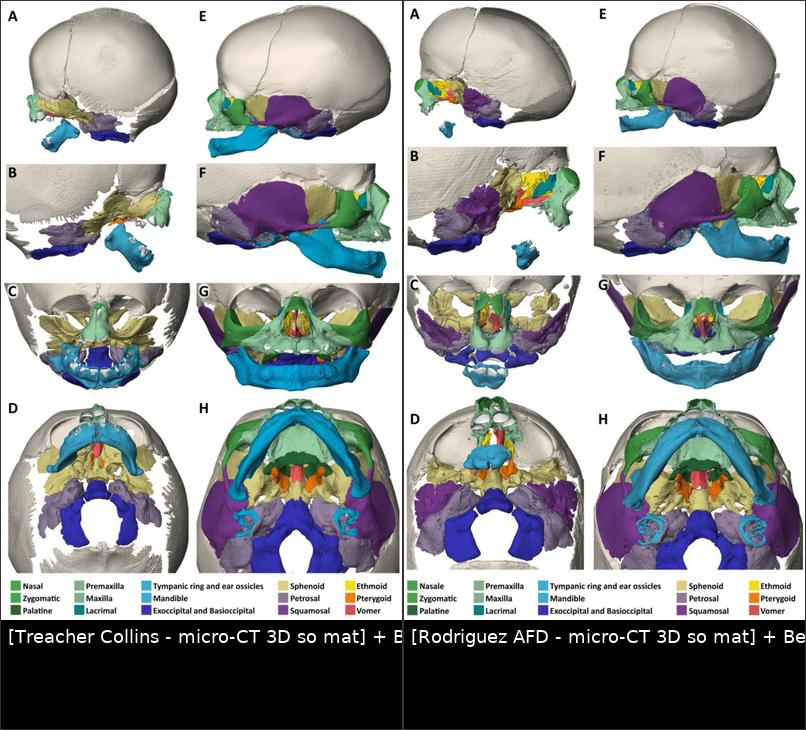
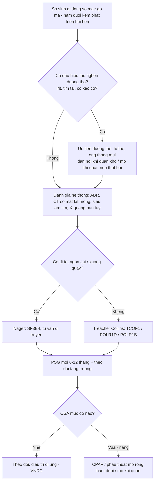
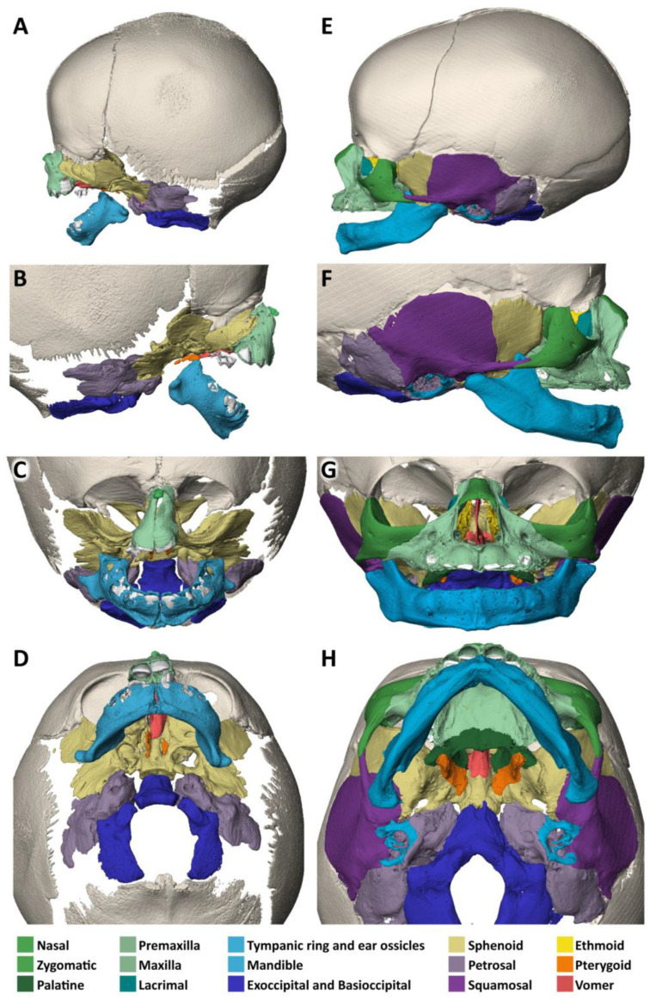
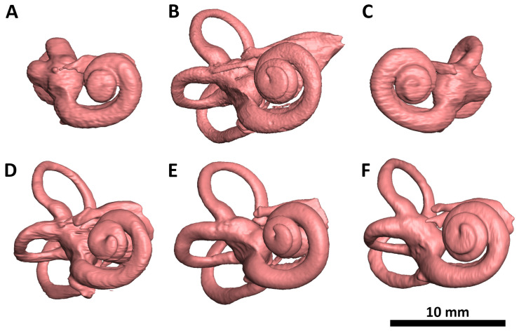
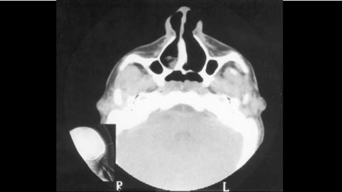
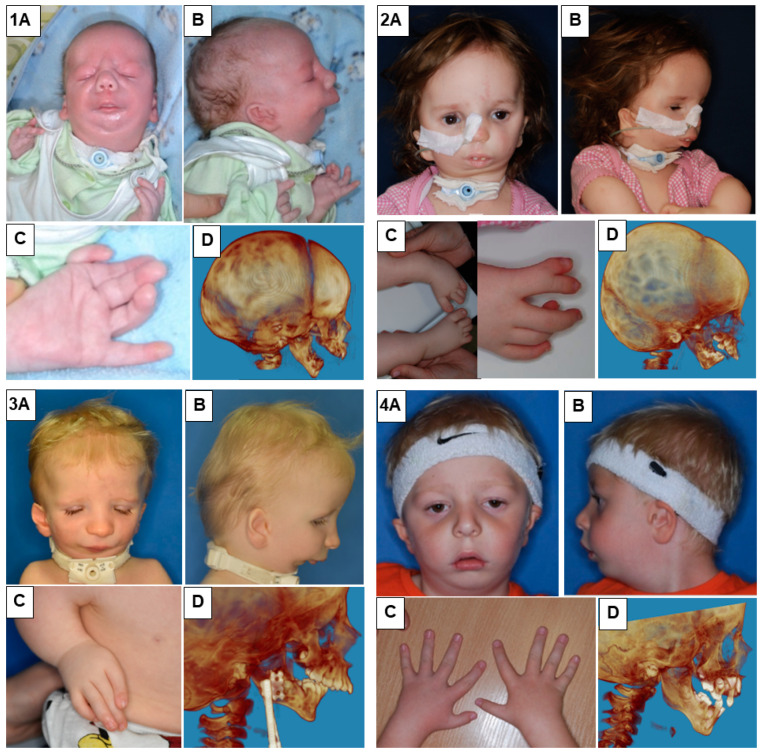

# 695 — Hội chứng Treacher Collins & Nager: hình ảnh sọ mặt – tai, đường thở và tư vấn di truyền / Treacher Collins syndrome & Nager syndrome

**Tags:** `pattern:thieu-san-xuong-mat` `vung:so-mat` `vung:tai` `protocol:CT-xuong-mat` `protocol:PSG` `anatomy:so-mat`
**Mức chắc chắn (certainty):** tổng hợp y văn (literature synthesis) — bài tổng hợp từ y văn mở (báo ca, nghiên cứu CBCT, tiêu bản micro-CT), số liệu đọc trực tiếp từ bài gốc, PMCID ghi trong `sources.md`; chưa gắn một ca nguyên văn duy nhất của nhóm.

> **Bài này nối tiếp 603 (Pierre Robin – tắc nghẽn đường thở trên) và 692 (dị tật vành tai – microtia).** 603 trả lời “khối chèn ép nào làm tắc đường thở”; 692 trả lời “vành tai bất thường thì mổ tạo hình thế nào”. Bài này trả lời câu hỏi đọc phim của bác sĩ CĐHA: **khi một trẻ có hai bên xương gò má – hàm dưới kém phát triển, cần mô tả gì trên CT, phân biệt với hội chứng nào, và vì sao phải khám tai + đường thở ngay từ sơ sinh**.

## 1. Tổng quan bệnh học – cơ chế hình ảnh

- **Bản chất phôi thai:** cả Treacher Collins (TCS, mandibulofacial dysostosis) và Nager (acrofacial dysostosis) là bệnh của **cung mang thứ nhất – thứ hai** và **tế bào mào thần kinh sọ**. Tổn thương cốt lõi là **chết tế bào mào thần kinh quá mức** ở phần trên của ống thần kinh → thiếu nguyên liệu tạo xương gò má, xương hàm trên bên, xương hàm dưới và các thành phần tai ngoài – tai giữa (Behunova 2025, PMC12292342). Vì vậy tổn thương **đối xứng, hai bên** và **không có loạn sản bao xương** như u/xơ lành.
- **TẠI SAO phải mô tả bằng CT xương (không phải phim sọ nghiêng):** thiểu sản gò má – hàm dưới là **khiếm khuyết mô xương ba chiều**; phim sọ nghiêng chỉ cho hình chiếu chồng, còn CT dựng 3D cho thấy **xương gò má mất hoàn toàn hay chỉ còn một mảnh**, và có giúp lập kế hoạch tạo hình hay không. Tiêu bản micro-CT của TCS trong ảnh dưới cho thấy **mất xương gò má và phần lớn xương hàm trên bên**, góc hàm và mỏm lồi cầu biến dạng, xương bướm phát triển bất thường và dính vào xương sàng – xương lệ – xương vảy (Behunova 2025).
- **TẠI SAO nghe kém dẫn truyền lại là “hình ảnh”: ** ốc tai và tai giữa phát triển từ cùng vùng cung mang; trên micro-CT, ốc tai của tiêu bản TCS **thiểu sản, các vòng dính cục (“clumped”)**, khác với ốc tai phát triển bình thường ở tiêu bản đối chứng (Behunova 2025, Fig. 4). Đây là cơ sở để giải thích **nghe kém dẫn truyền/nghe kém hỗn hợp** và chỉ định **CT xương đá** trước khi cân nhắc cấy ốc tai.
- **Dịch tễ – gen (số chốt):**
  - TCS: **1/40.000 – 1/70.000** trẻ sinh sống (Andrade 2005, PMC9443590; bài này cũng nêu 1/50.000), di truyền **trội nhiễm sắc thể thường**, biểu hiện biến thiên rộng.
  - **TCOF1 chiếm 78–93%** ca TCS; **POLR1D và POLR1B khoảng 8%**; thể lặn do **POLR1C** (TCS 3) hiếm (Behunova 2025).
  - Nager: **3/1.000.000 trẻ sinh sống**, y văn chỉ mô tả **khoảng 100 ca**; phần lớn do **SF3B4** (spliceosomopathy) (Marszałek-Kruk 2023, PMC10815867).
- **Tần suất dấu hiệu lâm sàng của TCS** (Andrade 2005): **mắt xếch xuống 89%**, **thiểu sản gò má 81%**, **thiểu sản hàm dưới 78%**, **dị tật vành tai 77%**; hở mi dưới (coloboma), hẹp ống tai ngoài, hở vòm miệng và **nghe kém dẫn truyền** là các dấu hiệu đi kèm.
- **Đường thở – vì sao không được bỏ qua:** hẹp đường thở do **hàm dưới lùi và hẹp sọ mặt** gây **ngưng thở khi ngủ do tắc nghẽn (OSA)**. Ở 20 người lớn TCS, **44,4% có OSA trên đa ký giấc ngủ**, AHI trung vị **3,8 sự kiện/giờ** (tối đa **77,5**), ngáy **75%**, nghẹt mũi **70%** (Fidélis-da Silva 2023, PMC10325840). Đây là lý do **PSG là một phần của hồ sơ hình ảnh chức năng**, không chỉ CT.
- **Đường thở thay đổi theo tuổi (số đo 3D):** trên CBCT, nhóm TCS **vị thành niên** có thể tích đường thở hầu **9,13 ± 1,74 cm³**, tăng lên **15,96 ± 6,07 cm³ ở người lớn TCS** (+74,8%); người lớn TCS gần bằng nhóm chứng **16,31 ± 3,14 cm³** dù vẫn nhỏ hơn về trị tuyệt đối ở một số biến số. Diện tích mặt cắt tối thiểu hầu miệng **69,07 mm²** (vị thành niên) so với **106,28 mm²** (chứng) (dos Inocentes 2024, PMC11221962). **Hệ quả thực hành:** trẻ nhỏ/vị thành niên là nhóm hẹp nhất — nguy cơ OSA và nguy cơ **khó đặt nội khí quản** cao nhất, không phải người lớn.

## 2. Mẫu hình + chẩn đoán phân biệt theo vị trí (gamut)

- **Vị trí 1 – gò má/ổ mắt:** thiểu sản/mất xương gò má hai bên → **TCS**, **Nager**, **AFD Rodriguez**, **loạn sản sọ mặt do Tessier 6–8**, **hemifacial microsomia/Goldenhar (một bên)**.
- **Vị trí 2 – hàm dưới:** vi hàm – lùi hàm hai bên → **TCS**, **Nager**, **Pierre Robin đơn thuần (không có thiểu sản gò má)**, **dính khớp thái dương – hàm bẩm sinh**, **loạn sản sụn**.
- **Vị trí 3 – tai:** microtia, hẹp/teo ống tai ngoài, bất thường xương con → **TCS/Nager** (hai bên, đối xứng), **teo ống tai đơn thuần**, **branchio-oto-renal**, **cholesteatoma bẩm sinh** (một bên, có khối mô mềm).
- **Vị trí 4 – đường thở:** hẹp mũi sau, lưỡi tụt ra sau, hẹp hầu → **TCS**, **Pierre Robin**, **teo mũi sau (choanal atresia)**, **mềm sụn thanh quản** (bài 694).
- **Mnemonic “1-2-3-4” của TCS:** **1** (cung mang 1) → gò má + hàm dưới; **2** (cung mang 2) → vành tai + xương con; **3** (ba tầng mô: da – sụn – xương) cùng thiểu sản; **4** (bốn dấu hiệu mắt: mắt xếch xuống, hở mi dưới, thiếu lông mi trong, coloboma).
- **Khác biệt then chốt TCS vs Nager:** Nager có **dị tật chi trước trục** (ngón cái thiểu sản/không có, cong ngón, thiếu xương quay) — **không bao giờ** có trong TCS; ngược lại TCS mới có **hở mi dưới + lông mi trong thiếu** điển hình.

## 3. Bảng so sánh phân biệt (ma trận đối chiếu)

| Thực thể (entity) | Hình ảnh điển hình (CT/CBCT) | Chốt vào (rule-in) | Chốt loại (rule-out) | Gợi ý xác nhận |
|---|---|---|---|---|
| **Treacher Collins (TCS)** | Mất/thiểu sản xương gò má **hai bên, đối xứng**; hàm dưới nhỏ – lùi; ống tai ngoài hẹp/teo; xương bướm – sàng dính bất thường | **Thiểu sản gò má hai bên + hở mi dưới + vành tai bất thường, KHÔNG có dị tật chi** | Có dị tật ngón cái/xương quay → nghĩ Nager; một bên → nghĩ Goldenhar | CT sọ mặt ≤ 1 mm + 3D; TCOF1/POLR1D/POLR1B |
| **Nager (AFD)** | Thiểu sản gò má + hàm dưới **kèm dị tật chi trước trục** (ngón cái thiểu sản/không có, thiếu xương quay); dính khớp thái dương – hàm | **Thiểu sản sọ mặt hai bên + bất thường ngón cái/xương quay** | Bàn tay – cẳng tay bình thường → nghĩ TCS | X-quang bàn tay – cẳng tay; SF3B4 |
| **AFD Rodriguez** | Khiếm khuyết **rộng hơn**: thiếu xương gò má + hàm trên bên + hàm dưới thô sơ; dị tật chi nặng (phocomelia) | **Khiếm khuyết sọ mặt lan rộng + dị tật chi nặng** | Chỉ hẹp ở gò má – hàm dưới → TCS | Micro-CT/CT 3D toàn thân; di truyền |
| **Pierre Robin đơn thuần** | Hàm dưới nhỏ – lùi, **gò má BÌNH THƯỜNG**, không hẹp ống tai | **Vi hàm – lùi hàm đơn độc + hở vòm miệng** | Có thiểu sản gò má/teo ống tai → không phải PR đơn thuần | Đo góc sọ mặt; PSG; đánh giá đường thở |
| **Goldenhar / hemifacial microsomia** | Thiểu sản **MỘT BÊN** gò má – hàm dưới – vành tai; có thể kèm u bì mắt, đốt sống cổ | **Bất đối xứng rõ, một bên** | Hai bên đối xứng → TCS/Nager | CT 3D; X-quang cột sống cổ |
| **Teo mũi sau (choanal atresia)** | Mảnh xương/màng bít **cửa sau mũi**, một hoặc hai bên; có thể kèm TCS | **Tắc hoàn toàn một bên/hai bên trên lát cắt trục mũi sau** | Cửa sau mũi thông thoáng → loại trừ | CT lát mỏng trục; nội soi mũi |

*Trái: TCS — mất xương gò má và phần lớn hàm trên bên, góc hàm và mỏm lồi cầu biến dạng. Phải: AFD Rodriguez — khiếm khuyết lan rộng hơn, hàm dưới thô sơ. Xương từng chiếc được tô màu để đối chiếu. Nguồn: Behunova J et al., Biology 2025 (PMC12292342, Fig. 3 và Fig. 6), CC BY 4.0. Ảnh ghép letterbox, giữ nguyên tỷ lệ.*

### Ba dấu hiệu cần đo trên CT (đừng chỉ “mô tả chung”)

1. **Xương gò má:** có/không có thân xương gò má, có/còn cung gò má; ghi rõ **mất hoàn toàn hay còn mảnh** — quyết định có cần ghép xương gò má hay không.
2. **Hàm dưới:** chiều dài thân xương, góc hàm, mỏm lồi cầu; ghi **khoảng lùi hàm (retrognathia)** và mức hẹp đường thở hầu.
3. **Ống tai ngoài – tai giữa:** độ dày mảnh xương bít, có/không có xương con, có/không có ốc tai – dây thần kinh ốc tai (trước cấy ốc tai).

## 4. Protocol chụp + hệ phân độ/điểm chuẩn hóa

- **CT sọ mặt:** lát cắt **≤ 1 mm**, thuật toán xương, dựng **3D volume rendering**; đọc thêm **lát trục mũi sau** (teo mũi sau) và **lát trục xương đá** (ống tai, xương con, ốc tai). Với trẻ nhỏ cần **an toàn đường thở khi an thần**: có kế hoạch đặt nội khí quản dự phòng, không an thần tại phòng chụp nếu chưa đánh giá đường thở.
- **CBCT** (nha – sọ mặt) dùng khi cần đánh giá **thể tích đường thở** và tương quan xương hàm; trong nghiên cứu, thể tích hầu được chia theo mốc: **tổng đường thở trên** (từ lỗ mũi đến điểm trước–dưới C3), **ổ mũi**, **hầu mũi** (đến điểm dưới cùng của khẩu cái mềm), **hầu miệng** (từ hầu mũi đến hết đường thở trên) (dos Inocentes 2024).
- **X-quang bàn tay – cẳng tay** (một hoặc hai bên): bắt buộc khi nghi Nager để tìm **thiếu/thiểu sản ngón cái, thiếu xương quay**.
- **Thính lực:** **ABR/audiometry** sớm ở mọi trẻ có microtia/teo ống tai; **CT xương đá** trước khi hội chẩn cấy ốc tai (ốc tai TCS có thể thiểu sản, dính cục — Behunova 2025).
- **Đa ký giấc ngủ (PSG)** ở mọi trẻ TCS/Nager có ngáy, thở miệng, ngưng thở hoặc chậm tăng cân; người lớn TCS cũng cần tầm soát (OSA **44,4%**).
- **Thứ tự ưu tiên điều trị (theo Marszałek-Kruk 2023):** **đường thở trước** → hở vòm miệng/môi → mi mắt → tạo hình gò má → muộn hơn: mũi và vành tai; kèm trị liệu ngôn ngữ – thính giác.
- **Thuật toán tiếp cận sơ sinh nghi TCS/Nager:**

## 5. Biến thể bình thường và cạm bẫy

- **Cạm bẫy 1 — ngưỡng dựng 3D:** volume rendering với ngưỡng (threshold) quá cao có thể **“xóa” một xương gò má mỏng nhưng còn tồn tại**. Luôn đối chiếu **lát cắt nguồn (axial/coronal)** trước khi kết luận “mất xương gò má”.
- **Cạm bẫy 2 — teo ống tai do ráy/mô mềm:** trên CT, nút ráy hoặc mô mềm lấp ống tai **cùng tỷ trọng mô mềm** với màng bít bẩm sinh; phân biệt bằng **mảnh xương bít dày, ống tai ngắn, xương con bất thường** và đối chiếu nội soi tai.
- **Cạm bẫy 3 — teo mũi sau một bên dễ bị bỏ qua:** trẻ chỉ thở mũi một bên, triệu chứng mơ hồ; trên CT phải **đo chiều dày mảnh bít** và ghi rõ **xương hay màng** — quyết định nong hay mổ nội soi.
- **Cạm bẫy 4 — “chỉ là vi hàm”:** vi hàm đơn độc ở trẻ sơ sinh có thể là **Pierre Robin**, nhưng nếu **gò má kém phát triển + vành tai bất thường** thì phải nghĩ TCS/Nager và **khám tai – đường thở ngay**, không chờ trẻ lớn.
- **Cạm bẫy 5 — an thần để chụp:** trẻ TCS/Nager có **đường thở hẹp, đặt nội khí quản khó** (đã có ca phải dùng ống Ovassapian người lớn + nội soi ống mềm sau 3 lần đặt thất bại — Rein 2025, PMC12335011). Không an thần ở phòng chụp khi chưa có phương án đường thở.
- **Cạm bẫy 6 — bỏ sót nghe kém:** dị tật mặt dễ thu hút mọi chú ý; **ABR phải làm sớm**, vì nghe kém dẫn truyền ảnh hưởng phát triển ngôn ngữ.

## 6. Tự lượng giá — Blind Quiz

**Ca 1 — Sơ sinh có hai bên gò má kém phát triển, mắt xếch xuống, vành tai bất thường. Nhìn 3D rồi mô tả trước.**

- Gợi ý lâm sàng: sơ sinh đủ tháng, không dị tật chi, không có bất thường thân mình.
- Câu hỏi: vùng xương nào mất? Có đối xứng không? Ba chẩn đoán phân biệt và dấu hiệu nào loại Nager?

<b>Bấm để hiện đáp án (findings + chẩn đoán)</b>

- Dấu hiệu: **mất xương gò má và phần lớn xương hàm trên bên hai bên, đối xứng**; góc hàm và mỏm lồi cầu biến dạng; xương bướm phát triển bất thường, dính vào xương sàng – lệ – vảy và hàm trên.
- Chẩn đoán: **Treacher Collins (mandibulofacial dysostosis)** — khiếm khuyết tế bào mào thần kinh cung mang 1–2.
- Loại Nager: **không có dị tật ngón cái/xương quay**; nếu có thì phải đổi hướng chẩn đoán.
- Nguồn ảnh: Behunova J et al., Biology 2025 (PMC12292342, Fig. 3), CC BY 4.0.

**Ca 2 — Trẻ TCS chậm nói, nghi nghe kém. Ảnh micro-CT tai trong:**

- Câu hỏi: ốc tai bên TCS khác gì so với đối chứng? Vì sao phải chụp CT xương đá trước khi cân nhắc cấy ốc tai?

<b>Bấm để hiện đáp án (findings + chẩn đoán)</b>

- Dấu hiệu: ốc tai hai bên của tiêu bản TCS **thiểu sản, các vòng dính cục** (A, C); ốc tai đối chứng phát triển bình thường (B).
- Ý nghĩa: giải thích **nghe kém dẫn truyền/hỗn hợp**; CT xương đá cần mô tả **ống tai ngoài, xương con, ốc tai và dây thần kinh ốc tai** vì độ thiểu sản quyết định khả năng cấy ốc tai.
- Lưu ý: đây là **tiêu bản micro-CT**, không phải phim của bệnh nhân — dùng để hiểu bệnh học, không dùng để chẩn đoán một ca cụ thể.
- Nguồn ảnh: Behunova J et al., Biology 2025 (PMC12292342, Fig. 4), CC BY 4.0.

**Ca 3 — Sơ sinh TCS thở bằng miệng, nghẹt mũi hai bên từ sau sinh. CT trục mũi sau:**

- Câu hỏi: bất thường ở đâu? Mô tả mảnh bít (xương hay màng)? Xử trí ban đầu?

<b>Bấm để hiện đáp án (findings + chẩn đoán)</b>

- Dấu hiệu: **teo mũi sau** — mảnh bít ở cửa sau mũi, thành phần chủ yếu là xương ở một bên; trẻ TCS có thể kèm teo mũi sau (hiếm).
- Vì sao nguy hiểm: sơ sinh **bắt buộc thở mũi**, teo hai bên gây suy hô hấp cấp; teo một bên có thể bị bỏ sót.
- Xử trí: đảm bảo đường thở (ống thông miệng – mũi), CT lát mỏng xác định **xương/màng**, nội soi mũi; phẫu thuật nong/mở thông khi cần.
- Nguồn ảnh: Andrade EC et al., Braz J Otorhinolaryngol 2005 (PMC9443590, Fig. 3), CC BY 4.0.

**Ca 4 — Trẻ Nager: nhìn bàn tay trước, rồi đọc phần sọ mặt.**

- Câu hỏi: dấu hiệu nào phân biệt Nager với TCS? Cần chụp thêm gì?

<b>Bấm để hiện đáp án (findings + chẩn đoán)</b>

- Dấu hiệu: thiểu sản gò má – hàm dưới, vành tai bất thường **kèm dị tật chi trước trục** (ngón cái thiểu sản/không có, cong ngón, thiếu xương quay).
- Chẩn đoán: **Nager syndrome (acrofacial dysostosis)** — SF3B4.
- Cần chụp: **X-quang bàn tay – cẳng tay hai bên**; CT sọ mặt; đánh giá đường thở (vi hàm nặng có thể phải mở khí quản + mở thông dạ dày).
- Nguồn ảnh: Marszałek-Kruk BA et al., Genes 2023 (PMC10815867, Fig. 1), CC BY 4.0.

## Bài liên quan chéo
- [603 – Pierre Robin & tắc nghẽn đường thở trên ở trẻ](../603-pierre-robin-tac-nghen-duong-tho/lesson.md)
- [692 – Microtia & dị tật vành tai](../692-microtia-atresia-phuc-hoi-thinh-luc/lesson.md)
- [694 – Mềm sụn thanh quản ở nhũ nhi](../694-mem-sun-thanh-quan-o-nhu-nhi/lesson.md)
- [244 – Rò dịch não tủy sau chấn thương nền sọ](../244-ro-dich-nao-tuy-nen-so/lesson.md)

> Không dùng để chẩn đoán độc lập khi chưa có người hướng dẫn.
