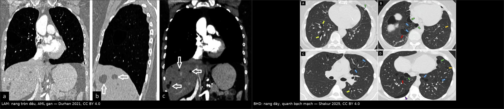
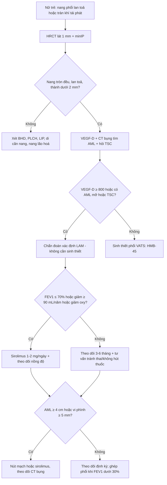
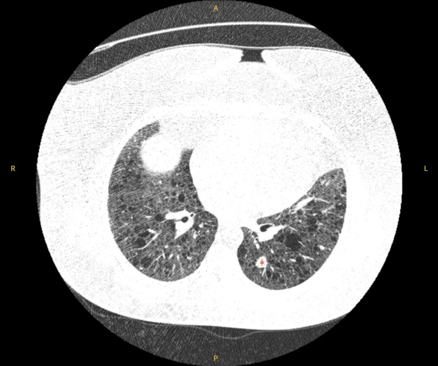
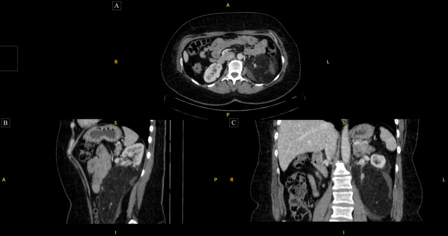
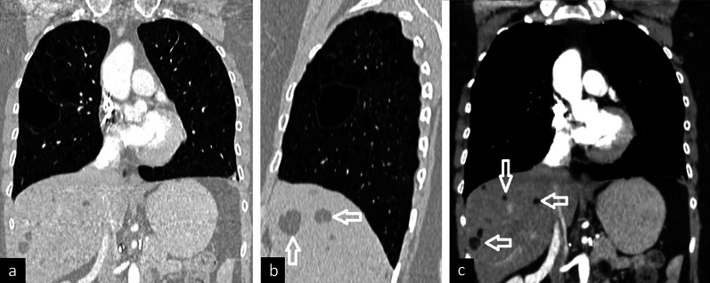

# 696 — LAM (lymphangioleiomyomatosis): nang phổi lan toả ở nữ tuổi sinh sản, VEGF-D & sirolimus

**Tags:** `pattern:nang-phoi` `vung:phoi` `anatomy:quanh-mach` `protocol:HRCT` `score:VEGF-D-800` `incidentaloma:nang-phoi`
**Mức chắc chắn (certainty):** tổng hợp y văn (literature synthesis) — tự biên từ khuyến cáo Hội Lao và Bệnh phổi Brazil 2025 (PMC11796567), bài tổng quan ảnh bệnh phổi bẩm sinh ở người lớn (PMC8557233) và loạt ca LAM 2025 (PMC12318564); **không** gắn một ca nguyên văn duy nhất cho toàn bài, nhưng phần quiz dùng **ca nguyên văn** của Conti 2025 và Durhan 2021 (ghi nguồn từng ảnh).

## 1. Tổng quan bệnh học – cơ chế hình ảnh

- **Bản chất:** **LAM (lymphangioleiomyomatosis)** là **u tăng sinh mô mềm mức độ thấp (low-grade neoplasm) có tiềm năng di căn**, đặc trưng bởi **tăng sinh tế bào cơ trơn không điển hình (LAM cells)** quanh **mạch máu, mạch bạch huyết và đường thở**, gây ra **nang phổi lan toả** (PMC11796567). Đây không phải bệnh viêm — đây là bệnh tân sinh, nên **ức chế mTOR là điều trị đặc hiệu**, không phải chống viêm.
- **Dịch tễ:** **3–5 ca/triệu phụ nữ** (ước tính của LAM Foundation); nghiên cứu 4 nước châu Âu gần đây cho **23,5 ca/triệu phụ nữ trưởng thành** — cao hơn nhiều vì **CT ngực được chỉ định rộng rãi hơn** (PMC11796567). **Xơ cứng củ (tuberous sclerosis complex — TSC)** có tỉ lệ **1/5.000–10.000** ca sinh; **26–50%** phụ nữ TSC có LAM phổi — **27% ở người dưới 21 tuổi, tăng tới 80% ở người trên 40 tuổi**; ở nam TSC, nang phổi gặp **10–38%** nhưng hiếm khi có triệu chứng. Thời gian **từ khởi triệu chứng đến chẩn đoán 3–5 năm**, thường ở **thập niên 3–4** (PMC11796567).
- **Di truyền – cơ chế phân tử:** mất chức năng **TSC1/TSC2** → **mTORC1 tăng hoạt** liên tục → LAM cell tăng sinh, tăng sinh mạch bạch huyết và **phá huỷ vách phế nang** nhờ metalloproteinase. Ở **LAM lẻ tẻ (sporadic LAM)**, đột biến TSC1/TSC2 xuất hiện **trong chính tế bào LAM** (đột biến soma), nên bệnh vẫn đáp ứng **sirolimus** dù không có TSC toàn thân (PMC11796567).
- **Biểu hiện lâm sàng (dùng để nhận ra trên phim):**
  - **Khó thở khi gắn sức** — triệu chứng chính, tiến triển âm thầm.
  - **Tràn khí màng phổi tự phát 30–50%** trong suốt bệnh trình, **tái phát tới 70%** (đây là cách vào viện hay gặp nhất ở nữ trẻ) (PMC11796567).
  - **Tràn dịch dưỡng trấp (chylothorax) 10–30%**, ho ra máu **20%**, dưỡng trấp đàm/tiểu/ổ bụng.
  - **U cơ mỡ mạch thận (renal angiomyolipoma — AML) khoảng 50%** ca LAM (**30–40%** ở LAM lẻ tẻ, **90%** ở LAM-TSC) — thường **hai bên, nhiều ổ**, có **mỡ**; nguy cơ chảy máu khi **≥ 4 cm** hoặc **vi phình mạch ≥ 5 mm** (PMC11796567).
  - **U cơ trơn bạch mạch (lymphangioleiomyoma)** vùng chậu – sau phúc mạc, có thể gây đau/chèn ép.
- **TẠI SAO tạo nang (mô bệnh → hình ảnh):** LAM cell phủ quanh tiểu phế quản → **hẹp lòng kiểu van một chiều** → khí bị giữ lại; đồng thời men phân huỷ **phá vách phế nang** → các khoang khí **hợp nhất thành nang tròn, thành rất mỏng (< 2 mm)**. Vì tổn thương **rải rác theo trục phế quản–mạch và màng phổi** chứ không theo vách liên tiểu thùy, nang LAM **phân bố lan toả, đối xứng, không ưu thế vùng** — đây là chốt hình ảnh phân biệt với **BHD** (nang ưu thế đáy, quanh bạch mạch) và **PLCH** (nang đỉnh–giữa, kèm nốt) (PMC11796567, PMC8557233).
- **TẠI SAO trông như vậy trên CT (vật lý):** khí trong nang **≈ −1.000 HU**, **thành nang là mô liên kết mỏng < 2 mm nhưng vẫn thấy được** — khác **khí phế thũng** (thành không xác định) và khác **bóng khí (bulla)** (thường > 1 cm, đỉnh phổi, thành rất mỏng, không có nang khắp phổi). Nhu mô xen giữa các nang **bình thường**; thể tích phổi **bình thường hoặc tăng** (không xẹp) (PMC11796567).
- **Dấu hiệu phối hợp trên CT:** **nốt kính mờ vi mô đa ổ (multifocal micronodular pneumocyte hyperplasia — MMPH)** — nốt đặc/kính mờ **2–14 mm**, phân bố **ngẫu nhiên** (đặc biệt TSC-LAM) — dễ đọc nhầm thành **lao kê/di căn** (PMC11796567, PMC12318564); **AML gan/thận** với **mỡ −20 đến −100 HU**; **tràn dịch dưỡng trấp** tỉ trọng dịch cao; **hạch/dịch dưỡng trấp** sau phúc mạc.
- **Ngưỡng định lượng bắt buộc (dùng trong quyết định):**
  - **Số nang:** **≥ 4 nang** đã đủ để **đi tìm bệnh nang lan toả**; **4–10 nang** là ngưỡng **nghi LAM** ở nữ có bệnh cảnh phù hợp (PMC11796567).
  - **VEGF-D (vascular endothelial growth factor-D) huyết thanh ≥ 800 pg/mL**: **độ đặc hiệu gần 100%** cho LAM, **có thể bỏ sinh thiết phổi** khi đã có HRCT điển hình (PMC11796567).
  - **Tốc độ giảm FEV₁: 47–135 mL/năm**; giảm nhanh hơn ở **LAM lẻ tẻ, VEGF-D cao, nang nhiều** (PMC11796567).
  - **Chỉ định sirolimus (mTOR inhibitor):** **FEV₁ ≤ 70% dự đoán**, **giảm FEV₁ ≥ 90 mL/năm**, hoặc **giảm oxy máu khi nghỉ/gắng sức**; cân nhắc khi **tràn khí tái phát**; **AML ≥ 4 cm**; **u bạch mạch/dịch dưỡng trấp có triệu chứng** (PMC11796567).
  - **Ghép phổi:** **FEV₁ < 30%**, giảm oxy khi nghỉ, **NYHA III–IV**, hoặc suy giảm chức năng dù đã điều trị (PMC11796567).

## 2. Mẫu hình + chẩn đoán phân biệt theo vị trí (gamut)

- **Mẫu hình chốt:** *nữ tuổi sinh sản, **nhiều nang tròn–bầu dục, thành mỏng đều < 2 mm, lan toả hai bên, đối xứng, không ưu thế vùng**, nhu mô xen giữa bình thường, thể tích phổi bình thường/tăng.*
- **Gamut theo phân bố nang (bệnh nang lan toả ở người lớn):**
  - **Lan toả, đối xứng, tròn đều:** **LAM**; **di căn phổi dạng nang** ( squamous/sarcoma — thường ít nang, thành dày hơn, có nốt đặc).
  - **Đáy + dưới màng phổi/cạnh trung thất, hình bất quy tắc, nang lớn nhất ≥ 2,1 cm:** **BHD/FLCN** (bài 697) — **không** có AML thận kiểu LAM (BHD có u thận thể chromophobe/oncocytoma, **không mỡ**).
  - **Đỉnh – giữa phổi, hình kỳ quái, kèm nốt/GGO, người hút thuốc:** **PLCH** (Langerhans cell histiocytosis).
  - **Dọc phế quản–mạch, có GGO/nốt, bệnh tự miễn (Sjögren), HIV:** **LIP** (lymphoid interstitial pneumonia).
  - **Vài nang ở người già, đáy, thành mỏng, không triệu chứng:** **nang do lão hoá** — **không** chẩn đoán bệnh nang lan toả.
- **Gamut theo bối cảnh lâm sàng:** nữ trẻ **tràn khí tái phát + nang lan toả** → LAM; **động kinh/chậm phát triển + u da + nang phổi** → TSC-LAM; **AML thận hai bên có mỡ** → gần như chốt LAM/TSC; **tràn dịch dưỡng trấp** → LAM (hoặc lymphoma/sarcoid — nhưng không có nang điển hình).
- **Mnemonic "LAM = Large Air spaces, All zones, Middle-aged women":** nang **L**ớn–**A**ll zones–**M**iddle-aged women; đối lập với **BHD = Bottom, Hilar, Diverse** và **PLCH = Peak, Nodules, Smoker**.

## 3. Bảng so sánh phân biệt (ma trận đối chiếu)

| Thực thể (entity) | Hình ảnh điển hình (HRCT) | Chốt vào (rule-in) | Chốt loại (rule-out) | Gợi ý xác nhận |
|---|---|---|---|---|
| **LAM** | Nang **tròn đều, thành < 2 mm, lan toả đối xứng** mọi vùng; nhu mô xen giữa bình thường; thể tích phổi ↑; có thể MMPH, AML | **Nang lan toả đối xứng + AML thận có mỡ + VEGF-D ≥ 800 pg/mL** | Nang **dẹt/bất quy tắc ưu thế đáy** hoặc nang lớn nhất **≥ 2,1 cm** → nghĩ BHD; nang kèm **nốt đỉnh** → PLCH | **VEGF-D**, CT bụng (AML), **HMB-45** nếu sinh thiết; TSC1/TSC2 |
| **BHD/FLCN (bài 697)** | Nang **ưu thế đáy**, **dưới màng phổi – cạnh trung thất – dọc vách liên tiểu thùy**, hình bất quy tắc, kích thước rất khác nhau; **tĩnh mạch xuyên nang** | **Nang lớn nhất ≥ 2,1 cm (Se 99%, Sp 82%) + phân bố quanh bạch mạch (chính xác 97%)** | Nang tròn đều lan toả đối xứng → LAM; có AML mỡ → LAM/TSC | Xét nghiệm **FLCN**; khám da; MRI thận |
| **PLCH** | Nang **đỉnh–giữa**, hình kỳ quái, thành không đều, **kèm nốt/GGO**; nang tồn tại khi nốt mất | **Nang kỳ quái vùng đỉnh + nốt + hút thuốc** | Nang đáy, không nốt → BHD; nang đối xứng tròn → LAM | HRCT, ngừng thuốc lá, sinh thiết (CD1a/Langerin) |
| **LIP** | Nang **thưa**, dọc **phế quản–mạch và dưới màng phổi**, có **vách trong nang**, kèm nốt/GGO | **Nang + GGO + nốt quanh trục mạch + bệnh tự miễn** | Không GGO, không nốt, nang đáy → BHD | Bệnh tự miễn (Sjögren), HIV, sinh thiết |
| **Di căn phổi dạng nang** | **Ít nang**, thành dày không đều, **nốt đặc đi kèm**, thường đáy/ngoại vi | **Tiền sử ung thư + nốt đặc + nang thành dày** | Nang thành mỏng đều, hàng trăm nang → LAM | So phim cũ, PET/CT, sinh thiết |
| **Nang do lão hoá** | **Vài nang, không đạt ngưỡng 4–10**, ở đáy, thành mỏng, nhu mô bình thường, không triệu chứng | **Tuổi cao + ít nang + không tiến triển** | Nang **lan toả, nhiều nang, tiến triển** → bệnh nang thật | So phim cũ 12–24 tháng |

*Trái: LAM — nang tròn đều lan toả, kèm **AML gan** (mũi tên) trên thì trước tiêm. Phải: BHD — nang **ưu thế đáy**, phân bố **quanh bạch mạch**, hình dạng rất khác nhau. Nguồn: Durhan G et al., Insights into Imaging 2021 (PMC8557233) Fig. 7, CC BY 4.0; Shakur A et al., Insights into Imaging 2025 (PMC12328879) Fig. 3, CC BY 4.0. Ảnh ghép letterbox, không crop.*

### Ba dấu hiệu quyết định trên một lát cắt
- **Phân bố:** LAM **mọi vùng** — BHD **đáy** — PLCH **đỉnh**.
- **Hình dạng:** LAM **tròn đều, cùng cỡ** — BHD **bất quy tắc, khác cỡ** — PLCH **kỳ quái, thành không đều**.
- **Nhu mô xen giữa:** LAM **bình thường** (hoặc MMPH thưa) — BHD **bình thường** — PLCH/LIP **có nốt/GGO**.

## 4. Protocol chụp + hệ phân độ/điểm chuẩn hoá

- **HRCT ngực (lát 1 mm, cửa sổ phổi):** **không cần cản quang**; chụp **thì hít vào tối đa**; dựng **MIP đảo (minIP)** coronal để đếm nang và thấy phân bố; ghi **số nang ước tính, đường kính nang lớn nhất (mm), phân bố (đáy/giữa/đỉnh), % nhu phổi bị thay thế** (PMC11796567).
- **CT/MRI bụng:** **bắt buộc tìm AML thận** ở mọi ca LAM mới — mỡ **−20 đến −100 HU** trong khối thận là chốt; đo **đường kính lớn nhất** và tìm **vi phình ≥ 5 mm** để quyết định can thiệp (PMC11796567).
- **Xét nghiệm máu:** **VEGF-D** trước mọi sinh thiết; **≥ 800 pg/mL** + HRCT điển hình → **chẩn đoán xác định, không cần mô học** (PMC11796567).
- **Mô học (khi VEGF-D thấp/HRCT không điển hình):** sinh thiết phổi **qua nội soi lồng ngực (VATS)** ưu tiên hơn sinh thiết xuyên phế quản; dấu **HMB-45** là **chuẩn vàng** (độ đặc hiệu cao, độ nhạy thay đổi nếu mẫu nhỏ) (PMC11796567).
- **Đánh giá chức năng & biến chứng:** **hô hấp ký + DLCO mỗi 3–6 tháng năm đầu, sau đó 6–12 tháng**; ngay lần đầu, **DLCO giảm ở 40–60%**, **air trapping 40–50%**, **rối loạn tắc nghẽn 30–50%**; **6MWT**; **siêu âm tim** tìm **tăng áp lực động mạch phổi (≤ 10%, thường nhẹ)**; **CT/MRI bụng theo dõi AML** (PMC11796567).
- **Điều trị sirolimus:** khởi đầu **1–2 mg/ngày**, **đo nồng độ thuốc sau 2 tuần, hằng tháng trong 3 tháng, sau đó mỗi 3 tháng**; dùng **liên tục, không ngừng khi ổn định** (ít nhất đến mãn kinh) vì **ngừng thuốc → FEV₁ giảm lại**; **everolimus** khi không dung nạp (PMC11796567).
- **Thai kỳ:** bệnh **có thể tiến triển** (FEV₁ trung bình **77% → 64%** sau sinh); nếu bệnh nặng, cân nhắc **sirolimus liều thấp ≤ 1 mg/ngày từ quý 2** (PMC11796567).
- **AML thận:** can thiệp khi **≥ 4 cm**, **phình mạch ≥ 5 mm**, tăng sinh mạch hoặc có triệu chứng — **nút mạch (embolization)** hoặc **sirolimus** (giảm **53% thể tích sau 12 tháng**) (PMC11796567).
- **Sơ đồ quyết định:**

## 5. Biến thể bình thường và cạm bẫy

- **"Vài nang" ở người lớn không phải LAM:** nang do lão hoá thường **vài nang, ở đáy**, thành mỏng, **không tiến triển**; chỉ **≥ 4 nang** mới đáng đi tìm bệnh nang lan toả, **4–10 nang** là vùng nghi ngờ (PMC11796567).
- **Nhầm LAM với BHD — sai lầm hay gặp nhất:** BHD nang **ưu thế đáy, dẹt/bất quy tắc, lớn nhất ≥ 2,1 cm**, có **tĩnh mạch xuyên nang**; LAM nang **tròn đều mọi vùng** (bài 697).
- **MMPH đọc nhầm thành lao kê/di căn:** nốt kính mờ vi mô **rải rác, không triệu chứng nhiễm trùng**, kèm nang LAM — đừng điều trị lao theo nốt (PMC12318564).
- **Kính mờ trong LAM không phải viêm phổi:** có thể do **ứ dưỡng trấp/phỳ mạch bạch huyết hoặc xuất huyết phế nang** — đọc kèm bối cảnh, không dùng kháng sinh mù (PMC11796567).
- **Tràn dịch dưỡng trấp bị gọi là mủ/lao:** dịch **đục như sữa**, **triglyceride cao**, cấy âm; ở nữ có nang phổi, nghĩ LAM ngay.
- **Bỏ sót AML "mỡ nghèo" (fat-poor):** AML thể **mỡ nghèo** có thể giống **RCC**; cần MRI (mỡ vi mô mất tín hiệu trên fat-sat) và theo dõi — **không sinh thiết mù** khối thận giàu mạch.
- **Tràn khí sau bay:** nguy cơ tràn khí ở nữ LAM **cao gấp 3 lần** sau chuyến bay — tư vấn trước khi đi máy bay, đặc biệt khi đã từng tràn khí (PMC11796567).
- **Thai kỳ:** **không coi là chống chỉ định tuyệt đối**, nhưng chức năng phổi giảm sau sinh — cần theo dõi sát và hội chẩn trước khi mang thai.
- **"Nang + tràn khí" ở nam giới:** **LAM gần như chỉ gặp ở nữ** (trừ TSC); nam có nang + tràn khí → nghĩ **BHD** trước tiên.

## 6. Tự lượng giá — Blind Quiz

**Ca 1 — Bệnh nhân nữ có nang phổi lan toả, HRCT dưới đây.**

- Gợi ý lâm sàng: nữ, không hút thuốc, không sốt; bài gốc không nêu chi tiết ngoài hình ảnh.
- Câu hỏi: mô tả nang (số lượng, thành, phân bố)? 3 chẩn đoán phân biệt? Hai xét nghiệm ít xâm lấn nhất để chốt?

<b>Bấm để hiện đáp án (findings + chẩn đoán)</b>

- Dấu hiệu: **hàng chục nang thành mỏng (< 2 mm), tròn đều, lan toả hai bên**, nhu mô xen giữa bình thường; có **nốt kính mờ vi mô** ở thùy dưới trái (dấu `*`) — **MMPH**.
- Chẩn đoán: **LAM** — nang tròn đều lan toả; ở nữ có tràn khí tái phát thì càng điển hình.
- Phân biệt: **BHD** (nang đáy, bất quy tắc, lớn ≥ 2,1 cm), **PLCH** (nang đỉnh + nốt, người hút thuốc), **LIP** (nang dọc trục mạch + GGO).
- Chốt: **VEGF-D huyết thanh ≥ 800 pg/mL** (đặc hiệu gần 100%) + **CT bụng tìm AML** — nếu đủ thì **không cần sinh thiết**.
- Nguồn ảnh: Conti L et al., *Cureus* 2025 (PMC12318564) Fig. 2, CC BY 4.0.

**Ca 2 — Cùng loạt ca, CT bụng của một bệnh nhân LAM. Ảnh dưới đây.**

- Gợi ý lâm sàng: khối thận trái lớn, tình cờ phát hiện khi chụp bụng.
- Câu hỏi: đậm độ khối? Chẩn đoán? Ngưỡng nào phải can thiệp? Vì sao khối này củng cố chẩn đoán phổi?

<b>Bấm để hiện đáp án (findings + chẩn đoán)</b>

- Dấu hiệu: **khối lớn thận trái, đậm độ hỗn hợp có vùng mỡ (thấp hơn mô mềm, âm HU)**, bờ không đều, không xâm lấn tĩnh mạch thận rõ — **AML**.
- Chẩn đoán: **AML thận** trong bệnh cảnh nang phổi → **LAM/TSC**; AML **có mỡ** cho phép chẩn đoán **bằng hình ảnh**, không cần sinh thiết.
- Ngưỡng can thiệp: **≥ 4 cm**, **vi phình ≥ 5 mm**, tăng sinh mạch hoặc có triệu chứng → **nút mạch** hoặc **sirolimus**.
- Vì sao củng cố: AML thận gặp ở **tới 50%** ca LAM và là **tiêu chuẩn ngoài phổi** giúp chốt chẩn đoán khi HRCT điển hình.
- Nguồn ảnh: Conti L et al., *Cureus* 2025 (PMC12318564) Fig. 3, CC BY 4.0.

**Ca 3 — Nữ 32 tuổi, khó thở nhẹ, CT ngực coronal dưới đây. Chẩn đoán và vì sao KHÔNG phải BHD?**

- Gợi ý lâm sàng: chưa tràn khí, chưa sinh thiết, đang chờ kết quả VEGF-D.
- Câu hỏi: mô tả nang và hai ổ giảm đậm độ ở gan? Dấu hiệu nào loại BHD? Bước tiếp theo?

<b>Bấm để hiện đáp án (findings + chẩn đoán)</b>

- Dấu hiệu: **nang thành mỏng lan toả, tròn đều, mọi vùng** (a, b); trên cửa sổ bụng (c) có **nhiều ổ mỡ trong gan** (mũi tên) — **AML gan**.
- Chẩn đoán: **LAM** (nang lan toả + AML gan). **BHD bị loại** vì nang BHD **ưu thế đáy, dẹt/bất quy tắc, lớn nhất ≥ 2,1 cm**, và BHD **không có AML mỡ** (u thận của BHD là chromophobe RCC/oncocytoma, không mỡ).
- Bước tiếp theo: **VEGF-D**; nếu < 800 → **sinh thiết phổi VATS** (HMB-45); đồng thời **đo chức năng hô hấp** để quyết định sirolimus.
- Nguồn ảnh: Durhan G et al., *Insights into Imaging* 2021 (PMC8557233) Fig. 7, CC BY 4.0.

## Bài liên quan chéo

- [697 – Hội chứng Birt–Hogg–Dubé (FLCN)](../697-hoi-chung-birt-hogg-dube-flcn/lesson.md) — đối cực "nang đáy" của LAM
- [698 – Nang phổi bẩm sinh CPAM/CCAM](../698-nang-phoi-bam-sinh-cpam-ccam/lesson.md) — nang một thùy ở trẻ, không phải bệnh nang lan toả
- [601 – Tràn khí màng phổi tự phát ở trẻ lớn & vị thành niên](../601-tran-khi-mang-phoi-tu-phat-tre-lon-vats/lesson.md) — xử trí tràn khí, ngưỡng tái phát
- [156 – Hội chứng di truyền u thận (VHL, BHD, TSC…)](../156-hoi-chung-di-truyen-u-than/lesson.md) — TSC và AML hai bên
- [150 – Nang thận & phân độ Bosniak](../150-nang-than-Bosniak/lesson.md) — phân biệt nang thận với AML
- [050 – Giãn phế quản & kén khí](../050-gian-phe-quan-ken-khi/lesson.md) — nang vs kén khí vs khí phế thũng

## Ảnh

- Tên file theo quy ước `NNN_slug_Modality_SourceID.jpg`; nguồn + giấy phép từng ảnh ở `images/CREDITS.md`.
- Cả 3 ảnh gốc và ảnh ghép đều **CC BY 4.0** — **không crop**, giữ nguyên mũi tên/dấu của tác giả.

> Không dùng để chẩn đoán độc lập khi chưa có người hướng dẫn.
